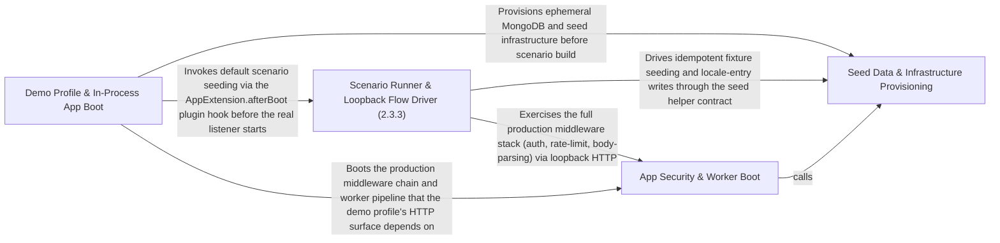

---
tags:
  - 2brain
  - 2brain/arch
  - project/boilerplate-node-backend
type: architecture
component: Scenario_Runner_Loopback_Flow_Driver
---

## Details

The core of the subsystem: the two entry points and the machinery that turns a named scenario into a live, seeded, historically-driven application. scenarios/index.ts owns the registry (buildScenario, isScenarioName, DEFAULT_SCENARIO) and the single legitimate order — seed first, then drive. scenarios/apply.ts boots the app in-process and applies the scenario; scenarios/run-server.ts does the same but then serves on NODE_PORT. The loopback driver listens on an ephemeral 127.0.0.1 port for the length of one seed, and the HTTP Caller plus the flow actions are the verbs the history is written in.

### Demo Profile & In-Process App Boot
The persistent demo server and the in-process app lifecycle it owns. run-server.ts is the npm run demo entry point: it configures a throwaway environment (loopback host, public token secrets, disabled Redis/RabbitMQ), starts an ephemeral or in-process MongoDB, and hands createApp a DemoExtension that mounts the __test/* control surface and pre-builds the default scenario before the real NODE_PORT listener starts. support/demo.ts (installDemo, restoreScenario, ScenarioCopy) keeps the built scenario in memory and replays it on every restore request, so the paired frontend's live-profile reset never re-seeds. The group also carries the app's job runner (appJobs, run), the mail spool (file-backed outbox for the log transport), and the lease helper that guards concurrent restores. This is the 'server that stays up' half of the subsystem, in contrast to apply.ts which is the 'seed once and exit' half.

**Related Classes/Methods**:

- `scenarios.support.demo.installDemo`:217-301
- `scenarios.support.demo.restoreScenario`:159-166
- `src.app.AppExtension`:88-101

**Source Files:**

- `scenarios/run-server.ts`
  - `scenarios.run-server.then() callback.then() callback.extension.install` (L238-L240) - Method
  - `scenarios.run-server.then() callback.then() callback.extension.afterBoot` (L241-L241) - Method
- `scenarios/support/demo.ts`
  - `scenarios.support.demo.ScenarioCopy` (L60-L65) - Interface
  - `scenarios.support.demo.then() callback.then() callback` (L102-L102) - Function
  - `scenarios.support.demo.restoreScenario` (L159-L166) - Class
  - `scenarios.support.demo.outcome.then() callback` (L162-L162) - Function
  - `scenarios.support.demo.jobLevers` (L208-L209) - Class
  - `scenarios.support.demo.jobLevers.jobs.map() callback` (L209-L209) - Function
  - `scenarios.support.demo.installDemo` (L217-L301) - Class
  - `scenarios.support.demo.installDemo.app.post('/__test/restore') callback` (L224-L242) - Function
  - `scenarios.support.demo.installDemo.app.post('/__test/restore') callback.then() callback` (L232-L232) - Function
  - `scenarios.support.demo.installDemo.app.post('/__test/restore') callback.catch() callback` (L233-L241) - Function
  - `scenarios.support.demo.installDemo.app.get('/__test/scenario') callback` (L244-L246) - Function
  - `scenarios.support.demo.installDemo.app.get('/__test/clock') callback` (L248-L252) - Function
  - `scenarios.support.demo.installDemo.app.post('/__test/clock') callback` (L254-L266) - Function
  - `scenarios.support.demo.installDemo.app.get('/__test/jobs') callback` (L268-L270) - Function
  - `scenarios.support.demo.installDemo.app.post('/__test/jobs/:name') callback` (L272-L293) - Function
  - `scenarios.support.demo.installDemo.app.post('/__test/jobs/:name') callback.then() callback` (L277-L287) - Function
  - `scenarios.support.demo.installDemo.app.post('/__test/jobs/:name') callback.then() callback.then() callback` (L284-L286) - Function
  - `scenarios.support.demo.installDemo.app.post('/__test/jobs/:name') callback.catch() callback` (L288-L292) - Function
  - `scenarios.support.demo.installDemo.app.get('/__test/emails') callback` (L298-L300) - Function
- `scripts/ops/prepare-job.ts`
  - `scripts.ops.prepare-job.runJobWork` (L36-L45) - Class
  - `scripts.ops.prepare-job.runJobWork.run` (L37-L37) - Class
  - `scripts.ops.prepare-job.runJobWork.run.then() callback` (L37-L37) - Function
  - `scripts.ops.prepare-job.runJobWork.withLease() callback` (L41-L41) - Function
  - `scripts.ops.prepare-job.runJobWork.withLease() callback.then() callback` (L41-L41) - Function
  - `scripts.ops.prepare-job.runJobWork.then() callback` (L41-L44) - Function
- `src/app.ts`
  - `src.app.AppInstance` (L59-L81) - Interface
  - `src.app.AppExtension` (L88-L101) - Interface
  - `src.app.AppOptions` (L104-L116) - Interface
  - `src.app.boot.then() callback` (L145-L145) - Function
  - `src.app.createApp.boot.then() callback` (L161-L161) - Function
  - `src.app.start.then() callback` (L175-L175) - Function
  - `src.app.createApp.start.then() callback` (L176-L197) - Function
  - `src.app.createApp.start.then() callback.then() callback` (L184-L196) - Function
  - `src.app.createApp.stop.shutdownInfra() callback` (L206-L207) - Function
  - `src.app.createApp.stop.finally() callback` (L208-L211) - Function
- `src/app/jobs.ts`
  - `src.app.jobs.appJobs` (L24-L65) - Class
  - `src.app.jobs.run` (L27-L37) - Method
  - `src.app.jobs.run.then() callback` (L33-L35) - Function
  - `src.app.jobs.appJobs.run` (L60-L63) - Method
  - `src.app.jobs.appJobs.run.then() callback` (L61-L63) - Function
- `src/infrastructure/adapters/filesystem.ts`
  - `src.infrastructure.adapters.filesystem.reapDirectory` (L149-L184) - Class
  - `src.infrastructure.adapters.filesystem.reapDirectory.catch() callback` (L151-L162) - Function
  - `src.infrastructure.adapters.filesystem.reapDirectory.then() callback` (L163-L183) - Function
  - `src.infrastructure.adapters.filesystem.reapDirectory.then() callback.entries.map() callback` (L165-L179) - Function
  - `src.infrastructure.adapters.filesystem.reapDirectory.then() callback.entries.map() callback.then() callback` (L168-L171) - Function
  - `src.infrastructure.adapters.filesystem.reapDirectory.then() callback.entries.map() callback.then() callback.then() callback` (L170-L170) - Function
  - `src.infrastructure.adapters.filesystem.reapDirectory.then() callback.entries.map() callback.catch() callback` (L173-L178) - Function
  - `src.infrastructure.adapters.filesystem.reapDirectory.then() callback.then() callback` (L180-L183) - Function
- `src/infrastructure/adapters/mail-spool.ts`
  - `src.infrastructure.adapters.mail-spool.reapSpooled` (L92-L93) - Class
  - `src.infrastructure.adapters.mail-spool.reapSpooled.then() callback` (L93-L93) - Function
- `src/infrastructure/persistence/lease.ts`
  - `src.infrastructure.persistence.lease.acquireLease` (L124-L139) - Class
  - `src.infrastructure.persistence.lease.acquireLease.then() callback` (L134-L134) - Function
  - `src.infrastructure.persistence.lease.acquireLease.catch() callback` (L135-L138) - Function
  - `src.infrastructure.persistence.lease.releaseLease` (L159-L191) - Class
  - `src.infrastructure.persistence.lease.releaseLease.catch() callback` (L180-L191) - Function
  - `src.infrastructure.persistence.lease.withLease` (L248-L266) - Class
  - `src.infrastructure.persistence.lease.withLease.then() callback` (L255-L265) - Function
  - `src.infrastructure.persistence.lease.withLease.then() callback.then() callback` (L260-L263) - Function
  - `src.infrastructure.persistence.lease.withLease.then() callback.then() callback.then() callback` (L261-L263) - Function
- `src/kernel/outbox.ts`
  - `src.kernel.outbox.settleOutboxNudges` (L508-L509) - Class
  - `src.kernel.outbox.settleOutboxNudges.then() callback` (L509-L509) - Function
- `src/kernel/registry.ts`
  - `src.kernel.registry.JobDeclaration` (L249-L277) - Interface
- `src/modules/account/jobs.ts`
  - `src.modules.account.jobs.accountJobs` (L37-L67) - Class
  - `src.modules.account.jobs.run.then() callback` (L47-L50) - Function
  - `src.modules.account.jobs.accountJobs.run.then() callback` (L56-L59) - Function
- `src/modules/delivery/jobs.ts`
  - `src.modules.delivery.jobs.deliveryJobs` (L16-L32) - Class
  - `src.modules.delivery.jobs.run` (L19-L22) - Method
  - `src.modules.delivery.jobs.run.then() callback` (L21-L21) - Function
  - `src.modules.delivery.jobs.deliveryJobs.run` (L26-L29) - Method
  - `src.modules.delivery.jobs.deliveryJobs.run.then() callback` (L27-L29) - Function
- `src/modules/inventory/jobs.ts`
  - `src.modules.inventory.jobs.inventoryJobs` (L14-L22) - Class
  - `src.modules.inventory.jobs.inventoryJobs.run` (L17-L17) - Method
- `src/modules/invoicing/jobs.ts`
  - `src.modules.invoicing.jobs.invoicingJobs` (L17-L37) - Class
  - `src.modules.invoicing.jobs.run` (L21-L26) - Method
  - `src.modules.invoicing.jobs.run.then() callback` (L23-L25) - Function
  - `src.modules.invoicing.jobs.invoicingJobs.run` (L32-L35) - Method
  - `src.modules.invoicing.jobs.invoicingJobs.run.then() callback` (L33-L35) - Function
- `src/modules/invoicing/services/retention.ts`
  - `src.modules.invoicing.services.retention.BuyerErasureReport` (L18-L21) - Interface
  - `src.modules.invoicing.services.retention.eraseKind` (L32-L54) - Class
  - `src.modules.invoicing.services.retention.eraseKind.then() callback.candidates.filter() callback` (L36-L36) - Function
  - `src.modules.invoicing.services.retention.eraseKind.then() callback` (L38-L53) - Function
  - `src.modules.invoicing.services.retention.eraseKind.then() callback.due.map() callback` (L44-L44) - Function
  - `src.modules.invoicing.services.retention.eraseKind.then() callback.then() callback` (L47-L52) - Function
  - `src.modules.invoicing.services.retention.eraseKind.then() callback.then() callback.due.map() callback` (L49-L50) - Function
  - `src.modules.invoicing.services.retention.eraseKind.then() callback.then() callback.then() callback` (L52-L52) - Function
  - `src.modules.invoicing.services.retention.eraseDueBuyers` (L62-L68) - Class
  - `src.modules.invoicing.services.retention.eraseDueBuyers.then() callback` (L67-L67) - Function
- `src/modules/notifications/services/stream.ts`
  - `src.modules.notifications.services.stream.openStreamCount` (L56-L57) - Class
  - `src.modules.notifications.services.stream.openStreamCount.reduce() callback` (L57-L57) - Function
  - `src.modules.notifications.services.stream.streamNotifications.heartbeat` (L82-L84) - Class
  - `src.modules.notifications.services.stream.streamNotifications.heartbeat.setInterval() callback` (L82-L84) - Function
- `src/modules/orders/jobs.ts`
  - `src.modules.orders.jobs.ordersJobs` (L14-L21) - Class
  - `src.modules.orders.jobs.ordersJobs.run` (L18-L19) - Method
  - `src.modules.orders.jobs.ordersJobs.run.then() callback.then() callback` (L19-L19) - Function
- `src/modules/payments/jobs.ts`
  - `src.modules.payments.jobs.paymentsJobs` (L15-L27) - Class
  - `src.modules.payments.jobs.run` (L18-L18) - Method
  - `src.modules.payments.jobs.paymentsJobs.run` (L22-L22) - Method
  - `src.modules.payments.jobs.paymentsJobs.run.then() callback` (L22-L22) - Function
- `src/modules/returns/jobs.ts`
  - `src.modules.returns.jobs.returnsJobs` (L13-L18) - Class
  - `src.modules.returns.jobs.returnsJobs.run` (L16-L16) - Method
- `src/modules/shop-tasks/jobs.ts`
  - `src.modules.shop-tasks.jobs.digestJob` (L16-L23) - Class
  - `src.modules.shop-tasks.jobs.digestJob.run` (L18-L21) - Method
  - `src.modules.shop-tasks.jobs.digestJob.run.then() callback` (L19-L21) - Function
- `src/modules/stock-alerts/jobs.ts`
  - `src.modules.stock-alerts.jobs.stockAlertsJobs` (L16-L25) - Class
  - `src.modules.stock-alerts.jobs.stockAlertsJobs.run` (L19-L22) - Method
  - `src.modules.stock-alerts.jobs.stockAlertsJobs.run.then() callback` (L20-L22) - Function
- `src/modules/tasks/jobs.ts`
  - `src.modules.tasks.jobs.tasksJobs` (L15-L28) - Class
  - `src.modules.tasks.jobs.tasksJobs.run` (L18-L24) - Method
  - `src.modules.tasks.jobs.tasksJobs.run.then() callback` (L21-L23) - Function
- `src/modules/users/jobs.ts`
  - `src.modules.users.jobs.usersJobs` (L15-L25) - Class
  - `src.modules.users.jobs.usersJobs.run` (L18-L22) - Method
  - `src.modules.users.jobs.usersJobs.run.then() callback` (L19-L22) - Function
- `src/modules/webhooks/jobs.ts`
  - `src.modules.webhooks.jobs.webhooksJobs` (L13-L18) - Class
  - `src.modules.webhooks.jobs.webhooksJobs.run` (L16-L16) - Method

### Seed Data & Infrastructure Provisioning
The data and infrastructure that must exist before any scenario can be seeded. This group owns the ephemeral MongoDB lifecycle (startEphemeralMongo, startInProcessMongod) that gives the demo profile and apply.ts a disposable database; the database bootstrap scripts (bootstrap-access creates the initial admin/role rows, index-sync reconciles Mongoose indexes against the live collection); the locale-entry seed driver (driveLocaleEntryEdit) that writes locale rows through the API so they carry audit entries; the seed-image generator (generate-seed-images) that produces the placeholder product/user images referenced by the catalogue fixtures; and the email/seed-value helpers. It also includes the scenarios/locales.ts scenario file and the scenarios/seed.ts contract (SeedOutcome) that every scenario's seed() must satisfy. This is the 'make the world exist' layer: without it, buildScenario has no database to write into and no rows to drive against.

**Related Classes/Methods**:

- `scenarios.support.ephemeral-mongo.startEphemeralMongo`:73-86
- `scenarios.locales.driveLocaleEntryEdit`:247-256
- `scenarios.tools.generate-seed-images.main`:149-174
- `scripts.db.bootstrap-access.main`:26-31

**Source Files:**

- `scenarios/locales.ts`
  - `scenarios.locales.localeEntryFixtures.LOCALE_ENTRIES.map() callback` (L209-L216) - Function
  - `scenarios.locales.localeEntryFixtures` (L209-L217) - Class
  - `scenarios.locales.driveLocaleEntryEdit` (L247-L256) - Class
  - `scenarios.locales.driveLocaleEntryEdit.then() callback` (L256-L256) - Function
- `scenarios/support/ephemeral-mongo.ts`
  - `scenarios.support.ephemeral-mongo.startEphemeralMongo` (L73-L86) - Class
  - `scenarios.support.ephemeral-mongo.startEphemeralMongo.stop` (L80-L80) - Method
- `scenarios/tools/generate-seed-images.ts`
  - `scenarios.tools.generate-seed-images.ImageEntry` (L36-L39) - Interface
  - `scenarios.tools.generate-seed-images.main` (L149-L174) - Class
  - `scenarios.tools.generate-seed-images.written.map() callback` (L160-L160) - Function
  - `scenarios.tools.generate-seed-images.main.written.map() callback` (L164-L164) - Function
  - `scenarios.tools.generate-seed-images.catch() callback` (L177-L180) - Function
- `scripts/db/bootstrap-access.ts`
  - `scripts.db.bootstrap-access.main` (L26-L31) - Class
  - `scripts.db.bootstrap-access.then() callback` (L28-L28) - Function
  - `scripts.db.bootstrap-access.main.then() callback` (L29-L31) - Function
- `scripts/db/index-sync.ts`
  - `scripts.db.index-sync.ReplacedIndex` (L33-L38) - Interface
  - `scripts.db.index-sync.IndexDiff` (L43-L56) - Interface
  - `scripts.db.index-sync.IndexSyncOptions` (L61-L64) - Interface
  - `scripts.db.index-sync.RegisteredModel` (L86-L95) - Interface
  - `scripts.db.index-sync.UniqueIndex` (L100-L107) - Interface
  - `scripts.db.index-sync.findDuplicates.$match.keys.map() callback` (L161-L161) - Function
  - `scripts.db.index-sync.findDuplicates.$group._id.keys.map() callback` (L167-L167) - Function
  - `scripts.db.index-sync.findBlockingDuplicates.pending` (L199-L207) - Class
  - `scripts.db.index-sync.findBlockingDuplicates.pending.plan.flatMap() callback` (L202-L205) - Function
  - `scripts.db.index-sync.findBlockingDuplicates.pending.plan.flatMap() callback.toReplace.map() callback` (L203-L203) - Function
  - `scripts.db.index-sync.findBlockingDuplicates.pending.plan.flatMap() callback.map() callback` (L204-L204) - Function
  - `scripts.db.index-sync.classify.storedKeyOf` (L270-L274) - Class
  - `scripts.db.index-sync.classify.storedKeyOf.stored.flatMap() callback` (L271-L272) - Function
  - `scripts.db.index-sync.applyIndexSync` (L342-L375) - Class
  - `scripts.db.index-sync.applyIndexSync.blocking.map() callback` (L349-L349) - Function
  - `scripts.db.index-sync.applyIndexSync.modelOf` (L353-L353) - Class
  - `scripts.db.index-sync.applyIndexSync.modelOf.map() callback` (L353-L353) - Function
  - `scripts.db.index-sync.applyIndexSync.plan.filter() callback` (L355-L355) - Function
- `scripts/db/sync-indexes.ts`
  - `scripts.db.sync-indexes.describe` (L38-L53) - Class
  - `scripts.db.sync-indexes.describe.toCreate.map() callback` (L48-L48) - Function
  - `scripts.db.sync-indexes.describe.toReplace.map() callback` (L49-L49) - Function
  - `scripts.db.sync-indexes.describe.toDropRetired.map() callback` (L50-L50) - Function
  - `scripts.db.sync-indexes.describe.toDropUndeclared.map() callback` (L51-L51) - Function
  - `scripts.db.sync-indexes.describe.kept.map() callback` (L52-L52) - Function
  - `scripts.db.sync-indexes.report` (L56-L63) - Class
  - `scripts.db.sync-indexes.report.plan.map() callback` (L62-L62) - Function
  - `scripts.db.sync-indexes.sync` (L66-L93) - Class
  - `scripts.db.sync-indexes.sync.plan.some() callback` (L88-L88) - Function
  - `scripts.db.sync-indexes.runScript() callback` (L98-L98) - Function
- `src/infrastructure/adapters/logger.ts`
  - `src.infrastructure.adapters.logger.Logger.info` (L46-L46) - Method
- `src/modules/account/emails.ts`
  - `src.modules.account.emails.resetRequestEmail` (L155-L167) - Class
  - `src.modules.account.emails.resetRequestEmail.body` (L160-L165) - Method
- `src/modules/account/services/export.ts`
  - `src.modules.account.services.export.readOwnExport` (L227-L235) - Class
  - `src.modules.account.services.export.readOwnExport.then() callback` (L228-L235) - Function
- `src/modules/account/services/password-reset-request.ts`
  - `src.modules.account.services.password-reset-request.mailResetLink` (L64-L84) - Class
  - `src.modules.account.services.password-reset-request.mailResetLink.then() callback` (L65-L84) - Function
  - `src.modules.account.services.password-reset-request.mailResetLink.then() callback.then() callback` (L68-L83) - Function
  - `src.modules.account.services.password-reset-request.requestPasswordReset.attempt` (L108-L112) - Class
  - `src.modules.account.services.password-reset-request.requestPasswordReset.attempt.then() callback` (L111-L111) - Function
  - `src.modules.account.services.password-reset-request.requestPasswordReset.attempt.catch() callback` (L118-L123) - Function
- `src/modules/account/services/reap-inactive.ts`
  - `src.modules.account.services.reap-inactive.minimiseStage` (L49-L53) - Class
  - `src.modules.account.services.reap-inactive.minimiseStage.then() callback` (L50-L53) - Function
- `src/modules/delivery/services/retention.ts`
  - `src.modules.delivery.services.retention.scrubHoldNotes` (L25-L33) - Class
  - `src.modules.delivery.services.retention.scrubHoldNotes.then() callback` (L28-L33) - Function
  - `src.modules.delivery.services.retention.scrubLostNotes` (L42-L50) - Class
  - `src.modules.delivery.services.retention.scrubLostNotes.then() callback` (L45-L50) - Function
- `src/modules/orders/services/crud.ts`
  - `src.modules.orders.services.crud.lineLimitRefusal` (L34-L54) - Class
  - `src.modules.orders.services.crud.lineLimitRefusal.items.some() callback` (L45-L45) - Function
- `src/modules/orders/services/retention.ts`
  - `src.modules.orders.services.retention.detachUserId` (L25-L30) - Class
  - `src.modules.orders.services.retention.detachUserId.then() callback` (L26-L30) - Function
  - `src.modules.orders.services.retention.startOrderPiiClock` (L39-L48) - Class
  - `src.modules.orders.services.retention.startOrderPiiClock.then() callback` (L40-L48) - Function
  - `src.modules.orders.services.retention.anonymizeDueOrders` (L56-L68) - Class
  - `src.modules.orders.services.retention.anonymizeDueOrders.then() callback` (L62-L68) - Function
  - `src.modules.orders.services.retention.cancelUnpaidOrders` (L80-L103) - Class
  - `src.modules.orders.services.retention.cancelUnpaidOrders.orderIds.map() callback` (L82-L101) - Function
  - `src.modules.orders.services.retention.cancelUnpaidOrders.orderIds.map() callback.then() callback` (L84-L92) - Function
  - `src.modules.orders.services.retention.cancelUnpaidOrders.orderIds.map() callback.catch() callback` (L93-L101) - Function
  - `src.modules.orders.services.retention.cancelUnpaidOrders.then() callback` (L103-L103) - Function
  - `src.modules.orders.services.retention.eraseUserOrders` (L119-L129) - Class
  - `src.modules.orders.services.retention.eraseUserOrders.then() callback` (L123-L128) - Function
  - `src.modules.orders.services.retention.then() callback.then() callback` (L127-L127) - Function
  - `src.modules.orders.services.retention.eraseUserOrders.then() callback.then() callback` (L128-L128) - Function
- `src/modules/orders/services/timeline.ts`
  - `src.modules.orders.services.timeline.clearTimelineActor` (L250-L251) - Class
  - `src.modules.orders.services.timeline.clearTimelineActor.then() callback` (L251-L251) - Function
  - `src.modules.orders.services.timeline.scrubTimelineText` (L259-L267) - Class
  - `src.modules.orders.services.timeline.scrubTimelineText.then() callback` (L262-L267) - Function
- `src/modules/payments/domain/transfer-reference.ts`
  - `src.modules.payments.domain.transfer-reference.numericStringFor` (L37-L38) - Class
  - `src.modules.payments.domain.transfer-reference.numericStringFor.value.replaceAll() callback` (L38-L38) - Function
- `src/modules/payments/services/retention.ts`
  - `src.modules.payments.services.retention.detachUserId` (L25-L35) - Class
  - `src.modules.payments.services.retention.detachUserId.then() callback` (L26-L35) - Function
  - `src.modules.payments.services.retention.toExportPayment.refunds.payment.refunds.map() callback` (L66-L75) - Function
  - `src.modules.payments.services.retention.reapAbandonedPayments` (L102-L115) - Class
  - `src.modules.payments.services.retention.reapAbandonedPayments.then() callback` (L108-L114) - Function
- `src/modules/returns/services/retention.ts`
  - `src.modules.returns.services.retention.scrubReturnText` (L22-L30) - Class
  - `src.modules.returns.services.retention.scrubReturnText.then() callback` (L25-L30) - Function
- `src/modules/webhooks/services/attempt.ts`
  - `src.modules.webhooks.services.attempt.announceAutoDisable` (L40-L57) - Class
  - `src.modules.webhooks.services.attempt.announceAutoDisable.then() callback` (L56-L56) - Function
  - `src.modules.webhooks.services.attempt.recordExhaustion` (L123-L158) - Class
  - `src.modules.webhooks.services.attempt.recordExhaustion.then() callback` (L140-L157) - Function
  - `src.modules.webhooks.services.attempt.recordExhaustion.then() callback.then() callback` (L144-L156) - Function
  - `src.modules.webhooks.services.attempt.recordExhaustion.then() callback.then() callback.then() callback` (L151-L154) - Function
  - `src.modules.webhooks.services.attempt.recordExhaustion.then() callback.then() callback.then() callback.then() callback` (L153-L153) - Function
- `src/modules/webhooks/services/sweep.ts`
  - `src.modules.webhooks.services.sweep.publishOrSend` (L41-L46) - Class
  - `src.modules.webhooks.services.sweep.publishOrSend.then() callback` (L42-L45) - Function
  - `src.modules.webhooks.services.sweep.publishOrSend.then() callback.then() callback` (L45-L45) - Function
  - `src.modules.webhooks.services.sweep.handleInGroups` (L55-L69) - Class
  - `src.modules.webhooks.services.sweep.handleInGroups.group.map() callback` (L59-L59) - Function
  - `src.modules.webhooks.services.sweep.handleInGroups.then() callback` (L59-L68) - Function
  - `src.modules.webhooks.services.sweep.handleInGroups.then() callback.failed.outcomes.filter() callback` (L60-L60) - Function
  - `src.modules.webhooks.services.sweep.then() callback.failed` (L60-L60) - Class
  - `src.modules.webhooks.services.sweep.sweepDueWebhookDeliveries` (L76-L81) - Class
  - `src.modules.webhooks.services.sweep.sweepDueWebhookDeliveries.then() callback` (L77-L81) - Function

### Scenario Runner & Loopback Flow Driver (2.3.3)
The core of the subsystem: the two entry points and the machinery that turns a named scenario into a live, seeded, historically-driven application. scenarios/index.ts owns the registry (SCENARIOS table, buildScenario, isScenarioName, DEFAULT_SCENARIO) and enforces the single legitimate order — seed first, then drive. scenarios/apply.ts is the one-shot CLI: it boots the app in-process (bootAppInProcess), optionally resets the database, calls buildScenario, and exits. scenarios/run-server.ts does the same but then serves on NODE_PORT for the paired frontend. The loopback driver (withLoopbackServer in flows/loopback.ts) listens on an ephemeral 127.0.0.1 port for the length of one seed, so the flows exercise the real middleware stack without publishing a port. The HTTP Caller (flows/client.ts) is the authenticated actor that issues requests; the verb-level actions (flows/actions.ts: checkout, receiveStock, submitCard, shipOrder, holdOrder, cancelOrder, requestReturn, etc.) are the verbs the history is written in. flows/shop-history.ts is the shop scenario's order book — the concrete sequence of checkouts, payments, shipments, refunds, and cancellations that gives the demo a believable past. flows/backdate.ts rewrites the date columns on every order, payment, shipment, reservation, stock-movement, and audit row so the dataset spans weeks rather than seconds. support/database-snapshot.ts provides the snapshot/restore primitives the demo profile uses to replay the scenario.

**Related Classes/Methods**:

- `scenarios.index.buildScenario`:98-115
- `scenarios.apply.bootAppInProcess`:118-123
- `scenarios.flows.loopback.withLoopbackServer`:25-47
- `scenarios.flows.backdate.mover`:37-54

**Source Files:**

- `scenarios/apply.ts`
  - `scenarios.apply.bootAppInProcess` (L118-L123) - Class
  - `scenarios.apply.bootAppInProcess.then() callback` (L119-L123) - Function
  - `scenarios.apply.bootAppInProcess.then() callback.then() callback` (L122-L122) - Function
  - `scenarios.apply.seed` (L126-L204) - Function
  - `scenarios.apply.runScript() callback` (L234-L234) - Function
  - `scenarios.apply.then() callback` (L234-L235) - Function
- `scenarios/flows/actions.ts`
  - `scenarios.flows.actions.cancelRemainder.then() callback.open.fulfillmentOrders.find() callback` (L330-L331) - Function
  - `scenarios.flows.actions.cancelRemainder.then() callback.open` (L330-L332) - Class
  - `scenarios.flows.actions.cancelRemainder.then() callback.open.fulfillmentOrders.find() callback.lines.some() callback` (L331-L331) - Function
- `scenarios/flows/backdate.ts`
  - `scenarios.flows.backdate.mover` (L37-L54) - Class
  - `scenarios.flows.backdate.mover.<function>` (L39-L54) - Function
  - `scenarios.flows.backdate.TRAILS` (L66-L98) - Class
  - `scenarios.flows.backdate.TRAILS.mover() callback` (L97-L97) - Function
  - `scenarios.flows.backdate.shiftStage` (L108-L119) - Class
  - `scenarios.flows.backdate.shiftStage.dates.map() callback` (L110-L118) - Function
- `scenarios/flows/client.ts`
  - `scenarios.flows.client.Problem` (L17-L19) - Interface
  - `scenarios.flows.client.Attempt` (L25-L33) - Interface
  - `scenarios.flows.client.Caller` (L58-L74) - Interface
  - `scenarios.flows.client.readAttempt` (L77-L94) - Class
  - `scenarios.flows.client.readAttempt.then() callback.errorMessages.map() callback` (L85-L85) - Function
  - `scenarios.flows.client.readAttempt.then() callback` (L88-L93) - Function
- `scenarios/flows/loopback.ts`
  - `scenarios.flows.loopback.withLoopbackServer` (L25-L47) - Class
  - `scenarios.flows.loopback.withLoopbackServer.<function>` (L29-L39) - Function
  - `scenarios.flows.loopback.withLoopbackServer.<function>.server` (L30-L37) - Class
  - `scenarios.flows.loopback.withLoopbackServer.<function>.server.app.listen('127.0.0.1') callback` (L30-L37) - Function
  - `scenarios.flows.loopback.withLoopbackServer.<function>.server.app.listen('127.0.0.1') callback.close` (L35-L35) - Method
  - `scenarios.flows.loopback.withLoopbackServer.<function>.server.app.listen('127.0.0.1') callback.close.<function>` (L35-L35) - Function
  - `scenarios.flows.loopback.withLoopbackServer.<function>.server.app.listen('127.0.0.1') callback.close.<function>.server.close() callback` (L35-L35) - Function
  - `scenarios.flows.loopback.withLoopbackServer.then() callback` (L39-L46) - Function
  - `scenarios.flows.loopback.then() callback.then() callback.then() callback` (L41-L41) - Function
  - `scenarios.flows.loopback.withLoopbackServer.then() callback.then() callback` (L42-L45) - Function
  - `scenarios.flows.loopback.withLoopbackServer.then() callback.then() callback.then() callback` (L43-L45) - Function
- `scenarios/index.ts`
  - `scenarios.index.Scenario` (L28-L42) - Interface
  - `scenarios.index.buildScenario` (L98-L115) - Class
  - `scenarios.index.then() callback` (L110-L111) - Function
  - `scenarios.index.buildScenario.then() callback.withoutHumanChallenge() callback` (L111-L111) - Function
  - `scenarios.index.buildScenario.then() callback` (L113-L113) - Function
- `scenarios/run-server.ts`
  - `scenarios.run-server.poll.then() callback` (L152-L152) - Function
  - `scenarios.run-server.then() callback` (L164-L249) - Function
  - `scenarios.run-server.then() callback.process.once() callback.catch() callback` (L174-L178) - Function
  - `scenarios.run-server.then() callback.process.once() callback.then() callback` (L179-L179) - Function
  - `scenarios.run-server.catch() callback` (L250-L253) - Function
- `scenarios/support/database-snapshot.ts`
  - `scenarios.support.database-snapshot.emptyDatabase` (L28-L31) - Class
  - `scenarios.support.database-snapshot.emptyDatabase.map() callback` (L30-L30) - Function
  - `scenarios.support.database-snapshot.emptyDatabase.then() callback` (L31-L31) - Function
  - `scenarios.support.database-snapshot.captureDatabase` (L64-L72) - Class
  - `scenarios.support.database-snapshot.captureDatabase.map() callback` (L66-L70) - Function
  - `scenarios.support.database-snapshot.captureDatabase.map() callback.then() callback` (L70-L70) - Function
  - `scenarios.support.database-snapshot.captureDatabase.then() callback` (L72-L72) - Function
  - `scenarios.support.database-snapshot.restoreDatabaseCopy` (L85-L96) - Class
  - `scenarios.support.database-snapshot.restoreDatabaseCopy.then() callback.filter() callback` (L90-L90) - Function
  - `scenarios.support.database-snapshot.restoreDatabaseCopy.then() callback.map() callback` (L91-L92) - Function
  - `scenarios.support.database-snapshot.restoreDatabaseCopy.then() callback` (L96-L96) - Function
- `scenarios/support/demo-clock.ts`
  - `scenarios.support.demo-clock.DemoClock` (L21-L35) - Interface
  - `scenarios.support.demo-clock.installDemoClock` (L64-L87) - Class
  - `scenarios.support.demo-clock.installDemoClock.uninstall` (L74-L74) - Method
  - `scenarios.support.demo-clock.installDemoClock.now` (L75-L75) - Method
  - `scenarios.support.demo-clock.installDemoClock.offsetMs` (L76-L76) - Method
  - `scenarios.support.demo-clock.installDemoClock.advance` (L77-L82) - Method
  - `scenarios.support.demo-clock.installDemoClock.reset` (L83-L85) - Method
- `scenarios/support/demo.ts`
  - `scenarios.support.demo.UnknownScenarioError` (L52-L57) - Class
  - `scenarios.support.demo.UnknownScenarioError.constructor` (L54-L56) - Constructor
  - `scenarios.support.demo.buildOnce` (L93-L110) - Class
  - `scenarios.support.demo.buildOnce.then() callback` (L94-L110) - Function
  - `scenarios.support.demo.buildOnce.then() callback.then() callback` (L103-L108) - Function
  - `scenarios.support.demo.buildOnce.then() callback.then() callback.then() callback` (L104-L108) - Function
  - `scenarios.support.demo.runRestore` (L129-L145) - Class
  - `scenarios.support.demo.runRestore.then() callback.then() callback` (L132-L134) - Function
  - `scenarios.support.demo.runRestore.then() callback` (L145-L145) - Function
  - `scenarios.support.demo.restoreScenario.outcome` (L160-L160) - Class
  - `scenarios.support.demo.restoreScenario.outcome.restoreQueue.then() callback` (L160-L160) - Function
  - `scenarios.support.demo.restoreScenario.outcome.then() callback` (L163-L163) - Function
- `scripts/db/cache-clear.ts`
  - `scripts.db.cache-clear.runScript() callback` (L46-L46) - Function
- `scripts/db/index-sync.ts`
  - `scripts.db.index-sync.uniqueIndexes` (L132-L142) - Class
  - `scripts.db.index-sync.uniqueIndexes.flatMap() callback` (L133-L141) - Function
  - `scripts.db.index-sync.uniqueIndexes.flatMap() callback.filter() callback` (L136-L136) - Function
  - `scripts.db.index-sync.uniqueIndexes.flatMap() callback.map() callback` (L137-L141) - Function
  - `scripts.db.index-sync.storedIndexesOf` (L242-L250) - Class
  - `scripts.db.index-sync.storedIndexesOf.catch() callback` (L247-L250) - Function
  - `scripts.db.index-sync.classify.at` (L282-L282) - Class
  - `scripts.db.index-sync.classify.at.created.findIndex() callback` (L282-L282) - Function
  - `scripts.db.index-sync.applyIndexSync.drops` (L359-L363) - Class
  - `scripts.db.index-sync.applyIndexSync.drops.diff.toReplace.map() callback` (L360-L360) - Function
- `scripts/scaffold/demo-remove-validation-labels.ts`
  - `scripts.scaffold.demo-remove-validation-labels.contractsIn` (L27-L32) - Class
  - `scripts.scaffold.demo-remove-validation-labels.contractsIn.filter() callback` (L30-L30) - Function
  - `scripts.scaffold.demo-remove-validation-labels.contractsIn.map() callback` (L31-L31) - Function
  - `scripts.scaffold.demo-remove-validation-labels.requestFields` (L88-L99) - Class
  - `scripts.scaffold.demo-remove-validation-labels.requestFields.eachObject() callback` (L92-L97) - Function
  - `scripts.scaffold.demo-remove-validation-labels.anyFields` (L105-L112) - Class
  - `scripts.scaffold.demo-remove-validation-labels.anyFields.eachObject() callback` (L107-L110) - Function
  - `scripts.scaffold.demo-remove-validation-labels.readRemovedFields.surviving` (L128-L132) - Class
  - `scripts.scaffold.demo-remove-validation-labels.readRemovedFields.surviving.flatMap() callback` (L129-L130) - Function
  - `scripts.scaffold.demo-remove-validation-labels.readRemovedFields.removed` (L133-L133) - Class
  - `scripts.scaffold.demo-remove-validation-labels.readRemovedFields.removed.names.flatMap() callback` (L133-L133) - Function
- `src/infrastructure/adapters/cache.ts`
  - `src.infrastructure.adapters.cache.clearCache` (L402-L434) - Class
  - `src.infrastructure.adapters.cache.clearCache.then() callback` (L405-L419) - Function
  - `src.infrastructure.adapters.cache.clearCache.then() callback.then() callback` (L415-L418) - Function
  - `src.infrastructure.adapters.cache.clearCache.catch() callback` (L420-L434) - Function
- `src/infrastructure/http/middlewares/rate-limit-store.ts`
  - `src.infrastructure.http.middlewares.rate-limit-store.resetMemoryRateLimitCounters` (L218-L220) - Class
  - `src.infrastructure.http.middlewares.rate-limit-store.resetMemoryRateLimitCounters.map() callback` (L219-L219) - Function
- `src/infrastructure/i18n/overrides.ts`
  - `src.infrastructure.i18n.overrides.LocaleOverlay` (L19-L31) - Interface
  - `src.infrastructure.i18n.overrides.refreshLocaleOverrides` (L132-L147) - Class
  - `src.infrastructure.i18n.overrides.refreshLocaleOverrides.then() callback` (L136-L136) - Function
  - `src.infrastructure.i18n.overrides.refreshLocaleOverrides.catch() callback` (L137-L146) - Function
  - `src.infrastructure.i18n.overrides.startLocaleOverrideRefresh` (L172-L177) - Class
  - `src.infrastructure.i18n.overrides.startLocaleOverrideRefresh.setInterval() callback` (L175-L175) - Function
- `src/infrastructure/i18n/served.ts`
  - `src.infrastructure.i18n.served.draftLocaleFor` (L68-L71) - Class
  - `src.infrastructure.i18n.served.draftLocaleFor.find() callback` (L70-L70) - Function

### App Security & Worker Boot
The cross-cutting app infrastructure that the in-process boot installs before any scenario can be driven: the security middleware chain (installSecurity, installRequestParsing, isRawBodyPath) that enforces Helmet, CORS, rate-limiting, and request-body parsing on every request the loopback flows make; the worker/consumer registration (registerWorkers, resolveConsumers, resolveImageTargets) that wires the RabbitMQ consumers and the image-writeback resolver into the app's event pipeline; the mailer adapter (EmailContent) and queue infrastructure that the log transport exercises during seeding; and the shared primitives (ids, content-type) that the security and worker layers depend on. This group is the 'make the app behave like production' layer: without it, the loopback flows would hit a bare Express app with no auth, no rate limiting, no worker dispatch, and no mail pipeline — and the audit entries, domain events, and actor scopes that the flows depend on would never be produced.

**Related Classes/Methods**:

- `src.app.security.installSecurity`:103-230
- `src.app.workers.registerWorkers`:29-67
- `src.kernel.registry.resolveConsumers`:579-580
- `src.app.security.installRequestParsing`:238-299

**Source Files:**

- `src/app/security.ts`
  - `src.app.security.isRawBodyPath` (L51-L57) - Class
  - `src.app.security.isRawBodyPath.RAW_BODY_PATHS.some() callback` (L54-L55) - Function
  - `src.app.security.installSecurity` (L103-L230) - Class
  - `src.app.security.installSecurity.app.use() callback` (L143-L146) - Function
  - `src.app.security.installRequestParsing` (L238-L299) - Class
  - `src.app.security.installRequestParsing.jsonParser` (L251-L267) - Class
  - `src.app.security.installRequestParsing.jsonParser.verify` (L260-L266) - Method
  - `src.app.security.installRequestParsing.app.use() callback` (L289-L290) - Function
- `src/app/workers.ts`
  - `src.app.workers.registerWorkers` (L29-L67) - Class
  - `src.app.workers.registerWorkers.registerImageWritebackResolver() callback` (L37-L37) - Function
  - `src.app.workers.registerWorkers.map() callback` (L62-L62) - Function
  - `src.app.workers.registerWorkers.then() callback` (L63-L66) - Function
- `src/infrastructure/adapters/image.worker.ts`
  - `src.infrastructure.adapters.image.worker.DigestedImageUrls` (L76-L81) - Interface
  - `src.infrastructure.adapters.image.worker.then() callback.then() callback` (L146-L147) - Function
  - `src.infrastructure.adapters.image.worker.then() callback.clearQuarantine.then() callback` (L211-L211) - Function
  - `src.infrastructure.adapters.image.worker.enqueueImageDigest` (L286-L315) - Class
  - `src.infrastructure.adapters.image.worker.enqueueImageDigest.then() callback` (L307-L314) - Function
- `src/infrastructure/adapters/logger.ts`
  - `src.infrastructure.adapters.logger.Logger` (L41-L56) - Interface
  - `src.infrastructure.adapters.logger.Logger.debug` (L43-L43) - Method
  - `src.infrastructure.adapters.logger.Logger.log` (L55-L55) - Method
- `src/infrastructure/adapters/mailer.ts`
  - `src.infrastructure.adapters.mailer.ResolvedAttachment` (L41-L44) - Interface
  - `src.infrastructure.adapters.mailer.withSpan('email.send') callback.then() callback` (L175-L181) - Function
  - `src.infrastructure.adapters.mailer.EmailContent` (L202-L214) - Interface
  - `src.infrastructure.adapters.mailer.enqueueEmail.dispatch` (L270-L290) - Class
  - `src.infrastructure.adapters.mailer.enqueueEmail.dispatch.then() callback` (L276-L290) - Function
  - `src.infrastructure.adapters.mailer.enqueueEmail.dispatch.catch() callback` (L296-L304) - Function
- `src/infrastructure/adapters/queue.ts`
  - `src.infrastructure.adapters.queue.parkedCounts` (L477-L501) - Class
  - `src.infrastructure.adapters.queue.parkedCounts.then() callback` (L483-L498) - Function
  - `src.infrastructure.adapters.queue.parkedCounts.then() callback.map() callback` (L485-L488) - Function
  - `src.infrastructure.adapters.queue.parkedCounts.then() callback.map() callback.then() callback` (L488-L488) - Function
  - `src.infrastructure.adapters.queue.parkedCounts.then() callback.then() callback` (L491-L494) - Function
  - `src.infrastructure.adapters.queue.parkedCounts.then() callback.then() callback.results.flatMap() callback` (L492-L493) - Function
  - `src.infrastructure.adapters.queue.parkedCounts.then() callback.finally() callback` (L496-L498) - Function
  - `src.infrastructure.adapters.queue.parkedCounts.then() callback.finally() callback.catch() callback` (L497-L497) - Function
  - `src.infrastructure.adapters.queue.parkedCounts.catch() callback` (L500-L500) - Function
  - `src.infrastructure.adapters.queue.assertJobQueue` (L579-L621) - Class
  - `src.infrastructure.adapters.queue.assertJobQueue.then() callback` (L620-L620) - Function
  - `src.infrastructure.adapters.queue.publishToQueue` (L667-L715) - Class
  - `src.infrastructure.adapters.queue.publishToQueue.then() callback` (L677-L709) - Function
  - `src.infrastructure.adapters.queue.publishToQueue.then() callback.<function>` (L678-L709) - Function
  - `src.infrastructure.adapters.queue.publishToQueue.then() callback.<function>.ch.sendToQueue() callback` (L702-L707) - Function
  - `src.infrastructure.adapters.queue.publishToQueue.catch() callback` (L711-L714) - Function
  - `src.infrastructure.adapters.queue.bindConsumer` (L981-L1013) - Class
  - `src.infrastructure.adapters.queue.bindConsumer.then() callback.ch.consume() callback` (L1000-L1006) - Function
  - `src.infrastructure.adapters.queue.bindConsumer.then() callback` (L1009-L1011) - Function
  - `src.infrastructure.adapters.queue.consumeFromQueue` (L1047-L1053) - Class
  - `src.infrastructure.adapters.queue.consumeFromQueue.consumerBindings.set() callback` (L1050-L1050) - Function
- `src/infrastructure/http/ids.ts`
  - `src.infrastructure.http.ids.carriedAt` (L211-L224) - Class
  - `src.infrastructure.http.ids.carriedAt.value.flatMap() callback` (L217-L218) - Function
  - `src.infrastructure.http.ids.malformedIdIssues` (L237-L248) - Class
  - `src.infrastructure.http.ids.malformedIdIssues.flatMap() callback` (L243-L243) - Function
  - `src.infrastructure.http.ids.malformedIdIssues.filter() callback` (L245-L246) - Function
  - `src.infrastructure.http.ids.malformedIdIssues.map() callback` (L248-L248) - Function
- `src/infrastructure/http/middlewares/content-type.ts`
  - `src.infrastructure.http.middlewares.content-type.declaredOperation` (L49-L54) - Class
  - `src.infrastructure.http.middlewares.content-type.declaredOperation.operations.find() callback` (L54-L54) - Function
  - `src.infrastructure.http.middlewares.content-type.requireDeclaredContentType` (L68-L97) - Class
  - `src.infrastructure.http.middlewares.content-type.requireDeclaredContentType.<function>` (L71-L96) - Function
- `src/infrastructure/http/middlewares/method-not-allowed.ts`
  - `src.infrastructure.http.middlewares.method-not-allowed.answerOptions` (L126-L156) - Class
  - `src.infrastructure.http.middlewares.method-not-allowed.answerOptions.<function>` (L131-L155) - Function
- `src/infrastructure/http/middlewares/request-logger.ts`
  - `src.infrastructure.http.middlewares.request-logger.requestLogger` (L16-L41) - Class
  - `src.infrastructure.http.middlewares.request-logger.requestLogger.response.once('finish') callback` (L20-L38) - Function
- `src/infrastructure/http/validation-messages.ts`
  - `src.infrastructure.http.validation-messages.registerValidationMessages` (L154-L157) - Class
  - `src.infrastructure.http.validation-messages.registerValidationMessages.customError` (L156-L156) - Method
- `src/infrastructure/observability/analytics/umami.ts`
  - `src.infrastructure.observability.analytics.umami.umamiAnalyticsProvider.capture` (L87-L150) - Method
- `src/kernel/registry.ts`
  - `src.kernel.registry.resolveImageTargets` (L560-L568) - Class
  - `src.kernel.registry.resolveImageTargets.appModules.flatMap() callback` (L566-L566) - Function
  - `src.kernel.registry.resolveConsumers` (L579-L580) - Class
  - `src.kernel.registry.resolveConsumers.appModules.flatMap() callback` (L580-L580) - Function
- `src/modules/account/services/export-rows.ts`
  - `src.modules.account.services.export-rows.removeRow` (L20-L21) - Class
  - `src.modules.account.services.export-rows.removeRow.then() callback` (L21-L21) - Function
  - `src.modules.account.services.export-rows.reapExpiredExports` (L32-L44) - Class
  - `src.modules.account.services.export-rows.reapExpiredExports.drain` (L33-L39) - Class
  - `src.modules.account.services.export-rows.reapExpiredExports.drain.then() callback` (L34-L39) - Function
  - `src.modules.account.services.export-rows.reapExpiredExports.drain.then() callback.due.map() callback` (L36-L36) - Function
  - `src.modules.account.services.export-rows.reapExpiredExports.drain.then() callback.then() callback` (L36-L37) - Function
  - `src.modules.account.services.export-rows.reapExpiredExports.then() callback` (L41-L42) - Function
  - `src.modules.account.services.export-rows.reapExpiredExports.then() callback.then() callback` (L42-L42) - Function
- `src/modules/account/services/export.ts`
  - `src.modules.account.services.export.insertRow` (L85-L108) - Class
  - `src.modules.account.services.export.insertRow.then() callback` (L99-L106) - Function
  - `src.modules.account.services.export.insertRow.then() callback.then() callback` (L101-L105) - Function
  - `src.modules.account.services.export.dispatch` (L115-L134) - Class
  - `src.modules.account.services.export.dispatch.then() callback` (L119-L134) - Function
  - `src.modules.account.services.export.rowOrRefusal` (L153-L168) - Class
  - `src.modules.account.services.export.rowOrRefusal.then() callback` (L158-L168) - Function
  - `src.modules.account.services.export.rowOrRefusal.then() callback.then() callback` (L164-L166) - Function
  - `src.modules.account.services.export.rowOrRefusal.then() callback.then() callback.then() callback` (L166-L166) - Function
  - `src.modules.account.services.export.requestExport` (L187-L218) - Class
  - `src.modules.account.services.export.requestExport.withOwnAccount() callback` (L193-L215) - Function
  - `src.modules.account.services.export.requestExport.withOwnAccount() callback.then() callback` (L194-L215) - Function
  - `src.modules.account.services.export.requestExport.withOwnAccount() callback.then() callback.then() callback` (L212-L213) - Function
