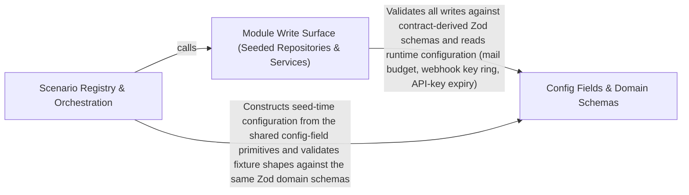

---
tags:
  - 2brain
  - 2brain/arch
  - project/boilerplate-node-backend
type: architecture
component: Scenario_Seed_Core_Registry
---

## Details

The heart of the subsystem — the domain-agnostic seeding primitive plus the per-module fixture tables and the scenario registry that orders them. scenarios/seed.ts defines the repository shape (SeedRepository / OwnedSeedRepository) and the two idempotent writers (insertIfAbsent by pinned _id, insertIfAbsentForOwner by userId for carts/wishlists/address books). Each module file exposes a seed*Collection that maps its fixture table through those primitives. scenarios/index.ts is the registry: seedShop sequences the access model first, then runInWaves over shopModules, and buildScenario composes seed → drive → backdate.

### Module Write Surface (Seeded Repositories & Services)
The production module layer the seeders write through: the per-module repositories and services (addresses, webhooks, api-keys, example, products, account) that expose the create/findById/findByUserId slice the seeding primitives consume, plus the domain services that the driven flows exercise. This is the bounded-context implementation the scenario layer depends on one-directionally — the seeders never import each other, only these repositories/services. It is the write surface that insertIfAbsent and the flow runner both reach, and it is what a production image ships while the scenario folder is omitted.

**Related Classes/Methods**:

- `src.modules.addresses.repository.addressBookRepository.create`:136-144
- `src.modules.example.services.cover.applyCover`:44-69
- `src.modules.api-keys.services.api-keys.mint`:156-211
- `src.modules.webhooks.secrets.activeRingSecrets`:107-111

**Source Files:**

- `src/modules/addresses/repository.ts`
  - `src.modules.addresses.repository.addressBookRepository.create` (L136-L144) - Method
- `src/modules/addresses/service.ts`
  - `src.modules.addresses.service.addressUpdate` (L56-L65) - Class
  - `src.modules.addresses.service.addressUpdate.then() callback` (L61-L65) - Function
- `src/modules/api-keys/services/api-keys.ts`
  - `src.modules.api-keys.services.api-keys.notifyMinted.then() callback` (L82-L101) - Function
  - `src.modules.api-keys.services.api-keys.mint` (L156-L211) - Class
  - `src.modules.api-keys.services.api-keys.mint.invalid` (L166-L166) - Class
  - `src.modules.api-keys.services.api-keys.mint.invalid.body.permissions.filter() callback` (L166-L166) - Function
  - `src.modules.api-keys.services.api-keys.mint.then() callback` (L194-L210) - Function
  - `src.modules.api-keys.services.api-keys.revoke` (L220-L240) - Class
  - `src.modules.api-keys.services.api-keys.revoke.then() callback` (L224-L240) - Function
  - `src.modules.api-keys.services.api-keys.revoke.then() callback.then() callback` (L230-L239) - Function
  - `src.modules.api-keys.services.api-keys.notifyRevoked.then() callback.mail.revoked.map() callback` (L262-L262) - Function
- `src/modules/example/repository.ts`
  - `src.modules.example.repository.exampleRepository.findScoped` (L64-L64) - Method
- `src/modules/example/services/cover.ts`
  - `src.modules.example.services.cover.applyCover` (L44-L69) - Class
  - `src.modules.example.services.cover.then() callback` (L55-L56) - Function
  - `src.modules.example.services.cover.applyCover.then() callback.then() callback` (L58-L58) - Function
  - `src.modules.example.services.cover.applyCover.then() callback` (L68-L68) - Function
  - `src.modules.example.services.cover.setCover` (L80-L93) - Class
  - `src.modules.example.services.cover.setCover.then() callback` (L87-L93) - Function
  - `src.modules.example.services.cover.setCover.then() callback.then() callback` (L91-L91) - Function
- `src/modules/example/services/crud.ts`
  - `src.modules.example.services.crud.create` (L96-L124) - Class
  - `src.modules.example.services.crud.create.then() callback` (L123-L123) - Function
  - `src.modules.example.services.crud.getById` (L133-L136) - Class
  - `src.modules.example.services.crud.getById.then() callback` (L136-L136) - Function
  - `src.modules.example.services.crud.getPublishedById` (L145-L148) - Class
  - `src.modules.example.services.crud.getPublishedById.then() callback` (L148-L148) - Function
  - `src.modules.example.services.crud.applyUpdate` (L230-L275) - Class
  - `src.modules.example.services.crud.applyUpdate.then() callback` (L263-L273) - Function
  - `src.modules.example.services.crud.applyUpdate.then() callback.then() callback` (L269-L272) - Function
  - `src.modules.example.services.crud.update` (L289-L304) - Class
  - `src.modules.example.services.crud.update.then() callback` (L297-L303) - Function
  - `src.modules.example.services.crud.update.then() callback.then() callback` (L301-L301) - Function
  - `src.modules.example.services.crud.deleteLoaded` (L312-L327) - Class
  - `src.modules.example.services.crud.deleteLoaded.then() callback` (L319-L327) - Function
  - `src.modules.example.services.crud.remove` (L337-L347) - Class
  - `src.modules.example.services.crud.remove.then() callback` (L341-L347) - Function
  - `src.modules.example.services.crud.remove.then() callback.then() callback` (L345-L345) - Function
- `src/modules/example/services/owner.ts`
  - `src.modules.example.services.owner.presentWithOwner` (L42-L43) - Class
  - `src.modules.example.services.owner.presentWithOwner.then() callback` (L43-L43) - Function
- `src/modules/locales/controllers/create-locale.ts`
  - `src.modules.locales.controllers.create-locale.createLocale` (L25-L48) - Class
  - `src.modules.locales.controllers.create-locale.createLocale.then() callback` (L41-L46) - Function
- `src/modules/locales/controllers/delete-locale.ts`
  - `src.modules.locales.controllers.delete-locale.deleteLocale` (L19-L27) - Class
  - `src.modules.locales.controllers.delete-locale.deleteLocale.then() callback` (L22-L26) - Function
- `src/modules/locales/controllers/get-entity-translations.ts`
  - `src.modules.locales.controllers.get-entity-translations.getEntityTranslations` (L18-L36) - Class
  - `src.modules.locales.controllers.get-entity-translations.getEntityTranslations.then() callback` (L30-L34) - Function
- `src/modules/locales/controllers/get-locale-entries.ts`
  - `src.modules.locales.controllers.get-locale-entries.listEntries` (L50-L70) - Class
  - `src.modules.locales.controllers.get-locale-entries.listEntries.then() callback` (L63-L68) - Function
- `src/modules/locales/controllers/get-locale-messages.ts`
  - `src.modules.locales.controllers.get-locale-messages.getLocaleMessages` (L19-L39) - Class
  - `src.modules.locales.controllers.get-locale-messages.getLocaleMessages.then() callback` (L33-L36) - Function
- `src/modules/locales/controllers/get-locales.ts`
  - `src.modules.locales.controllers.get-locales.getLocales` (L21-L26) - Class
  - `src.modules.locales.controllers.get-locales.getLocales.then() callback` (L25-L25) - Function
- `src/modules/locales/controllers/write-entity-translations.ts`
  - `src.modules.locales.controllers.write-entity-translations.writeEntityTranslations` (L33-L68) - Class
  - `src.modules.locales.controllers.write-entity-translations.writeEntityTranslations.<function>` (L44-L68) - Function
  - `src.modules.locales.controllers.write-entity-translations.writeEntityTranslations.<function>.then() callback` (L62-L66) - Function
- `src/modules/locales/controllers/write-locale-entries.ts`
  - `src.modules.locales.controllers.write-locale-entries.createLocaleEntry` (L38-L58) - Class
  - `src.modules.locales.controllers.write-locale-entries.createLocaleEntry.then() callback` (L47-L56) - Function
  - `src.modules.locales.controllers.write-locale-entries.importEntries` (L105-L132) - Class
  - `src.modules.locales.controllers.write-locale-entries.importEntries.<function>` (L107-L132) - Function
  - `src.modules.locales.controllers.write-locale-entries.importEntries.<function>.then() callback` (L126-L130) - Function
- `src/modules/locales/services/entries.ts`
  - `src.modules.locales.services.entries.findEntryInLanguage` (L43-L50) - Class
  - `src.modules.locales.services.entries.findEntryInLanguage.then() callback` (L50-L50) - Function
  - `src.modules.locales.services.entries.searchEntries` (L58-L81) - Class
  - `src.modules.locales.services.entries.searchEntries.then() callback` (L67-L81) - Function
  - `src.modules.locales.services.entries.searchEntries.then() callback.then() callback` (L80-L80) - Function
  - `src.modules.locales.services.entries.updateEntry` (L138-L170) - Class
  - `src.modules.locales.services.entries.updateEntry.then() callback` (L148-L169) - Function
  - `src.modules.locales.services.entries.updateEntry.then() callback.then() callback` (L153-L168) - Function
  - `src.modules.locales.services.entries.deleteEntry` (L178-L205) - Class
  - `src.modules.locales.services.entries.deleteEntry.then() callback` (L187-L204) - Function
  - `src.modules.locales.services.entries.deleteEntry.then() callback.then() callback` (L191-L203) - Function
- `src/modules/locales/services/languages.ts`
  - `src.modules.locales.services.languages.createLanguage` (L49-L80) - Class
  - `src.modules.locales.services.languages.createLanguage.then() callback` (L57-L79) - Function
  - `src.modules.locales.services.languages.createLanguage.then() callback.then() callback` (L68-L78) - Function
  - `src.modules.locales.services.languages.updateLanguage` (L88-L120) - Class
  - `src.modules.locales.services.languages.updateLanguage.then() callback` (L93-L120) - Function
  - `src.modules.locales.services.languages.updateLanguage.then() callback.then() callback` (L106-L119) - Function
  - `src.modules.locales.services.languages.deleteLanguage` (L128-L157) - Class
  - `src.modules.locales.services.languages.deleteLanguage.then() callback` (L134-L157) - Function
  - `src.modules.locales.services.languages.deleteLanguage.then() callback.then() callback` (L144-L156) - Function
- `src/modules/locales/services/translations.ts`
  - `src.modules.locales.services.translations.EntityTranslationsResult` (L38-L44) - Interface
  - `src.modules.locales.services.translations.planSlot` (L85-L136) - Class
  - `src.modules.locales.services.translations.planSlot.then() callback` (L128-L135) - Function
  - `src.modules.locales.services.translations.planForPort` (L247-L263) - Class
  - `src.modules.locales.services.translations.planForPort.then() callback` (L251-L262) - Function
  - `src.modules.locales.services.translations.planForPort.then() callback.planned.plan.planned.map() callback` (L257-L260) - Function
  - `src.modules.locales.services.translations.writeForPort` (L269-L288) - Class
  - `src.modules.locales.services.translations.writeForPort.writePlan.planned.map() callback` (L281-L284) - Function
  - `src.modules.locales.services.translations.applyTranslationBatch.metadata.upserted.map() callback` (L341-L341) - Function
  - `src.modules.locales.services.translations.applyTranslationBatch.metadata.upserted.planned.filter() callback` (L341-L341) - Function
  - `src.modules.locales.services.translations.applyTranslationBatch.metadata.deleted.map() callback` (L342-L342) - Function
  - `src.modules.locales.services.translations.applyTranslationBatch.metadata.deleted.planned.filter() callback` (L342-L342) - Function
  - `src.modules.locales.services.translations.getEntityTranslations` (L423-L438) - Class
  - `src.modules.locales.services.translations.getEntityTranslations.then() callback` (L430-L436) - Function
- `src/modules/returns/services/create.ts`
  - `src.modules.returns.services.create.writeWithdrawalRecord` (L86-L130) - Class
  - `src.modules.returns.services.create.writeWithdrawalRecord.then() callback` (L125-L129) - Function
  - `src.modules.returns.services.create.withdrawBeforeDispatch` (L148-L169) - Class
  - `src.modules.returns.services.create.withdrawBeforeDispatch.then() callback` (L156-L169) - Function
  - `src.modules.returns.services.create.withdrawBeforeDispatch.then() callback.then() callback` (L164-L167) - Function
  - `src.modules.returns.services.create.withdrawBeforeDispatch.then() callback.then() callback.then() callback` (L167-L167) - Function
  - `src.modules.returns.services.create.createReturn` (L371-L379) - Class
- `src/modules/returns/services/decide.ts`
  - `src.modules.returns.services.decide.notDecidable` (L36-L46) - Class
  - `src.modules.returns.services.decide.notDecidable.then() callback` (L37-L45) - Function
  - `src.modules.returns.services.decide.settleDecision` (L154-L182) - Class
  - `src.modules.returns.services.decide.settleDecision.then() callback` (L175-L180) - Function
- `src/modules/returns/services/ownership.ts`
  - `src.modules.returns.services.ownership.ownOrder` (L17-L23) - Class
  - `src.modules.returns.services.ownership.ownOrder.then() callback` (L23-L23) - Function
- `src/modules/returns/services/read.ts`
  - `src.modules.returns.services.read.ReturnFilters` (L27-L33) - Interface
  - `src.modules.returns.services.read.BuyerStanding` (L42-L47) - Interface
  - `src.modules.returns.services.read.withActions` (L81-L88) - Class
  - `src.modules.returns.services.read.withActions.then() callback` (L85-L88) - Function
  - `src.modules.returns.services.read.listReturns` (L97-L109) - Class
  - `src.modules.returns.services.read.listReturns.then() callback` (L108-L108) - Function
  - `src.modules.returns.services.read.getReturn` (L118-L132) - Class
  - `src.modules.returns.services.read.getReturn.then() callback` (L122-L132) - Function
  - `src.modules.returns.services.read.then() callback.then() callback` (L125-L125) - Function
  - `src.modules.returns.services.read.getReturn.then() callback.then() callback` (L127-L130) - Function
  - `src.modules.returns.services.read.getReturn.then() callback.then() callback.then() callback` (L129-L129) - Function
- `src/modules/returns/services/receive.ts`
  - `src.modules.returns.services.receive.receiveFor` (L240-L280) - Class
  - `src.modules.returns.services.receive.receiveFor.then() callback` (L248-L279) - Function
  - `src.modules.returns.services.receive.receiveFor.then() callback.received.lines.map() callback` (L262-L262) - Function
  - `src.modules.returns.services.receive.receiveFor.then() callback.then() callback` (L278-L278) - Function
  - `src.modules.returns.services.receive.receiveReturn` (L290-L308) - Class
  - `src.modules.returns.services.receive.receiveReturn.then() callback` (L295-L308) - Function
  - `src.modules.returns.services.receive.receiveReturn.then() callback.then() callback` (L299-L307) - Function
  - `src.modules.returns.services.receive.receiveReturn.then() callback.then() callback.then() callback` (L306-L306) - Function
- `src/modules/webhooks/secrets.ts`
  - `src.modules.webhooks.secrets.liveRingEntries` (L86-L96) - Class
  - `src.modules.webhooks.secrets.liveRingEntries.ring.filter() callback` (L92-L94) - Function
  - `src.modules.webhooks.secrets.activeRingSecrets` (L107-L111) - Class
  - `src.modules.webhooks.secrets.activeRingSecrets.map() callback` (L111-L111) - Function
  - `src.modules.webhooks.secrets.removeRingSecret` (L114-L117) - Class
  - `src.modules.webhooks.secrets.removeRingSecret.ring.filter() callback` (L117-L117) - Function
- `src/modules/webhooks/services/reencrypt.ts`
  - `src.modules.webhooks.services.reencrypt.fieldsOf` (L14-L20) - Class
  - `src.modules.webhooks.services.reencrypt.fieldsOf.subscription.secrets.map() callback` (L15-L20) - Function
- `src/modules/webhooks/services/subscriptions.ts`
  - `src.modules.webhooks.services.subscriptions.SubscriptionWithMintedSecrets` (L37-L43) - Interface
  - `src.modules.webhooks.services.subscriptions.refuseUnsafeUrl` (L56-L70) - Class
  - `src.modules.webhooks.services.subscriptions.refuseUnsafeUrl.then() callback` (L58-L58) - Function
  - `src.modules.webhooks.services.subscriptions.refuseUnsafeUrl.catch() callback` (L59-L70) - Function
  - `src.modules.webhooks.services.subscriptions.rollbackOverCap` (L119-L122) - Class
  - `src.modules.webhooks.services.subscriptions.rollbackOverCap.then() callback` (L122-L122) - Function
  - `src.modules.webhooks.services.subscriptions.create` (L166-L197) - Class
  - `src.modules.webhooks.services.subscriptions.create.then() callback` (L174-L196) - Function
  - `src.modules.webhooks.services.subscriptions.create.then() callback.then() callback` (L195-L195) - Function
  - `src.modules.webhooks.services.subscriptions.update` (L205-L251) - Class
  - `src.modules.webhooks.services.subscriptions.update.then() callback` (L212-L251) - Function
  - `src.modules.webhooks.services.subscriptions.update.then() callback.then() callback` (L242-L250) - Function
  - `src.modules.webhooks.services.subscriptions.rotateSecret` (L260-L286) - Class
  - `src.modules.webhooks.services.subscriptions.rotateSecret.then() callback` (L266-L286) - Function
  - `src.modules.webhooks.services.subscriptions.rotateSecret.then() callback.then() callback` (L277-L285) - Function
  - `src.modules.webhooks.services.subscriptions.removeSecret` (L295-L326) - Class
  - `src.modules.webhooks.services.subscriptions.removeSecret.then() callback` (L302-L326) - Function
  - `src.modules.webhooks.services.subscriptions.removeSecret.then() callback.then() callback` (L317-L325) - Function
  - `src.modules.webhooks.services.subscriptions.remove` (L329-L347) - Class
  - `src.modules.webhooks.services.subscriptions.remove.then() callback` (L335-L347) - Function
  - `src.modules.webhooks.services.subscriptions.remove.then() callback.then() callback` (L338-L346) - Function

### Scenario Registry & Orchestration
The heart of the subsystem: the domain-agnostic seeding primitive, the per-module fixture tables, and the registry that orders them. It owns the repository shape and the two idempotent writers, the shopModules fixture table with its after/baseline/driveHistoryEdit scheduling metadata, the wave scheduler, and the SCENARIOS registry that composes seed → drive → backdate. This is the single place a new scenario is added, and the only layer that knows the legitimate ordering of the three steps.

**Related Classes/Methods**:

- `scenarios.seed.insertIfAbsent`:60-64
- `scenarios.seed.insertIfAbsentForOwner`:76-80
- `scenarios.index.seedShop`:40-43

**Source Files:**

- `scenarios/accounts.ts`
  - `scenarios.accounts.seedAccessModel` (L198-L221) - Class
  - `scenarios.accounts.seedAccessModel.then() callback.map() callback` (L213-L213) - Function
  - `scenarios.accounts.seedAccessModel.then() callback` (L221-L221) - Function
- `scenarios/addresses.ts`
  - `scenarios.addresses.seedAddressBooksCollection` (L103-L106) - Class
  - `scenarios.addresses.seedAddressBooksCollection.addressBookFixtures.map() callback` (L105-L105) - Function
- `scenarios/blank.ts`
  - `scenarios.blank.seedBlank` (L24-L32) - Class
  - `scenarios.blank.then() callback` (L26-L30) - Function
  - `scenarios.blank.seedBlank.then() callback` (L32-L32) - Function
- `scenarios/example.ts`
  - `scenarios.example.seedExampleCollection` (L70-L71) - Class
  - `scenarios.example.seedExampleCollection.exampleFixtures.map() callback` (L71-L71) - Function
- `scenarios/index.ts`
  - `scenarios.index.seedShop` (L40-L43) - Class
  - `scenarios.index.seedShop.then() callback` (L43-L43) - Function
- `scenarios/locales.ts`
  - `scenarios.locales.seedLocalesCollection.languages` (L225-L227) - Class
  - `scenarios.locales.seedLocalesCollection.languages.localeFixtures.map() callback` (L226-L226) - Function
  - `scenarios.locales.seedLocalesCollection.entries` (L228-L230) - Class
  - `scenarios.locales.seedLocalesCollection.entries.localeEntryFixtures.map() callback` (L229-L229) - Function
- `scenarios/products.ts`
  - `scenarios.products.seedProductsCollection` (L510-L520) - Class
  - `scenarios.products.seedProductsCollection.productFixtures.map() callback` (L511-L511) - Function
  - `scenarios.products.seedProductsCollection.then() callback` (L512-L519) - Function
  - `scenarios.products.seedProductsCollection.then() callback.productFixtures.map() callback` (L514-L517) - Function
  - `scenarios.products.seedProductsCollection.then() callback.then() callback` (L519-L519) - Function
- `scenarios/seed.ts`
  - `scenarios.seed.SeedRepository` (L19-L22) - Interface
  - `scenarios.seed.OwnedSeedRepository` (L27-L30) - Interface
  - `scenarios.seed.insertIfAbsentBy` (L45-L52) - Class
  - `scenarios.seed.insertIfAbsentBy.then() callback` (L50-L51) - Function
  - `scenarios.seed.insertIfAbsentBy.then() callback.then() callback` (L51-L51) - Function
  - `scenarios.seed.insertIfAbsent` (L60-L64) - Class
  - `scenarios.seed.insertIfAbsent.insertIfAbsentBy() callback` (L64-L64) - Function
  - `scenarios.seed.insertIfAbsentForOwner` (L76-L80) - Class
  - `scenarios.seed.insertIfAbsentForOwner.insertIfAbsentBy() callback` (L80-L80) - Function
- `scenarios/shop-modules.ts`
  - `scenarios.shop-modules.asWaveEntries` (L76-L84) - Class
  - `scenarios.shop-modules.asWaveEntries.map() callback` (L80-L83) - Function
  - `scenarios.shop-modules.baselineShopModules` (L104-L112) - Class
  - `scenarios.shop-modules.baselineShopModules.filter() callback` (L111-L111) - Function
- `scenarios/users.ts`
  - `scenarios.users.staffUsers` (L148-L163) - Class
  - `scenarios.users.staffUsers.map() callback` (L155-L162) - Function
  - `scenarios.users.customerUsers.CUSTOMER_NAMES.map() callback` (L256-L266) - Function
  - `scenarios.users.customerUsers` (L256-L267) - Class
  - `scenarios.users.seedUsersCollection` (L280-L287) - Class
  - `scenarios.users.seedUsersCollection.userFixtures.map() callback` (L281-L281) - Function
  - `scenarios.users.seedUsersCollection.then() callback` (L281-L286) - Function
  - `scenarios.users.seedUsersCollection.then() callback.customerUsers.map() callback` (L283-L284) - Function
  - `scenarios.users.seedUsersCollection.then() callback.then() callback` (L286-L286) - Function
  - `scenarios.users.seedNamedUsersCollection` (L293-L294) - Class
  - `scenarios.users.seedNamedUsersCollection.namedUsers.map() callback` (L294-L294) - Function
- `scenarios/waves.ts`
  - `scenarios.waves.runInWaves` (L57-L65) - Class
  - `scenarios.waves.runInWaves.wave.map() callback` (L62-L62) - Function
- `scenarios/webhooks.ts`
  - `scenarios.webhooks.seedWebhooksCollection` (L63-L88) - Class
  - `scenarios.webhooks.seedWebhooksCollection.then() callback` (L87-L87) - Function
- `scenarios/wishlist.ts`
  - `scenarios.wishlist.seedWishlistsCollection` (L36-L39) - Class
  - `scenarios.wishlist.seedWishlistsCollection.wishlistFixtures.map() callback` (L38-L38) - Function
- `src/infrastructure/http/errors.ts`
  - `src.infrastructure.http.errors.ConflictError` (L34-L36) - Class
- `src/infrastructure/security/password-hash.ts`
  - `src.infrastructure.security.password-hash.Derivation` (L39-L44) - Interface
  - `src.infrastructure.security.password-hash.hashPassword` (L67-L78) - Class
  - `src.infrastructure.security.password-hash.hashPassword.then() callback` (L75-L76) - Function
- `src/modules/access/service.ts`
  - `src.modules.access.service.AccessInvariantError` (L58-L64) - Class
  - `src.modules.access.service.AccessInvariantError.constructor` (L60-L63) - Constructor
  - `src.modules.access.service.assignRole` (L307-L342) - Class
  - `src.modules.access.service.attempt.then() callback` (L317-L317) - Function
- `src/modules/account/services/oauth.ts`
  - `src.modules.account.services.oauth.signupFromOAuth` (L139-L207) - Class
  - `src.modules.account.services.oauth.signupFromOAuth.then() callback` (L146-L206) - Function
  - `src.modules.account.services.oauth.signupFromOAuth.then() callback.catch() callback` (L191-L191) - Function
  - `src.modules.account.services.oauth.signupFromOAuth.then() callback.then() callback` (L192-L206) - Function
- `src/modules/users/model.ts`
  - `src.modules.users.model.userSchema.pre('save') callback` (L632-L641) - Function
- `src/modules/users/services/create.ts`
  - `src.modules.users.services.create.create` (L46-L127) - Class
  - `src.modules.users.services.create.then() callback` (L61-L64) - Function
  - `src.modules.users.services.create.create.then() callback` (L126-L126) - Function

### Config Fields & Domain Schemas
The validation and configuration substrate the seeded fixtures and the write surface both validate against: the reusable config-field primitives (flag, choice, decimal, int, text with their transform/error callbacks) that shape seedPasswordsConfig and other seed-time configuration, and the Zod domain schemas generated from the OpenAPI contract that the product write path validates. This is the contract-first layer that constrains both the seed fixtures and the driven writes, and it is why seedProductsCollection deliberately routes through planTranslations/writeTranslations rather than a raw insert — to stay on the same validated write surface.

**Related Classes/Methods**:

- `src.infrastructure.config.fields.flag`:208-222
- `src.modules.products.model.zodProductCreateSchema`:193-197
- `src.modules.account.mail-budget.mailRecipientRefusal`:69-80

**Source Files:**

- `src/infrastructure/config/fields.ts`
  - `src.infrastructure.config.fields.Presence` (L26-L47) - Interface
  - `src.infrastructure.config.fields.Field` (L52-L59) - Interface
  - `src.infrastructure.config.fields.int.transform() callback` (L172-L172) - Function
  - `src.infrastructure.config.fields.decimal.transform() callback` (L195-L195) - Function
  - `src.infrastructure.config.fields.flag` (L208-L222) - Function
  - `src.infrastructure.config.fields.choice.transform() callback` (L247-L247) - Function
  - `src.infrastructure.config.fields.choice.z.custom() callback` (L253-L255) - Function
  - `src.infrastructure.config.fields.choice.error` (L256-L256) - Method
  - `src.infrastructure.config.fields.text.transform() callback` (L295-L295) - Function
- `src/modules/account/mail-budget.ts`
  - `src.modules.account.mail-budget.mailRecipientRefusal` (L69-L80) - Class
  - `src.modules.account.mail-budget.mailRecipientRefusal.then() callback` (L70-L79) - Function
- `src/modules/account/services/oauth.ts`
  - `src.modules.account.services.oauth.unlinkOAuthProvider` (L332-L346) - Class
  - `src.modules.account.services.oauth.unlinkOAuthProvider.then() callback` (L337-L346) - Function
- `src/modules/account/services/profile.ts`
  - `src.modules.account.services.profile.getOwnProfile` (L41-L50) - Class
  - `src.modules.account.services.profile.getOwnProfile.then() callback` (L49-L49) - Function
  - `src.modules.account.services.profile.writeProfile` (L109-L136) - Class
- `src/modules/account/services/verification.ts`
  - `src.modules.account.services.verification.requestEmailVerification` (L112-L121) - Class
  - `src.modules.account.services.verification.requestEmailVerification.then() callback` (L116-L121) - Function
  - `src.modules.account.services.verification.resendCooldownRemaining` (L133-L137) - Class
  - `src.modules.account.services.verification.requestEmailVerificationFor` (L180-L198) - Class
  - `src.modules.account.services.verification.requestEmailVerificationFor.then() callback` (L184-L198) - Function
  - `src.modules.account.services.verification.resendPendingEmailVerificationFor` (L213-L240) - Class
  - `src.modules.account.services.verification.then() callback.then() callback` (L332-L332) - Function
- `src/modules/products/model.ts`
  - `src.modules.products.model.zodProductCreateSchema` (L193-L197) - Class
  - `src.modules.products.model.zodProductReplaceSchema` (L204-L208) - Class
  - `src.modules.products.model.zodProductUpdateSchema` (L214-L218) - Class
