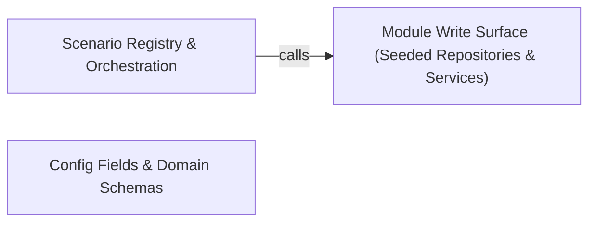

---
tags:
  - 2brain
  - 2brain/arch
  - project/boilerplate-node-backend
type: architecture
component: Scenario_Seed_Core_Registry
---

## Details

The heart of the subsystem — the domain-agnostic seeding primitive plus the per-module fixture tables and the scenario registry that orders them. scenarios/seed.ts defines the repository shape (SeedRepository / OwnedSeedRepository) and the two idempotent writers (insertIfAbsent by pinned _id, insertIfAbsentForOwner by userId for carts/wishlists/address books). Each module file exposes a seed*Collection that maps its fixture table through those primitives. scenarios/index.ts is the registry: seedShop sequences the access model first, then runInWaves over shopModules, and buildScenario composes seed → drive → backdate.

### Module Write Surface (Seeded Repositories & Services)
The production module layer the seeders write through: the per-module repositories and services (addresses, webhooks, api-keys, example, products, account) that expose the create/findById/findByUserId slice the seeding primitives consume, plus the domain services that the driven flows exercise. This is the bounded-context implementation the scenario layer depends on one-directionally — the seeders never import each other, only these repositories/services. It is the write surface that insertIfAbsent and the flow runner both reach, and it is what a production image ships while the scenario folder is omitted.

**Related Classes/Methods**:

- `src.modules.addresses.repository.addressBookRepository.create`:136-144
- `src.modules.example.services.cover.applyCover`:44-69
- `src.modules.api-keys.services.api-keys.mint`:147-206
- `src.modules.webhooks.secrets.activeRingSecrets`:107-111

**Source Files:**

- `src/modules/addresses/repository.ts`
  - `src.modules.addresses.repository.addressBookRepository.create` (L136-L144) - Method
- `src/modules/addresses/service.ts`
  - `src.modules.addresses.service.addressUpdate` (L56-L65) - Class
  - `src.modules.addresses.service.addressUpdate.then() callback` (L61-L65) - Function
- `src/modules/api-keys/services/api-keys.ts`
  - `src.modules.api-keys.services.api-keys.notifyMinted.then() callback` (L73-L92) - Function
  - `src.modules.api-keys.services.api-keys.mint` (L147-L206) - Class
  - `src.modules.api-keys.services.api-keys.mint.invalid` (L163-L163) - Class
  - `src.modules.api-keys.services.api-keys.mint.invalid.body.permissions.filter() callback` (L163-L163) - Function
  - `src.modules.api-keys.services.api-keys.mint.then() callback` (L189-L205) - Function
  - `src.modules.api-keys.services.api-keys.revoke` (L215-L235) - Class
  - `src.modules.api-keys.services.api-keys.revoke.then() callback` (L219-L235) - Function
  - `src.modules.api-keys.services.api-keys.revoke.then() callback.then() callback` (L225-L234) - Function
  - `src.modules.api-keys.services.api-keys.notifyRevoked.then() callback.mail.revoked.map() callback` (L257-L257) - Function
- `src/modules/example/repository.ts`
  - `src.modules.example.repository.exampleRepository.findScoped` (L59-L59) - Method
- `src/modules/example/services/cover.ts`
  - `src.modules.example.services.cover.applyCover` (L44-L69) - Class
  - `src.modules.example.services.cover.then() callback` (L55-L56) - Function
  - `src.modules.example.services.cover.applyCover.then() callback.then() callback` (L58-L58) - Function
  - `src.modules.example.services.cover.applyCover.then() callback` (L68-L68) - Function
  - `src.modules.example.services.cover.setCover` (L80-L93) - Class
  - `src.modules.example.services.cover.setCover.then() callback` (L87-L93) - Function
  - `src.modules.example.services.cover.setCover.then() callback.then() callback` (L91-L91) - Function
- `src/modules/example/services/crud.ts`
  - `src.modules.example.services.crud.create` (L101-L129) - Class
  - `src.modules.example.services.crud.create.then() callback` (L128-L128) - Function
  - `src.modules.example.services.crud.getById` (L138-L141) - Class
  - `src.modules.example.services.crud.getById.then() callback` (L141-L141) - Function
  - `src.modules.example.services.crud.getPublishedById` (L150-L153) - Class
  - `src.modules.example.services.crud.getPublishedById.then() callback` (L153-L153) - Function
  - `src.modules.example.services.crud.applyUpdate` (L189-L219) - Class
  - `src.modules.example.services.crud.applyUpdate.then() callback` (L206-L218) - Function
  - `src.modules.example.services.crud.applyUpdate.then() callback.then() callback` (L215-L216) - Function
  - `src.modules.example.services.crud.update` (L233-L248) - Class
  - `src.modules.example.services.crud.update.then() callback` (L241-L247) - Function
  - `src.modules.example.services.crud.update.then() callback.then() callback` (L245-L245) - Function
  - `src.modules.example.services.crud.deleteLoaded` (L256-L271) - Class
  - `src.modules.example.services.crud.deleteLoaded.then() callback` (L263-L271) - Function
  - `src.modules.example.services.crud.remove` (L281-L291) - Class
  - `src.modules.example.services.crud.remove.then() callback` (L285-L291) - Function
  - `src.modules.example.services.crud.remove.then() callback.then() callback` (L289-L289) - Function
- `src/modules/example/services/owner.ts`
  - `src.modules.example.services.owner.presentWithOwner` (L42-L43) - Class
  - `src.modules.example.services.owner.presentWithOwner.then() callback` (L43-L43) - Function
- `src/modules/locales/controllers/create-locale.ts`
  - `src.modules.locales.controllers.create-locale.createLocale` (L25-L44) - Class
  - `src.modules.locales.controllers.create-locale.createLocale.then() callback` (L37-L42) - Function
- `src/modules/locales/controllers/delete-locale.ts`
  - `src.modules.locales.controllers.delete-locale.deleteLocale` (L19-L27) - Class
  - `src.modules.locales.controllers.delete-locale.deleteLocale.then() callback` (L22-L26) - Function
- `src/modules/locales/controllers/get-entity-translations.ts`
  - `src.modules.locales.controllers.get-entity-translations.getEntityTranslations` (L18-L36) - Class
  - `src.modules.locales.controllers.get-entity-translations.getEntityTranslations.then() callback` (L30-L34) - Function
- `src/modules/locales/controllers/get-locale-entries.ts`
  - `src.modules.locales.controllers.get-locale-entries.listEntries` (L36-L59) - Class
  - `src.modules.locales.controllers.get-locale-entries.listEntries.then() callback` (L52-L57) - Function
- `src/modules/locales/controllers/get-locale-messages.ts`
  - `src.modules.locales.controllers.get-locale-messages.getLocaleMessages` (L19-L39) - Class
  - `src.modules.locales.controllers.get-locale-messages.getLocaleMessages.then() callback` (L33-L36) - Function
- `src/modules/locales/controllers/get-locales.ts`
  - `src.modules.locales.controllers.get-locales.getLocales` (L21-L26) - Class
  - `src.modules.locales.controllers.get-locales.getLocales.then() callback` (L25-L25) - Function
- `src/modules/locales/controllers/write-entity-translations.ts`
  - `src.modules.locales.controllers.write-entity-translations.writeEntityTranslations` (L33-L68) - Class
  - `src.modules.locales.controllers.write-entity-translations.writeEntityTranslations.<function>` (L44-L68) - Function
  - `src.modules.locales.controllers.write-entity-translations.writeEntityTranslations.<function>.then() callback` (L62-L66) - Function
- `src/modules/locales/controllers/write-locale-entries.ts`
  - `src.modules.locales.controllers.write-locale-entries.createLocaleEntry` (L38-L63) - Class
  - `src.modules.locales.controllers.write-locale-entries.createLocaleEntry.then() callback` (L52-L61) - Function
  - `src.modules.locales.controllers.write-locale-entries.importEntries` (L100-L127) - Class
  - `src.modules.locales.controllers.write-locale-entries.importEntries.<function>` (L102-L127) - Function
  - `src.modules.locales.controllers.write-locale-entries.importEntries.<function>.then() callback` (L121-L125) - Function
- `src/modules/locales/services/entries.ts`
  - `src.modules.locales.services.entries.findEntryInLanguage` (L43-L46) - Class
  - `src.modules.locales.services.entries.findEntryInLanguage.then() callback` (L46-L46) - Function
  - `src.modules.locales.services.entries.searchEntries` (L56-L76) - Class
  - `src.modules.locales.services.entries.searchEntries.then() callback` (L65-L76) - Function
  - `src.modules.locales.services.entries.searchEntries.then() callback.then() callback` (L75-L75) - Function
  - `src.modules.locales.services.entries.updateEntry` (L130-L157) - Class
  - `src.modules.locales.services.entries.updateEntry.then() callback` (L136-L157) - Function
  - `src.modules.locales.services.entries.updateEntry.then() callback.then() callback` (L141-L156) - Function
  - `src.modules.locales.services.entries.deleteEntry` (L164-L186) - Class
  - `src.modules.locales.services.entries.deleteEntry.then() callback` (L169-L186) - Function
  - `src.modules.locales.services.entries.deleteEntry.then() callback.then() callback` (L173-L185) - Function
- `src/modules/locales/services/languages.ts`
  - `src.modules.locales.services.languages.createLanguage` (L51-L82) - Class
  - `src.modules.locales.services.languages.createLanguage.then() callback` (L59-L81) - Function
  - `src.modules.locales.services.languages.createLanguage.then() callback.then() callback` (L70-L80) - Function
  - `src.modules.locales.services.languages.updateLanguage` (L90-L122) - Class
  - `src.modules.locales.services.languages.updateLanguage.then() callback` (L95-L122) - Function
  - `src.modules.locales.services.languages.updateLanguage.then() callback.then() callback` (L108-L121) - Function
  - `src.modules.locales.services.languages.deleteLanguage` (L130-L159) - Class
  - `src.modules.locales.services.languages.deleteLanguage.then() callback` (L136-L159) - Function
  - `src.modules.locales.services.languages.deleteLanguage.then() callback.then() callback` (L146-L158) - Function
- `src/modules/locales/services/translations.ts`
  - `src.modules.locales.services.translations.EntityTranslationsResult` (L37-L43) - Interface
  - `src.modules.locales.services.translations.planSlot` (L91-L148) - Class
  - `src.modules.locales.services.translations.planSlot.then() callback` (L140-L147) - Function
  - `src.modules.locales.services.translations.planForPort` (L259-L275) - Class
  - `src.modules.locales.services.translations.planForPort.then() callback` (L263-L274) - Function
  - `src.modules.locales.services.translations.planForPort.then() callback.planned.plan.planned.map() callback` (L269-L272) - Function
  - `src.modules.locales.services.translations.writeForPort` (L281-L300) - Class
  - `src.modules.locales.services.translations.writeForPort.writePlan.planned.map() callback` (L293-L296) - Function
  - `src.modules.locales.services.translations.applyTranslationBatch.metadata.upserted.map() callback` (L343-L343) - Function
  - `src.modules.locales.services.translations.applyTranslationBatch.metadata.upserted.planned.filter() callback` (L343-L343) - Function
  - `src.modules.locales.services.translations.applyTranslationBatch.metadata.deleted.map() callback` (L344-L344) - Function
  - `src.modules.locales.services.translations.applyTranslationBatch.metadata.deleted.planned.filter() callback` (L344-L344) - Function
  - `src.modules.locales.services.translations.getEntityTranslations` (L425-L440) - Class
  - `src.modules.locales.services.translations.getEntityTranslations.then() callback` (L432-L438) - Function
- `src/modules/returns/services/create.ts`
  - `src.modules.returns.services.create.writeWithdrawalRecord` (L152-L180) - Class
  - `src.modules.returns.services.create.writeWithdrawalRecord.then() callback` (L170-L179) - Function
  - `src.modules.returns.services.create.withdrawBeforeDispatch` (L193-L208) - Class
  - `src.modules.returns.services.create.withdrawBeforeDispatch.then() callback` (L200-L208) - Function
  - `src.modules.returns.services.create.withdrawBeforeDispatch.then() callback.then() callback` (L203-L206) - Function
  - `src.modules.returns.services.create.withdrawBeforeDispatch.then() callback.then() callback.then() callback` (L206-L206) - Function
  - `src.modules.returns.services.create.createReturn` (L341-L379) - Class
  - `src.modules.returns.services.create.createReturn.then() callback` (L346-L379) - Function
  - `src.modules.returns.services.create.createReturn.then() callback.excluded` (L355-L359) - Class
  - `src.modules.returns.services.create.createReturn.then() callback.excluded.order.items.filter() callback` (L357-L357) - Function
  - `src.modules.returns.services.create.createReturn.then() callback.excluded.map() callback` (L358-L358) - Function
  - `src.modules.returns.services.create.createReturn.then() callback.input.lines.some() callback` (L371-L371) - Function
  - `src.modules.returns.services.create.createReturn.then() callback.then() callback` (L376-L377) - Function
- `src/modules/returns/services/decide.ts`
  - `src.modules.returns.services.decide.notDecidable` (L34-L44) - Class
  - `src.modules.returns.services.decide.notDecidable.then() callback` (L35-L43) - Function
  - `src.modules.returns.services.decide.settleDecision` (L128-L156) - Class
  - `src.modules.returns.services.decide.settleDecision.then() callback` (L149-L154) - Function
- `src/modules/returns/services/ownership.ts`
  - `src.modules.returns.services.ownership.ownOrder` (L17-L23) - Class
  - `src.modules.returns.services.ownership.ownOrder.then() callback` (L23-L23) - Function
- `src/modules/returns/services/read.ts`
  - `src.modules.returns.services.read.ReturnFilters` (L27-L33) - Interface
  - `src.modules.returns.services.read.BuyerStanding` (L42-L47) - Interface
  - `src.modules.returns.services.read.withActions` (L81-L88) - Class
  - `src.modules.returns.services.read.withActions.then() callback` (L85-L88) - Function
  - `src.modules.returns.services.read.listReturns` (L97-L109) - Class
  - `src.modules.returns.services.read.listReturns.then() callback` (L108-L108) - Function
  - `src.modules.returns.services.read.getReturn` (L118-L132) - Class
  - `src.modules.returns.services.read.getReturn.then() callback` (L122-L132) - Function
  - `src.modules.returns.services.read.then() callback.then() callback` (L125-L125) - Function
  - `src.modules.returns.services.read.getReturn.then() callback.then() callback` (L127-L130) - Function
  - `src.modules.returns.services.read.getReturn.then() callback.then() callback.then() callback` (L129-L129) - Function
- `src/modules/returns/services/receive.ts`
  - `src.modules.returns.services.receive.receiveFor` (L177-L221) - Class
  - `src.modules.returns.services.receive.receiveFor.then() callback` (L196-L220) - Function
  - `src.modules.returns.services.receive.receiveFor.then() callback.received.lines.map() callback` (L200-L200) - Function
  - `src.modules.returns.services.receive.receiveFor.then() callback.then() callback` (L219-L219) - Function
  - `src.modules.returns.services.receive.receiveReturn` (L231-L249) - Class
  - `src.modules.returns.services.receive.receiveReturn.then() callback` (L236-L249) - Function
  - `src.modules.returns.services.receive.receiveReturn.then() callback.then() callback` (L240-L248) - Function
  - `src.modules.returns.services.receive.receiveReturn.then() callback.then() callback.then() callback` (L247-L247) - Function
- `src/modules/webhooks/secrets.ts`
  - `src.modules.webhooks.secrets.liveRingEntries` (L86-L96) - Class
  - `src.modules.webhooks.secrets.liveRingEntries.ring.filter() callback` (L92-L94) - Function
  - `src.modules.webhooks.secrets.activeRingSecrets` (L107-L111) - Class
  - `src.modules.webhooks.secrets.activeRingSecrets.map() callback` (L111-L111) - Function
  - `src.modules.webhooks.secrets.removeRingSecret` (L114-L117) - Class
  - `src.modules.webhooks.secrets.removeRingSecret.ring.filter() callback` (L117-L117) - Function
- `src/modules/webhooks/services/reencrypt.ts`
  - `src.modules.webhooks.services.reencrypt.fieldsOf` (L14-L20) - Class
  - `src.modules.webhooks.services.reencrypt.fieldsOf.subscription.secrets.map() callback` (L15-L20) - Function
- `src/modules/webhooks/services/subscriptions.ts`
  - `src.modules.webhooks.services.subscriptions.SubscriptionWithMintedSecrets` (L36-L42) - Interface
  - `src.modules.webhooks.services.subscriptions.refuseUnsafeUrl` (L55-L75) - Class
  - `src.modules.webhooks.services.subscriptions.refuseUnsafeUrl.then() callback` (L57-L57) - Function
  - `src.modules.webhooks.services.subscriptions.refuseUnsafeUrl.catch() callback` (L58-L75) - Function
  - `src.modules.webhooks.services.subscriptions.rollbackOverCap` (L106-L109) - Class
  - `src.modules.webhooks.services.subscriptions.rollbackOverCap.then() callback` (L109-L109) - Function
  - `src.modules.webhooks.services.subscriptions.create` (L153-L182) - Class
  - `src.modules.webhooks.services.subscriptions.create.then() callback` (L159-L181) - Function
  - `src.modules.webhooks.services.subscriptions.create.then() callback.then() callback` (L180-L180) - Function
  - `src.modules.webhooks.services.subscriptions.update` (L190-L233) - Class
  - `src.modules.webhooks.services.subscriptions.update.then() callback` (L197-L233) - Function
  - `src.modules.webhooks.services.subscriptions.update.then() callback.then() callback` (L224-L232) - Function
  - `src.modules.webhooks.services.subscriptions.rotateSecret` (L242-L268) - Class
  - `src.modules.webhooks.services.subscriptions.rotateSecret.then() callback` (L248-L268) - Function
  - `src.modules.webhooks.services.subscriptions.rotateSecret.then() callback.then() callback` (L259-L267) - Function
  - `src.modules.webhooks.services.subscriptions.removeSecret` (L277-L308) - Class
  - `src.modules.webhooks.services.subscriptions.removeSecret.then() callback` (L284-L308) - Function
  - `src.modules.webhooks.services.subscriptions.removeSecret.then() callback.then() callback` (L299-L307) - Function
  - `src.modules.webhooks.services.subscriptions.remove` (L311-L329) - Class
  - `src.modules.webhooks.services.subscriptions.remove.then() callback` (L317-L329) - Function
  - `src.modules.webhooks.services.subscriptions.remove.then() callback.then() callback` (L320-L328) - Function

### Scenario Registry & Orchestration
The heart of the subsystem: the domain-agnostic seeding primitive, the per-module fixture tables, and the registry that orders them. It owns the repository shape and the two idempotent writers, the shopModules fixture table with its after/baseline/driveHistoryEdit scheduling metadata, the wave scheduler, and the SCENARIOS registry that composes seed → drive → backdate. This is the single place a new scenario is added, and the only layer that knows the legitimate ordering of the three steps.

**Related Classes/Methods**:

- `scenarios.seed.insertIfAbsent`:60-64
- `scenarios.seed.insertIfAbsentForOwner`:76-80
- `scenarios.index.seedShop`:40-43

**Source Files:**

- `scenarios/accounts.ts`
  - `scenarios.accounts.seedAccessModel` (L198-L221) - Class
  - `scenarios.accounts.seedAccessModel.then() callback.map() callback` (L213-L213) - Function
  - `scenarios.accounts.seedAccessModel.then() callback` (L221-L221) - Function
- `scenarios/addresses.ts`
  - `scenarios.addresses.seedAddressBooksCollection` (L103-L106) - Class
  - `scenarios.addresses.seedAddressBooksCollection.addressBookFixtures.map() callback` (L105-L105) - Function
- `scenarios/blank.ts`
  - `scenarios.blank.seedBlank` (L24-L32) - Class
  - `scenarios.blank.then() callback` (L26-L30) - Function
  - `scenarios.blank.seedBlank.then() callback` (L32-L32) - Function
- `scenarios/example.ts`
  - `scenarios.example.seedExampleCollection` (L70-L71) - Class
  - `scenarios.example.seedExampleCollection.exampleFixtures.map() callback` (L71-L71) - Function
- `scenarios/index.ts`
  - `scenarios.index.seedShop` (L40-L43) - Class
  - `scenarios.index.seedShop.then() callback` (L43-L43) - Function
- `scenarios/locales.ts`
  - `scenarios.locales.seedLocalesCollection.languages` (L225-L227) - Class
  - `scenarios.locales.seedLocalesCollection.languages.localeFixtures.map() callback` (L226-L226) - Function
  - `scenarios.locales.seedLocalesCollection.entries` (L228-L230) - Class
  - `scenarios.locales.seedLocalesCollection.entries.localeEntryFixtures.map() callback` (L229-L229) - Function
- `scenarios/products.ts`
  - `scenarios.products.seedProductsCollection` (L481-L491) - Class
  - `scenarios.products.seedProductsCollection.productFixtures.map() callback` (L482-L482) - Function
  - `scenarios.products.seedProductsCollection.then() callback` (L483-L490) - Function
  - `scenarios.products.seedProductsCollection.then() callback.productFixtures.map() callback` (L485-L488) - Function
  - `scenarios.products.seedProductsCollection.then() callback.then() callback` (L490-L490) - Function
- `scenarios/seed.ts`
  - `scenarios.seed.SeedRepository` (L19-L22) - Interface
  - `scenarios.seed.OwnedSeedRepository` (L27-L30) - Interface
  - `scenarios.seed.insertIfAbsentBy` (L45-L52) - Class
  - `scenarios.seed.insertIfAbsentBy.then() callback` (L50-L51) - Function
  - `scenarios.seed.insertIfAbsentBy.then() callback.then() callback` (L51-L51) - Function
  - `scenarios.seed.insertIfAbsent` (L60-L64) - Class
  - `scenarios.seed.insertIfAbsent.insertIfAbsentBy() callback` (L64-L64) - Function
  - `scenarios.seed.insertIfAbsentForOwner` (L76-L80) - Class
  - `scenarios.seed.insertIfAbsentForOwner.insertIfAbsentBy() callback` (L80-L80) - Function
- `scenarios/shop-modules.ts`
  - `scenarios.shop-modules.asWaveEntries` (L76-L84) - Class
  - `scenarios.shop-modules.asWaveEntries.map() callback` (L80-L83) - Function
  - `scenarios.shop-modules.baselineShopModules` (L104-L112) - Class
  - `scenarios.shop-modules.baselineShopModules.filter() callback` (L111-L111) - Function
- `scenarios/users.ts`
  - `scenarios.users.staffUsers` (L148-L163) - Class
  - `scenarios.users.staffUsers.map() callback` (L155-L162) - Function
  - `scenarios.users.customerUsers.CUSTOMER_NAMES.map() callback` (L256-L266) - Function
  - `scenarios.users.customerUsers` (L256-L267) - Class
  - `scenarios.users.seedUsersCollection` (L280-L287) - Class
  - `scenarios.users.seedUsersCollection.userFixtures.map() callback` (L281-L281) - Function
  - `scenarios.users.seedUsersCollection.then() callback` (L281-L286) - Function
  - `scenarios.users.seedUsersCollection.then() callback.customerUsers.map() callback` (L283-L284) - Function
  - `scenarios.users.seedUsersCollection.then() callback.then() callback` (L286-L286) - Function
  - `scenarios.users.seedNamedUsersCollection` (L293-L294) - Class
  - `scenarios.users.seedNamedUsersCollection.namedUsers.map() callback` (L294-L294) - Function
- `scenarios/waves.ts`
  - `scenarios.waves.runInWaves` (L57-L65) - Class
  - `scenarios.waves.runInWaves.wave.map() callback` (L62-L62) - Function
- `scenarios/webhooks.ts`
  - `scenarios.webhooks.seedWebhooksCollection` (L63-L88) - Class
  - `scenarios.webhooks.seedWebhooksCollection.then() callback` (L87-L87) - Function
- `scenarios/wishlist.ts`
  - `scenarios.wishlist.seedWishlistsCollection` (L36-L39) - Class
  - `scenarios.wishlist.seedWishlistsCollection.wishlistFixtures.map() callback` (L38-L38) - Function
- `src/infrastructure/http/errors.ts`
  - `src.infrastructure.http.errors.ConflictError` (L34-L36) - Class
- `src/infrastructure/security/password-hash.ts`
  - `src.infrastructure.security.password-hash.Derivation` (L39-L44) - Interface
  - `src.infrastructure.security.password-hash.hashPassword` (L67-L78) - Class
  - `src.infrastructure.security.password-hash.hashPassword.then() callback` (L75-L76) - Function
- `src/modules/access/service.ts`
  - `src.modules.access.service.AccessInvariantError` (L57-L63) - Class
  - `src.modules.access.service.AccessInvariantError.constructor` (L59-L62) - Constructor
  - `src.modules.access.service.assignRole` (L241-L281) - Class
  - `src.modules.access.service.attempt.then() callback` (L250-L250) - Function
- `src/modules/account/services/oauth.ts`
  - `src.modules.account.services.oauth.signupFromOAuth` (L123-L181) - Class
  - `src.modules.account.services.oauth.signupFromOAuth.then() callback` (L130-L180) - Function
  - `src.modules.account.services.oauth.signupFromOAuth.then() callback.catch() callback` (L153-L153) - Function
  - `src.modules.account.services.oauth.signupFromOAuth.then() callback.then() callback.then() callback` (L160-L163) - Function
  - `src.modules.account.services.oauth.signupFromOAuth.then() callback.then() callback.then() callback.then() callback` (L163-L163) - Function
  - `src.modules.account.services.oauth.signupFromOAuth.then() callback.then() callback` (L166-L180) - Function
- `src/modules/users/model.ts`
  - `src.modules.users.model.userSchema.pre('save') callback` (L755-L764) - Function
- `src/modules/users/services/create.ts`
  - `src.modules.users.services.create.create` (L38-L108) - Class
  - `src.modules.users.services.create.then() callback` (L60-L83) - Function
  - `src.modules.users.services.create.then() callback.then() callback` (L78-L78) - Function
  - `src.modules.users.services.create.then() callback.then() callback.then() callback` (L80-L82) - Function
  - `src.modules.users.services.create.create.then() callback.then() callback` (L101-L104) - Function
  - `src.modules.users.services.create.create.then() callback.then() callback.then() callback` (L104-L104) - Function
  - `src.modules.users.services.create.create.then() callback` (L107-L107) - Function
- `src/modules/users/services/update.ts`
  - `src.modules.users.services.update.saveWithRole.grantChecked` (L137-L142) - Class
  - `src.modules.users.services.update.grantChecked.then() callback` (L140-L141) - Function
  - `src.modules.users.services.update.saveWithRole.grantChecked.then() callback` (L145-L152) - Function
  - `src.modules.users.services.update.saveWithRole.then() callback.membership` (L171-L181) - Class
  - `src.modules.users.services.update.saveWithRole.then() callback.membership.then() callback` (L181-L181) - Function

### Config Fields & Domain Schemas
The validation and configuration substrate the seeded fixtures and the write surface both validate against: the reusable config-field primitives (flag, choice, decimal, int, text with their transform/error callbacks) that shape seedPasswordsConfig and other seed-time configuration, and the Zod domain schemas generated from the OpenAPI contract that the product write path validates. This is the contract-first layer that constrains both the seed fixtures and the driven writes, and it is why seedProductsCollection deliberately routes through planTranslations/writeTranslations rather than a raw insert — to stay on the same validated write surface.

**Related Classes/Methods**:

- `src.infrastructure.config.fields.flag`:201-215
- `src.modules.products.model.zodProductCreateSchema`:184-189
- `src.modules.account.mail-budget.mailRecipientRefusal`:69-80

**Source Files:**

- `src/infrastructure/config/fields.ts`
  - `src.infrastructure.config.fields.Presence` (L25-L40) - Interface
  - `src.infrastructure.config.fields.Field` (L45-L52) - Interface
  - `src.infrastructure.config.fields.int.transform() callback` (L165-L165) - Function
  - `src.infrastructure.config.fields.decimal.transform() callback` (L188-L188) - Function
  - `src.infrastructure.config.fields.flag` (L201-L215) - Function
  - `src.infrastructure.config.fields.choice.transform() callback` (L240-L240) - Function
  - `src.infrastructure.config.fields.choice.z.custom() callback` (L246-L248) - Function
  - `src.infrastructure.config.fields.choice.error` (L249-L249) - Method
  - `src.infrastructure.config.fields.text.transform() callback` (L288-L288) - Function
- `src/modules/account/mail-budget.ts`
  - `src.modules.account.mail-budget.mailRecipientRefusal` (L69-L80) - Class
  - `src.modules.account.mail-budget.mailRecipientRefusal.then() callback` (L70-L79) - Function
- `src/modules/account/services/authentication.ts`
  - `src.modules.account.services.authentication.sessionRevoke` (L240-L252) - Class
  - `src.modules.account.services.authentication.sessionRevoke.then() callback` (L245-L252) - Function
  - `src.modules.account.services.authentication.logoutCurrentSession` (L260-L279) - Class
  - `src.modules.account.services.authentication.logoutCurrentSession.then() callback` (L264-L279) - Function
  - `src.modules.account.services.authentication.signup.parseResult` (L470-L498) - Class
  - `src.modules.account.services.authentication.signup.parseResult.termsAccepted.error` (L481-L481) - Method
  - `src.modules.account.services.authentication.signup.parseResult.superRefine() callback` (L484-L490) - Function
- `src/modules/account/services/oauth.ts`
  - `src.modules.account.services.oauth.unlinkOAuthProvider` (L301-L315) - Class
  - `src.modules.account.services.oauth.unlinkOAuthProvider.then() callback` (L306-L315) - Function
- `src/modules/account/services/profile.ts`
  - `src.modules.account.services.profile.validatePasswordChange.parseResult` (L78-L96) - Class
  - `src.modules.account.services.profile.validatePasswordChange.parseResult.superRefine() callback` (L85-L92) - Function
  - `src.modules.account.services.profile.getOwnProfile` (L178-L187) - Class
  - `src.modules.account.services.profile.getOwnProfile.then() callback` (L186-L186) - Function
  - `src.modules.account.services.profile.then() callback` (L239-L246) - Function
  - `src.modules.account.services.profile.EmailChangeOutcome` (L440-L443) - Interface
  - `src.modules.account.services.profile.cancelPendingEmailChange` (L492-L506) - Class
  - `src.modules.account.services.profile.cancelPendingEmailChange.then() callback` (L498-L505) - Function
  - `src.modules.account.services.profile.then() callback.then() callback` (L503-L503) - Function
  - `src.modules.account.services.profile.cancelPendingEmailChange.then() callback.then() callback` (L504-L504) - Function
  - `src.modules.account.services.profile.cancelPendingEmailChange.catch() callback` (L506-L506) - Function
  - `src.modules.account.services.profile.revokeCancelledChange` (L512-L525) - Class
  - `src.modules.account.services.profile.revokeCancelledChange.then() callback` (L518-L524) - Function
  - `src.modules.account.services.profile.notifyEmailChangeRequested` (L564-L570) - Class
  - `src.modules.account.services.profile.notifyEmailChangeRequested.then() callback` (L565-L570) - Function
  - `src.modules.account.services.profile.writeProfile` (L578-L618) - Class
  - `src.modules.account.services.profile.writeProfile.budget.then() callback` (L610-L617) - Function
  - `src.modules.account.services.profile.writeProfile.budget.then() callback.then() callback` (L613-L616) - Function
  - `src.modules.account.services.profile.writeProfile.budget.then() callback.then() callback.then() callback` (L615-L615) - Function
  - `src.modules.account.services.profile.updateProfile.outcome` (L635-L651) - Class
  - `src.modules.account.services.profile.updateProfile.outcome.then() callback.then() callback` (L647-L647) - Function
  - `src.modules.account.services.profile.updateProfile.outcome.catch() callback` (L650-L650) - Function
  - `src.modules.account.services.profile.updateProfile.outcome.then() callback` (L653-L660) - Function
  - `src.modules.account.services.profile.passwordChangeWithCurrent` (L670-L697) - Class
  - `src.modules.account.services.profile.outcome.then() callback` (L683-L686) - Function
- `src/modules/account/services/tokens.ts`
  - `src.modules.account.services.tokens.then() callback.entry` (L45-L45) - Class
  - `src.modules.account.services.tokens.sessionsList` (L122-L135) - Class
  - `src.modules.account.services.tokens.sessionsList.then() callback` (L127-L135) - Function
  - `src.modules.account.services.tokens.then() callback.sessions` (L130-L132) - Class
  - `src.modules.account.services.tokens.sessionsList.then() callback.sessions.user.tokens.filter() callback` (L131-L131) - Function
  - `src.modules.account.services.tokens.sessionsList.then() callback.sessions.map() callback` (L132-L132) - Function
- `src/modules/account/services/two-factor.ts`
  - `src.modules.account.services.two-factor.audited` (L110-L123) - Class
  - `src.modules.account.services.two-factor.audited.outcome.then() callback` (L116-L123) - Function
- `src/modules/account/services/verification.ts`
  - `src.modules.account.services.verification.requestEmailVerification` (L117-L126) - Class
  - `src.modules.account.services.verification.requestEmailVerification.then() callback` (L121-L126) - Function
  - `src.modules.account.services.verification.resendCooldownRemaining` (L138-L147) - Class
  - `src.modules.account.services.verification.resendCooldownRemaining.user.tokens.find() callback` (L144-L144) - Function
  - `src.modules.account.services.verification.requestEmailVerificationFor` (L161-L190) - Class
  - `src.modules.account.services.verification.requestEmailVerificationFor.then() callback` (L166-L190) - Function
  - `src.modules.account.services.verification.requestEmailVerificationFor.then() callback.then() callback` (L179-L189) - Function
  - `src.modules.account.services.verification.requestEmailVerificationFor.then() callback.then() callback.then() callback` (L182-L187) - Function
  - `src.modules.account.services.verification.resendPendingEmailVerificationFor` (L205-L244) - Class
  - `src.modules.account.services.verification.resendPendingEmailVerificationFor.then() callback` (L210-L244) - Function
  - `src.modules.account.services.verification.resendPendingEmailVerificationFor.then() callback.then() callback` (L229-L243) - Function
  - `src.modules.account.services.verification.resendPendingEmailVerificationFor.then() callback.then() callback.then() callback` (L232-L242) - Function
  - `src.modules.account.services.verification.then() callback.then() callback` (L344-L344) - Function
- `src/modules/products/model.ts`
  - `src.modules.products.model.title.error` (L91-L91) - Method
  - `src.modules.products.model.zodProductTranslationEntry.title.error` (L93-L93) - Method
  - `src.modules.products.model.zodProductTranslationEntry.description.error` (L99-L99) - Method
  - `src.modules.products.model.zodProductCreateSchema` (L184-L189) - Class
  - `src.modules.products.model.price.error` (L186-L186) - Method
  - `src.modules.products.model.zodProductCreateSchema.price.error` (L187-L187) - Method
  - `src.modules.products.model.zodProductCreateSchema.superRefine() callback` (L189-L189) - Function
  - `src.modules.products.model.zodProductReplaceSchema` (L197-L202) - Class
  - `src.modules.products.model.zodProductReplaceSchema.price.error` (L200-L200) - Method
  - `src.modules.products.model.zodProductReplaceSchema.superRefine() callback` (L202-L202) - Function
  - `src.modules.products.model.zodProductUpdateSchema` (L209-L215) - Class
  - `src.modules.products.model.zodProductUpdateSchema.price.error` (L212-L212) - Method
  - `src.modules.products.model.zodProductUpdateSchema.superRefine() callback` (L215-L215) - Function
- `src/modules/users/model.ts`
  - `src.modules.users.model.email.error` (L338-L338) - Method
  - `src.modules.users.model.zodUserSchema.email.error` (L342-L342) - Method
  - `src.modules.users.model.username.error` (L349-L349) - Method
  - `src.modules.users.model.zodUserSchema.username.error` (L353-L353) - Method
  - `src.modules.users.model.password.error` (L360-L360) - Method
  - `src.modules.users.model.zodUserSchema.password.error` (L364-L364) - Method
