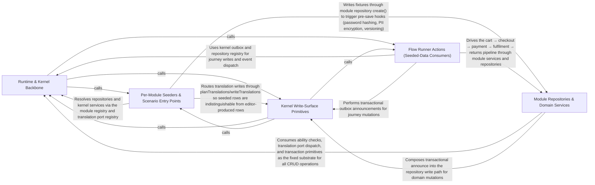

---
tags:
  - 2brain
  - 2brain/arch
  - project/boilerplate-node-backend
type: architecture
component: Scenario_Seed_Fixtures
---

## Details

Per-module seeders that write the demo dataset's rows (accounts, addresses, products, blank, example) into a database through the shared SeedRepository / OwnedSeedRepository primitive, using insertIfAbsent / insertIfAbsentForOwner so re-runs skip rather than rewrite and pre-save hooks (e.g. password hashing) still run.

### Runtime & Kernel Backbone [[Expand]](./Runtime_Kernel_Backbone.md)
The shared runtime and kernel services the seeding subsystem executes against — the module registry that resolves repositories, the outbox kernel (event enqueue/relay), the translation kernel (Translatable, TranslationPort, applyTranslations), the ability/permission kernel (permitsOnRows), rate-limiting, Redis, the image worker, and the development doubles (e.g. registerOAuthProvider('fake')) that stand in for external systems during seeding. This is the substrate every seeder and flow action depends on; it is not seeding-specific but is the fixed environment the fixtures are written into.

**Related Classes/Methods**:

- `src.kernel.outbox.enqueueOutboxEvent`:153-163
- `src.kernel.translation.TranslationPort`:60-166
- `src.kernel.translation.applyTranslations`:371-391
- `src.kernel.ability.permitsOnRows`:216-232

**Source Files:**

- `scenarios/support/development-doubles.ts`
  - `scenarios.support.development-doubles.registerOAuthProvider('fake') callback` (L46-L46) - Function
- `scripts/ops/check-config.ts`
  - `scripts.ops.check-config.runScript() callback` (L20-L20) - Function
- `src/globals.d.ts`
  - `src.globals.d.'express-serve-static-core'.Request` (L12-L84) - Interface
- `src/infrastructure/adapters/image.worker.ts`
  - `src.infrastructure.adapters.image.worker.enqueueIfImagePending` (L335-L359) - Class
  - `src.infrastructure.adapters.image.worker.enqueueIfImagePending.then() callback` (L351-L358) - Function
- `src/infrastructure/adapters/redis.ts`
  - `src.infrastructure.adapters.redis.then() callback` (L123-L123) - Function
  - `src.infrastructure.adapters.redis.isRedisConnectionError` (L149-L150) - Class
  - `src.infrastructure.adapters.redis.isRedisConnectionError.REDIS_CONNECTION_ERRORS.some() callback` (L150-L150) - Function
- `src/infrastructure/config/shared-rules/registry.ts`
  - `src.infrastructure.config.shared-rules.registry.SharedRuleEntry` (L26-L31) - Interface
- `src/infrastructure/http/middlewares/rate-limit.ts`
  - `src.infrastructure.http.middlewares.rate-limit.BudgetCharge` (L285-L290) - Interface
- `src/infrastructure/i18n/catalog.ts`
  - `src.infrastructure.i18n.catalog.localeCandidatesFor` (L40-L43) - Class
  - `src.infrastructure.i18n.catalog.localeCandidatesFor.filter() callback` (L42-L42) - Function
- `src/infrastructure/i18n/context.ts`
  - `src.infrastructure.i18n.context.LocaleContext` (L22-L32) - Interface
- `src/infrastructure/persistence/changes.ts`
  - `src.infrastructure.persistence.changes.SetAndUnset` (L19-L22) - Interface
- `src/infrastructure/persistence/conditional-status.ts`
  - `src.infrastructure.persistence.conditional-status.ConditionalStatusOptions` (L14-L19) - Interface
- `src/infrastructure/persistence/create-repository.ts`
  - `src.infrastructure.persistence.create-repository.buildWhere.ids` (L155-L157) - Class
  - `src.infrastructure.persistence.create-repository.buildWhere.ids.value.filter() callback` (L156-L156) - Function
  - `src.infrastructure.persistence.create-repository.buildWhere.ids.map() callback` (L157-L157) - Function
  - `src.infrastructure.persistence.create-repository.Repository` (L238-L301) - Interface
  - `src.infrastructure.persistence.create-repository.createRepository` (L338-L486) - Function
  - `src.infrastructure.persistence.create-repository.createRepository.buildWhere` (L484-L484) - Method
- `src/infrastructure/persistence/image-writeback.ts`
  - `src.infrastructure.persistence.image-writeback.imageWritebackFor` (L26-L51) - Class
  - `src.infrastructure.persistence.image-writeback.imageWritebackFor.<function>` (L28-L51) - Function
  - `src.infrastructure.persistence.image-writeback.imageWritebackFor.<function>.then() callback` (L41-L50) - Function
  - `src.infrastructure.persistence.image-writeback.imageWritebackFor.<function>.then() callback.then() callback` (L50-L50) - Function
- `src/infrastructure/persistence/money-field.ts`
  - `src.infrastructure.persistence.money-field.isWritableAmount` (L95-L101) - Class
  - `src.infrastructure.persistence.money-field.isWritableAmount.<function>` (L97-L101) - Function
  - `src.infrastructure.persistence.money-field.moneyPlugin` (L139-L149) - Class
  - `src.infrastructure.persistence.money-field.moneyPlugin.reviveLean` (L145-L147) - Function
- `src/infrastructure/persistence/search.ts`
  - `src.infrastructure.persistence.search.readAll.collectFrom` (L98-L102) - Class
  - `src.infrastructure.persistence.search.readAll.collectFrom.then() callback` (L99-L102) - Function
  - `src.infrastructure.persistence.search.addTextFilter` (L150-L160) - Class
  - `src.infrastructure.persistence.search.addTextFilter.fields.map() callback` (L157-L159) - Function
- `src/infrastructure/persistence/serialize.ts`
  - `src.infrastructure.persistence.serialize.SerializeOptions` (L24-L44) - Interface
  - `src.infrastructure.persistence.serialize.SerializableSchema` (L53-L55) - Interface
  - `src.infrastructure.persistence.serialize.applySerialization` (L64-L115) - Class
  - `src.infrastructure.persistence.serialize.transform` (L70-L96) - Class
  - `src.infrastructure.persistence.serialize.applySerialization.transform.toString` (L74-L74) - Method
  - `src.infrastructure.persistence.serialize.applySerialization.transform` (L105-L111) - Method
- `src/infrastructure/persistence/translatable-columns.ts`
  - `src.infrastructure.persistence.translatable-columns.TranslatableColumns` (L17-L35) - Interface
  - `src.infrastructure.persistence.translatable-columns.translatableColumnsOf` (L42-L76) - Class
  - `src.infrastructure.persistence.translatable-columns.translatableColumnsOf.exists` (L46-L48) - Method
  - `src.infrastructure.persistence.translatable-columns.translatableColumnsOf.writeDerived` (L50-L65) - Method
  - `src.infrastructure.persistence.translatable-columns.translatableColumnsOf.writeDerived.$set.map() callback` (L58-L58) - Function
  - `src.infrastructure.persistence.translatable-columns.translatableColumnsOf.writeDerived.then() callback` (L65-L65) - Function
  - `src.infrastructure.persistence.translatable-columns.translatableColumnsOf.markEdited` (L67-L75) - Method
  - `src.infrastructure.persistence.translatable-columns.translatableColumnsOf.markEdited.then() callback` (L75-L75) - Function
- `src/infrastructure/persistence/versioning.ts`
  - `src.infrastructure.persistence.versioning.Precondition` (L27-L32) - Interface
  - `src.infrastructure.persistence.versioning.PreconditionFailedError` (L38-L40) - Class
  - `src.infrastructure.persistence.versioning.armed` (L159-L164) - Class
  - `src.infrastructure.persistence.versioning.armed.finally() callback` (L161-L163) - Function
  - `src.infrastructure.persistence.versioning.fencedSave` (L180-L192) - Class
  - `src.infrastructure.persistence.versioning.fencedSave.catch() callback` (L189-L191) - Function
  - `src.infrastructure.persistence.versioning.DeleteOutcome` (L197-L200) - Interface
  - `src.infrastructure.persistence.versioning.checkedDelete` (L211-L223) - Class
  - `src.infrastructure.persistence.versioning.then() callback` (L216-L216) - Function
  - `src.infrastructure.persistence.versioning.checkedDelete.then() callback` (L220-L222) - Function
- `src/infrastructure/runtime/after-commit.ts`
  - `src.infrastructure.runtime.after-commit.afterCommit` (L20-L31) - Class
  - `src.infrastructure.runtime.after-commit.afterCommit.catch() callback` (L28-L31) - Function
- `src/infrastructure/runtime/database.ts`
  - `src.infrastructure.runtime.database.attemptConnect.then() callback` (L139-L139) - Function
- `src/kernel/ability.ts`
  - `src.kernel.ability.permitsOnRows` (L216-L232) - Class
  - `src.kernel.ability.permitsOnRows.<function>` (L225-L231) - Function
  - `src.kernel.ability.permitsOnRows.<function>.actions.map() callback` (L227-L230) - Function
- `src/kernel/outbox.ts`
  - `src.kernel.outbox.'./events'.DomainEventMap` (L41-L48) - Interface
  - `src.kernel.outbox.OutboxEventDocument` (L61-L79) - Interface
  - `src.kernel.outbox.enqueueOutboxEvent` (L153-L163) - Class
  - `src.kernel.outbox.enqueueOutboxEvent.then() callback` (L163-L163) - Function
  - `src.kernel.outbox.OutboxRow` (L166-L173) - Interface
  - `src.kernel.outbox.RelayResult` (L176-L180) - Interface
  - `src.kernel.outbox.OutboxAnnouncement` (L370-L377) - Interface
  - `src.kernel.outbox.setOutboxPendingReader() callback` (L457-L457) - Function
- `src/kernel/translation.ts`
  - `src.kernel.translation.TranslationPort` (L60-L166) - Interface
  - `src.kernel.translation.Translatable` (L352-L354) - Interface
  - `src.kernel.translation.applyTranslations` (L371-L391) - Class
  - `src.kernel.translation.applyTranslations.items.map() callback` (L387-L390) - Function
- `src/modules/access/audit.ts`
  - `src.modules.access.audit.'@infrastructure/observability/audit'.AuditActionMap` (L19-L21) - Interface
- `src/modules/access/model.ts`
  - `src.modules.access.model.TenantDocument` (L33-L39) - Interface
  - `src.modules.access.model.MembershipDocument` (L49-L56) - Interface
- `src/modules/account/analytics.ts`
  - `src.modules.account.analytics.'@infrastructure/observability/analytics'.AnalyticsEventMap` (L26-L28) - Interface
- `src/modules/account/audit.ts`
  - `src.modules.account.audit.'@infrastructure/observability/audit'.AuditActionMap` (L93-L95) - Interface
- `src/modules/account/domain/email-change.ts`
  - `src.modules.account.domain.email-change.EmailChangeFields` (L46-L52) - Interface
- `src/modules/account/domain/revocation.ts`
  - `src.modules.account.domain.revocation.RevocationRow` (L20-L26) - Interface
- `src/modules/account/events.ts`
  - `src.modules.account.events.'@kernel/events'.DomainEventMap` (L14-L51) - Interface
- `src/modules/account/model.ts`
  - `src.modules.account.model.AccountExportDocument` (L30-L39) - Interface
  - `src.modules.account.model.SessionDocument` (L75-L108) - Interface
  - `src.modules.account.model.VerificationTokenDocument` (L151-L163) - Interface
- `src/modules/account/services/profile.ts`
  - `src.modules.account.services.profile.saveProfile.budget.then() callback.announceWithdrawal` (L104-L112) - Class
  - `src.modules.account.services.profile.saveProfile.budget.then() callback.announceWithdrawal.<function>` (L105-L111) - Function
- `src/modules/addresses/model.ts`
  - `src.modules.addresses.model.AddressItem` (L14-L29) - Interface
  - `src.modules.addresses.model.AddressBookDocument` (L32-L37) - Interface
- `src/modules/addresses/pii.ts`
  - `src.modules.addresses.pii.decryptAddressItem` (L105-L111) - Class
  - `src.modules.addresses.pii.decryptAddressItem.mapPiiFields() callback` (L108-L109) - Function
- `src/modules/addresses/presenter.ts`
  - `src.modules.addresses.presenter.AddressesView` (L12-L14) - Interface
  - `src.modules.addresses.presenter.presentAddresses.addresses.map() callback` (L46-L46) - Function
- `src/modules/addresses/reencrypt.ts`
  - `src.modules.addresses.reencrypt.fieldsOf` (L14-L29) - Class
  - `src.modules.addresses.reencrypt.fieldsOf.book.items.flatMap() callback` (L15-L28) - Function
  - `src.modules.addresses.reencrypt.fieldsOf.book.items.flatMap() callback.ADDRESS_PII_FIELDS.flatMap() callback` (L16-L28) - Function
- `src/modules/addresses/repository.ts`
  - `src.modules.addresses.repository.loadEntry.entry.book.items.find() callback` (L101-L101) - Function
  - `src.modules.addresses.repository.addressBookRepository` (L117-L282) - Class
  - `src.modules.addresses.repository.addressBookRepository.create` (L148-L156) - Method
  - `src.modules.addresses.repository.addressBookRepository.create.items.map() callback` (L152-L153) - Function
  - `src.modules.addresses.repository.addressBookRepository.findByUserId` (L162-L166) - Method
  - `src.modules.addresses.repository.addressBookRepository.findByUserId.then() callback` (L166-L166) - Function
  - `src.modules.addresses.repository.addressBookRepository.addEntry` (L181-L211) - Method
  - `src.modules.addresses.repository.addressBookRepository.addEntry.catch() callback` (L196-L210) - Function
  - `src.modules.addresses.repository.addressBookRepository.addEntry.catch() callback.then() callback` (L201-L209) - Function
  - `src.modules.addresses.repository.addressBookRepository.updateEntry` (L218-L238) - Method
  - `src.modules.addresses.repository.addressBookRepository.setDefault` (L245-L255) - Method
  - `src.modules.addresses.repository.addressBookRepository.removeEntry` (L261-L270) - Method
  - `src.modules.addresses.repository.addressBookRepository.removeEntry.book.items.filter() callback` (L266-L266) - Function
  - `src.modules.addresses.repository.addressBookRepository.deleteByUserId` (L275-L281) - Method
  - `src.modules.addresses.repository.addressBookRepository.deleteByUserId.then() callback` (L279-L281) - Function
- `src/modules/addresses/service.ts`
  - `src.modules.addresses.service.list` (L31-L32) - Class
  - `src.modules.addresses.service.list.then() callback` (L32-L32) - Function
  - `src.modules.addresses.service.get` (L41-L48) - Class
  - `src.modules.addresses.service.get.then() callback` (L45-L48) - Function
  - `src.modules.addresses.service.create` (L54-L66) - Class
  - `src.modules.addresses.service.create.then() callback` (L58-L66) - Function
  - `src.modules.addresses.service.update` (L72-L81) - Class
  - `src.modules.addresses.service.update.then() callback` (L77-L81) - Function
  - `src.modules.addresses.service.setDefault` (L87-L95) - Class
  - `src.modules.addresses.service.setDefault.then() callback` (L91-L95) - Function
  - `src.modules.addresses.service.remove` (L101-L108) - Class
  - `src.modules.addresses.service.remove.then() callback` (L105-L108) - Function
  - `src.modules.addresses.service.forCheckout` (L116-L121) - Class
  - `src.modules.addresses.service.forCheckout.then() callback` (L117-L121) - Function
  - `src.modules.addresses.service.then() callback.book.items.find() callback` (L119-L119) - Function
  - `src.modules.addresses.service.forCheckout.then() callback.book.items.find() callback` (L120-L120) - Function
- `src/modules/api-keys/audit.ts`
  - `src.modules.api-keys.audit.'@infrastructure/observability/audit'.AuditActionMap` (L18-L20) - Interface
- `src/modules/api-keys/credentials.ts`
  - `src.modules.api-keys.credentials.MintedApiKey` (L34-L38) - Interface
- `src/modules/api-keys/model.ts`
  - `src.modules.api-keys.model.ApiKeyDocument` (L15-L27) - Interface
  - `src.modules.api-keys.model.apiKeySchema.permissions.validate.validator` (L62-L62) - Method
- `src/modules/api-keys/services/actions.ts`
  - `src.modules.api-keys.services.actions.actionsForRows` (L22-L30) - Class
  - `src.modules.api-keys.services.actions.actionsForRows.<function>` (L29-L29) - Function
- `src/modules/api-keys/services/api-keys.ts`
  - `src.modules.api-keys.services.api-keys.withStatus` (L159-L176) - Class
  - `src.modules.api-keys.services.api-keys.withStatus.rows.map() callback` (L160-L160) - Function
  - `src.modules.api-keys.services.api-keys.withStatus.then() callback` (L160-L175) - Function
  - `src.modules.api-keys.services.api-keys.withStatus.then() callback.map() callback` (L162-L165) - Function
  - `src.modules.api-keys.services.api-keys.withStatus.then() callback.map() callback.then() callback` (L165-L165) - Function
  - `src.modules.api-keys.services.api-keys.withStatus.then() callback.then() callback` (L167-L175) - Function
  - `src.modules.api-keys.services.api-keys.withStatus.then() callback.then() callback.rows.map() callback` (L170-L174) - Function
  - `src.modules.api-keys.services.api-keys.list` (L182-L192) - Class
  - `src.modules.api-keys.services.api-keys.list.then() callback` (L186-L191) - Function
  - `src.modules.api-keys.services.api-keys.list.then() callback.then() callback` (L187-L191) - Function
  - `src.modules.api-keys.services.api-keys.get` (L201-L209) - Class
  - `src.modules.api-keys.services.api-keys.get.then() callback` (L205-L209) - Function
  - `src.modules.api-keys.services.api-keys.get.then() callback.then() callback` (L208-L208) - Function
  - `src.modules.api-keys.services.api-keys.mint` (L220-L275) - Class
  - `src.modules.api-keys.services.api-keys.mint.then() callback` (L258-L274) - Function
- `src/modules/audit-logs/model.ts`
  - `src.modules.audit-logs.model.AuditLogDocument` (L40-L42) - Interface
  - `src.modules.audit-logs.model.applyAuditLogTransform` (L180-L187) - Class
  - `src.modules.audit-logs.model.applyAuditLogTransform.after` (L183-L186) - Method
- `src/modules/cart/analytics.ts`
  - `src.modules.cart.analytics.'@infrastructure/observability/analytics'.AnalyticsEventMap` (L34-L36) - Interface
- `src/modules/cart/audit.ts`
  - `src.modules.cart.audit.'@infrastructure/observability/audit'.AuditActionMap` (L21-L23) - Interface
- `src/modules/cart/domain/availability.ts`
  - `src.modules.cart.domain.availability.AvailabilityProduct` (L13-L24) - Interface
  - `src.modules.cart.domain.availability.AvailabilityFacts` (L27-L39) - Interface
- `src/modules/cart/domain/merge.ts`
  - `src.modules.cart.domain.merge.MergeLineFacts` (L11-L23) - Interface
  - `src.modules.cart.domain.merge.MergePlan` (L26-L31) - Interface
- `src/modules/cart/domain/rules.ts`
  - `src.modules.cart.domain.rules.CartLineCandidate` (L17-L40) - Interface
  - `src.modules.cart.domain.rules.UnavailableCartLine` (L43-L47) - Interface
  - `src.modules.cart.domain.rules.CheckoutShortfall` (L53-L59) - Interface
  - `src.modules.cart.domain.rules.WeighedCartLine` (L62-L65) - Interface
  - `src.modules.cart.domain.rules.needsShipping` (L102-L103) - Class
  - `src.modules.cart.domain.rules.needsShipping.lines.some() callback` (L103-L103) - Function
  - `src.modules.cart.domain.rules.evaluateCheckout.judged` (L166-L174) - Class
  - `src.modules.cart.domain.rules.evaluateCheckout.judged.lines.map() callback` (L166-L174) - Function
  - `src.modules.cart.domain.rules.evaluateCheckout.unavailable` (L176-L178) - Class
  - `src.modules.cart.domain.rules.evaluateCheckout.unavailable.judged.filter() callback` (L177-L177) - Function
  - `src.modules.cart.domain.rules.evaluateCheckout.unavailable.map() callback` (L178-L178) - Function
  - `src.modules.cart.domain.rules.evaluateCheckout.shortfalls.judged.flatMap() callback` (L183-L193) - Function
  - `src.modules.cart.domain.rules.shortfalls` (L183-L194) - Class
- `src/modules/cart/events.ts`
  - `src.modules.cart.events.'@kernel/events'.DomainEventMap` (L9-L43) - Interface
- `src/modules/cart/factories.ts`
  - `src.modules.cart.factories.CartOverrides` (L17-L22) - Interface
- `src/modules/cart/model.ts`
  - `src.modules.cart.model.CartDocument` (L36-L59) - Interface
- `src/modules/cart/presenter.ts`
  - `src.modules.cart.presenter.JudgedCartLine` (L15-L19) - Interface
  - `src.modules.cart.presenter.CartFacts` (L22-L35) - Interface
  - `src.modules.cart.presenter.presentCart.items.lines.map() callback` (L54-L59) - Function
  - `src.modules.cart.presenter.presentCart.checkoutable.lines.every() callback` (L69-L69) - Function
- `src/modules/cart/repository.ts`
  - `src.modules.cart.repository.LineWrite` (L30-L33) - Interface
  - `src.modules.cart.repository.pushNewLine` (L52-L64) - Class
  - `src.modules.cart.repository.pushNewLine.then() callback` (L64-L64) - Function
  - `src.modules.cart.repository.unchangedOrPushed` (L72-L82) - Class
  - `src.modules.cart.repository.unchangedOrPushed.then() callback` (L80-L81) - Function
  - `src.modules.cart.repository.unchangedOrMissing` (L92-L104) - Class
  - `src.modules.cart.repository.unchangedOrMissing.then() callback` (L100-L104) - Function
  - `src.modules.cart.repository.resolveAddMiss` (L117-L140) - Class
  - `src.modules.cart.repository.resolveAddMiss.then() callback` (L126-L140) - Function
  - `src.modules.cart.repository.upsertLine` (L160-L230) - Class
  - `src.modules.cart.repository.upsertLine.then() callback` (L213-L224) - Function
  - `src.modules.cart.repository.then() callback.then() callback` (L217-L218) - Function
  - `src.modules.cart.repository.upsertLine.then() callback.then() callback` (L221-L222) - Function
  - `src.modules.cart.repository.upsertLine.catch() callback` (L225-L228) - Function
  - `src.modules.cart.repository.cartRepository` (L238-L397) - Class
  - `src.modules.cart.repository.cartRepository.findByUserId` (L268-L268) - Method
  - `src.modules.cart.repository.cartRepository.removeLine` (L281-L288) - Method
  - `src.modules.cart.repository.cartRepository.clearLines` (L296-L303) - Method
  - `src.modules.cart.repository.cartRepository.clearLinesIfUnchanged` (L322-L341) - Method
  - `src.modules.cart.repository.cartRepository.setShippingMethod` (L350-L359) - Method
  - `src.modules.cart.repository.cartRepository.deleteByUserId` (L368-L374) - Method
  - `src.modules.cart.repository.cartRepository.deleteByUserId.then() callback` (L372-L374) - Function
  - `src.modules.cart.repository.cartRepository.removeProductFromAll` (L386-L396) - Method
- `src/modules/cart/services/checkout.ts`
  - `src.modules.cart.services.checkout.resolvePaymentMethod.methodInfo.find() callback` (L112-L112) - Function
  - `src.modules.cart.services.checkout.buildStockRefusal.details.lines.refusal.shortfalls.map() callback` (L314-L319) - Function
  - `src.modules.cart.services.checkout.refuseOverLimit.details.productIds.overLimit.map() callback` (L422-L422) - Function
  - `src.modules.cart.services.checkout.placeLinesOf` (L459-L470) - Class
  - `src.modules.cart.services.checkout.placeLinesOf.joined.map() callback` (L461-L469) - Function
  - `src.modules.cart.services.checkout.CheckoutPlacement` (L473-L486) - Interface
  - `src.modules.cart.services.checkout.placeOrderInputOf` (L496-L538) - Class
  - `src.modules.cart.services.checkout.placeOrderInputOf.commitWith` (L534-L537) - Method
  - `src.modules.cart.services.checkout.placeOrderInputOf.commitWith.then() callback` (L537-L537) - Function
  - `src.modules.cart.services.checkout.refusalForPlaceOrder.shortfalls.outcome.shortfalls.map() callback` (L558-L563) - Function
  - `src.modules.cart.services.checkout.runCheckout.positionByProduct` (L635-L639) - Class
  - `src.modules.cart.services.checkout.runCheckout.positionByProduct.lines.map() callback` (L636-L636) - Function
  - `src.modules.cart.services.checkout.runCheckout.verdict` (L640-L650) - Class
  - `src.modules.cart.services.checkout.runCheckout.verdict.lines.map() callback` (L641-L649) - Function
  - `src.modules.cart.services.checkout.orderConfirm` (L712-L741) - Class
  - `src.modules.cart.services.checkout.orderConfirm.catch() callback` (L718-L718) - Function
  - `src.modules.cart.services.checkout.orderConfirm.then() callback` (L719-L741) - Function
- `src/modules/cart/services/items.ts`
  - `src.modules.cart.services.items.cartGet` (L36-L37) - Class
  - `src.modules.cart.services.items.cartGet.then() callback` (L37-L37) - Function
  - `src.modules.cart.services.items.cartViewOf` (L45-L46) - Class
  - `src.modules.cart.services.items.cartViewOf.then() callback` (L46-L46) - Function
  - `src.modules.cart.services.items.cartGetForView` (L52-L59) - Class
  - `src.modules.cart.services.items.cartGetForView.then() callback` (L53-L59) - Function
  - `src.modules.cart.services.items.upsertCartItem` (L87-L106) - Class
  - `src.modules.cart.services.items.upsertCartItem.then() callback` (L93-L106) - Function
  - `src.modules.cart.services.items.upsertCartItem.then() callback.then() callback` (L97-L105) - Function
  - `src.modules.cart.services.items.upsertCartItem.then() callback.then() callback.then() callback` (L102-L103) - Function
  - `src.modules.cart.services.items.cartItemAdd` (L172-L180) - Class
  - `src.modules.cart.services.items.cartItemAdd.then() callback` (L178-L179) - Function
  - `src.modules.cart.services.items.cartItemUpdateQuantity` (L186-L194) - Class
  - `src.modules.cart.services.items.cartItemUpdateQuantity.then() callback` (L192-L193) - Function
  - `src.modules.cart.services.items.cartItemRemoveById` (L213-L233) - Class
  - `src.modules.cart.services.items.cartItemRemoveById.then() callback` (L218-L233) - Function
  - `src.modules.cart.services.items.cartItemRemoveById.then() callback.then() callback` (L232-L232) - Function
  - `src.modules.cart.services.items.cartRemove` (L241-L251) - Class
  - `src.modules.cart.services.items.cartRemove.then() callback` (L242-L250) - Function
  - `src.modules.cart.services.items.cartRemove.then() callback.then() callback` (L243-L250) - Function
  - `src.modules.cart.services.items.cartShippingMethodSet` (L266-L306) - Class
  - `src.modules.cart.services.items.cartShippingMethodSet.then() callback` (L282-L305) - Function
  - `src.modules.cart.services.items.cartShippingMethodSet.then() callback.then() callback` (L304-L304) - Function
- `src/modules/cart/services/merge.ts`
  - `src.modules.cart.services.merge.MergeResult` (L27-L30) - Interface
  - `src.modules.cart.services.merge.MergeStep` (L33-L36) - Interface
  - `src.modules.cart.services.merge.heldIn` (L39-L40) - Class
  - `src.modules.cart.services.merge.heldIn.cart.items.find() callback` (L40-L40) - Function
  - `src.modules.cart.services.merge.writeAdd` (L47-L59) - Class
  - `src.modules.cart.services.merge.writeAdd.then() callback` (L53-L59) - Function
  - `src.modules.cart.services.merge.writeAdd.then() callback.then() callback` (L56-L56) - Function
  - `src.modules.cart.services.merge.mergeLine` (L67-L103) - Class
  - `src.modules.cart.services.merge.mergeLine.written.then() callback` (L86-L102) - Function
  - `src.modules.cart.services.merge.mergeLines.shelves` (L117-L117) - Class
  - `src.modules.cart.services.merge.mergeLines.shelves.lines.map() callback` (L117-L117) - Function
  - `src.modules.cart.services.merge.cartMerge` (L170-L179) - Class
  - `src.modules.cart.services.merge.cartMerge.then() callback` (L175-L178) - Function
  - `src.modules.cart.services.merge.then() callback.then() callback` (L177-L177) - Function
  - `src.modules.cart.services.merge.cartMerge.then() callback.then() callback` (L178-L178) - Function
- `src/modules/cart/services/preorder.ts`
  - `src.modules.cart.services.preorder.preorderIdsOf` (L28-L35) - Class
  - `src.modules.cart.services.preorder.preorderIdsOf.lines.filter() callback` (L33-L33) - Function
  - `src.modules.cart.services.preorder.preorderIdsOf.map() callback` (L34-L34) - Function
  - `src.modules.cart.services.preorder.backorderIdsOf` (L43-L50) - Class
  - `src.modules.cart.services.preorder.backorderIdsOf.lines.filter() callback` (L48-L48) - Function
  - `src.modules.cart.services.preorder.backorderIdsOf.map() callback` (L49-L49) - Function
- `src/modules/cart/services/reorder.ts`
  - `src.modules.cart.services.reorder.reorderIntoCart` (L45-L92) - Class
  - `src.modules.cart.services.reorder.then() callback` (L54-L75) - Function
  - `src.modules.cart.services.reorder.reorderIntoCart.then() callback.then() callback` (L62-L74) - Function
  - `src.modules.cart.services.reorder.reorderIntoCart.then() callback.then() callback.lines.every() callback` (L63-L63) - Function
  - `src.modules.cart.services.reorder.reorderIntoCart.then() callback.then() callback.then() callback` (L71-L72) - Function
  - `src.modules.cart.services.reorder.reorderIntoCart.catch() callback` (L76-L76) - Function
  - `src.modules.cart.services.reorder.reorderIntoCart.then() callback` (L77-L91) - Function
- `src/modules/cart/services/shelf.ts`
  - `src.modules.cart.services.shelf.Shelf` (L18-L25) - Interface
  - `src.modules.cart.services.shelf.readShelf` (L34-L55) - Class
  - `src.modules.cart.services.shelf.readShelf.then() callback` (L36-L54) - Function
  - `src.modules.cart.services.shelf.readShelf.then() callback.then() callback` (L42-L52) - Function
  - `src.modules.cart.services.shelf.readShelf.then() callback.then() callback.ids.map() callback` (L44-L51) - Function
  - `src.modules.cart.services.shelf.productAvailabilityFor` (L86-L92) - Class
  - `src.modules.cart.services.shelf.productAvailabilityFor.then() callback` (L90-L91) - Function
  - `src.modules.cart.services.shelf.productAvailabilityFor.then() callback.map() callback` (L91-L91) - Function
- `src/modules/cart/services/view.ts`
  - `src.modules.cart.services.view.readCartLines` (L59-L74) - Class
  - `src.modules.cart.services.view.readCartLines.then() callback` (L65-L73) - Function
  - `src.modules.cart.services.view.readCartLines.then() callback.cart.items.map() callback` (L68-L72) - Function
  - `src.modules.cart.services.view.shippingOptionsFor.options.SHIPPING_METHODS.filter() callback` (L108-L108) - Function
  - `src.modules.cart.services.view.shippingOptionsFor.options.map() callback` (L109-L114) - Function
  - `src.modules.cart.services.view.effectiveShippingChoice` (L128-L132) - Class
  - `src.modules.cart.services.view.effectiveShippingChoice.options.some() callback` (L132-L132) - Function
  - `src.modules.cart.services.view.shippingCost` (L147-L149) - Class
  - `src.modules.cart.services.view.buildView.shippingCost.options.find() callback` (L148-L148) - Function
  - `src.modules.cart.services.view.buildView.lines.lines.map() callback` (L151-L160) - Function
  - `src.modules.cart.services.view.toCartView` (L183-L192) - Class
  - `src.modules.cart.services.view.toCartView.then() callback` (L184-L191) - Function
  - `src.modules.cart.services.view.toCartView.then() callback.lines.map() callback` (L187-L187) - Function
  - `src.modules.cart.services.view.toCartView.then() callback.then() callback` (L191-L191) - Function
- `src/modules/delivery/audit.ts`
  - `src.modules.delivery.audit.'@infrastructure/observability/audit'.AuditActionMap` (L33-L35) - Interface
- `src/modules/delivery/domain/rates.ts`
  - `src.modules.delivery.domain.rates.findShippingMethod` (L49-L50) - Class
  - `src.modules.delivery.domain.rates.findShippingMethod.SHIPPING_METHODS.find() callback` (L50-L50) - Function
- `src/modules/delivery/domain/tracking.ts`
  - `src.modules.delivery.domain.tracking.TrackingFacts` (L11-L16) - Interface
- `src/modules/delivery/model.ts`
  - `src.modules.delivery.model.ShipmentLineDocument` (L34-L38) - Interface
  - `src.modules.delivery.model.FulfillmentOrderDocument` (L41-L100) - Interface
  - `src.modules.delivery.model.ShipmentDocument` (L103-L133) - Interface
- `src/modules/delivery/services/actions.ts`
  - `src.modules.delivery.services.actions.Standing` (L33-L38) - Interface
- `src/modules/delivery/services/announce.ts`
  - `src.modules.delivery.services.announce.shipmentPayload.lines.shipment.lines.map() callback` (L36-L36) - Function
  - `src.modules.delivery.services.announce.announceShipped` (L47-L79) - Class
  - `src.modules.delivery.services.announce.announceShipped.then() callback` (L69-L78) - Function
  - `src.modules.delivery.services.announce.announceDelivered` (L88-L115) - Class
  - `src.modules.delivery.services.announce.announceDelivered.then() callback` (L108-L114) - Function
  - `src.modules.delivery.services.announce.LossNotice` (L118-L127) - Interface
  - `src.modules.delivery.services.announce.announceLost` (L138-L176) - Class
  - `src.modules.delivery.services.announce.announceLost.then() callback` (L161-L174) - Function
  - `src.modules.delivery.services.announce.announceHeld` (L217-L248) - Class
  - `src.modules.delivery.services.announce.announceHeld.then() callback` (L248-L248) - Function
  - `src.modules.delivery.services.announce.announceReleased` (L256-L281) - Class
  - `src.modules.delivery.services.announce.announceReleased.then() callback` (L271-L280) - Function
  - `src.modules.delivery.services.announce.announceDelayed` (L331-L353) - Class
  - `src.modules.delivery.services.announce.announceDelayed.then() callback` (L351-L352) - Function
- `src/modules/delivery/services/board.ts`
  - `src.modules.delivery.services.board.listPreorderFulfillmentOrders.items.items.map() callback.shipments.filter() callback` (L108-L108) - Function
- `src/modules/example/analytics.ts`
  - `src.modules.example.analytics.'@infrastructure/observability/analytics'.AnalyticsEventMap` (L18-L20) - Interface
- `src/modules/example/audit.ts`
  - `src.modules.example.audit.'@infrastructure/observability/audit'.AuditActionMap` (L17-L19) - Interface
- `src/modules/example/events.ts`
  - `src.modules.example.events.'@kernel/events'.DomainEventMap` (L13-L16) - Interface
- `src/modules/example/factories.ts`
  - `src.modules.example.factories.ExampleOverrides` (L15-L28) - Interface
- `src/modules/example/model.ts`
  - `src.modules.example.model.ExampleDocument` (L25-L38) - Interface
  - `src.modules.example.model.applyExampleTransform` (L77-L82) - Class
  - `src.modules.example.model.applyExampleTransform.after` (L79-L81) - Method
- `src/modules/example/repository.ts`
  - `src.modules.example.repository.exampleRepository` (L34-L112) - Class
  - `src.modules.example.repository.exampleRepository.findScoped` (L65-L65) - Method
  - `src.modules.example.repository.exampleRepository.deleteAllOf` (L75-L86) - Method
  - `src.modules.example.repository.exampleRepository.deleteAllOf.then() callback` (L81-L85) - Function
  - `src.modules.example.repository.exampleRepository.deleteAllOf.then() callback.then() callback` (L85-L85) - Function
  - `src.modules.example.repository.exampleRepository.deleteAllOf.then() callback.then() callback.withCover.flatMap() callback` (L85-L85) - Function
  - `src.modules.example.repository.exampleRepository.moveFrom` (L99-L103) - Method
- `src/modules/example/services/actions.ts`
  - `src.modules.example.services.actions.ActionRow` (L18-L23) - Interface
  - `src.modules.example.services.actions.actionsForRows` (L30-L34) - Class
  - `src.modules.example.services.actions.actionsForRows.<function>` (L33-L33) - Function
- `src/modules/example/services/cover.ts`
  - `src.modules.example.services.cover.applyCover` (L45-L81) - Class
  - `src.modules.example.services.cover.then() callback` (L56-L68) - Function
  - `src.modules.example.services.cover.applyCover.then() callback.afterCommit('image enqueue') callback` (L60-L65) - Function
  - `src.modules.example.services.cover.applyCover.then() callback.then() callback` (L70-L70) - Function
  - `src.modules.example.services.cover.applyCover.then() callback` (L80-L80) - Function
  - `src.modules.example.services.cover.setCover` (L92-L103) - Class
  - `src.modules.example.services.cover.setCover.then() callback` (L99-L103) - Function
- `src/modules/example/services/crud.ts`
  - `src.modules.example.services.crud.create` (L76-L104) - Class
  - `src.modules.example.services.crud.create.then() callback` (L103-L103) - Function
  - `src.modules.example.services.crud.publishedById` (L113-L116) - Class
  - `src.modules.example.services.crud.publishedById.then() callback` (L116-L116) - Function
  - `src.modules.example.services.crud.translatedOne` (L125-L128) - Class
  - `src.modules.example.services.crud.translatedOne.then() callback` (L127-L127) - Function
  - `src.modules.example.services.crud.getById` (L139-L143) - Class
  - `src.modules.example.services.crud.getById.then() callback` (L142-L142) - Function
  - `src.modules.example.services.crud.search` (L151-L174) - Class
  - `src.modules.example.services.crud.search.then() callback` (L164-L174) - Function
  - `src.modules.example.services.crud.search.then() callback.items.map() callback` (L166-L166) - Function
  - `src.modules.example.services.crud.search.then() callback.then() callback.items.map() callback` (L168-L169) - Function
  - `src.modules.example.services.crud.search.then() callback.then() callback` (L173-L173) - Function
  - `src.modules.example.services.crud.applyUpdate` (L185-L210) - Class
  - `src.modules.example.services.crud.applyUpdate.then() callback` (L200-L209) - Function
  - `src.modules.example.services.crud.applyUpdate.then() callback.then() callback` (L208-L208) - Function
  - `src.modules.example.services.crud.updateById` (L223-L236) - Class
  - `src.modules.example.services.crud.updateById.then() callback` (L231-L235) - Function
  - `src.modules.example.services.crud.deleteLoaded` (L244-L259) - Class
  - `src.modules.example.services.crud.deleteLoaded.then() callback` (L251-L259) - Function
  - `src.modules.example.services.crud.removeById` (L268-L276) - Class
  - `src.modules.example.services.crud.removeById.then() callback` (L272-L276) - Function
- `src/modules/example/services/owner.ts`
  - `src.modules.example.services.owner.ownerNameOf` (L27-L28) - Class
  - `src.modules.example.services.owner.ownerNameOf.then() callback` (L28-L28) - Function
  - `src.modules.example.services.owner.ownerNamesOf` (L36-L41) - Class
  - `src.modules.example.services.owner.ownerNamesOf.map() callback` (L38-L39) - Function
  - `src.modules.example.services.owner.ownerNamesOf.map() callback.then() callback` (L39-L39) - Function
  - `src.modules.example.services.owner.ownerNamesOf.then() callback` (L41-L41) - Function
  - `src.modules.example.services.owner.presentForCaller` (L49-L59) - Class
  - `src.modules.example.services.owner.presentForCaller.then() callback` (L53-L58) - Function
  - `src.modules.example.services.owner.presentPublic` (L66-L69) - Class
  - `src.modules.example.services.owner.presentPublic.then() callback` (L67-L68) - Function
- `src/modules/example/services/personal-data.ts`
  - `src.modules.example.services.personal-data.collectPersonalData` (L27-L44) - Class
  - `src.modules.example.services.personal-data.collectPersonalData.readAll() callback` (L30-L38) - Function
  - `src.modules.example.services.personal-data.collectPersonalData.then() callback` (L42-L43) - Function
  - `src.modules.example.services.personal-data.collectPersonalData.then() callback.map() callback` (L43-L43) - Function
- `src/modules/example/services/transition.ts`
  - `src.modules.example.services.transition.writeMove` (L95-L124) - Class
  - `src.modules.example.services.transition.announceInTransaction() callback` (L110-L110) - Function
  - `src.modules.example.services.transition.writeMove.announceInTransaction() callback` (L111-L119) - Function
  - `src.modules.example.services.transition.writeMove.then() callback` (L120-L123) - Function
  - `src.modules.example.services.transition.applyEvent` (L139-L165) - Class
  - `src.modules.example.services.transition.applyEvent.then() callback` (L146-L165) - Function
  - `src.modules.example.services.transition.applyEvent.then() callback.then() callback` (L152-L164) - Function
  - `src.modules.example.services.transition.applyEvent.then() callback.then() callback.then() callback` (L161-L162) - Function
- `src/modules/inventory/audit.ts`
  - `src.modules.inventory.audit.'@infrastructure/observability/audit'.AuditActionMap` (L25-L27) - Interface
- `src/modules/inventory/domain/hold-lines.ts`
  - `src.modules.inventory.domain.hold-lines.HoldLine` (L14-L18) - Interface
  - `src.modules.inventory.domain.hold-lines.HoldTake` (L21-L26) - Interface
  - `src.modules.inventory.domain.hold-lines.takeFromHold.toLines` (L77-L84) - Class
  - `src.modules.inventory.domain.hold-lines.takeFromHold.toLines.filter() callback` (L79-L79) - Function
  - `src.modules.inventory.domain.hold-lines.takeFromHold.toLines.map() callback` (L80-L84) - Function
  - `src.modules.inventory.domain.hold-lines.withAdded` (L98-L106) - Class
  - `src.modules.inventory.domain.hold-lines.withAdded.filter() callback` (L105-L105) - Function
- `src/modules/inventory/domain/transitions.ts`
  - `src.modules.inventory.domain.transitions.CounterDelta` (L29-L34) - Interface
- `src/modules/inventory/events.ts`
  - `src.modules.inventory.events.'@kernel/events'.DomainEventMap` (L16-L51) - Interface
- `src/modules/inventory/metrics.ts`
  - `src.modules.inventory.metrics._inventoryReservedUnitsTotal` (L38-L45) - Class
  - `src.modules.inventory.metrics._inventoryReservedUnitsTotal.collect` (L42-L44) - Method
- `src/modules/inventory/model.ts`
  - `src.modules.inventory.model.StockMovementDocument` (L31-L36) - Interface
  - `src.modules.inventory.model.StockLevelDocument` (L115-L142) - Interface
  - `src.modules.inventory.model.ReservationItem` (L211-L216) - Interface
  - `src.modules.inventory.model.ReservationDocument` (L233-L245) - Interface
- `src/modules/inventory/presenter.ts`
  - `src.modules.inventory.presenter.PreorderProductFacts` (L14-L20) - Interface
- `src/modules/inventory/repository.ts`
  - `src.modules.inventory.repository.StockLevelRow` (L114-L121) - Interface
  - `src.modules.inventory.repository.PreorderLevelRow` (L124-L134) - Interface
  - `src.modules.inventory.repository.toReservationItems` (L142-L149) - Class
  - `src.modules.inventory.repository.toReservationItems.lines.map() callback` (L145-L149) - Function
  - `src.modules.inventory.repository.orderedByProduct` (L158-L167) - Class
  - `src.modules.inventory.repository.orderedByProduct.then() callback` (L167-L167) - Function
  - `src.modules.inventory.repository.orderedByProduct.then() callback.rows.map() callback` (L167-L167) - Function
  - `src.modules.inventory.repository.outstandingByProduct` (L176-L209) - Class
  - `src.modules.inventory.repository.outstandingByProduct.then() callback` (L199-L209) - Function
  - `src.modules.inventory.repository.stockLevelRepository` (L216-L488) - Class
  - `src.modules.inventory.repository.stockLevelRepository.insertIfAbsent` (L260-L276) - Method
  - `src.modules.inventory.repository.stockLevelRepository.insertIfAbsent.then() callback` (L276-L276) - Function
  - `src.modules.inventory.repository.stockLevelRepository.findManyByProductIds` (L284-L285) - Method
  - `src.modules.inventory.repository.stockLevelRepository.findManyByProductIds.productId.$in.productIds.map() callback` (L285-L285) - Function
  - `src.modules.inventory.repository.stockLevelRepository.findByProductId` (L292-L296) - Method
  - `src.modules.inventory.repository.stockLevelRepository.deleteByProductId` (L306-L310) - Method
  - `src.modules.inventory.repository.stockLevelRepository.deleteByProductId.then() callback` (L310-L310) - Function
  - `src.modules.inventory.repository.stockLevelRepository.applyDelta` (L327-L352) - Method
  - `src.modules.inventory.repository.stockLevelRepository.applyDelta.then() callback` (L352-L352) - Function
  - `src.modules.inventory.repository.stockLevelRepository.stockBoard` (L366-L390) - Method
  - `src.modules.inventory.repository.stockLevelRepository.stockBoard.then() callback` (L379-L389) - Function
  - `src.modules.inventory.repository.stockLevelRepository.stockBoard.then() callback.items.rows.map() callback` (L380-L387) - Function
  - `src.modules.inventory.repository.stockLevelRepository.setBackorderLimit` (L401-L412) - Method
  - `src.modules.inventory.repository.stockLevelRepository.setBackorderLimit.then() callback` (L412-L412) - Function
  - `src.modules.inventory.repository.stockLevelRepository.preorderBoard` (L422-L460) - Method
  - `src.modules.inventory.repository.stockLevelRepository.preorderBoard.then() callback` (L441-L459) - Function
  - `src.modules.inventory.repository.stockLevelRepository.preorderBoard.then() callback.then() callback` (L444-L457) - Function
  - `src.modules.inventory.repository.stockLevelRepository.preorderBoard.then() callback.then() callback.items.rows.map() callback` (L445-L455) - Function
  - `src.modules.inventory.repository.stockLevelRepository.lowAvailabilityProductIds` (L472-L477) - Method
  - `src.modules.inventory.repository.stockLevelRepository.lowAvailabilityProductIds.then() callback` (L477-L477) - Function
  - `src.modules.inventory.repository.stockLevelRepository.lowAvailabilityProductIds.then() callback.rows.map() callback` (L477-L477) - Function
  - `src.modules.inventory.repository.stockLevelRepository.sumReserved` (L484-L487) - Method
  - `src.modules.inventory.repository.stockLevelRepository.sumReserved.then() callback` (L487-L487) - Function
  - `src.modules.inventory.repository.reservationRepository` (L512-L789) - Class
  - `src.modules.inventory.repository.reservationRepository.insertHold` (L564-L576) - Method
  - `src.modules.inventory.repository.reservationRepository.insertHold.then() callback` (L572-L572) - Function
  - `src.modules.inventory.repository.reservationRepository.insertHold.catch() callback` (L573-L576) - Function
  - `src.modules.inventory.repository.reservationRepository.findByOrderId` (L584-L585) - Method
  - `src.modules.inventory.repository.reservationRepository.claimStatus` (L597-L607) - Method
  - `src.modules.inventory.repository.reservationRepository.findOpenByOrderId` (L617-L621) - Method
  - `src.modules.inventory.repository.reservationRepository.replaceItems` (L634-L646) - Method
  - `src.modules.inventory.repository.reservationRepository.topUpItems` (L660-L714) - Method
  - `src.modules.inventory.repository.reservationRepository.topUpItems.then() callback` (L665-L714) - Function
  - `src.modules.inventory.repository.topUpItems.then() callback.then() callback` (L680-L680) - Function
  - `src.modules.inventory.repository.topUpItems.then() callback.items` (L682-L695) - Class
  - `src.modules.inventory.repository.reservationRepository.topUpItems.then() callback.items.hold.items.map() callback` (L684-L688) - Function
  - `src.modules.inventory.repository.reservationRepository.topUpItems.then() callback.items.added.map() callback` (L690-L694) - Function
  - `src.modules.inventory.repository.reservationRepository.topUpItems.then() callback.then() callback` (L713-L713) - Function
  - `src.modules.inventory.repository.reservationRepository.findPaidPreorderHolds` (L725-L733) - Method
  - `src.modules.inventory.repository.reservationRepository.findExpired` (L743-L748) - Method
  - `src.modules.inventory.repository.reservationRepository.narrowToTaken` (L760-L770) - Method
  - `src.modules.inventory.repository.reservationRepository.narrowToTaken.then() callback` (L770-L770) - Function
  - `src.modules.inventory.repository.reservationRepository.extendExpiry` (L781-L788) - Method
- `src/modules/inventory/services/admin.ts`
  - `src.modules.inventory.services.admin.levelFor` (L33-L36) - Class
  - `src.modules.inventory.services.admin.levelFor.then() callback` (L36-L36) - Function
  - `src.modules.inventory.services.admin.receiveAndAllocate` (L50-L68) - Class
  - `src.modules.inventory.services.admin.receiveAndAllocate.withTransaction() callback` (L56-L63) - Function
  - `src.modules.inventory.services.admin.receiveAndAllocate.withTransaction() callback.then() callback.then() callback` (L63-L63) - Function
  - `src.modules.inventory.services.admin.receiveAndAllocate.then() callback` (L64-L68) - Function
  - `src.modules.inventory.services.admin.receiveAndAllocate.then() callback.then() callback` (L67-L67) - Function
  - `src.modules.inventory.services.admin.AdminStockTransition` (L74-L92) - Interface
  - `src.modules.inventory.services.admin.applyAdminStockTransition` (L98-L140) - Class
  - `src.modules.inventory.services.admin.applyAdminStockTransition.then() callback` (L112-L140) - Function
  - `src.modules.inventory.services.admin.applyAdminStockTransition.then() callback.applied.then() callback` (L119-L139) - Function
  - `src.modules.inventory.services.admin.applyAdminStockTransition.then() callback.applied.then() callback.then() callback` (L126-L138) - Function
  - `src.modules.inventory.services.admin.receive` (L153-L168) - Class
  - `src.modules.inventory.services.admin.receive.buildAuditMetadata` (L167-L167) - Method
  - `src.modules.inventory.services.admin.adjust` (L181-L214) - Class
  - `src.modules.inventory.services.admin.adjust.onFailure` (L201-L211) - Method
  - `src.modules.inventory.services.admin.adjust.onFailure.then() callback` (L202-L211) - Function
  - `src.modules.inventory.services.admin.adjust.buildAuditMetadata` (L213-L213) - Method
  - `src.modules.inventory.services.admin.setBackorderLimit` (L226-L270) - Class
  - `src.modules.inventory.services.admin.setBackorderLimit.then() callback` (L231-L270) - Function
  - `src.modules.inventory.services.admin.then() callback.then() callback.then() callback` (L241-L246) - Function
  - `src.modules.inventory.services.admin.setBackorderLimit.then() callback.then() callback.then() callback` (L254-L254) - Function
  - `src.modules.inventory.services.admin.setBackorderLimit.then() callback.then() callback` (L256-L268) - Function
- `src/modules/inventory/services/allocate.ts`
  - `src.modules.inventory.services.allocate.Allocation` (L24-L29) - Interface
  - `src.modules.inventory.services.allocate.waiting` (L80-L82) - Class
  - `src.modules.inventory.services.allocate.allocateProduct.waiting.hold.items.filter() callback` (L81-L81) - Function
  - `src.modules.inventory.services.allocate.allocateProduct.waiting.reduce() callback` (L82-L82) - Function
- `src/modules/inventory/services/holds.ts`
  - `src.modules.inventory.services.holds.serveQueueAfter` (L34-L49) - Class
  - `src.modules.inventory.services.holds.serveQueueAfter.then() callback` (L48-L48) - Function
  - `src.modules.inventory.services.holds.claimAndApply` (L67-L89) - Class
  - `src.modules.inventory.services.holds.claimAndApply.claimAndMove` (L74-L80) - Class
  - `src.modules.inventory.services.holds.claimAndApply.claimAndMove.then() callback` (L75-L80) - Function
  - `src.modules.inventory.services.holds.claimAndApply.claimAndMove.then() callback.then() callback` (L79-L79) - Function
  - `src.modules.inventory.services.holds.claimAndApply.then() callback` (L84-L88) - Function
  - `src.modules.inventory.services.holds.claimAndApply.then() callback.then() callback` (L87-L87) - Function
  - `src.modules.inventory.services.holds.commitWithin` (L214-L249) - Class
  - `src.modules.inventory.services.holds.commitWithin.then() callback` (L242-L242) - Function
  - `src.modules.inventory.services.holds.commitForOrder` (L273-L283) - Class
  - `src.modules.inventory.services.holds.commitForOrder.withTransaction() callback` (L276-L276) - Function
  - `src.modules.inventory.services.holds.commitForOrder.then() callback` (L277-L281) - Function
  - `src.modules.inventory.services.holds.commitForOrder.then() callback.then() callback` (L280-L280) - Function
  - `src.modules.inventory.services.holds.takeLines` (L324-L350) - Class
  - `src.modules.inventory.services.holds.takeLines.then() callback` (L331-L350) - Function
  - `src.modules.inventory.services.holds.takeLines.then() callback.then() callback` (L344-L349) - Function
  - `src.modules.inventory.services.holds.takeLines.then() callback.then() callback.then() callback` (L348-L348) - Function
  - `src.modules.inventory.services.holds.shipLinesForOrder` (L366-L379) - Class
  - `src.modules.inventory.services.holds.shipLinesForOrder.then() callback` (L371-L379) - Function
  - `src.modules.inventory.services.holds.shipLinesForOrder.then() callback.then() callback` (L375-L378) - Function
  - `src.modules.inventory.services.holds.refreshStockCacheForOrder` (L465-L480) - Class
  - `src.modules.inventory.services.holds.refreshStockCacheForOrder.then() callback` (L468-L471) - Function
  - `src.modules.inventory.services.holds.refreshStockCacheForOrder.then() callback.map() callback` (L470-L470) - Function
  - `src.modules.inventory.services.holds.refreshStockCacheForOrder.catch() callback` (L473-L480) - Function
  - `src.modules.inventory.services.holds.extendHoldForOrder` (L492-L495) - Class
  - `src.modules.inventory.services.holds.extendHoldForOrder.then() callback` (L495-L495) - Function
  - `src.modules.inventory.services.holds.isHoldReleased` (L507-L508) - Class
  - `src.modules.inventory.services.holds.isHoldReleased.then() callback` (L508-L508) - Function
  - `src.modules.inventory.services.holds.isStockBoundToOrder` (L520-L523) - Class
  - `src.modules.inventory.services.holds.isStockBoundToOrder.then() callback` (L523-L523) - Function
- `src/modules/inventory/services/levels.ts`
  - `src.modules.inventory.services.levels.openLevel` (L38-L39) - Class
  - `src.modules.inventory.services.levels.openLevel.then() callback` (L39-L39) - Function
  - `src.modules.inventory.services.levels.availableFor` (L70-L84) - Class
  - `src.modules.inventory.services.levels.availableFor.then() callback` (L75-L84) - Function
  - `src.modules.inventory.services.levels.availableFor.then() callback.levels.map() callback` (L83-L83) - Function
  - `src.modules.inventory.services.levels.listPreorders.items.items.map() callback` (L109-L119) - Function
  - `src.modules.inventory.services.levels.listLevels.items.items.map() callback` (L151-L152) - Function
  - `src.modules.inventory.services.levels.getLevel` (L165-L178) - Class
  - `src.modules.inventory.services.levels.getLevel.then() callback` (L168-L178) - Function
  - `src.modules.inventory.services.levels.getLevel.then() callback.then() callback` (L173-L176) - Function
  - `src.modules.inventory.services.levels.lowStockCount` (L186-L190) - Class
  - `src.modules.inventory.services.levels.lowStockCount.then() callback` (L190-L190) - Function
- `src/modules/inventory/services/reserve.ts`
  - `src.modules.inventory.services.reserve.giveBackAndDeleteHold` (L33-L64) - Class
  - `src.modules.inventory.services.reserve.giveBackAndDeleteHold.taken.map() callback` (L41-L53) - Function
  - `src.modules.inventory.services.reserve.giveBackAndDeleteHold.taken.map() callback.catch() callback` (L46-L53) - Function
  - `src.modules.inventory.services.reserve.giveBackAndDeleteHold.catch() callback` (L56-L63) - Function
  - `src.modules.inventory.services.reserve.inLockOrder` (L77-L79) - Class
  - `src.modules.inventory.services.reserve.inLockOrder.lines.toSorted() callback` (L79-L79) - Function
  - `src.modules.inventory.services.reserve.OwedRefused` (L101-L101) - Class
  - `src.modules.inventory.services.reserve.takeSpillLine.parts.withTransaction() callback` (L115-L170) - Function
  - `src.modules.inventory.services.reserve.takeSpillLine.parts` (L115-L174) - Class
  - `src.modules.inventory.services.reserve.takeSpillLine.parts.catch() callback` (L170-L174) - Function
  - `src.modules.inventory.services.reserve.owedPartsOf` (L188-L196) - Class
  - `src.modules.inventory.services.reserve.owedPartsOf.parts.filter() callback` (L195-L195) - Function
  - `src.modules.inventory.services.reserve.owedPartsOf.map() callback` (L196-L196) - Function
- `src/modules/inventory/services/returns.ts`
  - `src.modules.inventory.services.returns.restockReturnedLines` (L26-L39) - Class
  - `src.modules.inventory.services.returns.then() callback` (L33-L37) - Function
  - `src.modules.inventory.services.returns.restockReturnedLines.then() callback.lines.map() callback` (L35-L35) - Function
  - `src.modules.inventory.services.returns.restockReturnedLines.then() callback` (L39-L39) - Function
- `src/modules/inventory/services/sweep.ts`
  - `src.modules.inventory.services.sweep.expireOne` (L38-L52) - Class
  - `src.modules.inventory.services.sweep.announceInTransaction() callback` (L40-L43) - Function
  - `src.modules.inventory.services.sweep.expireOne.announceInTransaction() callback.then() callback` (L41-L42) - Function
  - `src.modules.inventory.services.sweep.expireOne.announceInTransaction() callback` (L44-L48) - Function
  - `src.modules.inventory.services.sweep.expireOne.then() callback` (L49-L51) - Function
  - `src.modules.inventory.services.sweep.expireOne.then() callback.then() callback` (L51-L51) - Function
- `src/modules/inventory/services/top-up.ts`
  - `src.modules.inventory.services.top-up.linesOf` (L76-L80) - Class
  - `src.modules.inventory.services.top-up.linesOf.taken.flatMap() callback` (L77-L80) - Function
  - `src.modules.inventory.services.top-up.reserveMoreForOrder` (L94-L110) - Class
  - `src.modules.inventory.services.top-up.reserveMoreForOrder.lines.toSorted() callback` (L101-L101) - Function
- `src/modules/inventory/services/transition.ts`
  - `src.modules.inventory.services.transition.refreshStockCache` (L28-L50) - Class
  - `src.modules.inventory.services.transition.refreshStockCache.then() callback` (L31-L41) - Function
  - `src.modules.inventory.services.transition.refreshStockCache.then() callback.then() callback` (L40-L40) - Function
  - `src.modules.inventory.services.transition.refreshStockCache.catch() callback` (L43-L50) - Function
- `src/modules/invoicing/audit.ts`
  - `src.modules.invoicing.audit.'@infrastructure/observability/audit'.AuditActionMap` (L17-L19) - Interface
- `src/modules/invoicing/services/issue-credit-note.ts`
  - `src.modules.invoicing.services.issue-credit-note.RefundedInput` (L25-L34) - Interface
  - `src.modules.invoicing.services.issue-credit-note.creditableOf.lines.invoice.lines.map() callback` (L42-L46) - Function
- `src/modules/locales/audit.ts`
  - `src.modules.locales.audit.'@infrastructure/observability/audit'.AuditActionMap` (L35-L37) - Interface
- `src/modules/locales/model.ts`
  - `src.modules.locales.model.LocaleDocument` (L48-L54) - Interface
  - `src.modules.locales.model.LocaleEntryDocument` (L57-L61) - Interface
  - `src.modules.locales.model.TranslationDocument` (L64-L68) - Interface
  - `src.modules.locales.model.derivesBaseLanguage` (L153-L155) - Function
  - `src.modules.locales.model.translationSchema.fields.default` (L264-L264) - Method
- `src/modules/locales/module.ts`
  - `src.modules.locales.module.onRegistered` (L35-L68) - Class
  - `src.modules.locales.module.onRegistered.registerLocaleOverrideProvider() callback` (L40-L40) - Function
  - `src.modules.locales.module.onRegistered.readAll` (L55-L58) - Method
  - `src.modules.locales.module.onRegistered.readAll.then() callback` (L58-L58) - Function
  - `src.modules.locales.module.onRegistered.readAll.then() callback.rows.map() callback` (L58-L58) - Function
  - `src.modules.locales.module.onRegistered.canPreviewDrafts` (L60-L60) - Method
  - `src.modules.locales.module.onRegistered.readServed` (L61-L64) - Method
  - `src.modules.locales.module.onRegistered.readServed.then() callback` (L64-L64) - Function
  - `src.modules.locales.module.onRegistered.readServed.then() callback.rows.map() callback` (L64-L64) - Function
- `src/modules/locales/repository.ts`
  - `src.modules.locales.repository.EntryInput` (L37-L40) - Interface
  - `src.modules.locales.repository.EntryChange` (L43-L46) - Interface
  - `src.modules.locales.repository.ImportCounts` (L49-L53) - Interface
  - `src.modules.locales.repository.bumpRevision` (L172-L176) - Class
  - `src.modules.locales.repository.bumpRevision.then() callback` (L176-L176) - Function
  - `src.modules.locales.repository.valuesByKey` (L182-L188) - Class
  - `src.modules.locales.repository.valuesByKey.then() callback` (L188-L188) - Function
  - `src.modules.locales.repository.valuesByKey.then() callback.rows.map() callback` (L188-L188) - Function
  - `src.modules.locales.repository.currentRevision` (L194-L200) - Class
  - `src.modules.locales.repository.currentRevision.then() callback` (L200-L200) - Function
  - `src.modules.locales.repository.createEntry` (L203-L214) - Class
  - `src.modules.locales.repository.createEntry.then() callback.then() callback` (L214-L214) - Function
  - `src.modules.locales.repository.saveEntryValue` (L217-L229) - Class
  - `src.modules.locales.repository.saveEntryValue.then() callback` (L226-L227) - Function
  - `src.modules.locales.repository.saveEntryValue.then() callback.then() callback` (L227-L227) - Function
  - `src.modules.locales.repository.removeEntry` (L232-L233) - Class
  - `src.modules.locales.repository.removeEntry.then() callback` (L233-L233) - Function
  - `src.modules.locales.repository.importEntries` (L249-L305) - Class
  - `src.modules.locales.repository.importEntries.withTransaction() callback` (L271-L290) - Function
  - `src.modules.locales.repository.importEntries.withTransaction() callback.changedEntries.map() callback` (L276-L282) - Function
  - `src.modules.locales.repository.LocaleCascadeCounts` (L308-L313) - Interface
- `src/modules/locales/services/capabilities.ts`
  - `src.modules.locales.services.capabilities.readLanguage` (L250-L259) - Class
  - `src.modules.locales.services.capabilities.readLanguage.then() callback` (L255-L259) - Function
- `src/modules/locales/services/entries.ts`
  - `src.modules.locales.services.entries.findEntryInLanguage` (L44-L51) - Class
  - `src.modules.locales.services.entries.findEntryInLanguage.then() callback` (L51-L51) - Function
  - `src.modules.locales.services.entries.searchEntries` (L59-L83) - Class
  - `src.modules.locales.services.entries.searchEntries.then() callback` (L68-L83) - Function
  - `src.modules.locales.services.entries.searchEntries.then() callback.then() callback` (L82-L82) - Function
  - `src.modules.locales.services.entries.getEntry` (L149-L160) - Class
  - `src.modules.locales.services.entries.getEntry.then() callback` (L157-L158) - Function
  - `src.modules.locales.services.entries.updateEntry` (L166-L201) - Class
  - `src.modules.locales.services.entries.updateEntry.then() callback` (L176-L200) - Function
  - `src.modules.locales.services.entries.updateEntry.then() callback.then() callback` (L184-L199) - Function
  - `src.modules.locales.services.entries.removeEntry` (L209-L236) - Class
  - `src.modules.locales.services.entries.removeEntry.then() callback` (L218-L235) - Function
  - `src.modules.locales.services.entries.removeEntry.then() callback.then() callback` (L222-L234) - Function
- `src/modules/locales/services/languages.ts`
  - `src.modules.locales.services.languages.createLanguage` (L77-L114) - Class
  - `src.modules.locales.services.languages.createLanguage.then() callback` (L85-L113) - Function
  - `src.modules.locales.services.languages.createLanguage.then() callback.then() callback` (L102-L112) - Function
  - `src.modules.locales.services.languages.createLanguage.then() callback.then() callback.then() callback` (L111-L111) - Function
  - `src.modules.locales.services.languages.updateLanguage` (L124-L160) - Class
  - `src.modules.locales.services.languages.updateLanguage.then() callback` (L129-L160) - Function
  - `src.modules.locales.services.languages.updateLanguage.then() callback.then() callback` (L147-L159) - Function
  - `src.modules.locales.services.languages.updateLanguage.then() callback.then() callback.then() callback` (L158-L158) - Function
  - `src.modules.locales.services.languages.setActive` (L172-L219) - Class
  - `src.modules.locales.services.languages.setActive.then() callback` (L177-L219) - Function
  - `src.modules.locales.services.languages.setActive.then() callback.then() callback` (L203-L218) - Function
  - `src.modules.locales.services.languages.setActive.then() callback.then() callback.then() callback` (L217-L217) - Function
  - `src.modules.locales.services.languages.removeLanguage` (L240-L271) - Class
  - `src.modules.locales.services.languages.removeLanguage.then() callback` (L246-L271) - Function
  - `src.modules.locales.services.languages.removeLanguage.then() callback.then() callback` (L258-L270) - Function
  - `src.modules.locales.services.languages.removeLanguage.then() callback.then() callback.then() callback` (L267-L268) - Function
- `src/modules/locales/services/translations.ts`
  - `src.modules.locales.services.translations.EntityTranslationsResult` (L38-L44) - Interface
  - `src.modules.locales.services.translations.planSlot` (L99-L150) - Class
  - `src.modules.locales.services.translations.planSlot.then() callback` (L142-L149) - Function
  - `src.modules.locales.services.translations.clearOmittedInPayload` (L385-L396) - Class
  - `src.modules.locales.services.translations.clearOmittedInPayload.map() callback` (L390-L395) - Function
- `src/modules/notifications/factories.ts`
  - `src.modules.notifications.factories.NotificationOverrides` (L13-L29) - Interface
- `src/modules/notifications/model.ts`
  - `src.modules.notifications.model.NotificationCommon` (L36-L51) - Interface
- `src/modules/notifications/presenter.ts`
  - `src.modules.notifications.presenter.NotificationsView` (L11-L13) - Interface
  - `src.modules.notifications.presenter.presentNotifications.items.notifications.map() callback` (L38-L38) - Function
- `src/modules/notifications/repository.ts`
  - `src.modules.notifications.repository.notificationRepository` (L39-L232) - Class
  - `src.modules.notifications.repository.notificationRepository.listOwn` (L72-L76) - Method
  - `src.modules.notifications.repository.notificationRepository.listStaff` (L82-L90) - Method
  - `src.modules.notifications.repository.notificationRepository.insertMany` (L98-L99) - Method
  - `src.modules.notifications.repository.notificationRepository.insertStaffOnce` (L107-L114) - Method
  - `src.modules.notifications.repository.notificationRepository.insertStaffOnce.then() callback` (L110-L110) - Function
  - `src.modules.notifications.repository.notificationRepository.insertStaffOnce.catch() callback` (L111-L114) - Function
  - `src.modules.notifications.repository.notificationRepository.findSummary` (L117-L118) - Method
  - `src.modules.notifications.repository.notificationRepository.writeSummary` (L126-L136) - Method
  - `src.modules.notifications.repository.notificationRepository.deleteSummaries` (L139-L147) - Method
  - `src.modules.notifications.repository.notificationRepository.deleteSummaries.rows.map() callback` (L146-L146) - Function
  - `src.modules.notifications.repository.notificationRepository.findOwned` (L150-L151) - Method
  - `src.modules.notifications.repository.notificationRepository.deleteOwned` (L157-L161) - Method
  - `src.modules.notifications.repository.notificationRepository.deleteOwned.then() callback` (L161-L161) - Function
  - `src.modules.notifications.repository.notificationRepository.deleteByUserId` (L165-L171) - Method
  - `src.modules.notifications.repository.notificationRepository.deleteByUserId.then() callback` (L169-L171) - Function
  - `src.modules.notifications.repository.notificationRepository.deleteByAudience` (L177-L193) - Method
  - `src.modules.notifications.repository.notificationRepository.deleteByAudience.then() callback` (L184-L192) - Function
  - `src.modules.notifications.repository.notificationRepository.deleteByAudience.then() callback.then() callback` (L191-L191) - Function
  - `src.modules.notifications.repository.notificationRepository.markAllRead` (L196-L205) - Method
  - `src.modules.notifications.repository.notificationRepository.markAllRead.then() callback` (L203-L205) - Function
  - `src.modules.notifications.repository.notificationRepository.trimToNewest` (L213-L231) - Method
- `src/modules/notifications/services/inbox.ts`
  - `src.modules.notifications.services.inbox.notificationsListStaffNotices` (L38-L45) - Class
  - `src.modules.notifications.services.inbox.notificationsListStaffNotices.then() callback` (L39-L44) - Function
  - `src.modules.notifications.services.inbox.notificationsListStaffNotices.then() callback.rows.map() callback` (L40-L44) - Function
  - `src.modules.notifications.services.inbox.notificationsListVisible` (L64-L76) - Class
  - `src.modules.notifications.services.inbox.notificationsListVisible.then() callback` (L70-L75) - Function
  - `src.modules.notifications.services.inbox.notificationsListVisible.then() callback.filter() callback` (L73-L73) - Function
  - `src.modules.notifications.services.inbox.notificationsListVisible.then() callback.toSorted() callback` (L74-L74) - Function
  - `src.modules.notifications.services.inbox.notificationGet` (L82-L92) - Class
  - `src.modules.notifications.services.inbox.notificationGet.then() callback` (L88-L91) - Function
  - `src.modules.notifications.services.inbox.trimInbox` (L99-L111) - Class
  - `src.modules.notifications.services.inbox.trimInbox.then() callback` (L108-L111) - Function
  - `src.modules.notifications.services.inbox.notificationsCreate` (L121-L132) - Class
  - `src.modules.notifications.services.inbox.notificationsCreate.created.map() callback` (L130-L130) - Function
  - `src.modules.notifications.services.inbox.notificationsCreateStaffOnce` (L141-L150) - Class
  - `src.modules.notifications.services.inbox.notificationsCreateStaffOnce.then() callback` (L142-L150) - Function
  - `src.modules.notifications.services.inbox.notificationsClearSummary` (L205-L209) - Class
  - `src.modules.notifications.services.inbox.notificationsClearSummary.then() callback` (L206-L209) - Function
  - `src.modules.notifications.services.inbox.notificationDelete` (L215-L224) - Class
  - `src.modules.notifications.services.inbox.notificationDelete.then() callback` (L219-L224) - Function
  - `src.modules.notifications.services.inbox.notificationsDismissAll` (L233-L248) - Class
  - `src.modules.notifications.services.inbox.notificationsDismissAll.then() callback` (L243-L247) - Function
  - `src.modules.notifications.services.inbox.notificationsReadAll` (L251-L257) - Class
  - `src.modules.notifications.services.inbox.notificationsReadAll.then() callback` (L253-L256) - Function
- `src/modules/notifications/services/staff.ts`
  - `src.modules.notifications.services.staff.tell` (L59-L73) - Class
  - `src.modules.notifications.services.staff.tell.then() callback` (L70-L73) - Function
  - `src.modules.notifications.services.staff.staffRecipients` (L82-L88) - Class
  - `src.modules.notifications.services.staff.staffRecipients.then() callback` (L88-L88) - Function
  - `src.modules.notifications.services.staff.notifyStaffMember` (L114-L117) - Class
  - `src.modules.notifications.services.staff.notifyStaffMember.then() callback` (L115-L117) - Function
- `src/modules/notifications/services/subscribers.ts`
  - `src.modules.notifications.services.subscribers.onWebhookSubscriptionAutoDisabled` (L20-L30) - Class
  - `src.modules.notifications.services.subscribers.onWebhookSubscriptionAutoDisabled.then() callback` (L30-L30) - Function
  - `src.modules.notifications.services.subscribers.onOutboxEventDead` (L33-L43) - Class
  - `src.modules.notifications.services.subscribers.onOutboxEventDead.then() callback` (L43-L43) - Function
  - `src.modules.notifications.services.subscribers.onTaskOpened` (L113-L116) - Class
  - `src.modules.notifications.services.subscribers.onTaskOpened.then() callback` (L114-L115) - Function
  - `src.modules.notifications.services.subscribers.onTaskOverdue` (L123-L128) - Class
  - `src.modules.notifications.services.subscribers.onTaskOverdue.then() callback` (L124-L127) - Function
  - `src.modules.notifications.services.subscribers.onTaskDueSoon` (L135-L140) - Class
  - `src.modules.notifications.services.subscribers.onTaskDueSoon.then() callback` (L136-L139) - Function
- `src/modules/observability/audit.ts`
  - `src.modules.observability.audit.'@infrastructure/observability/audit'.AuditActionMap` (L19-L21) - Interface
- `src/modules/orders/analytics.ts`
  - `src.modules.orders.analytics.'@infrastructure/observability/analytics'.AnalyticsEventMap` (L26-L28) - Interface
- `src/modules/orders/audit.ts`
  - `src.modules.orders.audit.'@infrastructure/observability/audit'.AuditActionMap` (L39-L41) - Interface
- `src/modules/orders/domain/backorder.ts`
  - `src.modules.orders.domain.backorder.OwedLine` (L11-L20) - Interface
- `src/modules/orders/domain/deletion.ts`
  - `src.modules.orders.domain.deletion.DeletionCandidate` (L12-L19) - Interface
- `src/modules/orders/domain/fulfillment.ts`
  - `src.modules.orders.domain.fulfillment.FulfillmentSummary` (L20-L33) - Interface
- `src/modules/orders/events.ts`
  - `src.modules.orders.events.'@kernel/events'.DomainEventMap` (L14-L101) - Interface
- `src/modules/orders/model.ts`
  - `src.modules.orders.model.applyOrderTransform` (L635-L650) - Class
  - `src.modules.orders.model.applyOrderTransform.after` (L639-L649) - Method
- `src/modules/orders/presenter.ts`
  - `src.modules.orders.presenter.presentTimeline` (L64-L70) - Class
  - `src.modules.orders.presenter.presentTimeline.events.filter() callback` (L69-L69) - Function
  - `src.modules.orders.presenter.presentTimeline.map() callback` (L70-L70) - Function
- `src/modules/orders/repository.ts`
  - `src.modules.orders.repository.deleteCanceledUnpaid` (L804-L830) - Class
  - `src.modules.orders.repository.deleteCanceledUnpaid.checkedDelete() callback` (L807-L829) - Function
  - `src.modules.orders.repository.deleteCanceledUnpaid.checkedDelete() callback.then() callback` (L822-L825) - Function
  - `src.modules.orders.repository.deleteCanceledUnpaid.checkedDelete() callback.finally() callback` (L826-L828) - Function
  - `src.modules.orders.repository.deleteCanceledUnpaid.then() callback` (L829-L829) - Function
  - `src.modules.orders.repository.orderEventRepository` (L945-L1082) - Class
  - `src.modules.orders.repository.orderEventRepository.findByOrderId` (L975-L979) - Method
  - `src.modules.orders.repository.orderEventRepository.findByOrderIds` (L986-L990) - Method
  - `src.modules.orders.repository.orderEventRepository.findByOrderIds.orderId.$in.orderIds.map() callback` (L988-L988) - Function
  - `src.modules.orders.repository.orderEventRepository.findBuyerCancelTimes` (L1004-L1017) - Method
  - `src.modules.orders.repository.orderEventRepository.findBuyerCancelTimes.orderId.$in.orderIds.map() callback` (L1007-L1007) - Function
  - `src.modules.orders.repository.orderEventRepository.findBuyerCancelTimes.then() callback` (L1017-L1017) - Function
  - `src.modules.orders.repository.orderEventRepository.findBuyerCancelTimes.then() callback.rows.map() callback` (L1017-L1017) - Function
  - `src.modules.orders.repository.orderEventRepository.clearActor` (L1026-L1030) - Method
  - `src.modules.orders.repository.orderEventRepository.clearActor.then() callback` (L1030-L1030) - Function
  - `src.modules.orders.repository.orderEventRepository.scrubTextBefore` (L1039-L1043) - Method
  - `src.modules.orders.repository.orderEventRepository.scrubTextBefore.then() callback` (L1043-L1043) - Function
  - `src.modules.orders.repository.orderEventRepository.clearNoteText` (L1054-L1067) - Method
  - `src.modules.orders.repository.orderEventRepository.deleteByOrderId` (L1075-L1079) - Method
  - `src.modules.orders.repository.orderEventRepository.deleteByOrderId.then() callback` (L1079-L1079) - Function
- `src/modules/orders/services/place.ts`
  - `src.modules.orders.services.place.PlaceOrderLine` (L39-L49) - Interface
  - `src.modules.orders.services.place.PlaceOrderShipping` (L60-L65) - Interface
  - `src.modules.orders.services.place.PlaceOrderInput` (L68-L87) - Interface
  - `src.modules.orders.services.place.OrderSuperseded` (L98-L98) - Class
  - `src.modules.orders.services.place.placeOrder.orderItems` (L150-L155) - Class
  - `src.modules.orders.services.place.orderItems.input.lines.map() callback` (L153-L153) - Function
  - `src.modules.orders.services.place.placeOrder.orderItems.input.lines.map() callback` (L154-L154) - Function
- `src/modules/orders/services/read.ts`
  - `src.modules.orders.services.read.ownOrderIds` (L92-L99) - Class
  - `src.modules.orders.services.read.ownOrderIds.readAll() callback` (L94-L97) - Function
  - `src.modules.orders.services.read.ownOrderIds.readAll() callback.then() callback` (L97-L97) - Function
  - `src.modules.orders.services.read.ownOrderIds.then() callback` (L99-L99) - Function
  - `src.modules.orders.services.read.ownOrderIds.then() callback.orders.map() callback` (L99-L99) - Function
  - `src.modules.orders.services.read.OrderBrief` (L102-L110) - Interface
- `src/modules/orders/services/remove.ts`
  - `src.modules.orders.services.remove.then() callback.then() callback` (L72-L72) - Function
  - `src.modules.orders.services.remove.remove` (L100-L142) - Class
  - `src.modules.orders.services.remove.remove.then() callback` (L132-L141) - Function
  - `src.modules.orders.services.remove.removeById` (L177-L186) - Class
  - `src.modules.orders.services.remove.removeById.then() callback` (L182-L186) - Function
- `src/modules/orders/services/snapshot.ts`
  - `src.modules.orders.services.snapshot.resolveSnapshotProducts` (L37-L52) - Class
  - `src.modules.orders.services.snapshot.resolveSnapshotProducts.runWithLocale() callback` (L41-L51) - Function
  - `src.modules.orders.services.snapshot.resolveSnapshotProducts.runWithLocale() callback.products.map() callback` (L44-L44) - Function
  - `src.modules.orders.services.snapshot.resolveSnapshotProducts.runWithLocale() callback.then() callback` (L46-L50) - Function
  - `src.modules.orders.services.snapshot.resolveSnapshotProducts.runWithLocale() callback.then() callback.products.map() callback` (L47-L50) - Function
  - `src.modules.orders.services.snapshot.freezeOrderLines` (L65-L99) - Class
  - `src.modules.orders.services.snapshot.freezeOrderLines.then() callback` (L70-L98) - Function
  - `src.modules.orders.services.snapshot.freezeOrderLines.then() callback.resolvedProducts.map() callback` (L71-L98) - Function
- `src/modules/orders/services/timeline.ts`
  - `src.modules.orders.services.timeline.appendTimeline` (L80-L84) - Class
  - `src.modules.orders.services.timeline.appendTimeline.then() callback` (L84-L84) - Function
  - `src.modules.orders.services.timeline.readTimeline` (L198-L206) - Class
  - `src.modules.orders.services.timeline.readTimeline.then() callback` (L204-L205) - Function
  - `src.modules.orders.services.timeline.collectTimelineOf` (L217-L229) - Class
  - `src.modules.orders.services.timeline.collectTimelineOf.then() callback` (L220-L228) - Function
  - `src.modules.orders.services.timeline.collectTimelineOf.then() callback.then() callback` (L221-L227) - Function
  - `src.modules.orders.services.timeline.collectTimelineOf.then() callback.then() callback.events.map() callback` (L222-L227) - Function
  - `src.modules.orders.services.timeline.deleteTimelineOf` (L262-L263) - Class
  - `src.modules.orders.services.timeline.deleteTimelineOf.then() callback` (L263-L263) - Function
- `src/modules/payments/analytics.ts`
  - `src.modules.payments.analytics.'@infrastructure/observability/analytics'.AnalyticsEventMap` (L26-L28) - Interface
- `src/modules/payments/audit.ts`
  - `src.modules.payments.audit.'@infrastructure/observability/audit'.AuditActionMap` (L61-L63) - Interface
- `src/modules/payments/domain/display-status.ts`
  - `src.modules.payments.domain.display-status.DisplayStatusInput` (L22-L28) - Interface
- `src/modules/payments/events.ts`
  - `src.modules.payments.events.DisputeEventPayload` (L15-L27) - Interface
  - `src.modules.payments.events.'@kernel/events'.DomainEventMap` (L31-L193) - Interface
- `src/modules/payments/globals.d.ts`
  - `src.modules.payments.globals.d.'express-serve-static-core'.Request` (L15-L24) - Interface
- `src/modules/payments/model.ts`
  - `src.modules.payments.model.applyPaymentTransform` (L416-L427) - Class
  - `src.modules.payments.model.applyPaymentTransform.after` (L418-L426) - Method
  - `src.modules.payments.model.applyPaymentTransform.after.serialized.refunds.map() callback` (L423-L424) - Function
- `src/modules/payments/services/refunds.ts`
  - `src.modules.payments.services.refunds.RefundRequest` (L84-L104) - Interface
  - `src.modules.payments.services.refunds.OpenedRefund` (L116-L119) - Interface
  - `src.modules.payments.services.refunds.RefundOutcome` (L122-L132) - Interface
  - `src.modules.payments.services.refunds.write.then() callback.then() callback` (L329-L329) - Function
  - `src.modules.payments.services.refunds.then() callback.then() callback.then() callback` (L676-L676) - Function
  - `src.modules.payments.services.refunds.RefundRequested` (L768-L773) - Interface
  - `src.modules.payments.services.refunds.then() callback.announceInTransaction() callback` (L1073-L1073) - Function
  - `src.modules.payments.services.refunds.OpenedReturnRefund` (L1154-L1159) - Interface
- `src/modules/products/analytics.ts`
  - `src.modules.products.analytics.'@infrastructure/observability/analytics'.AnalyticsEventMap` (L19-L21) - Interface
- `src/modules/products/audit.ts`
  - `src.modules.products.audit.'@infrastructure/observability/audit'.AuditActionMap` (L18-L20) - Interface
- `src/modules/products/events.ts`
  - `src.modules.products.events.'@kernel/events'.DomainEventMap` (L10-L76) - Interface
- `src/modules/products/model.ts`
  - `src.modules.products.model.RefinableProduct` (L224-L229) - Interface
- `src/modules/products/repository.ts`
  - `src.modules.products.repository.ListedProduct` (L40-L45) - Interface
  - `src.modules.products.repository.StockCounters` (L51-L60) - Interface
  - `src.modules.products.repository.productRepository` (L63-L235) - Class
  - `src.modules.products.repository.productRepository.publicScope` (L105-L105) - Method
  - `src.modules.products.repository.productRepository.findByIdScoped` (L119-L120) - Method
  - `src.modules.products.repository.productRepository.findByIdRawScoped` (L131-L135) - Method
  - `src.modules.products.repository.productRepository.findPublicById` (L144-L145) - Method
  - `src.modules.products.repository.productRepository.listedPage` (L156-L165) - Method
  - `src.modules.products.repository.productRepository.listedPage.then() callback` (L165-L165) - Function
  - `src.modules.products.repository.productRepository.listedPage.then() callback.rows.map() callback` (L165-L165) - Function
  - `src.modules.products.repository.productRepository.facets` (L174-L202) - Method
  - `src.modules.products.repository.productRepository.facets.then() callback` (L196-L202) - Function
  - `src.modules.products.repository.productRepository.facets.then() callback.categories.map() callback` (L197-L200) - Function
  - `src.modules.products.repository.productRepository.facets.then() callback.tags.map() callback` (L201-L201) - Function
  - `src.modules.products.repository.productRepository.syncStockCache` (L214-L222) - Method
- `src/modules/products/services/crud.ts`
  - `src.modules.products.services.crud.sanitizeStringArray` (L43-L46) - Class
  - `src.modules.products.services.crud.sanitizeStringArray.values.map() callback` (L45-L45) - Function
  - `src.modules.products.services.crud.enqueuePendingImage` (L123-L129) - Class
  - `src.modules.products.services.crud.enqueuePendingImage.afterCommit('image enqueue') callback` (L126-L126) - Function
  - `src.modules.products.services.crud.insertProduct` (L152-L182) - Class
  - `src.modules.products.services.crud.insertProduct.then() callback` (L175-L181) - Function
  - `src.modules.products.services.crud.insertProduct.then() callback.then() callback` (L181-L181) - Function
  - `src.modules.products.services.crud.finishCreate` (L191-L217) - Class
  - `src.modules.products.services.crud.finishCreate.afterCommit('re-read') callback` (L200-L200) - Function
  - `src.modules.products.services.crud.finishCreate.afterCommit('re-read') callback.then() callback` (L200-L200) - Function
  - `src.modules.products.services.crud.finishCreate.then() callback` (L203-L215) - Function
  - `src.modules.products.services.crud.finishCreate.then() callback.afterCommit('audit') callback` (L206-L212) - Function
  - `src.modules.products.services.crud.finishCreate.then() callback.then() callback` (L215-L215) - Function
  - `src.modules.products.services.crud.ProductUpdateOutcome` (L256-L265) - Interface
  - `src.modules.products.services.crud.DateChange` (L295-L298) - Interface
  - `src.modules.products.services.crud.applyUpdate` (L352-L442) - Class
  - `src.modules.products.services.crud.then() callback` (L414-L439) - Function
  - `src.modules.products.services.crud.then() callback.then() callback` (L421-L427) - Function
  - `src.modules.products.services.crud.applyUpdate.then() callback.then() callback` (L439-L439) - Function
  - `src.modules.products.services.crud.applyUpdate.then() callback` (L441-L441) - Function
  - `src.modules.products.services.crud.finishUpdate` (L450-L458) - Class
  - `src.modules.products.services.crud.finishUpdate.then() callback` (L455-L456) - Function
  - `src.modules.products.services.crud.updateByIdInTransaction` (L468-L484) - Class
  - `src.modules.products.services.crud.updateByIdInTransaction.then() callback` (L477-L483) - Function
  - `src.modules.products.services.crud.finishUpdateById` (L494-L524) - Class
  - `src.modules.products.services.crud.finishUpdateById.afterCommit('audit') callback` (L501-L519) - Function
  - `src.modules.products.services.crud.finishUpdateById.then() callback` (L524-L524) - Function
- `src/modules/products/services/lookups.ts`
  - `src.modules.products.services.lookups.findManyByIds` (L59-L62) - Class
  - `src.modules.products.services.lookups.findManyByIds.then() callback` (L60-L61) - Function
  - `src.modules.products.services.lookups.findManyByIds.then() callback._id.$in.ids.map() callback` (L61-L61) - Function
  - `src.modules.products.services.lookups.countPublic` (L76-L95) - Class
  - `src.modules.products.services.lookups.countPublic.then() callback` (L82-L94) - Function
  - `src.modules.products.services.lookups.countPublic.then() callback._id.$in.ids.map() callback` (L85-L85) - Function
  - `src.modules.products.services.lookups.syncStockCache` (L107-L119) - Class
  - `src.modules.products.services.lookups.syncStockCache.withTransaction() callback` (L108-L117) - Function
  - `src.modules.products.services.lookups.syncStockCache.then() callback` (L117-L119) - Function
  - `src.modules.products.services.lookups.translationsWithFallback` (L162-L167) - Class
  - `src.modules.products.services.lookups.translationsWithFallback.then() callback` (L165-L166) - Function
  - `src.modules.products.services.lookups.titlesOf` (L177-L185) - Class
  - `src.modules.products.services.lookups.titlesOf.then() callback` (L178-L184) - Function
  - `src.modules.products.services.lookups.titlesOf.then() callback.map() callback` (L180-L183) - Function
  - `src.modules.products.services.lookups.titlesById` (L193-L194) - Class
  - `src.modules.products.services.lookups.titlesById.then() callback` (L194-L194) - Function
- `src/modules/products/services/read.ts`
  - `src.modules.products.services.read.resolveToLocale` (L35-L36) - Class
  - `src.modules.products.services.read.resolveToLocale.then() callback` (L36-L36) - Function
  - `src.modules.products.services.read.getById` (L50-L60) - Class
  - `src.modules.products.services.read.getById.then() callback` (L59-L59) - Function
  - `src.modules.products.services.read.getByIdForCaller` (L74-L88) - Class
  - `src.modules.products.services.read.getByIdForCaller.then() callback` (L81-L87) - Function
  - `src.modules.products.services.read.then() callback.then() callback` (L85-L85) - Function
  - `src.modules.products.services.read.getByIdForCaller.then() callback.then() callback` (L86-L86) - Function
  - `src.modules.products.services.read.withTranslations` (L98-L108) - Class
  - `src.modules.products.services.read.withTranslations.then() callback` (L105-L106) - Function
- `src/modules/products/services/remove.ts`
  - `src.modules.products.services.remove.removeById` (L114-L125) - Class
  - `src.modules.products.services.remove.removeById.then() callback` (L121-L124) - Function
  - `src.modules.products.services.remove.restoreById` (L136-L156) - Class
  - `src.modules.products.services.remove.restoreById.then() callback` (L140-L156) - Function
  - `src.modules.products.services.remove.restoreById.then() callback.then() callback` (L147-L155) - Function
- `src/modules/products/services/search.ts`
  - `src.modules.products.services.search.search` (L35-L57) - Class
  - `src.modules.products.services.search.search.resultPromise.then() callback` (L54-L55) - Function
  - `src.modules.products.services.search.search.resultPromise.then() callback.then() callback` (L55-L55) - Function
  - `src.modules.products.services.search.searchWithTranslatedText` (L66-L92) - Class
  - `src.modules.products.services.search.searchWithTranslatedText.then() callback` (L81-L91) - Function
  - `src.modules.products.services.search.searchWithTranslatedText.then() callback.union.$or._id.$in.translatedIds.map() callback` (L86-L86) - Function
  - `src.modules.products.services.search.searchForCaller` (L102-L113) - Class
  - `src.modules.products.services.search.searchForCaller.then() callback` (L107-L113) - Function
  - `src.modules.products.services.search.searchForCaller.then() callback.items.result.items.map() callback` (L111-L111) - Function
- `src/modules/products/services/translated-write.ts`
  - `src.modules.products.services.translated-write.toUpsertTranslationsRequest` (L36-L53) - Class
  - `src.modules.products.services.translated-write.toUpsertTranslationsRequest.map() callback` (L40-L52) - Function
  - `src.modules.products.services.translated-write.prefixTranslationErrors.errors.rejection.errors.map() callback` (L62-L68) - Function
  - `src.modules.products.services.translated-write.create.product.withTransaction() callback` (L99-L119) - Function
  - `src.modules.products.services.translated-write.create.product` (L99-L120) - Class
  - `src.modules.products.services.translated-write.create.product.withTransaction() callback.then() callback` (L111-L118) - Function
  - `src.modules.products.services.translated-write.create.product.withTransaction() callback.then() callback.then() callback` (L118-L118) - Function
  - `src.modules.products.services.translated-write.updateById.result.withTransaction() callback` (L163-L178) - Function
  - `src.modules.products.services.translated-write.updateById.result` (L163-L179) - Class
  - `src.modules.products.services.translated-write.updateById.result.withTransaction() callback.then() callback` (L168-L177) - Function
  - `src.modules.products.services.translated-write.updateById.result.withTransaction() callback.then() callback.then() callback` (L176-L176) - Function
  - `src.modules.products.services.translated-write.clearOmittedLocales` (L197-L212) - Class
  - `src.modules.products.services.translated-write.clearOmittedLocales.then() callback` (L201-L212) - Function
  - `src.modules.products.services.translated-write.then() callback.translations` (L203-L208) - Class
  - `src.modules.products.services.translated-write.clearOmittedLocales.then() callback.translations.map() callback` (L204-L207) - Function
- `src/modules/returns/audit.ts`
  - `src.modules.returns.audit.'@infrastructure/observability/audit'.AuditActionMap` (L23-L25) - Interface
- `src/modules/returns/domain/reasons.ts`
  - `src.modules.returns.domain.reasons.FrozenDeadlines` (L32-L37) - Interface
- `src/modules/returns/domain/refund-amount.ts`
  - `src.modules.returns.domain.refund-amount.RefundInputs` (L33-L46) - Interface
  - `src.modules.returns.domain.refund-amount.RefundBreakdown` (L49-L54) - Interface
  - `src.modules.returns.domain.refund-amount.CancellationInputs` (L118-L126) - Interface
- `src/modules/returns/domain/statement.ts`
  - `src.modules.returns.domain.statement.StatementInput` (L17-L28) - Interface
- `src/modules/returns/events.ts`
  - `src.modules.returns.events.'@kernel/events'.DomainEventMap` (L12-L54) - Interface
- `src/modules/returns/services/outcome.ts`
  - `src.modules.returns.services.outcome.CreateReturnInput` (L31-L47) - Interface
  - `src.modules.returns.services.outcome.Opener` (L50-L55) - Interface
- `src/modules/stats/services/figures.ts`
  - `src.modules.stats.services.figures.RawFigures` (L20-L32) - Interface
  - `src.modules.stats.services.figures.Figures` (L35-L49) - Interface
- `src/modules/stock-alerts/events.ts`
  - `src.modules.stock-alerts.events.'@kernel/events'.DomainEventMap` (L9-L21) - Interface
- `src/modules/stock-alerts/model.ts`
  - `src.modules.stock-alerts.model.StockAlertDocument` (L14-L19) - Interface
- `src/modules/stock-alerts/presenter.ts`
  - `src.modules.stock-alerts.presenter.presentStockAlerts.items.alerts.map() callback` (L12-L15) - Function
- `src/modules/users/analytics.ts`
  - `src.modules.users.analytics.'@infrastructure/observability/analytics'.AnalyticsEventMap` (L21-L23) - Interface
- `src/modules/users/audit.ts`
  - `src.modules.users.audit.'@infrastructure/observability/audit'.AuditActionMap` (L52-L54) - Interface
- `src/modules/users/events.ts`
  - `src.modules.users.events.'@kernel/events'.DomainEventMap` (L16-L58) - Interface
- `src/modules/users/model.ts`
  - `src.modules.users.model.applyUserTransform` (L778-L796) - Class
  - `src.modules.users.model.applyUserTransform.after` (L787-L795) - Method
- `src/modules/users/repository.ts`
  - `src.modules.users.repository.userRepository.setOwnerDeletionState` (L940-L962) - Method
  - `src.modules.users.repository.userRepository.setOwnerDeletionState.then() callback` (L962-L962) - Function
- `src/modules/users/services/create.ts`
  - `src.modules.users.services.create.create` (L43-L138) - Class
  - `src.modules.users.services.create.then() callback` (L67-L106) - Function
  - `src.modules.users.services.create.then() callback.announceInTransaction() callback` (L73-L100) - Function
  - `src.modules.users.services.create.create.then() callback.announceInTransaction() callback.then() callback` (L86-L99) - Function
  - `src.modules.users.services.create.create.then() callback.announceInTransaction() callback.then() callback.then() callback` (L99-L99) - Function
  - `src.modules.users.services.create.create.then() callback.announceInTransaction() callback` (L101-L105) - Function
  - `src.modules.users.services.create.create.then() callback` (L137-L137) - Function
- `src/modules/users/services/image.ts`
  - `src.modules.users.services.image.enqueueIfPending` (L19-L25) - Class
  - `src.modules.users.services.image.enqueueIfPending.afterCommit('image enqueue') callback` (L22-L22) - Function
- `src/modules/users/services/own-account.ts`
  - `src.modules.users.services.own-account.restoreOwnAccount` (L155-L165) - Class
  - `src.modules.users.services.own-account.restoreOwnAccount.withTransaction() callback` (L160-L164) - Function
  - `src.modules.users.services.own-account.restoreOwnAccount.withTransaction() callback.then() callback` (L161-L164) - Function
  - `src.modules.users.services.own-account.restoreOwnAccount.withTransaction() callback.then() callback.then() callback` (L163-L163) - Function
  - `src.modules.users.services.own-account.restoreDeletionState` (L240-L260) - Class
  - `src.modules.users.services.own-account.restoreDeletionState.then() callback` (L246-L259) - Function
  - `src.modules.users.services.own-account.restoreDeletionState.then() callback.then() callback` (L248-L258) - Function
- `src/modules/users/services/update.ts`
  - `src.modules.users.services.update.update` (L42-L104) - Class
  - `src.modules.users.services.update.update.then() callback` (L99-L103) - Function
  - `src.modules.users.services.update.rectifiedFields` (L116-L137) - Class
  - `src.modules.users.services.update.rectifiedFields.filter() callback` (L135-L135) - Function
  - `src.modules.users.services.update.announcing` (L147-L162) - Class
  - `src.modules.users.services.update.announcing.<function>` (L154-L162) - Function
  - `src.modules.users.services.update.announcing.<function>.then() callback` (L155-L161) - Function
  - `src.modules.users.services.update.changedRole` (L198-L205) - Class
  - `src.modules.users.services.update.changedRole.then() callback` (L201-L205) - Function
  - `src.modules.users.services.update.saveAndGrant` (L271-L293) - Class
  - `src.modules.users.services.update.saveAndGrant.then() callback` (L288-L291) - Function
  - `src.modules.users.services.update.saveAndGrant.then() callback.then() callback` (L291-L291) - Function
  - `src.modules.users.services.update.finishUpdate` (L303-L333) - Class
  - `src.modules.users.services.update.imageCleanup.then() callback` (L311-L311) - Function
  - `src.modules.users.services.update.saveWithRole` (L343-L371) - Class
  - `src.modules.users.services.update.saveWithRole.then() callback.withTransaction() callback` (L368-L368) - Function
  - `src.modules.users.services.update.saveWithRole.then() callback` (L370-L370) - Function
  - `src.modules.users.services.update.applyUpdate` (L385-L405) - Class
  - `src.modules.users.services.update.applyUpdate.then() callback` (L394-L404) - Function
  - `src.modules.users.services.update.updateById` (L415-L433) - Class
  - `src.modules.users.services.update.updateById.then() callback` (L422-L433) - Function
  - `src.modules.users.services.update.updateById.then() callback.then() callback` (L428-L431) - Function
  - `src.modules.users.services.update.updateById.then() callback.then() callback.then() callback` (L431-L431) - Function
- `src/modules/webhooks/audit.ts`
  - `src.modules.webhooks.audit.'@infrastructure/observability/audit'.AuditActionMap` (L27-L29) - Interface
- `src/modules/webhooks/events.ts`
  - `src.modules.webhooks.events.'@kernel/events'.DomainEventMap` (L9-L23) - Interface
- `src/modules/webhooks/model.ts`
  - `src.modules.webhooks.model.WebhookSecretRingEntry` (L25-L29) - Interface
  - `src.modules.webhooks.model.WebhookSubscriptionDocument` (L32-L64) - Interface
  - `src.modules.webhooks.model.webhookSubscriptionSchema.eventTypes.validate.validator` (L96-L96) - Method
  - `src.modules.webhooks.model.applyWebhookSubscriptionTransform` (L153-L163) - Class
  - `src.modules.webhooks.model.applyWebhookSubscriptionTransform.after` (L155-L162) - Method
  - `src.modules.webhooks.model.applyWebhookSubscriptionTransform.after.map() callback` (L158-L158) - Function
  - `src.modules.webhooks.model.WebhookDeliveryDocument` (L186-L211) - Interface
- `src/modules/webhooks/repository.ts`
  - `src.modules.webhooks.repository.findEnabledIdsAmong` (L70-L75) - Class
  - `src.modules.webhooks.repository.findEnabledIdsAmong._id.$in.ids.map() callback` (L72-L72) - Function
  - `src.modules.webhooks.repository.findEnabledIdsAmong.then() callback` (L75-L75) - Function
  - `src.modules.webhooks.repository.findEnabledIdsAmong.then() callback.rows.map() callback` (L75-L75) - Function
  - `src.modules.webhooks.repository.recordFailure` (L96-L111) - Class
  - `src.modules.webhooks.repository.recordFailure.then() callback` (L103-L110) - Function
- `src/modules/webhooks/secrets.ts`
  - `src.modules.webhooks.secrets.liveRingEntries` (L86-L96) - Class
  - `src.modules.webhooks.secrets.liveRingEntries.ring.filter() callback` (L92-L94) - Function
  - `src.modules.webhooks.secrets.retiringRingSecrets` (L105-L119) - Class
  - `src.modules.webhooks.secrets.retiringRingSecrets.map() callback` (L112-L118) - Function
  - `src.modules.webhooks.secrets.retiringRingSecrets.map() callback.retiresAt.ring.findIndex() callback` (L115-L115) - Function
  - `src.modules.webhooks.secrets.activeRingSecrets` (L130-L134) - Class
  - `src.modules.webhooks.secrets.activeRingSecrets.map() callback` (L134-L134) - Function
  - `src.modules.webhooks.secrets.removeRingSecret` (L137-L140) - Class
  - `src.modules.webhooks.secrets.removeRingSecret.ring.filter() callback` (L140-L140) - Function
- `src/modules/webhooks/services/actions.ts`
  - `src.modules.webhooks.services.actions.Standing` (L22-L27) - Interface
  - `src.modules.webhooks.services.actions.SubscriptionState` (L39-L44) - Interface
- `src/modules/webhooks/services/attempt.ts`
  - `src.modules.webhooks.services.attempt.recordSuccess` (L93-L115) - Class
  - `src.modules.webhooks.services.attempt.recordSuccess.then() callback` (L108-L113) - Function
  - `src.modules.webhooks.services.attempt.recordSuccess.then() callback.then() callback` (L112-L112) - Function
  - `src.modules.webhooks.services.attempt.attemptDelivery` (L203-L231) - Class
  - `src.modules.webhooks.services.attempt.attemptDelivery.then() callback` (L226-L229) - Function
  - `src.modules.webhooks.services.attempt.processDeliveryJob` (L252-L260) - Class
  - `src.modules.webhooks.services.attempt.processDeliveryJob.then() callback` (L253-L260) - Function
  - `src.modules.webhooks.services.attempt.processDeliveryJob.then() callback.then() callback` (L259-L259) - Function
- `src/modules/webhooks/services/deliveries.ts`
  - `src.modules.webhooks.services.deliveries.DeliveryListFilters` (L30-L35) - Interface
  - `src.modules.webhooks.services.deliveries.list` (L51-L78) - Class
  - `src.modules.webhooks.services.deliveries.list.then() callback` (L66-L78) - Function
  - `src.modules.webhooks.services.deliveries.list.then() callback.items.map() callback` (L70-L70) - Function
  - `src.modules.webhooks.services.deliveries.list.then() callback.then() callback` (L71-L77) - Function
  - `src.modules.webhooks.services.deliveries.list.then() callback.then() callback.items.items.map() callback` (L72-L75) - Function
  - `src.modules.webhooks.services.deliveries.get` (L87-L107) - Class
  - `src.modules.webhooks.services.deliveries.get.then() callback` (L91-L107) - Function
  - `src.modules.webhooks.services.deliveries.get.then() callback.then() callback` (L96-L105) - Function
- `src/modules/webhooks/services/publish.ts`
  - `src.modules.webhooks.services.publish.createDeliveryRow` (L36-L55) - Class
  - `src.modules.webhooks.services.publish.createDeliveryRow.catch() callback` (L52-L55) - Function
- `src/modules/webhooks/services/reencrypt.ts`
  - `src.modules.webhooks.services.reencrypt.fieldsOf` (L14-L20) - Class
  - `src.modules.webhooks.services.reencrypt.fieldsOf.subscription.secrets.map() callback` (L15-L20) - Function
- `src/modules/webhooks/services/subscriptions.ts`
  - `src.modules.webhooks.services.subscriptions.refuseUnsafeUrl` (L61-L75) - Class
  - `src.modules.webhooks.services.subscriptions.refuseUnsafeUrl.then() callback` (L63-L63) - Function
  - `src.modules.webhooks.services.subscriptions.refuseUnsafeUrl.catch() callback` (L64-L75) - Function
  - `src.modules.webhooks.services.subscriptions.list` (L111-L133) - Class
  - `src.modules.webhooks.services.subscriptions.list.then() callback` (L129-L132) - Function
  - `src.modules.webhooks.services.subscriptions.list.then() callback.items.items.map() callback` (L130-L130) - Function
  - `src.modules.webhooks.services.subscriptions.create` (L223-L252) - Class
  - `src.modules.webhooks.services.subscriptions.create.then() callback` (L231-L251) - Function
  - `src.modules.webhooks.services.subscriptions.create.then() callback.then() callback` (L250-L250) - Function
  - `src.modules.webhooks.services.subscriptions.update` (L271-L310) - Class
  - `src.modules.webhooks.services.subscriptions.update.then() callback` (L278-L310) - Function
  - `src.modules.webhooks.services.subscriptions.update.then() callback.then() callback` (L300-L309) - Function
  - `src.modules.webhooks.services.subscriptions.enable` (L327-L357) - Class
  - `src.modules.webhooks.services.subscriptions.enable.then() callback` (L333-L357) - Function
  - `src.modules.webhooks.services.subscriptions.enable.then() callback.then() callback` (L348-L356) - Function
  - `src.modules.webhooks.services.subscriptions.disable` (L366-L391) - Class
  - `src.modules.webhooks.services.subscriptions.disable.then() callback` (L372-L391) - Function
  - `src.modules.webhooks.services.subscriptions.disable.then() callback.then() callback` (L382-L390) - Function
  - `src.modules.webhooks.services.subscriptions.createSecret` (L400-L426) - Class
  - `src.modules.webhooks.services.subscriptions.createSecret.then() callback` (L406-L426) - Function
  - `src.modules.webhooks.services.subscriptions.createSecret.then() callback.then() callback` (L417-L425) - Function
  - `src.modules.webhooks.services.subscriptions.removeSecret` (L435-L466) - Class
  - `src.modules.webhooks.services.subscriptions.removeSecret.then() callback` (L442-L466) - Function
  - `src.modules.webhooks.services.subscriptions.removeSecret.then() callback.then() callback` (L457-L465) - Function
  - `src.modules.webhooks.services.subscriptions.remove` (L469-L487) - Class
  - `src.modules.webhooks.services.subscriptions.remove.then() callback` (L475-L487) - Function
  - `src.modules.webhooks.services.subscriptions.remove.then() callback.then() callback` (L478-L486) - Function
- `src/modules/wishlist/analytics.ts`
  - `src.modules.wishlist.analytics.'@infrastructure/observability/analytics'.AnalyticsEventMap` (L19-L21) - Interface
- `src/modules/wishlist/events.ts`
  - `src.modules.wishlist.events.'@kernel/events'.DomainEventMap` (L9-L22) - Interface
- `src/modules/wishlist/model.ts`
  - `src.modules.wishlist.model.WishlistItem` (L22-L24) - Interface
  - `src.modules.wishlist.model.WishlistDocument` (L32-L37) - Interface
- `src/modules/wishlist/presenter.ts`
  - `src.modules.wishlist.presenter.WishlistView` (L12-L14) - Interface
  - `src.modules.wishlist.presenter.savedProductIds` (L17-L18) - Class
  - `src.modules.wishlist.presenter.savedProductIds.map() callback` (L18-L18) - Function
  - `src.modules.wishlist.presenter.presentWishlist.items.map() callback` (L30-L33) - Function
- `src/modules/wishlist/repository.ts`
  - `src.modules.wishlist.repository.wishlistRepository` (L32-L132) - Class
  - `src.modules.wishlist.repository.wishlistRepository.findByUserId` (L50-L51) - Method
  - `src.modules.wishlist.repository.wishlistRepository.addLine` (L70-L91) - Method
  - `src.modules.wishlist.repository.wishlistRepository.addLine.added.before.items.some() callback` (L89-L89) - Function
  - `src.modules.wishlist.repository.wishlistRepository.removeLine` (L98-L105) - Method
  - `src.modules.wishlist.repository.wishlistRepository.deleteByUserId` (L111-L117) - Method
  - `src.modules.wishlist.repository.wishlistRepository.deleteByUserId.then() callback` (L115-L117) - Function
  - `src.modules.wishlist.repository.wishlistRepository.removeProductFromAll` (L124-L131) - Method
- `src/modules/wishlist/service.ts`
  - `src.modules.wishlist.service.present` (L33-L36) - Class
  - `src.modules.wishlist.service.present.then() callback` (L36-L36) - Function
  - `src.modules.wishlist.service.exportLines` (L48-L51) - Class
  - `src.modules.wishlist.service.exportLines.then() callback` (L51-L51) - Function
  - `src.modules.wishlist.service.exportLines.then() callback.map() callback` (L51-L51) - Function
  - `src.modules.wishlist.service.add` (L61-L78) - Class
  - `src.modules.wishlist.service.add.then() callback` (L66-L78) - Function
  - `src.modules.wishlist.service.add.then() callback.then() callback` (L68-L77) - Function
  - `src.modules.wishlist.service.add.then() callback.then() callback.then() callback` (L76-L76) - Function
  - `src.modules.wishlist.service.remove` (L86-L99) - Class
  - `src.modules.wishlist.service.remove.then() callback` (L91-L99) - Function
  - `src.modules.wishlist.service.remove.then() callback.then() callback` (L98-L98) - Function
  - `src.modules.wishlist.service.moveToCart` (L116-L144) - Class
  - `src.modules.wishlist.service.moveToCart.then() callback` (L121-L144) - Function
  - `src.modules.wishlist.service.moveToCart.then() callback.saved` (L122-L122) - Class
  - `src.modules.wishlist.service.moveToCart.then() callback.saved.wishlist.items.some() callback` (L122-L122) - Function
  - `src.modules.wishlist.service.moveToCart.then() callback.then() callback` (L125-L143) - Function
  - `src.modules.wishlist.service.moveToCart.then() callback.then() callback.added.errors.some() callback` (L131-L131) - Function
  - `src.modules.wishlist.service.moveToCart.then() callback.then() callback.then() callback` (L135-L142) - Function
  - `src.modules.wishlist.service.moveToCart.then() callback.then() callback.then() callback.then() callback` (L141-L141) - Function
- `src/types/server-image.ts`
  - `src.types.server-image.ServerImageFields` (L10-L17) - Interface

### Kernel Write-Surface Primitives [[Expand]](./Kernel_Write_Surface_Primitives.md)
The transactional and contract-level write primitives that seeders invoke to produce the same side effects a real service call would — transactional outbox announcements (announceInTransaction, announceWithin), the translation write plan (TranslationWritePlan, applyTranslations.resolved), the access query collapse, and the module-level PII/email helpers (e.g. encryptOrderPii, decryptOrderAddress, withdrawalCase). Seeders deliberately route through these primitives (e.g. planTranslations/writeTranslations) rather than raw driver writes so that the seeded rows are indistinguishable from rows a human editor would have produced.

**Related Classes/Methods**:

- `src.kernel.outbox.announceInTransaction`:434-441
- `src.kernel.outbox.announceWithin`:413-421
- `src.kernel.access.query.collapse`:120-132
- `src.modules.orders.pii.encryptOrderPii`:69-81
- `src.modules.orders.pii.decryptOrderAddress`:88-95

**Source Files:**

- `src/kernel/access/query.ts`
  - `src.kernel.access.query.collapse` (L120-L132) - Class
  - `src.kernel.access.query.collapse.branches.some() callback` (L127-L127) - Function
- `src/kernel/outbox.ts`
  - `src.kernel.outbox.announceWithin` (L413-L421) - Class
  - `src.kernel.outbox.announceWithin.then() callback` (L418-L421) - Function
  - `src.kernel.outbox.announceWithin.then() callback.then() callback` (L420-L420) - Function
  - `src.kernel.outbox.announceInTransaction` (L434-L441) - Class
  - `src.kernel.outbox.announceInTransaction.withTransaction() callback` (L438-L438) - Function
  - `src.kernel.outbox.announceInTransaction.then() callback` (L438-L441) - Function
- `src/kernel/translation.ts`
  - `src.kernel.translation.TranslationWritePlan` (L179-L182) - Interface
  - `src.kernel.translation.applyTranslations.resolved` (L378-L383) - Class
  - `src.kernel.translation.applyTranslations.resolved.items.map() callback` (L380-L380) - Function
- `src/modules/orders/domain/lifecycle.ts`
  - `src.modules.orders.domain.lifecycle.OrderEvent` (L31-L35) - Interface
  - `src.modules.orders.domain.lifecycle.statusesReachableFrom` (L259-L263) - Class
  - `src.modules.orders.domain.lifecycle.statusesReachableFrom.filter() callback` (L263-L263) - Function
  - `src.modules.orders.domain.lifecycle.statusesLeadingTo` (L270-L271) - Class
  - `src.modules.orders.domain.lifecycle.statusesLeadingTo.filter() callback` (L271-L271) - Function
- `src/modules/orders/domain/rules.ts`
  - `src.modules.orders.domain.rules.OrderLineCandidate` (L8-L11) - Interface
  - `src.modules.orders.domain.rules.HasBuyer` (L33-L35) - Interface
  - `src.modules.orders.domain.rules.ShippableLineCandidate` (L56-L58) - Interface
  - `src.modules.orders.domain.rules.isDigitalOnlyOrder` (L74-L75) - Class
  - `src.modules.orders.domain.rules.isDigitalOnlyOrder.lines.every() callback` (L75-L75) - Function
- `src/modules/orders/emails.ts`
  - `src.modules.orders.emails.withdrawalCase` (L81-L85) - Class
  - `src.modules.orders.emails.withdrawalCase.withdrawable` (L82-L82) - Class
  - `src.modules.orders.emails.withdrawalCase.withdrawable.order.items.filter() callback` (L82-L82) - Function
  - `src.modules.orders.emails.withdrawalCase.withdrawable.some() callback` (L84-L84) - Function
  - `src.modules.orders.emails.withdrawalNotice.excluded` (L140-L140) - Class
  - `src.modules.orders.emails.withdrawalNotice.excluded.order.items.filter() callback` (L140-L140) - Function
- `src/modules/orders/pii.ts`
  - `src.modules.orders.pii.OrderPiiFields` (L28-L32) - Interface
  - `src.modules.orders.pii.encryptOrderPii` (L69-L81) - Class
  - `src.modules.orders.pii.encryptOrderPii.mapAddress() callback` (L75-L76) - Function
  - `src.modules.orders.pii.decryptOrderAddress` (L88-L95) - Class
  - `src.modules.orders.pii.decryptOrderAddress.mapAddress() callback` (L93-L94) - Function
- `src/modules/orders/repository.ts`
  - `src.modules.orders.repository.search` (L156-L187) - Class
  - `src.modules.orders.repository.search.then() callback` (L174-L185) - Function
  - `src.modules.orders.repository.search.then() callback.then() callback` (L181-L184) - Function
  - `src.modules.orders.repository.countMatching` (L196-L203) - Class
  - `src.modules.orders.repository.countMatching.then() callback` (L203-L203) - Function
  - `src.modules.orders.repository.streamMatching` (L213-L226) - Function
  - `src.modules.orders.repository.extendConformity` (L343-L360) - Class
  - `src.modules.orders.repository.extendConformity.then() callback` (L360-L360) - Function
  - `src.modules.orders.repository.markMoneyReceived` (L407-L415) - Class
  - `src.modules.orders.repository.markMoneyReceived.then() callback` (L415-L415) - Function
  - `src.modules.orders.repository.findOpenUnpaidIdsOf` (L544-L556) - Class
  - `src.modules.orders.repository.findOpenUnpaidIdsOf.then() callback` (L556-L556) - Function
  - `src.modules.orders.repository.findOpenUnpaidIdsOf.then() callback.orders.map() callback` (L556-L556) - Function
  - `src.modules.orders.repository.findCanceledIdsOf` (L566-L573) - Class
  - `src.modules.orders.repository.findCanceledIdsOf.then() callback` (L570-L573) - Function
  - `src.modules.orders.repository.findCanceledIdsOf.then() callback.paid.map() callback` (L571-L571) - Function
  - `src.modules.orders.repository.findCanceledIdsOf.then() callback.paid.orders.filter() callback` (L571-L571) - Function
  - `src.modules.orders.repository.findCanceledIdsOf.then() callback.unpaid.map() callback` (L572-L572) - Function
  - `src.modules.orders.repository.findCanceledIdsOf.then() callback.unpaid.orders.filter() callback` (L572-L572) - Function
  - `src.modules.orders.repository.PiiClaimWindow` (L578-L583) - Interface
  - `src.modules.orders.repository.startPiiClock` (L668-L676) - Class
  - `src.modules.orders.repository.startPiiClock.then() callback` (L676-L676) - Function
  - `src.modules.orders.repository.scrubBatch` (L697-L739) - Class
  - `src.modules.orders.repository.announceInTransaction() callback` (L699-L732) - Function
  - `src.modules.orders.repository.scrubBatch.announceInTransaction() callback.then() callback` (L705-L731) - Function
  - `src.modules.orders.repository.scrubBatch.announceInTransaction() callback.then() callback._id.$in.due.map() callback` (L708-L708) - Function
  - `src.modules.orders.repository.scrubBatch.announceInTransaction() callback.then() callback.then() callback.orderId.$in.due.map() callback` (L725-L725) - Function
  - `src.modules.orders.repository.scrubBatch.announceInTransaction() callback.then() callback.then() callback` (L731-L731) - Function
  - `src.modules.orders.repository.scrubBatch.announceInTransaction() callback.then() callback.then() callback.due.map() callback` (L731-L731) - Function
  - `src.modules.orders.repository.scrubBatch.announceInTransaction() callback` (L733-L738) - Function
  - `src.modules.orders.repository.scrubBatch.announceInTransaction() callback.scrubbedIds.map() callback` (L734-L738) - Function
  - `src.modules.orders.repository.scrubBatch.then() callback` (L739-L739) - Function
  - `src.modules.orders.repository.scrubDueForAnonymization.scrubbed` (L773-L777) - Class
  - `src.modules.orders.repository.scrubDueForAnonymization.scrubbed.due.map() callback` (L774-L774) - Function
- `src/modules/orders/services/actions.ts`
  - `src.modules.orders.services.actions.startAndOverrideActions.override.filter() callback` (L69-L69) - Function
  - `src.modules.orders.services.actions.withActions` (L214-L218) - Class
  - `src.modules.orders.services.actions.withActions.then() callback` (L215-L218) - Function
  - `src.modules.orders.services.actions.withListActions` (L228-L254) - Class
  - `src.modules.orders.services.actions.withListActions._id.$in.page.items.map() callback` (L236-L236) - Function
  - `src.modules.orders.services.actions.withListActions.then() callback` (L239-L254) - Function
  - `src.modules.orders.services.actions.withListActions.then() callback.items.page.items.flatMap() callback` (L246-L251) - Function
- `src/modules/orders/services/address.ts`
  - `src.modules.orders.services.address.correctShippingAddress` (L59-L88) - Class
  - `src.modules.orders.services.address.correctShippingAddress.then() callback` (L64-L88) - Function
  - `src.modules.orders.services.address.then() callback.withTimeline() callback` (L72-L73) - Function
  - `src.modules.orders.services.address.correctShippingAddress.then() callback.withTimeline() callback` (L74-L74) - Function
  - `src.modules.orders.services.address.correctShippingAddress.then() callback.then() callback` (L76-L87) - Function
- `src/modules/orders/services/cancel.ts`
  - `src.modules.orders.services.cancel.moveToCanceled` (L69-L103) - Class
  - `src.modules.orders.services.cancel.announceInTransaction() callback` (L78-L95) - Function
  - `src.modules.orders.services.cancel.moveToCanceled.announceInTransaction() callback.order` (L79-L92) - Class
  - `src.modules.orders.services.cancel.announceInTransaction() callback.order.withTimeline() callback` (L80-L84) - Function
  - `src.modules.orders.services.cancel.moveToCanceled.announceInTransaction() callback.order.withTimeline() callback` (L85-L91) - Function
  - `src.modules.orders.services.cancel.moveToCanceled.announceInTransaction() callback` (L96-L100) - Function
  - `src.modules.orders.services.cancel.moveToCanceled.then() callback` (L101-L102) - Function
  - `src.modules.orders.services.cancel.moveToCanceled.then() callback.then() callback` (L102-L102) - Function
  - `src.modules.orders.services.cancel.CauseRules` (L120-L140) - Interface
  - `src.modules.orders.services.cancel.cancel` (L252-L299) - Class
  - `src.modules.orders.services.cancel.cancel.then() callback` (L283-L297) - Function
  - `src.modules.orders.services.cancel.cancel.then() callback.then() callback` (L288-L296) - Function
- `src/modules/orders/services/crud.ts`
  - `src.modules.orders.services.crud.create.details.productIds.removed.map() callback` (L144-L144) - Function
  - `src.modules.orders.services.crud.create.details.lines.outcome.shortfalls.map() callback` (L171-L172) - Function
  - `src.modules.orders.services.crud.update` (L194-L201) - Class
  - `src.modules.orders.services.crud.update.then() callback` (L200-L200) - Function
  - `src.modules.orders.services.crud.updateById` (L206-L230) - Class
  - `src.modules.orders.services.crud.updateById.then() callback` (L211-L230) - Function
  - `src.modules.orders.services.crud.updateById.then() callback.then() callback` (L219-L229) - Function
- `src/modules/orders/services/current.ts`
  - `src.modules.orders.services.current.OrderLineCurrent` (L14-L17) - Interface
  - `src.modules.orders.services.current.OrderLineShape` (L20-L23) - Interface
  - `src.modules.orders.services.current.OrderShape` (L26-L28) - Interface
  - `src.modules.orders.services.current.resolveCurrentImages` (L50-L73) - Class
  - `src.modules.orders.services.current.resolveCurrentImages.then() callback` (L56-L72) - Function
- `src/modules/orders/services/digest.ts`
  - `src.modules.orders.services.digest.OrdersDigest` (L14-L19) - Interface
  - `src.modules.orders.services.digest.shippingMethodsOf` (L53-L66) - Class
  - `src.modules.orders.services.digest.shippingMethodsOf._id.$in.orderIds.map() callback` (L60-L60) - Function
  - `src.modules.orders.services.digest.shippingMethodsOf.then() callback` (L64-L65) - Function
  - `src.modules.orders.services.digest.shippingMethodsOf.then() callback.orders.map() callback` (L65-L65) - Function
- `src/modules/orders/services/export.ts`
  - `src.modules.orders.services.export.OrderExport` (L53-L58) - Interface
  - `src.modules.orders.services.export.csvRows` (L66-L72) - Function
  - `src.modules.orders.services.export.openOrderExport` (L86-L115) - Class
  - `src.modules.orders.services.export.openOrderExport.then() callback` (L94-L114) - Function
- `src/modules/orders/services/fulfillment.ts`
  - `src.modules.orders.services.fulfillment.isPayableNow` (L130-L137) - Class
  - `src.modules.orders.services.fulfillment.isPayableNow.then() callback` (L133-L136) - Function
  - `src.modules.orders.services.fulfillment.isPayableNow.then() callback.then() callback` (L135-L135) - Function
- `src/modules/orders/services/override.ts`
  - `src.modules.orders.services.override.applyOverride` (L46-L117) - Class
  - `src.modules.orders.services.override.applyOverride.write` (L78-L90) - Class
  - `src.modules.orders.services.override.write.withTimeline() callback` (L79-L80) - Function
  - `src.modules.orders.services.override.applyOverride.write.withTimeline() callback` (L81-L89) - Function
  - `src.modules.orders.services.override.applyOverride.move.then() callback` (L104-L116) - Function
  - `src.modules.orders.services.override.overrideStatus` (L151-L169) - Class
  - `src.modules.orders.services.override.overrideStatus.then() callback` (L157-L169) - Function
  - `src.modules.orders.services.override.overrideStatus.then() callback.then() callback` (L164-L167) - Function
- `src/modules/orders/services/place.ts`
  - `src.modules.orders.services.place.withOwedLines` (L108-L125) - Class
  - `src.modules.orders.services.place.withOwedLines.items.map() callback` (L114-L124) - Function
  - `src.modules.orders.services.place.placeOrder` (L144-L265) - Class
  - `src.modules.orders.services.place.placeOrder.order.announceInTransaction() callback.then() callback` (L238-L245) - Function
  - `src.modules.orders.services.place.placeOrder.order.announceInTransaction() callback.then() callback.then() callback` (L241-L244) - Function
  - `src.modules.orders.services.place.placeOrder.order.announceInTransaction() callback` (L247-L247) - Function
  - `src.modules.orders.services.place.placeOrder.catch() callback` (L254-L261) - Function
- `src/modules/orders/services/read.ts`
  - `src.modules.orders.services.read.search` (L65-L83) - Class
  - `src.modules.orders.services.read.search.then() callback` (L73-L82) - Function
  - `src.modules.orders.services.read.search.then() callback.then() callback` (L75-L82) - Function
  - `src.modules.orders.services.read.orderBriefsByIds` (L120-L142) - Class
  - `src.modules.orders.services.read.orderBriefsByIds._id.$in.orderIds.map() callback` (L125-L125) - Function
  - `src.modules.orders.services.read.orderBriefsByIds.then() callback` (L129-L141) - Function
  - `src.modules.orders.services.read.orderBriefsByIds.then() callback.orders.map() callback` (L131-L140) - Function
  - `src.modules.orders.services.read.findOwnOrders` (L152-L159) - Class
  - `src.modules.orders.services.read.findOwnOrders.readAll() callback` (L154-L157) - Function
  - `src.modules.orders.services.read.findOwnOrders.readAll() callback.then() callback` (L156-L156) - Function
- `src/modules/orders/services/reencrypt.ts`
  - `src.modules.orders.services.reencrypt.fieldsOf.addresses.ADDRESS_PATHS.flatMap() callback` (L18-L31) - Function
  - `src.modules.orders.services.reencrypt.fieldsOf.addresses` (L18-L32) - Class
  - `src.modules.orders.services.reencrypt.fieldsOf.addresses.ADDRESS_PATHS.flatMap() callback.POSTAL_ADDRESS_FIELDS.flatMap() callback` (L19-L31) - Function
  - `src.modules.orders.services.reencrypt.reencryptOrders` (L66-L80) - Class
  - `src.modules.orders.services.reencrypt.reencryptOrders.then() callback` (L69-L79) - Function
  - `src.modules.orders.services.reencrypt.reencryptOrders.then() callback.then() callback` (L79-L79) - Function
- `src/modules/orders/services/remove.ts`
  - `src.modules.orders.services.remove.restoreById` (L151-L169) - Class
  - `src.modules.orders.services.remove.restoreById.then() callback` (L155-L169) - Function
  - `src.modules.orders.services.remove.restoreById.then() callback.then() callback` (L160-L168) - Function
- `src/modules/orders/services/ship-stock.ts`
  - `src.modules.orders.services.ship-stock.announceMoveShippingStock` (L30-L43) - Class
  - `src.modules.orders.services.ship-stock.announceMoveShippingStock.announceInTransaction() callback` (L36-L39) - Function
  - `src.modules.orders.services.ship-stock.announceMoveShippingStock.announceInTransaction() callback.then() callback` (L37-L38) - Function
  - `src.modules.orders.services.ship-stock.announceMoveShippingStock.announceInTransaction() callback.then() callback.then() callback` (L38-L38) - Function
  - `src.modules.orders.services.ship-stock.announceMoveShippingStock.then() callback` (L41-L42) - Function
  - `src.modules.orders.services.ship-stock.announceMoveShippingStock.then() callback.then() callback` (L42-L42) - Function
- `src/modules/orders/services/status.ts`
  - `src.modules.orders.services.status.markSystemMove` (L78-L97) - Class
  - `src.modules.orders.services.status.markSystemMove.withTimeline() callback` (L90-L93) - Function
  - `src.modules.orders.services.status.markSystemMove.announceMove() callback` (L95-L95) - Function
  - `src.modules.orders.services.status.markPaid` (L128-L172) - Class
  - `src.modules.orders.services.status.markPaid.movePaid` (L135-L142) - Class
  - `src.modules.orders.services.status.movePaid.withTimeline() callback` (L136-L136) - Function
  - `src.modules.orders.services.status.markPaid.movePaid.withTimeline() callback` (L137-L141) - Function
  - `src.modules.orders.services.status.markPaid.announceMove() callback.then() callback` (L149-L169) - Function
  - `src.modules.orders.services.status.markPaid.announceMove() callback.then() callback.then() callback` (L156-L168) - Function
  - `src.modules.orders.services.status.markPaid.announceMove() callback.then() callback.then() callback.then() callback` (L158-L167) - Function
  - `src.modules.orders.services.status.announceMove() callback.then() callback.then() callback.then() callback.then() callback` (L162-L162) - Function
  - `src.modules.orders.services.status.markPaid.announceMove() callback.then() callback.then() callback.then() callback.then() callback` (L166-L166) - Function
  - `src.modules.orders.services.status.markPaid.announceMove() callback` (L170-L170) - Function
  - `src.modules.orders.services.status.markDelivered` (L269-L289) - Class
  - `src.modules.orders.services.status.withTimeline() callback` (L283-L283) - Function
  - `src.modules.orders.services.status.markDelivered.withTimeline() callback` (L285-L285) - Function
  - `src.modules.orders.services.status.markDelivered.announceMove() callback` (L287-L287) - Function
  - `src.modules.orders.services.status.markFulfillmentComplete` (L306-L335) - Class
  - `src.modules.orders.services.status.markFulfillmentComplete.then() callback` (L312-L335) - Function
  - `src.modules.orders.services.status.then() callback.withTimeline() callback` (L324-L324) - Function
  - `src.modules.orders.services.status.markFulfillmentComplete.then() callback.withTimeline() callback` (L325-L328) - Function
  - `src.modules.orders.services.status.markFulfillmentComplete.then() callback.announceWithin() callback` (L330-L333) - Function
  - `src.modules.orders.services.status.markFulfillmentComplete.then() callback.announceWithin() callback.events.map() callback` (L331-L332) - Function
  - `src.modules.orders.services.status.markUndeliverable` (L351-L386) - Class
  - `src.modules.orders.services.status.markUndeliverable.withTimeline() callback` (L365-L370) - Function
  - `src.modules.orders.services.status.markUndeliverable.announceWithin() callback` (L372-L376) - Function
  - `src.modules.orders.services.status.markUndeliverable.then() callback` (L377-L385) - Function
  - `src.modules.orders.services.status.markUndeliverable.then() callback.reportCanceled` (L381-L383) - Method
- `src/modules/orders/services/timeline.ts`
  - `src.modules.orders.services.timeline.withTimeline` (L109-L119) - Class
  - `src.modules.orders.services.timeline.withTimeline.<function>` (L114-L119) - Function
  - `src.modules.orders.services.timeline.withTimeline.<function>.then() callback` (L115-L118) - Function
  - `src.modules.orders.services.timeline.withTimeline.<function>.then() callback.then() callback` (L117-L117) - Function
  - `src.modules.orders.services.timeline.addNote` (L130-L150) - Class
  - `src.modules.orders.services.timeline.addNote.then() callback` (L135-L150) - Function
  - `src.modules.orders.services.timeline.addNote.then() callback.withTransaction() callback` (L138-L139) - Function
  - `src.modules.orders.services.timeline.addNote.then() callback.then() callback` (L140-L149) - Function
  - `src.modules.orders.services.timeline.deleteNote` (L161-L178) - Class
  - `src.modules.orders.services.timeline.deleteNote.then() callback` (L166-L178) - Function
- `src/modules/payments/providers/webhook-signature.ts`
  - `src.modules.payments.providers.webhook-signature.verifyWebhookSignature.matches.flatMap() callback` (L105-L108) - Function
  - `src.modules.payments.providers.webhook-signature.verifyWebhookSignature.matches` (L105-L109) - Class
  - `src.modules.payments.providers.webhook-signature.verifyWebhookSignature.matches.flatMap() callback.provided.map() callback` (L106-L107) - Function
- `src/modules/payments/repository.ts`
  - `src.modules.payments.repository.aggregateRefundRows` (L219-L223) - Class
  - `src.modules.payments.repository.aggregateRefundRows.then() callback` (L220-L223) - Function
  - `src.modules.payments.repository.upsertOutcome` (L250-L269) - Class
  - `src.modules.payments.repository.upsertOutcome.then() callback` (L258-L264) - Function
  - `src.modules.payments.repository.upsertOutcome.catch() callback` (L266-L269) - Function
  - `src.modules.payments.repository.paymentRepository` (L313-L1171) - Class
  - `src.modules.payments.repository.paymentRepository.ownerScope` (L450-L450) - Method
  - `src.modules.payments.repository.paymentRepository.attachProviderRef` (L498-L506) - Method
  - `src.modules.payments.repository.paymentRepository.attachProviderRef.then() callback` (L506-L506) - Function
  - `src.modules.payments.repository.paymentRepository.upsertIntent` (L517-L529) - Method
  - `src.modules.payments.repository.paymentRepository.upsertOffline` (L538-L553) - Method
  - `src.modules.payments.repository.paymentRepository.openTransfer` (L562-L577) - Method
  - `src.modules.payments.repository.paymentRepository.updateStatusIfIn` (L584-L588) - Method
  - `src.modules.payments.repository.paymentRepository.detachUserId` (L599-L607) - Method
  - `src.modules.payments.repository.paymentRepository.detachUserId.then() callback` (L607-L607) - Function
  - `src.modules.payments.repository.paymentRepository.deleteAbandonedBefore` (L620-L632) - Method
  - `src.modules.payments.repository.paymentRepository.deleteAbandonedBefore.then() callback` (L632-L632) - Function
  - `src.modules.payments.repository.paymentRepository.addRefund` (L651-L662) - Method
  - `src.modules.payments.repository.paymentRepository.importRefund` (L678-L690) - Method
  - `src.modules.payments.repository.paymentRepository.findOverRefunded` (L699-L709) - Method
  - `src.modules.payments.repository.paymentRepository.settleRefund` (L723-L755) - Method
  - `src.modules.payments.repository.paymentRepository.failRefund` (L769-L793) - Method
  - `src.modules.payments.repository.paymentRepository.claimRefund` (L807-L825) - Method
  - `src.modules.payments.repository.paymentRepository.attachRefundRef` (L837-L854) - Method
  - `src.modules.payments.repository.paymentRepository.reverseRefund` (L870-L898) - Method
  - `src.modules.payments.repository.paymentRepository.cancelRefund` (L914-L939) - Method
  - `src.modules.payments.repository.paymentRepository.searchStaff` (L948-L967) - Method
  - `src.modules.payments.repository.paymentRepository.sumMix` (L973-L988) - Method
  - `src.modules.payments.repository.paymentRepository.searchRefunds` (L996-L1019) - Method
  - `src.modules.payments.repository.paymentRepository.findOpenRefundRows` (L1029-L1051) - Method
  - `src.modules.payments.repository.paymentRepository.findWithOpenRefunds` (L1061-L1081) - Method
  - `src.modules.payments.repository.paymentRepository.recordDispute` (L1095-L1138) - Method
  - `src.modules.payments.repository.paymentRepository.recordDispute.then() callback` (L1120-L1137) - Function
  - `src.modules.payments.repository.paymentRepository.recordDispute.then() callback.previous.before.disputes.find() callback` (L1125-L1125) - Function
  - `src.modules.payments.repository.paymentRepository.recordDispute.then() callback.then() callback` (L1134-L1135) - Function
  - `src.modules.payments.repository.paymentRepository.findWithOpenDisputes` (L1145-L1146) - Method
- `src/modules/payments/services/announce.ts`
  - `src.modules.payments.services.announce.recordDecline` (L35-L73) - Class
  - `src.modules.payments.services.announce.announceInTransaction() callback` (L41-L67) - Function
  - `src.modules.payments.services.announce.recordDecline.announceInTransaction() callback.SETTLEABLE_PAYMENT_STATUSES.filter() callback` (L47-L47) - Function
  - `src.modules.payments.services.announce.recordDecline.announceInTransaction() callback.then() callback` (L54-L66) - Function
  - `src.modules.payments.services.announce.recordDecline.announceInTransaction() callback.then() callback.then() callback` (L65-L65) - Function
  - `src.modules.payments.services.announce.recordDecline.announceInTransaction() callback` (L68-L72) - Function
- `src/modules/payments/services/disputes.ts`
  - `src.modules.payments.services.disputes.storeDispute` (L137-L157) - Class
  - `src.modules.payments.services.disputes.announceInTransaction() callback` (L142-L151) - Function
  - `src.modules.payments.services.disputes.storeDispute.announceInTransaction() callback.then() callback` (L145-L150) - Function
  - `src.modules.payments.services.disputes.storeDispute.announceInTransaction() callback.then() callback.then() callback` (L148-L148) - Function
  - `src.modules.payments.services.disputes.storeDispute.announceInTransaction() callback` (L152-L156) - Function
- `src/modules/payments/services/intent.ts`
  - `src.modules.payments.services.intent.cancelOpenIntentForOrder` (L189-L216) - Class
  - `src.modules.payments.services.intent.cancelOpenIntentForOrder.then() callback` (L190-L216) - Function
  - `src.modules.payments.services.intent.cancelOpenIntentForOrder.then() callback.then() callback` (L197-L198) - Function
  - `src.modules.payments.services.intent.cancelOpenIntentForOrder.then() callback.catch() callback.then() callback` (L206-L206) - Function
  - `src.modules.payments.services.intent.cancelOpenIntentForOrder.then() callback.catch() callback` (L208-L215) - Function
- `src/modules/payments/services/list.ts`
  - `src.modules.payments.services.list.listPayments` (L78-L114) - Class
  - `src.modules.payments.services.list.listPayments.labels` (L93-L96) - Class
  - `src.modules.payments.services.list.listPayments.labels.filter() callback` (L96-L96) - Function
  - `src.modules.payments.services.list.listPayments.then() callback` (L103-L112) - Function
  - `src.modules.payments.services.list.listPayments.then() callback.items.map() callback` (L104-L104) - Function
  - `src.modules.payments.services.list.listPayments.then() callback.then() callback` (L104-L112) - Function
  - `src.modules.payments.services.list.listPayments.then() callback.then() callback.items.items.map() callback` (L107-L108) - Function
  - `src.modules.payments.services.list.listRefunds` (L140-L145) - Class
  - `src.modules.payments.services.list.listRefunds.then() callback` (L145-L145) - Function
  - `src.modules.payments.services.list.listRefunds.then() callback.items.items.map() callback` (L145-L145) - Function
  - `src.modules.payments.services.list.listAttention` (L258-L306) - Class
  - `src.modules.payments.services.list.listAttention.then() callback` (L284-L305) - Function
  - `src.modules.payments.services.list.listAttention.then() callback.items.stale.filter() callback` (L290-L290) - Function
  - `src.modules.payments.services.list.then() callback.items.map() callback` (L291-L291) - Function
  - `src.modules.payments.services.list.listAttention.then() callback.items.refused.filter() callback` (L293-L293) - Function
  - `src.modules.payments.services.list.listAttention.then() callback.items.map() callback` (L294-L294) - Function
  - `src.modules.payments.services.list.listAttention.then() callback.items.reversed.map() callback` (L295-L296) - Function
  - `src.modules.payments.services.list.listAttention.then() callback.items.manual.map() callback` (L300-L301) - Function
  - `src.modules.payments.services.list.listAttention.then() callback.items.toSorted() callback` (L303-L303) - Function
- `src/modules/payments/services/notify.ts`
  - `src.modules.payments.services.notify.mailTransferExpired` (L207-L212) - Class
  - `src.modules.payments.services.notify.mailTransferExpired.orderService.mailBuyerOfOrder() callback` (L208-L212) - Function
- `src/modules/payments/services/offline.ts`
  - `src.modules.payments.services.offline.OfflinePaymentInput` (L35-L39) - Interface
  - `src.modules.payments.services.offline.recordOfflinePayment.refusal` (L82-L90) - Class
  - `src.modules.payments.services.offline.recordOfflinePayment.refusal.then() callback` (L83-L83) - Function
  - `src.modules.payments.services.offline.recordOfflinePayment.refusal.catch() callback` (L84-L90) - Function
- `src/modules/payments/services/retention.ts`
  - `src.modules.payments.services.retention.findOwnPayments` (L43-L51) - Class
  - `src.modules.payments.services.retention.findOwnPayments.readAll() callback` (L45-L49) - Function
  - `src.modules.payments.services.retention.findOwnPaymentsForExport` (L90-L91) - Class
  - `src.modules.payments.services.retention.findOwnPaymentsForExport.then() callback` (L91-L91) - Function
  - `src.modules.payments.services.retention.findOwnPaymentsForExport.then() callback.payments.map() callback` (L91-L91) - Function
- `src/modules/payments/services/settlement.ts`
  - `src.modules.payments.services.settlement.settleMismatch` (L149-L222) - Class
  - `src.modules.payments.services.settlement.settleMismatch.withTransaction() callback` (L157-L183) - Function
  - `src.modules.payments.services.settlement.settleMismatch.then() callback` (L183-L221) - Function
  - `src.modules.payments.services.settlement.settlePayment` (L376-L440) - Class
  - `src.modules.payments.services.settlement.settlePayment.then() callback.catch() callback` (L407-L414) - Function
  - `src.modules.payments.services.settlement.settlePayment.withTransaction() callback` (L437-L438) - Function
  - `src.modules.payments.services.settlement.settlePayment.then() callback` (L439-L439) - Function
- `src/modules/payments/services/view.ts`
  - `src.modules.payments.services.view.listForOrder` (L64-L75) - Class
  - `src.modules.payments.services.view.listForOrder.then() callback` (L68-L75) - Function
  - `src.modules.payments.services.view.listForOrder.then() callback.then() callback` (L74-L74) - Function
  - `src.modules.payments.services.view.settleableByHand` (L203-L208) - Class
  - `src.modules.payments.services.view.settleableByHand.payment.refunds.filter() callback` (L206-L206) - Function
  - `src.modules.payments.services.view.settleableByHand.map() callback` (L207-L207) - Function
- `src/modules/stock-alerts/repository.ts`
  - `src.modules.stock-alerts.repository.stockAlertRepository` (L21-L110) - Class
  - `src.modules.stock-alerts.repository.stockAlertRepository.ask` (L43-L56) - Method
  - `src.modules.stock-alerts.repository.stockAlertRepository.ask.then() callback` (L53-L56) - Function
  - `src.modules.stock-alerts.repository.stockAlertRepository.cancel` (L59-L63) - Method
  - `src.modules.stock-alerts.repository.stockAlertRepository.cancel.then() callback` (L63-L63) - Function
  - `src.modules.stock-alerts.repository.stockAlertRepository.findByUserId` (L66-L70) - Method
  - `src.modules.stock-alerts.repository.stockAlertRepository.findByProductId` (L73-L77) - Method
  - `src.modules.stock-alerts.repository.stockAlertRepository.distinctProductIds` (L80-L84) - Method
  - `src.modules.stock-alerts.repository.stockAlertRepository.distinctProductIds.then() callback` (L84-L84) - Function
  - `src.modules.stock-alerts.repository.stockAlertRepository.deleteById` (L87-L91) - Method
  - `src.modules.stock-alerts.repository.stockAlertRepository.deleteById.then() callback` (L91-L91) - Function
  - `src.modules.stock-alerts.repository.stockAlertRepository.deleteByUserId` (L94-L100) - Method
  - `src.modules.stock-alerts.repository.stockAlertRepository.deleteByUserId.then() callback` (L98-L100) - Function
  - `src.modules.stock-alerts.repository.stockAlertRepository.deleteByProductId` (L103-L109) - Method
  - `src.modules.stock-alerts.repository.stockAlertRepository.deleteByProductId.then() callback` (L107-L109) - Function
- `src/modules/stock-alerts/service.ts`
  - `src.modules.stock-alerts.service.list` (L33-L34) - Class
  - `src.modules.stock-alerts.service.list.then() callback` (L34-L34) - Function
  - `src.modules.stock-alerts.service.ask` (L45-L63) - Class
  - `src.modules.stock-alerts.service.ask.then() callback` (L49-L63) - Function
  - `src.modules.stock-alerts.service.ask.then() callback.then() callback` (L62-L62) - Function
  - `src.modules.stock-alerts.service.cancel` (L71-L78) - Class
  - `src.modules.stock-alerts.service.cancel.then() callback` (L75-L78) - Function
  - `src.modules.stock-alerts.service.cancel.then() callback.then() callback` (L77-L77) - Function
  - `src.modules.stock-alerts.service.exportRows` (L84-L85) - Class
  - `src.modules.stock-alerts.service.exportRows.then() callback` (L85-L85) - Function
  - `src.modules.stock-alerts.service.answerOne` (L122-L139) - Class
  - `src.modules.stock-alerts.service.announceInTransaction() callback` (L127-L130) - Function
  - `src.modules.stock-alerts.service.answerOne.announceInTransaction() callback.then() callback` (L130-L130) - Function
  - `src.modules.stock-alerts.service.answerOne.announceInTransaction() callback` (L131-L135) - Function
  - `src.modules.stock-alerts.service.answerOne.then() callback` (L136-L139) - Function
  - `src.modules.stock-alerts.service.answerOne.then() callback.then() callback` (L138-L138) - Function
- `src/modules/tasks/access.ts`
  - `src.modules.tasks.access.roleMayWorkRouteSet.set` (L86-L86) - Class
  - `src.modules.tasks.access.roleMayWorkRouteSet.set.PERMISSION_SETS.find() callback` (L86-L86) - Function
  - `src.modules.tasks.access.roleMayWorkRouteSet.set.rules.every() callback` (L87-L87) - Function
- `src/modules/tasks/domain/actions.ts`
  - `src.modules.tasks.domain.actions.ActionFacts` (L11-L18) - Interface
  - `src.modules.tasks.domain.actions.TaskActionFlags` (L21-L29) - Interface
- `src/modules/tasks/domain/lifecycle.ts`
  - `src.modules.tasks.domain.lifecycle.TaskFacts` (L18-L26) - Interface
  - `src.modules.tasks.domain.lifecycle.TaskPatch` (L29-L32) - Interface
- `src/modules/tasks/domain/ownership.ts`
  - `src.modules.tasks.domain.ownership.OwnerRef` (L8-L12) - Interface
  - `src.modules.tasks.domain.ownership.OwnTasksFilter` (L18-L21) - Interface
- `src/modules/tasks/domain/system.ts`
  - `src.modules.tasks.domain.system.SystemOpening` (L22-L44) - Interface
- `src/modules/tasks/repository.ts`
  - `src.modules.tasks.repository.forgetStaff.then() callback` (L309-L318) - Function
- `src/modules/tasks/service.ts`
  - `src.modules.tasks.service.create` (L90-L134) - Class
  - `src.modules.tasks.service.create.then() callback` (L95-L133) - Function
  - `src.modules.tasks.service.create.then() callback.announceInTransaction() callback` (L124-L131) - Function
- `src/modules/users/repository.ts`
  - `src.modules.users.repository.stampDaily` (L80-L94) - Class
  - `src.modules.users.repository.stampDaily.then() callback` (L94-L94) - Function
  - `src.modules.users.repository.clearedCode` (L149-L150) - Class
  - `src.modules.users.repository.clearedCode.DELIVERED_CODE_FIELDS.map() callback` (L150-L150) - Function
  - `src.modules.users.repository.userRepository` (L157-L983) - Class
  - `src.modules.users.repository.userRepository.updateMany` (L246-L247) - Method
  - `src.modules.users.repository.userRepository.findByIdWithCredentials` (L252-L253) - Method
  - `src.modules.users.repository.userRepository.findOneWithCredentials` (L258-L259) - Method
  - `src.modules.users.repository.userRepository.findByIdWithPendingEmail` (L266-L266) - Method
  - `src.modules.users.repository.userRepository.emailOrPendingEmailTaken` (L278-L285) - Method
  - `src.modules.users.repository.userRepository.emailOrPendingEmailTaken.then() callback` (L285-L285) - Function
  - `src.modules.users.repository.userRepository.emailTaken` (L293-L297) - Method
  - `src.modules.users.repository.userRepository.emailTaken.then() callback` (L297-L297) - Function
  - `src.modules.users.repository.userRepository.findStaffContacts` (L305-L313) - Method
  - `src.modules.users.repository.userRepository.findStaffContacts._id.$in.ids.map() callback` (L308-L308) - Function
  - `src.modules.users.repository.userRepository.findAuthenticatableById` (L323-L326) - Method
  - `src.modules.users.repository.userRepository.findForSignInByEmail` (L335-L340) - Method
  - `src.modules.users.repository.userRepository.findForSignInByOAuthIdentity` (L347-L356) - Method
  - `src.modules.users.repository.userRepository.clearLapsedPreviousEmail` (L368-L379) - Method
  - `src.modules.users.repository.userRepository.clearLapsedPreviousEmail._id.$nin.keepUserIds.map() callback` (L373-L373) - Function
  - `src.modules.users.repository.userRepository.clearLapsedPreviousEmail.then() callback` (L379-L379) - Function
  - `src.modules.users.repository.userRepository.linkOAuthAccount` (L391-L401) - Method
  - `src.modules.users.repository.userRepository.linkOAuthAccount.then() callback` (L401-L401) - Function
  - `src.modules.users.repository.userRepository.unlinkOAuthAccount` (L411-L419) - Method
  - `src.modules.users.repository.userRepository.unlinkOAuthAccount.then() callback` (L419-L419) - Function
  - `src.modules.users.repository.userRepository.reserveMfaAttempt` (L436-L485) - Method
  - `src.modules.users.repository.userRepository.reserveMfaAttempt.then() callback` (L480-L483) - Function
  - `src.modules.users.repository.userRepository.resetMfaAttempts` (L491-L502) - Method
  - `src.modules.users.repository.userRepository.resetMfaAttempts.then() callback` (L502-L502) - Function
  - `src.modules.users.repository.userRepository.bumpSessionEpoch` (L509-L521) - Method
  - `src.modules.users.repository.userRepository.bumpSessionEpoch.then() callback` (L521-L521) - Function
  - `src.modules.users.repository.userRepository.claimTotpStep` (L531-L547) - Method
  - `src.modules.users.repository.userRepository.claimTotpStep.then() callback` (L547-L547) - Function
  - `src.modules.users.repository.userRepository.spendBackupCode` (L559-L567) - Method
  - `src.modules.users.repository.userRepository.spendBackupCode.then() callback` (L567-L567) - Function
  - `src.modules.users.repository.userRepository.spendDeliveredCode` (L581-L596) - Method
  - `src.modules.users.repository.userRepository.spendDeliveredCode.codeSlotFilter() callback` (L584-L591) - Function
  - `src.modules.users.repository.userRepository.spendDeliveredCode.then() callback` (L596-L596) - Function
  - `src.modules.users.repository.userRepository.recordDeliveredMiss` (L608-L634) - Method
  - `src.modules.users.repository.userRepository.recordDeliveredMiss.codeSlotFilter() callback` (L611-L617) - Function
  - `src.modules.users.repository.recordDeliveredMiss.then() callback` (L622-L632) - Function
  - `src.modules.users.repository.userRepository.recordDeliveredMiss.then() callback.codeSlotFilter() callback` (L625-L628) - Function
  - `src.modules.users.repository.userRepository.recordDeliveredMiss.then() callback` (L634-L634) - Function
  - `src.modules.users.repository.userRepository.armReauthCode` (L644-L652) - Method
  - `src.modules.users.repository.userRepository.armReauthCode.then() callback` (L652-L652) - Function
  - `src.modules.users.repository.userRepository.writeTwoFactor` (L667-L697) - Method
  - `src.modules.users.repository.userRepository.writeTwoFactor.then() callback` (L689-L696) - Function
  - `src.modules.users.repository.userRepository.touchLastActive` (L715-L715) - Method
  - `src.modules.users.repository.userRepository.touchApiKeyUse` (L724-L724) - Method
  - `src.modules.users.repository.userRepository.markInactivityMinimised` (L733-L741) - Method
  - `src.modules.users.repository.userRepository.markInactivityMinimised.then() callback` (L741-L741) - Function
  - `src.modules.users.repository.userRepository.claimPurchaseHold` (L754-L770) - Method
  - `src.modules.users.repository.userRepository.claimPurchaseHold.then() callback` (L770-L770) - Function
  - `src.modules.users.repository.userRepository.claimPurchaseHoldReview` (L783-L791) - Method
  - `src.modules.users.repository.userRepository.claimPurchaseHoldReview.then() callback` (L791-L791) - Function
  - `src.modules.users.repository.userRepository.reduceExpiredPurchaseHolds` (L803-L825) - Method
  - `src.modules.users.repository.userRepository.reduceExpiredPurchaseHolds.then() callback` (L825-L825) - Function
  - `src.modules.users.repository.userRepository.findInactiveUnminimised` (L834-L850) - Method
  - `src.modules.users.repository.userRepository.findInactiveUnwarned` (L856-L862) - Method
  - `src.modules.users.repository.userRepository.findWarnedStillInactive` (L869-L876) - Method
  - `src.modules.users.repository.userRepository.findReaperSoftDeletedPastGrace` (L879-L888) - Method
  - `src.modules.users.repository.userRepository.forgetHoldSetter` (L897-L905) - Method
  - `src.modules.users.repository.userRepository.forgetHoldSetter.then() callback` (L905-L905) - Function
  - `src.modules.users.repository.userRepository.findScheduledDeletionsDue` (L908-L909) - Method
  - `src.modules.users.repository.userRepository.restoreScheduledDeletion` (L919-L928) - Method
  - `src.modules.users.repository.userRepository.restoreScheduledDeletion.then() callback` (L928-L928) - Function
  - `src.modules.users.repository.userRepository.claimScheduledErasure` (L974-L982) - Method
  - `src.modules.users.repository.userRepository.claimScheduledErasure.then() callback` (L982-L982) - Function
- `src/modules/users/services/activation.ts`
  - `src.modules.users.services.activation.withClearedAccount` (L39-L51) - Class
  - `src.modules.users.services.activation.withClearedAccount.then() callback` (L44-L51) - Function
  - `src.modules.users.services.activation.withClearedAccount.then() callback.then() callback` (L50-L50) - Function
  - `src.modules.users.services.activation.activate` (L61-L86) - Class
  - `src.modules.users.services.activation.activate.withClearedAccount() callback` (L65-L86) - Function
  - `src.modules.users.services.activation.activate.withClearedAccount() callback.then() callback` (L77-L85) - Function
  - `src.modules.users.services.activation.deactivate` (L97-L142) - Class
  - `src.modules.users.services.activation.deactivate.withClearedAccount() callback` (L101-L142) - Function
  - `src.modules.users.services.activation.deactivate.withClearedAccount() callback.withTransaction() callback` (L114-L123) - Function
  - `src.modules.users.services.activation.withClearedAccount() callback.withTransaction() callback.announceWithin() callback` (L117-L117) - Function
  - `src.modules.users.services.activation.deactivate.withClearedAccount() callback.withTransaction() callback.announceWithin() callback` (L118-L122) - Function
  - `src.modules.users.services.activation.deactivate.withClearedAccount() callback.then() callback` (L124-L141) - Function
- `src/modules/users/services/credentials.ts`
  - `src.modules.users.services.credentials.saveAnnouncingEmail` (L80-L88) - Class
  - `src.modules.users.services.credentials.announceInTransaction() callback` (L82-L82) - Function
  - `src.modules.users.services.credentials.saveAnnouncingEmail.announceInTransaction() callback` (L83-L87) - Function
  - `src.modules.users.services.credentials.persistTwoFactorWrite` (L177-L195) - Class
  - `src.modules.users.services.credentials.persistTwoFactorWrite.then() callback` (L189-L194) - Function
  - `src.modules.users.services.credentials.persistTwoFactorMethods` (L214-L217) - Class
  - `src.modules.users.services.credentials.persistTwoFactorMethods.then() callback` (L217-L217) - Function
  - `src.modules.users.services.credentials.armReauthCode` (L226-L234) - Class
  - `src.modules.users.services.credentials.armReauthCode.then() callback` (L230-L233) - Function
  - `src.modules.users.services.credentials.spendDeliveredCode` (L262-L272) - Class
  - `src.modules.users.services.credentials.spendDeliveredCode.then() callback` (L269-L272) - Function
  - `src.modules.users.services.credentials.spendBackupCode` (L323-L332) - Class
  - `src.modules.users.services.credentials.spendBackupCode.then() callback` (L324-L332) - Function
  - `src.modules.users.services.credentials.spendBackupCode.then() callback.user.twoFactorBackupCodes.filter() callback` (L327-L327) - Function
- `src/modules/users/services/own-account.ts`
  - `src.modules.users.services.own-account.softDeleteInactive` (L66-L87) - Class
  - `src.modules.users.services.own-account.softDeleteInactive.then() callback` (L77-L85) - Function
  - `src.modules.users.services.own-account.eraseScheduledDeletion` (L177-L182) - Class
  - `src.modules.users.services.own-account.eraseScheduledDeletion.erase() callback` (L182-L182) - Function
- `src/modules/users/services/purchase-hold.ts`
  - `src.modules.users.services.purchase-hold.purchaseHoldOf` (L88-L92) - Class
  - `src.modules.users.services.purchase-hold.purchaseHoldOf.then() callback` (L92-L92) - Function
  - `src.modules.users.services.purchase-hold.saveAnnouncingReview` (L155-L166) - Class
  - `src.modules.users.services.purchase-hold.saveAnnouncingReview.announceInTransaction() callback` (L158-L165) - Function
  - `src.modules.users.services.purchase-hold.setPurchaseHold` (L178-L219) - Class
  - `src.modules.users.services.purchase-hold.setPurchaseHold.then() callback` (L183-L219) - Function
  - `src.modules.users.services.purchase-hold.setPurchaseHold.then() callback.then() callback` (L186-L218) - Function
  - `src.modules.users.services.purchase-hold.setPurchaseHold.then() callback.then() callback.then() callback` (L207-L217) - Function
  - `src.modules.users.services.purchase-hold.liftPurchaseHold` (L232-L266) - Class
  - `src.modules.users.services.purchase-hold.liftPurchaseHold.then() callback` (L236-L266) - Function
  - `src.modules.users.services.purchase-hold.liftPurchaseHold.then() callback.then() callback` (L239-L265) - Function
  - `src.modules.users.services.purchase-hold.liftPurchaseHold.then() callback.then() callback.then() callback` (L255-L264) - Function
  - `src.modules.users.services.purchase-hold.takeAutomaticPurchaseHold` (L288-L318) - Class
  - `src.modules.users.services.purchase-hold.takeAutomaticPurchaseHold.then() callback` (L296-L317) - Function
  - `src.modules.users.services.purchase-hold.takeAutomaticPurchaseHold.then() callback.catch() callback` (L313-L314) - Function
  - `src.modules.users.services.purchase-hold.takeAutomaticPurchaseHold.then() callback.then() callback` (L316-L316) - Function
  - `src.modules.users.services.purchase-hold.flagPurchaseHoldReview` (L330-L351) - Class
  - `src.modules.users.services.purchase-hold.flagPurchaseHoldReview.announceInTransaction() callback.then() callback` (L335-L335) - Function
  - `src.modules.users.services.purchase-hold.flagPurchaseHoldReview.announceInTransaction() callback` (L336-L340) - Function
  - `src.modules.users.services.purchase-hold.flagPurchaseHoldReview.then() callback` (L341-L351) - Function
- `src/modules/users/services/read.ts`
  - `src.modules.users.services.read.staffContacts` (L67-L76) - Class
  - `src.modules.users.services.read.staffContacts.then() callback` (L70-L75) - Function
  - `src.modules.users.services.read.staffContacts.then() callback.users.map() callback` (L71-L75) - Function
  - `src.modules.users.services.read.toUserContract` (L87-L96) - Class
  - `src.modules.users.services.read.toUserContract.then() callback` (L90-L95) - Function
- `src/modules/users/services/remove.ts`
  - `src.modules.users.services.remove.erase` (L94-L124) - Class
  - `src.modules.users.services.remove.erase.withTransaction() callback` (L100-L103) - Function
  - `src.modules.users.services.remove.erase.withTransaction() callback.then() callback` (L101-L102) - Function
  - `src.modules.users.services.remove.erase.then() callback` (L104-L124) - Function
  - `src.modules.users.services.remove.then() callback.then() callback` (L111-L111) - Function
  - `src.modules.users.services.remove.erase.then() callback.then() callback` (L123-L123) - Function
  - `src.modules.users.services.remove.remove` (L143-L170) - Class
  - `src.modules.users.services.remove.remove.then() callback` (L158-L169) - Function
  - `src.modules.users.services.remove.restoreScheduled` (L182-L216) - Class
  - `src.modules.users.services.remove.announceInTransaction() callback` (L193-L196) - Function
  - `src.modules.users.services.remove.restoreScheduled.announceInTransaction() callback.then() callback` (L196-L196) - Function
  - `src.modules.users.services.remove.restoreScheduled.announceInTransaction() callback` (L197-L201) - Function
  - `src.modules.users.services.remove.restoreScheduled.then() callback` (L202-L215) - Function
  - `src.modules.users.services.remove.restoreScheduled.then() callback.then() callback` (L214-L214) - Function
  - `src.modules.users.services.remove.restoreById` (L227-L254) - Class
  - `src.modules.users.services.remove.restoreById.then() callback` (L231-L254) - Function
  - `src.modules.users.services.remove.restoreById.then() callback.then() callback` (L234-L253) - Function
  - `src.modules.users.services.remove.restoreById.then() callback.then() callback.then() callback` (L244-L252) - Function
  - `src.modules.users.services.remove.removeById` (L261-L272) - Class
  - `src.modules.users.services.remove.removeById.then() callback` (L266-L272) - Function
  - `src.modules.users.services.remove.removeById.then() callback.then() callback` (L271-L271) - Function
- `src/modules/users/services/sign-in-methods.ts`
  - `src.modules.users.services.sign-in-methods.exportSignInMethods` (L24-L40) - Class
  - `src.modules.users.services.sign-in-methods.exportSignInMethods.then() callback` (L25-L39) - Function
  - `src.modules.users.services.sign-in-methods.exportSignInMethods.then() callback.providers.user.oauthAccounts.map() callback` (L28-L32) - Function
  - `src.modules.users.services.sign-in-methods.exportSignInMethods.then() callback.twoFactor.user.twoFactorMethods.flatMap() callback` (L35-L36) - Function
- `src/modules/users/two-factor-write.ts`
  - `src.modules.users.two-factor-write.modifiedFieldsOf` (L119-L123) - Class
  - `src.modules.users.two-factor-write.modifiedFieldsOf.ENTRY_FIELDS.filter() callback` (L122-L122) - Function

### Module Repositories & Domain Services [[Expand]](./Module_Repositories_Domain_Services.md)
The per-module repository and service layer that seeders write through — the SeedRepository / OwnedSeedRepository structural interface is satisfied by these repositories (e.g. src.modules.account.repository with deleteById, findLiveFamilyRow, issueVerificationToken, removeAllSessions, removeAllVerificationTokens), alongside the supporting domain services (password hashing verifyPassword/Derivation, mail budget, roles, cache, upload, HTTP response normalisation). This is the seam where the seeding primitive meets each bounded context: the seeder never touches the driver directly, it hands a fixture to the module's own create(), which is what guarantees pre-save hooks (password hashing, PII encryption) still fire.

**Related Classes/Methods**:

- `src.infrastructure.security.password-hash.verifyPassword`:106-121
- `src.modules.account.mail-budget.mailRecipientRefusal`:61-76
- `src.infrastructure.http.response.normalizeErrors`:233-261

**Source Files:**

- `src/infrastructure/http/middlewares/cache.ts`
  - `src.infrastructure.http.middlewares.cache.CacheOptions` (L166-L229) - Interface
- `src/infrastructure/http/middlewares/upload.ts`
  - `src.infrastructure.http.middlewares.upload.withLocaleRestored` (L208-L215) - Class
  - `src.infrastructure.http.middlewares.upload.withLocaleRestored.<function>` (L210-L215) - Function
  - `src.infrastructure.http.middlewares.upload.withLocaleRestored.<function>.middleware() callback` (L211-L215) - Function
  - `src.infrastructure.http.middlewares.upload.then() callback.digested.map() callback` (L367-L367) - Function
  - `src.infrastructure.http.middlewares.upload.upload` (L481-L483) - Class
  - `src.infrastructure.http.middlewares.upload.upload.image` (L482-L482) - Method
- `src/infrastructure/http/response.ts`
  - `src.infrastructure.http.response.normalizeErrors` (L233-L261) - Class
  - `src.infrastructure.http.response.normalizeErrors.inputErrors.map() callback` (L242-L260) - Function
  - `src.infrastructure.http.response.validationErrors` (L421-L427) - Class
  - `src.infrastructure.http.response.validationErrors.error.issues.map() callback` (L422-L427) - Function
- `src/infrastructure/security/breached-passwords/index.ts`
  - `src.infrastructure.security.breached-passwords.index.assertPasswordNotBreached` (L124-L127) - Class
  - `src.infrastructure.security.breached-passwords.index.assertPasswordNotBreached.then() callback` (L125-L126) - Function
- `src/infrastructure/security/password-hash.ts`
  - `src.infrastructure.security.password-hash.Derivation` (L42-L47) - Interface
  - `src.infrastructure.security.password-hash.verifyPassword` (L106-L121) - Class
  - `src.infrastructure.security.password-hash.verifyPassword.then() callback` (L120-L120) - Function
- `src/modules/account/mail-budget.ts`
  - `src.modules.account.mail-budget.mailRecipientRefusal` (L61-L76) - Class
  - `src.modules.account.mail-budget.mailRecipientRefusal.then() callback` (L65-L76) - Function
- `src/modules/account/repository.ts`
  - `src.modules.account.repository.deleteById` (L89-L93) - Class
  - `src.modules.account.repository.deleteById.then() callback` (L93-L93) - Function
  - `src.modules.account.repository.deleteByUserId` (L103-L113) - Class
  - `src.modules.account.repository.deleteByUserId.then() callback` (L108-L112) - Function
  - `src.modules.account.repository.deleteByUserId.then() callback.then() callback` (L112-L112) - Function
  - `src.modules.account.repository.deleteByUserId.then() callback.then() callback.rows.map() callback` (L112-L112) - Function
  - `src.modules.account.repository.removeSessionFamily` (L275-L279) - Class
  - `src.modules.account.repository.removeSessionFamily.then() callback` (L279-L279) - Function
  - `src.modules.account.repository.removeSessionFamilyExcept` (L289-L301) - Class
  - `src.modules.account.repository.removeSessionFamilyExcept.then() callback` (L301-L301) - Function
  - `src.modules.account.repository.findLiveFamilyRow` (L323-L339) - Class
  - `src.modules.account.repository.findLiveFamilyRow.then() callback` (L339-L339) - Function
  - `src.modules.account.repository.sessionFamilyActivity` (L352-L384) - Class
  - `src.modules.account.repository.sessionFamilyActivity.then() callback` (L370-L384) - Function
  - `src.modules.account.repository.sessionFamilyActivity.then() callback.lastActiveAt.rows.map() callback` (L379-L379) - Function
  - `src.modules.account.repository.sessionFamilyActivity.then() callback.startedAt.rows.map() callback` (L381-L381) - Function
  - `src.modules.account.repository.touchSessionFamily` (L396-L416) - Class
  - `src.modules.account.repository.touchSessionFamily.then() callback` (L416-L416) - Function
  - `src.modules.account.repository.removeSessionFamilyByHash` (L426-L429) - Class
  - `src.modules.account.repository.removeSessionFamilyByHash.then() callback` (L427-L428) - Function
  - `src.modules.account.repository.removeAllSessions` (L438-L442) - Class
  - `src.modules.account.repository.removeAllSessions.then() callback` (L442-L442) - Function
  - `src.modules.account.repository.upsertLiveToken` (L497-L522) - Class
  - `src.modules.account.repository.upsertLiveToken.catch() callback` (L515-L520) - Function
  - `src.modules.account.repository.upsertLiveToken.then() callback` (L521-L521) - Function
  - `src.modules.account.repository.issueVerificationToken` (L530-L535) - Class
  - `src.modules.account.repository.issueVerificationToken.then() callback` (L535-L535) - Function
  - `src.modules.account.repository.removeVerificationTokens` (L574-L581) - Class
  - `src.modules.account.repository.removeVerificationTokens.then() callback` (L581-L581) - Function
  - `src.modules.account.repository.lastVerificationTokenSentAt` (L590-L599) - Class
  - `src.modules.account.repository.lastVerificationTokenSentAt.then() callback` (L599-L599) - Function
  - `src.modules.account.repository.removeAllVerificationTokens` (L623-L627) - Class
  - `src.modules.account.repository.removeAllVerificationTokens.then() callback` (L627-L627) - Function
  - `src.modules.account.repository.upsertErasureLedgerRow` (L663-L712) - Class
  - `src.modules.account.repository.upsertErasureLedgerRow.catch() callback` (L707-L710) - Function
  - `src.modules.account.repository.upsertErasureLedgerRow.then() callback` (L711-L711) - Function
- `src/modules/account/roles.ts`
  - `src.modules.account.roles.isUnrestrictedCaller` (L16-L19) - Class
  - `src.modules.account.roles.isUnrestrictedCaller.then() callback` (L19-L19) - Function
- `src/modules/account/services/account-deletion.ts`
  - `src.modules.account.services.account-deletion.restoreAccount` (L120-L140) - Class
  - `src.modules.account.services.account-deletion.restoreAccount.userService.restoreOwnAccount() callback` (L129-L130) - Function
  - `src.modules.account.services.account-deletion.restoreAccount.then() callback` (L132-L139) - Function
  - `src.modules.account.services.account-deletion.restoreAccount.then() callback.then() callback` (L135-L138) - Function
  - `src.modules.account.services.account-deletion.restoreAccountByLink` (L185-L197) - Class
  - `src.modules.account.services.account-deletion.restoreAccountByLink.then() callback` (L189-L196) - Function
  - `src.modules.account.services.account-deletion.restoreAccountByLink.then() callback.then() callback` (L191-L194) - Function
  - `src.modules.account.services.account-deletion.handleRestoredByStaff` (L207-L214) - Class
  - `src.modules.account.services.account-deletion.handleRestoredByStaff.then() callback` (L211-L214) - Function
- `src/modules/account/services/caller.ts`
  - `src.modules.account.services.caller.withOwnAccount` (L27-L36) - Class
  - `src.modules.account.services.caller.withOwnAccount.then() callback` (L36-L36) - Function
  - `src.modules.account.services.caller.recordAccountAudit` (L48-L59) - Class
  - `src.modules.account.services.caller.recordAccountAudit.then() callback` (L53-L59) - Function
- `src/modules/account/services/deletion-sign-in.ts`
  - `src.modules.account.services.deletion-sign-in.redeem` (L60-L78) - Class
  - `src.modules.account.services.deletion-sign-in.redeem.then() callback` (L71-L76) - Function
  - `src.modules.account.services.deletion-sign-in.redeem.then() callback.then() callback` (L73-L74) - Function
  - `src.modules.account.services.deletion-sign-in.restoreAtSignIn` (L88-L94) - Class
  - `src.modules.account.services.deletion-sign-in.restoreAtSignIn.then() callback` (L93-L93) - Function
  - `src.modules.account.services.deletion-sign-in.restoreAtSignIn.catch() callback` (L94-L94) - Function
- `src/modules/account/services/email-change.ts`
  - `src.modules.account.services.email-change.EmailChangeOutcome` (L36-L39) - Interface
  - `src.modules.account.services.email-change.cancelPendingEmailChange` (L88-L104) - Class
  - `src.modules.account.services.email-change.cancelPendingEmailChange.then() callback` (L94-L103) - Function
  - `src.modules.account.services.email-change.then() callback.then() callback` (L101-L101) - Function
  - `src.modules.account.services.email-change.cancelPendingEmailChange.then() callback.then() callback` (L102-L102) - Function
  - `src.modules.account.services.email-change.cancelPendingEmailChange.catch() callback` (L104-L104) - Function
  - `src.modules.account.services.email-change.revokeCanceledChange` (L110-L123) - Class
  - `src.modules.account.services.email-change.revokeCanceledChange.then() callback` (L116-L122) - Function
  - `src.modules.account.services.email-change.notifyEmailChangeRequested` (L155-L164) - Class
  - `src.modules.account.services.email-change.notifyEmailChangeRequested.then() callback` (L159-L164) - Function
- `src/modules/account/services/login.ts`
  - `src.modules.account.services.login.login` (L34-L70) - Class
  - `src.modules.account.services.login.login.then() callback` (L52-L67) - Function
  - `src.modules.account.services.login.login.then() callback.then() callback` (L58-L65) - Function
  - `src.modules.account.services.login.login.catch() callback` (L68-L68) - Function
  - `src.modules.account.services.login.verifyOwnPassword` (L84-L95) - Class
  - `src.modules.account.services.login.verifyOwnPassword.withOwnAccount() callback` (L89-L95) - Function
  - `src.modules.account.services.login.verifyOwnPassword.withOwnAccount() callback.then() callback` (L92-L93) - Function
- `src/modules/account/services/logout.ts`
  - `src.modules.account.services.logout.SessionRevocation` (L24-L29) - Interface
  - `src.modules.account.services.logout.logoutCurrentSession` (L82-L104) - Class
  - `src.modules.account.services.logout.logoutCurrentSession.then() callback` (L89-L104) - Function
  - `src.modules.account.services.logout.logoutEverywhere` (L111-L146) - Class
  - `src.modules.account.services.logout.logoutEverywhere.then() callback.then() callback` (L127-L128) - Function
  - `src.modules.account.services.logout.logoutEverywhere.catch() callback` (L132-L132) - Function
  - `src.modules.account.services.logout.logoutEverywhere.then() callback` (L133-L146) - Function
- `src/modules/account/services/oauth.ts`
  - `src.modules.account.services.oauth.OAuthEmailUnverifiedError` (L36-L42) - Class
  - `src.modules.account.services.oauth.OAuthEmailUnverifiedError.constructor` (L38-L41) - Constructor
  - `src.modules.account.services.oauth.OAuthAccountUnverifiedError` (L55-L61) - Class
  - `src.modules.account.services.oauth.OAuthAccountUnverifiedError.constructor` (L57-L60) - Constructor
  - `src.modules.account.services.oauth.OAuthAccountUnavailableError` (L69-L75) - Class
  - `src.modules.account.services.oauth.OAuthAccountUnavailableError.constructor` (L71-L74) - Constructor
  - `src.modules.account.services.oauth.OAuthAccountExistsError` (L85-L93) - Class
  - `src.modules.account.services.oauth.OAuthAccountExistsError.constructor` (L87-L92) - Constructor
  - `src.modules.account.services.oauth.OAuthIdentityTakenError` (L100-L106) - Class
  - `src.modules.account.services.oauth.OAuthIdentityTakenError.constructor` (L102-L105) - Constructor
  - `src.modules.account.services.oauth.OAuthLinkExpiredError` (L112-L117) - Class
  - `src.modules.account.services.oauth.OAuthLinkExpiredError.constructor` (L113-L116) - Constructor
  - `src.modules.account.services.oauth.linkProviderToSignedInAccount` (L180-L216) - Class
  - `src.modules.account.services.oauth.linkProviderToSignedInAccount.then() callback` (L187-L216) - Function
  - `src.modules.account.services.oauth.linkProviderToSignedInAccount.then() callback.then() callback` (L194-L215) - Function
  - `src.modules.account.services.oauth.linkProviderToSignedInAccount.then() callback.then() callback.then() callback` (L203-L214) - Function
  - `src.modules.account.services.oauth.linkProviderToSignedInAccount.then() callback.then() callback.then() callback.then() callback` (L210-L213) - Function
  - `src.modules.account.services.oauth.signupFromOAuth` (L241-L290) - Class
  - `src.modules.account.services.oauth.signupFromOAuth.then() callback` (L248-L289) - Function
  - `src.modules.account.services.oauth.signupFromOAuth.then() callback.catch() callback` (L274-L274) - Function
  - `src.modules.account.services.oauth.signupFromOAuth.then() callback.then() callback` (L275-L289) - Function
  - `src.modules.account.services.oauth.loginOrCreateFromOAuth` (L323-L367) - Class
  - `src.modules.account.services.oauth.loginOrCreateFromOAuth.then() callback` (L333-L367) - Function
  - `src.modules.account.services.oauth.loginOrCreateFromOAuth.then() callback.then() callback` (L344-L366) - Function
  - `src.modules.account.services.oauth.loginOrCreateFromOAuth.then() callback.then() callback.then() callback` (L355-L358) - Function
- `src/modules/account/services/password-reset-request.ts`
  - `src.modules.account.services.password-reset-request.resetRecentlySent` (L40-L43) - Class
  - `src.modules.account.services.password-reset-request.resetRecentlySent.then() callback` (L42-L42) - Function
- `src/modules/account/services/password-reset.ts`
  - `src.modules.account.services.password-reset.afterReset` (L46-L91) - Class
  - `src.modules.account.services.password-reset.afterReset.catch() callback` (L59-L67) - Function
  - `src.modules.account.services.password-reset.resetWith` (L111-L127) - Class
  - `src.modules.account.services.password-reset.resetWith.then() callback` (L117-L127) - Function
  - `src.modules.account.services.password-reset.resetWith.then() callback.then() callback` (L120-L125) - Function
  - `src.modules.account.services.password-reset.resetWith.then() callback.then() callback.then() callback` (L123-L123) - Function
  - `src.modules.account.services.password-reset.completePasswordReset` (L144-L158) - Class
  - `src.modules.account.services.password-reset.completePasswordReset.then() callback` (L154-L155) - Function
  - `src.modules.account.services.password-reset.completePasswordReset.catch() callback` (L157-L157) - Function
- `src/modules/account/services/password.ts`
  - `src.modules.account.services.password.validatePasswordChange.parseResult` (L47-L64) - Class
  - `src.modules.account.services.password.validatePasswordChange.parseResult.superRefine() callback` (L52-L60) - Function
  - `src.modules.account.services.password.passwordChange` (L95-L113) - Class
  - `src.modules.account.services.password.passwordChange.then() callback` (L108-L112) - Function
  - `src.modules.account.services.password.passwordAndEpochWrite` (L122-L129) - Class
  - `src.modules.account.services.password.passwordAndEpochWrite.<function>` (L124-L129) - Function
  - `src.modules.account.services.password.passwordAndEpochWrite.<function>.then() callback` (L127-L128) - Function
  - `src.modules.account.services.password.passwordAndEpochWrite.<function>.then() callback.then() callback` (L128-L128) - Function
  - `src.modules.account.services.password.writePassword` (L145-L164) - Class
  - `src.modules.account.services.password.writePassword.then() callback.announceInTransaction() callback` (L156-L157) - Function
  - `src.modules.account.services.password.writePassword.then() callback` (L161-L162) - Function
  - `src.modules.account.services.password.writePassword.then() callback.then() callback` (L162-L162) - Function
  - `src.modules.account.services.password.writePassword.catch() callback` (L164-L164) - Function
  - `src.modules.account.services.password.passwordChangeWithCurrent` (L190-L218) - Class
  - `src.modules.account.services.password.passwordChangeWithCurrent.outcome` (L199-L208) - Class
  - `src.modules.account.services.password.outcome.then() callback` (L203-L206) - Function
  - `src.modules.account.services.password.passwordChangeWithCurrent.outcome.catch() callback` (L208-L208) - Function
  - `src.modules.account.services.password.passwordChangeWithCurrent.outcome.then() callback` (L210-L217) - Function
- `src/modules/account/services/profile.ts`
  - `src.modules.account.services.profile.getOwnProfile` (L44-L53) - Class
  - `src.modules.account.services.profile.getOwnProfile.then() callback` (L52-L52) - Function
  - `src.modules.account.services.profile.saveProfile` (L83-L122) - Class
  - `src.modules.account.services.profile.saveProfile.budget.then() callback` (L100-L121) - Function
  - `src.modules.account.services.profile.saveProfile.budget.then() callback.then() callback` (L116-L120) - Function
  - `src.modules.account.services.profile.saveProfile.budget.then() callback.then() callback.then() callback` (L119-L119) - Function
  - `src.modules.account.services.profile.writeProfile` (L130-L164) - Class
  - `src.modules.account.services.profile.writeProfile.then() callback` (L154-L163) - Function
  - `src.modules.account.services.profile.updateProfile` (L175-L206) - Class
  - `src.modules.account.services.profile.updateProfile.withOwnAccount() callback` (L182-L200) - Function
  - `src.modules.account.services.profile.updateProfile.withOwnAccount() callback.then() callback` (L183-L200) - Function
  - `src.modules.account.services.profile.updateProfile.withOwnAccount() callback.then() callback.then() callback` (L191-L199) - Function
  - `src.modules.account.services.profile.updateProfile.catch() callback` (L202-L202) - Function
  - `src.modules.account.services.profile.updateProfile.then() callback` (L203-L206) - Function
- `src/modules/account/services/reauth.ts`
  - `src.modules.account.services.reauth.ReauthProven` (L63-L65) - Interface
  - `src.modules.account.services.reauth.reauthMethods` (L87-L92) - Class
  - `src.modules.account.services.reauth.reauthMethods.withOwnAccount() callback` (L90-L90) - Function
  - `src.modules.account.services.reauth.deliverCode` (L98-L110) - Class
  - `src.modules.account.services.reauth.deliverCode.then() callback.then() callback` (L108-L108) - Function
  - `src.modules.account.services.reauth.deliverCode.then() callback` (L109-L109) - Function
  - `src.modules.account.services.reauth.sendReauthCode` (L121-L143) - Class
  - `src.modules.account.services.reauth.sendReauthCode.withOwnAccount() callback` (L126-L134) - Function
  - `src.modules.account.services.reauth.sendReauthCode.then() callback` (L136-L143) - Function
  - `src.modules.account.services.reauth.proveMethod` (L162-L190) - Class
  - `src.modules.account.services.reauth.proveMethod.proved.then() callback` (L181-L188) - Function
  - `src.modules.account.services.reauth.proveOtp` (L197-L208) - Class
  - `src.modules.account.services.reauth.proveOtp.then() callback` (L205-L206) - Function
  - `src.modules.account.services.reauth.reauth` (L223-L241) - Class
  - `src.modules.account.services.reauth.reauth.withOwnAccount() callback` (L228-L231) - Function
  - `src.modules.account.services.reauth.reauth.withOwnAccount() callback.then() callback` (L229-L230) - Function
  - `src.modules.account.services.reauth.reauth.then() callback` (L234-L241) - Function
- `src/modules/account/services/revocation.ts`
  - `src.modules.account.services.revocation.moveEpoch` (L70-L79) - Class
  - `src.modules.account.services.revocation.announceInTransaction() callback` (L76-L76) - Function
  - `src.modules.account.services.revocation.moveEpoch.announceInTransaction() callback.then() callback` (L76-L76) - Function
  - `src.modules.account.services.revocation.moveEpoch.announceInTransaction() callback` (L77-L77) - Function
  - `src.modules.account.services.revocation.moveEpoch.then() callback` (L78-L78) - Function
  - `src.modules.account.services.revocation.settle` (L89-L102) - Class
  - `src.modules.account.services.revocation.settle.then() callback` (L94-L94) - Function
  - `src.modules.account.services.revocation.settle.catch() callback` (L95-L102) - Function
  - `src.modules.account.services.revocation.revokeFor` (L112-L113) - Class
  - `src.modules.account.services.revocation.revokeFor.then() callback` (L113-L113) - Function
- `src/modules/account/services/signup.ts`
  - `src.modules.account.services.signup.SignupInput` (L36-L60) - Interface
  - `src.modules.account.services.signup.guardBreachedPassword` (L68-L71) - Class
  - `src.modules.account.services.signup.guardBreachedPassword.then() callback` (L69-L70) - Function
  - `src.modules.account.services.signup.guardEmailPolicy` (L80-L92) - Class
  - `src.modules.account.services.signup.guardEmailPolicy.then() callback` (L81-L91) - Function
  - `src.modules.account.services.signup.createAccountIfEmailFree` (L99-L130) - Class
  - `src.modules.account.services.signup.createAccountIfEmailFree.then() callback` (L104-L129) - Function
  - `src.modules.account.services.signup.createAccountIfEmailFree.then() callback.then() callback` (L124-L127) - Function
  - `src.modules.account.services.signup.createAccountIfEmailFree.then() callback.then() callback.then() callback` (L127-L127) - Function
  - `src.modules.account.services.signup.createAccountIfEmailFree.catch() callback` (L130-L130) - Function
  - `src.modules.account.services.signup.signup` (L138-L215) - Class
  - `src.modules.account.services.signup.signup.parseResult` (L144-L171) - Class
  - `src.modules.account.services.signup.signup.parseResult.termsAccepted.error` (L153-L153) - Method
  - `src.modules.account.services.signup.signup.parseResult.superRefine() callback` (L156-L163) - Function
  - `src.modules.account.services.signup.signup.outcome` (L175-L183) - Class
  - `src.modules.account.services.signup.outcome.then() callback` (L178-L178) - Function
  - `src.modules.account.services.signup.signup.outcome.then() callback` (L185-L214) - Function
- `src/modules/account/services/tokens.ts`
  - `src.modules.account.services.tokens.findLiveTokenEntry` (L87-L98) - Class
  - `src.modules.account.services.tokens.findLiveTokenEntry.then() callback` (L91-L97) - Function
  - `src.modules.account.services.tokens.findLiveTokenEntry.then() callback.then() callback` (L96-L96) - Function
  - `src.modules.account.services.tokens.findLiveToken` (L108-L112) - Class
  - `src.modules.account.services.tokens.findLiveToken.then() callback` (L112-L112) - Function
  - `src.modules.account.services.tokens.redeemLiveToken` (L140-L150) - Class
  - `src.modules.account.services.tokens.redeemLiveToken.then() callback` (L144-L150) - Function
  - `src.modules.account.services.tokens.redeemLiveToken.then() callback.then() callback` (L147-L148) - Function
- `src/modules/account/services/two-factor-challenge.ts`
  - `src.modules.account.services.two-factor-challenge.buildLoginChallenge` (L62-L77) - Class
  - `src.modules.account.services.two-factor-challenge.buildLoginChallenge.then() callback` (L70-L76) - Function
  - `src.modules.account.services.two-factor-challenge.buildLoginChallenge.then() callback.methods.armed.map() callback` (L74-L74) - Function
  - `src.modules.account.services.two-factor-challenge.sendLoginCode.outcome` (L93-L99) - Class
  - `src.modules.account.services.two-factor-challenge.sendLoginCode.outcome.then() callback` (L94-L98) - Function
  - `src.modules.account.services.two-factor-challenge.sendLoginCode.outcome.catch() callback` (L99-L99) - Function
  - `src.modules.account.services.two-factor-challenge.VerifiedChallenge` (L105-L108) - Interface
  - `src.modules.account.services.two-factor-challenge.verifyLoginChallenge` (L119-L166) - Class
  - `src.modules.account.services.two-factor-challenge.verifyLoginChallenge.outcome` (L124-L153) - Class
  - `src.modules.account.services.two-factor-challenge.verifyLoginChallenge.outcome.then() callback.then() callback` (L133-L150) - Function
  - `src.modules.account.services.two-factor-challenge.verifyLoginChallenge.outcome.then() callback.then() callback.settleVerdict() callback` (L134-L149) - Function
  - `src.modules.account.services.two-factor-challenge.verifyLoginChallenge.outcome.then() callback.then() callback.settleVerdict() callback.then() callback` (L140-L148) - Function
  - `src.modules.account.services.two-factor-challenge.verifyLoginChallenge.outcome.then() callback.then() callback.settleVerdict() callback.then() callback.then() callback` (L142-L146) - Function
  - `src.modules.account.services.two-factor-challenge.verifyLoginChallenge.outcome.catch() callback` (L153-L153) - Function
  - `src.modules.account.services.two-factor-challenge.verifyLoginChallenge.outcome.then() callback` (L158-L165) - Function
- `src/modules/account/services/two-factor-enrollment.ts`
  - `src.modules.account.services.two-factor-enrollment.announceAuthenticatorLoss` (L74-L90) - Class
  - `src.modules.account.services.two-factor-enrollment.announceAuthenticatorLoss.user.twoFactorMethods.every() callback` (L75-L75) - Function
  - `src.modules.account.services.two-factor-enrollment.announceAuthenticatorLoss.then() callback` (L76-L89) - Function
  - `src.modules.account.services.two-factor-enrollment.then() callback.announceInTransaction() callback` (L82-L82) - Function
  - `src.modules.account.services.two-factor-enrollment.announceAuthenticatorLoss.then() callback.announceInTransaction() callback` (L83-L87) - Function
  - `src.modules.account.services.two-factor-enrollment.announceAuthenticatorLoss.then() callback.then() callback` (L88-L88) - Function
  - `src.modules.account.services.two-factor-enrollment.twoFactorStatus` (L97-L120) - Class
  - `src.modules.account.services.two-factor-enrollment.twoFactorStatus.withOwnAccount() callback` (L100-L120) - Function
  - `src.modules.account.services.two-factor-enrollment.twoFactorStatus.withOwnAccount() callback.enrolledNames` (L104-L104) - Class
  - `src.modules.account.services.two-factor-enrollment.twoFactorStatus.withOwnAccount() callback.enrolledNames.enrolled.map() callback` (L104-L104) - Function
  - `src.modules.account.services.two-factor-enrollment.twoFactorStatus.withOwnAccount() callback.methods.enrolled.map() callback` (L108-L111) - Function
  - `src.modules.account.services.two-factor-enrollment.twoFactorStatus.withOwnAccount() callback.available.filter() callback` (L113-L113) - Function
  - `src.modules.account.services.two-factor-enrollment.twoFactorStatus.withOwnAccount() callback.available.map() callback` (L114-L117) - Function
  - `src.modules.account.services.two-factor-enrollment.twoFactorStatus.catch() callback` (L120-L120) - Function
  - `src.modules.account.services.two-factor-enrollment.setupTwoFactorMethod` (L131-L159) - Class
  - `src.modules.account.services.two-factor-enrollment.setupTwoFactorMethod.withOwnAccount() callback` (L141-L158) - Function
  - `src.modules.account.services.two-factor-enrollment.setupTwoFactorMethod.withOwnAccount() callback.then() callback` (L155-L156) - Function
  - `src.modules.account.services.two-factor-enrollment.setupTwoFactorMethod.withOwnAccount() callback.then() callback.settleVerdict() callback` (L156-L156) - Function
  - `src.modules.account.services.two-factor-enrollment.setupTwoFactorMethod.catch() callback` (L158-L158) - Function
  - `src.modules.account.services.two-factor-enrollment.beginSetup` (L167-L187) - Class
  - `src.modules.account.services.two-factor-enrollment.beginSetup.then() callback` (L181-L186) - Function
  - `src.modules.account.services.two-factor-enrollment.beginSetup.then() callback.then() callback` (L185-L185) - Function
  - `src.modules.account.services.two-factor-enrollment.sendMethodCode.outcome` (L206-L208) - Class
  - `src.modules.account.services.two-factor-enrollment.sendMethodCode.outcome.withOwnAccount() callback` (L206-L208) - Function
  - `src.modules.account.services.two-factor-enrollment.sendMethodCode.outcome.catch() callback` (L208-L208) - Function
  - `src.modules.account.services.two-factor-enrollment.confirmTwoFactorMethod.outcome` (L233-L248) - Class
  - `src.modules.account.services.two-factor-enrollment.confirmTwoFactorMethod.outcome.withOwnAccount() callback` (L233-L248) - Function
  - `src.modules.account.services.two-factor-enrollment.confirmTwoFactorMethod.outcome.withOwnAccount() callback.entry` (L234-L234) - Class
  - `src.modules.account.services.two-factor-enrollment.confirmTwoFactorMethod.outcome.withOwnAccount() callback.entry.user.twoFactorMethods.find() callback` (L234-L234) - Function
  - `src.modules.account.services.two-factor-enrollment.confirmTwoFactorMethod.outcome.withOwnAccount() callback.then() callback` (L240-L246) - Function
  - `src.modules.account.services.two-factor-enrollment.confirmTwoFactorMethod.outcome.withOwnAccount() callback.then() callback.then() callback` (L242-L245) - Function
  - `src.modules.account.services.two-factor-enrollment.confirmTwoFactorMethod.outcome.catch() callback` (L248-L248) - Function
  - `src.modules.account.services.two-factor-enrollment.armMethod` (L257-L289) - Class
  - `src.modules.account.services.two-factor-enrollment.armMethod.then() callback` (L278-L287) - Function
  - `src.modules.account.services.two-factor-enrollment.armMethod.then() callback.then() callback` (L279-L286) - Function
  - `src.modules.account.services.two-factor-enrollment.removeTwoFactorMethod.outcome` (L314-L355) - Class
  - `src.modules.account.services.two-factor-enrollment.removeTwoFactorMethod.outcome.withVerifiedCode() callback.user.twoFactorMethods.findIndex() callback` (L320-L320) - Function
  - `src.modules.account.services.two-factor-enrollment.removeTwoFactorMethod.outcome.withVerifiedCode() callback` (L326-L354) - Function
  - `src.modules.account.services.two-factor-enrollment.removeTwoFactorMethod.outcome.withVerifiedCode() callback.hadAuthenticator.user.twoFactorMethods.some() callback` (L327-L328) - Function
  - `src.modules.account.services.two-factor-enrollment.removeTwoFactorMethod.outcome.withVerifiedCode() callback.hadAuthenticator` (L327-L329) - Class
  - `src.modules.account.services.two-factor-enrollment.removeTwoFactorMethod.outcome.withVerifiedCode() callback.then() callback` (L343-L352) - Function
  - `src.modules.account.services.two-factor-enrollment.disableTwoFactor.outcome` (L373-L396) - Class
  - `src.modules.account.services.two-factor-enrollment.outcome.withVerifiedCode() callback` (L377-L380) - Function
  - `src.modules.account.services.two-factor-enrollment.disableTwoFactor.outcome.withVerifiedCode() callback` (L381-L395) - Function
  - `src.modules.account.services.two-factor-enrollment.disableTwoFactor.outcome.withVerifiedCode() callback.hadAuthenticator.user.twoFactorMethods.some() callback` (L382-L383) - Function
  - `src.modules.account.services.two-factor-enrollment.disableTwoFactor.outcome.withVerifiedCode() callback.hadAuthenticator` (L382-L384) - Class
  - `src.modules.account.services.two-factor-enrollment.outcome.withVerifiedCode() callback.then() callback` (L389-L389) - Function
  - `src.modules.account.services.two-factor-enrollment.disableTwoFactor.outcome.withVerifiedCode() callback.then() callback` (L391-L394) - Function
  - `src.modules.account.services.two-factor-enrollment.regenerateBackupCodes.outcome` (L415-L436) - Class
  - `src.modules.account.services.two-factor-enrollment.regenerateBackupCodes.outcome.withVerifiedCode() callback` (L423-L435) - Function
  - `src.modules.account.services.two-factor-enrollment.regenerateBackupCodes.outcome.withVerifiedCode() callback.then() callback` (L428-L434) - Function
- `src/modules/account/services/two-factor-lockout.ts`
  - `src.modules.account.services.two-factor-lockout.verifyInOrder` (L54-L64) - Class
  - `src.modules.account.services.two-factor-lockout.verifyInOrder.then() callback` (L63-L63) - Function
  - `src.modules.account.services.two-factor-lockout.verifyAnyFactor` (L70-L73) - Class
  - `src.modules.account.services.two-factor-lockout.verifyAnyFactor.then() callback` (L72-L72) - Function
  - `src.modules.account.services.two-factor-lockout.verifyArmedFactor` (L93-L109) - Class
  - `src.modules.account.services.two-factor-lockout.verifyArmedFactor.then() callback` (L100-L109) - Function
  - `src.modules.account.services.two-factor-lockout.verifyArmedFactor.then() callback.then() callback` (L104-L107) - Function
  - `src.modules.account.services.two-factor-lockout.verifyArmedFactor.then() callback.then() callback.then() callback` (L106-L106) - Function
  - `src.modules.account.services.two-factor-lockout.proveSecondFactor` (L136-L149) - Class
  - `src.modules.account.services.two-factor-lockout.proveSecondFactor.then() callback` (L144-L147) - Function
  - `src.modules.account.services.two-factor-lockout.proveSecondFactor.then() callback.settleVerdict() callback` (L145-L146) - Function
  - `src.modules.account.services.two-factor-lockout.proveSecondFactor.then() callback.settleVerdict() callback.then() callback` (L146-L146) - Function
  - `src.modules.account.services.two-factor-lockout.withVerifiedCode` (L164-L178) - Class
  - `src.modules.account.services.two-factor-lockout.withVerifiedCode.withOwnAccount() callback` (L171-L178) - Function
  - `src.modules.account.services.two-factor-lockout.withVerifiedCode.withOwnAccount() callback.then() callback` (L175-L176) - Function
  - `src.modules.account.services.two-factor-lockout.withVerifiedCode.withOwnAccount() callback.then() callback.settleVerdict() callback` (L176-L176) - Function
  - `src.modules.account.services.two-factor-lockout.withVerifiedCode.catch() callback` (L178-L178) - Function
- `src/modules/account/services/two-factor-outcomes.ts`
  - `src.modules.account.services.two-factor-outcomes.audited` (L79-L92) - Class
  - `src.modules.account.services.two-factor-outcomes.audited.outcome.then() callback` (L85-L92) - Function
  - `src.modules.account.services.two-factor-outcomes.rejectWrongCode` (L102-L111) - Class
  - `src.modules.account.services.two-factor-outcomes.rejectWrongCode.catch() callback` (L107-L110) - Function
  - `src.modules.account.services.two-factor-outcomes.rejectWrongCode.then() callback` (L111-L111) - Function
  - `src.modules.account.services.two-factor-outcomes.armedEntries` (L168-L169) - Class
  - `src.modules.account.services.two-factor-outcomes.armedEntries.filter() callback` (L169-L169) - Function
  - `src.modules.account.services.two-factor-outcomes.deliverArmedCode` (L185-L202) - Class
  - `src.modules.account.services.two-factor-outcomes.deliverArmedCode.armed` (L190-L190) - Class
  - `src.modules.account.services.two-factor-outcomes.deliverArmedCode.armed.find() callback` (L190-L190) - Function
  - `src.modules.account.services.two-factor-outcomes.deliverArmedCode.then() callback` (L199-L200) - Function
  - `src.modules.account.services.two-factor-outcomes.deliverArmedCode.then() callback.then() callback` (L200-L200) - Function
- `src/modules/account/services/verification.ts`
  - `src.modules.account.services.verification.requestEmailVerification` (L110-L119) - Class
  - `src.modules.account.services.verification.requestEmailVerification.then() callback` (L114-L119) - Function
  - `src.modules.account.services.verification.resendCooldownRemaining` (L131-L135) - Class
  - `src.modules.account.services.verification.resendCooldownRemaining.then() callback` (L135-L135) - Function
  - `src.modules.account.services.verification.pacedSend` (L149-L166) - Class
  - `src.modules.account.services.verification.pacedSend.then() callback` (L156-L165) - Function
  - `src.modules.account.services.verification.pacedSend.then() callback.then() callback` (L165-L165) - Function
  - `src.modules.account.services.verification.requestEmailVerificationFor` (L180-L203) - Class
  - `src.modules.account.services.verification.requestEmailVerificationFor.then() callback` (L184-L203) - Function
  - `src.modules.account.services.verification.requestEmailVerificationFor.then() callback.pacedSend() callback` (L195-L201) - Function
  - `src.modules.account.services.verification.requestEmailVerificationFor.then() callback.pacedSend() callback.then() callback` (L196-L200) - Function
  - `src.modules.account.services.verification.resendPendingEmailVerificationFor` (L218-L240) - Class
  - `src.modules.account.services.verification.resendPendingEmailVerificationFor.withOwnAccount() callback` (L222-L240) - Function
  - `src.modules.account.services.verification.resendPendingEmailVerificationFor.withOwnAccount() callback.pacedSend() callback` (L228-L238) - Function
  - `src.modules.account.services.verification.resendPendingEmailVerificationFor.withOwnAccount() callback.pacedSend() callback.then() callback` (L229-L238) - Function
  - `src.modules.account.services.verification.auditProvenAddress` (L268-L273) - Class
  - `src.modules.account.services.verification.auditProvenAddress.then() callback` (L273-L273) - Function
  - `src.modules.account.services.verification.completeEmailVerification` (L281-L289) - Class
  - `src.modules.account.services.verification.completeEmailVerification.then() callback` (L287-L288) - Function
  - `src.modules.account.services.verification.completeEmailChange` (L304-L321) - Class
  - `src.modules.account.services.verification.completeEmailChange.then() callback.then() callback` (L317-L317) - Function
  - `src.modules.account.services.verification.completeEmailChange.then() callback` (L318-L319) - Function
  - `src.modules.account.services.verification.undoEmailChange` (L337-L353) - Class
  - `src.modules.account.services.verification.undoEmailChange.then() callback` (L351-L352) - Function
  - `src.modules.account.services.verification.confirmEmailVerification` (L364-L372) - Class
  - `src.modules.account.services.verification.confirmEmailVerification.then() callback` (L368-L371) - Function
  - `src.modules.account.services.verification.confirmEmailVerification.then() callback.then() callback` (L370-L370) - Function
  - `src.modules.account.services.verification.confirmEmailChange` (L384-L392) - Class
  - `src.modules.account.services.verification.confirmEmailChange.then() callback` (L388-L391) - Function
  - `src.modules.account.services.verification.confirmEmailChange.then() callback.then() callback` (L390-L390) - Function
  - `src.modules.account.services.verification.undoEmailChangeByToken` (L404-L412) - Class
  - `src.modules.account.services.verification.undoEmailChangeByToken.then() callback` (L408-L411) - Function
  - `src.modules.account.services.verification.undoEmailChangeByToken.then() callback.then() callback` (L410-L410) - Function
- `src/modules/account/two-factor/backup-codes.ts`
  - `src.modules.account.two-factor.backup-codes.generateBackupCodes` (L50-L51) - Class
  - `src.modules.account.two-factor.backup-codes.generateBackupCodes.Array.from() callback` (L51-L51) - Function
  - `src.modules.account.two-factor.backup-codes.hashBackupCodes` (L54-L55) - Class
  - `src.modules.account.two-factor.backup-codes.hashBackupCodes.codes.map() callback` (L55-L55) - Function
- `src/modules/account/two-factor/delivered-code-verify.ts`
  - `src.modules.account.two-factor.delivered-code-verify.verifyDeliveredCode` (L23-L41) - Class
  - `src.modules.account.two-factor.delivered-code-verify.verifyDeliveredCode.then() callback` (L39-L39) - Function
- `src/modules/account/two-factor/methods/email.ts`
  - `src.modules.account.two-factor.methods.email.deliverEmailCode` (L48-L75) - Class
  - `src.modules.account.two-factor.methods.email.deliverEmailCode.then() callback` (L67-L74) - Function
  - `src.modules.account.two-factor.methods.email.emailMethod` (L85-L114) - Class
  - `src.modules.account.two-factor.methods.email.emailMethod.available` (L93-L93) - Method
  - `src.modules.account.two-factor.methods.email.emailMethod.eligibility` (L95-L98) - Method
  - `src.modules.account.two-factor.methods.email.emailMethod.target` (L100-L100) - Method
  - `src.modules.account.two-factor.methods.email.emailMethod.setup` (L104-L108) - Method
  - `src.modules.account.two-factor.methods.email.emailMethod.setup.then() callback` (L105-L108) - Function
  - `src.modules.account.two-factor.methods.email.emailMethod.send` (L110-L110) - Method
  - `src.modules.account.two-factor.methods.email.emailMethod.verify` (L112-L113) - Method
- `src/modules/account/two-factor/methods/totp.ts`
  - `src.modules.account.two-factor.methods.totp.totpMethod` (L17-L61) - Class
  - `src.modules.account.two-factor.methods.totp.totpMethod.available` (L20-L20) - Method
  - `src.modules.account.two-factor.methods.totp.totpMethod.eligibility` (L21-L21) - Method
  - `src.modules.account.two-factor.methods.totp.totpMethod.target` (L22-L22) - Method
  - `src.modules.account.two-factor.methods.totp.totpMethod.setup` (L24-L39) - Method
  - `src.modules.account.two-factor.methods.totp.totpMethod.verify` (L41-L60) - Method
  - `src.modules.account.two-factor.methods.totp.totpMethod.verify.then() callback` (L47-L59) - Function
  - `src.modules.account.two-factor.methods.totp.totpMethod.verify.then() callback.then() callback` (L55-L58) - Function
- `src/modules/account/two-factor/registry.ts`
  - `src.modules.account.two-factor.registry.MethodEligibility` (L17-L22) - Interface
  - `src.modules.account.two-factor.registry.TwoFactorMethodHandler` (L29-L68) - Interface
  - `src.modules.account.two-factor.registry.TwoFactorMethodHandler.available` (L41-L41) - Method
  - `src.modules.account.two-factor.registry.TwoFactorMethodHandler.eligibility` (L44-L44) - Method
  - `src.modules.account.two-factor.registry.TwoFactorMethodHandler.target` (L47-L47) - Method
  - `src.modules.account.two-factor.registry.TwoFactorMethodHandler.setup` (L53-L57) - Method
  - `src.modules.account.two-factor.registry.TwoFactorMethodHandler.verify` (L60-L60) - Method
  - `src.modules.account.two-factor.registry.TwoFactorMethodHandler.send` (L63-L67) - Method
  - `src.modules.account.two-factor.registry.HANDLERS.map() callback` (L79-L79) - Function
  - `src.modules.account.two-factor.registry.availableTwoFactorMethods` (L84-L85) - Class
  - `src.modules.account.two-factor.registry.availableTwoFactorMethods.HANDLERS.filter() callback` (L85-L85) - Function
  - `src.modules.account.two-factor.registry.twoFactorMethod` (L94-L95) - Class
  - `src.modules.account.two-factor.registry.twoFactorMethod.find() callback` (L95-L95) - Function
  - `src.modules.account.two-factor.registry.orderedEntries` (L104-L110) - Class
  - `src.modules.account.two-factor.registry.orderedEntries.flatMap() callback` (L107-L110) - Function
  - `src.modules.account.two-factor.registry.flatMap() callback.entry` (L108-L108) - Class
  - `src.modules.account.two-factor.registry.orderedEntries.flatMap() callback.entry.entries.find() callback` (L108-L108) - Function
- `src/modules/account/two-factor/totp.ts`
  - `src.modules.account.two-factor.totp.verifyTotpCode` (L91-L118) - Class
  - `src.modules.account.two-factor.totp.verifyTotpCode.then() callback` (L105-L111) - Function
  - `src.modules.account.two-factor.totp.verifyTotpCode.catch() callback` (L117-L117) - Function
- `src/modules/locales/routes.ts`
  - `src.modules.locales.routes.messagesCache` (L50-L55) - Class
  - `src.modules.locales.routes.messagesCache.scopeKey` (L54-L54) - Method
  - `src.modules.locales.routes.publicLocaleCache` (L69-L74) - Class
  - `src.modules.locales.routes.publicLocaleCache.scopeKey` (L73-L73) - Method

### Per-Module Seeders & Scenario Entry Points [[Expand]](./Per_Module_Seeders_Scenario_Entry_Points.md)
The heart of the subsystem — the shared seeding primitive and the per-module seeders that compose it. scenarios/seed.ts defines SeedRepository, OwnedSeedRepository, insertIfAbsent (keyed by pinned _id) and insertIfAbsentForOwner (keyed by userId for carts/wishlists/address books). Each module file (accounts.ts, addresses.ts, products.ts, example.ts, blank.ts, locales.ts, …) declares its fixtures with pinned ids, exposes a seed*Collection function, and registers a shopModule entry (regenerated into shop-modules.generated.ts). The scenario entry points seedBlank and seedExampleCollection (and the shop runner) orchestrate the waves: access model first, then users + baseline modules concurrently, then domain modules in dependency order. This is the only group that is the seeding subsystem proper; the others are its environment and consumers.

**Related Classes/Methods**:

- `scenarios.seed.insertIfAbsent`:60-64
- `scenarios.seed.insertIfAbsentForOwner`:76-80
- `scenarios.products.seedProductsCollection`:510-520
- `scenarios.accounts.seedAccessModel`:154-171
- `scenarios.blank.seedBlank`:24-32
- `scenarios.example.seedExampleCollection`:70-71
- `scenarios.addresses.seedAddressBooksCollection`:103-106

**Source Files:**

- `scenarios/accounts.ts`
  - `scenarios.accounts.seedAccessModel` (L154-L171) - Class
  - `scenarios.accounts.seedAccessModel.then() callback.PERSONA_NAMES.flatMap() callback` (L159-L167) - Function
  - `scenarios.accounts.seedAccessModel.then() callback.PERSONA_NAMES.flatMap() callback.memberships.map() callback` (L160-L166) - Function
  - `scenarios.accounts.seedAccessModel.then() callback` (L171-L171) - Function
- `scenarios/addresses.ts`
  - `scenarios.addresses.seedAddressBooksCollection` (L103-L106) - Class
  - `scenarios.addresses.seedAddressBooksCollection.addressBookFixtures.map() callback` (L105-L105) - Function
- `scenarios/blank.ts`
  - `scenarios.blank.seedBlank` (L24-L32) - Class
  - `scenarios.blank.then() callback` (L26-L30) - Function
  - `scenarios.blank.seedBlank.then() callback` (L32-L32) - Function
- `scenarios/example.ts`
  - `scenarios.example.seedExampleCollection` (L70-L71) - Class
  - `scenarios.example.seedExampleCollection.exampleFixtures.map() callback` (L71-L71) - Function
- `scenarios/flows/actions.ts`
  - `scenarios.flows.actions.receiveStock` (L52-L55) - Class
  - `scenarios.flows.actions.receiveStock.then() callback` (L55-L55) - Function
  - `scenarios.flows.actions.ensureAddress` (L63-L78) - Class
  - `scenarios.flows.actions.ensureAddress.then() callback` (L78-L78) - Function
- `scenarios/locales.ts`
  - `scenarios.locales.seedLocalesCollection.languages` (L225-L227) - Class
  - `scenarios.locales.seedLocalesCollection.languages.localeFixtures.map() callback` (L226-L226) - Function
  - `scenarios.locales.seedLocalesCollection.entries` (L228-L230) - Class
  - `scenarios.locales.seedLocalesCollection.entries.localeEntryFixtures.map() callback` (L229-L229) - Function
- `scenarios/products.ts`
  - `scenarios.products.fillerProductRows` (L376-L387) - Class
  - `scenarios.products.fillerProductRows.FILLER_PRODUCTS.map() callback` (L377-L386) - Function
  - `scenarios.products.OPENING_STOCK` (L400-L414) - Class
  - `scenarios.products.OPENING_STOCK.FILLER_PRODUCTS.map() callback` (L412-L412) - Function
  - `scenarios.products.PRODUCT_COPY_BY_ID` (L431-L438) - Class
  - `scenarios.products.PRODUCT_COPY_BY_ID.map() callback` (L433-L433) - Function
  - `scenarios.products.PRODUCT_COPY_BY_ID.FILLER_PRODUCTS.map() callback` (L436-L436) - Function
  - `scenarios.products.writeSeedTranslations` (L473-L488) - Class
  - `scenarios.products.writeSeedTranslations.then() callback` (L479-L487) - Function
  - `scenarios.products.writeSeedTranslations.then() callback.then() callback` (L486-L486) - Function
  - `scenarios.products.seedProductsCollection` (L510-L520) - Class
  - `scenarios.products.seedProductsCollection.productFixtures.map() callback` (L511-L511) - Function
  - `scenarios.products.seedProductsCollection.then() callback` (L512-L519) - Function
  - `scenarios.products.seedProductsCollection.then() callback.productFixtures.map() callback` (L514-L517) - Function
  - `scenarios.products.seedProductsCollection.then() callback.then() callback` (L519-L519) - Function
- `scenarios/seed.ts`
  - `scenarios.seed.SeedRepository` (L19-L22) - Interface
  - `scenarios.seed.OwnedSeedRepository` (L27-L30) - Interface
  - `scenarios.seed.insertIfAbsentBy` (L45-L52) - Class
  - `scenarios.seed.insertIfAbsentBy.then() callback` (L50-L51) - Function
  - `scenarios.seed.insertIfAbsentBy.then() callback.then() callback` (L51-L51) - Function
  - `scenarios.seed.insertIfAbsent` (L60-L64) - Class
  - `scenarios.seed.insertIfAbsent.insertIfAbsentBy() callback` (L64-L64) - Function
  - `scenarios.seed.insertIfAbsentForOwner` (L76-L80) - Class
  - `scenarios.seed.insertIfAbsentForOwner.insertIfAbsentBy() callback` (L80-L80) - Function
- `scenarios/shop-modules.ts`
  - `scenarios.shop-modules.ShopModuleEntry` (L16-L38) - Interface
  - `scenarios.shop-modules.asWaveEntries` (L60-L68) - Class
  - `scenarios.shop-modules.asWaveEntries.map() callback` (L64-L67) - Function
  - `scenarios.shop-modules.historyEdits` (L74-L81) - Class
  - `scenarios.shop-modules.historyEdits.flatMap() callback` (L78-L79) - Function
  - `scenarios.shop-modules.baselineShopModules` (L88-L96) - Class
  - `scenarios.shop-modules.baselineShopModules.filter() callback` (L95-L95) - Function
- `scenarios/shop.scenario.ts`
  - `scenarios.shop.scenario.seedShop` (L26-L29) - Class
  - `scenarios.shop.scenario.then() callback` (L28-L28) - Function
  - `scenarios.shop.scenario.seedShop.then() callback` (L29-L29) - Function
- `scenarios/users.ts`
  - `scenarios.users.seedUsersCollection` (L211-L212) - Class
  - `scenarios.users.seedUsersCollection.userFixtures.map() callback` (L212-L212) - Function
  - `scenarios.users.seedNamedUsersCollection` (L218-L219) - Class
  - `scenarios.users.seedNamedUsersCollection.namedUsers.map() callback` (L219-L219) - Function
- `scenarios/waves.ts`
  - `scenarios.waves.WaveEntry` (L11-L15) - Interface
  - `scenarios.waves.runInWaves` (L57-L65) - Class
  - `scenarios.waves.runInWaves.wave.map() callback` (L62-L62) - Function
- `scenarios/webhooks.ts`
  - `scenarios.webhooks.seedWebhooksCollection` (L62-L86) - Class
  - `scenarios.webhooks.seedWebhooksCollection.then() callback` (L85-L85) - Function
- `scenarios/wishlist.ts`
  - `scenarios.wishlist.seedWishlistsCollection` (L36-L39) - Class
  - `scenarios.wishlist.seedWishlistsCollection.wishlistFixtures.map() callback` (L38-L38) - Function
- `src/domain-primitives/lifecycle.ts`
  - `src.domain-primitives.lifecycle.LifecycleEvent` (L14-L21) - Interface
  - `src.domain-primitives.lifecycle.LifecycleTable` (L24-L33) - Interface
  - `src.domain-primitives.lifecycle.Lifecycle` (L36-L55) - Interface
  - `src.domain-primitives.lifecycle.defineLifecycle` (L65-L112) - Class
  - `src.domain-primitives.lifecycle.eventsFrom` (L97-L98) - Class
  - `src.domain-primitives.lifecycle.defineLifecycle.eventsFrom.names.filter() callback` (L98-L98) - Function
  - `src.domain-primitives.lifecycle.defineLifecycle.fromOf` (L103-L103) - Method
  - `src.domain-primitives.lifecycle.defineLifecycle.toOf` (L104-L104) - Method
  - `src.domain-primitives.lifecycle.defineLifecycle.reachableFrom` (L106-L108) - Method
  - `src.domain-primitives.lifecycle.defineLifecycle.reachableFrom.map() callback` (L107-L107) - Function
  - `src.domain-primitives.lifecycle.defineLifecycle.canTransition` (L109-L110) - Method
  - `src.domain-primitives.lifecycle.defineLifecycle.canTransition.some() callback` (L110-L110) - Function
- `src/domain-primitives/time.ts`
  - `src.domain-primitives.time.dayInZone.field` (L79-L80) - Class
  - `src.domain-primitives.time.dayInZone.field.parts.find() callback` (L80-L80) - Function
- `src/infrastructure/observability/audit-changes.ts`
  - `src.infrastructure.observability.audit-changes.FieldChange` (L16-L19) - Interface
  - `src.infrastructure.observability.audit-changes.AuditChanges` (L34-L39) - Interface
  - `src.infrastructure.observability.audit-changes.AuditedFields` (L42-L47) - Interface
  - `src.infrastructure.observability.audit-changes.auditChanges.changes` (L78-L82) - Class
  - `src.infrastructure.observability.audit-changes.auditChanges.changes.fields.valued.filter() callback` (L80-L80) - Function
  - `src.infrastructure.observability.audit-changes.auditChanges.changes.map() callback` (L81-L81) - Function
- `src/infrastructure/security/password-hash.ts`
  - `src.infrastructure.security.password-hash.hashPassword` (L70-L81) - Class
  - `src.infrastructure.security.password-hash.hashPassword.then() callback` (L78-L79) - Function
- `src/infrastructure/security/reencrypt.ts`
  - `src.infrastructure.security.reencrypt.reencryptOf` (L79-L82) - Class
  - `src.infrastructure.security.reencrypt.reencryptOf.<function>` (L81-L82) - Function
  - `src.infrastructure.security.reencrypt.reencryptCollection` (L146-L178) - Class
  - `src.infrastructure.security.reencrypt.reencryptCollection.then() callback` (L165-L177) - Function
  - `src.infrastructure.security.reencrypt.reencryptCollection.then() callback.apply.then() callback` (L171-L176) - Function
- `src/modules/delivery/domain/fulfillment.ts`
  - `src.modules.delivery.domain.fulfillment.remainingOf` (L81-L82) - Class
  - `src.modules.delivery.domain.fulfillment.remainingOf.lines.reduce() callback` (L82-L82) - Function
  - `src.modules.delivery.domain.fulfillment.kindOf` (L88-L89) - Class
  - `src.modules.delivery.domain.fulfillment.kindOf.lines.some() callback` (L89-L89) - Function
  - `src.modules.delivery.domain.fulfillment.promisedAt` (L145-L146) - Class
  - `src.modules.delivery.domain.fulfillment.promisedAt.group.map() callback` (L146-L146) - Function
  - `src.modules.delivery.domain.fulfillment.groupOrderLines` (L170-L223) - Class
  - `src.modules.delivery.domain.fulfillment.groupOrderLines.openGroup.lines.group.map() callback` (L195-L195) - Function
  - `src.modules.delivery.domain.fulfillment.groupOrderLines.drafts` (L200-L220) - Class
  - `src.modules.delivery.domain.fulfillment.groupOrderLines.drafts.toSorted() callback` (L204-L204) - Function
  - `src.modules.delivery.domain.fulfillment.groupOrderLines.drafts.map() callback.lines.group.map() callback` (L206-L206) - Function
  - `src.modules.delivery.domain.fulfillment.groupOrderLines.drafts.map() callback.lines.lines.map() callback` (L212-L212) - Function
  - `src.modules.delivery.domain.fulfillment.groupOrderLines.drafts.map() callback` (L222-L222) - Function
  - `src.modules.delivery.domain.fulfillment.statusOfLines` (L233-L248) - Class
  - `src.modules.delivery.domain.fulfillment.statusOfLines.lines.some() callback` (L245-L245) - Function
  - `src.modules.delivery.domain.fulfillment.checkShipLines.left` (L274-L274) - Class
  - `src.modules.delivery.domain.fulfillment.checkShipLines.left.lines.map() callback` (L274-L274) - Function
  - `src.modules.delivery.domain.fulfillment.withShipped` (L317-L326) - Class
  - `src.modules.delivery.domain.fulfillment.withShipped.lines.map() callback` (L322-L325) - Function
  - `src.modules.delivery.domain.fulfillment.withRemainderCanceled` (L332-L336) - Class
  - `src.modules.delivery.domain.fulfillment.withRemainderCanceled.lines.map() callback` (L333-L336) - Function
  - `src.modules.delivery.domain.fulfillment.remainderLines` (L343-L346) - Class
  - `src.modules.delivery.domain.fulfillment.remainderLines.lines.filter() callback` (L345-L345) - Function
  - `src.modules.delivery.domain.fulfillment.remainderLines.map() callback` (L346-L346) - Function
  - `src.modules.delivery.domain.fulfillment.summarize.units` (L383-L384) - Class
  - `src.modules.delivery.domain.fulfillment.summarize.units.group.reduce() callback` (L384-L384) - Function
- `src/modules/delivery/domain/lost.ts`
  - `src.modules.delivery.domain.lost.withLoss` (L78-L92) - Class
  - `src.modules.delivery.domain.lost.withLoss.lines.map() callback` (L86-L90) - Function
  - `src.modules.delivery.domain.lost.withLoss.filter() callback` (L91-L91) - Function
  - `src.modules.delivery.domain.lost.withRestoration.updated` (L155-L164) - Class
  - `src.modules.delivery.domain.lost.withRestoration.updated.lines.map() callback` (L155-L164) - Function
- `src/modules/delivery/domain/preorder.ts`
  - `src.modules.delivery.domain.preorder.SlipFacts` (L35-L42) - Interface
  - `src.modules.delivery.domain.preorder.expectedDateOf` (L68-L79) - Class
  - `src.modules.delivery.domain.preorder.expectedDateOf.dates` (L72-L74) - Class
  - `src.modules.delivery.domain.preorder.expectedDateOf.dates.lines.filter() callback` (L73-L73) - Function
  - `src.modules.delivery.domain.preorder.expectedDateOf.dates.map() callback` (L74-L74) - Function
  - `src.modules.delivery.domain.preorder.MoveFacts` (L103-L108) - Interface
- `src/modules/delivery/domain/rates.ts`
  - `src.modules.delivery.domain.rates.cheapestStandardShipping.prices.SHIPPING_METHODS.filter() callback` (L123-L123) - Function
  - `src.modules.delivery.domain.rates.cheapestStandardShipping.prices.map() callback` (L123-L124) - Function
  - `src.modules.delivery.domain.rates.cheapestStandardShipping.prices` (L123-L125) - Class
- `src/modules/delivery/domain/reship.ts`
  - `src.modules.delivery.domain.reship.planReopening` (L37-L59) - Class
  - `src.modules.delivery.domain.reship.planReopening.map() callback` (L58-L58) - Function
- `src/modules/delivery/pii.ts`
  - `src.modules.delivery.pii.encryptDestination` (L45-L51) - Class
  - `src.modules.delivery.pii.encryptDestination.mapDestination() callback` (L49-L50) - Function
  - `src.modules.delivery.pii.decryptDestination` (L58-L61) - Class
  - `src.modules.delivery.pii.decryptDestination.mapDestination() callback` (L59-L60) - Function
- `src/modules/delivery/presenter.ts`
  - `src.modules.delivery.presenter.presentLines` (L30-L38) - Class
  - `src.modules.delivery.presenter.presentLines.lines.map() callback` (L31-L38) - Function
  - `src.modules.delivery.presenter.presentExportShipment.lines.shipment.lines.map() callback` (L77-L81) - Function
- `src/modules/delivery/repository.ts`
  - `src.modules.delivery.repository.BoardFilters` (L40-L51) - Interface
  - `src.modules.delivery.repository.ProductSummaryRow` (L54-L64) - Interface
  - `src.modules.delivery.repository.boardWhere.orderId.$in.filters.orderIds.map() callback` (L139-L139) - Function
  - `src.modules.delivery.repository.fulfillmentOrderRepository` (L172-L491) - Class
  - `src.modules.delivery.repository.fulfillmentOrderRepository.findByOrderId` (L221-L226) - Method
  - `src.modules.delivery.repository.fulfillmentOrderRepository.findByOrderIds` (L233-L237) - Method
  - `src.modules.delivery.repository.fulfillmentOrderRepository.findByOrderIds.orderId.$in.orderIds.map() callback` (L235-L235) - Function
  - `src.modules.delivery.repository.fulfillmentOrderRepository.findInSession` (L244-L245) - Method
  - `src.modules.delivery.repository.fulfillmentOrderRepository.insertIfAbsent` (L258-L282) - Method
  - `src.modules.delivery.repository.fulfillmentOrderRepository.insertIfAbsent.then() callback` (L282-L282) - Function
  - `src.modules.delivery.repository.fulfillmentOrderRepository.claim` (L294-L307) - Method
  - `src.modules.delivery.repository.fulfillmentOrderRepository.findWaitingForProduct` (L314-L323) - Method
  - `src.modules.delivery.repository.fulfillmentOrderRepository.findDatePassed` (L331-L338) - Method
  - `src.modules.delivery.repository.fulfillmentOrderRepository.searchBoard` (L348-L359) - Method
  - `src.modules.delivery.repository.fulfillmentOrderRepository.searchBoard.then() callback` (L358-L358) - Function
  - `src.modules.delivery.repository.fulfillmentOrderRepository.summarizeProducts` (L372-L469) - Method
  - `src.modules.delivery.repository.fulfillmentOrderRepository.summarizeProducts.then() callback` (L464-L467) - Function
  - `src.modules.delivery.repository.fulfillmentOrderRepository.summarizeProducts.then() callback.items.result.items.map() callback` (L465-L465) - Function
  - `src.modules.delivery.repository.fulfillmentOrderRepository.scrubHoldNotesBefore` (L482-L490) - Method
  - `src.modules.delivery.repository.fulfillmentOrderRepository.scrubHoldNotesBefore.then() callback` (L490-L490) - Function
  - `src.modules.delivery.repository.LossRecord` (L494-L501) - Interface
  - `src.modules.delivery.repository.shipmentRepository` (L504-L702) - Class
  - `src.modules.delivery.repository.shipmentRepository.findByOrderId` (L546-L551) - Method
  - `src.modules.delivery.repository.shipmentRepository.findByOrderIds` (L559-L563) - Method
  - `src.modules.delivery.repository.shipmentRepository.findByOrderIds.orderId.$in.orderIds.map() callback` (L561-L561) - Function
  - `src.modules.delivery.repository.shipmentRepository.findByFulfillmentOrderIds` (L570-L575) - Method
  - `src.modules.delivery.repository.shipmentRepository.findByFulfillmentOrderIds.fulfillmentOrderId.$in.fulfillmentOrderIds.map() callback` (L573-L573) - Function
  - `src.modules.delivery.repository.shipmentRepository.findInSession` (L582-L582) - Method
  - `src.modules.delivery.repository.shipmentRepository.nextNumber` (L591-L596) - Method
  - `src.modules.delivery.repository.shipmentRepository.nextNumber.then() callback` (L596-L596) - Function
  - `src.modules.delivery.repository.shipmentRepository.markDelivered` (L609-L613) - Method
  - `src.modules.delivery.repository.shipmentRepository.markLost` (L622-L637) - Method
  - `src.modules.delivery.repository.shipmentRepository.markFound` (L646-L653) - Method
  - `src.modules.delivery.repository.shipmentRepository.scrubLostNotesBefore` (L662-L670) - Method
  - `src.modules.delivery.repository.shipmentRepository.scrubLostNotesBefore.then() callback` (L670-L670) - Function
  - `src.modules.delivery.repository.shipmentRepository.setTrackingCode` (L678-L685) - Method
  - `src.modules.delivery.repository.shipmentRepository.unsetDestinations` (L693-L701) - Method
  - `src.modules.delivery.repository.shipmentRepository.unsetDestinations.then() callback` (L701-L701) - Function
- `src/modules/delivery/services/act.ts`
  - `src.modules.delivery.services.act.ActRefusal` (L27-L38) - Class
  - `src.modules.delivery.services.act.ActRefusal.constructor` (L34-L37) - Constructor
  - `src.modules.delivery.services.act.runAct` (L71-L80) - Class
  - `src.modules.delivery.services.act.runAct.then() callback` (L73-L76) - Function
  - `src.modules.delivery.services.act.runAct.catch() callback` (L77-L80) - Function
- `src/modules/delivery/services/cancel-remainder.ts`
  - `src.modules.delivery.services.cancel-remainder.cancelRemainder.otherLive` (L96-L99) - Class
  - `src.modules.delivery.services.cancel-remainder.cancelRemainder.otherLive.others.some() callback` (L97-L98) - Function
  - `src.modules.delivery.services.cancel-remainder.cancelAllForOrder` (L142-L163) - Class
  - `src.modules.delivery.services.cancel-remainder.cancelAllForOrder.runAct() callback` (L143-L163) - Function
  - `src.modules.delivery.services.cancel-remainder.cancelAllForOrder.then() callback` (L163-L163) - Function
- `src/modules/delivery/services/cut.ts`
  - `src.modules.delivery.services.cut.CutInput` (L21-L36) - Interface
  - `src.modules.delivery.services.cut.Cut` (L39-L42) - Interface
  - `src.modules.delivery.services.cut.destinationFor` (L51-L61) - Class
  - `src.modules.delivery.services.cut.destinationFor.then() callback` (L57-L60) - Function
  - `src.modules.delivery.services.cut.cutShipment` (L71-L129) - Class
  - `src.modules.delivery.services.cut.cutShipment.then() callback` (L88-L128) - Function
  - `src.modules.delivery.services.cut.cutShipment.then() callback.then() callback` (L94-L126) - Function
  - `src.modules.delivery.services.cut.cutShipment.then() callback.then() callback.then() callback` (L95-L125) - Function
  - `src.modules.delivery.services.cut.cutShipment.then() callback.then() callback.then() callback.lines.lines.map() callback` (L106-L112) - Function
  - `src.modules.delivery.services.cut.cutShipment.then() callback.then() callback.then() callback.lines.lines.map() callback.title.before.lines.find() callback` (L110-L110) - Function
  - `src.modules.delivery.services.cut.cutShipment.then() callback.then() callback.then() callback.then() callback` (L120-L124) - Function
  - `src.modules.delivery.services.cut.cutShipment.then() callback.then() callback.then() callback.then() callback.then() callback` (L124-L124) - Function
- `src/modules/delivery/services/deliver.ts`
  - `src.modules.delivery.services.deliver.Delivered` (L35-L40) - Interface
  - `src.modules.delivery.services.deliver.deliverShipment` (L95-L121) - Class
  - `src.modules.delivery.services.deliver.deliverShipment.runAct() callback` (L100-L100) - Function
  - `src.modules.delivery.services.deliver.deliverShipment.then() callback` (L100-L120) - Function
- `src/modules/delivery/services/digest.ts`
  - `src.modules.delivery.services.digest.countAwaitingTracking` (L47-L63) - Class
  - `src.modules.delivery.services.digest.countAwaitingTracking.shipments.filter() callback` (L60-L61) - Function
  - `src.modules.delivery.services.digest.deliveryDigest` (L71-L97) - Class
  - `src.modules.delivery.services.digest.deliveryDigest.holdReason.$in.filter() callback` (L82-L82) - Function
  - `src.modules.delivery.services.digest.deliveryDigest.then() callback` (L92-L97) - Function
- `src/modules/delivery/services/ensure.ts`
  - `src.modules.delivery.services.ensure.groupableLinesOf` (L26-L44) - Class
  - `src.modules.delivery.services.ensure.groupableLinesOf.order.items.map() callback` (L27-L44) - Function
  - `src.modules.delivery.services.ensure.ensureFulfillmentOrders` (L57-L88) - Class
  - `src.modules.delivery.services.ensure.ensureFulfillmentOrders.then() callback` (L58-L88) - Function
  - `src.modules.delivery.services.ensure.ensureFulfillmentOrders.then() callback.then() callback` (L61-L87) - Function
  - `src.modules.delivery.services.ensure.ensureFulfillmentOrders.then() callback.then() callback.withTransaction() callback` (L65-L82) - Function
  - `src.modules.delivery.services.ensure.ensureFulfillmentOrders.then() callback.then() callback.catch() callback` (L82-L86) - Function
- `src/modules/delivery/services/found.ts`
  - `src.modules.delivery.services.found.planFor.facts.lines.shipment.lines.map() callback` (L38-L42) - Function
  - `src.modules.delivery.services.found.planFor.restoration.orders.map() callback` (L48-L52) - Function
  - `src.modules.delivery.services.found.restorableIds` (L63-L79) - Class
  - `src.modules.delivery.services.found.restorableIds.then() callback` (L72-L77) - Function
  - `src.modules.delivery.services.found.restorableIds.then() callback.lost.filter() callback` (L75-L75) - Function
  - `src.modules.delivery.services.found.restorableIds.then() callback.map() callback` (L76-L76) - Function
  - `src.modules.delivery.services.found.viewShipmentOf` (L88-L95) - Class
  - `src.modules.delivery.services.found.viewShipmentOf.then() callback` (L93-L94) - Function
  - `src.modules.delivery.services.found.closeOwed` (L111-L132) - Class
  - `src.modules.delivery.services.found.closeOwed.orders.filter() callback` (L116-L116) - Function
  - `src.modules.delivery.services.found.restoreLostShipment` (L144-L185) - Class
  - `src.modules.delivery.services.found.restoreLostShipment.origin` (L157-L157) - Class
  - `src.modules.delivery.services.found.restoreLostShipment.origin.orders.find() callback` (L157-L157) - Function
  - `src.modules.delivery.services.found.restoreLostShipment.facts.lines.flatMap() callback` (L175-L181) - Function
- `src/modules/delivery/services/fulfill.ts`
  - `src.modules.delivery.services.fulfill.Fulfilled` (L38-L41) - Interface
  - `src.modules.delivery.services.fulfill.fulfillFulfillmentOrder` (L97-L127) - Class
  - `src.modules.delivery.services.fulfill.fulfillFulfillmentOrder.runAct() callback` (L104-L104) - Function
  - `src.modules.delivery.services.fulfill.fulfillFulfillmentOrder.then() callback` (L105-L125) - Function
  - `src.modules.delivery.services.fulfill.fulfillFulfillmentOrder.then() callback.shipment.lines.map() callback` (L112-L112) - Function
  - `src.modules.delivery.services.fulfill.then() callback.then() callback` (L113-L121) - Function
  - `src.modules.delivery.services.fulfill.fulfillFulfillmentOrder.then() callback.then() callback` (L122-L123) - Function
- `src/modules/delivery/services/holds.ts`
  - `src.modules.delivery.services.holds.HoldInput` (L33-L40) - Interface
  - `src.modules.delivery.services.holds.Changed` (L43-L48) - Interface
  - `src.modules.delivery.services.holds.guarded` (L134-L160) - Class
  - `src.modules.delivery.services.holds.guarded.then() callback` (L141-L160) - Function
  - `src.modules.delivery.services.holds.guarded.then() callback.then() callback` (L155-L158) - Function
  - `src.modules.delivery.services.holds.holdFulfillmentOrder` (L170-L182) - Class
  - `src.modules.delivery.services.holds.holdFulfillmentOrder.guarded() callback` (L178-L178) - Function
  - `src.modules.delivery.services.holds.releaseFulfillmentOrder` (L191-L202) - Class
  - `src.modules.delivery.services.holds.releaseFulfillmentOrder.guarded() callback` (L198-L198) - Function
- `src/modules/delivery/services/lost.ts`
  - `src.modules.delivery.services.lost.LostInput` (L37-L44) - Interface
  - `src.modules.delivery.services.lost.Lost` (L47-L50) - Interface
  - `src.modules.delivery.services.lost.lostAct` (L66-L159) - Class
  - `src.modules.delivery.services.lost.lostAct.lines` (L102-L105) - Class
  - `src.modules.delivery.services.lost.lostAct.lines.shipment.lines.map() callback` (L102-L105) - Function
  - `src.modules.delivery.services.lost.owed` (L107-L109) - Class
  - `src.modules.delivery.services.lost.lostAct.owed.taken.filter() callback` (L108-L108) - Function
  - `src.modules.delivery.services.lost.lostAct.owed.map() callback` (L109-L109) - Function
  - `src.modules.delivery.services.lost.lostAct.titleOf` (L128-L129) - Method
  - `src.modules.delivery.services.lost.lostAct.titleOf.shipment.lines.find() callback` (L129-L129) - Function
  - `src.modules.delivery.services.lost.lostAct.owed.owed.map() callback` (L149-L152) - Function
  - `src.modules.delivery.services.lost.lostAct.owed.owed.map() callback.title.shipment.lines.find() callback` (L150-L150) - Function
  - `src.modules.delivery.services.lost.markShipmentLost` (L170-L196) - Class
  - `src.modules.delivery.services.lost.markShipmentLost.runAct() callback` (L176-L176) - Function
  - `src.modules.delivery.services.lost.markShipmentLost.then() callback` (L176-L196) - Function
  - `src.modules.delivery.services.lost.then() callback.then() callback` (L190-L190) - Function
  - `src.modules.delivery.services.lost.markShipmentLost.then() callback.then() callback` (L191-L194) - Function
- `src/modules/delivery/services/override-sync.ts`
  - `src.modules.delivery.services.override-sync.shipRemainder` (L31-L49) - Class
  - `src.modules.delivery.services.override-sync.shipRemainder.then() callback` (L49-L49) - Function
  - `src.modules.delivery.services.override-sync.syncWithOverride` (L76-L86) - Class
  - `src.modules.delivery.services.override-sync.syncWithOverride.runAct() callback` (L79-L85) - Function
  - `src.modules.delivery.services.override-sync.syncWithOverride.then() callback` (L85-L85) - Function
- `src/modules/delivery/services/owed.ts`
  - `src.modules.delivery.services.owed.Owed` (L21-L24) - Interface
  - `src.modules.delivery.services.owed.OwedOrigin` (L27-L33) - Interface
  - `src.modules.delivery.services.owed.promiseFor` (L40-L50) - Class
  - `src.modules.delivery.services.owed.promiseFor.owed.map() callback` (L41-L41) - Function
  - `src.modules.delivery.services.owed.promiseFor.then() callback` (L41-L49) - Function
  - `src.modules.delivery.services.owed.promiseFor.then() callback.owed.map() callback` (L44-L45) - Function
  - `src.modules.delivery.services.owed.promiseFor.then() callback.owed.map() callback.products.find() callback` (L45-L45) - Function
  - `src.modules.delivery.services.owed.createOwedFulfillmentOrder.lines.owed.map() callback` (L72-L78) - Function
  - `src.modules.delivery.services.owed.lines` (L72-L78) - Class
  - `src.modules.delivery.services.owed.createOwedFulfillmentOrder.number.siblings.map() callback` (L82-L82) - Function
- `src/modules/delivery/services/preorder-sweep.ts`
  - `src.modules.delivery.services.preorder-sweep.noticeOne` (L38-L52) - Class
  - `src.modules.delivery.services.preorder-sweep.noticeOne.runAct() callback` (L39-L52) - Function
  - `src.modules.delivery.services.preorder-sweep.noticeOne.then() callback` (L52-L52) - Function
- `src/modules/delivery/services/process.ts`
  - `src.modules.delivery.services.process.listMethods.methods.SHIPPING_METHODS.map() callback` (L36-L36) - Function
  - `src.modules.delivery.services.process.processOrder` (L56-L80) - Class
  - `src.modules.delivery.services.process.processOrder.then() callback` (L61-L80) - Function
  - `src.modules.delivery.services.process.then() callback.then() callback` (L68-L68) - Function
  - `src.modules.delivery.services.process.processOrder.then() callback.then() callback` (L69-L79) - Function
- `src/modules/delivery/services/progress.ts`
  - `src.modules.delivery.services.progress.ProgressReport` (L20-L26) - Interface
  - `src.modules.delivery.services.progress.reportProgress` (L37-L54) - Class
  - `src.modules.delivery.services.progress.reportProgress.then() callback` (L39-L53) - Function
  - `src.modules.delivery.services.progress.reportProgress.then() callback.then() callback` (L40-L53) - Function
  - `src.modules.delivery.services.progress.reportProgress.then() callback.then() callback.then() callback` (L44-L52) - Function
  - `src.modules.delivery.services.progress.settleOrder` (L106-L141) - Class
  - `src.modules.delivery.services.progress.settleOrder.then() callback` (L139-L139) - Function
- `src/modules/delivery/services/read.ts`
  - `src.modules.delivery.services.read.listFulfillmentOrdersForOrder` (L40-L69) - Class
  - `src.modules.delivery.services.read.listFulfillmentOrdersForOrder.then() callback` (L44-L69) - Function
  - `src.modules.delivery.services.read.listFulfillmentOrdersForOrder.then() callback.then() callback` (L56-L68) - Function
  - `src.modules.delivery.services.read.listFulfillmentOrdersForOrder.then() callback.then() callback.fulfillmentOrders.map() callback` (L60-L65) - Function
  - `src.modules.delivery.services.read.listShipmentsForOrder` (L78-L102) - Class
  - `src.modules.delivery.services.read.listShipmentsForOrder.then() callback` (L82-L102) - Function
  - `src.modules.delivery.services.read.listShipmentsForOrder.then() callback.then() callback` (L87-L100) - Function
  - `src.modules.delivery.services.read.listShipmentsForOrder.then() callback.then() callback.then() callback` (L89-L99) - Function
  - `src.modules.delivery.services.read.listShipmentsForOrder.then() callback.then() callback.then() callback.shipments.map() callback` (L91-L97) - Function
  - `src.modules.delivery.services.read.getShipment` (L113-L129) - Class
  - `src.modules.delivery.services.read.getShipment.then() callback` (L117-L129) - Function
  - `src.modules.delivery.services.read.getShipment.then() callback.then() callback` (L122-L127) - Function
  - `src.modules.delivery.services.read.getShipment.then() callback.then() callback.then() callback` (L124-L125) - Function
  - `src.modules.delivery.services.read.getFulfillmentOrder` (L139-L153) - Class
  - `src.modules.delivery.services.read.getFulfillmentOrder.then() callback` (L143-L153) - Function
  - `src.modules.delivery.services.read.getFulfillmentOrder.then() callback.then() callback` (L148-L151) - Function
  - `src.modules.delivery.services.read.shippedQuantities` (L161-L170) - Class
  - `src.modules.delivery.services.read.shippedQuantities.then() callback` (L162-L170) - Function
  - `src.modules.delivery.services.read.shippedQuantities.then() callback.filter() callback` (L168-L168) - Function
  - `src.modules.delivery.services.read.shippedQuantities.then() callback.map() callback` (L169-L169) - Function
  - `src.modules.delivery.services.read.RemainderOption` (L173-L178) - Interface
  - `src.modules.delivery.services.read.remainderOptions` (L189-L205) - Class
  - `src.modules.delivery.services.read.remainderOptions.then() callback` (L190-L205) - Function
  - `src.modules.delivery.services.read.remainderOptions.then() callback.live` (L191-L191) - Class
  - `src.modules.delivery.services.read.remainderOptions.then() callback.live.all.filter() callback` (L191-L191) - Function
  - `src.modules.delivery.services.read.remainderOptions.then() callback.live.map() callback` (L194-L204) - Function
  - `src.modules.delivery.services.read.remainderOptions.then() callback.live.map() callback.lines.fulfillmentOrder.lines.filter() callback` (L198-L198) - Function
  - `src.modules.delivery.services.read.remainderOptions.then() callback.live.map() callback.lines.map() callback` (L199-L203) - Function
- `src/modules/delivery/services/reencrypt.ts`
  - `src.modules.delivery.services.reencrypt.fieldsOf` (L15-L28) - Class
  - `src.modules.delivery.services.reencrypt.fieldsOf.POSTAL_ADDRESS_FIELDS.flatMap() callback` (L16-L28) - Function
- `src/modules/delivery/services/release-allocated.ts`
  - `src.modules.delivery.services.release-allocated.waitingOn` (L27-L30) - Class
  - `src.modules.delivery.services.release-allocated.waitingOn.fulfillmentOrder.lines.filter() callback` (L29-L29) - Function
  - `src.modules.delivery.services.release-allocated.waitingOn.reduce() callback` (L30-L30) - Function
  - `src.modules.delivery.services.release-allocated.heldFor` (L39-L55) - Class
  - `src.modules.delivery.services.release-allocated.heldFor.then() callback` (L42-L54) - Function
  - `src.modules.delivery.services.release-allocated.heldFor.then() callback.all.filter() callback` (L45-L48) - Function
  - `src.modules.delivery.services.release-allocated.heldFor.then() callback.toSorted() callback` (L51-L53) - Function
  - `src.modules.delivery.services.release-allocated.releaseAllocated` (L65-L83) - Class
  - `src.modules.delivery.services.release-allocated.releaseAllocated.then() callback` (L73-L83) - Function
  - `src.modules.delivery.services.release-allocated.releaseAllocated.then() callback.total` (L74-L74) - Class
  - `src.modules.delivery.services.release-allocated.releaseAllocated.then() callback.total.held.reduce() callback` (L74-L74) - Function
- `src/modules/delivery/services/release-date-impact.ts`
  - `src.modules.delivery.services.release-date-impact.verdictsFor` (L66-L90) - Class
  - `src.modules.delivery.services.release-date-impact.verdictsFor.then() callback` (L75-L89) - Function
  - `src.modules.delivery.services.release-date-impact.verdictsFor.then() callback.waiting.flatMap() callback` (L81-L88) - Function
  - `src.modules.delivery.services.release-date-impact.previewDateImpact` (L111-L126) - Class
  - `src.modules.delivery.services.release-date-impact.previewDateImpact.then() callback` (L116-L126) - Function
  - `src.modules.delivery.services.release-date-impact.previewDateImpact.then() callback.then() callback` (L125-L125) - Function
- `src/modules/delivery/services/reship.ts`
  - `src.modules.delivery.services.reship.reopenForReplacement` (L91-L134) - Class
  - `src.modules.delivery.services.reship.reopenForReplacement.reopenings` (L100-L108) - Class
  - `src.modules.delivery.services.reship.reopenForReplacement.reopenings.orders.map() callback` (L101-L106) - Function
  - `src.modules.delivery.services.reship.reopenForReplacement.owed` (L113-L115) - Class
  - `src.modules.delivery.services.reship.reopenForReplacement.owed.taken.filter() callback` (L114-L114) - Function
  - `src.modules.delivery.services.reship.reopenForReplacement.owed.map() callback` (L115-L115) - Function
  - `src.modules.delivery.services.reship.reopenForReplacement.titleOf` (L122-L124) - Method
  - `src.modules.delivery.services.reship.reopenForReplacement.titleOf.find() callback` (L123-L123) - Function
  - `src.modules.delivery.services.reship.reopenForReplacement.titleOf.orders.flatMap() callback` (L123-L123) - Function
- `src/modules/delivery/services/ship.ts`
  - `src.modules.delivery.services.ship.ShipInput` (L43-L48) - Interface
  - `src.modules.delivery.services.ship.Shipped` (L51-L55) - Interface
  - `src.modules.delivery.services.ship.afterShipped` (L149-L158) - Class
  - `src.modules.delivery.services.ship.afterShipped.shipped.shipment.lines.map() callback` (L150-L150) - Function
  - `src.modules.delivery.services.ship.afterShipped.then() callback` (L150-L158) - Function
  - `src.modules.delivery.services.ship.shipFulfillmentOrder` (L169-L192) - Class
  - `src.modules.delivery.services.ship.shipFulfillmentOrder.runAct() callback` (L178-L178) - Function
  - `src.modules.delivery.services.ship.shipFulfillmentOrder.then() callback` (L179-L190) - Function
  - `src.modules.delivery.services.ship.shipFulfillmentOrder.then() callback.then() callback` (L184-L188) - Function
- `src/modules/delivery/services/slip.ts`
  - `src.modules.delivery.services.slip.expectedFrom` (L39-L49) - Class
  - `src.modules.delivery.services.slip.expectedFrom.fulfillmentOrder.lines.map() callback` (L41-L41) - Function
  - `src.modules.delivery.services.slip.expectedFrom.then() callback` (L42-L48) - Function
  - `src.modules.delivery.services.slip.expectedFrom.then() callback.expectedDateOfWaiting() callback` (L43-L48) - Function
  - `src.modules.delivery.services.slip.judgeOne` (L132-L143) - Class
  - `src.modules.delivery.services.slip.judgeOne.runAct() callback` (L133-L143) - Function
  - `src.modules.delivery.services.slip.judgeOne.then() callback` (L143-L143) - Function
- `src/modules/delivery/services/split.ts`
  - `src.modules.delivery.services.split.Split` (L27-L32) - Interface
  - `src.modules.delivery.services.split.splitAct.covers` (L100-L103) - Class
  - `src.modules.delivery.services.split.splitAct.covers.held.lines.every() callback` (L100-L103) - Function
  - `src.modules.delivery.services.split.splitAct.released.number.siblings.map() callback` (L135-L135) - Function
  - `src.modules.delivery.services.split.splitForAllocation` (L165-L179) - Class
  - `src.modules.delivery.services.split.splitForAllocation.then() callback` (L169-L179) - Function
  - `src.modules.delivery.services.split.splitForAllocation.then() callback.then() callback` (L172-L178) - Function
  - `src.modules.delivery.services.split.splitForAllocation.then() callback.then() callback.runAct() callback` (L175-L175) - Function
  - `src.modules.delivery.services.split.splitForAllocation.then() callback.then() callback.then() callback` (L176-L176) - Function
- `src/modules/delivery/services/tracking.ts`
  - `src.modules.delivery.services.tracking.editShipmentTracking` (L76-L104) - Class
  - `src.modules.delivery.services.tracking.editShipmentTracking.then() callback` (L82-L104) - Function
  - `src.modules.delivery.services.tracking.editShipmentTracking.then() callback.then() callback` (L89-L103) - Function
  - `src.modules.delivery.services.tracking.then() callback.then() callback.then() callback` (L93-L94) - Function
  - `src.modules.delivery.services.tracking.editShipmentTracking.then() callback.then() callback.then() callback` (L97-L102) - Function
  - `src.modules.delivery.services.tracking.then() callback.then() callback.then() callback.then() callback` (L100-L100) - Function
  - `src.modules.delivery.services.tracking.editShipmentTracking.then() callback.then() callback.then() callback.then() callback` (L101-L101) - Function
- `src/modules/invoicing/pii.ts`
  - `src.modules.invoicing.pii.encryptInvoiceParty` (L60-L65) - Class
  - `src.modules.invoicing.pii.encryptInvoiceParty.mapParty() callback` (L65-L65) - Function
  - `src.modules.invoicing.pii.decryptInvoiceParty` (L72-L79) - Class
  - `src.modules.invoicing.pii.decryptInvoiceParty.mapParty() callback` (L77-L78) - Function
- `src/modules/invoicing/services/for-caller.ts`
  - `src.modules.invoicing.services.for-caller.ReadFor` (L28-L31) - Interface
  - `src.modules.invoicing.services.for-caller.invoiceForCaller` (L77-L94) - Class
  - `src.modules.invoicing.services.for-caller.invoiceForCaller.then() callback` (L81-L94) - Function
  - `src.modules.invoicing.services.for-caller.invoiceForCaller.then() callback.then() callback` (L84-L92) - Function
  - `src.modules.invoicing.services.for-caller.creditNotesForCaller` (L104-L114) - Class
  - `src.modules.invoicing.services.for-caller.creditNotesForCaller.then() callback` (L109-L114) - Function
  - `src.modules.invoicing.services.for-caller.creditNotesForCaller.then() callback.then() callback` (L113-L113) - Function
  - `src.modules.invoicing.services.for-caller.creditNoteForCaller` (L126-L140) - Class
  - `src.modules.invoicing.services.for-caller.creditNoteForCaller.then() callback` (L132-L140) - Function
  - `src.modules.invoicing.services.for-caller.creditNoteForCaller.then() callback.then() callback` (L137-L138) - Function
- `src/modules/products/controllers/post-product-restore.ts`
  - `src.modules.products.controllers.post-product-restore.restoreProducts.present` (L18-L18) - Method
- `src/modules/products/controllers/post-product.ts`
  - `src.modules.products.controllers.post-product.createProduct.then() callback` (L75-L84) - Function
- `src/modules/stats/services/sales.ts`
  - `src.modules.stats.services.sales.rawFiguresFor` (L38-L64) - Class
  - `src.modules.stats.services.sales.rawFiguresFor.then() callback` (L43-L64) - Function
  - `src.modules.stats.services.sales.getSalesStats` (L84-L107) - Class
  - `src.modules.stats.services.sales.getSalesStats.then() callback` (L86-L106) - Function
  - `src.modules.stats.services.sales.getSalesStats.then() callback.currencies.map() callback` (L90-L104) - Function
  - `src.modules.stats.services.sales.getSalesStats.then() callback.currencies.map() callback.buckets.period.bucketStarts.map() callback` (L96-L102) - Function
- `src/modules/users/model.ts`
  - `src.modules.users.model.userSchema.pre('save') callback` (L722-L731) - Function

### Flow Runner Actions (Seeded-Data Consumers) [[Expand]](./Flow_Runner_Actions_Seeded_Data_Consumers_.md)
The flow-runner action layer that exercises the seeded dataset end-to-end — the typed action surface (CartSummaryData, CheckoutData, FulfillmentData, PaymentData, Line) and the journey verbs (openPayment, holdOrder, deliverOrder, cancelOrder, cancelRemainder, hardDeleteProduct, readFulfillment, backdate, reencrypt, shop-history). These actions are the read side of the seeding subsystem: they address the pinned ids that the seeders wrote (e.g. SEED_USER_ID, SEED_ADMIN_ID, the seeded product ids) and drive the cart → checkout → payment → fulfilment → returns pipeline against the seeded rows. They also include the operational helpers (generate-role-matrix, reencrypt, backdate) that mutate the seeded state to reach specific journey preconditions.

**Related Classes/Methods**:

- `scenarios.flows.actions.openPayment`:128-129
- `scenarios.flows.actions.holdOrder`:291-299
- `scenarios.flows.actions.deliverOrder`:307-313
- `scenarios.flows.actions.cancelOrder`:345-346
- `scenarios.flows.actions.cancelRemainder`:322-339
- `scenarios.flows.actions.hardDeleteProduct`:404-405

**Source Files:**

- `scenarios/flows/actions.ts`
  - `scenarios.flows.actions.Line` (L15-L18) - Interface
  - `scenarios.flows.actions.CartSummaryData` (L21-L23) - Interface
  - `scenarios.flows.actions.CheckoutData` (L26-L28) - Interface
  - `scenarios.flows.actions.PaymentData` (L31-L34) - Interface
  - `scenarios.flows.actions.openPayment` (L128-L129) - Class
  - `scenarios.flows.actions.openPayment.then() callback` (L129-L129) - Function
  - `scenarios.flows.actions.submitCard` (L142-L157) - Class
  - `scenarios.flows.actions.submitCard.then() callback` (L149-L157) - Function
  - `scenarios.flows.actions.syncPayment` (L163-L166) - Class
  - `scenarios.flows.actions.syncPayment.then() callback` (L166-L166) - Function
  - `scenarios.flows.actions.recordOfflinePayment` (L189-L194) - Class
  - `scenarios.flows.actions.recordOfflinePayment.then() callback` (L194-L194) - Function
  - `scenarios.flows.actions.startProcessing` (L203-L204) - Class
  - `scenarios.flows.actions.startProcessing.then() callback` (L204-L204) - Function
  - `scenarios.flows.actions.FulfillmentData` (L207-L215) - Interface
  - `scenarios.flows.actions.readFulfillment` (L221-L232) - Class
  - `scenarios.flows.actions.readFulfillment.then() callback` (L226-L231) - Function
  - `scenarios.flows.actions.readFulfillment.then() callback.then() callback` (L231-L231) - Function
  - `scenarios.flows.actions.shipOrder` (L252-L260) - Class
  - `scenarios.flows.actions.shipOrder.then() callback` (L253-L259) - Function
  - `scenarios.flows.actions.shipOrder.then() callback.fulfillmentOrders.filter() callback` (L256-L256) - Function
  - `scenarios.flows.actions.shipOrder.then() callback.inSequence() callback` (L258-L258) - Function
  - `scenarios.flows.actions.shipPart` (L270-L283) - Class
  - `scenarios.flows.actions.shipPart.then() callback` (L276-L283) - Function
  - `scenarios.flows.actions.shipPart.then() callback.then() callback` (L282-L282) - Function
  - `scenarios.flows.actions.holdOrder` (L291-L299) - Class
  - `scenarios.flows.actions.holdOrder.then() callback` (L292-L298) - Function
  - `scenarios.flows.actions.holdOrder.then() callback.then() callback` (L298-L298) - Function
  - `scenarios.flows.actions.deliverOrder` (L307-L313) - Class
  - `scenarios.flows.actions.deliverOrder.then() callback` (L308-L312) - Function
  - `scenarios.flows.actions.deliverOrder.then() callback.shipments.filter() callback` (L310-L310) - Function
  - `scenarios.flows.actions.deliverOrder.then() callback.inSequence() callback` (L311-L311) - Function
  - `scenarios.flows.actions.cancelRemainder` (L322-L339) - Class
  - `scenarios.flows.actions.cancelRemainder.then() callback` (L339-L339) - Function
  - `scenarios.flows.actions.cancelOrder` (L345-L346) - Class
  - `scenarios.flows.actions.cancelOrder.then() callback` (L346-L346) - Function
  - `scenarios.flows.actions.requestReturn` (L357-L365) - Class
  - `scenarios.flows.actions.requestReturn.then() callback` (L365-L365) - Function
  - `scenarios.flows.actions.softDeleteOrder` (L372-L373) - Class
  - `scenarios.flows.actions.softDeleteOrder.then() callback` (L373-L373) - Function
  - `scenarios.flows.actions.replaceProductImage` (L392-L396) - Class
  - `scenarios.flows.actions.replaceProductImage.then() callback` (L395-L395) - Function
  - `scenarios.flows.actions.hardDeleteProduct` (L404-L405) - Class
  - `scenarios.flows.actions.hardDeleteProduct.then() callback` (L405-L405) - Function
- `scenarios/flows/backdate.ts`
  - `scenarios.flows.backdate.mover() callback` (L66-L66) - Function
  - `scenarios.flows.backdate.backdateOrder` (L126-L129) - Class
  - `scenarios.flows.backdate.backdateOrder.TRAILS.map() callback` (L129-L129) - Function
  - `scenarios.flows.backdate.backdateOrder.then() callback` (L129-L129) - Function
  - `scenarios.flows.backdate.backdateHistory` (L160-L165) - Class
  - `scenarios.flows.backdate.then() callback` (L162-L163) - Function
  - `scenarios.flows.backdate.backdateHistory.then() callback.map() callback` (L163-L163) - Function
  - `scenarios.flows.backdate.backdateHistory.then() callback` (L165-L165) - Function
- `scenarios/flows/client.ts`
  - `scenarios.flows.client.ScenarioFlowError` (L40-L54) - Class
  - `scenarios.flows.client.ScenarioFlowError.constructor` (L47-L53) - Constructor
  - `scenarios.flows.client.answerChallenge` (L124-L141) - Class
  - `scenarios.flows.client.answerChallenge.then() callback` (L134-L139) - Function
  - `scenarios.flows.client.signIn` (L157-L193) - Class
  - `scenarios.flows.client.signIn.then() callback` (L169-L193) - Function
  - `scenarios.flows.client.signIn.then() callback.call` (L186-L191) - Method
  - `scenarios.flows.client.signIn.then() callback.call.then() callback` (L187-L191) - Function
- `scenarios/flows/shop-history.ts`
  - `scenarios.flows.shop-history.signInCustomerBase` (L252-L257) - Class
  - `scenarios.flows.shop-history.signInCustomerBase.map() callback` (L254-L255) - Function
  - `scenarios.flows.shop-history.signInCustomerBase.map() callback.then() callback` (L255-L255) - Function
  - `scenarios.flows.shop-history.signInCustomerBase.then() callback` (L257-L257) - Function
  - `scenarios.flows.shop-history.banOneCustomer` (L286-L287) - Class
  - `scenarios.flows.shop-history.banOneCustomer.then() callback` (L287-L287) - Function
  - `scenarios.flows.shop-history.signOutEveryone` (L298-L301) - Class
  - `scenarios.flows.shop-history.signOutEveryone.callers.map() callback` (L299-L299) - Function
  - `scenarios.flows.shop-history.signOutEveryone.then() callback` (L300-L300) - Function
  - `scenarios.flows.shop-history.requireBankTransfer` (L333-L339) - Class
  - `scenarios.flows.shop-history.requireBankTransfer.then() callback` (L334-L339) - Function
  - `scenarios.flows.shop-history.requireBankTransfer.then() callback.methods.some() callback` (L335-L335) - Function
  - `scenarios.flows.shop-history.driveShopHistory` (L353-L652) - Class
  - `scenarios.flows.shop-history.driveShopHistory.orderId.lines.map() callback` (L386-L386) - Function
  - `scenarios.flows.shop-history.driveShopHistory.<function>` (L431-L441) - Function
  - `scenarios.flows.shop-history.driveShopHistory.ages` (L640-L645) - Class
  - `scenarios.flows.shop-history.driveShopHistory.ages.placed.map() callback` (L641-L644) - Function
- `scripts/docs/generate-role-matrix.ts`
  - `scripts.docs.generate-role-matrix.cell` (L122-L145) - Class
  - `scripts.docs.generate-role-matrix.cell.map() callback` (L139-L143) - Function
  - `scripts.docs.generate-role-matrix.effectiveTable` (L148-L159) - Class
  - `scripts.docs.generate-role-matrix.effectiveTable.personas.map() callback` (L152-L158) - Function
  - `scripts.docs.generate-role-matrix.effectiveTable.personas.map() callback.modules.map() callback` (L156-L156) - Function
  - `scripts.docs.generate-role-matrix.moduleBody` (L233-L261) - Class
  - `scripts.docs.generate-role-matrix.moduleBody.callers` (L234-L234) - Class
  - `scripts.docs.generate-role-matrix.moduleBody.callers.personas.map() callback` (L234-L234) - Function
  - `scripts.docs.generate-role-matrix.moduleBody.rows.PERMISSION_RULES.filter() callback` (L235-L235) - Function
  - `scripts.docs.generate-role-matrix.moduleBody.rows` (L235-L249) - Class
  - `scripts.docs.generate-role-matrix.moduleBody.rows.map() callback` (L236-L248) - Function
  - `scripts.docs.generate-role-matrix.moduleBody.rows.map() callback.callers.map() callback` (L246-L246) - Function
  - `scripts.docs.generate-role-matrix.moduleBody.personas.map() callback` (L252-L252) - Function
  - `scripts.docs.generate-role-matrix.pages` (L264-L271) - Class
  - `scripts.docs.generate-role-matrix.pages.map() callback` (L266-L270) - Function
- `scripts/ops/reencrypt.ts`
  - `scripts.ops.reencrypt.runAll` (L44-L51) - Class
  - `scripts.ops.reencrypt.runAll.then() callback` (L50-L50) - Function
  - `scripts.ops.reencrypt.main` (L54-L59) - Class
  - `scripts.ops.reencrypt.main.then() callback` (L57-L59) - Function
- `src/infrastructure/http/errors.ts`
  - `src.infrastructure.http.errors.ConflictError` (L34-L36) - Class
  - `src.infrastructure.http.errors.databaseErrorInterpreter` (L60-L102) - Function
- `src/infrastructure/persistence/money-field.ts`
  - `src.infrastructure.persistence.money-field.moneyPathsOf` (L179-L187) - Class
  - `src.infrastructure.persistence.money-field.moneyPathsOf.schema.eachPath() callback` (L181-L185) - Function
- `src/infrastructure/security/reencrypt.ts`
  - `src.infrastructure.security.reencrypt.EncryptedField` (L31-L40) - Interface
  - `src.infrastructure.security.reencrypt.ReencryptReport` (L46-L51) - Interface
  - `src.infrastructure.security.reencrypt.ReencryptJob` (L54-L65) - Interface
- `src/kernel/ability.ts`
  - `src.kernel.ability.holds` (L162-L175) - Class
  - `src.kernel.ability.holds.some() callback` (L174-L174) - Function
  - `src.kernel.ability.holdsSet` (L184-L195) - Class
  - `src.kernel.ability.heldRules` (L201-L202) - Class
  - `src.kernel.ability.heldRules.map() callback` (L202-L202) - Function
- `src/kernel/access/query.ts`
  - `src.kernel.access.query.coerce` (L61-L68) - Class
  - `src.kernel.access.query.coerce.userId` (L67-L67) - Method
  - `src.kernel.access.query.toStorage` (L76-L100) - Class
  - `src.kernel.access.query.toStorage.query.map() callback` (L78-L78) - Function
- `src/kernel/middlewares/authorizations.ts`
  - `src.kernel.middlewares.authorizations.requirePermission` (L562-L695) - Class
  - `src.kernel.middlewares.authorizations.requirePermission.requirePermissionGuard` (L583-L689) - Function
  - `src.kernel.middlewares.authorizations.cookieGuard` (L759-L798) - Class
  - `src.kernel.middlewares.authorizations.cookieGuard.cookieSessionGuard` (L769-L795) - Function
  - `src.kernel.middlewares.authorizations.cookieGuard.cookieSessionGuard.then() callback` (L779-L791) - Function
  - `src.kernel.middlewares.authorizations.cookieGuard.cookieSessionGuard.catch() callback` (L792-L794) - Function
  - `src.kernel.middlewares.authorizations.requirePermissionViaCookie` (L815-L824) - Class
  - `src.kernel.middlewares.authorizations.requirePermissionViaCookie.cookieGuard('requirePermissionViaCookieGuard') callback` (L821-L822) - Function
  - `src.kernel.middlewares.authorizations.stillHoldsRuleViaCookie` (L859-L867) - Class
  - `src.kernel.middlewares.authorizations.stillHoldsRuleViaCookie.then() callback` (L866-L866) - Function
  - `src.kernel.middlewares.authorizations.stillHoldsRuleViaCookie.catch() callback` (L867-L867) - Function
  - `src.kernel.middlewares.authorizations.FreshAuthOptions` (L883-L891) - Interface
  - `src.kernel.middlewares.authorizations.requireFreshAuth` (L908-L954) - Class
  - `src.kernel.middlewares.authorizations.requireFreshAuth.<function>` (L910-L954) - Function
  - `src.kernel.middlewares.authorizations.requireFreshAuthWhen` (L973-L989) - Class
  - `src.kernel.middlewares.authorizations.requireFreshAuthWhen.<function>` (L979-L989) - Function
- `src/kernel/permissions.ts`
  - `src.kernel.permissions.PermissionSet` (L152-L158) - Interface
  - `src.kernel.permissions.PresetRole` (L170-L184) - Interface
  - `src.kernel.permissions.AudienceRole` (L208-L214) - Interface
  - `src.kernel.permissions.PERMISSION_RULES` (L289-L294) - Class
  - `src.kernel.permissions.PERMISSION_RULES.keysDocument.rules.map() callback` (L289-L294) - Function
  - `src.kernel.permissions.callerInScope` (L598-L611) - Function
  - `src.kernel.permissions.scopeOfSubject` (L638-L639) - Class
  - `src.kernel.permissions.scopeOfSubject.PERMISSION_RULES.find() callback` (L639-L639) - Function
  - `src.kernel.permissions.holdsEveryDeclaredRule` (L669-L678) - Class
  - `src.kernel.permissions.holdsEveryDeclaredRule.declared.every() callback` (L677-L677) - Function
- `src/modules/access/repository.ts`
  - `src.modules.access.repository.tenantRepository` (L15-L36) - Class
  - `src.modules.access.repository.tenantRepository.upsertBySlug` (L20-L35) - Method
  - `src.modules.access.repository.membershipRepository` (L39-L108) - Class
  - `src.modules.access.repository.membershipRepository.findByUserId` (L41-L42) - Method
  - `src.modules.access.repository.membershipRepository.findOne` (L45-L50) - Method
  - `src.modules.access.repository.membershipRepository.upsertRole` (L57-L72) - Method
  - `src.modules.access.repository.membershipRepository.deleteById` (L79-L83) - Method
  - `src.modules.access.repository.membershipRepository.deleteByUserId` (L90-L92) - Method
  - `src.modules.access.repository.membershipRepository.findByUserIds` (L95-L100) - Method
  - `src.modules.access.repository.membershipRepository.findUserIdsByRoles` (L103-L107) - Method
- `src/modules/access/services/grants.ts`
  - `src.modules.access.services.grants.AccessInvariantError` (L30-L36) - Class
  - `src.modules.access.services.grants.AccessInvariantError.constructor` (L32-L35) - Constructor
- `src/modules/access/services/memberships.ts`
  - `src.modules.access.services.memberships.assignRole` (L60-L95) - Class
  - `src.modules.access.services.memberships.assignRole.attempt` (L69-L73) - Class
  - `src.modules.access.services.memberships.attempt.then() callback` (L70-L70) - Function
  - `src.modules.access.services.memberships.assignRole.attempt.then() callback` (L82-L93) - Function
  - `src.modules.access.services.memberships.revokeRole` (L112-L159) - Class
  - `src.modules.access.services.memberships.revokeRole.attempt` (L124-L136) - Class
  - `src.modules.access.services.memberships.revokeRole.attempt.then() callback.then() callback` (L135-L135) - Function
  - `src.modules.access.services.memberships.revokeRole.attempt.then() callback` (L146-L157) - Function
  - `src.modules.access.services.memberships.eraseMemberships` (L172-L173) - Class
  - `src.modules.access.services.memberships.eraseMemberships.then() callback` (L173-L173) - Function
  - `src.modules.access.services.memberships.rolesOf` (L184-L193) - Class
  - `src.modules.access.services.memberships.rolesOf.then() callback` (L188-L193) - Function
  - `src.modules.access.services.memberships.rolesOf.then() callback.tenant.memberships.find() callback` (L190-L190) - Function
  - `src.modules.access.services.memberships.rolesOf.then() callback.platform.memberships.find() callback` (L192-L192) - Function
  - `src.modules.access.services.memberships.rolesOfMany` (L201-L213) - Class
  - `src.modules.access.services.memberships.rolesOfMany.then() callback` (L211-L212) - Function
  - `src.modules.access.services.memberships.rolesOfMany.then() callback.memberships.map() callback` (L212-L212) - Function
  - `src.modules.access.services.memberships.membersHolding.roles` (L250-L255) - Class
  - `src.modules.access.services.memberships.membersHolding.roles.PRESET_ROLES.filter() callback` (L251-L254) - Function
  - `src.modules.access.services.memberships.membersHolding.roles.PRESET_ROLES.filter() callback.role.sets.some() callback` (L254-L254) - Function
  - `src.modules.access.services.memberships.membersHolding.roles.map() callback` (L255-L255) - Function
- `src/modules/access/services/protection.ts`
  - `src.modules.access.services.protection.holdsStaffRole` (L34-L35) - Class
  - `src.modules.access.services.protection.holdsStaffRole.then() callback` (L35-L35) - Function
  - `src.modules.access.services.protection.staffHoldersAmong` (L44-L48) - Class
  - `src.modules.access.services.protection.staffHoldersAmong.then() callback` (L48-L48) - Function
  - `src.modules.access.services.protection.canChangeAccount` (L82-L94) - Class
  - `src.modules.access.services.protection.canChangeAccount.then() callback` (L91-L92) - Function
  - `src.modules.access.services.protection.roleProtectedRefusal` (L116-L130) - Class
  - `src.modules.access.services.protection.roleProtectedRefusal.then() callback` (L120-L130) - Function
- `src/modules/api-keys/services/api-keys.ts`
  - `src.modules.api-keys.services.api-keys.findOwnApiKeys` (L131-L143) - Class
  - `src.modules.api-keys.services.api-keys.findOwnApiKeys.readAll() callback` (L134-L141) - Function
  - `src.modules.api-keys.services.api-keys.findOwnApiKeys.readAll() callback.then() callback` (L141-L141) - Function
  - `src.modules.api-keys.services.api-keys.findOwnApiKeys.then() callback` (L143-L143) - Function
  - `src.modules.api-keys.services.api-keys.findOwnApiKeys.then() callback.rows.map() callback` (L143-L143) - Function
  - `src.modules.api-keys.services.api-keys.mint.invalid` (L230-L230) - Class
  - `src.modules.api-keys.services.api-keys.mint.invalid.body.permissions.filter() callback` (L230-L230) - Function
  - `src.modules.api-keys.services.api-keys.revoke` (L284-L304) - Class
  - `src.modules.api-keys.services.api-keys.revoke.then() callback` (L288-L304) - Function
  - `src.modules.api-keys.services.api-keys.revoke.then() callback.then() callback` (L294-L303) - Function
- `src/modules/api-keys/services/resolver.ts`
  - `src.modules.api-keys.services.resolver.currentCallerOf` (L37-L51) - Class
  - `src.modules.api-keys.services.resolver.currentCallerOf.then() callback` (L38-L51) - Function
  - `src.modules.api-keys.services.resolver.currentCallerOf.then() callback.then() callback` (L41-L50) - Function
  - `src.modules.api-keys.services.resolver.missFor` (L58-L62) - Class
  - `src.modules.api-keys.services.resolver.missFor.then() callback` (L59-L62) - Function
  - `src.modules.api-keys.services.resolver.fromBearerToken` (L70-L129) - Class
  - `src.modules.api-keys.services.resolver.fromBearerToken.then() callback` (L74-L128) - Function
  - `src.modules.api-keys.services.resolver.fromBearerToken.then() callback.then() callback` (L78-L127) - Function
  - `src.modules.api-keys.services.resolver.then() callback.then() callback.catch() callback` (L87-L93) - Function
  - `src.modules.api-keys.services.resolver.fromBearerToken.then() callback.then() callback.catch() callback` (L97-L103) - Function
- `src/modules/invoicing/services/reencrypt.ts`
  - `src.modules.invoicing.services.reencrypt.partyFields` (L15-L31) - Class
  - `src.modules.invoicing.services.reencrypt.partyFields.PARTY_FIELDS.flatMap() callback` (L19-L31) - Function
  - `src.modules.invoicing.services.reencrypt.reencryptInvoices` (L39-L60) - Class
  - `src.modules.invoicing.services.reencrypt.fieldsOf` (L47-L47) - Method
  - `src.modules.invoicing.services.reencrypt.reencryptInvoices.fieldsOf` (L55-L55) - Method
  - `src.modules.invoicing.services.reencrypt.reencryptInvoices.then() callback` (L59-L59) - Function
- `src/modules/notifications/controllers/get-notifications-stream.ts`
  - `src.modules.notifications.controllers.get-notifications-stream.getNotificationsStream` (L21-L35) - Class
  - `src.modules.notifications.controllers.get-notifications-stream.getNotificationsStream.notificationsService.stream() callback` (L34-L34) - Function
- `src/modules/notifications/staff-routing.ts`
  - `src.modules.notifications.staff-routing.StaffRoute` (L22-L35) - Interface
  - `src.modules.notifications.staff-routing.StaffLink` (L38-L41) - Interface
  - `src.modules.notifications.staff-routing.callerHoldsAnySet` (L160-L161) - Class
  - `src.modules.notifications.staff-routing.callerHoldsAnySet.sets.some() callback` (L161-L161) - Function
- `src/modules/observability/controllers/get-observability-events.ts`
  - `src.modules.observability.controllers.get-observability-events.getObservabilityEvents` (L21-L27) - Class
  - `src.modules.observability.controllers.get-observability-events.getObservabilityEvents.observabilityService.streamObservabilityMetrics() callback` (L24-L25) - Function
- `src/modules/orders/domain/lifecycle.ts`
  - `src.modules.orders.domain.lifecycle.overridableTargetsFrom` (L248-L252) - Class
  - `src.modules.orders.domain.lifecycle.overridableTargetsFrom.OVERRIDABLE_SEQUENCE.filter() callback` (L252-L252) - Function
- `src/modules/orders/domain/tax.ts`
  - `src.modules.orders.domain.tax.orderTaxBreakdown.shippingWeights.items.map() callback` (L239-L240) - Function
  - `src.modules.orders.domain.tax.orderTaxBreakdown.shippingWeights` (L239-L241) - Class
- `src/modules/orders/domain/withdrawal.ts`
  - `src.modules.orders.domain.withdrawal.DispatchCandidate` (L18-L22) - Interface
  - `src.modules.orders.domain.withdrawal.AddressCandidate` (L35-L41) - Interface
  - `src.modules.orders.domain.withdrawal.WithdrawalClockCandidate` (L139-L142) - Interface
  - `src.modules.orders.domain.withdrawal.DeliveryClock` (L157-L162) - Interface
  - `src.modules.orders.domain.withdrawal.WithdrawableLine` (L181-L183) - Interface
  - `src.modules.orders.domain.withdrawal.WithdrawalCandidate` (L195-L203) - Interface
  - `src.modules.orders.domain.withdrawal.withdrawalRefusalOf` (L220-L233) - Class
  - `src.modules.orders.domain.withdrawal.withdrawalRefusalOf.order.items.every() callback` (L225-L225) - Function
- `src/modules/orders/model.ts`
  - `src.modules.orders.model.applyOrderLineProductTransform` (L310-L317) - Class
  - `src.modules.orders.model.applyOrderLineProductTransform.after` (L311-L316) - Method
- `src/modules/orders/repository.ts`
  - `src.modules.orders.repository.findByIdScoped` (L238-L245) - Class
  - `src.modules.orders.repository.findByIdScoped.then() callback` (L245-L245) - Function
  - `src.modules.orders.repository.setProjection` (L426-L445) - Class
  - `src.modules.orders.repository.setProjection.then() callback` (L444-L444) - Function
  - `src.modules.orders.repository.findManyReferences` (L521-L532) - Class
  - `src.modules.orders.repository.findManyReferences._id.$in.ids.map() callback` (L523-L523) - Function
  - `src.modules.orders.repository.findManyReferences.then() callback` (L526-L531) - Function
  - `src.modules.orders.repository.findManyReferences.then() callback.rows.map() callback` (L527-L531) - Function
  - `src.modules.orders.repository.detachUserId` (L650-L659) - Class
  - `src.modules.orders.repository.detachUserId.then() callback` (L659-L659) - Function
- `src/modules/orders/services/remove.ts`
  - `src.modules.orders.services.remove.hardDeleteCanceled` (L69-L79) - Class
  - `src.modules.orders.services.remove.hardDeleteCanceled.then() callback` (L70-L79) - Function
  - `src.modules.orders.services.remove.hardDeleteCanceled.then() callback.then() callback` (L76-L77) - Function
- `src/modules/payments/services/deadline.ts`
  - `src.modules.payments.services.deadline.refundLegalDueAt` (L21-L25) - Class
  - `src.modules.payments.services.deadline.refundLegalDueAt.then() callback` (L22-L25) - Function
- `src/modules/returns/domain/accounting.ts`
  - `src.modules.returns.domain.accounting.accountsOf.accountedFor.settled.flatMap() callback` (L60-L60) - Function
- `src/modules/returns/domain/quantities.ts`
  - `src.modules.returns.domain.quantities.ProductQuantity` (L8-L11) - Interface
  - `src.modules.returns.domain.quantities.wireLines` (L24-L27) - Class
  - `src.modules.returns.domain.quantities.wireLines.lines.map() callback` (L27-L27) - Function
  - `src.modules.returns.domain.quantities.returnableLinesOf` (L48-L56) - Class
  - `src.modules.returns.domain.quantities.returnableLinesOf.items.filter() callback` (L55-L55) - Function
  - `src.modules.returns.domain.quantities.returnableLinesOf.map() callback` (L56-L56) - Function
  - `src.modules.returns.domain.quantities.checkRequestedLines.lines.filter() callback` (L94-L94) - Function
  - `src.modules.returns.domain.quantities.checkRequestedLines.lines.map() callback` (L108-L108) - Function
  - `src.modules.returns.domain.quantities.takesLastUnit` (L121-L130) - Class
  - `src.modules.returns.domain.quantities.takesLastUnit.every() callback` (L128-L128) - Function
- `src/modules/returns/domain/status-projection.ts`
  - `src.modules.returns.domain.status-projection.projectReturnStatus` (L39-L62) - Class
  - `src.modules.returns.domain.status-projection.projectReturnStatus.back` (L56-L56) - Class
  - `src.modules.returns.domain.status-projection.projectReturnStatus.back.holding.flatMap() callback` (L56-L56) - Function
- `src/modules/returns/repository.ts`
  - `src.modules.returns.repository.returnRepository` (L43-L175) - Class
  - `src.modules.returns.repository.returnRepository.claimStatus` (L83-L84) - Method
  - `src.modules.returns.repository.returnRepository.findByOrderId` (L91-L96) - Method
  - `src.modules.returns.repository.returnRepository.lockOrder` (L105-L113) - Method
  - `src.modules.returns.repository.returnRepository.lockOrder.then() callback` (L113-L113) - Function
  - `src.modules.returns.repository.returnRepository.findByOrderIds` (L146-L150) - Method
  - `src.modules.returns.repository.returnRepository.findByOrderIds.orderId.$in.orderIds.map() callback` (L148-L148) - Function
  - `src.modules.returns.repository.returnRepository.scrubFreeTextBefore` (L163-L174) - Method
  - `src.modules.returns.repository.returnRepository.scrubFreeTextBefore.then() callback` (L174-L174) - Function
- `src/modules/returns/services/cancel-remainder.ts`
  - `src.modules.returns.services.cancel-remainder.rowFor.lines.lines.map() callback` (L100-L109) - Function
  - `src.modules.returns.services.cancel-remainder.cancelUnderLock` (L129-L189) - Class
  - `src.modules.returns.services.cancel-remainder.cancelUnderLock.withTransaction() callback` (L137-L189) - Function
  - `src.modules.returns.services.cancel-remainder.cancelUnderLock.withTransaction() callback.canceled.lines.map() callback` (L157-L157) - Function
  - `src.modules.returns.services.cancel-remainder.refund` (L199-L204) - Class
  - `src.modules.returns.services.cancel-remainder.refund.then() callback` (L203-L203) - Function
  - `src.modules.returns.services.cancel-remainder.announceCanceled` (L214-L228) - Class
  - `src.modules.returns.services.cancel-remainder.announceCanceled.done.lines.map() callback` (L224-L224) - Function
  - `src.modules.returns.services.cancel-remainder.then() callback` (L225-L225) - Function
  - `src.modules.returns.services.cancel-remainder.announceCanceled.then() callback` (L227-L227) - Function
  - `src.modules.returns.services.cancel-remainder.createCancellation` (L288-L336) - Class
  - `src.modules.returns.services.cancel-remainder.createCancellation.then() callback` (L297-L335) - Function
  - `src.modules.returns.services.cancel-remainder.createCancellation.then() callback.then() callback` (L302-L334) - Function
  - `src.modules.returns.services.cancel-remainder.createCancellation.then() callback.then() callback.then() callback` (L323-L328) - Function
  - `src.modules.returns.services.cancel-remainder.createCancellation.then() callback.then() callback.catch() callback` (L330-L333) - Function
- `src/modules/returns/services/cancel-right.ts`
  - `src.modules.returns.services.cancel-right.cancelRefusalOf` (L40-L63) - Class
  - `src.modules.returns.services.cancel-right.cancelRefusalOf.excluded` (L57-L61) - Class
  - `src.modules.returns.services.cancel-right.cancelRefusalOf.excluded.order.items.filter() callback` (L59-L59) - Function
  - `src.modules.returns.services.cancel-right.cancelRefusalOf.excluded.map() callback` (L60-L60) - Function
  - `src.modules.returns.services.cancel-right.cancelRefusalOf.remainder.some() callback` (L62-L62) - Function
- `src/modules/returns/services/cancel.ts`
  - `src.modules.returns.services.cancel.notCancelable` (L38-L48) - Class
  - `src.modules.returns.services.cancel.notCancelable.then() callback` (L39-L47) - Function
  - `src.modules.returns.services.cancel.cancelReturn` (L60-L102) - Class
  - `src.modules.returns.services.cancel.cancelReturn.withTransaction() callback` (L65-L88) - Function
  - `src.modules.returns.services.cancel.cancelReturn.withTransaction() callback.then() callback` (L74-L87) - Function
  - `src.modules.returns.services.cancel.cancelReturn.withTransaction() callback.then() callback.then() callback` (L86-L86) - Function
  - `src.modules.returns.services.cancel.cancelReturn.then() callback` (L89-L102) - Function
  - `src.modules.returns.services.cancel.cancelReturn.then() callback.then() callback` (L99-L100) - Function
- `src/modules/returns/services/close.ts`
  - `src.modules.returns.services.close.claimClosed` (L43-L72) - Class
  - `src.modules.returns.services.close.claimClosed.then() callback` (L50-L71) - Function
  - `src.modules.returns.services.close.claimClosed.then() callback.then() callback` (L70-L70) - Function
  - `src.modules.returns.services.close.closeReturn` (L87-L94) - Class
  - `src.modules.returns.services.close.closeReturn.announceInTransaction() callback` (L88-L88) - Function
  - `src.modules.returns.services.close.closeReturn.then() callback` (L89-L93) - Function
  - `src.modules.returns.services.close.closeReturn.then() callback.then() callback` (L92-L92) - Function
  - `src.modules.returns.services.close.notClosable` (L101-L111) - Class
  - `src.modules.returns.services.close.notClosable.then() callback` (L102-L110) - Function
  - `src.modules.returns.services.close.closeReturnByHand` (L124-L140) - Class
  - `src.modules.returns.services.close.closeReturnByHand.withTransaction() callback` (L129-L129) - Function
  - `src.modules.returns.services.close.closeReturnByHand.then() callback` (L129-L140) - Function
  - `src.modules.returns.services.close.closeReturnByHand.then() callback.then() callback` (L139-L139) - Function
- `src/modules/returns/services/create.ts`
  - `src.modules.returns.services.create.alreadyReturned` (L83-L88) - Class
  - `src.modules.returns.services.create.alreadyReturned.then() callback` (L86-L87) - Function
  - `src.modules.returns.services.create.alreadyReturned.then() callback.flatMap() callback` (L87-L87) - Function
  - `src.modules.returns.services.create.writeReturn` (L134-L186) - Class
  - `src.modules.returns.services.create.writeReturn.lines.lines.map() callback` (L155-L164) - Function
  - `src.modules.returns.services.create.writeReturn.then() callback.then() callback` (L185-L185) - Function
  - `src.modules.returns.services.create.excludedProductIds` (L192-L197) - Class
  - `src.modules.returns.services.create.excludedProductIds.order.items.filter() callback` (L195-L195) - Function
  - `src.modules.returns.services.create.excludedProductIds.map() callback` (L196-L196) - Function
  - `src.modules.returns.services.create.openUnderLock` (L221-L257) - Class
  - `src.modules.returns.services.create.openUnderLock.withTransaction() callback` (L227-L256) - Function
  - `src.modules.returns.services.create.withTransaction() callback.then() callback` (L230-L230) - Function
  - `src.modules.returns.services.create.openUnderLock.withTransaction() callback.then() callback` (L231-L256) - Function
  - `src.modules.returns.services.create.withTransaction() callback.then() callback.policyExceptions` (L240-L247) - Class
  - `src.modules.returns.services.create.openUnderLock.withTransaction() callback.then() callback.policyExceptions.verdict.lines.some() callback` (L245-L245) - Function
  - `src.modules.returns.services.create.openUnderLock.withTransaction() callback.then() callback.then() callback` (L255-L255) - Function
  - `src.modules.returns.services.create.announceOpened` (L266-L274) - Class
  - `src.modules.returns.services.create.announceOpened.then() callback` (L273-L273) - Function
  - `src.modules.returns.services.create.openFor` (L286-L333) - Class
  - `src.modules.returns.services.create.openFor.withdrawBeforeDispatch() callback` (L311-L312) - Function
  - `src.modules.returns.services.create.openFor.then() callback` (L317-L332) - Function
  - `src.modules.returns.services.create.openFor.then() callback.input.lines.some() callback` (L320-L320) - Function
  - `src.modules.returns.services.create.openFor.then() callback.then() callback` (L327-L331) - Function
  - `src.modules.returns.services.create.openReturn` (L342-L370) - Class
  - `src.modules.returns.services.create.openReturn.then() callback` (L347-L370) - Function
- `src/modules/returns/services/decide.ts`
  - `src.modules.returns.services.decide.notDecidable` (L39-L49) - Class
  - `src.modules.returns.services.decide.notDecidable.then() callback` (L40-L48) - Function
  - `src.modules.returns.services.decide.decide` (L59-L101) - Class
  - `src.modules.returns.services.decide.decide.withTransaction() callback` (L67-L98) - Function
  - `src.modules.returns.services.decide.decide.withTransaction() callback.then() callback` (L76-L97) - Function
  - `src.modules.returns.services.decide.withTransaction() callback.then() callback.then() callback` (L88-L94) - Function
  - `src.modules.returns.services.decide.decide.withTransaction() callback.then() callback.then() callback` (L96-L96) - Function
  - `src.modules.returns.services.decide.decide.then() callback` (L99-L100) - Function
  - `src.modules.returns.services.decide.settleDecision` (L112-L151) - Class
  - `src.modules.returns.services.decide.settleDecision.catch() callback` (L125-L133) - Function
  - `src.modules.returns.services.decide.settleDecision.then() callback` (L150-L150) - Function
- `src/modules/returns/services/notify.ts`
  - `src.modules.returns.services.notify.withReturn` (L27-L41) - Class
  - `src.modules.returns.services.notify.withReturn.then() callback` (L33-L33) - Function
  - `src.modules.returns.services.notify.withReturn.catch() callback` (L34-L41) - Function
  - `src.modules.returns.services.notify.sendNotice` (L49-L61) - Class
  - `src.modules.returns.services.notify.sendNotice.orderService.mailBuyerOfOrder() callback` (L54-L61) - Function
  - `src.modules.returns.services.notify.mailReturnRequested` (L70-L101) - Class
  - `src.modules.returns.services.notify.mailReturnRequested.withReturn() callback` (L73-L101) - Function
  - `src.modules.returns.services.notify.mailReturnDecided` (L121-L136) - Class
  - `src.modules.returns.services.notify.mailReturnDecided.withReturn() callback` (L125-L135) - Function
  - `src.modules.returns.services.notify.mailReturnClosed` (L154-L168) - Class
  - `src.modules.returns.services.notify.mailReturnClosed.withReturn() callback` (L160-L167) - Function
- `src/modules/returns/services/options.ts`
  - `src.modules.returns.services.options.optionLines` (L59-L75) - Class
  - `src.modules.returns.services.options.optionLines.filter() callback` (L68-L68) - Function
  - `src.modules.returns.services.options.optionLines.map() callback` (L69-L74) - Function
  - `src.modules.returns.services.options.OfferedReasons` (L78-L84) - Interface
  - `src.modules.returns.services.options.offeredReasons.exceptions.reasons.filter() callback` (L111-L111) - Function
  - `src.modules.returns.services.options.getReturnOptions` (L124-L177) - Class
  - `src.modules.returns.services.options.getReturnOptions.then() callback` (L128-L177) - Function
  - `src.modules.returns.services.options.getReturnOptions.then() callback.then() callback` (L135-L176) - Function
  - `src.modules.returns.services.options.getReturnOptions.then() callback.then() callback.excluded` (L141-L145) - Class
  - `src.modules.returns.services.options.getReturnOptions.then() callback.then() callback.excluded.order.items.filter() callback` (L143-L143) - Function
  - `src.modules.returns.services.options.getReturnOptions.then() callback.then() callback.excluded.map() callback` (L144-L144) - Function
  - `src.modules.returns.services.options.getReturnOptions.then() callback.then() callback.excludedOffered` (L146-L146) - Class
  - `src.modules.returns.services.options.getReturnOptions.then() callback.then() callback.excludedOffered.reasons.some() callback` (L146-L146) - Function
  - `src.modules.returns.services.options.then() callback.then() callback.returnable` (L147-L149) - Class
  - `src.modules.returns.services.options.getReturnOptions.then() callback.then() callback.returnable.shipped.filter() callback` (L148-L148) - Function
  - `src.modules.returns.services.options.getReturnOptions.then() callback.then() callback.back` (L150-L152) - Class
  - `src.modules.returns.services.options.getReturnOptions.then() callback.then() callback.back.flatMap() callback` (L152-L152) - Function
  - `src.modules.returns.services.options.getReturnOptions.then() callback.then() callback.cancelable.remainders.map() callback` (L163-L174) - Function
- `src/modules/returns/services/ownership.ts`
  - `src.modules.returns.services.ownership.OpenableOrder` (L14-L18) - Interface
  - `src.modules.returns.services.ownership.ownOrder` (L26-L32) - Class
  - `src.modules.returns.services.ownership.ownOrder.then() callback` (L32-L32) - Function
  - `src.modules.returns.services.ownership.openableOrder` (L41-L52) - Class
  - `src.modules.returns.services.ownership.openableOrder.then() callback` (L45-L52) - Function
  - `src.modules.returns.services.ownership.openableOrder.then() callback.then() callback` (L51-L51) - Function
- `src/modules/returns/services/personal-data.ts`
  - `src.modules.returns.services.personal-data.toExportReturn.lines.returned.lines.map() callback` (L29-L33) - Function
  - `src.modules.returns.services.personal-data.collectPersonalData` (L42-L46) - Class
  - `src.modules.returns.services.personal-data.then() callback` (L45-L45) - Function
  - `src.modules.returns.services.personal-data.collectPersonalData.then() callback` (L46-L46) - Function
  - `src.modules.returns.services.personal-data.collectPersonalData.then() callback.returns.map() callback` (L46-L46) - Function
- `src/modules/returns/services/projection.ts`
  - `src.modules.returns.services.projection.syncReturnStatus` (L20-L51) - Class
  - `src.modules.returns.services.projection.syncReturnStatus.then() callback` (L22-L43) - Function
  - `src.modules.returns.services.projection.syncReturnStatus.then() callback.canceled` (L27-L29) - Class
  - `src.modules.returns.services.projection.syncReturnStatus.then() callback.canceled.returns.filter() callback` (L28-L28) - Function
  - `src.modules.returns.services.projection.syncReturnStatus.then() callback.canceled.flatMap() callback` (L29-L29) - Function
  - `src.modules.returns.services.projection.syncReturnStatus.then() callback.status` (L30-L41) - Class
  - `src.modules.returns.services.projection.syncReturnStatus.then() callback.status.returns.map() callback` (L31-L36) - Function
  - `src.modules.returns.services.projection.syncReturnStatus.then() callback.then() callback` (L42-L42) - Function
  - `src.modules.returns.services.projection.syncReturnStatus.catch() callback` (L44-L51) - Function
- `src/modules/returns/services/read.ts`
  - `src.modules.returns.services.read.ReturnFilters` (L33-L40) - Interface
  - `src.modules.returns.services.read.StatusOnly` (L43-L45) - Interface
  - `src.modules.returns.services.read.actionsForCaller` (L59-L75) - Class
  - `src.modules.returns.services.read.actionsForCaller.<function>` (L64-L74) - Function
  - `src.modules.returns.services.read.listReturns` (L94-L114) - Class
  - `src.modules.returns.services.read.listReturns.withCallerActions.items.items.map() callback` (L105-L105) - Function
  - `src.modules.returns.services.read.listReturns.then() callback` (L112-L112) - Function
  - `src.modules.returns.services.read.getReturn` (L123-L139) - Class
  - `src.modules.returns.services.read.getReturn.then() callback` (L127-L139) - Function
  - `src.modules.returns.services.read.getReturn.then() callback.visible.then() callback` (L134-L137) - Function
- `src/modules/returns/services/receive.ts`
  - `src.modules.returns.services.receive.ReceiveReturnInput` (L67-L77) - Interface
  - `src.modules.returns.services.receive.stampRestocked` (L131-L132) - Class
  - `src.modules.returns.services.receive.stampRestocked.restocked.map() callback` (L132-L132) - Function
  - `src.modules.returns.services.receive.restockedLines` (L140-L146) - Class
  - `src.modules.returns.services.receive.restockedLines.map() callback` (L145-L145) - Function
  - `src.modules.returns.services.receive.restockedLines.filter() callback` (L146-L146) - Function
  - `src.modules.returns.services.receive.claimAndRestock` (L233-L320) - Class
  - `src.modules.returns.services.receive.announceInTransaction() callback` (L242-L307) - Function
  - `src.modules.returns.services.receive.claimAndRestock.announceInTransaction() callback` (L309-L319) - Function
  - `src.modules.returns.services.receive.refundAndClose` (L332-L346) - Class
  - `src.modules.returns.services.receive.refundAndClose.finish` (L337-L338) - Class
  - `src.modules.returns.services.receive.refundAndClose.finish.then() callback` (L338-L338) - Function
  - `src.modules.returns.services.receive.refundAndClose.then() callback` (L345-L345) - Function
  - `src.modules.returns.services.receive.receiveFor` (L358-L440) - Class
  - `src.modules.returns.services.receive.receiveFor.catch() callback` (L387-L390) - Function
  - `src.modules.returns.services.receive.receiveFor.then() callback` (L391-L438) - Function
  - `src.modules.returns.services.receive.receiveFor.then() callback.map() callback` (L415-L415) - Function
  - `src.modules.returns.services.receive.then() callback.then() callback` (L417-L417) - Function
  - `src.modules.returns.services.receive.receiveFor.then() callback.then() callback` (L437-L437) - Function
  - `src.modules.returns.services.receive.receiveReturn` (L450-L464) - Class
  - `src.modules.returns.services.receive.receiveReturn.then() callback` (L455-L464) - Function
  - `src.modules.returns.services.receive.receiveReturn.then() callback.then() callback` (L459-L463) - Function
- `src/modules/returns/services/withdraw.ts`
  - `src.modules.returns.services.withdraw.writeWithdrawalRecord` (L62-L100) - Class
  - `src.modules.returns.services.withdraw.writeWithdrawalRecord.withTransaction() callback` (L68-L94) - Function
  - `src.modules.returns.services.withdraw.writeWithdrawalRecord.withTransaction() callback.then() callback` (L90-L93) - Function
  - `src.modules.returns.services.withdraw.withTransaction() callback.then() callback.then() callback` (L92-L92) - Function
  - `src.modules.returns.services.withdraw.writeWithdrawalRecord.withTransaction() callback.then() callback.then() callback` (L93-L93) - Function
  - `src.modules.returns.services.withdraw.writeWithdrawalRecord.then() callback` (L95-L99) - Function
  - `src.modules.returns.services.withdraw.withdrawEligibleGroups.excluded` (L122-L126) - Class
  - `src.modules.returns.services.withdraw.withdrawEligibleGroups.excluded.order.items.filter() callback` (L124-L124) - Function
  - `src.modules.returns.services.withdraw.withdrawEligibleGroups.excluded.map() callback` (L125-L125) - Function
  - `src.modules.returns.services.withdraw.withdrawBeforeDispatch` (L189-L219) - Class
  - `src.modules.returns.services.withdraw.withdrawBeforeDispatch.bespokeAndStarted` (L197-L198) - Class
  - `src.modules.returns.services.withdraw.withdrawBeforeDispatch.bespokeAndStarted.order.items.some() callback` (L198-L198) - Function
  - `src.modules.returns.services.withdraw.withdrawBeforeDispatch.cancelling.then() callback` (L209-L218) - Function
  - `src.modules.returns.services.withdraw.withdrawBeforeDispatch.cancelling.then() callback.then() callback` (L213-L214) - Function
- `src/modules/shop-tasks/domain/openings.ts`
  - `src.modules.shop-tasks.domain.openings.ShopOpening` (L21-L36) - Interface
  - `src.modules.shop-tasks.domain.openings.DelayFacts` (L199-L212) - Interface
  - `src.modules.shop-tasks.domain.openings.bindsThisShipment` (L221-L222) - Class
  - `src.modules.shop-tasks.domain.openings.bindsThisShipment.FTC_JURISDICTIONS.some() callback` (L222-L222) - Function
- `src/modules/shop-tasks/module.ts`
  - `src.modules.shop-tasks.module.default` (L47-L86) - Class
  - `src.modules.shop-tasks.module.default.subscribe` (L54-L83) - Method
- `src/modules/shop-tasks/services/delayed.ts`
  - `src.modules.shop-tasks.services.delayed.onFulfillmentOrderDelayed` (L19-L25) - Class
  - `src.modules.shop-tasks.services.delayed.onFulfillmentOrderDelayed.then() callback` (L25-L25) - Function
- `src/modules/shop-tasks/services/digest.ts`
  - `src.modules.shop-tasks.services.digest.readFigures` (L87-L117) - Class
  - `src.modules.shop-tasks.services.digest.readFigures.then() callback.items.filter() callback` (L104-L104) - Function
  - `src.modules.shop-tasks.services.digest.readFigures.then() callback` (L110-L116) - Function
- `src/modules/shop-tasks/services/notices.ts`
  - `src.modules.shop-tasks.services.notices.removedFor` (L24-L33) - Class
  - `src.modules.shop-tasks.services.notices.removedFor.userIds.map() callback` (L28-L33) - Function
  - `src.modules.shop-tasks.services.notices.shopNotices` (L36-L193) - Class
  - `src.modules.shop-tasks.services.notices.shopNotices.onCartLinesRemoved` (L38-L39) - Method
  - `src.modules.shop-tasks.services.notices.shopNotices.onWishlistItemsRemoved` (L42-L43) - Method
  - `src.modules.shop-tasks.services.notices.shopNotices.onStockAlertSent` (L46-L58) - Method
  - `src.modules.shop-tasks.services.notices.shopNotices.onCartMergeRefused` (L61-L69) - Method
  - `src.modules.shop-tasks.services.notices.shopNotices.onFulfillmentOrderHoldNoticed` (L76-L93) - Method
  - `src.modules.shop-tasks.services.notices.shopNotices.onShipmentLost` (L100-L122) - Method
  - `src.modules.shop-tasks.services.notices.shopNotices.onFulfillmentOrderDelayedNotice` (L129-L149) - Method
  - `src.modules.shop-tasks.services.notices.shopNotices.onPurchaseHoldPlaced` (L152-L168) - Method
  - `src.modules.shop-tasks.services.notices.shopNotices.onPurchaseHoldPlaced.then() callback` (L168-L168) - Function
  - `src.modules.shop-tasks.services.notices.shopNotices.onReturnRequested` (L175-L192) - Method
  - `src.modules.shop-tasks.services.notices.shopNotices.onReturnRequested.then() callback` (L192-L192) - Function
- `src/modules/shop-tasks/services/tasks.ts`
  - `src.modules.shop-tasks.services.tasks.guarded` (L67-L71) - Class
  - `src.modules.shop-tasks.services.tasks.guarded.catch() callback` (L68-L71) - Function
  - `src.modules.shop-tasks.services.tasks.shopTasks` (L74-L229) - Class
  - `src.modules.shop-tasks.services.tasks.shopTasks.onRefundOwedByHand` (L76-L86) - Method
  - `src.modules.shop-tasks.services.tasks.shopTasks.onRefundOwedByHand.guarded('payment.refund_owed_by_hand') callback` (L80-L85) - Function
  - `src.modules.shop-tasks.services.tasks.shopTasks.onRefundFailed` (L93-L106) - Method
  - `src.modules.shop-tasks.services.tasks.shopTasks.onRefundFailed.guarded('payment.refund_failed') callback` (L94-L105) - Function
  - `src.modules.shop-tasks.services.tasks.shopTasks.onRefundFailed.guarded('payment.refund_failed') callback.then() callback` (L98-L103) - Function
  - `src.modules.shop-tasks.services.tasks.shopTasks.onRefundReversed` (L114-L127) - Method
  - `src.modules.shop-tasks.services.tasks.shopTasks.onRefundReversed.guarded('payment.refund_reversed') callback` (L115-L126) - Function
  - `src.modules.shop-tasks.services.tasks.shopTasks.onRefundReversed.guarded('payment.refund_reversed') callback.then() callback` (L120-L125) - Function
  - `src.modules.shop-tasks.services.tasks.shopTasks.onRefundClosed` (L130-L136) - Method
  - `src.modules.shop-tasks.services.tasks.shopTasks.onRefundClosed.guarded('refund closed') callback` (L131-L135) - Function
  - `src.modules.shop-tasks.services.tasks.shopTasks.onAmountMismatch` (L139-L146) - Method
  - `src.modules.shop-tasks.services.tasks.shopTasks.onAmountMismatch.guarded('payment.amount_mismatch') callback` (L140-L145) - Function
  - `src.modules.shop-tasks.services.tasks.shopTasks.onDispute` (L153-L177) - Method
  - `src.modules.shop-tasks.services.tasks.shopTasks.onDispute.guarded('payment dispute') callback` (L154-L177) - Function
  - `src.modules.shop-tasks.services.tasks.shopTasks.onDispute.guarded('payment dispute') callback.then() callback` (L165-L170) - Function
  - `src.modules.shop-tasks.services.tasks.shopTasks.onHoldOrphaned` (L180-L187) - Method
  - `src.modules.shop-tasks.services.tasks.shopTasks.onHoldOrphaned.guarded('inventory.hold_orphaned') callback` (L181-L186) - Function
  - `src.modules.shop-tasks.services.tasks.shopTasks.onOrderCanceled` (L190-L196) - Method
  - `src.modules.shop-tasks.services.tasks.shopTasks.onOrderCanceled.guarded('order.canceled') callback` (L191-L195) - Function
  - `src.modules.shop-tasks.services.tasks.shopTasks.onShipped` (L199-L212) - Method
  - `src.modules.shop-tasks.services.tasks.shopTasks.onShipped.guarded('shipment.shipped') callback` (L200-L211) - Function
  - `src.modules.shop-tasks.services.tasks.shopTasks.onShipped.guarded('shipment.shipped') callback.then() callback` (L206-L210) - Function
  - `src.modules.shop-tasks.services.tasks.shopTasks.onFulfillmentOrderCanceled` (L215-L221) - Method
  - `src.modules.shop-tasks.services.tasks.shopTasks.onFulfillmentOrderCanceled.guarded('fulfillment_order.canceled') callback` (L216-L220) - Function
  - `src.modules.shop-tasks.services.tasks.shopTasks.onDelayed` (L224-L228) - Method
  - `src.modules.shop-tasks.services.tasks.shopTasks.onDelayed.guarded('fulfillment_order.delayed') callback` (L225-L228) - Function
- `src/modules/shop-tasks/services/work-summary.ts`
  - `src.modules.shop-tasks.services.work-summary.Badge` (L19-L23) - Interface
  - `src.modules.shop-tasks.services.work-summary.BADGES` (L50-L84) - Class
  - `src.modules.shop-tasks.services.work-summary.BADGES.count.then() callback` (L63-L63) - Function
  - `src.modules.shop-tasks.services.work-summary.BADGES.count` (L82-L82) - Method
- `src/modules/tasks/access.ts`
  - `src.modules.tasks.access.heldRouteSets` (L26-L27) - Class
  - `src.modules.tasks.access.heldRouteSets.PERMISSION_SETS.map() callback` (L27-L27) - Function
  - `src.modules.tasks.access.heldRouteSets.filter() callback` (L27-L27) - Function
  - `src.modules.tasks.access.roleMayWorkRouteSet` (L81-L88) - Class
- `src/modules/tasks/model.ts`
  - `src.modules.tasks.model.applyTaskTransform` (L293-L308) - Class
  - `src.modules.tasks.model.applyTaskTransform.after` (L295-L307) - Method
  - `src.modules.tasks.model.applyTaskTransform.after.serialized.notes.map() callback` (L302-L306) - Function
- `src/modules/tasks/service.ts`
  - `src.modules.tasks.service.then() callback.announceInTransaction() callback` (L101-L123) - Function
  - `src.modules.tasks.service.search` (L269-L285) - Class
  - `src.modules.tasks.service.search.then() callback` (L275-L283) - Function
  - `src.modules.tasks.service.search.then() callback.items.map() callback` (L276-L276) - Function
  - `src.modules.tasks.service.search.then() callback.then() callback` (L276-L283) - Function
  - `src.modules.tasks.service.search.then() callback.then() callback.items.items.map() callback` (L282-L282) - Function
  - `src.modules.tasks.service.getById` (L296-L315) - Class
  - `src.modules.tasks.service.getById.then() callback` (L300-L315) - Function
  - `src.modules.tasks.service.getById.then() callback.then() callback` (L307-L313) - Function
  - `src.modules.tasks.service.earlierThan` (L324-L343) - Class
  - `src.modules.tasks.service.earlierThan.then() callback` (L336-L342) - Function
  - `src.modules.tasks.service.earlierThan.then() callback.rows.map() callback` (L337-L342) - Function
  - `src.modules.tasks.service.removeById` (L356-L375) - Class
  - `src.modules.tasks.service.removeById.then() callback` (L360-L375) - Function
  - `src.modules.tasks.service.removeById.then() callback.then() callback` (L366-L374) - Function
  - `src.modules.tasks.service.findSystemTasksForExport` (L461-L472) - Class
  - `src.modules.tasks.service.findSystemTasksForExport.readAll() callback` (L463-L470) - Function
  - `src.modules.tasks.service.findSystemTasksForExport.then() callback` (L472-L472) - Function
  - `src.modules.tasks.service.findSystemTasksForExport.then() callback.tasks.map() callback` (L472-L472) - Function
- `src/modules/tasks/services/system.ts`
  - `src.modules.tasks.services.system.open.announceInTransaction() callback` (L47-L64) - Function
  - `src.modules.tasks.services.system.then() callback` (L102-L124) - Function
- `src/modules/tasks/services/workflow.ts`
  - `src.modules.tasks.services.workflow.present` (L99-L102) - Class
  - `src.modules.tasks.services.workflow.present.then() callback` (L100-L101) - Function
  - `src.modules.tasks.services.workflow.loadWorkable` (L111-L120) - Class
  - `src.modules.tasks.services.workflow.loadWorkable.then() callback` (L115-L120) - Function
  - `src.modules.tasks.services.workflow.move.then() callback.then() callback` (L168-L187) - Function
  - `src.modules.tasks.services.workflow.mayBeAssigned` (L201-L207) - Class
  - `src.modules.tasks.services.workflow.mayBeAssigned.then() callback` (L202-L207) - Function
  - `src.modules.tasks.services.workflow.mayBeAssigned.then() callback.then() callback` (L206-L206) - Function
  - `src.modules.tasks.services.workflow.announceInTransaction() callback` (L228-L228) - Function
  - `src.modules.tasks.services.workflow.assign` (L254-L286) - Class
  - `src.modules.tasks.services.workflow.assign.then() callback` (L259-L286) - Function
  - `src.modules.tasks.services.workflow.assign.then() callback.then() callback` (L265-L285) - Function
  - `src.modules.tasks.services.workflow.assign.then() callback.then() callback.then() callback` (L274-L284) - Function
  - `src.modules.tasks.services.workflow.assign.then() callback.then() callback.then() callback.then() callback` (L283-L283) - Function
  - `src.modules.tasks.services.workflow.unassign` (L295-L312) - Class
  - `src.modules.tasks.services.workflow.unassign.then() callback` (L299-L312) - Function
  - `src.modules.tasks.services.workflow.unassign.then() callback.then() callback` (L302-L311) - Function
  - `src.modules.tasks.services.workflow.unassign.then() callback.then() callback.then() callback` (L310-L310) - Function
  - `src.modules.tasks.services.workflow.addNote` (L322-L350) - Class
  - `src.modules.tasks.services.workflow.addNote.then() callback` (L327-L350) - Function
  - `src.modules.tasks.services.workflow.addNote.then() callback.then() callback` (L340-L349) - Function
  - `src.modules.tasks.services.workflow.addNote.then() callback.then() callback.then() callback` (L348-L348) - Function
  - `src.modules.tasks.services.workflow.summary` (L358-L379) - Class
  - `src.modules.tasks.services.workflow.summary.then() callback` (L373-L378) - Function
- `src/modules/tasks/views.ts`
  - `src.modules.tasks.views.assigneeNamesOf` (L29-L43) - Class
  - `src.modules.tasks.views.assigneeNamesOf.toString` (L30-L30) - Method
  - `src.modules.tasks.views.assigneeNamesOf.then() callback` (L38-L41) - Function
  - `src.modules.tasks.views.assigneeNamesOf.then() callback.items.map() callback` (L40-L40) - Function
  - `src.modules.tasks.views.viewerOf` (L51-L69) - Class
  - `src.modules.tasks.views.viewerOf.of` (L55-L68) - Method
- `src/modules/users/routes.ts`
  - `src.modules.users.routes.changesPowers` (L47-L61) - Class
  - `src.modules.users.routes.changesPowers.catch() callback` (L60-L60) - Function
- `src/modules/users/services/own-account.ts`
  - `src.modules.users.services.own-account.scheduleOwnDeletion` (L124-L143) - Class
  - `src.modules.users.services.own-account.scheduleOwnDeletion.withTransaction() callback` (L134-L141) - Function
  - `src.modules.users.services.own-account.scheduleOwnDeletion.withTransaction() callback.then() callback` (L137-L140) - Function
  - `src.modules.users.services.own-account.scheduleOwnDeletion.withTransaction() callback.then() callback.then() callback` (L139-L139) - Function
  - `src.modules.users.services.own-account.eraseAgain` (L219-L228) - Class
  - `src.modules.users.services.own-account.eraseAgain.then() callback` (L227-L227) - Function
- `src/modules/users/services/read.ts`
  - `src.modules.users.services.read.toUserContracts` (L106-L121) - Class
  - `src.modules.users.services.read.toUserContracts.then() callback` (L112-L119) - Function
  - `src.modules.users.services.read.toUserContracts.then() callback.rows.map() callback` (L113-L118) - Function
- `src/modules/users/services/reaper.ts`
  - `src.modules.users.services.reaper.minimiseInactiveBefore` (L69-L84) - Class
  - `src.modules.users.services.reaper.minimiseInactiveBefore.then() callback` (L72-L84) - Function
  - `src.modules.users.services.reaper.minimiseInactiveBefore.then() callback.catch() callback` (L75-L82) - Function
- `src/modules/users/services/reencrypt.ts`
  - `src.modules.users.services.reencrypt.reencryptUserPhones` (L19-L37) - Class
  - `src.modules.users.services.reencrypt.reencryptUserPhones.fieldsOf` (L24-L34) - Method
  - `src.modules.users.services.reencrypt.TwoFactorSecretRing` (L46-L49) - Interface
  - `src.modules.users.services.reencrypt.reencryptTwoFactorSecrets` (L58-L80) - Class
  - `src.modules.users.services.reencrypt.reencryptTwoFactorSecrets.fieldsOf` (L65-L77) - Method
  - `src.modules.users.services.reencrypt.reencryptTwoFactorSecrets.fieldsOf.user.twoFactorMethods.flatMap() callback` (L66-L76) - Function
- `src/modules/users/services/update.ts`
  - `src.modules.users.services.update.roleChangeRequested` (L218-L230) - Class
  - `src.modules.users.services.update.roleChangeRequested.then() callback` (L224-L230) - Function
  - `src.modules.users.services.update.roleChangeRequested.then() callback.then() callback` (L229-L229) - Function
