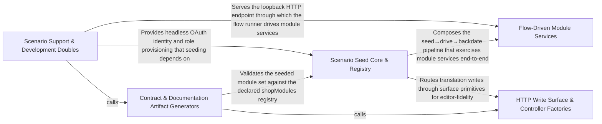

---
tags:
  - 2brain
  - 2brain/arch
  - project/boilerplate-node-backend
type: architecture
component: Scenario_Seed_Fixtures
---

## Details

The domain-agnostic seeding primitive and the per-module fixture tables (accounts, addresses, products, locales, blank, example) that every scenario writes its starting rows through.

### Scenario Support & Development Doubles [[Expand]](./Scenario_Support_Development_Doubles.md)
The non-production scaffolding the seed/flow path leans on to run unattended: the fake OAuth provider and development doubles that let the flow runner solve no human challenge, the loopback listener the flows are driven against, and the app-level security/rate-limit/system-route wiring that must be present for a listening demo server. This group also carries the kernel event/translation type surface (DomainEventMap, TranslationWritePlan) that the seeded rows and the write surface reference. It is the 'make the demo runnable headlessly' layer, distinct from the fixture data itself.

**Related Classes/Methods**:

- `scenarios.support.doubles.oauth-fake.fakeOAuthProvider`:32-53

**Source Files:**

- `scenarios/support/development-doubles.ts`
  - `scenarios.support.development-doubles.registerOAuthProvider('fake') callback` (L46-L46) - Function
- `scenarios/support/doubles/oauth-fake.ts`
  - `scenarios.support.doubles.oauth-fake.fakeOAuthProvider` (L32-L53) - Class
  - `scenarios.support.doubles.oauth-fake.fakeOAuthProvider.authorizeUrl` (L38-L39) - Method
  - `scenarios.support.doubles.oauth-fake.fakeOAuthProvider.exchangeCode` (L41-L52) - Method
- `scripts/docs/marker-block.ts`
  - `scripts.docs.marker-block.MarkerBlock` (L18-L22) - Interface
  - `scripts.docs.marker-block.MarkerPageOptions` (L25-L40) - Interface
- `scripts/regenerate-artifacts.ts`
  - `scripts.regenerate-artifacts.Step` (L35-L40) - Interface
- `src/app/security.ts`
  - `src.app.security.installSecurity.origin` (L139-L158) - Method
- `src/app/system-routes.ts`
  - `src.app.system-routes.router.get('/') callback` (L21-L23) - Function
- `src/globals.d.ts`
  - `src.globals.d.'express-serve-static-core'.Request` (L12-L70) - Interface
- `src/infrastructure/http/middlewares/rate-limit.ts`
  - `src.infrastructure.http.middlewares.rate-limit.refuseRateLimited` (L67-L86) - Class
  - `src.infrastructure.http.middlewares.rate-limit.refuseRateLimited.<function>` (L69-L86) - Function
  - `src.infrastructure.http.middlewares.rate-limit.BudgetCharge` (L188-L193) - Interface
- `src/infrastructure/http/read-capped-body.ts`
  - `src.infrastructure.http.read-capped-body.readCappedJson` (L51-L52) - Class
  - `src.infrastructure.http.read-capped-body.readCappedJson.then() callback` (L52-L52) - Function
- `src/infrastructure/http/request.ts`
  - `src.infrastructure.http.request.RequestInputDeclaration` (L109-L136) - Interface
- `src/infrastructure/http/response.ts`
  - `src.infrastructure.http.response.validationErrors` (L280-L288) - Class
  - `src.infrastructure.http.response.validationErrors.error.issues.map() callback` (L281-L288) - Function
- `src/infrastructure/i18n/context.ts`
  - `src.infrastructure.i18n.context.LocaleContext` (L21-L26) - Interface
- `src/infrastructure/observability/analytics/index.ts`
  - `src.infrastructure.observability.analytics.index.AnalyticsEventMap` (L27-L27) - Interface
  - `src.infrastructure.observability.analytics.index.AnalyticsEvent` (L44-L65) - Interface
- `src/infrastructure/observability/audit.ts`
  - `src.infrastructure.observability.audit.AuditActionMap` (L61-L61) - Interface
- `src/infrastructure/persistence/changes.ts`
  - `src.infrastructure.persistence.changes.SetAndUnset` (L19-L22) - Interface
- `src/infrastructure/security/breached-passwords/index.ts`
  - `src.infrastructure.security.breached-passwords.index.bundledList` (L36-L40) - Class
  - `src.infrastructure.security.breached-passwords.index.bundledList.filter() callback` (L39-L39) - Function
  - `src.infrastructure.security.breached-passwords.index.checkHibpRange` (L62-L99) - Class
  - `src.infrastructure.security.breached-passwords.index.checkHibpRange.then() callback` (L83-L89) - Function
  - `src.infrastructure.security.breached-passwords.index.checkHibpRange.then() callback.match` (L84-L87) - Class
  - `src.infrastructure.security.breached-passwords.index.checkHibpRange.then() callback.match.map() callback` (L86-L86) - Function
  - `src.infrastructure.security.breached-passwords.index.checkHibpRange.then() callback.match.find() callback` (L87-L87) - Function
  - `src.infrastructure.security.breached-passwords.index.checkHibpRange.catch() callback` (L90-L98) - Function
  - `src.infrastructure.security.breached-passwords.index.assertPasswordNotBreached` (L128-L139) - Class
  - `src.infrastructure.security.breached-passwords.index.assertPasswordNotBreached.then() callback` (L129-L138) - Function
- `src/infrastructure/security/password-hash.ts`
  - `src.infrastructure.security.password-hash.verifyPassword` (L103-L118) - Class
  - `src.infrastructure.security.password-hash.verifyPassword.then() callback` (L117-L117) - Function
- `src/infrastructure/security/reencrypt.ts`
  - `src.infrastructure.security.reencrypt.EncryptedField` (L31-L40) - Interface
  - `src.infrastructure.security.reencrypt.ReencryptReport` (L46-L51) - Interface
- `src/infrastructure/security/versioned-secret.ts`
  - `src.infrastructure.security.versioned-secret.VersionedKey` (L18-L21) - Interface
  - `src.infrastructure.security.versioned-secret.SecretBinding` (L57-L60) - Interface
- `src/kernel/events.ts`
  - `src.kernel.events.DomainEventMap` (L21-L21) - Interface
  - `src.kernel.events.DomainEventMeta` (L35-L41) - Interface
- `src/kernel/staff-read.ts`
  - `src.kernel.staff-read.StaffReadTarget` (L17-L28) - Interface
- `src/kernel/translation.ts`
  - `src.kernel.translation.TranslationWritePlan` (L165-L168) - Interface
- `src/modules/access/audit.ts`
  - `src.modules.access.audit.'@infrastructure/observability/audit'.AuditActionMap` (L19-L21) - Interface
- `src/modules/access/model.ts`
  - `src.modules.access.model.TenantDocument` (L33-L39) - Interface
  - `src.modules.access.model.MembershipDocument` (L49-L56) - Interface
- `src/modules/access/module.ts`
  - `src.modules.access.module.default.personalData.collect` (L27-L33) - Method
  - `src.modules.access.module.default.personalData.collect.then() callback` (L28-L32) - Function
  - `src.modules.access.module.default.personalData.collect.then() callback.memberships.map() callback` (L29-L32) - Function
- `src/modules/access/service.ts`
  - `src.modules.access.service.promoteVerifiedCustomer` (L303-L310) - Class
  - `src.modules.access.service.promoteVerifiedCustomer.then() callback` (L304-L310) - Function
  - `src.modules.access.service.promoteVerifiedCustomer.then() callback.then() callback` (L309-L309) - Function
- `src/modules/account/analytics.ts`
  - `src.modules.account.analytics.'@infrastructure/observability/analytics'.AnalyticsEventMap` (L24-L26) - Interface
- `src/modules/account/audit.ts`
  - `src.modules.account.audit.'@infrastructure/observability/audit'.AuditActionMap` (L84-L86) - Interface
- `src/modules/account/controllers/delete-oauth-link.ts`
  - `src.modules.account.controllers.delete-oauth-link.deleteOAuthLink` (L19-L33) - Class
  - `src.modules.account.controllers.delete-oauth-link.deleteOAuthLink.then() callback` (L26-L32) - Function
- `src/modules/account/controllers/get-account.ts`
  - `src.modules.account.controllers.get-account.getAccount` (L20-L41) - Class
  - `src.modules.account.controllers.get-account.getAccount.then() callback` (L28-L39) - Function
- `src/modules/account/controllers/get-oauth-callback.ts`
  - `src.modules.account.controllers.get-oauth-callback.getOAuthCallback` (L66-L203) - Class
  - `src.modules.account.controllers.get-oauth-callback.then() callback` (L134-L134) - Function
  - `src.modules.account.controllers.get-oauth-callback.getOAuthCallback.then() callback` (L135-L179) - Function
  - `src.modules.account.controllers.get-oauth-callback.then() callback.then() callback` (L143-L167) - Function
  - `src.modules.account.controllers.get-oauth-callback.then() callback.then() callback.then() callback` (L153-L156) - Function
  - `src.modules.account.controllers.get-oauth-callback.getOAuthCallback.then() callback.then() callback.then() callback` (L159-L166) - Function
  - `src.modules.account.controllers.get-oauth-callback.getOAuthCallback.then() callback.then() callback` (L170-L178) - Function
  - `src.modules.account.controllers.get-oauth-callback.getOAuthCallback.catch() callback` (L180-L202) - Function
- `src/modules/account/controllers/get-reauth-methods.ts`
  - `src.modules.account.controllers.get-reauth-methods.getReauthMethods` (L17-L27) - Class
  - `src.modules.account.controllers.get-reauth-methods.getReauthMethods.then() callback` (L22-L25) - Function
- `src/modules/account/controllers/post-2fa-method-send.ts`
  - `src.modules.account.controllers.post-2fa-method-send.post2faMethodSend` (L21-L39) - Class
  - `src.modules.account.controllers.post-2fa-method-send.post2faMethodSend.then() callback` (L29-L37) - Function
- `src/modules/account/controllers/post-2fa-setup.ts`
  - `src.modules.account.controllers.post-2fa-setup.post2faSetup` (L21-L41) - Class
  - `src.modules.account.controllers.post-2fa-setup.post2faSetup.then() callback` (L33-L39) - Function
- `src/modules/account/controllers/post-login-2fa.ts`
  - `src.modules.account.controllers.post-login-2fa.postLoginTwoFactor` (L33-L84) - Class
  - `src.modules.account.controllers.post-login-2fa.postLoginTwoFactor.then() callback` (L53-L79) - Function
  - `src.modules.account.controllers.post-login-2fa.postLoginTwoFactor.then() callback.then() callback` (L63-L77) - Function
  - `src.modules.account.controllers.post-login-2fa.postLoginTwoFactor.then() callback.then() callback.then() callback` (L65-L77) - Function
  - `src.modules.account.controllers.post-login-2fa.postLoginTwoFactor.catch() callback` (L80-L83) - Function
- `src/modules/account/controllers/post-login.ts`
  - `src.modules.account.controllers.post-login.postLogin` (L29-L125) - Class
  - `src.modules.account.controllers.post-login.postLogin.then() callback` (L70-L119) - Function
  - `src.modules.account.controllers.post-login.then() callback.pruned.then() callback` (L91-L91) - Function
  - `src.modules.account.controllers.post-login.then() callback.then() callback` (L92-L99) - Function
  - `src.modules.account.controllers.post-login.postLogin.then() callback.pruned.then() callback` (L103-L103) - Function
  - `src.modules.account.controllers.post-login.postLogin.then() callback.then() callback` (L104-L117) - Function
  - `src.modules.account.controllers.post-login.postLogin.then() callback.then() callback.then() callback` (L106-L117) - Function
  - `src.modules.account.controllers.post-login.postLogin.catch() callback` (L120-L124) - Function
- `src/modules/account/controllers/post-logout-everywhere.ts`
  - `src.modules.account.controllers.post-logout-everywhere.postLogoutEverywhere` (L19-L29) - Class
  - `src.modules.account.controllers.post-logout-everywhere.postLogoutEverywhere.then() callback` (L22-L27) - Function
- `src/modules/account/controllers/post-logout.ts`
  - `src.modules.account.controllers.post-logout.postLogout` (L21-L33) - Class
  - `src.modules.account.controllers.post-logout.postLogout.then() callback` (L26-L31) - Function
- `src/modules/account/controllers/post-password-change.ts`
  - `src.modules.account.controllers.post-password-change.postPasswordChange` (L42-L106) - Class
  - `src.modules.account.controllers.post-password-change.postPasswordChange.then() callback` (L67-L101) - Function
  - `src.modules.account.controllers.post-password-change.postPasswordChange.then() callback.then() callback` (L81-L89) - Function
  - `src.modules.account.controllers.post-password-change.postPasswordChange.then() callback.catch() callback` (L90-L100) - Function
  - `src.modules.account.controllers.post-password-change.postPasswordChange.catch() callback` (L102-L105) - Function
- `src/modules/account/controllers/post-pending-email-resend.ts`
  - `src.modules.account.controllers.post-pending-email-resend.postPendingEmailResend` (L18-L29) - Class
  - `src.modules.account.controllers.post-pending-email-resend.postPendingEmailResend.then() callback` (L24-L27) - Function
- `src/modules/account/controllers/post-reauth-method-send.ts`
  - `src.modules.account.controllers.post-reauth-method-send.postReauthMethodSend` (L21-L39) - Class
  - `src.modules.account.controllers.post-reauth-method-send.postReauthMethodSend.then() callback` (L29-L37) - Function
- `src/modules/account/controllers/post-reauth.ts`
  - `src.modules.account.controllers.post-reauth.postReauth` (L26-L64) - Class
  - `src.modules.account.controllers.post-reauth.postReauth.then() callback` (L41-L59) - Function
  - `src.modules.account.controllers.post-reauth.postReauth.then() callback.then() callback` (L55-L58) - Function
  - `src.modules.account.controllers.post-reauth.postReauth.catch() callback` (L60-L63) - Function
- `src/modules/account/controllers/post-signup.ts`
  - `src.modules.account.controllers.post-signup.postSignup` (L31-L133) - Class
  - `src.modules.account.controllers.post-signup.postSignup.then() callback` (L70-L128) - Function
  - `src.modules.account.controllers.post-signup.postSignup.then() callback.then() callback` (L118-L127) - Function
  - `src.modules.account.controllers.post-signup.postSignup.catch() callback` (L129-L132) - Function
- `src/modules/account/events.ts`
  - `src.modules.account.events.'@kernel/events'.DomainEventMap` (L13-L21) - Interface
- `src/modules/account/model.ts`
  - `src.modules.account.model.AccountExportDocument` (L23-L32) - Interface
- `src/modules/account/oauth/config.ts`
  - `src.modules.account.oauth.config.OAuthCredentials` (L54-L57) - Interface
- `src/modules/account/oauth/providers/github.ts`
  - `src.modules.account.oauth.providers.github.GithubUser` (L16-L21) - Interface
  - `src.modules.account.oauth.providers.github.GithubEmail` (L24-L28) - Interface
  - `src.modules.account.oauth.providers.github.githubApiGet` (L34-L48) - Class
  - `src.modules.account.oauth.providers.github.githubApiGet.then() callback` (L44-L48) - Function
  - `src.modules.account.oauth.providers.github.githubOAuthProvider` (L54-L138) - Class
  - `src.modules.account.oauth.providers.github.githubOAuthProvider.authorizeUrl` (L57-L72) - Method
  - `src.modules.account.oauth.providers.github.githubOAuthProvider.exchangeCode` (L74-L137) - Method
  - `src.modules.account.oauth.providers.github.exchangeCode.then() callback` (L97-L104) - Function
  - `src.modules.account.oauth.providers.github.githubOAuthProvider.exchangeCode.then() callback` (L116-L136) - Function
- `src/modules/account/oauth/providers/google.ts`
  - `src.modules.account.oauth.providers.google.GoogleIdTokenClaims` (L19-L28) - Interface
  - `src.modules.account.oauth.providers.google.googleOAuthProvider` (L57-L125) - Class
  - `src.modules.account.oauth.providers.google.googleOAuthProvider.authorizeUrl` (L60-L76) - Method
  - `src.modules.account.oauth.providers.google.googleOAuthProvider.exchangeCode` (L78-L124) - Method
  - `src.modules.account.oauth.providers.google.exchangeCode.then() callback` (L99-L105) - Function
  - `src.modules.account.oauth.providers.google.googleOAuthProvider.exchangeCode.then() callback` (L106-L123) - Function
- `src/modules/account/oauth/providers/index.ts`
  - `src.modules.account.oauth.providers.index.registry` (L25-L28) - Class
  - `src.modules.account.oauth.providers.index.registry.google` (L26-L26) - Method
  - `src.modules.account.oauth.providers.index.registry.github` (L27-L27) - Method
- `src/modules/account/oauth/providers/port.ts`
  - `src.modules.account.oauth.providers.port.OAuthIdentity` (L13-L27) - Interface
  - `src.modules.account.oauth.providers.port.OAuthProvider` (L30-L57) - Interface
  - `src.modules.account.oauth.providers.port.OAuthProvider.authorizeUrl` (L44-L44) - Method
  - `src.modules.account.oauth.providers.port.OAuthProvider.exchangeCode` (L56-L56) - Method
- `src/modules/account/roles.ts`
  - `src.modules.account.roles.isUnrestrictedCaller` (L16-L17) - Class
  - `src.modules.account.roles.isUnrestrictedCaller.then() callback` (L17-L17) - Function
- `src/modules/account/services/authentication.ts`
  - `src.modules.account.services.authentication.SignupInput` (L353-L378) - Interface
  - `src.modules.account.services.authentication.guardBreachedPassword` (L386-L389) - Class
  - `src.modules.account.services.authentication.guardBreachedPassword.then() callback` (L387-L388) - Function
  - `src.modules.account.services.authentication.guardEmailPolicy` (L398-L410) - Class
  - `src.modules.account.services.authentication.guardEmailPolicy.then() callback` (L399-L409) - Function
  - `src.modules.account.services.authentication.createAccountIfEmailFree` (L417-L456) - Class
  - `src.modules.account.services.authentication.createAccountIfEmailFree.then() callback` (L422-L455) - Function
  - `src.modules.account.services.authentication.then() callback.then() callback` (L436-L448) - Function
  - `src.modules.account.services.authentication.then() callback.then() callback.then() callback` (L443-L443) - Function
  - `src.modules.account.services.authentication.createAccountIfEmailFree.then() callback.then() callback.then() callback.then() callback` (L445-L447) - Function
  - `src.modules.account.services.authentication.createAccountIfEmailFree.then() callback.then() callback` (L450-L453) - Function
  - `src.modules.account.services.authentication.createAccountIfEmailFree.then() callback.then() callback.then() callback` (L453-L453) - Function
  - `src.modules.account.services.authentication.createAccountIfEmailFree.catch() callback` (L456-L456) - Function
  - `src.modules.account.services.authentication.signup` (L464-L542) - Class
  - `src.modules.account.services.authentication.signup.outcome` (L502-L510) - Class
  - `src.modules.account.services.authentication.outcome.then() callback` (L505-L505) - Function
  - `src.modules.account.services.authentication.signup.outcome.then() callback` (L512-L541) - Function
  - `src.modules.account.services.authentication.login` (L547-L580) - Class
  - `src.modules.account.services.authentication.login.then() callback` (L565-L577) - Function
  - `src.modules.account.services.authentication.login.then() callback.then() callback` (L571-L575) - Function
  - `src.modules.account.services.authentication.login.catch() callback` (L578-L578) - Function
  - `src.modules.account.services.authentication.logoutEverywhere` (L589-L634) - Class
  - `src.modules.account.services.authentication.logoutEverywhere.then() callback.then() callback` (L617-L617) - Function
  - `src.modules.account.services.authentication.logoutEverywhere.catch() callback` (L620-L620) - Function
  - `src.modules.account.services.authentication.logoutEverywhere.then() callback` (L621-L634) - Function
  - `src.modules.account.services.authentication.verifyOwnPassword` (L648-L665) - Class
  - `src.modules.account.services.authentication.verifyOwnPassword.then() callback` (L656-L665) - Function
  - `src.modules.account.services.authentication.verifyOwnPassword.then() callback.then() callback` (L662-L663) - Function
- `src/modules/account/services/oauth.ts`
  - `src.modules.account.services.oauth.OAuthEmailUnverifiedError` (L30-L36) - Class
  - `src.modules.account.services.oauth.OAuthEmailUnverifiedError.constructor` (L32-L35) - Constructor
  - `src.modules.account.services.oauth.OAuthAccountUnverifiedError` (L49-L55) - Class
  - `src.modules.account.services.oauth.OAuthAccountUnverifiedError.constructor` (L51-L54) - Constructor
  - `src.modules.account.services.oauth.linkToExistingAccount` (L66-L98) - Class
  - `src.modules.account.services.oauth.linkToExistingAccount.then() callback` (L78-L97) - Function
  - `src.modules.account.services.oauth.linkToExistingAccount.then() callback.then() callback` (L81-L97) - Function
  - `src.modules.account.services.oauth.loginOrCreateFromOAuth` (L214-L249) - Class
  - `src.modules.account.services.oauth.loginOrCreateFromOAuth.then() callback` (L224-L249) - Function
  - `src.modules.account.services.oauth.loginOrCreateFromOAuth.then() callback.then() callback` (L229-L248) - Function
  - `src.modules.account.services.oauth.then() callback.then() callback.then() callback` (L235-L238) - Function
  - `src.modules.account.services.oauth.loginOrCreateFromOAuth.then() callback.then() callback.then() callback` (L244-L247) - Function
- `src/modules/account/services/profile.ts`
  - `src.modules.account.services.profile.passwordChange` (L122-L139) - Class
  - `src.modules.account.services.profile.passwordChange.then() callback` (L134-L138) - Function
  - `src.modules.account.services.profile.writePassword` (L150-L168) - Class
  - `src.modules.account.services.profile.writePassword.then() callback` (L157-L166) - Function
  - `src.modules.account.services.profile.writePassword.then() callback.catch() callback` (L159-L165) - Function
  - `src.modules.account.services.profile.writePassword.then() callback.then() callback` (L166-L166) - Function
  - `src.modules.account.services.profile.writePassword.catch() callback` (L168-L168) - Function
  - `src.modules.account.services.profile.passwordResetChange` (L207-L215) - Class
  - `src.modules.account.services.profile.passwordResetChange.then() callback` (L213-L214) - Function
  - `src.modules.account.services.profile.afterReset` (L227-L283) - Class
  - `src.modules.account.services.profile.afterReset.catch() callback` (L247-L255) - Function
  - `src.modules.account.services.profile.afterReset.then() callback` (L282-L282) - Function
  - `src.modules.account.services.profile.resetWith` (L305-L321) - Class
  - `src.modules.account.services.profile.resetWith.then() callback` (L311-L321) - Function
  - `src.modules.account.services.profile.resetWith.then() callback.then() callback` (L314-L319) - Function
  - `src.modules.account.services.profile.resetWith.then() callback.then() callback.then() callback` (L316-L317) - Function
  - `src.modules.account.services.profile.completePasswordReset` (L338-L352) - Class
  - `src.modules.account.services.profile.completePasswordReset.then() callback` (L348-L349) - Function
  - `src.modules.account.services.profile.completePasswordReset.catch() callback` (L351-L351) - Function
  - `src.modules.account.services.profile.updateProfile` (L628-L661) - Class
  - `src.modules.account.services.profile.passwordChangeWithCurrent.outcome` (L679-L688) - Class
  - `src.modules.account.services.profile.passwordChangeWithCurrent.outcome.catch() callback` (L688-L688) - Function
  - `src.modules.account.services.profile.passwordChangeWithCurrent.outcome.then() callback` (L690-L696) - Function
- `src/modules/account/services/reauth.ts`
  - `src.modules.account.services.reauth.ReauthProven` (L70-L72) - Interface
  - `src.modules.account.services.reauth.withCaller` (L90-L98) - Class
  - `src.modules.account.services.reauth.withCaller.then() callback` (L97-L97) - Function
  - `src.modules.account.services.reauth.withCaller.catch() callback` (L98-L98) - Function
  - `src.modules.account.services.reauth.reauthMethods` (L105-L108) - Class
  - `src.modules.account.services.reauth.reauthMethods.withCaller() callback` (L108-L108) - Function
  - `src.modules.account.services.reauth.sendReauthCode` (L161-L181) - Class
  - `src.modules.account.services.reauth.sendReauthCode.withCaller() callback` (L166-L174) - Function
  - `src.modules.account.services.reauth.sendReauthCode.then() callback` (L174-L181) - Function
  - `src.modules.account.services.reauth.codeMatches` (L193-L199) - Class
  - `src.modules.account.services.reauth.codeMatches.then() callback` (L198-L198) - Function
  - `src.modules.account.services.reauth.proveMethod` (L206-L234) - Class
  - `src.modules.account.services.reauth.proveMethod.proved.then() callback` (L225-L232) - Function
  - `src.modules.account.services.reauth.proveOtp` (L241-L252) - Class
  - `src.modules.account.services.reauth.proveOtp.then() callback` (L249-L250) - Function
  - `src.modules.account.services.reauth.reauth` (L267-L283) - Class
  - `src.modules.account.services.reauth.reauth.withCaller() callback` (L272-L275) - Function
  - `src.modules.account.services.reauth.reauth.withCaller() callback.then() callback` (L273-L274) - Function
  - `src.modules.account.services.reauth.reauth.then() callback` (L276-L283) - Function
- `src/modules/account/services/revocation.ts`
  - `src.modules.account.services.revocation.revokeAllSessions` (L26-L29) - Class
  - `src.modules.account.services.revocation.revokeAllSessions.then() callback` (L29-L29) - Function
  - `src.modules.account.services.revocation.revokeAfterPasswordChange` (L51-L56) - Class
  - `src.modules.account.services.revocation.then() callback` (L53-L54) - Function
  - `src.modules.account.services.revocation.revokeAfterPasswordChange.then() callback.PENDING_TOKEN_TYPES.map() callback` (L54-L54) - Function
  - `src.modules.account.services.revocation.revokeAfterPasswordChange.then() callback` (L56-L56) - Function
- `src/modules/account/services/tokens.ts`
  - `src.modules.account.services.tokens.findLiveTokenEntry` (L35-L50) - Class
  - `src.modules.account.services.tokens.findLiveTokenEntry.then() callback` (L39-L50) - Function
  - `src.modules.account.services.tokens.findLiveTokenEntry.then() callback.entry.user.tokens.find() callback` (L45-L45) - Function
  - `src.modules.account.services.tokens.findLiveToken` (L58-L62) - Class
  - `src.modules.account.services.tokens.findLiveToken.then() callback` (L62-L62) - Function
  - `src.modules.account.services.tokens.redeemLiveToken` (L86-L96) - Class
  - `src.modules.account.services.tokens.redeemLiveToken.then() callback` (L90-L96) - Function
  - `src.modules.account.services.tokens.redeemLiveToken.then() callback.then() callback` (L93-L94) - Function
- `src/modules/account/services/two-factor.ts`
  - `src.modules.account.services.two-factor.rejectWrongCode` (L133-L142) - Class
  - `src.modules.account.services.two-factor.rejectWrongCode.catch() callback` (L138-L141) - Function
  - `src.modules.account.services.two-factor.rejectWrongCode.then() callback` (L142-L142) - Function
  - `src.modules.account.services.two-factor.armedEntries` (L172-L173) - Class
  - `src.modules.account.services.two-factor.armedEntries.filter() callback` (L173-L173) - Function
  - `src.modules.account.services.two-factor.verifyInOrder` (L213-L223) - Class
  - `src.modules.account.services.two-factor.verifyInOrder.then() callback` (L222-L222) - Function
  - `src.modules.account.services.two-factor.verifyAnyFactor` (L229-L232) - Class
  - `src.modules.account.services.two-factor.verifyAnyFactor.then() callback` (L231-L231) - Function
  - `src.modules.account.services.two-factor.verifyArmedFactor` (L252-L266) - Class
  - `src.modules.account.services.two-factor.verifyArmedFactor.then() callback` (L257-L266) - Function
  - `src.modules.account.services.two-factor.verifyArmedFactor.then() callback.then() callback` (L261-L264) - Function
  - `src.modules.account.services.two-factor.verifyArmedFactor.then() callback.then() callback.then() callback` (L263-L263) - Function
  - `src.modules.account.services.two-factor.proveSecondFactor` (L293-L306) - Class
  - `src.modules.account.services.two-factor.proveSecondFactor.then() callback` (L301-L304) - Function
  - `src.modules.account.services.two-factor.proveSecondFactor.then() callback.settleVerdict() callback` (L302-L303) - Function
  - `src.modules.account.services.two-factor.proveSecondFactor.then() callback.settleVerdict() callback.then() callback` (L303-L303) - Function
  - `src.modules.account.services.two-factor.withVerifiedCode` (L321-L340) - Class
  - `src.modules.account.services.two-factor.withVerifiedCode.then() callback` (L330-L339) - Function
  - `src.modules.account.services.two-factor.withVerifiedCode.then() callback.then() callback` (L336-L337) - Function
  - `src.modules.account.services.two-factor.withVerifiedCode.then() callback.then() callback.settleVerdict() callback` (L337-L337) - Function
  - `src.modules.account.services.two-factor.withVerifiedCode.catch() callback` (L340-L340) - Function
  - `src.modules.account.services.two-factor.syncArmedState` (L350-L354) - Class
  - `src.modules.account.services.two-factor.syncArmedState.user.twoFactorMethods.some() callback` (L351-L351) - Function
  - `src.modules.account.services.two-factor.buildLoginChallenge` (L417-L438) - Class
  - `src.modules.account.services.two-factor.buildLoginChallenge.then() callback` (L431-L437) - Function
  - `src.modules.account.services.two-factor.buildLoginChallenge.then() callback.methods.armed.map() callback` (L435-L435) - Function
  - `src.modules.account.services.two-factor.twoFactorStatus` (L445-L473) - Class
  - `src.modules.account.services.two-factor.twoFactorStatus.then() callback` (L450-L472) - Function
  - `src.modules.account.services.two-factor.twoFactorStatus.then() callback.methods.enrolled.map() callback` (L460-L463) - Function
  - `src.modules.account.services.two-factor.twoFactorStatus.then() callback.available.filter() callback` (L465-L465) - Function
  - `src.modules.account.services.two-factor.twoFactorStatus.then() callback.available.map() callback` (L466-L469) - Function
  - `src.modules.account.services.two-factor.twoFactorStatus.catch() callback` (L473-L473) - Function
  - `src.modules.account.services.two-factor.setupTwoFactorMethod` (L484-L517) - Class
  - `src.modules.account.services.two-factor.setupTwoFactorMethod.then() callback` (L496-L515) - Function
  - `src.modules.account.services.two-factor.setupTwoFactorMethod.then() callback.then() callback` (L512-L513) - Function
  - `src.modules.account.services.two-factor.setupTwoFactorMethod.then() callback.then() callback.settleVerdict() callback` (L513-L513) - Function
  - `src.modules.account.services.two-factor.setupTwoFactorMethod.catch() callback` (L516-L516) - Function
  - `src.modules.account.services.two-factor.beginSetup` (L525-L543) - Class
  - `src.modules.account.services.two-factor.beginSetup.then() callback` (L539-L542) - Function
  - `src.modules.account.services.two-factor.beginSetup.then() callback.then() callback` (L541-L541) - Function
  - `src.modules.account.services.two-factor.sendMethodCode.outcome` (L562-L580) - Class
  - `src.modules.account.services.two-factor.sendMethodCode.outcome.then() callback` (L564-L579) - Function
  - `src.modules.account.services.two-factor.sendMethodCode.outcome.then() callback.then() callback` (L576-L577) - Function
  - `src.modules.account.services.two-factor.sendMethodCode.outcome.then() callback.then() callback.then() callback` (L577-L577) - Function
  - `src.modules.account.services.two-factor.sendMethodCode.outcome.catch() callback` (L580-L580) - Function
  - `src.modules.account.services.two-factor.confirmTwoFactorMethod.outcome` (L609-L629) - Class
  - `src.modules.account.services.two-factor.confirmTwoFactorMethod.outcome.then() callback` (L611-L628) - Function
  - `src.modules.account.services.two-factor.confirmTwoFactorMethod.outcome.then() callback.then() callback` (L620-L626) - Function
  - `src.modules.account.services.two-factor.confirmTwoFactorMethod.outcome.then() callback.then() callback.then() callback` (L622-L625) - Function
  - `src.modules.account.services.two-factor.confirmTwoFactorMethod.outcome.catch() callback` (L629-L629) - Function
  - `src.modules.account.services.two-factor.armMethod` (L638-L665) - Class
  - `src.modules.account.services.two-factor.then() callback` (L657-L657) - Function
  - `src.modules.account.services.two-factor.armMethod.then() callback` (L658-L663) - Function
  - `src.modules.account.services.two-factor.removeTwoFactorMethod.outcome` (L690-L719) - Class
  - `src.modules.account.services.two-factor.removeTwoFactorMethod.outcome.withVerifiedCode() callback.user.twoFactorMethods.findIndex() callback` (L696-L696) - Function
  - `src.modules.account.services.two-factor.removeTwoFactorMethod.outcome.withVerifiedCode() callback` (L702-L718) - Function
  - `src.modules.account.services.two-factor.removeTwoFactorMethod.outcome.withVerifiedCode() callback.then() callback` (L708-L717) - Function
  - `src.modules.account.services.two-factor.disableTwoFactor.outcome` (L737-L756) - Class
  - `src.modules.account.services.two-factor.outcome.withVerifiedCode() callback` (L741-L744) - Function
  - `src.modules.account.services.two-factor.disableTwoFactor.outcome.withVerifiedCode() callback` (L745-L755) - Function
  - `src.modules.account.services.two-factor.outcome.withVerifiedCode() callback.then() callback` (L750-L750) - Function
  - `src.modules.account.services.two-factor.disableTwoFactor.outcome.withVerifiedCode() callback.then() callback` (L751-L754) - Function
  - `src.modules.account.services.two-factor.regenerateBackupCodes.outcome` (L775-L795) - Class
  - `src.modules.account.services.two-factor.regenerateBackupCodes.outcome.withVerifiedCode() callback` (L783-L794) - Function
  - `src.modules.account.services.two-factor.regenerateBackupCodes.outcome.withVerifiedCode() callback.then() callback` (L788-L792) - Function
  - `src.modules.account.services.two-factor.sendLoginCode.outcome` (L814-L834) - Class
  - `src.modules.account.services.two-factor.sendLoginCode.outcome.then() callback` (L815-L833) - Function
  - `src.modules.account.services.two-factor.sendLoginCode.outcome.then() callback.armed` (L818-L818) - Class
  - `src.modules.account.services.two-factor.sendLoginCode.outcome.then() callback.armed.find() callback` (L818-L818) - Function
  - `src.modules.account.services.two-factor.sendLoginCode.outcome.then() callback.then() callback` (L830-L831) - Function
  - `src.modules.account.services.two-factor.sendLoginCode.outcome.then() callback.then() callback.then() callback` (L831-L831) - Function
  - `src.modules.account.services.two-factor.sendLoginCode.outcome.catch() callback` (L834-L834) - Function
  - `src.modules.account.services.two-factor.VerifiedChallenge` (L840-L843) - Interface
  - `src.modules.account.services.two-factor.verifyLoginChallenge` (L854-L896) - Class
  - `src.modules.account.services.two-factor.verifyLoginChallenge.outcome` (L859-L883) - Class
  - `src.modules.account.services.two-factor.verifyLoginChallenge.outcome.then() callback.then() callback` (L865-L880) - Function
  - `src.modules.account.services.two-factor.verifyLoginChallenge.outcome.then() callback.then() callback.settleVerdict() callback` (L866-L879) - Function
  - `src.modules.account.services.two-factor.verifyLoginChallenge.outcome.then() callback.then() callback.settleVerdict() callback.then() callback` (L871-L878) - Function
  - `src.modules.account.services.two-factor.verifyLoginChallenge.outcome.then() callback.then() callback.settleVerdict() callback.then() callback.then() callback` (L875-L876) - Function
  - `src.modules.account.services.two-factor.verifyLoginChallenge.outcome.catch() callback` (L883-L883) - Function
  - `src.modules.account.services.two-factor.verifyLoginChallenge.outcome.then() callback` (L888-L895) - Function
- `src/modules/account/services/verification.ts`
  - `src.modules.account.services.verification.markVerified` (L263-L266) - Class
  - `src.modules.account.services.verification.markVerified.then() callback` (L265-L265) - Function
  - `src.modules.account.services.verification.auditProvenAddress` (L277-L290) - Class
  - `src.modules.account.services.verification.auditProvenAddress.then() callback` (L282-L290) - Function
  - `src.modules.account.services.verification.completeEmailVerification` (L298-L312) - Class
  - `src.modules.account.services.verification.completeEmailVerification.then() callback.then() callback` (L308-L308) - Function
  - `src.modules.account.services.verification.completeEmailVerification.then() callback` (L310-L311) - Function
  - `src.modules.account.services.verification.completeEmailChange` (L328-L360) - Class
  - `src.modules.account.services.verification.completeEmailChange.then() callback.catch() callback` (L348-L354) - Function
  - `src.modules.account.services.verification.completeEmailChange.then() callback.then() callback` (L355-L355) - Function
  - `src.modules.account.services.verification.completeEmailChange.then() callback` (L357-L358) - Function
  - `src.modules.account.services.verification.undoEmailChange` (L378-L394) - Class
  - `src.modules.account.services.verification.undoEmailChange.then() callback.then() callback` (L391-L391) - Function
  - `src.modules.account.services.verification.undoEmailChange.then() callback` (L392-L393) - Function
- `src/modules/account/session/config.ts`
  - `src.modules.account.session.config.RefreshTokenExpiryTime` (L14-L18) - Enum
  - `src.modules.account.session.config.toRememberTier` (L27-L30) - Class
  - `src.modules.account.session.config.toRememberTier.find() callback` (L30-L30) - Function
- `src/modules/account/session/session.ts`
  - `src.modules.account.session.session.issueSession` (L27-L38) - Class
  - `src.modules.account.session.session.issueSession.then() callback` (L33-L38) - Function
  - `src.modules.account.session.session.reissueSession` (L53-L63) - Class
  - `src.modules.account.session.session.reissueSession.then() callback.then() callback` (L62-L62) - Function
- `src/modules/account/two-factor/backup-codes.ts`
  - `src.modules.account.two-factor.backup-codes.generateBackupCodes` (L50-L51) - Class
  - `src.modules.account.two-factor.backup-codes.generateBackupCodes.Array.from() callback` (L51-L51) - Function
  - `src.modules.account.two-factor.backup-codes.hashBackupCodes` (L54-L55) - Class
  - `src.modules.account.two-factor.backup-codes.hashBackupCodes.codes.map() callback` (L55-L55) - Function
- `src/modules/account/two-factor/methods/email.ts`
  - `src.modules.account.two-factor.methods.email.emailMethod` (L77-L102) - Class
  - `src.modules.account.two-factor.methods.email.emailMethod.available` (L85-L85) - Method
  - `src.modules.account.two-factor.methods.email.emailMethod.eligibility` (L87-L90) - Method
  - `src.modules.account.two-factor.methods.email.emailMethod.target` (L92-L92) - Method
  - `src.modules.account.two-factor.methods.email.emailMethod.setup` (L96-L97) - Method
  - `src.modules.account.two-factor.methods.email.emailMethod.setup.then() callback` (L97-L97) - Function
  - `src.modules.account.two-factor.methods.email.emailMethod.verify` (L101-L101) - Method
- `src/modules/account/two-factor/methods/totp.ts`
  - `src.modules.account.two-factor.methods.totp.totpMethod` (L17-L61) - Class
  - `src.modules.account.two-factor.methods.totp.totpMethod.available` (L20-L20) - Method
  - `src.modules.account.two-factor.methods.totp.totpMethod.eligibility` (L21-L21) - Method
  - `src.modules.account.two-factor.methods.totp.totpMethod.target` (L22-L22) - Method
  - `src.modules.account.two-factor.methods.totp.totpMethod.setup` (L24-L39) - Method
  - `src.modules.account.two-factor.methods.totp.totpMethod.verify` (L41-L60) - Method
  - `src.modules.account.two-factor.methods.totp.totpMethod.verify.then() callback` (L47-L59) - Function
  - `src.modules.account.two-factor.methods.totp.totpMethod.verify.then() callback.then() callback` (L55-L58) - Function
- `src/modules/account/two-factor/registry.ts`
  - `src.modules.account.two-factor.registry.MethodEligibility` (L16-L21) - Interface
  - `src.modules.account.two-factor.registry.TwoFactorMethodHandler` (L28-L67) - Interface
  - `src.modules.account.two-factor.registry.TwoFactorMethodHandler.available` (L40-L40) - Method
  - `src.modules.account.two-factor.registry.TwoFactorMethodHandler.eligibility` (L43-L43) - Method
  - `src.modules.account.two-factor.registry.TwoFactorMethodHandler.target` (L46-L46) - Method
  - `src.modules.account.two-factor.registry.TwoFactorMethodHandler.setup` (L52-L56) - Method
  - `src.modules.account.two-factor.registry.TwoFactorMethodHandler.verify` (L59-L59) - Method
  - `src.modules.account.two-factor.registry.TwoFactorMethodHandler.send` (L62-L66) - Method
  - `src.modules.account.two-factor.registry.availableTwoFactorMethods` (L77-L78) - Class
  - `src.modules.account.two-factor.registry.availableTwoFactorMethods.HANDLERS.filter() callback` (L78-L78) - Function
  - `src.modules.account.two-factor.registry.twoFactorMethod` (L87-L88) - Class
  - `src.modules.account.two-factor.registry.twoFactorMethod.find() callback` (L88-L88) - Function
  - `src.modules.account.two-factor.registry.orderedEntries` (L97-L103) - Class
  - `src.modules.account.two-factor.registry.orderedEntries.flatMap() callback` (L100-L103) - Function
  - `src.modules.account.two-factor.registry.flatMap() callback.entry` (L101-L101) - Class
  - `src.modules.account.two-factor.registry.orderedEntries.flatMap() callback.entry.entries.find() callback` (L101-L101) - Function
- `src/modules/account/two-factor/totp.ts`
  - `src.modules.account.two-factor.totp.TotpVerification` (L76-L81) - Interface
  - `src.modules.account.two-factor.totp.verifyTotpCode` (L91-L118) - Class
  - `src.modules.account.two-factor.totp.verifyTotpCode.then() callback` (L105-L111) - Function
  - `src.modules.account.two-factor.totp.verifyTotpCode.catch() callback` (L117-L117) - Function
- `src/modules/addresses/presenter.ts`
  - `src.modules.addresses.presenter.presentAddresses.addresses.map() callback` (L46-L46) - Function
- `src/modules/api-keys/audit.ts`
  - `src.modules.api-keys.audit.'@infrastructure/observability/audit'.AuditActionMap` (L18-L20) - Interface
- `src/modules/api-keys/credentials.ts`
  - `src.modules.api-keys.credentials.MintedApiKey` (L34-L38) - Interface
- `src/modules/cart/analytics.ts`
  - `src.modules.cart.analytics.'@infrastructure/observability/analytics'.AnalyticsEventMap` (L34-L36) - Interface
- `src/modules/cart/audit.ts`
  - `src.modules.cart.audit.'@infrastructure/observability/audit'.AuditActionMap` (L21-L23) - Interface
- `src/modules/cart/events.ts`
  - `src.modules.cart.events.'@kernel/events'.DomainEventMap` (L9-L43) - Interface
- `src/modules/cart/factories.ts`
  - `src.modules.cart.factories.CartOverrides` (L17-L22) - Interface
- `src/modules/delivery/audit.ts`
  - `src.modules.delivery.audit.'@infrastructure/observability/audit'.AuditActionMap` (L20-L22) - Interface
- `src/modules/example/analytics.ts`
  - `src.modules.example.analytics.'@infrastructure/observability/analytics'.AnalyticsEventMap` (L15-L17) - Interface
- `src/modules/example/audit.ts`
  - `src.modules.example.audit.'@infrastructure/observability/audit'.AuditActionMap` (L19-L21) - Interface
- `src/modules/example/events.ts`
  - `src.modules.example.events.'@kernel/events'.DomainEventMap` (L12-L15) - Interface
- `src/modules/example/factories.ts`
  - `src.modules.example.factories.ExampleOverrides` (L12-L25) - Interface
- `src/modules/feedback/audit.ts`
  - `src.modules.feedback.audit.'@infrastructure/observability/audit'.AuditActionMap` (L18-L20) - Interface
- `src/modules/inventory/audit.ts`
  - `src.modules.inventory.audit.'@infrastructure/observability/audit'.AuditActionMap` (L24-L26) - Interface
- `src/modules/inventory/events.ts`
  - `src.modules.inventory.events.'@kernel/events'.DomainEventMap` (L14-L21) - Interface
- `src/modules/invoicing/audit.ts`
  - `src.modules.invoicing.audit.'@infrastructure/observability/audit'.AuditActionMap` (L15-L17) - Interface
- `src/modules/invoicing/presenter.ts`
  - `src.modules.invoicing.presenter.ExportedDocument` (L12-L18) - Interface
- `src/modules/locales/audit.ts`
  - `src.modules.locales.audit.'@infrastructure/observability/audit'.AuditActionMap` (L33-L35) - Interface
- `src/modules/locales/model.ts`
  - `src.modules.locales.model.derivesBaseLanguage` (L147-L149) - Function
- `src/modules/notifications/factories.ts`
  - `src.modules.notifications.factories.NotificationOverrides` (L12-L26) - Interface
- `src/modules/orders/analytics.ts`
  - `src.modules.orders.analytics.'@infrastructure/observability/analytics'.AnalyticsEventMap` (L26-L28) - Interface
- `src/modules/orders/audit.ts`
  - `src.modules.orders.audit.'@infrastructure/observability/audit'.AuditActionMap` (L30-L32) - Interface
- `src/modules/orders/events.ts`
  - `src.modules.orders.events.'@kernel/events'.DomainEventMap` (L13-L60) - Interface
- `src/modules/orders/services/notify.ts`
  - `src.modules.orders.services.notify.catch() callback` (L90-L99) - Function
- `src/modules/payments/analytics.ts`
  - `src.modules.payments.analytics.'@infrastructure/observability/analytics'.AnalyticsEventMap` (L26-L28) - Interface
- `src/modules/payments/audit.ts`
  - `src.modules.payments.audit.'@infrastructure/observability/audit'.AuditActionMap` (L35-L37) - Interface
- `src/modules/payments/events.ts`
  - `src.modules.payments.events.'@kernel/events'.DomainEventMap` (L10-L58) - Interface
- `src/modules/payments/globals.d.ts`
  - `src.modules.payments.globals.d.'express-serve-static-core'.Request` (L15-L24) - Interface
- `src/modules/products/analytics.ts`
  - `src.modules.products.analytics.'@infrastructure/observability/analytics'.AnalyticsEventMap` (L18-L20) - Interface
- `src/modules/products/audit.ts`
  - `src.modules.products.audit.'@infrastructure/observability/audit'.AuditActionMap` (L18-L20) - Interface
- `src/modules/products/events.ts`
  - `src.modules.products.events.'@kernel/events'.DomainEventMap` (L10-L59) - Interface
- `src/modules/products/services/translated-write.ts`
  - `src.modules.products.services.translated-write.prefixTranslationErrors.errors.rejection.errors.map() callback` (L66-L72) - Function
  - `src.modules.products.services.translated-write.ProductImageExtras` (L80-L84) - Interface
  - `src.modules.products.services.translated-write.then() callback.translations` (L225-L230) - Class
- `src/modules/returns/audit.ts`
  - `src.modules.returns.audit.'@infrastructure/observability/audit'.AuditActionMap` (L19-L21) - Interface
- `src/modules/returns/events.ts`
  - `src.modules.returns.events.'@kernel/events'.DomainEventMap` (L10-L35) - Interface
- `src/modules/users/analytics.ts`
  - `src.modules.users.analytics.'@infrastructure/observability/analytics'.AnalyticsEventMap` (L21-L23) - Interface
- `src/modules/users/audit.ts`
  - `src.modules.users.audit.'@infrastructure/observability/audit'.AuditActionMap` (L39-L41) - Interface
- `src/modules/users/events.ts`
  - `src.modules.users.events.'@kernel/events'.DomainEventMap` (L10-L16) - Interface
- `src/modules/webhooks/audit.ts`
  - `src.modules.webhooks.audit.'@infrastructure/observability/audit'.AuditActionMap` (L25-L27) - Interface
- `src/modules/webhooks/services/catalogue.ts`
  - `src.modules.webhooks.services.catalogue.AsyncApiChannelsDocument` (L14-L16) - Interface
- `src/modules/webhooks/services/deliveries.ts`
  - `src.modules.webhooks.services.deliveries.DeliveryListFilters` (L29-L34) - Interface
- `src/modules/wishlist/analytics.ts`
  - `src.modules.wishlist.analytics.'@infrastructure/observability/analytics'.AnalyticsEventMap` (L19-L21) - Interface
- `src/modules/wishlist/events.ts`
  - `src.modules.wishlist.events.'@kernel/events'.DomainEventMap` (L9-L22) - Interface
- `src/modules/wishlist/presenter.ts`
  - `src.modules.wishlist.presenter.WishlistView` (L11-L13) - Interface
  - `src.modules.wishlist.presenter.presentWishlist.items.map() callback` (L17-L17) - Function

### HTTP Write Surface & Controller Factories [[Expand]](./HTTP_Write_Surface_Controller_Factories.md)
The infrastructure HTTP layer that both the seed fixtures and the driven flows write through. It provides the generic controller factories (createItemController, createListController, createDeleteController, createRestoreController), the namedHandler binding, id/upload helpers (RequiredId, readUploadedImage, writeWithUploadedImage), and the surfaces spec types. The product seeder deliberately routes its translation writes through this surface's planTranslations/writeTranslations primitives rather than a raw repository insert, so the seeded translations rows match what a real editor's write would produce.

**Related Classes/Methods**:

- `src.infrastructure.http.controller.namedHandler`:46-54
- `src.infrastructure.surfaces.create-item-controller.createItemController`:48-74
- `src.infrastructure.surfaces.create-list-controller.createListController`:49-76
- `src.infrastructure.surfaces.create-delete-controller.createDeleteController`:50-83
- `src.infrastructure.http.uploads.writeWithUploadedImage`:142-157

**Source Files:**

- `src/infrastructure/http/controller.ts`
  - `src.infrastructure.http.controller.namedHandler` (L46-L54) - Class
  - `src.infrastructure.http.controller.namedHandler.[operation]` (L52-L52) - Method
- `src/infrastructure/http/ids.ts`
  - `src.infrastructure.http.ids.RequiredId` (L65-L76) - Interface
- `src/infrastructure/http/uploads.ts`
  - `src.infrastructure.http.uploads.readUploadedImage` (L68-L113) - Class
  - `src.infrastructure.http.uploads.writeWithUploadedImage` (L142-L157) - Class
  - `src.infrastructure.http.uploads.writeWithUploadedImage.then() callback` (L153-L156) - Function
- `src/infrastructure/surfaces/create-delete-controller.ts`
  - `src.infrastructure.surfaces.create-delete-controller.DeleteControllerSpec` (L27-L42) - Interface
  - `src.infrastructure.surfaces.create-delete-controller.createDeleteController` (L50-L83) - Class
  - `src.infrastructure.surfaces.create-delete-controller.createDeleteController.namedHandler() callback` (L54-L82) - Function
  - `src.infrastructure.surfaces.create-delete-controller.createDeleteController.namedHandler() callback.withIfMatch() callback` (L74-L74) - Function
  - `src.infrastructure.surfaces.create-delete-controller.createDeleteController.namedHandler() callback.then() callback` (L75-L80) - Function
- `src/infrastructure/surfaces/create-item-controller.ts`
  - `src.infrastructure.surfaces.create-item-controller.ItemControllerSpec` (L18-L40) - Interface
  - `src.infrastructure.surfaces.create-item-controller.createItemController` (L48-L74) - Class
  - `src.infrastructure.surfaces.create-item-controller.createItemController.namedHandler() callback` (L57-L73) - Function
  - `src.infrastructure.surfaces.create-item-controller.createItemController.namedHandler() callback.then() callback` (L63-L71) - Function
- `src/infrastructure/surfaces/create-list-controller.ts`
  - `src.infrastructure.surfaces.create-list-controller.ListControllerSpec` (L17-L41) - Interface
  - `src.infrastructure.surfaces.create-list-controller.createListController` (L49-L76) - Class
  - `src.infrastructure.surfaces.create-list-controller.createListController.namedHandler() callback` (L58-L75) - Function
  - `src.infrastructure.surfaces.create-list-controller.createListController.namedHandler() callback.then() callback` (L71-L73) - Function
- `src/infrastructure/surfaces/create-restore-controller.ts`
  - `src.infrastructure.surfaces.create-restore-controller.RestoreControllerSpec` (L22-L39) - Interface
  - `src.infrastructure.surfaces.create-restore-controller.createRestoreController` (L47-L71) - Class
  - `src.infrastructure.surfaces.create-restore-controller.createRestoreController.namedHandler() callback` (L55-L70) - Function
  - `src.infrastructure.surfaces.create-restore-controller.createRestoreController.namedHandler() callback.then() callback` (L61-L68) - Function
  - `src.infrastructure.surfaces.create-restore-controller.createRestoreController.namedHandler() callback.then() callback.then() callback` (L65-L67) - Function
- `src/modules/account/controllers/cancel-pending-email.ts`
  - `src.modules.account.controllers.cancel-pending-email.cancelPendingEmail` (L19-L34) - Class
  - `src.modules.account.controllers.cancel-pending-email.cancelPendingEmail.then() callback` (L24-L32) - Function
- `src/modules/account/controllers/delete-account-confirm.ts`
  - `src.modules.account.controllers.delete-account-confirm.deleteAccountConfirm` (L22-L59) - Class
  - `src.modules.account.controllers.delete-account-confirm.deleteAccountConfirm.then() callback` (L33-L53) - Function
  - `src.modules.account.controllers.delete-account-confirm.deleteAccountConfirm.then() callback.then() callback` (L48-L52) - Function
  - `src.modules.account.controllers.delete-account-confirm.deleteAccountConfirm.catch() callback` (L54-L58) - Function
- `src/modules/account/controllers/delete-account-request.ts`
  - `src.modules.account.controllers.delete-account-request.deleteAccountRequest` (L22-L51) - Class
  - `src.modules.account.controllers.delete-account-request.deleteAccountRequest.then() callback` (L28-L49) - Function
  - `src.modules.account.controllers.delete-account-request.deleteAccountRequest.then() callback.then() callback` (L40-L48) - Function
- `src/modules/account/controllers/delete-session.ts`
  - `src.modules.account.controllers.delete-session.deleteSession` (L24-L44) - Class
  - `src.modules.account.controllers.delete-session.deleteSession.then() callback` (L35-L42) - Function
- `src/modules/account/controllers/get-2fa.ts`
  - `src.modules.account.controllers.get-2fa.get2fa` (L17-L31) - Class
  - `src.modules.account.controllers.get-2fa.get2fa.then() callback` (L22-L29) - Function
- `src/modules/account/controllers/get-account-export.ts`
  - `src.modules.account.controllers.get-account-export.getAccountExport` (L25-L61) - Class
  - `src.modules.account.controllers.get-account-export.getAccountExport.then() callback` (L34-L51) - Function
  - `src.modules.account.controllers.get-account-export.getAccountExport.catch() callback` (L52-L60) - Function
- `src/modules/account/controllers/get-oauth-links.ts`
  - `src.modules.account.controllers.get-oauth-links.getOAuthLinks` (L16-L27) - Class
  - `src.modules.account.controllers.get-oauth-links.getOAuthLinks.then() callback` (L19-L25) - Function
  - `src.modules.account.controllers.get-oauth-links.getOAuthLinks.then() callback.links.links.map() callback` (L21-L24) - Function
- `src/modules/account/controllers/get-refresh-token.ts`
  - `src.modules.account.controllers.get-refresh-token.getRefreshToken` (L22-L46) - Class
  - `src.modules.account.controllers.get-refresh-token.getRefreshToken.then() callback` (L30-L38) - Function
  - `src.modules.account.controllers.get-refresh-token.getRefreshToken.catch() callback` (L41-L44) - Function
- `src/modules/account/controllers/get-sessions.ts`
  - `src.modules.account.controllers.get-sessions.getSessions` (L19-L32) - Class
  - `src.modules.account.controllers.get-sessions.getSessions.then() callback` (L26-L30) - Function
- `src/modules/account/controllers/post-2fa-backup-codes.ts`
  - `src.modules.account.controllers.post-2fa-backup-codes.post2faBackupCodes` (L21-L50) - Class
  - `src.modules.account.controllers.post-2fa-backup-codes.post2faBackupCodes.then() callback` (L35-L48) - Function
- `src/modules/account/controllers/post-account-export.ts`
  - `src.modules.account.controllers.post-account-export.postAccountExport` (L19-L29) - Class
  - `src.modules.account.controllers.post-account-export.postAccountExport.then() callback` (L24-L27) - Function
- `src/modules/account/controllers/post-email-change-confirm.ts`
  - `src.modules.account.controllers.post-email-change-confirm.postEmailChangeConfirm` (L27-L62) - Class
  - `src.modules.account.controllers.post-email-change-confirm.postEmailChangeConfirm.then() callback` (L41-L53) - Function
  - `src.modules.account.controllers.post-email-change-confirm.postEmailChangeConfirm.then() callback.then() callback` (L49-L52) - Function
  - `src.modules.account.controllers.post-email-change-confirm.postEmailChangeConfirm.catch() callback` (L54-L61) - Function
- `src/modules/account/controllers/post-email-change-undo.ts`
  - `src.modules.account.controllers.post-email-change-undo.postEmailChangeUndo` (L24-L54) - Class
  - `src.modules.account.controllers.post-email-change-undo.postEmailChangeUndo.then() callback` (L37-L48) - Function
  - `src.modules.account.controllers.post-email-change-undo.postEmailChangeUndo.then() callback.then() callback` (L44-L47) - Function
  - `src.modules.account.controllers.post-email-change-undo.postEmailChangeUndo.catch() callback` (L49-L53) - Function
- `src/modules/account/controllers/post-login-2fa-send.ts`
  - `src.modules.account.controllers.post-login-2fa-send.postLoginTwoFactorSend` (L23-L59) - Class
  - `src.modules.account.controllers.post-login-2fa-send.postLoginTwoFactorSend.then() callback` (L42-L54) - Function
  - `src.modules.account.controllers.post-login-2fa-send.postLoginTwoFactorSend.catch() callback` (L55-L58) - Function
- `src/modules/account/controllers/post-password-check.ts`
  - `src.modules.account.controllers.post-password-check.postPasswordCheck` (L16-L25) - Class
  - `src.modules.account.controllers.post-password-check.postPasswordCheck.then() callback` (L21-L23) - Function
- `src/modules/account/controllers/post-reset-confirm.ts`
  - `src.modules.account.controllers.post-reset-confirm.postResetConfirm` (L34-L63) - Class
  - `src.modules.account.controllers.post-reset-confirm.postResetConfirm.then() callback` (L48-L58) - Function
  - `src.modules.account.controllers.post-reset-confirm.postResetConfirm.catch() callback` (L59-L62) - Function
- `src/modules/account/controllers/post-verify-confirm.ts`
  - `src.modules.account.controllers.post-verify-confirm.postVerifyConfirm` (L24-L57) - Class
  - `src.modules.account.controllers.post-verify-confirm.postVerifyConfirm.then() callback` (L38-L52) - Function
  - `src.modules.account.controllers.post-verify-confirm.postVerifyConfirm.then() callback.then() callback` (L48-L51) - Function
  - `src.modules.account.controllers.post-verify-confirm.postVerifyConfirm.catch() callback` (L53-L56) - Function
- `src/modules/account/controllers/post-verify-request.ts`
  - `src.modules.account.controllers.post-verify-request.postVerifyRequest` (L18-L29) - Class
  - `src.modules.account.controllers.post-verify-request.postVerifyRequest.then() callback` (L24-L27) - Function
- `src/modules/account/services/export.ts`
  - `src.modules.account.services.export.requestExport` (L186-L222) - Class
  - `src.modules.account.services.export.requestExport.then() callback` (L191-L222) - Function
  - `src.modules.account.services.export.requestExport.then() callback.then() callback` (L194-L221) - Function
  - `src.modules.account.services.export.requestExport.then() callback.then() callback.then() callback` (L214-L219) - Function
- `src/modules/addresses/controllers/delete-address.ts`
  - `src.modules.addresses.controllers.delete-address.deleteAddress` (L18-L35) - Class
  - `src.modules.addresses.controllers.delete-address.deleteAddress.then() callback` (L28-L33) - Function
- `src/modules/addresses/controllers/get-addresses.ts`
  - `src.modules.addresses.controllers.get-addresses.getAddresses` (L19-L28) - Class
  - `src.modules.addresses.controllers.get-addresses.getAddresses.then() callback` (L24-L26) - Function
- `src/modules/addresses/controllers/post-address.ts`
  - `src.modules.addresses.controllers.post-address.postAddress` (L20-L37) - Class
  - `src.modules.addresses.controllers.post-address.postAddress.then() callback` (L31-L35) - Function
- `src/modules/addresses/controllers/put-address-default.ts`
  - `src.modules.addresses.controllers.put-address-default.putAddressDefault` (L19-L37) - Class
  - `src.modules.addresses.controllers.put-address-default.putAddressDefault.then() callback` (L30-L35) - Function
- `src/modules/addresses/service.ts`
  - `src.modules.addresses.service.addressAdd` (L38-L50) - Class
  - `src.modules.addresses.service.addressAdd.then() callback` (L42-L50) - Function
  - `src.modules.addresses.service.addressSetDefault` (L71-L79) - Class
  - `src.modules.addresses.service.addressSetDefault.then() callback` (L75-L79) - Function
  - `src.modules.addresses.service.addressRemove` (L82-L89) - Class
  - `src.modules.addresses.service.addressRemove.then() callback` (L86-L89) - Function
  - `src.modules.addresses.service.then() callback.book.items.find() callback` (L103-L103) - Function
- `src/modules/api-keys/controllers/list-api-keys.ts`
  - `src.modules.api-keys.controllers.list-api-keys.listApiKeys` (L16-L21) - Class
  - `src.modules.api-keys.controllers.list-api-keys.listApiKeys.runList` (L19-L20) - Method
- `src/modules/api-keys/controllers/mint-api-key.ts`
  - `src.modules.api-keys.controllers.mint-api-key.mintApiKey` (L19-L37) - Class
  - `src.modules.api-keys.controllers.mint-api-key.mintApiKey.then() callback` (L28-L35) - Function
- `src/modules/api-keys/controllers/revoke-api-key.ts`
  - `src.modules.api-keys.controllers.revoke-api-key.revokeApiKey` (L20-L32) - Class
  - `src.modules.api-keys.controllers.revoke-api-key.revokeApiKey.then() callback` (L27-L30) - Function
- `src/modules/audit-logs/controllers/get-audit.ts`
  - `src.modules.audit-logs.controllers.get-audit.getAudit` (L16-L31) - Class
  - `src.modules.audit-logs.controllers.get-audit.getAudit.runList` (L26-L30) - Method
- `src/modules/cart/controllers/delete-cart-all.ts`
  - `src.modules.cart.controllers.delete-cart-all.clearCart` (L20-L29) - Class
  - `src.modules.cart.controllers.delete-cart-all.clearCart.then() callback` (L25-L27) - Function
- `src/modules/cart/controllers/delete-cart-item.ts`
  - `src.modules.cart.controllers.delete-cart-item.deleteCartItem` (L24-L47) - Class
  - `src.modules.cart.controllers.delete-cart-item.deleteCartItem.then() callback` (L42-L45) - Function
- `src/modules/cart/controllers/get-cart-summary.ts`
  - `src.modules.cart.controllers.get-cart-summary.getCartSummary` (L17-L24) - Class
  - `src.modules.cart.controllers.get-cart-summary.getCartSummary.then() callback` (L20-L22) - Function
- `src/modules/cart/controllers/get-cart.ts`
  - `src.modules.cart.controllers.get-cart.getCart` (L18-L25) - Class
  - `src.modules.cart.controllers.get-cart.getCart.then() callback` (L21-L23) - Function
- `src/modules/cart/controllers/post-cart-merge.ts`
  - `src.modules.cart.controllers.post-cart-merge.postCartMerge` (L19-L32) - Class
  - `src.modules.cart.controllers.post-cart-merge.postCartMerge.then() callback` (L28-L30) - Function
- `src/modules/cart/controllers/post-cart.ts`
  - `src.modules.cart.controllers.post-cart.postCart` (L22-L49) - Class
  - `src.modules.cart.controllers.post-cart.postCart.then() callback` (L36-L47) - Function
- `src/modules/cart/controllers/post-checkout.ts`
  - `src.modules.cart.controllers.post-checkout.postCheckout` (L24-L56) - Class
  - `src.modules.cart.controllers.post-checkout.postCheckout.then() callback` (L33-L50) - Function
  - `src.modules.cart.controllers.post-checkout.postCheckout.then() callback.then() callback` (L40-L49) - Function
  - `src.modules.cart.controllers.post-checkout.postCheckout.catch() callback` (L51-L55) - Function
- `src/modules/cart/controllers/post-reorder.ts`
  - `src.modules.cart.controllers.post-reorder.postReorder` (L20-L35) - Class
  - `src.modules.cart.controllers.post-reorder.postReorder.then() callback` (L29-L33) - Function
- `src/modules/cart/controllers/put-cart-item.ts`
  - `src.modules.cart.controllers.put-cart-item.putCartItem` (L21-L49) - Class
  - `src.modules.cart.controllers.put-cart-item.putCartItem.then() callback` (L43-L47) - Function
- `src/modules/cart/controllers/put-cart-shipping-method.ts`
  - `src.modules.cart.controllers.put-cart-shipping-method.putCartShippingMethod` (L19-L36) - Class
  - `src.modules.cart.controllers.put-cart-shipping-method.putCartShippingMethod.then() callback` (L30-L34) - Function
- `src/modules/delivery/controllers/get-shipment-by-order.ts`
  - `src.modules.delivery.controllers.get-shipment-by-order.getShipmentByOrder` (L16-L30) - Class
  - `src.modules.delivery.controllers.get-shipment-by-order.getShipmentByOrder.then() callback` (L25-L28) - Function
- `src/modules/delivery/controllers/post-deliver-order.ts`
  - `src.modules.delivery.controllers.post-deliver-order.postDeliverOrder` (L17-L34) - Class
  - `src.modules.delivery.controllers.post-deliver-order.postDeliverOrder.then() callback` (L29-L32) - Function
- `src/modules/delivery/controllers/post-fulfill-order.ts`
  - `src.modules.delivery.controllers.post-fulfill-order.postFulfillOrder` (L18-L32) - Class
  - `src.modules.delivery.controllers.post-fulfill-order.postFulfillOrder.then() callback` (L27-L30) - Function
- `src/modules/delivery/controllers/post-ship-order.ts`
  - `src.modules.delivery.controllers.post-ship-order.postShipOrder` (L18-L41) - Class
  - `src.modules.delivery.controllers.post-ship-order.postShipOrder.then() callback` (L36-L39) - Function
- `src/modules/delivery/controllers/post-start-order.ts`
  - `src.modules.delivery.controllers.post-start-order.postStartOrder` (L17-L31) - Class
  - `src.modules.delivery.controllers.post-start-order.postStartOrder.then() callback` (L26-L29) - Function
- `src/modules/example/controllers/delete-example.ts`
  - `src.modules.example.controllers.delete-example.deleteExample` (L21-L32) - Class
  - `src.modules.example.controllers.delete-example.deleteExample.then() callback` (L27-L30) - Function
- `src/modules/example/controllers/get-example.ts`
  - `src.modules.example.controllers.get-example.getExample` (L15-L19) - Class
  - `src.modules.example.controllers.get-example.getExample.fetch` (L18-L18) - Method
  - `src.modules.example.controllers.get-example.getPublishedExample` (L22-L27) - Class
  - `src.modules.example.controllers.get-example.getPublishedExample.fetch` (L26-L26) - Method
- `src/modules/example/controllers/post-example.ts`
  - `src.modules.example.controllers.post-example.postExample` (L17-L28) - Class
  - `src.modules.example.controllers.post-example.postExample.namedHandler('postExample') callback` (L17-L28) - Function
  - `src.modules.example.controllers.post-example.postExample.namedHandler('postExample') callback.then() callback` (L23-L26) - Function
- `src/modules/example/controllers/put-example-cover.ts`
  - `src.modules.example.controllers.put-example-cover.putExampleCover` (L19-L44) - Class
  - `src.modules.example.controllers.put-example-cover.putExampleCover.namedHandler('putExampleCover') callback` (L21-L43) - Function
  - `src.modules.example.controllers.put-example-cover.putExampleCover.namedHandler('putExampleCover') callback.then() callback` (L37-L41) - Function
- `src/modules/feedback/controllers/delete-feedback.ts`
  - `src.modules.feedback.controllers.delete-feedback.deleteFeedback` (L21-L32) - Class
  - `src.modules.feedback.controllers.delete-feedback.deleteFeedback.then() callback` (L27-L30) - Function
- `src/modules/feedback/service.ts`
  - `src.modules.feedback.service.remove` (L222-L237) - Class
  - `src.modules.feedback.service.remove.then() callback` (L226-L237) - Function
  - `src.modules.feedback.service.remove.then() callback.then() callback` (L228-L236) - Function
- `src/modules/inventory/controllers/get-inventory-levels.ts`
  - `src.modules.inventory.controllers.get-inventory-levels.getInventoryLevels` (L13-L22) - Class
  - `src.modules.inventory.controllers.get-inventory-levels.getInventoryLevels.runList` (L21-L21) - Method
- `src/modules/inventory/controllers/get-stock-movements.ts`
  - `src.modules.inventory.controllers.get-stock-movements.getStockMovements` (L13-L21) - Class
  - `src.modules.inventory.controllers.get-stock-movements.getStockMovements.runList` (L20-L20) - Method
- `src/modules/inventory/controllers/post-adjustment.ts`
  - `src.modules.inventory.controllers.post-adjustment.postAdjustment` (L19-L38) - Class
  - `src.modules.inventory.controllers.post-adjustment.postAdjustment.then() callback` (L33-L36) - Function
- `src/modules/inventory/controllers/post-receipt.ts`
  - `src.modules.inventory.controllers.post-receipt.postReceipt` (L17-L29) - Class
  - `src.modules.inventory.controllers.post-receipt.postReceipt.then() callback` (L24-L27) - Function
- `src/modules/inventory/controllers/post-reservations-sweep.ts`
  - `src.modules.inventory.controllers.post-reservations-sweep.postReservationsSweep` (L20-L31) - Class
  - `src.modules.inventory.controllers.post-reservations-sweep.postReservationsSweep.then() callback` (L23-L30) - Function
- `src/modules/inventory/services/admin.ts`
  - `src.modules.inventory.services.admin.AdminStockTransition` (L47-L64) - Interface
  - `src.modules.inventory.services.admin.receive` (L123-L138) - Class
  - `src.modules.inventory.services.admin.receive.buildAuditMetadata` (L136-L136) - Method
  - `src.modules.inventory.services.admin.adjust` (L151-L183) - Class
  - `src.modules.inventory.services.admin.adjust.onFailure` (L169-L179) - Method
  - `src.modules.inventory.services.admin.adjust.onFailure.then() callback` (L170-L179) - Function
  - `src.modules.inventory.services.admin.adjust.buildAuditMetadata` (L181-L181) - Method
- `src/modules/invoicing/controllers/get-order-credit-note.ts`
  - `src.modules.invoicing.controllers.get-order-credit-note.getOrderCreditNote` (L28-L73) - Class
  - `src.modules.invoicing.controllers.get-order-credit-note.getOrderCreditNote.then() callback` (L41-L71) - Function
  - `src.modules.invoicing.controllers.get-order-credit-note.getOrderCreditNote.then() callback.then() callback` (L53-L70) - Function
  - `src.modules.invoicing.controllers.get-order-credit-note.getOrderCreditNote.then() callback.then() callback.then() callback` (L59-L69) - Function
- `src/modules/invoicing/controllers/get-order-credit-notes.ts`
  - `src.modules.invoicing.controllers.get-order-credit-notes.getOrderCreditNotes` (L18-L39) - Class
  - `src.modules.invoicing.controllers.get-order-credit-notes.getOrderCreditNotes.then() callback` (L24-L37) - Function
  - `src.modules.invoicing.controllers.get-order-credit-notes.getOrderCreditNotes.then() callback.then() callback` (L30-L36) - Function
  - `src.modules.invoicing.controllers.get-order-credit-notes.getOrderCreditNotes.then() callback.then() callback.notes.map() callback` (L33-L33) - Function
- `src/modules/invoicing/controllers/get-order-invoice.ts`
  - `src.modules.invoicing.controllers.get-order-invoice.getOrderInvoice` (L21-L71) - Class
  - `src.modules.invoicing.controllers.get-order-invoice.getOrderInvoice.then() callback` (L28-L69) - Function
  - `src.modules.invoicing.controllers.get-order-invoice.getOrderInvoice.then() callback.then() callback` (L34-L68) - Function
  - `src.modules.invoicing.controllers.get-order-invoice.getOrderInvoice.then() callback.then() callback.then() callback` (L53-L66) - Function
- `src/modules/locales/controllers/delete-locale-entry.ts`
  - `src.modules.locales.controllers.delete-locale-entry.deleteLocaleEntry` (L20-L38) - Class
  - `src.modules.locales.controllers.delete-locale-entry.deleteLocaleEntry.then() callback` (L32-L36) - Function
- `src/modules/locales/controllers/get-entity-translations.ts`
  - `src.modules.locales.controllers.get-entity-translations.getEntityTranslations.id` (L23-L25) - Class
  - `src.modules.locales.controllers.get-entity-translations.getEntityTranslations.id.notFound` (L24-L24) - Method
- `src/modules/locales/controllers/write-entity-translations.ts`
  - `src.modules.locales.controllers.write-entity-translations.writeEntityTranslations.<function>.id` (L53-L55) - Class
  - `src.modules.locales.controllers.write-entity-translations.writeEntityTranslations.<function>.id.notFound` (L54-L54) - Method
- `src/modules/locales/controllers/write-locale-entries.ts`
  - `src.modules.locales.controllers.write-locale-entries.updateLocaleEntry` (L70-L91) - Class
  - `src.modules.locales.controllers.write-locale-entries.updateLocaleEntry.then() callback` (L85-L89) - Function
- `src/modules/notifications/controllers/delete-notification.ts`
  - `src.modules.notifications.controllers.delete-notification.deleteNotification` (L17-L29) - Class
  - `src.modules.notifications.controllers.delete-notification.deleteNotification.then() callback` (L23-L27) - Function
- `src/modules/notifications/controllers/get-notifications-stream.ts`
  - `src.modules.notifications.controllers.get-notifications-stream.getNotificationsStream` (L28-L45) - Class
  - `src.modules.notifications.controllers.get-notifications-stream.getNotificationsStream.streamNotifications() callback` (L42-L43) - Function
- `src/modules/notifications/controllers/get-notifications.ts`
  - `src.modules.notifications.controllers.get-notifications.getNotifications` (L16-L23) - Class
  - `src.modules.notifications.controllers.get-notifications.getNotifications.then() callback` (L19-L21) - Function
- `src/modules/notifications/controllers/post-dismiss-all.ts`
  - `src.modules.notifications.controllers.post-dismiss-all.postDismissAll` (L15-L22) - Class
  - `src.modules.notifications.controllers.post-dismiss-all.postDismissAll.then() callback` (L18-L20) - Function
- `src/modules/notifications/controllers/post-read-all.ts`
  - `src.modules.notifications.controllers.post-read-all.postReadAll` (L15-L22) - Class
  - `src.modules.notifications.controllers.post-read-all.postReadAll.then() callback` (L18-L20) - Function
- `src/modules/notifications/services/inbox.ts`
  - `src.modules.notifications.services.inbox.notificationDelete` (L63-L72) - Class
  - `src.modules.notifications.services.inbox.notificationDelete.then() callback` (L67-L72) - Function
  - `src.modules.notifications.services.inbox.notificationsDismissAll.then() callback` (L76-L79) - Function
- `src/modules/observability/controllers/get-observability-audit.ts`
  - `src.modules.observability.controllers.get-observability-audit.getObservabilityAuditLogs` (L21-L36) - Class
  - `src.modules.observability.controllers.get-observability-audit.getObservabilityAuditLogs.runList` (L31-L35) - Method
- `src/modules/observability/controllers/get-observability-health.ts`
  - `src.modules.observability.controllers.get-observability-health.getObservabilityHealth` (L24-L29) - Class
  - `src.modules.observability.controllers.get-observability-health.getObservabilityHealth.then() callback` (L26-L28) - Function
- `src/modules/orders/controllers/create-order.ts`
  - `src.modules.orders.controllers.create-order.createOrder` (L18-L38) - Class
  - `src.modules.orders.controllers.create-order.createOrder.then() callback` (L29-L36) - Function
- `src/modules/orders/controllers/delete-orders.ts`
  - `src.modules.orders.controllers.delete-orders.deleteOrders` (L17-L22) - Class
  - `src.modules.orders.controllers.delete-orders.deleteOrders.remove` (L19-L20) - Method
- `src/modules/orders/controllers/get-order-item.ts`
  - `src.modules.orders.controllers.get-order-item.getOrderItem` (L24-L52) - Class
  - `src.modules.orders.controllers.get-order-item.getOrderItem.then() callback` (L33-L50) - Function
- `src/modules/orders/controllers/post-cancel-order.ts`
  - `src.modules.orders.controllers.post-cancel-order.postCancelOrder` (L23-L54) - Class
  - `src.modules.orders.controllers.post-cancel-order.postCancelOrder.then() callback` (L41-L52) - Function
- `src/modules/orders/controllers/post-order-status-override.ts`
  - `src.modules.orders.controllers.post-order-status-override.postOrderStatusOverride` (L20-L43) - Class
  - `src.modules.orders.controllers.post-order-status-override.postOrderStatusOverride.then() callback` (L32-L41) - Function
- `src/modules/orders/controllers/respond.ts`
  - `src.modules.orders.controllers.respond.respondWithOrder` (L36-L50) - Class
  - `src.modules.orders.controllers.respond.respondWithOrder.then() callback` (L46-L49) - Function
- `src/modules/orders/controllers/restore-orders.ts`
  - `src.modules.orders.controllers.restore-orders.restoreOrders` (L15-L20) - Class
  - `src.modules.orders.controllers.restore-orders.restoreOrders.restore` (L17-L17) - Method
  - `src.modules.orders.controllers.restore-orders.restoreOrders.present` (L18-L18) - Method
- `src/modules/payments/controllers/get-order-by-reference.ts`
  - `src.modules.payments.controllers.get-order-by-reference.getOrderByReference` (L18-L39) - Class
  - `src.modules.payments.controllers.get-order-by-reference.getOrderByReference.then() callback` (L29-L37) - Function
  - `src.modules.payments.controllers.get-order-by-reference.getOrderByReference.then() callback.then() callback` (L36-L36) - Function
- `src/modules/payments/controllers/get-payment-by-order.ts`
  - `src.modules.payments.controllers.get-payment-by-order.getPaymentByOrder` (L16-L30) - Class
  - `src.modules.payments.controllers.get-payment-by-order.getPaymentByOrder.then() callback` (L25-L28) - Function
- `src/modules/payments/controllers/post-payment-confirm.ts`
  - `src.modules.payments.controllers.post-payment-confirm.postPaymentConfirm` (L23-L56) - Class
  - `src.modules.payments.controllers.post-payment-confirm.postPaymentConfirm.then() callback` (L37-L54) - Function
- `src/modules/payments/controllers/post-payment-intent.ts`
  - `src.modules.payments.controllers.post-payment-intent.postPaymentIntent` (L21-L40) - Class
  - `src.modules.payments.controllers.post-payment-intent.postPaymentIntent.then() callback` (L27-L38) - Function
- `src/modules/payments/controllers/post-payment-offline.ts`
  - `src.modules.payments.controllers.post-payment-offline.postPaymentOffline` (L20-L45) - Class
  - `src.modules.payments.controllers.post-payment-offline.postPaymentOffline.then() callback` (L32-L43) - Function
- `src/modules/payments/controllers/post-payment-refund.ts`
  - `src.modules.payments.controllers.post-payment-refund.postPaymentRefund` (L21-L38) - Class
  - `src.modules.payments.controllers.post-payment-refund.postPaymentRefund.then() callback` (L33-L36) - Function
- `src/modules/payments/controllers/post-payment-sync.ts`
  - `src.modules.payments.controllers.post-payment-sync.postPaymentSync` (L20-L32) - Class
  - `src.modules.payments.controllers.post-payment-sync.postPaymentSync.then() callback` (L26-L30) - Function
- `src/modules/payments/providers/webhook-signature.ts`
  - `src.modules.payments.providers.webhook-signature.verifyWebhookSignature.matches.flatMap() callback` (L104-L107) - Function
  - `src.modules.payments.providers.webhook-signature.verifyWebhookSignature.matches` (L104-L108) - Class
  - `src.modules.payments.providers.webhook-signature.verifyWebhookSignature.matches.flatMap() callback.provided.map() callback` (L105-L106) - Function
- `src/modules/payments/services/lookup.ts`
  - `src.modules.payments.services.lookup.getOrderByReference` (L27-L38) - Class
  - `src.modules.payments.services.lookup.getOrderByReference.then() callback` (L35-L36) - Function
- `src/modules/payments/services/offline.ts`
  - `src.modules.payments.services.offline.OfflinePaymentInput` (L33-L37) - Interface
  - `src.modules.payments.services.offline.recordOfflinePayment.refusal` (L77-L85) - Class
  - `src.modules.payments.services.offline.recordOfflinePayment.refusal.then() callback` (L78-L78) - Function
  - `src.modules.payments.services.offline.recordOfflinePayment.refusal.catch() callback` (L79-L85) - Function
- `src/modules/payments/services/refunds.ts`
  - `src.modules.payments.services.refunds.RefundRequest` (L57-L64) - Interface
  - `src.modules.payments.services.refunds.OpenedRefund` (L70-L73) - Interface
  - `src.modules.payments.services.refunds.then() callback` (L214-L214) - Function
  - `src.modules.payments.services.refunds.announceInTransaction() callback` (L354-L354) - Function
  - `src.modules.payments.services.refunds.refundByOrder` (L569-L604) - Class
  - `src.modules.payments.services.refunds.refundByOrder.then() callback` (L580-L603) - Function
  - `src.modules.payments.services.refunds.refundByOrder.then() callback.then() callback` (L584-L603) - Function
  - `src.modules.payments.services.refunds.refundByOrder.then() callback.then() callback.then() callback` (L593-L601) - Function
- `src/modules/payments/services/settlement.ts`
  - `src.modules.payments.services.settlement.Settlement` (L46-L57) - Interface
  - `src.modules.payments.services.settlement.confirmableOrder` (L448-L458) - Class
  - `src.modules.payments.services.settlement.confirmableOrder.then() callback.then() callback` (L455-L455) - Function
  - `src.modules.payments.services.settlement.confirmableOrder.then() callback` (L458-L458) - Function
  - `src.modules.payments.services.settlement.settleVia() callback` (L552-L552) - Function
  - `src.modules.payments.services.settlement.then() callback.then() callback` (L665-L665) - Function
- `src/modules/payments/services/view.ts`
  - `src.modules.payments.services.view.getForOrder` (L31-L45) - Class
  - `src.modules.payments.services.view.getForOrder.then() callback` (L35-L45) - Function
  - `src.modules.payments.services.view.getForOrder.then() callback.then() callback` (L42-L43) - Function
  - `src.modules.payments.services.view.getForOrder.then() callback.then() callback.then() callback` (L43-L43) - Function
  - `src.modules.payments.services.view.withActions` (L66-L99) - Class
  - `src.modules.payments.services.view.withActions.then() callback` (L72-L98) - Function
- `src/modules/products/controllers/create-product.ts`
  - `src.modules.products.controllers.create-product.createProduct` (L23-L85) - Class
  - `src.modules.products.controllers.create-product.createProduct.then() callback` (L71-L81) - Function
  - `src.modules.products.controllers.create-product.createProduct.catch() callback` (L82-L84) - Function
- `src/modules/products/controllers/delete-products.ts`
  - `src.modules.products.controllers.delete-products.deleteProducts` (L17-L22) - Class
  - `src.modules.products.controllers.delete-products.deleteProducts.remove` (L19-L20) - Method
- `src/modules/products/controllers/get-product-admin.ts`
  - `src.modules.products.controllers.get-product-admin.getProductAdmin` (L14-L19) - Class
  - `src.modules.products.controllers.get-product-admin.getProductAdmin.fetch` (L18-L18) - Method
- `src/modules/products/controllers/get-product-item.ts`
  - `src.modules.products.controllers.get-product-item.getProductItem` (L16-L26) - Class
  - `src.modules.products.controllers.get-product-item.getProductItem.fetch` (L20-L25) - Method
- `src/modules/products/controllers/restore-products.ts`
  - `src.modules.products.controllers.restore-products.restoreProducts` (L15-L20) - Class
  - `src.modules.products.controllers.restore-products.restoreProducts.restore` (L17-L17) - Method
  - `src.modules.products.controllers.restore-products.restoreProducts.present` (L18-L18) - Method
- `src/modules/products/services/remove.ts`
  - `src.modules.products.services.remove.restoreById` (L130-L148) - Class
  - `src.modules.products.services.remove.restoreById.then() callback` (L134-L148) - Function
  - `src.modules.products.services.remove.restoreById.then() callback.then() callback` (L138-L147) - Function
- `src/modules/returns/controllers/get-return-by-id.ts`
  - `src.modules.returns.controllers.get-return-by-id.getReturnById` (L17-L36) - Class
  - `src.modules.returns.controllers.get-return-by-id.getReturnById.then() callback` (L25-L34) - Function
- `src/modules/returns/controllers/get-returns.ts`
  - `src.modules.returns.controllers.get-returns.getReturns` (L21-L34) - Class
  - `src.modules.returns.controllers.get-returns.getReturns.then() callback` (L30-L32) - Function
- `src/modules/returns/controllers/post-return-decision.ts`
  - `src.modules.returns.controllers.post-return-decision.postReturnApprove` (L17-L32) - Class
  - `src.modules.returns.controllers.post-return-decision.postReturnApprove.then() callback` (L25-L30) - Function
  - `src.modules.returns.controllers.post-return-decision.postReturnApprove.then() callback.then() callback` (L27-L29) - Function
  - `src.modules.returns.controllers.post-return-decision.postReturnDecline` (L35-L52) - Class
  - `src.modules.returns.controllers.post-return-decision.postReturnDecline.then() callback` (L45-L50) - Function
  - `src.modules.returns.controllers.post-return-decision.postReturnDecline.then() callback.then() callback` (L47-L49) - Function
- `src/modules/returns/controllers/post-return-receive.ts`
  - `src.modules.returns.controllers.post-return-receive.postReturnReceive` (L18-L36) - Class
  - `src.modules.returns.controllers.post-return-receive.postReturnReceive.then() callback` (L29-L34) - Function
  - `src.modules.returns.controllers.post-return-receive.postReturnReceive.then() callback.then() callback` (L31-L33) - Function
- `src/modules/returns/controllers/post-return.ts`
  - `src.modules.returns.controllers.post-return.postReturn` (L19-L44) - Class
  - `src.modules.returns.controllers.post-return.postReturn.then() callback` (L28-L42) - Function
  - `src.modules.returns.controllers.post-return.postReturn.then() callback.then() callback` (L33-L41) - Function
- `src/modules/users/controllers/create-user.ts`
  - `src.modules.users.controllers.create-user.createUser` (L22-L107) - Class
  - `src.modules.users.controllers.create-user.createUser.then() callback` (L91-L103) - Function
  - `src.modules.users.controllers.create-user.createUser.then() callback.then() callback` (L100-L102) - Function
  - `src.modules.users.controllers.create-user.createUser.catch() callback` (L104-L106) - Function
- `src/modules/users/controllers/delete-users.ts`
  - `src.modules.users.controllers.delete-users.deleteUsers` (L23-L28) - Class
  - `src.modules.users.controllers.delete-users.deleteUsers.remove` (L25-L26) - Method
- `src/modules/users/controllers/get-user-item.ts`
  - `src.modules.users.controllers.get-user-item.getUserItem` (L21-L36) - Class
  - `src.modules.users.controllers.get-user-item.getUserItem.fetch` (L24-L35) - Method
  - `src.modules.users.controllers.get-user-item.getUserItem.fetch.then() callback` (L25-L35) - Function
- `src/modules/users/controllers/restore-users.ts`
  - `src.modules.users.controllers.restore-users.restoreUsers` (L16-L21) - Class
  - `src.modules.users.controllers.restore-users.restoreUsers.restore` (L18-L18) - Method
  - `src.modules.users.controllers.restore-users.restoreUsers.present` (L19-L19) - Method
- `src/modules/webhooks/controllers/create-subscription.ts`
  - `src.modules.webhooks.controllers.create-subscription.createWebhookSubscription` (L22-L41) - Class
  - `src.modules.webhooks.controllers.create-subscription.createWebhookSubscription.then() callback` (L31-L39) - Function
- `src/modules/webhooks/controllers/delete-subscription.ts`
  - `src.modules.webhooks.controllers.delete-subscription.deleteWebhookSubscription` (L19-L31) - Class
  - `src.modules.webhooks.controllers.delete-subscription.deleteWebhookSubscription.then() callback` (L26-L29) - Function
- `src/modules/webhooks/controllers/list-deliveries.ts`
  - `src.modules.webhooks.controllers.list-deliveries.listWebhookDeliveries` (L17-L28) - Class
  - `src.modules.webhooks.controllers.list-deliveries.listWebhookDeliveries.runList` (L26-L27) - Method
- `src/modules/webhooks/controllers/list-subscriptions.ts`
  - `src.modules.webhooks.controllers.list-subscriptions.listWebhookSubscriptions` (L17-L28) - Class
  - `src.modules.webhooks.controllers.list-subscriptions.listWebhookSubscriptions.runList` (L26-L27) - Method
- `src/modules/webhooks/controllers/remove-subscription-secret.ts`
  - `src.modules.webhooks.controllers.remove-subscription-secret.removeWebhookSubscriptionSecret` (L21-L38) - Class
  - `src.modules.webhooks.controllers.remove-subscription-secret.removeWebhookSubscriptionSecret.then() callback` (L30-L36) - Function
- `src/modules/webhooks/controllers/replay-delivery.ts`
  - `src.modules.webhooks.controllers.replay-delivery.replayWebhookDelivery` (L20-L32) - Class
  - `src.modules.webhooks.controllers.replay-delivery.replayWebhookDelivery.then() callback` (L27-L30) - Function
- `src/modules/webhooks/controllers/rotate-subscription-secret.ts`
  - `src.modules.webhooks.controllers.rotate-subscription-secret.rotateWebhookSubscriptionSecret` (L20-L37) - Class
  - `src.modules.webhooks.controllers.rotate-subscription-secret.rotateWebhookSubscriptionSecret.then() callback` (L29-L35) - Function
- `src/modules/wishlist/controllers/delete-wishlist-item.ts`
  - `src.modules.wishlist.controllers.delete-wishlist-item.deleteWishlistItem` (L19-L35) - Class
  - `src.modules.wishlist.controllers.delete-wishlist-item.deleteWishlistItem.then() callback` (L29-L33) - Function
- `src/modules/wishlist/controllers/get-wishlist.ts`
  - `src.modules.wishlist.controllers.get-wishlist.getWishlist` (L18-L25) - Class
  - `src.modules.wishlist.controllers.get-wishlist.getWishlist.then() callback` (L21-L23) - Function
- `src/modules/wishlist/controllers/post-move-to-cart.ts`
  - `src.modules.wishlist.controllers.post-move-to-cart.postMoveToCart` (L21-L37) - Class
  - `src.modules.wishlist.controllers.post-move-to-cart.postMoveToCart.then() callback` (L31-L35) - Function
- `src/modules/wishlist/controllers/put-wishlist-item.ts`
  - `src.modules.wishlist.controllers.put-wishlist-item.putWishlistItem` (L21-L37) - Class
  - `src.modules.wishlist.controllers.put-wishlist-item.putWishlistItem.then() callback` (L31-L35) - Function
- `src/modules/wishlist/service.ts`
  - `src.modules.wishlist.service.wishlistGet` (L31-L32) - Class
  - `src.modules.wishlist.service.wishlistGet.then() callback` (L32-L32) - Function
  - `src.modules.wishlist.service.wishlistAdd` (L42-L59) - Class
  - `src.modules.wishlist.service.wishlistAdd.then() callback` (L47-L59) - Function
  - `src.modules.wishlist.service.wishlistAdd.then() callback.then() callback` (L49-L58) - Function
  - `src.modules.wishlist.service.wishlistRemove` (L67-L80) - Class
  - `src.modules.wishlist.service.wishlistRemove.then() callback` (L72-L80) - Function
  - `src.modules.wishlist.service.wishlistMoveToCart` (L97-L125) - Class
  - `src.modules.wishlist.service.wishlistMoveToCart.then() callback` (L102-L125) - Function
  - `src.modules.wishlist.service.wishlistMoveToCart.then() callback.then() callback` (L106-L124) - Function
  - `src.modules.wishlist.service.wishlistMoveToCart.then() callback.then() callback.added.errors.some() callback` (L112-L112) - Function
  - `src.modules.wishlist.service.wishlistMoveToCart.then() callback.then() callback.then() callback` (L116-L123) - Function

### Scenario Seed Core & Registry [[Expand]](./Scenario_Seed_Core_Registry.md)
The heart of the subsystem — the domain-agnostic seeding primitive plus the per-module fixture tables and the scenario registry that orders them. scenarios/seed.ts defines the repository shape (SeedRepository / OwnedSeedRepository) and the two idempotent writers (insertIfAbsent by pinned _id, insertIfAbsentForOwner by userId for carts/wishlists/address books). Each module file exposes a seed*Collection that maps its fixture table through those primitives. scenarios/index.ts is the registry: seedShop sequences the access model first, then runInWaves over shopModules, and buildScenario composes seed → drive → backdate.

**Related Classes/Methods**:

- `scenarios.seed.insertIfAbsent`:60-64
- `scenarios.seed.insertIfAbsentForOwner`:76-80
- `scenarios.index.seedShop`:40-43
- `scenarios.products.seedProductsCollection`:481-491
- `scenarios.accounts.seedAccessModel`:198-221

**Source Files:**

- `scenarios/accounts.ts`
  - `scenarios.accounts.seedAccessModel` (L198-L221) - Class
  - `scenarios.accounts.seedAccessModel.then() callback.map() callback` (L213-L213) - Function
  - `scenarios.accounts.seedAccessModel.then() callback` (L221-L221) - Function
- `scenarios/addresses.ts`
  - `scenarios.addresses.seedAddressBooksCollection` (L103-L106) - Class
  - `scenarios.addresses.seedAddressBooksCollection.addressBookFixtures.map() callback` (L105-L105) - Function
- `scenarios/blank.ts`
  - `scenarios.blank.seedBlank` (L24-L32) - Class
  - `scenarios.blank.then() callback` (L26-L30) - Function
  - `scenarios.blank.seedBlank.then() callback` (L32-L32) - Function
- `scenarios/example.ts`
  - `scenarios.example.seedExampleCollection` (L70-L71) - Class
  - `scenarios.example.seedExampleCollection.exampleFixtures.map() callback` (L71-L71) - Function
- `scenarios/index.ts`
  - `scenarios.index.seedShop` (L40-L43) - Class
  - `scenarios.index.seedShop.then() callback` (L43-L43) - Function
- `scenarios/locales.ts`
  - `scenarios.locales.seedLocalesCollection.languages` (L225-L227) - Class
  - `scenarios.locales.seedLocalesCollection.languages.localeFixtures.map() callback` (L226-L226) - Function
  - `scenarios.locales.seedLocalesCollection.entries` (L228-L230) - Class
  - `scenarios.locales.seedLocalesCollection.entries.localeEntryFixtures.map() callback` (L229-L229) - Function
- `scenarios/products.ts`
  - `scenarios.products.seedProductsCollection` (L481-L491) - Class
  - `scenarios.products.seedProductsCollection.productFixtures.map() callback` (L482-L482) - Function
  - `scenarios.products.seedProductsCollection.then() callback` (L483-L490) - Function
  - `scenarios.products.seedProductsCollection.then() callback.productFixtures.map() callback` (L485-L488) - Function
  - `scenarios.products.seedProductsCollection.then() callback.then() callback` (L490-L490) - Function
- `scenarios/seed.ts`
  - `scenarios.seed.SeedRepository` (L19-L22) - Interface
  - `scenarios.seed.OwnedSeedRepository` (L27-L30) - Interface
  - `scenarios.seed.insertIfAbsentBy` (L45-L52) - Class
  - `scenarios.seed.insertIfAbsentBy.then() callback` (L50-L51) - Function
  - `scenarios.seed.insertIfAbsentBy.then() callback.then() callback` (L51-L51) - Function
  - `scenarios.seed.insertIfAbsent` (L60-L64) - Class
  - `scenarios.seed.insertIfAbsent.insertIfAbsentBy() callback` (L64-L64) - Function
  - `scenarios.seed.insertIfAbsentForOwner` (L76-L80) - Class
  - `scenarios.seed.insertIfAbsentForOwner.insertIfAbsentBy() callback` (L80-L80) - Function
- `scenarios/shop-modules.ts`
  - `scenarios.shop-modules.asWaveEntries` (L76-L84) - Class
  - `scenarios.shop-modules.asWaveEntries.map() callback` (L80-L83) - Function
  - `scenarios.shop-modules.baselineShopModules` (L104-L112) - Class
  - `scenarios.shop-modules.baselineShopModules.filter() callback` (L111-L111) - Function
- `scenarios/users.ts`
  - `scenarios.users.staffUsers` (L148-L163) - Class
  - `scenarios.users.staffUsers.map() callback` (L155-L162) - Function
  - `scenarios.users.customerUsers.CUSTOMER_NAMES.map() callback` (L256-L266) - Function
  - `scenarios.users.customerUsers` (L256-L267) - Class
  - `scenarios.users.seedUsersCollection` (L280-L287) - Class
  - `scenarios.users.seedUsersCollection.userFixtures.map() callback` (L281-L281) - Function
  - `scenarios.users.seedUsersCollection.then() callback` (L281-L286) - Function
  - `scenarios.users.seedUsersCollection.then() callback.customerUsers.map() callback` (L283-L284) - Function
  - `scenarios.users.seedUsersCollection.then() callback.then() callback` (L286-L286) - Function
  - `scenarios.users.seedNamedUsersCollection` (L293-L294) - Class
  - `scenarios.users.seedNamedUsersCollection.namedUsers.map() callback` (L294-L294) - Function
- `scenarios/waves.ts`
  - `scenarios.waves.runInWaves` (L57-L65) - Class
  - `scenarios.waves.runInWaves.wave.map() callback` (L62-L62) - Function
- `scenarios/webhooks.ts`
  - `scenarios.webhooks.seedWebhooksCollection` (L63-L88) - Class
  - `scenarios.webhooks.seedWebhooksCollection.then() callback` (L87-L87) - Function
- `scenarios/wishlist.ts`
  - `scenarios.wishlist.seedWishlistsCollection` (L36-L39) - Class
  - `scenarios.wishlist.seedWishlistsCollection.wishlistFixtures.map() callback` (L38-L38) - Function
- `src/infrastructure/config/fields.ts`
  - `src.infrastructure.config.fields.Presence` (L25-L40) - Interface
  - `src.infrastructure.config.fields.Field` (L45-L52) - Interface
  - `src.infrastructure.config.fields.int.transform() callback` (L165-L165) - Function
  - `src.infrastructure.config.fields.decimal.transform() callback` (L188-L188) - Function
  - `src.infrastructure.config.fields.flag` (L201-L215) - Function
  - `src.infrastructure.config.fields.choice.transform() callback` (L240-L240) - Function
  - `src.infrastructure.config.fields.choice.z.custom() callback` (L246-L248) - Function
  - `src.infrastructure.config.fields.choice.error` (L249-L249) - Method
  - `src.infrastructure.config.fields.text.transform() callback` (L288-L288) - Function
- `src/infrastructure/http/errors.ts`
  - `src.infrastructure.http.errors.ConflictError` (L34-L36) - Class
- `src/infrastructure/security/password-hash.ts`
  - `src.infrastructure.security.password-hash.Derivation` (L39-L44) - Interface
  - `src.infrastructure.security.password-hash.hashPassword` (L67-L78) - Class
  - `src.infrastructure.security.password-hash.hashPassword.then() callback` (L75-L76) - Function
- `src/modules/access/service.ts`
  - `src.modules.access.service.AccessInvariantError` (L57-L63) - Class
  - `src.modules.access.service.AccessInvariantError.constructor` (L59-L62) - Constructor
  - `src.modules.access.service.assignRole` (L241-L281) - Class
  - `src.modules.access.service.attempt.then() callback` (L250-L250) - Function
- `src/modules/account/mail-budget.ts`
  - `src.modules.account.mail-budget.mailRecipientRefusal` (L69-L80) - Class
  - `src.modules.account.mail-budget.mailRecipientRefusal.then() callback` (L70-L79) - Function
- `src/modules/account/services/authentication.ts`
  - `src.modules.account.services.authentication.sessionRevoke` (L240-L252) - Class
  - `src.modules.account.services.authentication.sessionRevoke.then() callback` (L245-L252) - Function
  - `src.modules.account.services.authentication.logoutCurrentSession` (L260-L279) - Class
  - `src.modules.account.services.authentication.logoutCurrentSession.then() callback` (L264-L279) - Function
  - `src.modules.account.services.authentication.signup.parseResult` (L470-L498) - Class
  - `src.modules.account.services.authentication.signup.parseResult.termsAccepted.error` (L481-L481) - Method
  - `src.modules.account.services.authentication.signup.parseResult.superRefine() callback` (L484-L490) - Function
- `src/modules/account/services/oauth.ts`
  - `src.modules.account.services.oauth.signupFromOAuth` (L123-L181) - Class
  - `src.modules.account.services.oauth.signupFromOAuth.then() callback` (L130-L180) - Function
  - `src.modules.account.services.oauth.signupFromOAuth.then() callback.catch() callback` (L153-L153) - Function
  - `src.modules.account.services.oauth.signupFromOAuth.then() callback.then() callback.then() callback` (L160-L163) - Function
  - `src.modules.account.services.oauth.signupFromOAuth.then() callback.then() callback.then() callback.then() callback` (L163-L163) - Function
  - `src.modules.account.services.oauth.signupFromOAuth.then() callback.then() callback` (L166-L180) - Function
  - `src.modules.account.services.oauth.unlinkOAuthProvider` (L301-L315) - Class
  - `src.modules.account.services.oauth.unlinkOAuthProvider.then() callback` (L306-L315) - Function
- `src/modules/account/services/profile.ts`
  - `src.modules.account.services.profile.validatePasswordChange.parseResult` (L78-L96) - Class
  - `src.modules.account.services.profile.validatePasswordChange.parseResult.superRefine() callback` (L85-L92) - Function
  - `src.modules.account.services.profile.getOwnProfile` (L178-L187) - Class
  - `src.modules.account.services.profile.getOwnProfile.then() callback` (L186-L186) - Function
  - `src.modules.account.services.profile.then() callback` (L239-L246) - Function
  - `src.modules.account.services.profile.EmailChangeOutcome` (L440-L443) - Interface
  - `src.modules.account.services.profile.cancelPendingEmailChange` (L492-L506) - Class
  - `src.modules.account.services.profile.cancelPendingEmailChange.then() callback` (L498-L505) - Function
  - `src.modules.account.services.profile.then() callback.then() callback` (L503-L503) - Function
  - `src.modules.account.services.profile.cancelPendingEmailChange.then() callback.then() callback` (L504-L504) - Function
  - `src.modules.account.services.profile.cancelPendingEmailChange.catch() callback` (L506-L506) - Function
  - `src.modules.account.services.profile.revokeCancelledChange` (L512-L525) - Class
  - `src.modules.account.services.profile.revokeCancelledChange.then() callback` (L518-L524) - Function
  - `src.modules.account.services.profile.notifyEmailChangeRequested` (L564-L570) - Class
  - `src.modules.account.services.profile.notifyEmailChangeRequested.then() callback` (L565-L570) - Function
  - `src.modules.account.services.profile.writeProfile` (L578-L618) - Class
  - `src.modules.account.services.profile.writeProfile.budget.then() callback` (L610-L617) - Function
  - `src.modules.account.services.profile.writeProfile.budget.then() callback.then() callback` (L613-L616) - Function
  - `src.modules.account.services.profile.writeProfile.budget.then() callback.then() callback.then() callback` (L615-L615) - Function
  - `src.modules.account.services.profile.updateProfile.outcome` (L635-L651) - Class
  - `src.modules.account.services.profile.updateProfile.outcome.then() callback.then() callback` (L647-L647) - Function
  - `src.modules.account.services.profile.updateProfile.outcome.catch() callback` (L650-L650) - Function
  - `src.modules.account.services.profile.updateProfile.outcome.then() callback` (L653-L660) - Function
  - `src.modules.account.services.profile.passwordChangeWithCurrent` (L670-L697) - Class
  - `src.modules.account.services.profile.outcome.then() callback` (L683-L686) - Function
- `src/modules/account/services/tokens.ts`
  - `src.modules.account.services.tokens.then() callback.entry` (L45-L45) - Class
  - `src.modules.account.services.tokens.sessionsList` (L122-L135) - Class
  - `src.modules.account.services.tokens.sessionsList.then() callback` (L127-L135) - Function
  - `src.modules.account.services.tokens.then() callback.sessions` (L130-L132) - Class
  - `src.modules.account.services.tokens.sessionsList.then() callback.sessions.user.tokens.filter() callback` (L131-L131) - Function
  - `src.modules.account.services.tokens.sessionsList.then() callback.sessions.map() callback` (L132-L132) - Function
- `src/modules/account/services/two-factor.ts`
  - `src.modules.account.services.two-factor.audited` (L110-L123) - Class
  - `src.modules.account.services.two-factor.audited.outcome.then() callback` (L116-L123) - Function
- `src/modules/account/services/verification.ts`
  - `src.modules.account.services.verification.requestEmailVerification` (L117-L126) - Class
  - `src.modules.account.services.verification.requestEmailVerification.then() callback` (L121-L126) - Function
  - `src.modules.account.services.verification.resendCooldownRemaining` (L138-L147) - Class
  - `src.modules.account.services.verification.resendCooldownRemaining.user.tokens.find() callback` (L144-L144) - Function
  - `src.modules.account.services.verification.requestEmailVerificationFor` (L161-L190) - Class
  - `src.modules.account.services.verification.requestEmailVerificationFor.then() callback` (L166-L190) - Function
  - `src.modules.account.services.verification.requestEmailVerificationFor.then() callback.then() callback` (L179-L189) - Function
  - `src.modules.account.services.verification.requestEmailVerificationFor.then() callback.then() callback.then() callback` (L182-L187) - Function
  - `src.modules.account.services.verification.resendPendingEmailVerificationFor` (L205-L244) - Class
  - `src.modules.account.services.verification.resendPendingEmailVerificationFor.then() callback` (L210-L244) - Function
  - `src.modules.account.services.verification.resendPendingEmailVerificationFor.then() callback.then() callback` (L229-L243) - Function
  - `src.modules.account.services.verification.resendPendingEmailVerificationFor.then() callback.then() callback.then() callback` (L232-L242) - Function
  - `src.modules.account.services.verification.then() callback.then() callback` (L344-L344) - Function
- `src/modules/addresses/repository.ts`
  - `src.modules.addresses.repository.addressBookRepository.create` (L136-L144) - Method
- `src/modules/addresses/service.ts`
  - `src.modules.addresses.service.addressUpdate` (L56-L65) - Class
  - `src.modules.addresses.service.addressUpdate.then() callback` (L61-L65) - Function
- `src/modules/api-keys/services/api-keys.ts`
  - `src.modules.api-keys.services.api-keys.notifyMinted.then() callback` (L73-L92) - Function
  - `src.modules.api-keys.services.api-keys.mint` (L147-L206) - Class
  - `src.modules.api-keys.services.api-keys.mint.invalid` (L163-L163) - Class
  - `src.modules.api-keys.services.api-keys.mint.invalid.body.permissions.filter() callback` (L163-L163) - Function
  - `src.modules.api-keys.services.api-keys.mint.then() callback` (L189-L205) - Function
  - `src.modules.api-keys.services.api-keys.revoke` (L215-L235) - Class
  - `src.modules.api-keys.services.api-keys.revoke.then() callback` (L219-L235) - Function
  - `src.modules.api-keys.services.api-keys.revoke.then() callback.then() callback` (L225-L234) - Function
  - `src.modules.api-keys.services.api-keys.notifyRevoked.then() callback.mail.revoked.map() callback` (L257-L257) - Function
- `src/modules/example/repository.ts`
  - `src.modules.example.repository.exampleRepository.findScoped` (L59-L59) - Method
- `src/modules/example/services/cover.ts`
  - `src.modules.example.services.cover.applyCover` (L44-L69) - Class
  - `src.modules.example.services.cover.then() callback` (L55-L56) - Function
  - `src.modules.example.services.cover.applyCover.then() callback.then() callback` (L58-L58) - Function
  - `src.modules.example.services.cover.applyCover.then() callback` (L68-L68) - Function
  - `src.modules.example.services.cover.setCover` (L80-L93) - Class
  - `src.modules.example.services.cover.setCover.then() callback` (L87-L93) - Function
  - `src.modules.example.services.cover.setCover.then() callback.then() callback` (L91-L91) - Function
- `src/modules/example/services/crud.ts`
  - `src.modules.example.services.crud.create` (L101-L129) - Class
  - `src.modules.example.services.crud.create.then() callback` (L128-L128) - Function
  - `src.modules.example.services.crud.getById` (L138-L141) - Class
  - `src.modules.example.services.crud.getById.then() callback` (L141-L141) - Function
  - `src.modules.example.services.crud.getPublishedById` (L150-L153) - Class
  - `src.modules.example.services.crud.getPublishedById.then() callback` (L153-L153) - Function
  - `src.modules.example.services.crud.applyUpdate` (L189-L219) - Class
  - `src.modules.example.services.crud.applyUpdate.then() callback` (L206-L218) - Function
  - `src.modules.example.services.crud.applyUpdate.then() callback.then() callback` (L215-L216) - Function
  - `src.modules.example.services.crud.update` (L233-L248) - Class
  - `src.modules.example.services.crud.update.then() callback` (L241-L247) - Function
  - `src.modules.example.services.crud.update.then() callback.then() callback` (L245-L245) - Function
  - `src.modules.example.services.crud.deleteLoaded` (L256-L271) - Class
  - `src.modules.example.services.crud.deleteLoaded.then() callback` (L263-L271) - Function
  - `src.modules.example.services.crud.remove` (L281-L291) - Class
  - `src.modules.example.services.crud.remove.then() callback` (L285-L291) - Function
  - `src.modules.example.services.crud.remove.then() callback.then() callback` (L289-L289) - Function
- `src/modules/example/services/owner.ts`
  - `src.modules.example.services.owner.presentWithOwner` (L42-L43) - Class
  - `src.modules.example.services.owner.presentWithOwner.then() callback` (L43-L43) - Function
- `src/modules/locales/controllers/create-locale.ts`
  - `src.modules.locales.controllers.create-locale.createLocale` (L25-L44) - Class
  - `src.modules.locales.controllers.create-locale.createLocale.then() callback` (L37-L42) - Function
- `src/modules/locales/controllers/delete-locale.ts`
  - `src.modules.locales.controllers.delete-locale.deleteLocale` (L19-L27) - Class
  - `src.modules.locales.controllers.delete-locale.deleteLocale.then() callback` (L22-L26) - Function
- `src/modules/locales/controllers/get-entity-translations.ts`
  - `src.modules.locales.controllers.get-entity-translations.getEntityTranslations` (L18-L36) - Class
  - `src.modules.locales.controllers.get-entity-translations.getEntityTranslations.then() callback` (L30-L34) - Function
- `src/modules/locales/controllers/get-locale-entries.ts`
  - `src.modules.locales.controllers.get-locale-entries.listEntries` (L36-L59) - Class
  - `src.modules.locales.controllers.get-locale-entries.listEntries.then() callback` (L52-L57) - Function
- `src/modules/locales/controllers/get-locale-messages.ts`
  - `src.modules.locales.controllers.get-locale-messages.getLocaleMessages` (L19-L39) - Class
  - `src.modules.locales.controllers.get-locale-messages.getLocaleMessages.then() callback` (L33-L36) - Function
- `src/modules/locales/controllers/get-locales.ts`
  - `src.modules.locales.controllers.get-locales.getLocales` (L21-L26) - Class
  - `src.modules.locales.controllers.get-locales.getLocales.then() callback` (L25-L25) - Function
- `src/modules/locales/controllers/write-entity-translations.ts`
  - `src.modules.locales.controllers.write-entity-translations.writeEntityTranslations` (L33-L68) - Class
  - `src.modules.locales.controllers.write-entity-translations.writeEntityTranslations.<function>` (L44-L68) - Function
  - `src.modules.locales.controllers.write-entity-translations.writeEntityTranslations.<function>.then() callback` (L62-L66) - Function
- `src/modules/locales/controllers/write-locale-entries.ts`
  - `src.modules.locales.controllers.write-locale-entries.createLocaleEntry` (L38-L63) - Class
  - `src.modules.locales.controllers.write-locale-entries.createLocaleEntry.then() callback` (L52-L61) - Function
  - `src.modules.locales.controllers.write-locale-entries.importEntries` (L100-L127) - Class
  - `src.modules.locales.controllers.write-locale-entries.importEntries.<function>` (L102-L127) - Function
  - `src.modules.locales.controllers.write-locale-entries.importEntries.<function>.then() callback` (L121-L125) - Function
- `src/modules/locales/services/entries.ts`
  - `src.modules.locales.services.entries.findEntryInLanguage` (L43-L46) - Class
  - `src.modules.locales.services.entries.findEntryInLanguage.then() callback` (L46-L46) - Function
  - `src.modules.locales.services.entries.searchEntries` (L56-L76) - Class
  - `src.modules.locales.services.entries.searchEntries.then() callback` (L65-L76) - Function
  - `src.modules.locales.services.entries.searchEntries.then() callback.then() callback` (L75-L75) - Function
  - `src.modules.locales.services.entries.updateEntry` (L130-L157) - Class
  - `src.modules.locales.services.entries.updateEntry.then() callback` (L136-L157) - Function
  - `src.modules.locales.services.entries.updateEntry.then() callback.then() callback` (L141-L156) - Function
  - `src.modules.locales.services.entries.deleteEntry` (L164-L186) - Class
  - `src.modules.locales.services.entries.deleteEntry.then() callback` (L169-L186) - Function
  - `src.modules.locales.services.entries.deleteEntry.then() callback.then() callback` (L173-L185) - Function
- `src/modules/locales/services/languages.ts`
  - `src.modules.locales.services.languages.createLanguage` (L51-L82) - Class
  - `src.modules.locales.services.languages.createLanguage.then() callback` (L59-L81) - Function
  - `src.modules.locales.services.languages.createLanguage.then() callback.then() callback` (L70-L80) - Function
  - `src.modules.locales.services.languages.updateLanguage` (L90-L122) - Class
  - `src.modules.locales.services.languages.updateLanguage.then() callback` (L95-L122) - Function
  - `src.modules.locales.services.languages.updateLanguage.then() callback.then() callback` (L108-L121) - Function
  - `src.modules.locales.services.languages.deleteLanguage` (L130-L159) - Class
  - `src.modules.locales.services.languages.deleteLanguage.then() callback` (L136-L159) - Function
  - `src.modules.locales.services.languages.deleteLanguage.then() callback.then() callback` (L146-L158) - Function
- `src/modules/locales/services/translations.ts`
  - `src.modules.locales.services.translations.EntityTranslationsResult` (L37-L43) - Interface
  - `src.modules.locales.services.translations.planSlot` (L91-L148) - Class
  - `src.modules.locales.services.translations.planSlot.then() callback` (L140-L147) - Function
  - `src.modules.locales.services.translations.planForPort` (L259-L275) - Class
  - `src.modules.locales.services.translations.planForPort.then() callback` (L263-L274) - Function
  - `src.modules.locales.services.translations.planForPort.then() callback.planned.plan.planned.map() callback` (L269-L272) - Function
  - `src.modules.locales.services.translations.writeForPort` (L281-L300) - Class
  - `src.modules.locales.services.translations.writeForPort.writePlan.planned.map() callback` (L293-L296) - Function
  - `src.modules.locales.services.translations.applyTranslationBatch.metadata.upserted.map() callback` (L343-L343) - Function
  - `src.modules.locales.services.translations.applyTranslationBatch.metadata.upserted.planned.filter() callback` (L343-L343) - Function
  - `src.modules.locales.services.translations.applyTranslationBatch.metadata.deleted.map() callback` (L344-L344) - Function
  - `src.modules.locales.services.translations.applyTranslationBatch.metadata.deleted.planned.filter() callback` (L344-L344) - Function
  - `src.modules.locales.services.translations.getEntityTranslations` (L425-L440) - Class
  - `src.modules.locales.services.translations.getEntityTranslations.then() callback` (L432-L438) - Function
- `src/modules/products/model.ts`
  - `src.modules.products.model.title.error` (L91-L91) - Method
  - `src.modules.products.model.zodProductTranslationEntry.title.error` (L93-L93) - Method
  - `src.modules.products.model.zodProductTranslationEntry.description.error` (L99-L99) - Method
  - `src.modules.products.model.zodProductCreateSchema` (L184-L189) - Class
  - `src.modules.products.model.price.error` (L186-L186) - Method
  - `src.modules.products.model.zodProductCreateSchema.price.error` (L187-L187) - Method
  - `src.modules.products.model.zodProductCreateSchema.superRefine() callback` (L189-L189) - Function
  - `src.modules.products.model.zodProductReplaceSchema` (L197-L202) - Class
  - `src.modules.products.model.zodProductReplaceSchema.price.error` (L200-L200) - Method
  - `src.modules.products.model.zodProductReplaceSchema.superRefine() callback` (L202-L202) - Function
  - `src.modules.products.model.zodProductUpdateSchema` (L209-L215) - Class
  - `src.modules.products.model.zodProductUpdateSchema.price.error` (L212-L212) - Method
  - `src.modules.products.model.zodProductUpdateSchema.superRefine() callback` (L215-L215) - Function
- `src/modules/returns/services/create.ts`
  - `src.modules.returns.services.create.writeWithdrawalRecord` (L152-L180) - Class
  - `src.modules.returns.services.create.writeWithdrawalRecord.then() callback` (L170-L179) - Function
  - `src.modules.returns.services.create.withdrawBeforeDispatch` (L193-L208) - Class
  - `src.modules.returns.services.create.withdrawBeforeDispatch.then() callback` (L200-L208) - Function
  - `src.modules.returns.services.create.withdrawBeforeDispatch.then() callback.then() callback` (L203-L206) - Function
  - `src.modules.returns.services.create.withdrawBeforeDispatch.then() callback.then() callback.then() callback` (L206-L206) - Function
  - `src.modules.returns.services.create.createReturn` (L341-L379) - Class
  - `src.modules.returns.services.create.createReturn.then() callback` (L346-L379) - Function
  - `src.modules.returns.services.create.createReturn.then() callback.excluded` (L355-L359) - Class
  - `src.modules.returns.services.create.createReturn.then() callback.excluded.order.items.filter() callback` (L357-L357) - Function
  - `src.modules.returns.services.create.createReturn.then() callback.excluded.map() callback` (L358-L358) - Function
  - `src.modules.returns.services.create.createReturn.then() callback.input.lines.some() callback` (L371-L371) - Function
  - `src.modules.returns.services.create.createReturn.then() callback.then() callback` (L376-L377) - Function
- `src/modules/returns/services/decide.ts`
  - `src.modules.returns.services.decide.notDecidable` (L34-L44) - Class
  - `src.modules.returns.services.decide.notDecidable.then() callback` (L35-L43) - Function
  - `src.modules.returns.services.decide.settleDecision` (L128-L156) - Class
  - `src.modules.returns.services.decide.settleDecision.then() callback` (L149-L154) - Function
- `src/modules/returns/services/ownership.ts`
  - `src.modules.returns.services.ownership.ownOrder` (L17-L23) - Class
  - `src.modules.returns.services.ownership.ownOrder.then() callback` (L23-L23) - Function
- `src/modules/returns/services/read.ts`
  - `src.modules.returns.services.read.ReturnFilters` (L27-L33) - Interface
  - `src.modules.returns.services.read.BuyerStanding` (L42-L47) - Interface
  - `src.modules.returns.services.read.withActions` (L81-L88) - Class
  - `src.modules.returns.services.read.withActions.then() callback` (L85-L88) - Function
  - `src.modules.returns.services.read.listReturns` (L97-L109) - Class
  - `src.modules.returns.services.read.listReturns.then() callback` (L108-L108) - Function
  - `src.modules.returns.services.read.getReturn` (L118-L132) - Class
  - `src.modules.returns.services.read.getReturn.then() callback` (L122-L132) - Function
  - `src.modules.returns.services.read.then() callback.then() callback` (L125-L125) - Function
  - `src.modules.returns.services.read.getReturn.then() callback.then() callback` (L127-L130) - Function
  - `src.modules.returns.services.read.getReturn.then() callback.then() callback.then() callback` (L129-L129) - Function
- `src/modules/returns/services/receive.ts`
  - `src.modules.returns.services.receive.receiveFor` (L177-L221) - Class
  - `src.modules.returns.services.receive.receiveFor.then() callback` (L196-L220) - Function
  - `src.modules.returns.services.receive.receiveFor.then() callback.received.lines.map() callback` (L200-L200) - Function
  - `src.modules.returns.services.receive.receiveFor.then() callback.then() callback` (L219-L219) - Function
  - `src.modules.returns.services.receive.receiveReturn` (L231-L249) - Class
  - `src.modules.returns.services.receive.receiveReturn.then() callback` (L236-L249) - Function
  - `src.modules.returns.services.receive.receiveReturn.then() callback.then() callback` (L240-L248) - Function
  - `src.modules.returns.services.receive.receiveReturn.then() callback.then() callback.then() callback` (L247-L247) - Function
- `src/modules/users/model.ts`
  - `src.modules.users.model.email.error` (L338-L338) - Method
  - `src.modules.users.model.zodUserSchema.email.error` (L342-L342) - Method
  - `src.modules.users.model.username.error` (L349-L349) - Method
  - `src.modules.users.model.zodUserSchema.username.error` (L353-L353) - Method
  - `src.modules.users.model.password.error` (L360-L360) - Method
  - `src.modules.users.model.zodUserSchema.password.error` (L364-L364) - Method
  - `src.modules.users.model.userSchema.pre('save') callback` (L755-L764) - Function
- `src/modules/users/services/create.ts`
  - `src.modules.users.services.create.create` (L38-L108) - Class
  - `src.modules.users.services.create.then() callback` (L60-L83) - Function
  - `src.modules.users.services.create.then() callback.then() callback` (L78-L78) - Function
  - `src.modules.users.services.create.then() callback.then() callback.then() callback` (L80-L82) - Function
  - `src.modules.users.services.create.create.then() callback.then() callback` (L101-L104) - Function
  - `src.modules.users.services.create.create.then() callback.then() callback.then() callback` (L104-L104) - Function
  - `src.modules.users.services.create.create.then() callback` (L107-L107) - Function
- `src/modules/users/services/update.ts`
  - `src.modules.users.services.update.saveWithRole.grantChecked` (L137-L142) - Class
  - `src.modules.users.services.update.grantChecked.then() callback` (L140-L141) - Function
  - `src.modules.users.services.update.saveWithRole.grantChecked.then() callback` (L145-L152) - Function
  - `src.modules.users.services.update.saveWithRole.then() callback.membership` (L171-L181) - Class
  - `src.modules.users.services.update.saveWithRole.then() callback.membership.then() callback` (L181-L181) - Function
- `src/modules/webhooks/secrets.ts`
  - `src.modules.webhooks.secrets.liveRingEntries` (L86-L96) - Class
  - `src.modules.webhooks.secrets.liveRingEntries.ring.filter() callback` (L92-L94) - Function
  - `src.modules.webhooks.secrets.activeRingSecrets` (L107-L111) - Class
  - `src.modules.webhooks.secrets.activeRingSecrets.map() callback` (L111-L111) - Function
  - `src.modules.webhooks.secrets.removeRingSecret` (L114-L117) - Class
  - `src.modules.webhooks.secrets.removeRingSecret.ring.filter() callback` (L117-L117) - Function
- `src/modules/webhooks/services/reencrypt.ts`
  - `src.modules.webhooks.services.reencrypt.fieldsOf` (L14-L20) - Class
  - `src.modules.webhooks.services.reencrypt.fieldsOf.subscription.secrets.map() callback` (L15-L20) - Function
- `src/modules/webhooks/services/subscriptions.ts`
  - `src.modules.webhooks.services.subscriptions.SubscriptionWithMintedSecrets` (L36-L42) - Interface
  - `src.modules.webhooks.services.subscriptions.refuseUnsafeUrl` (L55-L75) - Class
  - `src.modules.webhooks.services.subscriptions.refuseUnsafeUrl.then() callback` (L57-L57) - Function
  - `src.modules.webhooks.services.subscriptions.refuseUnsafeUrl.catch() callback` (L58-L75) - Function
  - `src.modules.webhooks.services.subscriptions.rollbackOverCap` (L106-L109) - Class
  - `src.modules.webhooks.services.subscriptions.rollbackOverCap.then() callback` (L109-L109) - Function
  - `src.modules.webhooks.services.subscriptions.create` (L153-L182) - Class
  - `src.modules.webhooks.services.subscriptions.create.then() callback` (L159-L181) - Function
  - `src.modules.webhooks.services.subscriptions.create.then() callback.then() callback` (L180-L180) - Function
  - `src.modules.webhooks.services.subscriptions.update` (L190-L233) - Class
  - `src.modules.webhooks.services.subscriptions.update.then() callback` (L197-L233) - Function
  - `src.modules.webhooks.services.subscriptions.update.then() callback.then() callback` (L224-L232) - Function
  - `src.modules.webhooks.services.subscriptions.rotateSecret` (L242-L268) - Class
  - `src.modules.webhooks.services.subscriptions.rotateSecret.then() callback` (L248-L268) - Function
  - `src.modules.webhooks.services.subscriptions.rotateSecret.then() callback.then() callback` (L259-L267) - Function
  - `src.modules.webhooks.services.subscriptions.removeSecret` (L277-L308) - Class
  - `src.modules.webhooks.services.subscriptions.removeSecret.then() callback` (L284-L308) - Function
  - `src.modules.webhooks.services.subscriptions.removeSecret.then() callback.then() callback` (L299-L307) - Function
  - `src.modules.webhooks.services.subscriptions.remove` (L311-L329) - Class
  - `src.modules.webhooks.services.subscriptions.remove.then() callback` (L317-L329) - Function
  - `src.modules.webhooks.services.subscriptions.remove.then() callback.then() callback` (L320-L328) - Function

### Contract & Documentation Artifact Generators [[Expand]](./Contract_Documentation_Artifact_Generators.md)
The scripts/docs toolchain that keeps the contract-first artifacts (OpenAPI/AsyncAPI fragments, module catalogue, dependency map, role matrix, rate-limit budgets, audit-action tables) in lockstep with the seeded modules and the shopModules registry. It scans the scenario/module surface (check-references, module-catalogue, generate-module-graph, generate-dependency-map) and emits the docs tables (generate-audit-actions, generate-role-matrix, generate-rate-limit-budgets). In the seed-flow representation this is the 'contract/registry consistency' band that validates the module set the fixtures seed against the declared contract.

**Related Classes/Methods**:

- `scripts.docs.generate-audit-actions.actionTable`:163-173

**Source Files:**

- `scripts/docs/check-references.ts`
  - `scripts.docs.check-references.Finding` (L70-L73) - Interface
  - `scripts.docs.check-references.Scan` (L133-L136) - Interface
  - `scripts.docs.check-references.Claim` (L170-L173) - Interface
  - `scripts.docs.check-references.run.roots` (L242-L242) - Class
  - `scripts.docs.check-references.run.roots.ALLOWED.map() callback` (L242-L242) - Function
  - `scripts.docs.check-references.run.pages` (L249-L255) - Class
  - `scripts.docs.check-references.run.pages.filter() callback` (L255-L255) - Function
- `scripts/docs/dependency-groups.ts`
  - `scripts.docs.dependency-groups.DependencyGroup` (L18-L23) - Interface
  - `scripts.docs.dependency-groups.matchesGroup` (L208-L213) - Class
  - `scripts.docs.dependency-groups.matchesGroup.patterns.some() callback` (L209-L212) - Function
- `scripts/docs/generate-audit-actions.ts`
  - `scripts.docs.generate-audit-actions.DeclaredAction` (L45-L54) - Interface
  - `scripts.docs.generate-audit-actions.AuditActionRow` (L57-L59) - Interface
  - `scripts.docs.generate-audit-actions.walk` (L62-L67) - Class
  - `scripts.docs.generate-audit-actions.walk.flatMap() callback` (L63-L67) - Function
  - `scripts.docs.generate-audit-actions.readModuleActions.entry` (L80-L85) - Class
  - `scripts.docs.generate-audit-actions.readModuleActions.entry.find() callback` (L81-L84) - Function
  - `scripts.docs.generate-audit-actions.readModuleActions.entry.find() callback.every() callback` (L84-L84) - Function
  - `scripts.docs.generate-audit-actions.collectDeclaredActions.infrastructureActions` (L91-L96) - Class
  - `scripts.docs.generate-audit-actions.collectDeclaredActions.infrastructureActions.map() callback` (L91-L96) - Function
  - `scripts.docs.generate-audit-actions.collectDeclaredActions.moduleActions` (L98-L110) - Class
  - `scripts.docs.generate-audit-actions.collectDeclaredActions.moduleActions.map() callback` (L99-L109) - Function
  - `scripts.docs.generate-audit-actions.collectDeclaredActions.moduleActions.map() callback.map() callback` (L103-L108) - Function
  - `scripts.docs.generate-audit-actions.targetTypeCell` (L153-L160) - Class
  - `scripts.docs.generate-audit-actions.targetTypeCell.map() callback` (L158-L158) - Function
  - `scripts.docs.generate-audit-actions.actionTable` (L163-L173) - Class
  - `scripts.docs.generate-audit-actions.actionTable.rows.toSorted() callback` (L168-L168) - Function
  - `scripts.docs.generate-audit-actions.actionTable.map() callback` (L170-L171) - Function
  - `scripts.docs.generate-audit-actions.main.sources` (L178-L178) - Class
  - `scripts.docs.generate-audit-actions.main.sources.map() callback` (L178-L178) - Function
  - `scripts.docs.generate-audit-actions.main.rows` (L179-L182) - Class
  - `scripts.docs.generate-audit-actions.main.rows.declared.map() callback` (L179-L182) - Function
- `scripts/docs/generate-dependency-map.ts`
  - `scripts.docs.generate-dependency-map.PackageManifest` (L71-L74) - Interface
  - `scripts.docs.generate-dependency-map.walk` (L80-L87) - Class
  - `scripts.docs.generate-dependency-map.walk.flatMap() callback` (L81-L87) - Function
  - `scripts.docs.generate-dependency-map.importSpecifiers` (L108-L117) - Class
  - `scripts.docs.generate-dependency-map.importSpecifiers.map() callback` (L110-L110) - Function
  - `scripts.docs.generate-dependency-map.importSpecifiers.filter() callback` (L112-L116) - Function
  - `scripts.docs.generate-dependency-map.importSpecifiers.filter() callback.ALIAS_PREFIXES.every() callback` (L115-L115) - Function
  - `scripts.docs.generate-dependency-map.packageFor` (L120-L121) - Class
  - `scripts.docs.generate-dependency-map.packageFor.packages.find() callback` (L121-L121) - Function
  - `scripts.docs.generate-dependency-map.readOwnership.files` (L149-L152) - Class
  - `scripts.docs.generate-dependency-map.readOwnership.files.SCAN_DIRECTORIES.flatMap() callback` (L150-L150) - Function
  - `scripts.docs.generate-dependency-map.readOwnership.files.SCAN_FILES.map() callback` (L151-L151) - Function
  - `scripts.docs.generate-dependency-map.Row` (L184-L189) - Interface
  - `scripts.docs.generate-dependency-map.groupRows` (L192-L203) - Class
  - `scripts.docs.generate-dependency-map.groupRows.groups.map() callback` (L194-L202) - Function
  - `scripts.docs.generate-dependency-map.groupRows.groups.map() callback.packages.packages.filter() callback` (L197-L197) - Function
  - `scripts.docs.generate-dependency-map.groupRows.groups.map() callback.packages.map() callback` (L198-L198) - Function
  - `scripts.docs.generate-dependency-map.groupRows.filter() callback` (L203-L203) - Function
  - `scripts.docs.generate-dependency-map.moduleOwnedRow.owned` (L211-L222) - Class
  - `scripts.docs.generate-dependency-map.moduleOwnedRow.owned.packages.filter() callback` (L212-L212) - Function
  - `scripts.docs.generate-dependency-map.moduleOwnedRow.owned.packages.filter() callback.groups.every() callback` (L212-L212) - Function
  - `scripts.docs.generate-dependency-map.moduleOwnedRow.owned.map() callback` (L213-L216) - Function
  - `scripts.docs.generate-dependency-map.moduleOwnedRow.owned.filter() callback` (L218-L218) - Function
  - `scripts.docs.generate-dependency-map.moduleOwnedRow.owned.toSorted() callback` (L221-L221) - Function
  - `scripts.docs.generate-dependency-map.moduleOwnedRow.packages.owned.map() callback` (L229-L229) - Function
  - `scripts.docs.generate-dependency-map.moduleOwnedRow.readMore.owned.map() callback` (L233-L233) - Function
  - `scripts.docs.generate-dependency-map.moduleOwnedRow.readMore.map() callback` (L234-L234) - Function
  - `scripts.docs.generate-dependency-map.ungroupedTable` (L240-L268) - Class
  - `scripts.docs.generate-dependency-map.ungroupedTable.leftover` (L245-L249) - Class
  - `scripts.docs.generate-dependency-map.ungroupedTable.leftover.packages.filter() callback` (L246-L248) - Function
  - `scripts.docs.generate-dependency-map.ungroupedTable.leftover.packages.filter() callback.groups.every() callback` (L247-L247) - Function
  - `scripts.docs.generate-dependency-map.ungroupedTable.map() callback` (L264-L265) - Function
  - `scripts.docs.generate-dependency-map.renderTable` (L271-L289) - Class
  - `scripts.docs.generate-dependency-map.renderTable.map() callback` (L283-L283) - Function
  - `scripts.docs.generate-dependency-map.renderTable.filter() callback` (L287-L287) - Function
  - `scripts.docs.generate-dependency-map.then() callback` (L320-L322) - Function
- `scripts/docs/generate-module-graph.ts`
  - `scripts.docs.generate-module-graph.EventEdge` (L57-L61) - Interface
  - `scripts.docs.generate-module-graph.Target` (L64-L69) - Interface
  - `scripts.docs.generate-module-graph.SUBDOMAIN` (L76-L85) - Class
  - `scripts.docs.generate-module-graph.SUBDOMAIN.filter() callback` (L78-L78) - Function
  - `scripts.docs.generate-module-graph.SUBDOMAIN.map() callback` (L79-L79) - Function
  - `scripts.docs.generate-module-graph.SUBDOMAIN.flatMap() callback` (L80-L84) - Function
  - `scripts.docs.generate-module-graph.readEdges` (L88-L121) - Class
  - `scripts.docs.generate-module-graph.readEdges.labels` (L108-L110) - Class
  - `scripts.docs.generate-module-graph.readEdges.labels.map() callback` (L109-L109) - Function
  - `scripts.docs.generate-module-graph.readEdges.edges.toSorted() callback` (L120-L120) - Function
  - `scripts.docs.generate-module-graph.moduleSourceFiles.rest` (L144-L151) - Class
  - `scripts.docs.generate-module-graph.rest.filter() callback` (L149-L149) - Function
  - `scripts.docs.generate-module-graph.moduleSourceFiles.rest.map() callback` (L150-L150) - Function
  - `scripts.docs.generate-module-graph.moduleSourceFiles.rest.filter() callback` (L151-L151) - Function
  - `scripts.docs.generate-module-graph.readEventEdges` (L186-L199) - Class
  - `scripts.docs.generate-module-graph.readEventEdges.edges.toSorted() callback` (L194-L197) - Function
  - `scripts.docs.generate-module-graph.renderNeighbourhood` (L202-L255) - Class
  - `scripts.docs.generate-module-graph.renderNeighbourhood.reaches` (L207-L207) - Class
  - `scripts.docs.generate-module-graph.renderNeighbourhood.reaches.edges.filter() callback` (L207-L207) - Function
  - `scripts.docs.generate-module-graph.renderNeighbourhood.reached` (L208-L208) - Class
  - `scripts.docs.generate-module-graph.renderNeighbourhood.reached.edges.filter() callback` (L208-L208) - Function
  - `scripts.docs.generate-module-graph.renderNeighbourhood.announces` (L209-L209) - Class
  - `scripts.docs.generate-module-graph.renderNeighbourhood.announces.events.filter() callback` (L209-L209) - Function
  - `scripts.docs.generate-module-graph.renderNeighbourhood.listens` (L210-L210) - Class
  - `scripts.docs.generate-module-graph.renderNeighbourhood.listens.events.filter() callback` (L210-L210) - Function
  - `scripts.docs.generate-module-graph.renderNeighbourhood.neighbours` (L212-L219) - Class
  - `scripts.docs.generate-module-graph.renderNeighbourhood.neighbours.announces.map() callback` (L216-L216) - Function
  - `scripts.docs.generate-module-graph.renderNeighbourhood.neighbours.listens.map() callback` (L217-L217) - Function
  - `scripts.docs.generate-module-graph.renderNeighbourhood.byKind` (L225-L226) - Class
  - `scripts.docs.generate-module-graph.renderNeighbourhood.byKind.map() callback` (L226-L226) - Function
  - `scripts.docs.generate-module-graph.renderNeighbourhood.byKind.neighbours.filter() callback` (L226-L226) - Function
  - `scripts.docs.generate-module-graph.renderNeighbourhood.neighbours.map() callback` (L238-L238) - Function
  - `scripts.docs.generate-module-graph.renderNeighbourhood.reached.map() callback` (L240-L240) - Function
  - `scripts.docs.generate-module-graph.renderNeighbourhood.reaches.map() callback` (L241-L241) - Function
  - `scripts.docs.generate-module-graph.renderNeighbourhood.listens.map() callback` (L242-L242) - Function
  - `scripts.docs.generate-module-graph.renderNeighbourhood.announces.map() callback` (L243-L243) - Function
  - `scripts.docs.generate-module-graph.render` (L257-L301) - Class
  - `scripts.docs.generate-module-graph.render.declare` (L260-L260) - Class
  - `scripts.docs.generate-module-graph.render.declare.names.map() callback` (L260-L260) - Function
  - `scripts.docs.generate-module-graph.render.byKind` (L261-L262) - Class
  - `scripts.docs.generate-module-graph.render.byKind.map() callback` (L262-L262) - Function
  - `scripts.docs.generate-module-graph.render.byKind.names.filter() callback` (L262-L262) - Function
  - `scripts.docs.generate-module-graph.render.isolated` (L263-L263) - Class
  - `scripts.docs.generate-module-graph.render.isolated.map() callback` (L263-L263) - Function
  - `scripts.docs.generate-module-graph.render.isolated.names.filter() callback` (L263-L263) - Function
  - `scripts.docs.generate-module-graph.render.edges.map() callback` (L271-L271) - Function
  - `scripts.docs.generate-module-graph.render.names.map() callback` (L290-L294) - Function
  - `scripts.docs.generate-module-graph.names.map() callback.reaches` (L291-L291) - Class
  - `scripts.docs.generate-module-graph.render.names.map() callback.reaches.edges.filter() callback` (L291-L291) - Function
  - `scripts.docs.generate-module-graph.render.names.map() callback.reaches.map() callback` (L291-L291) - Function
  - `scripts.docs.generate-module-graph.names.map() callback.reached` (L292-L292) - Class
  - `scripts.docs.generate-module-graph.render.names.map() callback.reached.edges.filter() callback` (L292-L292) - Function
  - `scripts.docs.generate-module-graph.render.names.map() callback.reached.map() callback` (L292-L292) - Function
  - `scripts.docs.generate-module-graph.render.toSorted() callback` (L295-L295) - Function
  - `scripts.docs.generate-module-graph.render.map() callback` (L297-L298) - Function
  - `scripts.docs.generate-module-graph.targets` (L324-L346) - Class
  - `scripts.docs.generate-module-graph.targets.filter() callback` (L338-L338) - Function
  - `scripts.docs.generate-module-graph.targets.map() callback` (L339-L344) - Function
  - `scripts.docs.generate-module-graph.then() callback` (L357-L359) - Function
- `scripts/docs/generate-rate-limit-budgets.ts`
  - `scripts.docs.generate-rate-limit-budgets.budgetTable` (L47-L57) - Class
  - `scripts.docs.generate-rate-limit-budgets.budgetTable.rows.map() callback` (L52-L55) - Function
  - `scripts.docs.generate-rate-limit-budgets.then() callback` (L67-L69) - Function
- `scripts/docs/generate-role-matrix.ts`
  - `scripts.docs.generate-role-matrix.roles` (L58-L58) - Class
  - `scripts.docs.generate-role-matrix.roles.PRESET_ROLES.filter() callback` (L58-L58) - Function
  - `scripts.docs.generate-role-matrix.modules` (L61-L61) - Class
  - `scripts.docs.generate-role-matrix.modules.PERMISSION_KEYS.map() callback` (L61-L61) - Function
  - `scripts.docs.generate-role-matrix.cell` (L111-L130) - Class
  - `scripts.docs.generate-role-matrix.cell.held` (L113-L115) - Class
  - `scripts.docs.generate-role-matrix.cell.held.PERMISSION_KEYS.filter() callback` (L114-L114) - Function
  - `scripts.docs.generate-role-matrix.cell.wide` (L119-L121) - Class
  - `scripts.docs.generate-role-matrix.cell.wide.held.filter() callback` (L120-L120) - Function
  - `scripts.docs.generate-role-matrix.cell.wide.map() callback` (L120-L120) - Function
  - `scripts.docs.generate-role-matrix.cell.held.map() callback` (L123-L123) - Function
  - `scripts.docs.generate-role-matrix.cell.map() callback` (L124-L128) - Function
  - `scripts.docs.generate-role-matrix.effectiveTable` (L133-L144) - Class
  - `scripts.docs.generate-role-matrix.effectiveTable.roles.map() callback` (L137-L143) - Function
  - `scripts.docs.generate-role-matrix.effectiveTable.roles.map() callback.modules.map() callback` (L141-L141) - Function
- `scripts/docs/module-catalogue.ts`
  - `scripts.docs.module-catalogue.CataloguePage` (L21-L26) - Interface
  - `scripts.docs.module-catalogue.CatalogueEntry` (L29-L36) - Interface
  - `scripts.docs.module-catalogue.readCatalogue` (L89-L108) - Class
  - `scripts.docs.module-catalogue.readCatalogue.stems` (L92-L97) - Class
  - `scripts.docs.module-catalogue.readCatalogue.stems.filter() callback` (L94-L94) - Function
  - `scripts.docs.module-catalogue.readCatalogue.stems.map() callback` (L95-L95) - Function
  - `scripts.docs.module-catalogue.readCatalogue.map() callback` (L99-L107) - Function
  - `scripts.docs.module-catalogue.readCatalogue.map() callback.pages.stems.filter() callback` (L105-L105) - Function
  - `scripts.docs.module-catalogue.readCatalogue.map() callback.pages.map() callback` (L106-L106) - Function
  - `scripts.docs.module-catalogue.inGroup` (L111-L117) - Class
  - `scripts.docs.module-catalogue.inGroup.entries.filter() callback` (L116-L116) - Function
  - `scripts.docs.module-catalogue.inGroup.toSorted() callback` (L117-L117) - Function
  - `scripts.docs.module-catalogue.bullet.deeper` (L121-L124) - Class
  - `scripts.docs.module-catalogue.bullet.deeper.entry.pages.map() callback` (L123-L123) - Function
  - `scripts.docs.module-catalogue.renderModuleList` (L134-L141) - Class
  - `scripts.docs.module-catalogue.renderModuleList.GROUPS.flatMap() callback` (L135-L139) - Function
  - `scripts.docs.module-catalogue.renderModuleList.GROUPS.flatMap() callback.members.map() callback` (L138-L138) - Function
  - `scripts.docs.module-catalogue.SidebarItem` (L144-L148) - Interface
  - `scripts.docs.module-catalogue.SidebarSection` (L151-L155) - Interface
  - `scripts.docs.module-catalogue.moduleSidebar` (L162-L189) - Class
  - `scripts.docs.module-catalogue.moduleSidebar.GROUPS.flatMap() callback` (L164-L188) - Function
  - `scripts.docs.module-catalogue.moduleSidebar.GROUPS.flatMap() callback.items.members.map() callback` (L171-L185) - Function
- `scripts/docs/module-descriptor.ts`
  - `scripts.docs.module-descriptor.readAllModuleDescriptors` (L72-L83) - Class
  - `scripts.docs.module-descriptor.filter() callback` (L75-L75) - Function
  - `scripts.docs.module-descriptor.map() callback` (L76-L76) - Function
  - `scripts.docs.module-descriptor.readAllModuleDescriptors.filter() callback` (L77-L77) - Function
  - `scripts.docs.module-descriptor.readAllModuleDescriptors.map() callback` (L79-L82) - Function
- `scripts/docs/repo-references.ts`
  - `scripts.docs.repo-references.allowed` (L73-L74) - Class
  - `scripts.docs.repo-references.allowed.ALLOWED.some() callback` (L74-L74) - Function
  - `scripts.docs.repo-references.trackedTargets.files` (L99-L107) - Class
  - `scripts.docs.repo-references.trackedTargets.files.filter() callback` (L107-L107) - Function
  - `scripts.docs.repo-references.trackedTargets.roots.files.map() callback` (L111-L111) - Function
  - `scripts.docs.repo-references.resolves` (L151-L152) - Class
  - `scripts.docs.repo-references.resolves.SPELLINGS.some() callback` (L152-L152) - Function
  - `scripts.docs.repo-references.readAliases` (L175-L187) - Class
  - `scripts.docs.repo-references.readAliases.map() callback` (L183-L186) - Function
  - `scripts.docs.repo-references.throughAliases.alias.aliases.find() callback` (L201-L202) - Function
  - `scripts.docs.repo-references.throughAliases.alias` (L201-L203) - Class
- `scripts/eslint/comment-links.ts`
  - `scripts.eslint.comment-links.commentLinks` (L86-L119) - Class
  - `scripts.eslint.comment-links.commentLinks.create` (L101-L118) - Method
  - `scripts.eslint.comment-links.commentLinks.create.Program` (L103-L116) - Method
- `src/infrastructure/surfaces/create-search-controller.ts`
  - `src.infrastructure.surfaces.create-search-controller.SearchControllerSpec` (L18-L35) - Interface
  - `src.infrastructure.surfaces.create-search-controller.createSearchController` (L71-L95) - Class
  - `src.infrastructure.surfaces.create-search-controller.createSearchController.namedHandler() callback` (L80-L94) - Function
  - `src.infrastructure.surfaces.create-search-controller.createSearchController.namedHandler() callback.then() callback` (L90-L92) - Function
- `src/infrastructure/surfaces/create-update-controller.ts`
  - `src.infrastructure.surfaces.create-update-controller.createUpdateController.run` (L172-L214) - Class
  - `src.infrastructure.surfaces.create-update-controller.createUpdateController.run.<function>` (L179-L214) - Function
  - `src.infrastructure.surfaces.create-update-controller.run.<function>.then() callback` (L200-L201) - Function
  - `src.infrastructure.surfaces.create-update-controller.createUpdateController.run.<function>.then() callback.withIfMatch() callback` (L201-L201) - Function
  - `src.infrastructure.surfaces.create-update-controller.createUpdateController.run.<function>.then() callback` (L203-L211) - Function
  - `src.infrastructure.surfaces.create-update-controller.createUpdateController.run.<function>.then() callback.then() callback` (L208-L210) - Function
- `src/kernel/ability.ts`
  - `src.kernel.ability.heldKeys` (L150-L151) - Class
  - `src.kernel.ability.heldKeys.map() callback` (L151-L151) - Function
- `src/kernel/access/query.ts`
  - `src.kernel.access.query.toStorage` (L58-L82) - Class
  - `src.kernel.access.query.toStorage.query.map() callback` (L60-L60) - Function
  - `src.kernel.access.query.collapse` (L102-L114) - Class
  - `src.kernel.access.query.collapse.branches.some() callback` (L109-L109) - Function
- `src/kernel/authentication.ts`
  - `src.kernel.authentication.resolveAccessToken` (L95-L96) - Class
  - `src.kernel.authentication.resolveAccessToken.then() callback` (L96-L96) - Function
  - `src.kernel.authentication.resolveRefreshToken` (L99-L100) - Class
  - `src.kernel.authentication.resolveRefreshToken.then() callback` (L100-L100) - Function
  - `src.kernel.authentication.resolveCredential` (L110-L113) - Class
  - `src.kernel.authentication.resolveCredential.then() callback` (L112-L112) - Function
- `src/kernel/middlewares/authorizations.ts`
  - `src.kernel.middlewares.authorizations.getAuth` (L163-L227) - Class
  - `src.kernel.middlewares.authorizations.getAuth.then() callback` (L203-L223) - Function
  - `src.kernel.middlewares.authorizations.getAuth.catch() callback` (L224-L226) - Function
  - `src.kernel.middlewares.authorizations.requirePermission` (L381-L488) - Class
  - `src.kernel.middlewares.authorizations.requirePermission.requirePermissionGuard` (L399-L482) - Function
  - `src.kernel.middlewares.authorizations.resolveKeyHolderViaCookie` (L506-L524) - Class
  - `src.kernel.middlewares.authorizations.resolveKeyHolderViaCookie.then() callback` (L507-L524) - Function
  - `src.kernel.middlewares.authorizations.requirePermissionViaCookie` (L537-L571) - Class
  - `src.kernel.middlewares.authorizations.requirePermissionViaCookie.requirePermissionViaCookieGuard` (L541-L570) - Function
  - `src.kernel.middlewares.authorizations.requirePermissionViaCookie.requirePermissionViaCookieGuard.then() callback` (L555-L566) - Function
  - `src.kernel.middlewares.authorizations.requirePermissionViaCookie.requirePermissionViaCookieGuard.catch() callback` (L567-L569) - Function
  - `src.kernel.middlewares.authorizations.requireFreshAuth` (L634-L663) - Class
  - `src.kernel.middlewares.authorizations.requireFreshAuth.<function>` (L636-L663) - Function
- `src/kernel/permissions.ts`
  - `src.kernel.permissions.callerInScope` (L543-L552) - Function
  - `src.kernel.permissions.scopeOfSubject` (L561-L562) - Class
  - `src.kernel.permissions.scopeOfSubject.PERMISSION_KEYS.find() callback` (L562-L562) - Function
  - `src.kernel.permissions.holdsEveryDeclaredKey` (L588-L597) - Class
  - `src.kernel.permissions.holdsEveryDeclaredKey.declared.every() callback` (L596-L596) - Function
- `src/modules/access/repository.ts`
  - `src.modules.access.repository.membershipRepository` (L39-L80) - Class
  - `src.modules.access.repository.membershipRepository.findByUserId` (L41-L42) - Method
  - `src.modules.access.repository.membershipRepository.findOne` (L45-L50) - Method
  - `src.modules.access.repository.membershipRepository.upsertRole` (L53-L67) - Method
  - `src.modules.access.repository.membershipRepository.deleteById` (L70-L71) - Method
  - `src.modules.access.repository.membershipRepository.findByUserIds` (L74-L79) - Method
- `src/modules/access/service.ts`
  - `src.modules.access.service.assignRole.attempt` (L249-L251) - Class
  - `src.modules.access.service.assignRole.attempt.then() callback` (L268-L279) - Function
  - `src.modules.access.service.revokeRole` (L322-L373) - Class
  - `src.modules.access.service.revokeRole.attempt` (L333-L340) - Class
  - `src.modules.access.service.revokeRole.attempt.then() callback.then() callback` (L339-L339) - Function
  - `src.modules.access.service.revokeRole.attempt.then() callback` (L360-L371) - Function
  - `src.modules.access.service.revokeAllOf` (L381-L386) - Class
  - `src.modules.access.service.revokeAllOf.then() callback` (L382-L385) - Function
  - `src.modules.access.service.revokeAllOf.then() callback.memberships.map() callback` (L383-L383) - Function
  - `src.modules.access.service.revokeAllOf.then() callback.then() callback` (L384-L384) - Function
  - `src.modules.access.service.rolesOf` (L397-L406) - Class
  - `src.modules.access.service.rolesOf.then() callback` (L401-L406) - Function
  - `src.modules.access.service.rolesOf.then() callback.tenant.memberships.find() callback` (L403-L403) - Function
  - `src.modules.access.service.rolesOf.then() callback.platform.memberships.find() callback` (L405-L405) - Function
  - `src.modules.access.service.rolesOfMany` (L414-L426) - Class
  - `src.modules.access.service.rolesOfMany.then() callback` (L424-L425) - Function
  - `src.modules.access.service.rolesOfMany.then() callback.memberships.map() callback` (L425-L425) - Function
  - `src.modules.access.service.levelsOfMany` (L447-L462) - Class
  - `src.modules.access.service.levelsOfMany.then() callback` (L452-L461) - Function
  - `src.modules.access.service.levelsOfMany.then() callback.userIds.map() callback` (L454-L460) - Function
  - `src.modules.access.service.canActOn` (L477-L488) - Class
  - `src.modules.access.service.canActOn.then() callback` (L485-L486) - Function
  - `src.modules.access.service.outrankedRefusal` (L500-L520) - Class
  - `src.modules.access.service.outrankedRefusal.then() callback` (L506-L520) - Function
- `src/modules/account/controllers/delete-2fa-method.ts`
  - `src.modules.account.controllers.delete-2fa-method.delete2faMethod` (L23-L58) - Class
  - `src.modules.account.controllers.delete-2fa-method.delete2faMethod.then() callback` (L41-L56) - Function
  - `src.modules.account.controllers.delete-2fa-method.delete2faMethod.then() callback.then() callback` (L48-L55) - Function
- `src/modules/account/controllers/delete-2fa.ts`
  - `src.modules.account.controllers.delete-2fa.delete2fa` (L22-L53) - Class
  - `src.modules.account.controllers.delete-2fa.delete2fa.then() callback` (L36-L51) - Function
  - `src.modules.account.controllers.delete-2fa.delete2fa.then() callback.then() callback` (L43-L50) - Function
- `src/modules/account/controllers/post-2fa-confirm.ts`
  - `src.modules.account.controllers.post-2fa-confirm.post2faConfirm` (L22-L58) - Class
  - `src.modules.account.controllers.post-2fa-confirm.post2faConfirm.then() callback` (L40-L56) - Function
  - `src.modules.account.controllers.post-2fa-confirm.post2faConfirm.then() callback.then() callback` (L48-L55) - Function
- `src/modules/account/session/resolver.ts`
  - `src.modules.account.session.resolver.resolveClaims` (L26-L102) - Class
  - `src.modules.account.session.resolver.resolveClaims.<function>` (L28-L102) - Function
  - `src.modules.account.session.resolver.<function>.then() callback.then() callback` (L40-L46) - Function
  - `src.modules.account.session.resolver.resolveClaims.<function>.then() callback.then() callback` (L63-L63) - Function
  - `src.modules.account.session.resolver.resolveClaims.<function>.then() callback` (L66-L101) - Function
  - `src.modules.account.session.resolver.resolve` (L109-L118) - Class
  - `src.modules.account.session.resolver.resolve.<function>` (L111-L118) - Function
  - `src.modules.account.session.resolver.<function>.then() callback` (L113-L113) - Function
  - `src.modules.account.session.resolver.resolve.<function>.then() callback` (L114-L117) - Function
- `src/modules/account/session/session.ts`
  - `src.modules.account.session.session.remintRefreshCookie` (L97-L117) - Class
  - `src.modules.account.session.session.remintRefreshCookie.then() callback` (L104-L109) - Function
  - `src.modules.account.session.session.remintRefreshCookie.then() callback.then() callback` (L105-L109) - Function
  - `src.modules.account.session.session.remintRefreshCookie.catch() callback` (L111-L117) - Function
- `src/modules/api-keys/services/resolver.ts`
  - `src.modules.api-keys.services.resolver.currentCallerOf` (L37-L52) - Class
  - `src.modules.api-keys.services.resolver.currentCallerOf.then() callback` (L38-L52) - Function
  - `src.modules.api-keys.services.resolver.currentCallerOf.then() callback.then() callback` (L41-L51) - Function
  - `src.modules.api-keys.services.resolver.missFor` (L59-L63) - Class
  - `src.modules.api-keys.services.resolver.missFor.then() callback` (L60-L63) - Function
  - `src.modules.api-keys.services.resolver.fromBearerToken` (L71-L122) - Class
  - `src.modules.api-keys.services.resolver.fromBearerToken.then() callback` (L75-L121) - Function
  - `src.modules.api-keys.services.resolver.fromBearerToken.then() callback.then() callback` (L79-L120) - Function
  - `src.modules.api-keys.services.resolver.fromBearerToken.then() callback.then() callback.catch() callback` (L84-L90) - Function
- `src/modules/example/controllers/get-examples.ts`
  - `src.modules.example.controllers.get-examples.getExamples` (L26-L30) - Class
  - `src.modules.example.controllers.get-examples.getExamples.runSearch` (L29-L29) - Method
- `src/modules/feedback/controllers/get-feedback.ts`
  - `src.modules.feedback.controllers.get-feedback.getFeedback` (L29-L34) - Class
  - `src.modules.feedback.controllers.get-feedback.getFeedback.runSearch` (L32-L33) - Method
- `src/modules/feedback/controllers/post-feedback-contact.ts`
  - `src.modules.feedback.controllers.post-feedback-contact.postFeedbackContact` (L42-L64) - Class
  - `src.modules.feedback.controllers.post-feedback-contact.postFeedbackContact.then() callback` (L55-L62) - Function
- `src/modules/feedback/service.ts`
  - `src.modules.feedback.service.search` (L138-L163) - Class
  - `src.modules.feedback.service.search.then() callback` (L157-L163) - Function
  - `src.modules.feedback.service.updateStatus` (L175-L186) - Class
  - `src.modules.feedback.service.updateStatus.then() callback` (L185-L185) - Function
  - `src.modules.feedback.service.updateStatusById` (L194-L211) - Class
  - `src.modules.feedback.service.updateStatusById.then() callback` (L199-L211) - Function
  - `src.modules.feedback.service.updateStatusById.then() callback.then() callback` (L201-L210) - Function
- `src/modules/orders/controllers/get-orders.ts`
  - `src.modules.orders.controllers.get-orders.getOrders` (L32-L51) - Class
  - `src.modules.orders.controllers.get-orders.getOrders.extendInput` (L38-L44) - Method
  - `src.modules.orders.controllers.get-orders.getOrders.runSearch` (L45-L50) - Method
- `src/modules/orders/services/crud.ts`
  - `src.modules.orders.services.crud.resolveItemProducts` (L61-L68) - Class
  - `src.modules.orders.services.crud.resolveItemProducts.items.map() callback` (L65-L66) - Function
  - `src.modules.orders.services.crud.resolveItemProducts.items.map() callback.then() callback` (L66-L66) - Function
  - `src.modules.orders.services.crud.create` (L80-L154) - Class
  - `src.modules.orders.services.crud.create.mailBuyer() callback` (L151-L151) - Function
- `src/modules/products/controllers/get-catalogue-facets.ts`
  - `src.modules.products.controllers.get-catalogue-facets.getCatalogueFacets` (L19-L25) - Class
  - `src.modules.products.controllers.get-catalogue-facets.getCatalogueFacets.then() callback` (L22-L24) - Function
- `src/modules/products/controllers/get-products.ts`
  - `src.modules.products.controllers.get-products.getProducts` (L94-L104) - Class
  - `src.modules.products.controllers.get-products.getProducts.runSearch` (L98-L103) - Method
- `src/modules/products/services/remove.ts`
  - `src.modules.products.services.remove.remove` (L38-L100) - Class
  - `src.modules.products.services.remove.then() callback` (L65-L75) - Function
  - `src.modules.products.services.remove.then() callback.then() callback` (L68-L68) - Function
  - `src.modules.products.services.remove.remove.then() callback.then() callback` (L88-L93) - Function
  - `src.modules.products.services.remove.remove.then() callback.then() callback.then() callback` (L93-L93) - Function
  - `src.modules.products.services.remove.remove.then() callback` (L96-L99) - Function
  - `src.modules.products.services.remove.removeById` (L109-L120) - Class
  - `src.modules.products.services.remove.removeById.then() callback` (L116-L119) - Function
- `src/modules/users/controllers/get-users.ts`
  - `src.modules.users.controllers.get-users.getUsers` (L42-L69) - Class
  - `src.modules.users.controllers.get-users.getUsers.runSearch` (L45-L68) - Method
  - `src.modules.users.controllers.get-users.getUsers.runSearch.then() callback` (L46-L68) - Function
  - `src.modules.users.controllers.get-users.getUsers.runSearch.then() callback.ids` (L47-L47) - Class
  - `src.modules.users.controllers.get-users.getUsers.runSearch.then() callback.ids.items.map() callback` (L47-L47) - Function
  - `src.modules.users.controllers.get-users.getUsers.runSearch.then() callback.then() callback` (L50-L66) - Function
  - `src.modules.users.controllers.get-users.getUsers.runSearch.then() callback.then() callback.items.items.map() callback` (L53-L63) - Function
- `src/modules/users/presenter.ts`
  - `src.modules.users.presenter.presentUserWithCurrentRole` (L96-L103) - Class
  - `src.modules.users.presenter.presentUserWithCurrentRole.then() callback` (L97-L102) - Function
- `src/modules/users/services/reaper.ts`
  - `src.modules.users.services.reaper.customersOnly` (L17-L20) - Class
  - `src.modules.users.services.reaper.customersOnly.accounts.map() callback` (L18-L18) - Function
  - `src.modules.users.services.reaper.customersOnly.then() callback` (L18-L19) - Function
  - `src.modules.users.services.reaper.customersOnly.then() callback.accounts.filter() callback` (L19-L19) - Function
- `src/modules/users/services/remove.ts`
  - `src.modules.users.services.remove.remove` (L88-L136) - Class
  - `src.modules.users.services.remove.remove.then() callback.withTransaction() callback` (L95-L95) - Function
  - `src.modules.users.services.remove.then() callback` (L95-L95) - Function
  - `src.modules.users.services.remove.remove.then() callback` (L116-L134) - Function
  - `src.modules.users.services.remove.remove.then() callback.catch() callback` (L121-L121) - Function
  - `src.modules.users.services.remove.remove.then() callback.then() callback` (L122-L134) - Function
  - `src.modules.users.services.remove.restoreById` (L147-L169) - Class
  - `src.modules.users.services.remove.restoreById.then() callback` (L151-L169) - Function
  - `src.modules.users.services.remove.restoreById.then() callback.then() callback` (L154-L168) - Function
  - `src.modules.users.services.remove.restoreById.then() callback.then() callback.then() callback` (L158-L167) - Function
  - `src.modules.users.services.remove.removeById` (L176-L187) - Class
  - `src.modules.users.services.remove.removeById.then() callback` (L181-L187) - Function
  - `src.modules.users.services.remove.removeById.then() callback.then() callback` (L185-L185) - Function
- `src/modules/users/services/update.ts`
  - `src.modules.users.services.update.refusalFor` (L263-L283) - Class
  - `src.modules.users.services.update.refusalFor.then() callback` (L275-L281) - Function
  - `src.modules.users.services.update.refusalFor.then() callback.then() callback` (L278-L279) - Function
  - `src.modules.users.services.update.applyUpdate` (L317-L342) - Class
  - `src.modules.users.services.update.applyUpdate.then() callback` (L323-L342) - Function
  - `src.modules.users.services.update.updateById` (L352-L368) - Class
  - `src.modules.users.services.update.updateById.then() callback` (L357-L368) - Function
  - `src.modules.users.services.update.updateById.then() callback.then() callback` (L366-L366) - Function

### Flow-Driven Module Services [[Expand]](./Flow_Driven_Module_Services.md)
The module business services the flow runner drives after seeding to give the shop a past: cart item/merge/reorder/view services, the checkout service (orderConfirm, CheckoutChoices, ExpectedTotal), and the delivery service (startFulfilment, shipOrder, recordShipment, recordDelivery, moveAndStampDelivered, fulfillOrder). These are the read/write services that turn the seeded onHand: 0 catalogue into delivered orders, which backdateHistory then moves into the past. They are the 'living history' half of the scenario, downstream of the seed core.

**Related Classes/Methods**:

- `src.modules.cart.services.checkout.orderConfirm`:585-614
- `src.modules.cart.services.items.cartGetForView`:50-57
- `src.modules.delivery.service.shipOrder`:315-350
- `src.modules.delivery.service.recordDelivery`:409-435
- `src.modules.delivery.service.fulfillOrder`:218-238

**Source Files:**

- `src/modules/cart/services/checkout.ts`
  - `src.modules.cart.services.checkout.CheckoutChoices` (L78-L84) - Interface
  - `src.modules.cart.services.checkout.resolvePaymentMethod.methodInfo.find() callback` (L110-L110) - Function
  - `src.modules.cart.services.checkout.buildStockRefusal.details.lines.refusal.shortfalls.map() callback` (L300-L304) - Function
  - `src.modules.cart.services.checkout.ExpectedTotal` (L320-L325) - Interface
  - `src.modules.cart.services.checkout.runCheckout.details.productIds.overLimit.map() callback` (L477-L477) - Function
  - `src.modules.cart.services.checkout.orderConfirm` (L585-L614) - Class
  - `src.modules.cart.services.checkout.orderConfirm.catch() callback` (L591-L591) - Function
  - `src.modules.cart.services.checkout.orderConfirm.then() callback` (L592-L614) - Function
- `src/modules/cart/services/items.ts`
  - `src.modules.cart.services.items.cartViewOf` (L43-L44) - Class
  - `src.modules.cart.services.items.cartViewOf.then() callback` (L44-L44) - Function
  - `src.modules.cart.services.items.cartGetForView` (L50-L57) - Class
  - `src.modules.cart.services.items.cartGetForView.then() callback` (L51-L57) - Function
  - `src.modules.cart.services.items.upsertCartItem` (L76-L100) - Class
  - `src.modules.cart.services.items.upsertCartItem.then() callback` (L82-L100) - Function
  - `src.modules.cart.services.items.upsertCartItem.then() callback.then() callback` (L89-L99) - Function
  - `src.modules.cart.services.items.upsertCartItem.then() callback.then() callback.then() callback` (L96-L97) - Function
  - `src.modules.cart.services.items.cartItemAdd` (L151-L159) - Class
  - `src.modules.cart.services.items.cartItemAdd.then() callback` (L157-L158) - Function
  - `src.modules.cart.services.items.cartItemUpdateQuantity` (L165-L173) - Class
  - `src.modules.cart.services.items.cartItemUpdateQuantity.then() callback` (L171-L172) - Function
  - `src.modules.cart.services.items.cartItemRemoveById` (L192-L212) - Class
  - `src.modules.cart.services.items.cartItemRemoveById.then() callback` (L197-L212) - Function
  - `src.modules.cart.services.items.cartItemRemoveById.then() callback.then() callback` (L211-L211) - Function
  - `src.modules.cart.services.items.cartRemove` (L220-L230) - Class
  - `src.modules.cart.services.items.cartRemove.then() callback` (L221-L229) - Function
  - `src.modules.cart.services.items.cartRemove.then() callback.then() callback` (L222-L229) - Function
  - `src.modules.cart.services.items.cartShippingMethodSet` (L245-L292) - Class
  - `src.modules.cart.services.items.cartShippingMethodSet.then() callback` (L266-L290) - Function
  - `src.modules.cart.services.items.cartShippingMethodSet.then() callback.then() callback` (L267-L290) - Function
  - `src.modules.cart.services.items.then() callback.then() callback.then() callback` (L288-L288) - Function
  - `src.modules.cart.services.items.cartShippingMethodSet.then() callback.then() callback.then() callback` (L289-L289) - Function
- `src/modules/cart/services/merge.ts`
  - `src.modules.cart.services.merge.announceUnavailable` (L163-L174) - Class
  - `src.modules.cart.services.merge.announceUnavailable.then() callback` (L173-L173) - Function
  - `src.modules.cart.services.merge.cartMerge` (L188-L197) - Class
  - `src.modules.cart.services.merge.cartMerge.then() callback` (L193-L196) - Function
  - `src.modules.cart.services.merge.cartMerge.then() callback.then() callback` (L194-L195) - Function
  - `src.modules.cart.services.merge.cartMerge.then() callback.then() callback.then() callback` (L195-L195) - Function
- `src/modules/cart/services/reorder.ts`
  - `src.modules.cart.services.reorder.ReorderLine` (L35-L40) - Interface
  - `src.modules.cart.services.reorder.resolveReorderLines` (L50-L64) - Class
  - `src.modules.cart.services.reorder.resolveReorderLines.then() callback` (L63-L63) - Function
  - `src.modules.cart.services.reorder.resolveReorderLines.then() callback.lines.filter() callback` (L63-L63) - Function
  - `src.modules.cart.services.reorder.reorderIntoCart` (L111-L156) - Class
  - `src.modules.cart.services.reorder.then() callback` (L120-L139) - Function
  - `src.modules.cart.services.reorder.reorderIntoCart.then() callback.then() callback` (L123-L138) - Function
  - `src.modules.cart.services.reorder.reorderIntoCart.then() callback.then() callback.then() callback` (L132-L136) - Function
  - `src.modules.cart.services.reorder.then() callback.then() callback.then() callback.then() callback` (L135-L135) - Function
  - `src.modules.cart.services.reorder.reorderIntoCart.then() callback.then() callback.then() callback.then() callback` (L136-L136) - Function
  - `src.modules.cart.services.reorder.reorderIntoCart.catch() callback` (L140-L140) - Function
  - `src.modules.cart.services.reorder.reorderIntoCart.then() callback` (L141-L155) - Function
- `src/modules/cart/services/view.ts`
  - `src.modules.cart.services.view.CartView` (L49-L61) - Interface
  - `src.modules.cart.services.view.shippingOptionsFor.options.SHIPPING_METHODS.filter() callback` (L124-L124) - Function
  - `src.modules.cart.services.view.shippingOptionsFor.options.map() callback` (L125-L130) - Function
  - `src.modules.cart.services.view.toCartView` (L196-L201) - Class
  - `src.modules.cart.services.view.toCartView.then() callback` (L197-L200) - Function
  - `src.modules.cart.services.view.toCartView.then() callback.lines.map() callback` (L199-L199) - Function
  - `src.modules.cart.services.view.toCartView.then() callback.then() callback` (L200-L200) - Function
- `src/modules/delivery/domain/rates.ts`
  - `src.modules.delivery.domain.rates.findShippingMethod` (L48-L49) - Class
  - `src.modules.delivery.domain.rates.findShippingMethod.SHIPPING_METHODS.find() callback` (L49-L49) - Function
- `src/modules/delivery/service.ts`
  - `src.modules.delivery.service.listMethods.methods.SHIPPING_METHODS.map() callback` (L57-L57) - Function
  - `src.modules.delivery.service.getForOrder` (L69-L79) - Class
  - `src.modules.delivery.service.getForOrder.then() callback` (L73-L79) - Function
  - `src.modules.delivery.service.getForOrder.then() callback.then() callback` (L75-L78) - Function
  - `src.modules.delivery.service.startFulfilment` (L95-L118) - Class
  - `src.modules.delivery.service.startFulfilment.then() callback` (L100-L118) - Function
  - `src.modules.delivery.service.startFulfilment.then() callback.then() callback` (L103-L117) - Function
  - `src.modules.delivery.service.startFulfilment.then() callback.then() callback.then() callback` (L107-L116) - Function
  - `src.modules.delivery.service.fulfillOrder` (L218-L238) - Class
  - `src.modules.delivery.service.fulfillOrder.then() callback` (L223-L238) - Function
  - `src.modules.delivery.service.fulfillOrder.then() callback.then() callback` (L226-L237) - Function
  - `src.modules.delivery.service.fulfillOrder.then() callback.then() callback.then() callback` (L231-L236) - Function
  - `src.modules.delivery.service.afterShipmentRecorded` (L253-L275) - Class
  - `src.modules.delivery.service.afterShipmentRecorded.moveOrder.then() callback` (L265-L274) - Function
  - `src.modules.delivery.service.afterShipmentRecorded.moveOrder.then() callback.then() callback` (L270-L273) - Function
  - `src.modules.delivery.service.recordShipment` (L289-L309) - Class
  - `src.modules.delivery.service.recordShipment.then() callback` (L299-L308) - Function
  - `src.modules.delivery.service.recordShipment.then() callback.then() callback` (L305-L306) - Function
  - `src.modules.delivery.service.shipOrder` (L315-L350) - Class
  - `src.modules.delivery.service.shipOrder.then() callback` (L347-L348) - Function
  - `src.modules.delivery.service.moveAndStampDelivered` (L368-L395) - Class
  - `src.modules.delivery.service.moveAndStampDelivered.moveOrder.then() callback.then() callback` (L388-L393) - Function
  - `src.modules.delivery.service.recordDelivery` (L409-L435) - Class
  - `src.modules.delivery.service.recordDelivery.then() callback` (L418-L434) - Function
  - `src.modules.delivery.service.recordDelivery.then() callback.then() callback.then() callback` (L428-L432) - Function
- `src/modules/orders/domain/lifecycle.ts`
  - `src.modules.orders.domain.lifecycle.overridableTargetsFrom` (L139-L140) - Class
  - `src.modules.orders.domain.lifecycle.overridableTargetsFrom.OVERRIDABLE_SEQUENCE.filter() callback` (L140-L140) - Function
  - `src.modules.orders.domain.lifecycle.statusesReachableFrom` (L160-L164) - Class
  - `src.modules.orders.domain.lifecycle.statusesReachableFrom.filter() callback` (L164-L164) - Function
- `src/modules/orders/domain/rules.ts`
  - `src.modules.orders.domain.rules.isDigitalOnlyOrder` (L51-L52) - Class
  - `src.modules.orders.domain.rules.isDigitalOnlyOrder.lines.every() callback` (L52-L52) - Function
- `src/modules/orders/domain/tax.ts`
  - `src.modules.orders.domain.tax.orderTaxBreakdown.shippingWeights.items.map() callback` (L244-L245) - Function
  - `src.modules.orders.domain.tax.orderTaxBreakdown.shippingWeights` (L244-L246) - Class
- `src/modules/orders/domain/withdrawal.ts`
  - `src.modules.orders.domain.withdrawal.WithdrawableLine` (L64-L66) - Interface
  - `src.modules.orders.domain.withdrawal.WithdrawalCandidate` (L77-L83) - Interface
  - `src.modules.orders.domain.withdrawal.canWithdraw` (L91-L94) - Class
  - `src.modules.orders.domain.withdrawal.canWithdraw.order.items.some() callback` (L93-L93) - Function
- `src/modules/orders/emails.ts`
  - `src.modules.orders.emails.withdrawalCase.withdrawable` (L95-L95) - Class
  - `src.modules.orders.emails.withdrawalCase.withdrawable.order.items.filter() callback` (L95-L95) - Function
  - `src.modules.orders.emails.withdrawalCase.withdrawable.some() callback` (L97-L97) - Function
  - `src.modules.orders.emails.withdrawalNotice.excluded` (L153-L153) - Class
  - `src.modules.orders.emails.withdrawalNotice.excluded.order.items.filter() callback` (L153-L153) - Function
- `src/modules/orders/services/cancel.ts`
  - `src.modules.orders.services.cancel.announceInTransaction() callback` (L82-L93) - Function
  - `src.modules.orders.services.cancel.afterCancel` (L113-L183) - Class
  - `src.modules.orders.services.cancel.mailBuyer() callback` (L148-L151) - Function
  - `src.modules.orders.services.cancel.afterCancel.mailBuyer() callback` (L160-L163) - Function
  - `src.modules.orders.services.cancel.cancelById` (L203-L277) - Class
  - `src.modules.orders.services.cancel.cancelById.rank.then() callback` (L237-L275) - Function
  - `src.modules.orders.services.cancel.cancelById.rank.then() callback.then() callback` (L251-L274) - Function
  - `src.modules.orders.services.cancel.cancelById.rank.then() callback.then() callback.then() callback` (L265-L273) - Function
- `src/modules/orders/services/crud.ts`
  - `src.modules.orders.services.crud.update` (L162-L169) - Class
  - `src.modules.orders.services.crud.update.then() callback` (L168-L168) - Function
  - `src.modules.orders.services.crud.updateById` (L176-L200) - Class
  - `src.modules.orders.services.crud.updateById.then() callback` (L181-L200) - Function
  - `src.modules.orders.services.crud.updateById.then() callback.then() callback` (L187-L198) - Function
  - `src.modules.orders.services.crud.updateById.then() callback.then() callback.then() callback` (L189-L198) - Function
- `src/modules/orders/services/override.ts`
  - `src.modules.orders.services.override.announceInTransaction() callback` (L97-L105) - Function
  - `src.modules.orders.services.override.overrideStatus` (L163-L183) - Class
  - `src.modules.orders.services.override.overrideStatus.then() callback` (L169-L183) - Function
  - `src.modules.orders.services.override.overrideStatus.then() callback.then() callback` (L172-L182) - Function
  - `src.modules.orders.services.override.overrideStatus.then() callback.then() callback.then() callback` (L177-L180) - Function
  - `src.modules.orders.services.override.forceMove` (L203-L216) - Class
  - `src.modules.orders.services.override.forceMove.then() callback` (L212-L215) - Function
- `src/modules/orders/services/remove.ts`
  - `src.modules.orders.services.remove.remove` (L38-L92) - Class
  - `src.modules.orders.services.remove.then() callback` (L61-L61) - Function
  - `src.modules.orders.services.remove.remove.then() callback` (L81-L91) - Function
  - `src.modules.orders.services.remove.restoreById` (L103-L125) - Class
  - `src.modules.orders.services.remove.restoreById.then() callback` (L107-L125) - Function
  - `src.modules.orders.services.remove.restoreById.then() callback.then() callback` (L110-L124) - Function
  - `src.modules.orders.services.remove.restoreById.then() callback.then() callback.then() callback` (L114-L123) - Function
  - `src.modules.orders.services.remove.removeById` (L135-L146) - Class
  - `src.modules.orders.services.remove.removeById.then() callback` (L140-L146) - Function
  - `src.modules.orders.services.remove.removeById.then() callback.then() callback` (L144-L144) - Function
- `src/modules/orders/services/scope.ts`
  - `src.modules.orders.services.scope.refusalOnOrderId` (L90-L99) - Class
  - `src.modules.orders.services.scope.refusalOnOrderId.then() callback` (L99-L99) - Function
  - `src.modules.orders.services.scope.reachesBuyerOf` (L300-L308) - Class
  - `src.modules.orders.services.scope.reachesBuyerOf.then() callback` (L307-L307) - Function
  - `src.modules.orders.services.scope.handlesMoneyOf` (L317-L323) - Class
  - `src.modules.orders.services.scope.handlesMoneyOf.then() callback` (L322-L322) - Function
  - `src.modules.orders.services.scope.handlesMoneyOfOrder` (L332-L340) - Class
  - `src.modules.orders.services.scope.handlesMoneyOfOrder.then() callback` (L339-L339) - Function
  - `src.modules.orders.services.scope.standingOn` (L352-L359) - Class
  - `src.modules.orders.services.scope.standingOn.then() callback` (L356-L359) - Function
  - `src.modules.orders.services.scope.withActions` (L399-L433) - Class
  - `src.modules.orders.services.scope.withActions.then() callback` (L405-L431) - Function
