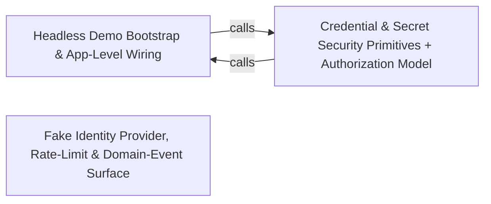

---
tags:
  - 2brain
  - 2brain/arch
  - project/boilerplate-node-backend
type: architecture
component: Scenario_Support_Development_Doubles
---

## Details

The non-production scaffolding the seed/flow path leans on to run unattended: the fake OAuth provider and development doubles that let the flow runner solve no human challenge, the loopback listener the flows are driven against, and the app-level security/rate-limit/system-route wiring that must be present for a listening demo server. This group also carries the kernel event/translation type surface (DomainEventMap, TranslationWritePlan) that the seeded rows and the write surface reference. It is the 'make the demo runnable headlessly' layer, distinct from the fixture data itself.

### Headless Demo Bootstrap & App-Level Wiring
The entry point that turns a bare Node process into a listening, demo-ready server. It is the Node preload (development-doubles.ts) that loads .env, applies developer defaults, and registers the test doubles into the application's registries; the app-level transport security and body-parsing install (security.ts) whose ordering (trust-proxy → rate limiter → body parsers) is what makes a listening server safe; and the system routes (system-routes.ts) — root ping, /livez, /readyz, security.txt — that a demo server must expose. It also carries the kernel type surface (DomainEventMap, TranslationWritePlan) and the shared request/context/audit type declarations that the seeded rows and the write surface reference. This is the 'make it boot and listen' half of the headless layer.

**Related Classes/Methods**: _None_

**Source Files:**

- `scenarios/support/development-doubles.ts`
  - `scenarios.support.development-doubles.registerOAuthProvider('fake') callback` (L46-L46) - Function
- `scripts/regenerate-artifacts.ts`
  - `scripts.regenerate-artifacts.Step` (L32-L37) - Interface
- `src/app/security.ts`
  - `src.app.security.installSecurity.origin` (L139-L158) - Method
- `src/app/system-routes.ts`
  - `src.app.system-routes.router.get('/') callback` (L21-L23) - Function
- `src/globals.d.ts`
  - `src.globals.d.'express-serve-static-core'.Request` (L12-L84) - Interface
- `src/infrastructure/http/request.ts`
  - `src.infrastructure.http.request.RequestInputDeclaration` (L126-L159) - Interface
- `src/infrastructure/i18n/context.ts`
  - `src.infrastructure.i18n.context.LocaleContext` (L21-L26) - Interface
- `src/infrastructure/observability/audit.ts`
  - `src.infrastructure.observability.audit.AuditActionMap` (L63-L63) - Interface
- `src/infrastructure/persistence/changes.ts`
  - `src.infrastructure.persistence.changes.SetAndUnset` (L19-L22) - Interface
- `src/kernel/staff-read.ts`
  - `src.kernel.staff-read.StaffReadTarget` (L17-L28) - Interface
- `src/kernel/translation.ts`
  - `src.kernel.translation.TranslationWritePlan` (L165-L168) - Interface
- `src/modules/access/audit.ts`
  - `src.modules.access.audit.'@infrastructure/observability/audit'.AuditActionMap` (L19-L21) - Interface
- `src/modules/access/module.ts`
  - `src.modules.access.module.default.personalData.collect` (L27-L33) - Method
  - `src.modules.access.module.default.personalData.collect.then() callback` (L28-L32) - Function
  - `src.modules.access.module.default.personalData.collect.then() callback.memberships.map() callback` (L29-L32) - Function
- `src/modules/account/analytics.ts`
  - `src.modules.account.analytics.'@infrastructure/observability/analytics'.AnalyticsEventMap` (L24-L26) - Interface
- `src/modules/account/audit.ts`
  - `src.modules.account.audit.'@infrastructure/observability/audit'.AuditActionMap` (L84-L86) - Interface
- `src/modules/account/events.ts`
  - `src.modules.account.events.'@kernel/events'.DomainEventMap` (L14-L23) - Interface
- `src/modules/account/model.ts`
  - `src.modules.account.model.AccountExportDocument` (L31-L40) - Interface
- `src/modules/account/oauth/config.ts`
  - `src.modules.account.oauth.config.OAuthCredentials` (L55-L58) - Interface
- `src/modules/account/services/caller.ts`
  - `src.modules.account.services.caller.withOwnAccount` (L27-L36) - Class
  - `src.modules.account.services.caller.withOwnAccount.then() callback` (L36-L36) - Function
- `src/modules/account/services/profile.ts`
  - `src.modules.account.services.profile.updateProfile.withOwnAccount() callback` (L154-L157) - Function
  - `src.modules.account.services.profile.updateProfile.withOwnAccount() callback.then() callback` (L155-L156) - Function
  - `src.modules.account.services.profile.updateProfile.catch() callback` (L159-L159) - Function
  - `src.modules.account.services.profile.updateProfile.then() callback` (L160-L167) - Function
- `src/modules/account/services/reauth.ts`
  - `src.modules.account.services.reauth.ReauthProven` (L63-L65) - Interface
  - `src.modules.account.services.reauth.reauthMethods` (L87-L92) - Class
  - `src.modules.account.services.reauth.reauthMethods.withOwnAccount() callback` (L90-L90) - Function
  - `src.modules.account.services.reauth.sendReauthCode` (L121-L143) - Class
  - `src.modules.account.services.reauth.sendReauthCode.withOwnAccount() callback` (L126-L134) - Function
  - `src.modules.account.services.reauth.sendReauthCode.then() callback` (L136-L143) - Function
  - `src.modules.account.services.reauth.codeMatches` (L154-L155) - Class
  - `src.modules.account.services.reauth.proveMethod` (L162-L190) - Class
  - `src.modules.account.services.reauth.proveMethod.proved.then() callback` (L181-L188) - Function
  - `src.modules.account.services.reauth.proveOtp` (L197-L208) - Class
  - `src.modules.account.services.reauth.proveOtp.then() callback` (L205-L206) - Function
  - `src.modules.account.services.reauth.reauth` (L223-L241) - Class
  - `src.modules.account.services.reauth.reauth.withOwnAccount() callback` (L228-L231) - Function
  - `src.modules.account.services.reauth.reauth.withOwnAccount() callback.then() callback` (L229-L230) - Function
  - `src.modules.account.services.reauth.reauth.then() callback` (L234-L241) - Function
- `src/modules/account/services/two-factor-challenge.ts`
  - `src.modules.account.services.two-factor-challenge.buildLoginChallenge` (L57-L72) - Class
  - `src.modules.account.services.two-factor-challenge.buildLoginChallenge.then() callback` (L65-L71) - Function
  - `src.modules.account.services.two-factor-challenge.buildLoginChallenge.then() callback.methods.armed.map() callback` (L69-L69) - Function
  - `src.modules.account.services.two-factor-challenge.sendLoginCode.outcome` (L88-L94) - Class
  - `src.modules.account.services.two-factor-challenge.sendLoginCode.outcome.then() callback` (L89-L93) - Function
  - `src.modules.account.services.two-factor-challenge.sendLoginCode.outcome.catch() callback` (L94-L94) - Function
  - `src.modules.account.services.two-factor-challenge.verifyLoginChallenge.outcome` (L119-L148) - Class
  - `src.modules.account.services.two-factor-challenge.verifyLoginChallenge.outcome.then() callback.then() callback` (L128-L145) - Function
  - `src.modules.account.services.two-factor-challenge.verifyLoginChallenge.outcome.then() callback.then() callback.settleVerdict() callback` (L129-L144) - Function
  - `src.modules.account.services.two-factor-challenge.verifyLoginChallenge.outcome.then() callback.then() callback.settleVerdict() callback.then() callback` (L135-L143) - Function
  - `src.modules.account.services.two-factor-challenge.verifyLoginChallenge.outcome.then() callback.then() callback.settleVerdict() callback.then() callback.then() callback` (L137-L141) - Function
  - `src.modules.account.services.two-factor-challenge.verifyLoginChallenge.outcome.catch() callback` (L148-L148) - Function
  - `src.modules.account.services.two-factor-challenge.verifyLoginChallenge.outcome.then() callback` (L153-L160) - Function
- `src/modules/account/services/two-factor-enrollment.ts`
  - `src.modules.account.services.two-factor-enrollment.twoFactorStatus` (L68-L91) - Class
  - `src.modules.account.services.two-factor-enrollment.twoFactorStatus.withOwnAccount() callback` (L71-L91) - Function
  - `src.modules.account.services.two-factor-enrollment.twoFactorStatus.withOwnAccount() callback.enrolledNames` (L75-L75) - Class
  - `src.modules.account.services.two-factor-enrollment.twoFactorStatus.withOwnAccount() callback.enrolledNames.enrolled.map() callback` (L75-L75) - Function
  - `src.modules.account.services.two-factor-enrollment.twoFactorStatus.withOwnAccount() callback.methods.enrolled.map() callback` (L79-L82) - Function
  - `src.modules.account.services.two-factor-enrollment.twoFactorStatus.withOwnAccount() callback.available.filter() callback` (L84-L84) - Function
  - `src.modules.account.services.two-factor-enrollment.twoFactorStatus.withOwnAccount() callback.available.map() callback` (L85-L88) - Function
  - `src.modules.account.services.two-factor-enrollment.twoFactorStatus.catch() callback` (L91-L91) - Function
  - `src.modules.account.services.two-factor-enrollment.setupTwoFactorMethod` (L102-L130) - Class
  - `src.modules.account.services.two-factor-enrollment.setupTwoFactorMethod.withOwnAccount() callback` (L112-L129) - Function
  - `src.modules.account.services.two-factor-enrollment.setupTwoFactorMethod.withOwnAccount() callback.then() callback` (L126-L127) - Function
  - `src.modules.account.services.two-factor-enrollment.setupTwoFactorMethod.withOwnAccount() callback.then() callback.settleVerdict() callback` (L127-L127) - Function
  - `src.modules.account.services.two-factor-enrollment.setupTwoFactorMethod.catch() callback` (L129-L129) - Function
  - `src.modules.account.services.two-factor-enrollment.beginSetup` (L138-L158) - Class
  - `src.modules.account.services.two-factor-enrollment.beginSetup.then() callback` (L152-L157) - Function
  - `src.modules.account.services.two-factor-enrollment.beginSetup.then() callback.then() callback` (L156-L156) - Function
  - `src.modules.account.services.two-factor-enrollment.sendMethodCode.outcome` (L177-L179) - Class
  - `src.modules.account.services.two-factor-enrollment.sendMethodCode.outcome.withOwnAccount() callback` (L177-L179) - Function
  - `src.modules.account.services.two-factor-enrollment.sendMethodCode.outcome.catch() callback` (L179-L179) - Function
  - `src.modules.account.services.two-factor-enrollment.confirmTwoFactorMethod.outcome` (L204-L219) - Class
  - `src.modules.account.services.two-factor-enrollment.confirmTwoFactorMethod.outcome.withOwnAccount() callback` (L204-L219) - Function
  - `src.modules.account.services.two-factor-enrollment.confirmTwoFactorMethod.outcome.withOwnAccount() callback.entry` (L205-L205) - Class
  - `src.modules.account.services.two-factor-enrollment.confirmTwoFactorMethod.outcome.withOwnAccount() callback.entry.user.twoFactorMethods.find() callback` (L205-L205) - Function
  - `src.modules.account.services.two-factor-enrollment.confirmTwoFactorMethod.outcome.withOwnAccount() callback.then() callback` (L211-L217) - Function
  - `src.modules.account.services.two-factor-enrollment.confirmTwoFactorMethod.outcome.withOwnAccount() callback.then() callback.then() callback` (L213-L216) - Function
  - `src.modules.account.services.two-factor-enrollment.confirmTwoFactorMethod.outcome.catch() callback` (L219-L219) - Function
  - `src.modules.account.services.two-factor-enrollment.armMethod` (L228-L260) - Class
  - `src.modules.account.services.two-factor-enrollment.armMethod.then() callback` (L249-L258) - Function
  - `src.modules.account.services.two-factor-enrollment.armMethod.then() callback.then() callback` (L250-L257) - Function
  - `src.modules.account.services.two-factor-enrollment.regenerateBackupCodes.outcome` (L378-L398) - Class
  - `src.modules.account.services.two-factor-enrollment.regenerateBackupCodes.outcome.withVerifiedCode() callback` (L386-L397) - Function
  - `src.modules.account.services.two-factor-enrollment.regenerateBackupCodes.outcome.withVerifiedCode() callback.then() callback` (L391-L395) - Function
- `src/modules/account/services/two-factor-lockout.ts`
  - `src.modules.account.services.two-factor-lockout.verifyInOrder` (L54-L64) - Class
  - `src.modules.account.services.two-factor-lockout.verifyInOrder.then() callback` (L63-L63) - Function
  - `src.modules.account.services.two-factor-lockout.verifyAnyFactor` (L70-L73) - Class
  - `src.modules.account.services.two-factor-lockout.verifyAnyFactor.then() callback` (L72-L72) - Function
  - `src.modules.account.services.two-factor-lockout.verifyArmedFactor` (L93-L109) - Class
  - `src.modules.account.services.two-factor-lockout.verifyArmedFactor.then() callback` (L100-L109) - Function
  - `src.modules.account.services.two-factor-lockout.verifyArmedFactor.then() callback.then() callback` (L104-L107) - Function
  - `src.modules.account.services.two-factor-lockout.verifyArmedFactor.then() callback.then() callback.then() callback` (L106-L106) - Function
  - `src.modules.account.services.two-factor-lockout.proveSecondFactor` (L136-L149) - Class
  - `src.modules.account.services.two-factor-lockout.proveSecondFactor.then() callback` (L144-L147) - Function
  - `src.modules.account.services.two-factor-lockout.proveSecondFactor.then() callback.settleVerdict() callback` (L145-L146) - Function
  - `src.modules.account.services.two-factor-lockout.proveSecondFactor.then() callback.settleVerdict() callback.then() callback` (L146-L146) - Function
- `src/modules/account/services/two-factor-outcomes.ts`
  - `src.modules.account.services.two-factor-outcomes.rejectWrongCode` (L101-L110) - Class
  - `src.modules.account.services.two-factor-outcomes.rejectWrongCode.then() callback` (L110-L110) - Function
  - `src.modules.account.services.two-factor-outcomes.armedEntries` (L164-L165) - Class
  - `src.modules.account.services.two-factor-outcomes.armedEntries.filter() callback` (L165-L165) - Function
  - `src.modules.account.services.two-factor-outcomes.deliverArmedCode` (L180-L197) - Class
  - `src.modules.account.services.two-factor-outcomes.deliverArmedCode.armed` (L185-L185) - Class
  - `src.modules.account.services.two-factor-outcomes.deliverArmedCode.armed.find() callback` (L185-L185) - Function
  - `src.modules.account.services.two-factor-outcomes.deliverArmedCode.then() callback` (L194-L195) - Function
  - `src.modules.account.services.two-factor-outcomes.deliverArmedCode.then() callback.then() callback` (L195-L195) - Function
- `src/modules/account/two-factor/backup-codes.ts`
  - `src.modules.account.two-factor.backup-codes.generateBackupCodes` (L50-L51) - Class
  - `src.modules.account.two-factor.backup-codes.generateBackupCodes.Array.from() callback` (L51-L51) - Function
  - `src.modules.account.two-factor.backup-codes.hashBackupCodes` (L54-L55) - Class
  - `src.modules.account.two-factor.backup-codes.hashBackupCodes.codes.map() callback` (L55-L55) - Function
- `src/modules/account/two-factor/delivered-code-verify.ts`
  - `src.modules.account.two-factor.delivered-code-verify.verifyDeliveredCode` (L23-L41) - Class
  - `src.modules.account.two-factor.delivered-code-verify.verifyDeliveredCode.then() callback` (L39-L39) - Function
- `src/modules/account/two-factor/methods/email.ts`
  - `src.modules.account.two-factor.methods.email.emailMethod` (L84-L113) - Class
  - `src.modules.account.two-factor.methods.email.emailMethod.available` (L92-L92) - Method
  - `src.modules.account.two-factor.methods.email.emailMethod.eligibility` (L94-L97) - Method
  - `src.modules.account.two-factor.methods.email.emailMethod.target` (L99-L99) - Method
  - `src.modules.account.two-factor.methods.email.emailMethod.setup` (L103-L107) - Method
  - `src.modules.account.two-factor.methods.email.emailMethod.setup.then() callback` (L104-L107) - Function
  - `src.modules.account.two-factor.methods.email.emailMethod.send` (L109-L109) - Method
  - `src.modules.account.two-factor.methods.email.emailMethod.verify` (L111-L112) - Method
- `src/modules/account/two-factor/methods/totp.ts`
  - `src.modules.account.two-factor.methods.totp.totpMethod` (L17-L61) - Class
  - `src.modules.account.two-factor.methods.totp.totpMethod.available` (L20-L20) - Method
  - `src.modules.account.two-factor.methods.totp.totpMethod.eligibility` (L21-L21) - Method
  - `src.modules.account.two-factor.methods.totp.totpMethod.target` (L22-L22) - Method
  - `src.modules.account.two-factor.methods.totp.totpMethod.setup` (L24-L39) - Method
  - `src.modules.account.two-factor.methods.totp.totpMethod.verify` (L41-L60) - Method
  - `src.modules.account.two-factor.methods.totp.totpMethod.verify.then() callback` (L47-L59) - Function
  - `src.modules.account.two-factor.methods.totp.totpMethod.verify.then() callback.then() callback` (L55-L58) - Function
- `src/modules/account/two-factor/registry.ts`
  - `src.modules.account.two-factor.registry.MethodEligibility` (L17-L22) - Interface
  - `src.modules.account.two-factor.registry.TwoFactorMethodHandler` (L29-L68) - Interface
  - `src.modules.account.two-factor.registry.TwoFactorMethodHandler.available` (L41-L41) - Method
  - `src.modules.account.two-factor.registry.TwoFactorMethodHandler.eligibility` (L44-L44) - Method
  - `src.modules.account.two-factor.registry.TwoFactorMethodHandler.target` (L47-L47) - Method
  - `src.modules.account.two-factor.registry.TwoFactorMethodHandler.setup` (L53-L57) - Method
  - `src.modules.account.two-factor.registry.TwoFactorMethodHandler.verify` (L60-L60) - Method
  - `src.modules.account.two-factor.registry.TwoFactorMethodHandler.send` (L63-L67) - Method
  - `src.modules.account.two-factor.registry.availableTwoFactorMethods` (L84-L85) - Class
  - `src.modules.account.two-factor.registry.availableTwoFactorMethods.HANDLERS.filter() callback` (L85-L85) - Function
  - `src.modules.account.two-factor.registry.twoFactorMethod` (L94-L95) - Class
  - `src.modules.account.two-factor.registry.twoFactorMethod.find() callback` (L95-L95) - Function
  - `src.modules.account.two-factor.registry.orderedEntries` (L104-L110) - Class
  - `src.modules.account.two-factor.registry.orderedEntries.flatMap() callback` (L107-L110) - Function
  - `src.modules.account.two-factor.registry.flatMap() callback.entry` (L108-L108) - Class
  - `src.modules.account.two-factor.registry.orderedEntries.flatMap() callback.entry.entries.find() callback` (L108-L108) - Function
- `src/modules/account/two-factor/totp.ts`
  - `src.modules.account.two-factor.totp.TotpVerification` (L76-L81) - Interface
  - `src.modules.account.two-factor.totp.verifyTotpCode` (L91-L118) - Class
  - `src.modules.account.two-factor.totp.verifyTotpCode.then() callback` (L105-L111) - Function
  - `src.modules.account.two-factor.totp.verifyTotpCode.catch() callback` (L117-L117) - Function
- `src/modules/addresses/presenter.ts`
  - `src.modules.addresses.presenter.presentAddresses.addresses.map() callback` (L46-L46) - Function
- `src/modules/api-keys/audit.ts`
  - `src.modules.api-keys.audit.'@infrastructure/observability/audit'.AuditActionMap` (L18-L20) - Interface
- `src/modules/api-keys/credentials.ts`
  - `src.modules.api-keys.credentials.MintedApiKey` (L34-L38) - Interface
- `src/modules/cart/analytics.ts`
  - `src.modules.cart.analytics.'@infrastructure/observability/analytics'.AnalyticsEventMap` (L34-L36) - Interface
- `src/modules/cart/audit.ts`
  - `src.modules.cart.audit.'@infrastructure/observability/audit'.AuditActionMap` (L21-L23) - Interface
- `src/modules/cart/events.ts`
  - `src.modules.cart.events.'@kernel/events'.DomainEventMap` (L9-L43) - Interface
- `src/modules/cart/factories.ts`
  - `src.modules.cart.factories.CartOverrides` (L17-L22) - Interface
- `src/modules/delivery/audit.ts`
  - `src.modules.delivery.audit.'@infrastructure/observability/audit'.AuditActionMap` (L25-L27) - Interface
- `src/modules/example/analytics.ts`
  - `src.modules.example.analytics.'@infrastructure/observability/analytics'.AnalyticsEventMap` (L15-L17) - Interface
- `src/modules/example/audit.ts`
  - `src.modules.example.audit.'@infrastructure/observability/audit'.AuditActionMap` (L19-L21) - Interface
- `src/modules/example/events.ts`
  - `src.modules.example.events.'@kernel/events'.DomainEventMap` (L12-L15) - Interface
- `src/modules/example/factories.ts`
  - `src.modules.example.factories.ExampleOverrides` (L12-L25) - Interface
- `src/modules/feedback/audit.ts`
  - `src.modules.feedback.audit.'@infrastructure/observability/audit'.AuditActionMap` (L18-L20) - Interface
- `src/modules/inventory/audit.ts`
  - `src.modules.inventory.audit.'@infrastructure/observability/audit'.AuditActionMap` (L25-L27) - Interface
- `src/modules/inventory/events.ts`
  - `src.modules.inventory.events.'@kernel/events'.DomainEventMap` (L16-L35) - Interface
- `src/modules/invoicing/audit.ts`
  - `src.modules.invoicing.audit.'@infrastructure/observability/audit'.AuditActionMap` (L15-L17) - Interface
- `src/modules/invoicing/presenter.ts`
  - `src.modules.invoicing.presenter.ExportedDocument` (L12-L18) - Interface
- `src/modules/locales/audit.ts`
  - `src.modules.locales.audit.'@infrastructure/observability/audit'.AuditActionMap` (L33-L35) - Interface
- `src/modules/locales/model.ts`
  - `src.modules.locales.model.derivesBaseLanguage` (L147-L149) - Function
- `src/modules/notifications/factories.ts`
  - `src.modules.notifications.factories.NotificationOverrides` (L12-L26) - Interface
- `src/modules/orders/analytics.ts`
  - `src.modules.orders.analytics.'@infrastructure/observability/analytics'.AnalyticsEventMap` (L26-L28) - Interface
- `src/modules/orders/audit.ts`
  - `src.modules.orders.audit.'@infrastructure/observability/audit'.AuditActionMap` (L32-L34) - Interface
- `src/modules/orders/events.ts`
  - `src.modules.orders.events.'@kernel/events'.DomainEventMap` (L13-L78) - Interface
- `src/modules/orders/services/notify.ts`
  - `src.modules.orders.services.notify.catch() callback` (L90-L99) - Function
- `src/modules/payments/analytics.ts`
  - `src.modules.payments.analytics.'@infrastructure/observability/analytics'.AnalyticsEventMap` (L26-L28) - Interface
- `src/modules/payments/audit.ts`
  - `src.modules.payments.audit.'@infrastructure/observability/audit'.AuditActionMap` (L35-L37) - Interface
- `src/modules/payments/events.ts`
  - `src.modules.payments.events.'@kernel/events'.DomainEventMap` (L10-L68) - Interface
- `src/modules/payments/globals.d.ts`
  - `src.modules.payments.globals.d.'express-serve-static-core'.Request` (L15-L24) - Interface
- `src/modules/products/analytics.ts`
  - `src.modules.products.analytics.'@infrastructure/observability/analytics'.AnalyticsEventMap` (L19-L21) - Interface
- `src/modules/products/audit.ts`
  - `src.modules.products.audit.'@infrastructure/observability/audit'.AuditActionMap` (L18-L20) - Interface
- `src/modules/products/events.ts`
  - `src.modules.products.events.'@kernel/events'.DomainEventMap` (L10-L63) - Interface
- `src/modules/products/services/translated-write.ts`
  - `src.modules.products.services.translated-write.prefixTranslationErrors.errors.rejection.errors.map() callback` (L64-L70) - Function
  - `src.modules.products.services.translated-write.ProductImageExtras` (L78-L82) - Interface
  - `src.modules.products.services.translated-write.then() callback.translations` (L215-L220) - Class
- `src/modules/returns/audit.ts`
  - `src.modules.returns.audit.'@infrastructure/observability/audit'.AuditActionMap` (L19-L21) - Interface
- `src/modules/returns/events.ts`
  - `src.modules.returns.events.'@kernel/events'.DomainEventMap` (L10-L35) - Interface
- `src/modules/users/analytics.ts`
  - `src.modules.users.analytics.'@infrastructure/observability/analytics'.AnalyticsEventMap` (L21-L23) - Interface
- `src/modules/users/audit.ts`
  - `src.modules.users.audit.'@infrastructure/observability/audit'.AuditActionMap` (L39-L41) - Interface
- `src/modules/users/events.ts`
  - `src.modules.users.events.'@kernel/events'.DomainEventMap` (L10-L16) - Interface
- `src/modules/webhooks/audit.ts`
  - `src.modules.webhooks.audit.'@infrastructure/observability/audit'.AuditActionMap` (L25-L27) - Interface
- `src/modules/webhooks/services/catalogue.ts`
  - `src.modules.webhooks.services.catalogue.AsyncApiChannelsDocument` (L22-L24) - Interface
- `src/modules/webhooks/services/deliveries.ts`
  - `src.modules.webhooks.services.deliveries.DeliveryListFilters` (L29-L34) - Interface
- `src/modules/wishlist/analytics.ts`
  - `src.modules.wishlist.analytics.'@infrastructure/observability/analytics'.AnalyticsEventMap` (L19-L21) - Interface
- `src/modules/wishlist/events.ts`
  - `src.modules.wishlist.events.'@kernel/events'.DomainEventMap` (L9-L22) - Interface
- `src/modules/wishlist/presenter.ts`
  - `src.modules.wishlist.presenter.WishlistView` (L12-L14) - Interface
  - `src.modules.wishlist.presenter.presentWishlist.items.map() callback` (L30-L33) - Function

### Credential & Secret Security Primitives + Authorization Model
The security substrate the demo identities and seeded accounts sit on. It owns the credential primitives — argon2id password hashing/verification (password-hash.ts), breached-password checks (breached-passwords), and the versioned AES-256-GCM secret envelope with key-ring rotation and re-encryption (versioned-secret.ts, reencrypt.ts) — and the authorization model that consumes them: the access module's tenant/membership documents and the grant-validation service (promoteVerifiedCustomer, validateGrant) that refuses privilege-escalating writes. This is the 'who may act, and how their secrets are stored' half of the headless layer, distinct from the fixture data it protects.

**Related Classes/Methods**:

- `src.infrastructure.security.password-hash.verifyPassword`:103-118
- `src.modules.access.service.promoteVerifiedCustomer`:368-375
- `src.modules.access.model.MembershipDocument`:49-56

**Source Files:**

- `src/infrastructure/http/response.ts`
  - `src.infrastructure.http.response.validationErrors` (L299-L305) - Class
  - `src.infrastructure.http.response.validationErrors.error.issues.map() callback` (L300-L305) - Function
- `src/infrastructure/security/breached-passwords/index.ts`
  - `src.infrastructure.security.breached-passwords.index.bundledList` (L35-L39) - Class
  - `src.infrastructure.security.breached-passwords.index.bundledList.filter() callback` (L38-L38) - Function
  - `src.infrastructure.security.breached-passwords.index.checkHibpRange` (L61-L98) - Class
  - `src.infrastructure.security.breached-passwords.index.checkHibpRange.then() callback` (L82-L88) - Function
  - `src.infrastructure.security.breached-passwords.index.checkHibpRange.then() callback.match` (L83-L86) - Class
  - `src.infrastructure.security.breached-passwords.index.checkHibpRange.then() callback.match.map() callback` (L85-L85) - Function
  - `src.infrastructure.security.breached-passwords.index.checkHibpRange.then() callback.match.find() callback` (L86-L86) - Function
  - `src.infrastructure.security.breached-passwords.index.checkHibpRange.catch() callback` (L89-L97) - Function
  - `src.infrastructure.security.breached-passwords.index.assertPasswordNotBreached` (L127-L130) - Class
  - `src.infrastructure.security.breached-passwords.index.assertPasswordNotBreached.then() callback` (L128-L129) - Function
- `src/infrastructure/security/password-hash.ts`
  - `src.infrastructure.security.password-hash.verifyPassword` (L103-L118) - Class
  - `src.infrastructure.security.password-hash.verifyPassword.then() callback` (L117-L117) - Function
- `src/infrastructure/security/reencrypt.ts`
  - `src.infrastructure.security.reencrypt.EncryptedField` (L31-L40) - Interface
  - `src.infrastructure.security.reencrypt.ReencryptReport` (L46-L51) - Interface
- `src/infrastructure/security/versioned-secret.ts`
  - `src.infrastructure.security.versioned-secret.VersionedKey` (L18-L21) - Interface
  - `src.infrastructure.security.versioned-secret.SecretBinding` (L57-L60) - Interface
- `src/modules/access/model.ts`
  - `src.modules.access.model.TenantDocument` (L33-L39) - Interface
  - `src.modules.access.model.MembershipDocument` (L49-L56) - Interface
- `src/modules/access/service.ts`
  - `src.modules.access.service.promoteVerifiedCustomer` (L368-L375) - Class
  - `src.modules.access.service.promoteVerifiedCustomer.then() callback` (L369-L375) - Function
  - `src.modules.access.service.promoteVerifiedCustomer.then() callback.then() callback` (L374-L374) - Function
- `src/modules/account/services/email-change.ts`
  - `src.modules.account.services.email-change.notifyEmailChangeRequested` (L156-L165) - Class
  - `src.modules.account.services.email-change.notifyEmailChangeRequested.then() callback` (L160-L165) - Function
- `src/modules/account/services/login.ts`
  - `src.modules.account.services.login.login` (L33-L66) - Class
  - `src.modules.account.services.login.login.then() callback` (L51-L63) - Function
  - `src.modules.account.services.login.login.then() callback.then() callback` (L57-L61) - Function
  - `src.modules.account.services.login.login.catch() callback` (L64-L64) - Function
  - `src.modules.account.services.login.verifyOwnPassword` (L80-L91) - Class
  - `src.modules.account.services.login.verifyOwnPassword.withOwnAccount() callback` (L85-L91) - Function
  - `src.modules.account.services.login.verifyOwnPassword.withOwnAccount() callback.then() callback` (L88-L89) - Function
- `src/modules/account/services/logout.ts`
  - `src.modules.account.services.logout.logoutEverywhere` (L111-L146) - Class
  - `src.modules.account.services.logout.logoutEverywhere.then() callback.then() callback` (L127-L128) - Function
  - `src.modules.account.services.logout.logoutEverywhere.catch() callback` (L132-L132) - Function
  - `src.modules.account.services.logout.logoutEverywhere.then() callback` (L133-L146) - Function
- `src/modules/account/services/password-reset.ts`
  - `src.modules.account.services.password-reset.afterReset` (L46-L91) - Class
  - `src.modules.account.services.password-reset.afterReset.catch() callback` (L60-L68) - Function
  - `src.modules.account.services.password-reset.resetWith` (L111-L127) - Class
  - `src.modules.account.services.password-reset.resetWith.then() callback` (L117-L127) - Function
  - `src.modules.account.services.password-reset.resetWith.then() callback.then() callback` (L120-L125) - Function
  - `src.modules.account.services.password-reset.resetWith.then() callback.then() callback.then() callback` (L123-L123) - Function
  - `src.modules.account.services.password-reset.completePasswordReset` (L144-L158) - Class
  - `src.modules.account.services.password-reset.completePasswordReset.then() callback` (L154-L155) - Function
  - `src.modules.account.services.password-reset.completePasswordReset.catch() callback` (L157-L157) - Function
- `src/modules/account/services/password.ts`
  - `src.modules.account.services.password.passwordChange` (L92-L110) - Class
  - `src.modules.account.services.password.passwordChange.then() callback` (L105-L109) - Function
  - `src.modules.account.services.password.passwordChangeWithCurrent.outcome` (L178-L187) - Class
  - `src.modules.account.services.password.passwordChangeWithCurrent.outcome.catch() callback` (L187-L187) - Function
  - `src.modules.account.services.password.passwordChangeWithCurrent.outcome.then() callback` (L189-L195) - Function
- `src/modules/account/services/profile.ts`
  - `src.modules.account.services.profile.saveProfile` (L80-L101) - Class
  - `src.modules.account.services.profile.saveProfile.budget.then() callback` (L93-L100) - Function
  - `src.modules.account.services.profile.saveProfile.budget.then() callback.then() callback` (L96-L99) - Function
  - `src.modules.account.services.profile.saveProfile.budget.then() callback.then() callback.then() callback` (L98-L98) - Function
  - `src.modules.account.services.profile.writeProfile.then() callback` (L126-L135) - Function
  - `src.modules.account.services.profile.updateProfile` (L147-L167) - Class
- `src/modules/account/services/revocation.ts`
  - `src.modules.account.services.revocation.settle` (L89-L102) - Class
  - `src.modules.account.services.revocation.settle.then() callback` (L94-L94) - Function
  - `src.modules.account.services.revocation.settle.catch() callback` (L95-L102) - Function
  - `src.modules.account.services.revocation.revokeFor` (L112-L113) - Class
  - `src.modules.account.services.revocation.revokeFor.then() callback` (L113-L113) - Function
- `src/modules/account/services/self-delete.ts`
  - `src.modules.account.services.self-delete.confirmAccountDeletion` (L83-L93) - Class
  - `src.modules.account.services.self-delete.confirmAccountDeletion.then() callback` (L87-L92) - Function
  - `src.modules.account.services.self-delete.confirmAccountDeletion.then() callback.then() callback` (L89-L90) - Function
- `src/modules/account/services/signup.ts`
  - `src.modules.account.services.signup.guardBreachedPassword` (L70-L73) - Class
  - `src.modules.account.services.signup.guardBreachedPassword.then() callback` (L71-L72) - Function
  - `src.modules.account.services.signup.guardEmailPolicy` (L82-L94) - Class
  - `src.modules.account.services.signup.guardEmailPolicy.then() callback` (L83-L93) - Function
  - `src.modules.account.services.signup.createAccountIfEmailFree` (L101-L143) - Class
  - `src.modules.account.services.signup.createAccountIfEmailFree.then() callback` (L106-L142) - Function
  - `src.modules.account.services.signup.createAccountIfEmailFree.then() callback.withTransaction() callback` (L113-L136) - Function
  - `src.modules.account.services.signup.createAccountIfEmailFree.then() callback.withTransaction() callback.then() callback` (L129-L135) - Function
  - `src.modules.account.services.signup.createAccountIfEmailFree.then() callback.withTransaction() callback.then() callback.then() callback` (L135-L135) - Function
  - `src.modules.account.services.signup.createAccountIfEmailFree.then() callback.then() callback.then() callback` (L140-L140) - Function
  - `src.modules.account.services.signup.createAccountIfEmailFree.catch() callback` (L143-L143) - Function
  - `src.modules.account.services.signup.signup` (L151-L228) - Class
  - `src.modules.account.services.signup.signup.outcome` (L188-L196) - Class
  - `src.modules.account.services.signup.signup.outcome.then() callback` (L198-L227) - Function
- `src/modules/account/services/tokens.ts`
  - `src.modules.account.services.tokens.findLiveTokenEntry` (L86-L97) - Class
  - `src.modules.account.services.tokens.findLiveTokenEntry.then() callback` (L90-L96) - Function
  - `src.modules.account.services.tokens.findLiveTokenEntry.then() callback.then() callback` (L95-L95) - Function
  - `src.modules.account.services.tokens.findLiveToken` (L106-L110) - Class
  - `src.modules.account.services.tokens.findLiveToken.then() callback` (L110-L110) - Function
  - `src.modules.account.services.tokens.redeemLiveToken` (L136-L146) - Class
  - `src.modules.account.services.tokens.redeemLiveToken.then() callback` (L140-L146) - Function
  - `src.modules.account.services.tokens.redeemLiveToken.then() callback.then() callback` (L143-L144) - Function
- `src/modules/account/services/two-factor-enrollment.ts`
  - `src.modules.account.services.two-factor-enrollment.removeTwoFactorMethod.outcome` (L285-L322) - Class
  - `src.modules.account.services.two-factor-enrollment.removeTwoFactorMethod.outcome.withVerifiedCode() callback.user.twoFactorMethods.findIndex() callback` (L291-L291) - Function
  - `src.modules.account.services.two-factor-enrollment.removeTwoFactorMethod.outcome.withVerifiedCode() callback` (L297-L321) - Function
  - `src.modules.account.services.two-factor-enrollment.removeTwoFactorMethod.outcome.withVerifiedCode() callback.then() callback` (L310-L319) - Function
  - `src.modules.account.services.two-factor-enrollment.disableTwoFactor.outcome` (L340-L359) - Class
  - `src.modules.account.services.two-factor-enrollment.disableTwoFactor.outcome.withVerifiedCode() callback` (L348-L358) - Function
  - `src.modules.account.services.two-factor-enrollment.disableTwoFactor.outcome.withVerifiedCode() callback.then() callback` (L354-L357) - Function
- `src/modules/account/services/two-factor-lockout.ts`
  - `src.modules.account.services.two-factor-lockout.withVerifiedCode` (L164-L178) - Class
  - `src.modules.account.services.two-factor-lockout.withVerifiedCode.withOwnAccount() callback` (L171-L178) - Function
  - `src.modules.account.services.two-factor-lockout.withVerifiedCode.withOwnAccount() callback.then() callback` (L175-L176) - Function
  - `src.modules.account.services.two-factor-lockout.withVerifiedCode.withOwnAccount() callback.then() callback.settleVerdict() callback` (L176-L176) - Function
  - `src.modules.account.services.two-factor-lockout.withVerifiedCode.catch() callback` (L178-L178) - Function
- `src/modules/account/services/two-factor-outcomes.ts`
  - `src.modules.account.services.two-factor-outcomes.audited` (L78-L91) - Class
  - `src.modules.account.services.two-factor-outcomes.audited.outcome.then() callback` (L84-L91) - Function
- `src/modules/account/services/verification.ts`
  - `src.modules.account.services.verification.resendCooldownRemaining.then() callback` (L137-L137) - Function
  - `src.modules.account.services.verification.pacedSend` (L150-L166) - Class
  - `src.modules.account.services.verification.pacedSend.then() callback` (L156-L165) - Function
  - `src.modules.account.services.verification.pacedSend.then() callback.then() callback` (L165-L165) - Function
  - `src.modules.account.services.verification.requestEmailVerificationFor.then() callback.pacedSend() callback` (L189-L196) - Function
  - `src.modules.account.services.verification.requestEmailVerificationFor.then() callback.pacedSend() callback.then() callback` (L190-L195) - Function
  - `src.modules.account.services.verification.resendPendingEmailVerificationFor.withOwnAccount() callback` (L217-L240) - Function
  - `src.modules.account.services.verification.resendPendingEmailVerificationFor.withOwnAccount() callback.pacedSend() callback` (L227-L238) - Function
  - `src.modules.account.services.verification.resendPendingEmailVerificationFor.withOwnAccount() callback.pacedSend() callback.then() callback` (L228-L238) - Function
  - `src.modules.account.services.verification.markVerified` (L259-L262) - Class
  - `src.modules.account.services.verification.markVerified.then() callback` (L261-L261) - Function
  - `src.modules.account.services.verification.auditProvenAddress` (L273-L278) - Class
  - `src.modules.account.services.verification.auditProvenAddress.then() callback` (L278-L278) - Function
  - `src.modules.account.services.verification.completeEmailVerification` (L286-L300) - Class
  - `src.modules.account.services.verification.completeEmailVerification.then() callback.then() callback` (L296-L296) - Function
  - `src.modules.account.services.verification.completeEmailVerification.then() callback` (L298-L299) - Function
  - `src.modules.account.services.verification.completeEmailChange` (L315-L338) - Class
  - `src.modules.account.services.verification.completeEmailChange.then() callback.then() callback` (L334-L334) - Function
  - `src.modules.account.services.verification.completeEmailChange.then() callback` (L335-L336) - Function
  - `src.modules.account.services.verification.undoEmailChange` (L354-L370) - Class
  - `src.modules.account.services.verification.undoEmailChange.then() callback` (L368-L369) - Function
  - `src.modules.account.services.verification.confirmEmailVerification` (L381-L391) - Class
  - `src.modules.account.services.verification.confirmEmailVerification.then() callback` (L385-L390) - Function
  - `src.modules.account.services.verification.confirmEmailVerification.then() callback.then() callback` (L387-L388) - Function
  - `src.modules.account.services.verification.confirmEmailChange` (L403-L413) - Class
  - `src.modules.account.services.verification.confirmEmailChange.then() callback` (L407-L412) - Function
  - `src.modules.account.services.verification.confirmEmailChange.then() callback.then() callback` (L409-L410) - Function
  - `src.modules.account.services.verification.undoEmailChangeByToken` (L425-L435) - Class
  - `src.modules.account.services.verification.undoEmailChangeByToken.then() callback` (L429-L434) - Function
  - `src.modules.account.services.verification.undoEmailChangeByToken.then() callback.then() callback` (L431-L432) - Function

### Fake Identity Provider, Rate-Limit & Domain-Event Surface
The runtime surface the flows actually drive headlessly. It provides the fake OAuth provider (oauth-fake.ts) that resolves the OAuthProvider port with no network — skipping the consent screen while still round-tripping CSRF state and PKCE — so 'Continue with Google' never leaves the app; the shared rate-limit machinery (rate-limit.ts) and capped-body reader (read-capped-body.ts) that bound the demo server's request path; and the kernel domain-event bus (events.ts, DomainEventMap/DomainEventMeta) plus the account role surface (isUnrestrictedCaller) that the seeded rows and cross-module effects reference. This is the 'solve no human challenge and keep the request path bounded' half of the headless layer.

**Related Classes/Methods**:

- `scenarios.support.doubles.oauth-fake.fakeOAuthProvider`:32-53
- `src.infrastructure.http.middlewares.rate-limit.refuseRateLimited`:67-86
- `src.kernel.events.DomainEventMap`
- `src.infrastructure.http.read-capped-body.readCappedJson`:51-52
- `src.modules.account.roles.isUnrestrictedCaller`:16-17

**Source Files:**

- `scenarios/support/doubles/oauth-fake.ts`
  - `scenarios.support.doubles.oauth-fake.fakeOAuthProvider` (L32-L53) - Class
  - `scenarios.support.doubles.oauth-fake.fakeOAuthProvider.authorizeUrl` (L38-L39) - Method
  - `scenarios.support.doubles.oauth-fake.fakeOAuthProvider.exchangeCode` (L41-L52) - Method
- `scripts/docs/marker-block.ts`
  - `scripts.docs.marker-block.MarkerBlock` (L18-L22) - Interface
  - `scripts.docs.marker-block.MarkerPageOptions` (L25-L40) - Interface
- `src/infrastructure/http/middlewares/rate-limit.ts`
  - `src.infrastructure.http.middlewares.rate-limit.refuseRateLimited` (L67-L86) - Class
  - `src.infrastructure.http.middlewares.rate-limit.refuseRateLimited.<function>` (L69-L86) - Function
  - `src.infrastructure.http.middlewares.rate-limit.BudgetCharge` (L188-L193) - Interface
- `src/infrastructure/http/read-capped-body.ts`
  - `src.infrastructure.http.read-capped-body.readCappedJson` (L51-L52) - Class
  - `src.infrastructure.http.read-capped-body.readCappedJson.then() callback` (L52-L52) - Function
- `src/infrastructure/observability/analytics/index.ts`
  - `src.infrastructure.observability.analytics.index.AnalyticsEventMap` (L27-L27) - Interface
  - `src.infrastructure.observability.analytics.index.AnalyticsEvent` (L44-L65) - Interface
- `src/kernel/events.ts`
  - `src.kernel.events.DomainEventMap` (L21-L21) - Interface
  - `src.kernel.events.DomainEventMeta` (L35-L41) - Interface
- `src/modules/account/controllers/delete-2fa-method.ts`
  - `src.modules.account.controllers.delete-2fa-method.delete2faMethod.then() callback.then() callback.then() callback` (L58-L65) - Function
- `src/modules/account/controllers/delete-2fa.ts`
  - `src.modules.account.controllers.delete-2fa.delete2fa.then() callback.then() callback.then() callback` (L53-L60) - Function
- `src/modules/account/controllers/delete-oauth-link.ts`
  - `src.modules.account.controllers.delete-oauth-link.deleteOAuthLink` (L19-L33) - Class
  - `src.modules.account.controllers.delete-oauth-link.deleteOAuthLink.then() callback` (L26-L32) - Function
- `src/modules/account/controllers/get-account.ts`
  - `src.modules.account.controllers.get-account.getAccount` (L20-L41) - Class
  - `src.modules.account.controllers.get-account.getAccount.then() callback` (L28-L39) - Function
- `src/modules/account/controllers/get-oauth-callback.ts`
  - `src.modules.account.controllers.get-oauth-callback.getOAuthCallback` (L67-L216) - Class
  - `src.modules.account.controllers.get-oauth-callback.then() callback` (L141-L141) - Function
  - `src.modules.account.controllers.get-oauth-callback.getOAuthCallback.then() callback` (L142-L186) - Function
  - `src.modules.account.controllers.get-oauth-callback.then() callback.then() callback` (L153-L174) - Function
  - `src.modules.account.controllers.get-oauth-callback.getOAuthCallback.then() callback.then() callback.then() callback` (L166-L173) - Function
  - `src.modules.account.controllers.get-oauth-callback.getOAuthCallback.then() callback.then() callback` (L177-L185) - Function
  - `src.modules.account.controllers.get-oauth-callback.getOAuthCallback.catch() callback` (L187-L215) - Function
- `src/modules/account/controllers/get-reauth-methods.ts`
  - `src.modules.account.controllers.get-reauth-methods.getReauthMethods` (L17-L27) - Class
  - `src.modules.account.controllers.get-reauth-methods.getReauthMethods.then() callback` (L22-L25) - Function
- `src/modules/account/controllers/get-session-config.ts`
  - `src.modules.account.controllers.get-session-config.getSessionConfig` (L17-L22) - Class
  - `src.modules.account.controllers.get-session-config.getSessionConfig.then() callback` (L19-L21) - Function
- `src/modules/account/controllers/post-2fa-confirm.ts`
  - `src.modules.account.controllers.post-2fa-confirm.post2faConfirm.then() callback.then() callback.then() callback` (L58-L65) - Function
- `src/modules/account/controllers/post-2fa-method-send.ts`
  - `src.modules.account.controllers.post-2fa-method-send.post2faMethodSend` (L21-L39) - Class
  - `src.modules.account.controllers.post-2fa-method-send.post2faMethodSend.then() callback` (L29-L37) - Function
- `src/modules/account/controllers/post-2fa-setup.ts`
  - `src.modules.account.controllers.post-2fa-setup.post2faSetup` (L21-L41) - Class
  - `src.modules.account.controllers.post-2fa-setup.post2faSetup.then() callback` (L33-L39) - Function
- `src/modules/account/controllers/post-login-2fa.ts`
  - `src.modules.account.controllers.post-login-2fa.postLoginTwoFactor` (L33-L84) - Class
  - `src.modules.account.controllers.post-login-2fa.postLoginTwoFactor.then() callback` (L56-L79) - Function
  - `src.modules.account.controllers.post-login-2fa.postLoginTwoFactor.then() callback.then() callback` (L70-L77) - Function
  - `src.modules.account.controllers.post-login-2fa.postLoginTwoFactor.then() callback.then() callback.then() callback` (L71-L77) - Function
  - `src.modules.account.controllers.post-login-2fa.postLoginTwoFactor.catch() callback` (L80-L83) - Function
- `src/modules/account/controllers/post-login.ts`
  - `src.modules.account.controllers.post-login.postLogin` (L34-L131) - Class
  - `src.modules.account.controllers.post-login.postLogin.then() callback` (L80-L125) - Function
  - `src.modules.account.controllers.post-login.then() callback.then() callback` (L97-L104) - Function
  - `src.modules.account.controllers.post-login.postLogin.then() callback.then() callback` (L112-L123) - Function
  - `src.modules.account.controllers.post-login.postLogin.then() callback.then() callback.then() callback` (L113-L123) - Function
  - `src.modules.account.controllers.post-login.postLogin.catch() callback` (L126-L130) - Function
- `src/modules/account/controllers/post-logout-everywhere.ts`
  - `src.modules.account.controllers.post-logout-everywhere.postLogoutEverywhere` (L20-L36) - Class
  - `src.modules.account.controllers.post-logout-everywhere.postLogoutEverywhere.then() callback` (L23-L34) - Function
- `src/modules/account/controllers/post-logout.ts`
  - `src.modules.account.controllers.post-logout.postLogout` (L21-L32) - Class
  - `src.modules.account.controllers.post-logout.postLogout.then() callback` (L26-L30) - Function
- `src/modules/account/controllers/post-password-change.ts`
  - `src.modules.account.controllers.post-password-change.postPasswordChange` (L27-L97) - Class
  - `src.modules.account.controllers.post-password-change.postPasswordChange.then() callback` (L58-L92) - Function
  - `src.modules.account.controllers.post-password-change.postPasswordChange.then() callback.then() callback` (L72-L80) - Function
  - `src.modules.account.controllers.post-password-change.postPasswordChange.then() callback.catch() callback` (L81-L91) - Function
  - `src.modules.account.controllers.post-password-change.postPasswordChange.catch() callback` (L93-L96) - Function
- `src/modules/account/controllers/post-pending-email-resend.ts`
  - `src.modules.account.controllers.post-pending-email-resend.postPendingEmailResend` (L18-L29) - Class
  - `src.modules.account.controllers.post-pending-email-resend.postPendingEmailResend.then() callback` (L24-L27) - Function
- `src/modules/account/controllers/post-reauth-method-send.ts`
  - `src.modules.account.controllers.post-reauth-method-send.postReauthMethodSend` (L21-L39) - Class
  - `src.modules.account.controllers.post-reauth-method-send.postReauthMethodSend.then() callback` (L29-L37) - Function
- `src/modules/account/controllers/post-reauth.ts`
  - `src.modules.account.controllers.post-reauth.postReauth` (L26-L66) - Class
  - `src.modules.account.controllers.post-reauth.postReauth.then() callback` (L41-L61) - Function
  - `src.modules.account.controllers.post-reauth.postReauth.then() callback.then() callback` (L56-L59) - Function
  - `src.modules.account.controllers.post-reauth.postReauth.catch() callback` (L62-L65) - Function
- `src/modules/account/controllers/post-session-touch.ts`
  - `src.modules.account.controllers.post-session-touch.postSessionTouch` (L19-L33) - Class
  - `src.modules.account.controllers.post-session-touch.postSessionTouch.then() callback` (L21-L32) - Function
- `src/modules/account/controllers/post-signup.ts`
  - `src.modules.account.controllers.post-signup.postSignup` (L32-L136) - Class
  - `src.modules.account.controllers.post-signup.postSignup.then() callback` (L73-L131) - Function
  - `src.modules.account.controllers.post-signup.postSignup.then() callback.then() callback` (L121-L130) - Function
  - `src.modules.account.controllers.post-signup.postSignup.catch() callback` (L132-L135) - Function
- `src/modules/account/oauth/providers/github.ts`
  - `src.modules.account.oauth.providers.github.GithubUser` (L30-L35) - Interface
  - `src.modules.account.oauth.providers.github.GithubEmail` (L38-L42) - Interface
  - `src.modules.account.oauth.providers.github.githubApiGet` (L48-L62) - Class
  - `src.modules.account.oauth.providers.github.githubApiGet.then() callback` (L58-L62) - Function
  - `src.modules.account.oauth.providers.github.githubOAuthProvider` (L98-L121) - Class
  - `src.modules.account.oauth.providers.github.githubOAuthProvider.authorizeUrl` (L104-L110) - Method
  - `src.modules.account.oauth.providers.github.githubOAuthProvider.exchangeCode` (L112-L120) - Method
  - `src.modules.account.oauth.providers.github.exchangeCode.then() callback` (L114-L118) - Function
  - `src.modules.account.oauth.providers.github.githubOAuthProvider.exchangeCode.then() callback` (L120-L120) - Function
- `src/modules/account/oauth/providers/google.ts`
  - `src.modules.account.oauth.providers.google.googleOAuthProvider` (L62-L79) - Class
  - `src.modules.account.oauth.providers.google.googleOAuthProvider.authorizeUrl` (L67-L73) - Method
  - `src.modules.account.oauth.providers.google.googleOAuthProvider.exchangeCode` (L75-L78) - Method
  - `src.modules.account.oauth.providers.google.googleOAuthProvider.exchangeCode.then() callback` (L76-L77) - Function
- `src/modules/account/oauth/providers/index.ts`
  - `src.modules.account.oauth.providers.index.registry` (L25-L28) - Class
  - `src.modules.account.oauth.providers.index.registry.google` (L26-L26) - Method
  - `src.modules.account.oauth.providers.index.registry.github` (L27-L27) - Method
- `src/modules/account/oauth/providers/port.ts`
  - `src.modules.account.oauth.providers.port.OAuthIdentity` (L13-L27) - Interface
  - `src.modules.account.oauth.providers.port.OAuthProvider` (L41-L69) - Interface
  - `src.modules.account.oauth.providers.port.OAuthProvider.authorizeUrl` (L55-L55) - Method
  - `src.modules.account.oauth.providers.port.OAuthProvider.exchangeCode` (L68-L68) - Method
- `src/modules/account/roles.ts`
  - `src.modules.account.roles.isUnrestrictedCaller` (L16-L17) - Class
  - `src.modules.account.roles.isUnrestrictedCaller.then() callback` (L17-L17) - Function
- `src/modules/account/services/email-change.ts`
  - `src.modules.account.services.email-change.cancelPendingEmailChange` (L89-L105) - Class
  - `src.modules.account.services.email-change.cancelPendingEmailChange.then() callback` (L95-L104) - Function
  - `src.modules.account.services.email-change.cancelPendingEmailChange.then() callback.then() callback` (L103-L103) - Function
  - `src.modules.account.services.email-change.cancelPendingEmailChange.catch() callback` (L105-L105) - Function
  - `src.modules.account.services.email-change.revokeCancelledChange` (L111-L124) - Class
  - `src.modules.account.services.email-change.revokeCancelledChange.then() callback` (L117-L123) - Function
- `src/modules/account/services/export.ts`
  - `src.modules.account.services.export.requestExport.withOwnAccount() callback` (L191-L221) - Function
  - `src.modules.account.services.export.requestExport.withOwnAccount() callback.then() callback` (L192-L221) - Function
  - `src.modules.account.services.export.requestExport.withOwnAccount() callback.then() callback.then() callback` (L214-L219) - Function
- `src/modules/account/services/logout.ts`
  - `src.modules.account.services.logout.logoutCurrentSession` (L82-L104) - Class
  - `src.modules.account.services.logout.logoutCurrentSession.then() callback` (L89-L104) - Function
- `src/modules/account/services/oauth.ts`
  - `src.modules.account.services.oauth.OAuthEmailUnverifiedError` (L32-L38) - Class
  - `src.modules.account.services.oauth.OAuthEmailUnverifiedError.constructor` (L34-L37) - Constructor
  - `src.modules.account.services.oauth.OAuthAccountUnverifiedError` (L51-L57) - Class
  - `src.modules.account.services.oauth.OAuthAccountUnverifiedError.constructor` (L53-L56) - Constructor
  - `src.modules.account.services.oauth.linkToExistingAccount` (L82-L114) - Class
  - `src.modules.account.services.oauth.linkToExistingAccount.then() callback` (L94-L113) - Function
  - `src.modules.account.services.oauth.linkToExistingAccount.then() callback.then() callback` (L104-L113) - Function
  - `src.modules.account.services.oauth.loginOrCreateFromOAuth` (L240-L280) - Class
  - `src.modules.account.services.oauth.loginOrCreateFromOAuth.then() callback` (L250-L280) - Function
  - `src.modules.account.services.oauth.loginOrCreateFromOAuth.then() callback.then() callback` (L255-L279) - Function
  - `src.modules.account.services.oauth.then() callback.then() callback.then() callback` (L266-L269) - Function
  - `src.modules.account.services.oauth.loginOrCreateFromOAuth.then() callback.then() callback.then() callback` (L275-L278) - Function
- `src/modules/account/services/password-reset-request.ts`
  - `src.modules.account.services.password-reset-request.resetRecentlySent` (L40-L43) - Class
  - `src.modules.account.services.password-reset-request.resetRecentlySent.then() callback` (L42-L42) - Function
  - `src.modules.account.services.password-reset-request.requestPasswordReset.attempt` (L105-L109) - Class
  - `src.modules.account.services.password-reset-request.requestPasswordReset.attempt.then() callback` (L108-L108) - Function
  - `src.modules.account.services.password-reset-request.requestPasswordReset.attempt.catch() callback` (L115-L120) - Function
- `src/modules/account/services/password.ts`
  - `src.modules.account.services.password.validatePasswordChange.parseResult` (L44-L61) - Class
  - `src.modules.account.services.password.validatePasswordChange.parseResult.superRefine() callback` (L49-L57) - Function
  - `src.modules.account.services.password.passwordChangeWithCurrent` (L169-L196) - Class
- `src/modules/account/services/revocation.ts`
  - `src.modules.account.services.revocation.announceInTransaction() callback` (L76-L76) - Function
- `src/modules/account/services/signup.ts`
  - `src.modules.account.services.signup.signup.parseResult` (L157-L184) - Class
  - `src.modules.account.services.signup.signup.parseResult.termsAccepted.error` (L166-L166) - Method
  - `src.modules.account.services.signup.signup.parseResult.superRefine() callback` (L169-L176) - Function
- `src/modules/account/services/two-factor-challenge.ts`
  - `src.modules.account.services.two-factor-challenge.verifyLoginChallenge` (L114-L161) - Class
- `src/modules/account/services/two-factor-enrollment.ts`
  - `src.modules.account.services.two-factor-enrollment.outcome.withVerifiedCode() callback` (L344-L347) - Function
- `src/modules/account/session/config.ts`
  - `src.modules.account.session.config.RefreshTokenExpiryTime` (L24-L28) - Enum
  - `src.modules.account.session.config.toRememberTier` (L37-L40) - Class
  - `src.modules.account.session.config.toRememberTier.find() callback` (L40-L40) - Function
- `src/modules/account/session/session.ts`
  - `src.modules.account.session.session.issueSession` (L34-L39) - Class
  - `src.modules.account.session.session.reissueSession` (L67-L72) - Class
