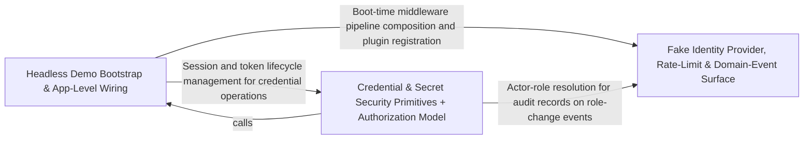

---
tags:
  - 2brain
  - 2brain/arch
  - project/boilerplate-node-backend
type: architecture
component: Scenario_Support_Development_Doubles
---

## Details

The non-production scaffolding the seed/flow path leans on to run unattended: the fake OAuth provider and development doubles that let the flow runner solve no human challenge, the loopback listener the flows are driven against, and the app-level security/rate-limit/system-route wiring that must be present for a listening demo server. This group also carries the kernel event/translation type surface (DomainEventMap, TranslationWritePlan) that the seeded rows and the write surface reference. It is the 'make the demo runnable headlessly' layer, distinct from the fixture data itself.

### Headless Demo Bootstrap & App-Level Wiring
The entry point that turns a bare Node process into a listening, demo-ready server. It is the Node preload (development-doubles.ts) that loads .env, applies developer defaults, and registers the test doubles into the application's registries; the app-level transport security and body-parsing install (security.ts) whose ordering (trust-proxy → rate limiter → body parsers) is what makes a listening server safe; and the system routes (system-routes.ts) — root ping, /livez, /readyz, security.txt — that a demo server must expose. It also carries the kernel type surface (DomainEventMap, TranslationWritePlan) and the shared request/context/audit type declarations that the seeded rows and the write surface reference. This is the 'make it boot and listen' half of the headless layer.

**Related Classes/Methods**: _None_

**Source Files:**

- `scenarios/support/development-doubles.ts`
  - `scenarios.support.development-doubles.registerOAuthProvider('fake') callback` (L46-L46) - Function
- `scripts/regenerate-artifacts.ts`
  - `scripts.regenerate-artifacts.Step` (L35-L40) - Interface
- `src/app/security.ts`
  - `src.app.security.installSecurity.origin` (L139-L158) - Method
- `src/app/system-routes.ts`
  - `src.app.system-routes.router.get('/') callback` (L21-L23) - Function
- `src/globals.d.ts`
  - `src.globals.d.'express-serve-static-core'.Request` (L12-L70) - Interface
- `src/infrastructure/http/request.ts`
  - `src.infrastructure.http.request.RequestInputDeclaration` (L109-L136) - Interface
- `src/infrastructure/i18n/context.ts`
  - `src.infrastructure.i18n.context.LocaleContext` (L21-L26) - Interface
- `src/infrastructure/observability/audit.ts`
  - `src.infrastructure.observability.audit.AuditActionMap` (L61-L61) - Interface
- `src/infrastructure/persistence/changes.ts`
  - `src.infrastructure.persistence.changes.SetAndUnset` (L19-L22) - Interface
- `src/kernel/staff-read.ts`
  - `src.kernel.staff-read.StaffReadTarget` (L17-L28) - Interface
- `src/kernel/translation.ts`
  - `src.kernel.translation.TranslationWritePlan` (L165-L168) - Interface
- `src/modules/access/audit.ts`
  - `src.modules.access.audit.'@infrastructure/observability/audit'.AuditActionMap` (L19-L21) - Interface
- `src/modules/access/module.ts`
  - `src.modules.access.module.default.personalData.collect` (L27-L33) - Method
  - `src.modules.access.module.default.personalData.collect.then() callback` (L28-L32) - Function
  - `src.modules.access.module.default.personalData.collect.then() callback.memberships.map() callback` (L29-L32) - Function
- `src/modules/account/analytics.ts`
  - `src.modules.account.analytics.'@infrastructure/observability/analytics'.AnalyticsEventMap` (L24-L26) - Interface
- `src/modules/account/audit.ts`
  - `src.modules.account.audit.'@infrastructure/observability/audit'.AuditActionMap` (L84-L86) - Interface
- `src/modules/account/events.ts`
  - `src.modules.account.events.'@kernel/events'.DomainEventMap` (L13-L21) - Interface
- `src/modules/account/model.ts`
  - `src.modules.account.model.AccountExportDocument` (L23-L32) - Interface
- `src/modules/account/oauth/config.ts`
  - `src.modules.account.oauth.config.OAuthCredentials` (L54-L57) - Interface
- `src/modules/account/services/reauth.ts`
  - `src.modules.account.services.reauth.ReauthProven` (L70-L72) - Interface
  - `src.modules.account.services.reauth.withCaller` (L90-L98) - Class
  - `src.modules.account.services.reauth.withCaller.then() callback` (L97-L97) - Function
  - `src.modules.account.services.reauth.withCaller.catch() callback` (L98-L98) - Function
  - `src.modules.account.services.reauth.reauthMethods` (L105-L108) - Class
  - `src.modules.account.services.reauth.reauthMethods.withCaller() callback` (L108-L108) - Function
  - `src.modules.account.services.reauth.sendReauthCode` (L161-L181) - Class
  - `src.modules.account.services.reauth.sendReauthCode.withCaller() callback` (L166-L174) - Function
  - `src.modules.account.services.reauth.sendReauthCode.then() callback` (L174-L181) - Function
  - `src.modules.account.services.reauth.codeMatches` (L193-L199) - Class
  - `src.modules.account.services.reauth.codeMatches.then() callback` (L198-L198) - Function
  - `src.modules.account.services.reauth.proveMethod` (L206-L234) - Class
  - `src.modules.account.services.reauth.proveMethod.proved.then() callback` (L225-L232) - Function
  - `src.modules.account.services.reauth.proveOtp` (L241-L252) - Class
  - `src.modules.account.services.reauth.proveOtp.then() callback` (L249-L250) - Function
  - `src.modules.account.services.reauth.reauth` (L267-L283) - Class
  - `src.modules.account.services.reauth.reauth.withCaller() callback` (L272-L275) - Function
  - `src.modules.account.services.reauth.reauth.withCaller() callback.then() callback` (L273-L274) - Function
  - `src.modules.account.services.reauth.reauth.then() callback` (L276-L283) - Function
- `src/modules/account/services/two-factor.ts`
  - `src.modules.account.services.two-factor.rejectWrongCode` (L133-L142) - Class
  - `src.modules.account.services.two-factor.rejectWrongCode.catch() callback` (L138-L141) - Function
  - `src.modules.account.services.two-factor.rejectWrongCode.then() callback` (L142-L142) - Function
  - `src.modules.account.services.two-factor.armedEntries` (L172-L173) - Class
  - `src.modules.account.services.two-factor.armedEntries.filter() callback` (L173-L173) - Function
  - `src.modules.account.services.two-factor.verifyInOrder` (L213-L223) - Class
  - `src.modules.account.services.two-factor.verifyInOrder.then() callback` (L222-L222) - Function
  - `src.modules.account.services.two-factor.verifyAnyFactor` (L229-L232) - Class
  - `src.modules.account.services.two-factor.verifyAnyFactor.then() callback` (L231-L231) - Function
  - `src.modules.account.services.two-factor.verifyArmedFactor` (L252-L266) - Class
  - `src.modules.account.services.two-factor.verifyArmedFactor.then() callback` (L257-L266) - Function
  - `src.modules.account.services.two-factor.verifyArmedFactor.then() callback.then() callback` (L261-L264) - Function
  - `src.modules.account.services.two-factor.verifyArmedFactor.then() callback.then() callback.then() callback` (L263-L263) - Function
  - `src.modules.account.services.two-factor.proveSecondFactor` (L293-L306) - Class
  - `src.modules.account.services.two-factor.proveSecondFactor.then() callback` (L301-L304) - Function
  - `src.modules.account.services.two-factor.proveSecondFactor.then() callback.settleVerdict() callback` (L302-L303) - Function
  - `src.modules.account.services.two-factor.proveSecondFactor.then() callback.settleVerdict() callback.then() callback` (L303-L303) - Function
  - `src.modules.account.services.two-factor.withVerifiedCode` (L321-L340) - Class
  - `src.modules.account.services.two-factor.withVerifiedCode.then() callback` (L330-L339) - Function
  - `src.modules.account.services.two-factor.withVerifiedCode.then() callback.then() callback` (L336-L337) - Function
  - `src.modules.account.services.two-factor.withVerifiedCode.then() callback.then() callback.settleVerdict() callback` (L337-L337) - Function
  - `src.modules.account.services.two-factor.withVerifiedCode.catch() callback` (L340-L340) - Function
  - `src.modules.account.services.two-factor.syncArmedState` (L350-L354) - Class
  - `src.modules.account.services.two-factor.syncArmedState.user.twoFactorMethods.some() callback` (L351-L351) - Function
  - `src.modules.account.services.two-factor.buildLoginChallenge` (L417-L438) - Class
  - `src.modules.account.services.two-factor.buildLoginChallenge.then() callback` (L431-L437) - Function
  - `src.modules.account.services.two-factor.buildLoginChallenge.then() callback.methods.armed.map() callback` (L435-L435) - Function
  - `src.modules.account.services.two-factor.twoFactorStatus` (L445-L473) - Class
  - `src.modules.account.services.two-factor.twoFactorStatus.then() callback` (L450-L472) - Function
  - `src.modules.account.services.two-factor.twoFactorStatus.then() callback.methods.enrolled.map() callback` (L460-L463) - Function
  - `src.modules.account.services.two-factor.twoFactorStatus.then() callback.available.filter() callback` (L465-L465) - Function
  - `src.modules.account.services.two-factor.twoFactorStatus.then() callback.available.map() callback` (L466-L469) - Function
  - `src.modules.account.services.two-factor.twoFactorStatus.catch() callback` (L473-L473) - Function
  - `src.modules.account.services.two-factor.setupTwoFactorMethod` (L484-L517) - Class
  - `src.modules.account.services.two-factor.setupTwoFactorMethod.then() callback` (L496-L515) - Function
  - `src.modules.account.services.two-factor.setupTwoFactorMethod.then() callback.then() callback` (L512-L513) - Function
  - `src.modules.account.services.two-factor.setupTwoFactorMethod.then() callback.then() callback.settleVerdict() callback` (L513-L513) - Function
  - `src.modules.account.services.two-factor.setupTwoFactorMethod.catch() callback` (L516-L516) - Function
  - `src.modules.account.services.two-factor.beginSetup` (L525-L543) - Class
  - `src.modules.account.services.two-factor.beginSetup.then() callback` (L539-L542) - Function
  - `src.modules.account.services.two-factor.beginSetup.then() callback.then() callback` (L541-L541) - Function
  - `src.modules.account.services.two-factor.sendMethodCode.outcome` (L562-L580) - Class
  - `src.modules.account.services.two-factor.sendMethodCode.outcome.then() callback` (L564-L579) - Function
  - `src.modules.account.services.two-factor.sendMethodCode.outcome.then() callback.then() callback` (L576-L577) - Function
  - `src.modules.account.services.two-factor.sendMethodCode.outcome.then() callback.then() callback.then() callback` (L577-L577) - Function
  - `src.modules.account.services.two-factor.sendMethodCode.outcome.catch() callback` (L580-L580) - Function
  - `src.modules.account.services.two-factor.confirmTwoFactorMethod.outcome` (L609-L629) - Class
  - `src.modules.account.services.two-factor.confirmTwoFactorMethod.outcome.then() callback` (L611-L628) - Function
  - `src.modules.account.services.two-factor.confirmTwoFactorMethod.outcome.then() callback.then() callback` (L620-L626) - Function
  - `src.modules.account.services.two-factor.confirmTwoFactorMethod.outcome.then() callback.then() callback.then() callback` (L622-L625) - Function
  - `src.modules.account.services.two-factor.confirmTwoFactorMethod.outcome.catch() callback` (L629-L629) - Function
  - `src.modules.account.services.two-factor.armMethod` (L638-L665) - Class
  - `src.modules.account.services.two-factor.then() callback` (L657-L657) - Function
  - `src.modules.account.services.two-factor.armMethod.then() callback` (L658-L663) - Function
  - `src.modules.account.services.two-factor.outcome.withVerifiedCode() callback` (L741-L744) - Function
  - `src.modules.account.services.two-factor.outcome.withVerifiedCode() callback.then() callback` (L750-L750) - Function
  - `src.modules.account.services.two-factor.regenerateBackupCodes.outcome` (L775-L795) - Class
  - `src.modules.account.services.two-factor.regenerateBackupCodes.outcome.withVerifiedCode() callback` (L783-L794) - Function
  - `src.modules.account.services.two-factor.regenerateBackupCodes.outcome.withVerifiedCode() callback.then() callback` (L788-L792) - Function
  - `src.modules.account.services.two-factor.sendLoginCode.outcome` (L814-L834) - Class
  - `src.modules.account.services.two-factor.sendLoginCode.outcome.then() callback` (L815-L833) - Function
  - `src.modules.account.services.two-factor.sendLoginCode.outcome.then() callback.armed` (L818-L818) - Class
  - `src.modules.account.services.two-factor.sendLoginCode.outcome.then() callback.armed.find() callback` (L818-L818) - Function
  - `src.modules.account.services.two-factor.sendLoginCode.outcome.then() callback.then() callback` (L830-L831) - Function
  - `src.modules.account.services.two-factor.sendLoginCode.outcome.then() callback.then() callback.then() callback` (L831-L831) - Function
  - `src.modules.account.services.two-factor.sendLoginCode.outcome.catch() callback` (L834-L834) - Function
  - `src.modules.account.services.two-factor.VerifiedChallenge` (L840-L843) - Interface
  - `src.modules.account.services.two-factor.verifyLoginChallenge` (L854-L896) - Class
- `src/modules/account/two-factor/backup-codes.ts`
  - `src.modules.account.two-factor.backup-codes.generateBackupCodes` (L50-L51) - Class
  - `src.modules.account.two-factor.backup-codes.generateBackupCodes.Array.from() callback` (L51-L51) - Function
  - `src.modules.account.two-factor.backup-codes.hashBackupCodes` (L54-L55) - Class
  - `src.modules.account.two-factor.backup-codes.hashBackupCodes.codes.map() callback` (L55-L55) - Function
- `src/modules/account/two-factor/methods/email.ts`
  - `src.modules.account.two-factor.methods.email.emailMethod` (L77-L102) - Class
  - `src.modules.account.two-factor.methods.email.emailMethod.available` (L85-L85) - Method
  - `src.modules.account.two-factor.methods.email.emailMethod.eligibility` (L87-L90) - Method
  - `src.modules.account.two-factor.methods.email.emailMethod.target` (L92-L92) - Method
  - `src.modules.account.two-factor.methods.email.emailMethod.setup` (L96-L97) - Method
  - `src.modules.account.two-factor.methods.email.emailMethod.setup.then() callback` (L97-L97) - Function
  - `src.modules.account.two-factor.methods.email.emailMethod.verify` (L101-L101) - Method
- `src/modules/account/two-factor/methods/totp.ts`
  - `src.modules.account.two-factor.methods.totp.totpMethod` (L17-L61) - Class
  - `src.modules.account.two-factor.methods.totp.totpMethod.available` (L20-L20) - Method
  - `src.modules.account.two-factor.methods.totp.totpMethod.eligibility` (L21-L21) - Method
  - `src.modules.account.two-factor.methods.totp.totpMethod.target` (L22-L22) - Method
  - `src.modules.account.two-factor.methods.totp.totpMethod.setup` (L24-L39) - Method
  - `src.modules.account.two-factor.methods.totp.totpMethod.verify` (L41-L60) - Method
  - `src.modules.account.two-factor.methods.totp.totpMethod.verify.then() callback` (L47-L59) - Function
  - `src.modules.account.two-factor.methods.totp.totpMethod.verify.then() callback.then() callback` (L55-L58) - Function
- `src/modules/account/two-factor/registry.ts`
  - `src.modules.account.two-factor.registry.MethodEligibility` (L16-L21) - Interface
  - `src.modules.account.two-factor.registry.TwoFactorMethodHandler` (L28-L67) - Interface
  - `src.modules.account.two-factor.registry.TwoFactorMethodHandler.available` (L40-L40) - Method
  - `src.modules.account.two-factor.registry.TwoFactorMethodHandler.eligibility` (L43-L43) - Method
  - `src.modules.account.two-factor.registry.TwoFactorMethodHandler.target` (L46-L46) - Method
  - `src.modules.account.two-factor.registry.TwoFactorMethodHandler.setup` (L52-L56) - Method
  - `src.modules.account.two-factor.registry.TwoFactorMethodHandler.verify` (L59-L59) - Method
  - `src.modules.account.two-factor.registry.TwoFactorMethodHandler.send` (L62-L66) - Method
  - `src.modules.account.two-factor.registry.availableTwoFactorMethods` (L77-L78) - Class
  - `src.modules.account.two-factor.registry.availableTwoFactorMethods.HANDLERS.filter() callback` (L78-L78) - Function
  - `src.modules.account.two-factor.registry.twoFactorMethod` (L87-L88) - Class
  - `src.modules.account.two-factor.registry.twoFactorMethod.find() callback` (L88-L88) - Function
  - `src.modules.account.two-factor.registry.orderedEntries` (L97-L103) - Class
  - `src.modules.account.two-factor.registry.orderedEntries.flatMap() callback` (L100-L103) - Function
  - `src.modules.account.two-factor.registry.flatMap() callback.entry` (L101-L101) - Class
  - `src.modules.account.two-factor.registry.orderedEntries.flatMap() callback.entry.entries.find() callback` (L101-L101) - Function
- `src/modules/account/two-factor/totp.ts`
  - `src.modules.account.two-factor.totp.TotpVerification` (L76-L81) - Interface
  - `src.modules.account.two-factor.totp.verifyTotpCode` (L91-L118) - Class
  - `src.modules.account.two-factor.totp.verifyTotpCode.then() callback` (L105-L111) - Function
  - `src.modules.account.two-factor.totp.verifyTotpCode.catch() callback` (L117-L117) - Function
- `src/modules/addresses/presenter.ts`
  - `src.modules.addresses.presenter.presentAddresses.addresses.map() callback` (L46-L46) - Function
- `src/modules/api-keys/audit.ts`
  - `src.modules.api-keys.audit.'@infrastructure/observability/audit'.AuditActionMap` (L18-L20) - Interface
- `src/modules/api-keys/credentials.ts`
  - `src.modules.api-keys.credentials.MintedApiKey` (L34-L38) - Interface
- `src/modules/cart/analytics.ts`
  - `src.modules.cart.analytics.'@infrastructure/observability/analytics'.AnalyticsEventMap` (L34-L36) - Interface
- `src/modules/cart/audit.ts`
  - `src.modules.cart.audit.'@infrastructure/observability/audit'.AuditActionMap` (L21-L23) - Interface
- `src/modules/cart/events.ts`
  - `src.modules.cart.events.'@kernel/events'.DomainEventMap` (L9-L43) - Interface
- `src/modules/cart/factories.ts`
  - `src.modules.cart.factories.CartOverrides` (L17-L22) - Interface
- `src/modules/delivery/audit.ts`
  - `src.modules.delivery.audit.'@infrastructure/observability/audit'.AuditActionMap` (L20-L22) - Interface
- `src/modules/example/analytics.ts`
  - `src.modules.example.analytics.'@infrastructure/observability/analytics'.AnalyticsEventMap` (L15-L17) - Interface
- `src/modules/example/audit.ts`
  - `src.modules.example.audit.'@infrastructure/observability/audit'.AuditActionMap` (L19-L21) - Interface
- `src/modules/example/events.ts`
  - `src.modules.example.events.'@kernel/events'.DomainEventMap` (L12-L15) - Interface
- `src/modules/example/factories.ts`
  - `src.modules.example.factories.ExampleOverrides` (L12-L25) - Interface
- `src/modules/feedback/audit.ts`
  - `src.modules.feedback.audit.'@infrastructure/observability/audit'.AuditActionMap` (L18-L20) - Interface
- `src/modules/inventory/audit.ts`
  - `src.modules.inventory.audit.'@infrastructure/observability/audit'.AuditActionMap` (L24-L26) - Interface
- `src/modules/inventory/events.ts`
  - `src.modules.inventory.events.'@kernel/events'.DomainEventMap` (L14-L21) - Interface
- `src/modules/invoicing/audit.ts`
  - `src.modules.invoicing.audit.'@infrastructure/observability/audit'.AuditActionMap` (L15-L17) - Interface
- `src/modules/invoicing/presenter.ts`
  - `src.modules.invoicing.presenter.ExportedDocument` (L12-L18) - Interface
- `src/modules/locales/audit.ts`
  - `src.modules.locales.audit.'@infrastructure/observability/audit'.AuditActionMap` (L33-L35) - Interface
- `src/modules/locales/model.ts`
  - `src.modules.locales.model.derivesBaseLanguage` (L147-L149) - Function
- `src/modules/notifications/factories.ts`
  - `src.modules.notifications.factories.NotificationOverrides` (L12-L26) - Interface
- `src/modules/orders/analytics.ts`
  - `src.modules.orders.analytics.'@infrastructure/observability/analytics'.AnalyticsEventMap` (L26-L28) - Interface
- `src/modules/orders/audit.ts`
  - `src.modules.orders.audit.'@infrastructure/observability/audit'.AuditActionMap` (L30-L32) - Interface
- `src/modules/orders/events.ts`
  - `src.modules.orders.events.'@kernel/events'.DomainEventMap` (L13-L60) - Interface
- `src/modules/orders/services/notify.ts`
  - `src.modules.orders.services.notify.catch() callback` (L90-L99) - Function
- `src/modules/payments/analytics.ts`
  - `src.modules.payments.analytics.'@infrastructure/observability/analytics'.AnalyticsEventMap` (L26-L28) - Interface
- `src/modules/payments/audit.ts`
  - `src.modules.payments.audit.'@infrastructure/observability/audit'.AuditActionMap` (L35-L37) - Interface
- `src/modules/payments/events.ts`
  - `src.modules.payments.events.'@kernel/events'.DomainEventMap` (L10-L58) - Interface
- `src/modules/payments/globals.d.ts`
  - `src.modules.payments.globals.d.'express-serve-static-core'.Request` (L15-L24) - Interface
- `src/modules/products/analytics.ts`
  - `src.modules.products.analytics.'@infrastructure/observability/analytics'.AnalyticsEventMap` (L18-L20) - Interface
- `src/modules/products/audit.ts`
  - `src.modules.products.audit.'@infrastructure/observability/audit'.AuditActionMap` (L18-L20) - Interface
- `src/modules/products/events.ts`
  - `src.modules.products.events.'@kernel/events'.DomainEventMap` (L10-L59) - Interface
- `src/modules/products/services/translated-write.ts`
  - `src.modules.products.services.translated-write.prefixTranslationErrors.errors.rejection.errors.map() callback` (L66-L72) - Function
  - `src.modules.products.services.translated-write.ProductImageExtras` (L80-L84) - Interface
  - `src.modules.products.services.translated-write.then() callback.translations` (L225-L230) - Class
- `src/modules/returns/audit.ts`
  - `src.modules.returns.audit.'@infrastructure/observability/audit'.AuditActionMap` (L19-L21) - Interface
- `src/modules/returns/events.ts`
  - `src.modules.returns.events.'@kernel/events'.DomainEventMap` (L10-L35) - Interface
- `src/modules/users/analytics.ts`
  - `src.modules.users.analytics.'@infrastructure/observability/analytics'.AnalyticsEventMap` (L21-L23) - Interface
- `src/modules/users/audit.ts`
  - `src.modules.users.audit.'@infrastructure/observability/audit'.AuditActionMap` (L39-L41) - Interface
- `src/modules/users/events.ts`
  - `src.modules.users.events.'@kernel/events'.DomainEventMap` (L10-L16) - Interface
- `src/modules/webhooks/audit.ts`
  - `src.modules.webhooks.audit.'@infrastructure/observability/audit'.AuditActionMap` (L25-L27) - Interface
- `src/modules/webhooks/services/catalogue.ts`
  - `src.modules.webhooks.services.catalogue.AsyncApiChannelsDocument` (L14-L16) - Interface
- `src/modules/webhooks/services/deliveries.ts`
  - `src.modules.webhooks.services.deliveries.DeliveryListFilters` (L29-L34) - Interface
- `src/modules/wishlist/analytics.ts`
  - `src.modules.wishlist.analytics.'@infrastructure/observability/analytics'.AnalyticsEventMap` (L19-L21) - Interface
- `src/modules/wishlist/events.ts`
  - `src.modules.wishlist.events.'@kernel/events'.DomainEventMap` (L9-L22) - Interface
- `src/modules/wishlist/presenter.ts`
  - `src.modules.wishlist.presenter.WishlistView` (L11-L13) - Interface
  - `src.modules.wishlist.presenter.presentWishlist.items.map() callback` (L17-L17) - Function

### Credential & Secret Security Primitives + Authorization Model
The security substrate the demo identities and seeded accounts sit on. It owns the credential primitives — argon2id password hashing/verification (password-hash.ts), breached-password checks (breached-passwords), and the versioned AES-256-GCM secret envelope with key-ring rotation and re-encryption (versioned-secret.ts, reencrypt.ts) — and the authorization model that consumes them: the access module's tenant/membership documents and the grant-validation service (promoteVerifiedCustomer, validateGrant) that refuses privilege-escalating writes. This is the 'who may act, and how their secrets are stored' half of the headless layer, distinct from the fixture data it protects.

**Related Classes/Methods**:

- `src.infrastructure.security.password-hash.verifyPassword`:103-118
- `src.modules.access.service.promoteVerifiedCustomer`:303-310
- `src.modules.access.model.MembershipDocument`:49-56

**Source Files:**

- `src/infrastructure/http/response.ts`
  - `src.infrastructure.http.response.validationErrors` (L280-L288) - Class
  - `src.infrastructure.http.response.validationErrors.error.issues.map() callback` (L281-L288) - Function
- `src/infrastructure/security/breached-passwords/index.ts`
  - `src.infrastructure.security.breached-passwords.index.bundledList` (L36-L40) - Class
  - `src.infrastructure.security.breached-passwords.index.bundledList.filter() callback` (L39-L39) - Function
  - `src.infrastructure.security.breached-passwords.index.checkHibpRange` (L62-L99) - Class
  - `src.infrastructure.security.breached-passwords.index.checkHibpRange.then() callback` (L83-L89) - Function
  - `src.infrastructure.security.breached-passwords.index.checkHibpRange.then() callback.match` (L84-L87) - Class
  - `src.infrastructure.security.breached-passwords.index.checkHibpRange.then() callback.match.map() callback` (L86-L86) - Function
  - `src.infrastructure.security.breached-passwords.index.checkHibpRange.then() callback.match.find() callback` (L87-L87) - Function
  - `src.infrastructure.security.breached-passwords.index.checkHibpRange.catch() callback` (L90-L98) - Function
  - `src.infrastructure.security.breached-passwords.index.assertPasswordNotBreached` (L128-L139) - Class
  - `src.infrastructure.security.breached-passwords.index.assertPasswordNotBreached.then() callback` (L129-L138) - Function
- `src/infrastructure/security/password-hash.ts`
  - `src.infrastructure.security.password-hash.verifyPassword` (L103-L118) - Class
  - `src.infrastructure.security.password-hash.verifyPassword.then() callback` (L117-L117) - Function
- `src/infrastructure/security/reencrypt.ts`
  - `src.infrastructure.security.reencrypt.EncryptedField` (L31-L40) - Interface
  - `src.infrastructure.security.reencrypt.ReencryptReport` (L46-L51) - Interface
- `src/infrastructure/security/versioned-secret.ts`
  - `src.infrastructure.security.versioned-secret.VersionedKey` (L18-L21) - Interface
  - `src.infrastructure.security.versioned-secret.SecretBinding` (L57-L60) - Interface
- `src/modules/access/model.ts`
  - `src.modules.access.model.TenantDocument` (L33-L39) - Interface
  - `src.modules.access.model.MembershipDocument` (L49-L56) - Interface
- `src/modules/access/service.ts`
  - `src.modules.access.service.promoteVerifiedCustomer` (L303-L310) - Class
  - `src.modules.access.service.promoteVerifiedCustomer.then() callback` (L304-L310) - Function
  - `src.modules.access.service.promoteVerifiedCustomer.then() callback.then() callback` (L309-L309) - Function
- `src/modules/account/services/authentication.ts`
  - `src.modules.account.services.authentication.SignupInput` (L353-L378) - Interface
  - `src.modules.account.services.authentication.guardBreachedPassword` (L386-L389) - Class
  - `src.modules.account.services.authentication.guardBreachedPassword.then() callback` (L387-L388) - Function
  - `src.modules.account.services.authentication.guardEmailPolicy` (L398-L410) - Class
  - `src.modules.account.services.authentication.guardEmailPolicy.then() callback` (L399-L409) - Function
  - `src.modules.account.services.authentication.createAccountIfEmailFree` (L417-L456) - Class
  - `src.modules.account.services.authentication.createAccountIfEmailFree.then() callback` (L422-L455) - Function
  - `src.modules.account.services.authentication.then() callback.then() callback` (L436-L448) - Function
  - `src.modules.account.services.authentication.then() callback.then() callback.then() callback` (L443-L443) - Function
  - `src.modules.account.services.authentication.createAccountIfEmailFree.then() callback.then() callback.then() callback.then() callback` (L445-L447) - Function
  - `src.modules.account.services.authentication.createAccountIfEmailFree.then() callback.then() callback` (L450-L453) - Function
  - `src.modules.account.services.authentication.createAccountIfEmailFree.then() callback.then() callback.then() callback` (L453-L453) - Function
  - `src.modules.account.services.authentication.createAccountIfEmailFree.catch() callback` (L456-L456) - Function
  - `src.modules.account.services.authentication.signup` (L464-L542) - Class
  - `src.modules.account.services.authentication.signup.outcome` (L502-L510) - Class
  - `src.modules.account.services.authentication.outcome.then() callback` (L505-L505) - Function
  - `src.modules.account.services.authentication.signup.outcome.then() callback` (L512-L541) - Function
  - `src.modules.account.services.authentication.login` (L547-L580) - Class
  - `src.modules.account.services.authentication.login.then() callback` (L565-L577) - Function
  - `src.modules.account.services.authentication.login.then() callback.then() callback` (L571-L575) - Function
  - `src.modules.account.services.authentication.login.catch() callback` (L578-L578) - Function
  - `src.modules.account.services.authentication.logoutEverywhere` (L589-L634) - Class
  - `src.modules.account.services.authentication.logoutEverywhere.then() callback.then() callback` (L617-L617) - Function
  - `src.modules.account.services.authentication.logoutEverywhere.catch() callback` (L620-L620) - Function
  - `src.modules.account.services.authentication.logoutEverywhere.then() callback` (L621-L634) - Function
  - `src.modules.account.services.authentication.verifyOwnPassword` (L648-L665) - Class
  - `src.modules.account.services.authentication.verifyOwnPassword.then() callback` (L656-L665) - Function
  - `src.modules.account.services.authentication.verifyOwnPassword.then() callback.then() callback` (L662-L663) - Function
- `src/modules/account/services/profile.ts`
  - `src.modules.account.services.profile.passwordChange` (L122-L139) - Class
  - `src.modules.account.services.profile.passwordChange.then() callback` (L134-L138) - Function
  - `src.modules.account.services.profile.writePassword` (L150-L168) - Class
  - `src.modules.account.services.profile.writePassword.then() callback` (L157-L166) - Function
  - `src.modules.account.services.profile.writePassword.then() callback.catch() callback` (L159-L165) - Function
  - `src.modules.account.services.profile.writePassword.then() callback.then() callback` (L166-L166) - Function
  - `src.modules.account.services.profile.writePassword.catch() callback` (L168-L168) - Function
  - `src.modules.account.services.profile.passwordResetChange` (L207-L215) - Class
  - `src.modules.account.services.profile.passwordResetChange.then() callback` (L213-L214) - Function
  - `src.modules.account.services.profile.afterReset` (L227-L283) - Class
  - `src.modules.account.services.profile.afterReset.catch() callback` (L247-L255) - Function
  - `src.modules.account.services.profile.afterReset.then() callback` (L282-L282) - Function
  - `src.modules.account.services.profile.resetWith` (L305-L321) - Class
  - `src.modules.account.services.profile.resetWith.then() callback` (L311-L321) - Function
  - `src.modules.account.services.profile.resetWith.then() callback.then() callback` (L314-L319) - Function
  - `src.modules.account.services.profile.resetWith.then() callback.then() callback.then() callback` (L316-L317) - Function
  - `src.modules.account.services.profile.completePasswordReset` (L338-L352) - Class
  - `src.modules.account.services.profile.completePasswordReset.then() callback` (L348-L349) - Function
  - `src.modules.account.services.profile.completePasswordReset.catch() callback` (L351-L351) - Function
  - `src.modules.account.services.profile.updateProfile` (L628-L661) - Class
  - `src.modules.account.services.profile.passwordChangeWithCurrent.outcome` (L679-L688) - Class
  - `src.modules.account.services.profile.passwordChangeWithCurrent.outcome.catch() callback` (L688-L688) - Function
  - `src.modules.account.services.profile.passwordChangeWithCurrent.outcome.then() callback` (L690-L696) - Function
- `src/modules/account/services/revocation.ts`
  - `src.modules.account.services.revocation.revokeAllSessions` (L26-L29) - Class
  - `src.modules.account.services.revocation.revokeAllSessions.then() callback` (L29-L29) - Function
  - `src.modules.account.services.revocation.revokeAfterPasswordChange` (L51-L56) - Class
  - `src.modules.account.services.revocation.then() callback` (L53-L54) - Function
  - `src.modules.account.services.revocation.revokeAfterPasswordChange.then() callback.PENDING_TOKEN_TYPES.map() callback` (L54-L54) - Function
  - `src.modules.account.services.revocation.revokeAfterPasswordChange.then() callback` (L56-L56) - Function
- `src/modules/account/services/tokens.ts`
  - `src.modules.account.services.tokens.findLiveTokenEntry` (L35-L50) - Class
  - `src.modules.account.services.tokens.findLiveTokenEntry.then() callback` (L39-L50) - Function
  - `src.modules.account.services.tokens.findLiveTokenEntry.then() callback.entry.user.tokens.find() callback` (L45-L45) - Function
  - `src.modules.account.services.tokens.findLiveToken` (L58-L62) - Class
  - `src.modules.account.services.tokens.findLiveToken.then() callback` (L62-L62) - Function
  - `src.modules.account.services.tokens.redeemLiveToken` (L86-L96) - Class
  - `src.modules.account.services.tokens.redeemLiveToken.then() callback` (L90-L96) - Function
  - `src.modules.account.services.tokens.redeemLiveToken.then() callback.then() callback` (L93-L94) - Function
- `src/modules/account/services/two-factor.ts`
  - `src.modules.account.services.two-factor.removeTwoFactorMethod.outcome` (L690-L719) - Class
  - `src.modules.account.services.two-factor.removeTwoFactorMethod.outcome.withVerifiedCode() callback.user.twoFactorMethods.findIndex() callback` (L696-L696) - Function
  - `src.modules.account.services.two-factor.removeTwoFactorMethod.outcome.withVerifiedCode() callback` (L702-L718) - Function
  - `src.modules.account.services.two-factor.removeTwoFactorMethod.outcome.withVerifiedCode() callback.then() callback` (L708-L717) - Function
  - `src.modules.account.services.two-factor.disableTwoFactor.outcome` (L737-L756) - Class
  - `src.modules.account.services.two-factor.disableTwoFactor.outcome.withVerifiedCode() callback` (L745-L755) - Function
  - `src.modules.account.services.two-factor.disableTwoFactor.outcome.withVerifiedCode() callback.then() callback` (L751-L754) - Function
  - `src.modules.account.services.two-factor.verifyLoginChallenge.outcome` (L859-L883) - Class
  - `src.modules.account.services.two-factor.verifyLoginChallenge.outcome.then() callback.then() callback` (L865-L880) - Function
  - `src.modules.account.services.two-factor.verifyLoginChallenge.outcome.then() callback.then() callback.settleVerdict() callback` (L866-L879) - Function
  - `src.modules.account.services.two-factor.verifyLoginChallenge.outcome.then() callback.then() callback.settleVerdict() callback.then() callback` (L871-L878) - Function
  - `src.modules.account.services.two-factor.verifyLoginChallenge.outcome.then() callback.then() callback.settleVerdict() callback.then() callback.then() callback` (L875-L876) - Function
  - `src.modules.account.services.two-factor.verifyLoginChallenge.outcome.catch() callback` (L883-L883) - Function
  - `src.modules.account.services.two-factor.verifyLoginChallenge.outcome.then() callback` (L888-L895) - Function
- `src/modules/account/services/verification.ts`
  - `src.modules.account.services.verification.markVerified` (L263-L266) - Class
  - `src.modules.account.services.verification.markVerified.then() callback` (L265-L265) - Function
  - `src.modules.account.services.verification.auditProvenAddress` (L277-L290) - Class
  - `src.modules.account.services.verification.auditProvenAddress.then() callback` (L282-L290) - Function
  - `src.modules.account.services.verification.completeEmailVerification` (L298-L312) - Class
  - `src.modules.account.services.verification.completeEmailVerification.then() callback.then() callback` (L308-L308) - Function
  - `src.modules.account.services.verification.completeEmailVerification.then() callback` (L310-L311) - Function
  - `src.modules.account.services.verification.completeEmailChange` (L328-L360) - Class
  - `src.modules.account.services.verification.completeEmailChange.then() callback.catch() callback` (L348-L354) - Function
  - `src.modules.account.services.verification.completeEmailChange.then() callback.then() callback` (L355-L355) - Function
  - `src.modules.account.services.verification.completeEmailChange.then() callback` (L357-L358) - Function
  - `src.modules.account.services.verification.undoEmailChange` (L378-L394) - Class
  - `src.modules.account.services.verification.undoEmailChange.then() callback.then() callback` (L391-L391) - Function
  - `src.modules.account.services.verification.undoEmailChange.then() callback` (L392-L393) - Function

### Fake Identity Provider, Rate-Limit & Domain-Event Surface
The runtime surface the flows actually drive headlessly. It provides the fake OAuth provider (oauth-fake.ts) that resolves the OAuthProvider port with no network — skipping the consent screen while still round-tripping CSRF state and PKCE — so 'Continue with Google' never leaves the app; the shared rate-limit machinery (rate-limit.ts) and capped-body reader (read-capped-body.ts) that bound the demo server's request path; and the kernel domain-event bus (events.ts, DomainEventMap/DomainEventMeta) plus the account role surface (isUnrestrictedCaller) that the seeded rows and cross-module effects reference. This is the 'solve no human challenge and keep the request path bounded' half of the headless layer.

**Related Classes/Methods**:

- `scenarios.support.doubles.oauth-fake.fakeOAuthProvider`:32-53
- `src.infrastructure.http.middlewares.rate-limit.refuseRateLimited`:67-86
- `src.kernel.events.DomainEventMap`
- `src.infrastructure.http.read-capped-body.readCappedJson`:51-52
- `src.modules.account.roles.isUnrestrictedCaller`:16-17

**Source Files:**

- `scenarios/support/doubles/oauth-fake.ts`
  - `scenarios.support.doubles.oauth-fake.fakeOAuthProvider` (L32-L53) - Class
  - `scenarios.support.doubles.oauth-fake.fakeOAuthProvider.authorizeUrl` (L38-L39) - Method
  - `scenarios.support.doubles.oauth-fake.fakeOAuthProvider.exchangeCode` (L41-L52) - Method
- `scripts/docs/marker-block.ts`
  - `scripts.docs.marker-block.MarkerBlock` (L18-L22) - Interface
  - `scripts.docs.marker-block.MarkerPageOptions` (L25-L40) - Interface
- `src/infrastructure/http/middlewares/rate-limit.ts`
  - `src.infrastructure.http.middlewares.rate-limit.refuseRateLimited` (L67-L86) - Class
  - `src.infrastructure.http.middlewares.rate-limit.refuseRateLimited.<function>` (L69-L86) - Function
  - `src.infrastructure.http.middlewares.rate-limit.BudgetCharge` (L188-L193) - Interface
- `src/infrastructure/http/read-capped-body.ts`
  - `src.infrastructure.http.read-capped-body.readCappedJson` (L51-L52) - Class
  - `src.infrastructure.http.read-capped-body.readCappedJson.then() callback` (L52-L52) - Function
- `src/infrastructure/observability/analytics/index.ts`
  - `src.infrastructure.observability.analytics.index.AnalyticsEventMap` (L27-L27) - Interface
  - `src.infrastructure.observability.analytics.index.AnalyticsEvent` (L44-L65) - Interface
- `src/kernel/events.ts`
  - `src.kernel.events.DomainEventMap` (L21-L21) - Interface
  - `src.kernel.events.DomainEventMeta` (L35-L41) - Interface
- `src/modules/account/controllers/delete-oauth-link.ts`
  - `src.modules.account.controllers.delete-oauth-link.deleteOAuthLink` (L19-L33) - Class
  - `src.modules.account.controllers.delete-oauth-link.deleteOAuthLink.then() callback` (L26-L32) - Function
- `src/modules/account/controllers/get-account.ts`
  - `src.modules.account.controllers.get-account.getAccount` (L20-L41) - Class
  - `src.modules.account.controllers.get-account.getAccount.then() callback` (L28-L39) - Function
- `src/modules/account/controllers/get-oauth-callback.ts`
  - `src.modules.account.controllers.get-oauth-callback.getOAuthCallback` (L66-L203) - Class
  - `src.modules.account.controllers.get-oauth-callback.then() callback` (L134-L134) - Function
  - `src.modules.account.controllers.get-oauth-callback.getOAuthCallback.then() callback` (L135-L179) - Function
  - `src.modules.account.controllers.get-oauth-callback.then() callback.then() callback` (L143-L167) - Function
  - `src.modules.account.controllers.get-oauth-callback.then() callback.then() callback.then() callback` (L153-L156) - Function
  - `src.modules.account.controllers.get-oauth-callback.getOAuthCallback.then() callback.then() callback.then() callback` (L159-L166) - Function
  - `src.modules.account.controllers.get-oauth-callback.getOAuthCallback.then() callback.then() callback` (L170-L178) - Function
  - `src.modules.account.controllers.get-oauth-callback.getOAuthCallback.catch() callback` (L180-L202) - Function
- `src/modules/account/controllers/get-reauth-methods.ts`
  - `src.modules.account.controllers.get-reauth-methods.getReauthMethods` (L17-L27) - Class
  - `src.modules.account.controllers.get-reauth-methods.getReauthMethods.then() callback` (L22-L25) - Function
- `src/modules/account/controllers/post-2fa-method-send.ts`
  - `src.modules.account.controllers.post-2fa-method-send.post2faMethodSend` (L21-L39) - Class
  - `src.modules.account.controllers.post-2fa-method-send.post2faMethodSend.then() callback` (L29-L37) - Function
- `src/modules/account/controllers/post-2fa-setup.ts`
  - `src.modules.account.controllers.post-2fa-setup.post2faSetup` (L21-L41) - Class
  - `src.modules.account.controllers.post-2fa-setup.post2faSetup.then() callback` (L33-L39) - Function
- `src/modules/account/controllers/post-login-2fa.ts`
  - `src.modules.account.controllers.post-login-2fa.postLoginTwoFactor` (L33-L84) - Class
  - `src.modules.account.controllers.post-login-2fa.postLoginTwoFactor.then() callback` (L53-L79) - Function
  - `src.modules.account.controllers.post-login-2fa.postLoginTwoFactor.then() callback.then() callback` (L63-L77) - Function
  - `src.modules.account.controllers.post-login-2fa.postLoginTwoFactor.then() callback.then() callback.then() callback` (L65-L77) - Function
  - `src.modules.account.controllers.post-login-2fa.postLoginTwoFactor.catch() callback` (L80-L83) - Function
- `src/modules/account/controllers/post-login.ts`
  - `src.modules.account.controllers.post-login.postLogin` (L29-L125) - Class
  - `src.modules.account.controllers.post-login.postLogin.then() callback` (L70-L119) - Function
  - `src.modules.account.controllers.post-login.then() callback.pruned.then() callback` (L91-L91) - Function
  - `src.modules.account.controllers.post-login.then() callback.then() callback` (L92-L99) - Function
  - `src.modules.account.controllers.post-login.postLogin.then() callback.pruned.then() callback` (L103-L103) - Function
  - `src.modules.account.controllers.post-login.postLogin.then() callback.then() callback` (L104-L117) - Function
  - `src.modules.account.controllers.post-login.postLogin.then() callback.then() callback.then() callback` (L106-L117) - Function
  - `src.modules.account.controllers.post-login.postLogin.catch() callback` (L120-L124) - Function
- `src/modules/account/controllers/post-logout-everywhere.ts`
  - `src.modules.account.controllers.post-logout-everywhere.postLogoutEverywhere` (L19-L29) - Class
  - `src.modules.account.controllers.post-logout-everywhere.postLogoutEverywhere.then() callback` (L22-L27) - Function
- `src/modules/account/controllers/post-logout.ts`
  - `src.modules.account.controllers.post-logout.postLogout` (L21-L33) - Class
  - `src.modules.account.controllers.post-logout.postLogout.then() callback` (L26-L31) - Function
- `src/modules/account/controllers/post-password-change.ts`
  - `src.modules.account.controllers.post-password-change.postPasswordChange` (L42-L106) - Class
  - `src.modules.account.controllers.post-password-change.postPasswordChange.then() callback` (L67-L101) - Function
  - `src.modules.account.controllers.post-password-change.postPasswordChange.then() callback.then() callback` (L81-L89) - Function
  - `src.modules.account.controllers.post-password-change.postPasswordChange.then() callback.catch() callback` (L90-L100) - Function
  - `src.modules.account.controllers.post-password-change.postPasswordChange.catch() callback` (L102-L105) - Function
- `src/modules/account/controllers/post-pending-email-resend.ts`
  - `src.modules.account.controllers.post-pending-email-resend.postPendingEmailResend` (L18-L29) - Class
  - `src.modules.account.controllers.post-pending-email-resend.postPendingEmailResend.then() callback` (L24-L27) - Function
- `src/modules/account/controllers/post-reauth-method-send.ts`
  - `src.modules.account.controllers.post-reauth-method-send.postReauthMethodSend` (L21-L39) - Class
  - `src.modules.account.controllers.post-reauth-method-send.postReauthMethodSend.then() callback` (L29-L37) - Function
- `src/modules/account/controllers/post-reauth.ts`
  - `src.modules.account.controllers.post-reauth.postReauth` (L26-L64) - Class
  - `src.modules.account.controllers.post-reauth.postReauth.then() callback` (L41-L59) - Function
  - `src.modules.account.controllers.post-reauth.postReauth.then() callback.then() callback` (L55-L58) - Function
  - `src.modules.account.controllers.post-reauth.postReauth.catch() callback` (L60-L63) - Function
- `src/modules/account/controllers/post-signup.ts`
  - `src.modules.account.controllers.post-signup.postSignup` (L31-L133) - Class
  - `src.modules.account.controllers.post-signup.postSignup.then() callback` (L70-L128) - Function
  - `src.modules.account.controllers.post-signup.postSignup.then() callback.then() callback` (L118-L127) - Function
  - `src.modules.account.controllers.post-signup.postSignup.catch() callback` (L129-L132) - Function
- `src/modules/account/oauth/providers/github.ts`
  - `src.modules.account.oauth.providers.github.GithubUser` (L16-L21) - Interface
  - `src.modules.account.oauth.providers.github.GithubEmail` (L24-L28) - Interface
  - `src.modules.account.oauth.providers.github.githubApiGet` (L34-L48) - Class
  - `src.modules.account.oauth.providers.github.githubApiGet.then() callback` (L44-L48) - Function
  - `src.modules.account.oauth.providers.github.githubOAuthProvider` (L54-L138) - Class
  - `src.modules.account.oauth.providers.github.githubOAuthProvider.authorizeUrl` (L57-L72) - Method
  - `src.modules.account.oauth.providers.github.githubOAuthProvider.exchangeCode` (L74-L137) - Method
  - `src.modules.account.oauth.providers.github.exchangeCode.then() callback` (L97-L104) - Function
  - `src.modules.account.oauth.providers.github.githubOAuthProvider.exchangeCode.then() callback` (L116-L136) - Function
- `src/modules/account/oauth/providers/google.ts`
  - `src.modules.account.oauth.providers.google.GoogleIdTokenClaims` (L19-L28) - Interface
  - `src.modules.account.oauth.providers.google.googleOAuthProvider` (L57-L125) - Class
  - `src.modules.account.oauth.providers.google.googleOAuthProvider.authorizeUrl` (L60-L76) - Method
  - `src.modules.account.oauth.providers.google.googleOAuthProvider.exchangeCode` (L78-L124) - Method
  - `src.modules.account.oauth.providers.google.exchangeCode.then() callback` (L99-L105) - Function
  - `src.modules.account.oauth.providers.google.googleOAuthProvider.exchangeCode.then() callback` (L106-L123) - Function
- `src/modules/account/oauth/providers/index.ts`
  - `src.modules.account.oauth.providers.index.registry` (L25-L28) - Class
  - `src.modules.account.oauth.providers.index.registry.google` (L26-L26) - Method
  - `src.modules.account.oauth.providers.index.registry.github` (L27-L27) - Method
- `src/modules/account/oauth/providers/port.ts`
  - `src.modules.account.oauth.providers.port.OAuthIdentity` (L13-L27) - Interface
  - `src.modules.account.oauth.providers.port.OAuthProvider` (L30-L57) - Interface
  - `src.modules.account.oauth.providers.port.OAuthProvider.authorizeUrl` (L44-L44) - Method
  - `src.modules.account.oauth.providers.port.OAuthProvider.exchangeCode` (L56-L56) - Method
- `src/modules/account/roles.ts`
  - `src.modules.account.roles.isUnrestrictedCaller` (L16-L17) - Class
  - `src.modules.account.roles.isUnrestrictedCaller.then() callback` (L17-L17) - Function
- `src/modules/account/services/oauth.ts`
  - `src.modules.account.services.oauth.OAuthEmailUnverifiedError` (L30-L36) - Class
  - `src.modules.account.services.oauth.OAuthEmailUnverifiedError.constructor` (L32-L35) - Constructor
  - `src.modules.account.services.oauth.OAuthAccountUnverifiedError` (L49-L55) - Class
  - `src.modules.account.services.oauth.OAuthAccountUnverifiedError.constructor` (L51-L54) - Constructor
  - `src.modules.account.services.oauth.linkToExistingAccount` (L66-L98) - Class
  - `src.modules.account.services.oauth.linkToExistingAccount.then() callback` (L78-L97) - Function
  - `src.modules.account.services.oauth.linkToExistingAccount.then() callback.then() callback` (L81-L97) - Function
  - `src.modules.account.services.oauth.loginOrCreateFromOAuth` (L214-L249) - Class
  - `src.modules.account.services.oauth.loginOrCreateFromOAuth.then() callback` (L224-L249) - Function
  - `src.modules.account.services.oauth.loginOrCreateFromOAuth.then() callback.then() callback` (L229-L248) - Function
  - `src.modules.account.services.oauth.then() callback.then() callback.then() callback` (L235-L238) - Function
  - `src.modules.account.services.oauth.loginOrCreateFromOAuth.then() callback.then() callback.then() callback` (L244-L247) - Function
- `src/modules/account/session/config.ts`
  - `src.modules.account.session.config.RefreshTokenExpiryTime` (L14-L18) - Enum
  - `src.modules.account.session.config.toRememberTier` (L27-L30) - Class
  - `src.modules.account.session.config.toRememberTier.find() callback` (L30-L30) - Function
- `src/modules/account/session/session.ts`
  - `src.modules.account.session.session.issueSession` (L27-L38) - Class
  - `src.modules.account.session.session.issueSession.then() callback` (L33-L38) - Function
  - `src.modules.account.session.session.reissueSession` (L53-L63) - Class
  - `src.modules.account.session.session.reissueSession.then() callback.then() callback` (L62-L62) - Function
