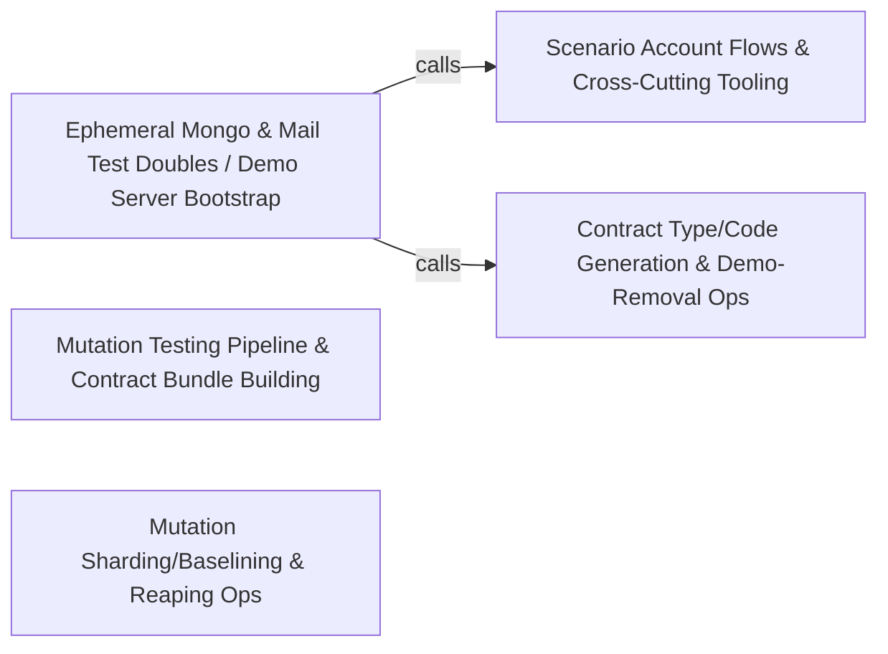

---
tags:
  - 2brain
  - 2brain/arch
  - project/boilerplate-node-backend
type: architecture
component: Scenario_Support_Test_Doubles
---

## Details

The disposable infrastructure the scenario layer runs on: ephemeral in-process MongoDB, the development doubles (mail outbox/log, fake payment provider), and the demo server bootstrap.

### Scenario Account Flows & Cross-Cutting Tooling [[Expand]](./Scenario_Account_Flows_Cross_Cutting_Tooling.md)
The scenario-side account flow entry points plus the scattered cross-cutting tooling that the harness touches — contract breaking-change checks, mutation diff reporting, module-scaffold option parsing, the app's system routes (/readyz), and the antibot provider adapters (altcha store, email/MX policy). It is the 'scenario + tooling' surface that the demo server exercises.

**Related Classes/Methods**:

- `src.infrastructure.adapters.antibot.checkEmailPolicy`:55-86

**Source Files:**

- `scenarios/accounts.ts`
  - `scenarios.accounts.then() callback` (L200-L219) - Function
- `scenarios/support/doubles/payments/fake.ts`
  - `scenarios.support.doubles.payments.fake.parseWebhook.then() callback` (L237-L237) - Function
- `scripts/contracts/check-asyncapi-breaking.ts`
  - `scripts.contracts.check-asyncapi-breaking.catch() callback` (L132-L135) - Function
- `scripts/mutation/run-diff.ts`
  - `scripts.mutation.run-diff.then() callback` (L106-L106) - Function
- `scripts/scaffold/options.ts`
  - `scripts.scaffold.options.ScaffoldOptions` (L10-L23) - Interface
  - `scripts.scaffold.options.ParseRefusal` (L38-L40) - Interface
- `scripts/scaffold/scaffold-module.ts`
  - `scripts.scaffold.scaffold-module.then() callback` (L70-L73) - Function
- `src/app/system-routes.ts`
  - `src.app.system-routes.router.get('/readyz') callback` (L40-L42) - Function
- `src/infrastructure/adapters/antibot-providers/altcha-store.ts`
  - `src.infrastructure.adapters.antibot-providers.altcha-store.claim` (L94-L100) - Class
  - `src.infrastructure.adapters.antibot-providers.altcha-store.claim.then() callback` (L99-L99) - Function
- `src/infrastructure/adapters/antibot-providers/altcha.ts`
  - `src.infrastructure.adapters.antibot-providers.altcha.issue` (L47-L59) - Class
  - `src.infrastructure.adapters.antibot-providers.altcha.issue.then() callback` (L56-L59) - Function
  - `src.infrastructure.adapters.antibot-providers.altcha.check` (L106-L125) - Class
  - `src.infrastructure.adapters.antibot-providers.altcha.check.then() callback.then() callback` (L119-L119) - Function
  - `src.infrastructure.adapters.antibot-providers.altcha.check.then() callback` (L123-L123) - Function
  - `src.infrastructure.adapters.antibot-providers.altcha.altchaProvider` (L128-L135) - Class
  - `src.infrastructure.adapters.antibot-providers.altcha.altchaProvider.publicParameters` (L132-L132) - Method
  - `src.infrastructure.adapters.antibot-providers.altcha.altchaProvider.verify` (L134-L134) - Method
  - `src.infrastructure.adapters.antibot-providers.altcha.altchaProvider.verify.catch() callback` (L134-L134) - Function
- `src/infrastructure/adapters/antibot-providers/index.ts`
  - `src.infrastructure.adapters.antibot-providers.index.IssuedChallenge` (L24-L28) - Interface
  - `src.infrastructure.adapters.antibot-providers.index.ChallengeParameters` (L31-L45) - Interface
  - `src.infrastructure.adapters.antibot-providers.index.HumanChallengeProvider` (L58-L90) - Interface
  - `src.infrastructure.adapters.antibot-providers.index.HumanChallengeProvider.publicParameters` (L71-L71) - Method
  - `src.infrastructure.adapters.antibot-providers.index.HumanChallengeProvider.issueChallenge` (L80-L80) - Method
  - `src.infrastructure.adapters.antibot-providers.index.HumanChallengeProvider.verify` (L89-L89) - Method
  - `src.infrastructure.adapters.antibot-providers.index.humanChallengeProviderProbe` (L135-L139) - Class
  - `src.infrastructure.adapters.antibot-providers.index.humanChallengeProviderProbe.check` (L138-L138) - Method
- `src/infrastructure/adapters/antibot-providers/none.ts`
  - `src.infrastructure.adapters.antibot-providers.none.noneProvider` (L11-L15) - Class
  - `src.infrastructure.adapters.antibot-providers.none.noneProvider.publicParameters` (L13-L13) - Method
  - `src.infrastructure.adapters.antibot-providers.none.noneProvider.verify` (L14-L14) - Method
- `src/infrastructure/adapters/antibot-providers/turnstile.ts`
  - `src.infrastructure.adapters.antibot-providers.turnstile.siteverify` (L38-L57) - Class
  - `src.infrastructure.adapters.antibot-providers.turnstile.then() callback` (L52-L53) - Function
  - `src.infrastructure.adapters.antibot-providers.turnstile.siteverify.then() callback` (L55-L56) - Function
  - `src.infrastructure.adapters.antibot-providers.turnstile.turnstileProvider` (L60-L67) - Class
  - `src.infrastructure.adapters.antibot-providers.turnstile.turnstileProvider.publicParameters` (L62-L65) - Method
  - `src.infrastructure.adapters.antibot-providers.turnstile.turnstileProvider.verify` (L66-L66) - Method
  - `src.infrastructure.adapters.antibot-providers.turnstile.turnstileProvider.verify.catch() callback` (L66-L66) - Function
- `src/infrastructure/adapters/antibot.ts`
  - `src.infrastructure.adapters.antibot.hasMxRecord` (L39-L43) - Class
  - `src.infrastructure.adapters.antibot.hasMxRecord.then() callback` (L42-L42) - Function
  - `src.infrastructure.adapters.antibot.hasMxRecord.catch() callback` (L43-L43) - Function
  - `src.infrastructure.adapters.antibot.checkEmailPolicy` (L55-L86) - Class
  - `src.infrastructure.adapters.antibot.checkEmailPolicy.then() callback` (L56-L86) - Function
  - `src.infrastructure.adapters.antibot.checkEmailPolicy.then() callback.then() callback` (L85-L85) - Function
- `src/infrastructure/adapters/config.ts`
  - `src.infrastructure.adapters.config.mailConfig` (L27-L51) - Class
  - `src.infrastructure.adapters.config.mailConfig.check` (L39-L50) - Method
  - `src.infrastructure.adapters.config.mailConfig.check.SMTP_COMPANIONS.filter() callback` (L42-L42) - Function
  - `src.infrastructure.adapters.config.outboundConfig` (L104-L113) - Class
  - `src.infrastructure.adapters.config.outboundConfig.check` (L109-L112) - Method
  - `src.infrastructure.adapters.config.outboundConfig.check.config.NODE_OUTBOUND_ALLOWED_PORTS.filter() callback` (L111-L111) - Function
  - `src.infrastructure.adapters.config.outboundConfig.check.map() callback` (L112-L112) - Function
  - `src.infrastructure.adapters.config.antibotConfig` (L136-L164) - Class
  - `src.infrastructure.adapters.config.antibotConfig.check` (L148-L163) - Method
- `src/infrastructure/adapters/mail-transports.ts`
  - `src.infrastructure.adapters.mail-transports.mailTransportProbe` (L116-L120) - Class
  - `src.infrastructure.adapters.mail-transports.mailTransportProbe.check` (L119-L119) - Method
- `src/infrastructure/adapters/pdf.ts`
  - `src.infrastructure.adapters.pdf.then() callback.then() callback` (L240-L240) - Function
- `src/infrastructure/config/define.ts`
  - `src.infrastructure.config.define.FieldInfo` (L26-L33) - Interface
  - `src.infrastructure.config.define.SliceProblems` (L36-L43) - Interface
  - `src.infrastructure.config.define.ConfigSlice` (L46-L58) - Interface
  - `src.infrastructure.config.define.ConfigSlice.inspect` (L57-L57) - Method
  - `src.infrastructure.config.define.presenceBroken` (L135-L147) - Class
  - `src.infrastructure.config.define.presenceBroken.members` (L137-L137) - Class
  - `src.infrastructure.config.define.presenceBroken.members.filter() callback` (L137-L137) - Function
  - `src.infrastructure.config.define.presenceBroken.members.some() callback` (L141-L144) - Function
  - `src.infrastructure.config.define.describeShape` (L150-L155) - Class
  - `src.infrastructure.config.define.describeShape.map() callback` (L151-L155) - Function
  - `src.infrastructure.config.define.ConfigDefinition` (L183-L193) - Interface
  - `src.infrastructure.config.define.ConfigDefinition.check` (L192-L192) - Method
  - `src.infrastructure.config.define.presenceProblems.presence.info.filter() callback` (L209-L212) - Function
  - `src.infrastructure.config.define.presenceProblems.presence.map() callback` (L214-L214) - Function
  - `src.infrastructure.config.define.slice` (L230-L243) - Class
  - `src.infrastructure.config.define.defineConfig.slice.inspect` (L233-L242) - Method
  - `src.infrastructure.config.define.configProblems.all` (L274-L274) - Class
  - `src.infrastructure.config.define.configProblems.all.slices.map() callback` (L274-L274) - Function
  - `src.infrastructure.config.define.configProblems.invalid.merged() callback` (L281-L281) - Function
  - `src.infrastructure.config.define.configProblems.presence.merged() callback` (L282-L282) - Function
  - `src.infrastructure.config.define.configProblems.checks.merged() callback` (L283-L283) - Function
- `src/infrastructure/config/fields.ts`
  - `src.infrastructure.config.fields.build` (L98-L109) - Function
  - `src.infrastructure.config.fields.build.rule` (L102-L102) - Class
  - `src.infrastructure.config.fields.build.rule.transform() callback` (L102-L102) - Function
  - `src.infrastructure.config.fields.int` (L158-L169) - Function
  - `src.infrastructure.config.fields.decimal` (L178-L192) - Function
  - `src.infrastructure.config.fields.choice` (L232-L254) - Function
  - `src.infrastructure.config.fields.text` (L285-L291) - Function
  - `src.infrastructure.config.fields.email` (L300-L305) - Function
  - `src.infrastructure.config.fields.listRule` (L342-L348) - Class
  - `src.infrastructure.config.fields.listRule.transform() callback` (L343-L347) - Function
  - `src.infrastructure.config.fields.listRule.transform() callback.map() callback` (L346-L346) - Function
  - `src.infrastructure.config.fields.listRule.transform() callback.filter() callback` (L347-L347) - Function
  - `src.infrastructure.config.fields.csv` (L355-L359) - Class
  - `src.infrastructure.config.fields.csv.listRule() callback` (L357-L357) - Function
  - `src.infrastructure.config.fields.keyRing` (L367-L371) - Class
  - `src.infrastructure.config.fields.keyRing.listRule() callback` (L369-L369) - Function
  - `src.infrastructure.config.fields.versionedKeyRing` (L378-L382) - Class
  - `src.infrastructure.config.fields.versionedKeyRing.transform() callback` (L380-L380) - Function
- `src/infrastructure/http/config.ts`
  - `src.infrastructure.http.config.rateLimitBudgetConfig.shape.budgets.map() callback` (L92-L95) - Function
- `src/infrastructure/http/middlewares/cache.ts`
  - `src.infrastructure.http.middlewares.cache.CachedResponse` (L35-L39) - Interface
- `src/infrastructure/http/middlewares/human-challenge.ts`
  - `src.infrastructure.http.middlewares.human-challenge.humanChallengeGate` (L36-L64) - Class
  - `src.infrastructure.http.middlewares.human-challenge.humanChallengeGate.then() callback` (L55-L61) - Function
  - `src.infrastructure.http.middlewares.human-challenge.humanChallengeGate.catch() callback` (L63-L63) - Function
- `src/infrastructure/http/middlewares/idempotency-model.ts`
  - `src.infrastructure.http.middlewares.idempotency-model.IdempotencyRecordDocument` (L27-L38) - Interface
- `src/infrastructure/observability/analytics/index.ts`
  - `src.infrastructure.observability.analytics.index.analyticsProviderProbe` (L229-L233) - Class
  - `src.infrastructure.observability.analytics.index.analyticsProviderProbe.check` (L232-L232) - Method
- `src/infrastructure/runtime/provider-registry.ts`
  - `src.infrastructure.runtime.provider-registry.ProviderRegistry` (L18-L35) - Interface
  - `src.infrastructure.runtime.provider-registry.ProviderRegistry.register` (L24-L24) - Method
  - `src.infrastructure.runtime.provider-registry.ProviderRegistry.names` (L27-L27) - Method
  - `src.infrastructure.runtime.provider-registry.ProviderRegistry.resolve` (L34-L34) - Method
  - `src.infrastructure.runtime.provider-registry.registryOver` (L42-L48) - Class
  - `src.infrastructure.runtime.provider-registry.registryOver.register` (L43-L45) - Method
  - `src.infrastructure.runtime.provider-registry.registryOver.names` (L46-L46) - Method
  - `src.infrastructure.runtime.provider-registry.registryOver.resolve` (L47-L47) - Method
- `src/infrastructure/security/versioned-secret.ts`
  - `src.infrastructure.security.versioned-secret.parseVersionedKeyRing` (L32-L41) - Class
  - `src.infrastructure.security.versioned-secret.parseVersionedKeyRing.filter() callback` (L35-L35) - Function
  - `src.infrastructure.security.versioned-secret.parseVersionedKeyRing.map() callback` (L36-L41) - Function
- `src/modules/account/oauth/config.ts`
  - `src.modules.account.oauth.config.oauthConfig` (L32-L51) - Class
  - `src.modules.account.oauth.config.oauthConfig.check` (L43-L50) - Method
  - `src.modules.account.oauth.config.oauthConfig.check.PROVIDER_PAIRS.some() callback` (L45-L45) - Function
- `src/modules/account/oauth/providers/github.ts`
  - `src.modules.account.oauth.providers.github.githubOAuthProvider.exchangeCode.then() callback.primary` (L126-L126) - Class
  - `src.modules.account.oauth.providers.github.githubOAuthProvider.exchangeCode.then() callback.primary.emails.find() callback` (L126-L126) - Function
- `src/modules/account/oauth/providers/index.ts`
  - `src.modules.account.oauth.providers.index.enabledProviders` (L35-L36) - Class
  - `src.modules.account.oauth.providers.index.enabledProviders.filter() callback` (L36-L36) - Function
- `src/modules/account/session/config.ts`
  - `src.modules.account.session.config.sessionConfig` (L45-L89) - Class
  - `src.modules.account.session.config.sessionConfig.check` (L82-L88) - Method
- `src/modules/antibot/controllers/get-antibot-challenge.ts`
  - `src.modules.antibot.controllers.get-antibot-challenge.getAntibotChallenge` (L20-L38) - Class
  - `src.modules.antibot.controllers.get-antibot-challenge.then() callback` (L22-L22) - Function
  - `src.modules.antibot.controllers.get-antibot-challenge.getAntibotChallenge.then() callback` (L23-L37) - Function
  - `src.modules.antibot.controllers.get-antibot-challenge.getAntibotChallenge.then() callback.then() callback` (L36-L36) - Function
- `src/modules/antibot/controllers/get-antibot-config.ts`
  - `src.modules.antibot.controllers.get-antibot-config.getAntibotConfig` (L29-L42) - Class
  - `src.modules.antibot.controllers.get-antibot-config.then() callback` (L31-L31) - Function
  - `src.modules.antibot.controllers.get-antibot-config.getAntibotConfig.then() callback` (L32-L40) - Function
- `src/modules/invoicing/emails.ts`
  - `src.modules.invoicing.emails.DocumentVatRow` (L42-L52) - Interface
  - `src.modules.invoicing.emails.DocumentTaxSummaryRow` (L55-L61) - Interface
  - `src.modules.invoicing.emails.DocumentVatBlock` (L64-L92) - Interface
  - `src.modules.invoicing.emails.buildVatBlock.rows.document.lines.map() callback` (L160-L169) - Function
  - `src.modules.invoicing.emails.rows` (L160-L169) - Class
  - `src.modules.invoicing.emails.buildVatBlock.shipping.rows.shippingByRate.map() callback` (L208-L214) - Function
  - `src.modules.invoicing.emails.buildVatBlock.summaryRows.taxSummary.map() callback` (L218-L222) - Function
- `src/modules/invoicing/providers/index.ts`
  - `src.modules.invoicing.providers.index.invoicingProviderProbe` (L102-L106) - Class
  - `src.modules.invoicing.providers.index.invoicingProviderProbe.check` (L105-L105) - Method
- `src/modules/observability/services/process-snapshot.ts`
  - `src.modules.observability.services.process-snapshot.ProcessMemorySnapshot` (L11-L23) - Interface
  - `src.modules.observability.services.process-snapshot.ProcessSnapshot` (L26-L33) - Interface
- `src/modules/payments/config.ts`
  - `src.modules.payments.config.webhookSecretRing` (L86-L87) - Class
  - `src.modules.payments.config.webhookSecretRing.map() callback` (L87-L87) - Function
  - `src.modules.payments.config.paymentsConfig` (L98-L123) - Class
  - `src.modules.payments.config.paymentsConfig.check` (L113-L122) - Method
  - `src.modules.payments.config.paymentsConfig.check.some() callback` (L116-L116) - Function
- `src/modules/payments/providers/index.ts`
  - `src.modules.payments.providers.index.paymentProviderProbe` (L239-L243) - Class
  - `src.modules.payments.providers.index.paymentProviderProbe.check` (L242-L242) - Method
- `src/modules/payments/providers/webhook-signature.ts`
  - `src.modules.payments.providers.webhook-signature.verifyWebhookSignature.pairs` (L85-L88) - Class
  - `src.modules.payments.providers.webhook-signature.verifyWebhookSignature.pairs.map() callback` (L85-L88) - Function
  - `src.modules.payments.providers.webhook-signature.verifyWebhookSignature.timestamp` (L90-L90) - Class
  - `src.modules.payments.providers.webhook-signature.verifyWebhookSignature.timestamp.pairs.find() callback` (L90-L90) - Function
  - `src.modules.payments.providers.webhook-signature.verifyWebhookSignature.provided` (L93-L93) - Class
  - `src.modules.payments.providers.webhook-signature.verifyWebhookSignature.provided.map() callback` (L93-L93) - Function
  - `src.modules.payments.providers.webhook-signature.verifyWebhookSignature.provided.pairs.filter() callback` (L93-L93) - Function

### Ephemeral Mongo & Mail Test Doubles / Demo Server Bootstrap [[Expand]](./Ephemeral_Mongo_Mail_Test_Doubles_Demo_Server_Bootstrap.md)
The heart of the subsystem: the Mongo resolver/starter pair, the development mail doubles (outbox + log), and the demo server bootstrap that wires the app to run against ephemeral Mongo and fake providers. This is the disposable runtime the scenario layer depends on.

**Related Classes/Methods**:

- `scenarios.support.ephemeral-mongo.startEphemeralMongo`:73-86
- `scenarios.support.ephemeral-mongo.EphemeralMongo`:35-38

**Source Files:**

- `scenarios/run-server.ts`
  - `scenarios.run-server.then() callback.process.once() callback` (L175-L184) - Function
- `scenarios/support/doubles/mail-log.ts`
  - `scenarios.support.doubles.mail-log.logMailTransport` (L20-L35) - Class
  - `scenarios.support.doubles.mail-log.logMailTransport.delivers` (L21-L21) - Method
  - `scenarios.support.doubles.mail-log.logMailTransport.send` (L22-L34) - Method
  - `scenarios.support.doubles.mail-log.logMailTransport.send.then() callback` (L23-L33) - Function
- `scenarios/support/doubles/mail-outbox.ts`
  - `scenarios.support.doubles.mail-outbox.outboxMailTransport` (L78-L84) - Class
  - `scenarios.support.doubles.mail-outbox.outboxMailTransport.delivers` (L79-L79) - Method
  - `scenarios.support.doubles.mail-outbox.outboxMailTransport.send` (L80-L83) - Method
- `scenarios/support/ephemeral-mongo.ts`
  - `scenarios.support.ephemeral-mongo.EphemeralMongo` (L35-L38) - Interface
  - `scenarios.support.ephemeral-mongo.startEphemeralMongo` (L73-L86) - Class
  - `scenarios.support.ephemeral-mongo.startEphemeralMongo.stop` (L80-L80) - Method
- `scenarios/support/ephemeral-mongod.ts`
  - `scenarios.support.ephemeral-mongod.toEphemeralMongo` (L32-L35) - Class
  - `scenarios.support.ephemeral-mongod.toEphemeralMongo.stop` (L34-L34) - Method
  - `scenarios.support.ephemeral-mongod.toEphemeralMongo.stop.then() callback` (L34-L34) - Function
- `scripts/contracts/generate-request-content-types.ts`
  - `scripts.contracts.generate-request-content-types.compileTemplate.source` (L74-L80) - Class
  - `scripts.contracts.generate-request-content-types.compileTemplate.source.segments.map() callback` (L75-L78) - Function
- `scripts/contracts/root-assembly.ts`
  - `scripts.contracts.root-assembly.readModuleFragments.present` (L153-L156) - Class
  - `scripts.contracts.root-assembly.readModuleFragments.present.map() callback` (L155-L155) - Function
  - `scripts.contracts.root-assembly.readModuleFragments.present.filter() callback` (L156-L156) - Function
- `scripts/eslint/controller-chain-must-catch.ts`
  - `scripts.eslint.controller-chain-must-catch.controllerChainMustCatch.create.CallExpression.parents` (L144-L146) - Class
  - `scripts.eslint.controller-chain-must-catch.controllerChainMustCatch.create.CallExpression.parents.map() callback` (L145-L145) - Function
- `scripts/eslint/no-hardcoded-user-text.ts`
  - `scripts.eslint.no-hardcoded-user-text.noHardcodedUserText.create.CallExpression.errors` (L51-L54) - Class
  - `scripts.eslint.no-hardcoded-user-text.noHardcodedUserText.create.CallExpression.errors.node.arguments.find() callback` (L52-L53) - Function
- `scripts/mutation/baseline.ts`
  - `scripts.mutation.baseline.compareToBaseline` (L166-L185) - Class
  - `scripts.mutation.baseline.compareToBaseline.files.map() callback` (L173-L184) - Function
- `scripts/mutation/mutate-scope.ts`
  - `scripts.mutation.mutate-scope.isMutable.exclude` (L45-L47) - Class
  - `scripts.mutation.mutate-scope.isMutable.exclude.patterns.filter() callback` (L46-L46) - Function
  - `scripts.mutation.mutate-scope.isMutable.exclude.map() callback` (L47-L47) - Function
  - `scripts.mutation.mutate-scope.isMutable.exclude.every() callback` (L52-L52) - Function
- `scripts/ops/demo-remove-registry.ts`
  - `scripts.ops.demo-remove-registry.RemovalNote` (L19-L22) - Interface
  - `scripts.ops.demo-remove-registry.stripModuleLines` (L41-L57) - Class
  - `scripts.ops.demo-remove-registry.stripModuleLines.filter() callback.names.every() callback` (L54-L54) - Function
  - `scripts.ops.demo-remove-registry.stripModuleLines.filter() callback` (L55-L55) - Function
  - `scripts.ops.demo-remove-registry.stripModuleRegistry.after` (L66-L70) - Class
  - `scripts.ops.demo-remove-registry.stripModuleRegistry.after.stripModuleLines() callback` (L69-L69) - Function
  - `scripts.ops.demo-remove-registry.OwnedOpsFile` (L76-L80) - Interface
  - `scripts.ops.demo-remove-registry.readOwnedOpsFiles` (L87-L100) - Class
  - `scripts.ops.demo-remove-registry.readOwnedOpsFiles.filter() callback` (L92-L92) - Function
  - `scripts.ops.demo-remove-registry.readOwnedOpsFiles.flatMap() callback` (L93-L99) - Function
  - `scripts.ops.demo-remove-registry.removeShopOwnedOpsScripts.owned` (L111-L111) - Class
  - `scripts.ops.demo-remove-registry.removeShopOwnedOpsScripts.owned.filter() callback` (L111-L111) - Function
  - `scripts.ops.demo-remove-registry.removeShopOwnedOpsScripts.removedScriptNames` (L114-L117) - Class
  - `scripts.ops.demo-remove-registry.removeShopOwnedOpsScripts.removedScriptNames.owned.map() callback` (L116-L116) - Function
  - `scripts.ops.demo-remove-registry.removeShopOwnedOpsScripts.owned.map() callback` (L121-L124) - Function
  - `scripts.ops.demo-remove-registry.removeShopOwnedOpsScripts.removedScriptNames.map() callback` (L125-L128) - Function
- `scripts/ops/demo-remove-tests.ts`
  - `scripts.ops.demo-remove-tests.removeResidueTests.gone` (L113-L117) - Class
  - `scripts.ops.demo-remove-tests.removeResidueTests.gone.names.flatMap() callback` (L113-L117) - Function
- `scripts/pairing/spec-identity.ts`
  - `scripts.pairing.spec-identity.SharedFile` (L33-L36) - Interface
  - `scripts.pairing.spec-identity.SpecComparison` (L128-L138) - Interface
  - `scripts.pairing.spec-identity.compareSharedFiles` (L160-L189) - Class
  - `scripts.pairing.spec-identity.compareSharedFiles.SHARED_FILES.map() callback` (L165-L189) - Function
- `scripts/pairing/sync-to-frontend.ts`
  - `scripts.pairing.sync-to-frontend.outcomes` (L122-L138) - Class
  - `scripts.pairing.sync-to-frontend.outcomes.SHARED_FILES.map() callback` (L122-L138) - Function
- `scripts/scaffold/plan.ts`
  - `scripts.scaffold.plan.collidingSchemas` (L126-L135) - Class
  - `scripts.scaffold.plan.collidingSchemas.filter() callback` (L135-L135) - Function
- `src/infrastructure/adapters/email.worker.ts`
  - `src.infrastructure.adapters.email.worker.discardJobAttachments` (L26-L29) - Class
  - `src.infrastructure.adapters.email.worker.discardJobAttachments.attachments.map() callback` (L29-L29) - Function
  - `src.infrastructure.adapters.email.worker.discardJobAttachments.then() callback` (L29-L29) - Function
  - `src.infrastructure.adapters.email.worker.handleEmailJob` (L40-L74) - Class
  - `src.infrastructure.adapters.email.worker.handleEmailJob.then() callback.then() callback` (L64-L64) - Function
  - `src.infrastructure.adapters.email.worker.handleEmailJob.catch() callback` (L65-L72) - Function
- `src/infrastructure/adapters/logger.ts`
  - `src.infrastructure.adapters.logger.Logger.debug` (L31-L31) - Method
- `src/infrastructure/adapters/mail-spool.ts`
  - `src.infrastructure.adapters.mail-spool.discardSpooled` (L72-L79) - Class
  - `src.infrastructure.adapters.mail-spool.discardSpooled.then() callback` (L77-L77) - Function
- `src/infrastructure/adapters/mail-transports.ts`
  - `src.infrastructure.adapters.mail-transports.OutgoingMail` (L29-L41) - Interface
  - `src.infrastructure.adapters.mail-transports.MailTransportAdapter` (L44-L62) - Interface
  - `src.infrastructure.adapters.mail-transports.smtpTransport` (L67-L70) - Class
  - `src.infrastructure.adapters.mail-transports.smtpTransport.delivers` (L68-L68) - Method
  - `src.infrastructure.adapters.mail-transports.smtpTransport.send` (L69-L69) - Method
  - `src.infrastructure.adapters.mail-transports.smtpTransport.send.then() callback` (L69-L69) - Function
- `src/infrastructure/adapters/mailer.ts`
  - `src.infrastructure.adapters.mailer.ResolvedAttachment` (L41-L44) - Interface
  - `src.infrastructure.adapters.mailer.resolveAttachments` (L58-L73) - Class
  - `src.infrastructure.adapters.mailer.resolveAttachments.attachments.map() callback` (L62-L72) - Function
  - `src.infrastructure.adapters.mailer.resolveAttachments.attachments.map() callback.then() callback` (L64-L64) - Function
  - `src.infrastructure.adapters.mailer.resolveAttachments.then() callback` (L73-L73) - Function
  - `src.infrastructure.adapters.mailer.renderMessage` (L87-L119) - Class
  - `src.infrastructure.adapters.mailer.renderMessage.then() callback` (L110-L119) - Function
  - `src.infrastructure.adapters.mailer.sendTemplatedEmail` (L140-L184) - Class
  - `src.infrastructure.adapters.mailer.sendTemplatedEmail.withSpan('email.send') callback` (L148-L183) - Function
  - `src.infrastructure.adapters.mailer.withSpan('email.send') callback.then() callback` (L165-L171) - Function
  - `src.infrastructure.adapters.mailer.sendTemplatedEmail.withSpan('email.send') callback.then() callback.render` (L170-L170) - Method
  - `src.infrastructure.adapters.mailer.sendTemplatedEmail.withSpan('email.send') callback.then() callback` (L173-L179) - Function
  - `src.infrastructure.adapters.mailer.EmailContent` (L192-L204) - Interface
  - `src.infrastructure.adapters.mailer.sendInline` (L212-L223) - Class
  - `src.infrastructure.adapters.mailer.sendInline.then() callback` (L218-L218) - Function
  - `src.infrastructure.adapters.mailer.sendInline.finally() callback` (L219-L222) - Function
  - `src.infrastructure.adapters.mailer.sendInline.finally() callback.map() callback` (L220-L220) - Function
  - `src.infrastructure.adapters.mailer.sendInline.finally() callback.then() callback` (L221-L221) - Function
  - `src.infrastructure.adapters.mailer.enqueueEmail.dispatch` (L259-L279) - Class
  - `src.infrastructure.adapters.mailer.enqueueEmail.dispatch.then() callback` (L265-L279) - Function
  - `src.infrastructure.adapters.mailer.enqueueEmail.dispatch.catch() callback` (L286-L294) - Function
- `src/infrastructure/adapters/smtp-transport.ts`
  - `src.infrastructure.adapters.smtp-transport.sendBySmtp` (L85-L86) - Class
  - `src.infrastructure.adapters.smtp-transport.sendBySmtp.then() callback` (L86-L86) - Function
- `src/infrastructure/observability/analytics/umami.ts`
  - `src.infrastructure.observability.analytics.umami.umamiAnalyticsProvider.capture` (L87-L150) - Method
- `src/infrastructure/observability/audit.ts`
  - `src.infrastructure.observability.audit.AuditEvent` (L83-L130) - Interface
  - `src.infrastructure.observability.audit.AuditEntry` (L136-L141) - Interface
- `src/infrastructure/observability/metrics-registry.ts`
  - `src.infrastructure.observability.metrics-registry._heapSizeLimitGauge` (L55-L62) - Class
  - `src.infrastructure.observability.metrics-registry._heapSizeLimitGauge.collect` (L59-L61) - Method
- `src/infrastructure/observability/tracer.ts`
  - `src.infrastructure.observability.tracer.withSpan` (L37-L83) - Class
  - `src.infrastructure.observability.tracer.withSpan.tracer.startActiveSpan() callback` (L46-L82) - Function
  - `src.infrastructure.observability.tracer.withSpan.tracer.startActiveSpan() callback.then() callback` (L66-L80) - Function

### Mutation Testing Pipeline & Contract Bundle Building [[Expand]](./Mutation_Testing_Pipeline_Contract_Bundle_Building.md)
The mutation-testing execution pipeline (sharding, Stryker runs, GitHub artifact baselines, CI wave/merge) together with contract bundle building and the eslint guard that keeps the unit layer free of persistence imports. It is the CI-side consumer of the test harness.

**Related Classes/Methods**:

- `scripts.mutation.stryker-run.runStryker`:92-188

**Source Files:**

- `scripts/contracts/build-bundles.ts`
  - `scripts.contracts.build-bundles.named` (L39-L39) - Class
  - `scripts.contracts.build-bundles.named.arguments_.filter() callback` (L39-L39) - Function
- `scripts/eslint/no-persistence-imports.ts`
  - `scripts.eslint.no-persistence-imports.noPersistenceImports.create.ImportDeclaration.name.find() callback` (L129-L130) - Function
  - `scripts.eslint.no-persistence-imports.noPersistenceImports.create.ImportDeclaration.name` (L129-L131) - Class
  - `scripts.eslint.no-persistence-imports.noPersistenceImports.create.ImportDeclaration.name.find() callback.bindings.some() callback` (L130-L130) - Function
- `scripts/mutation/baseline.ts`
  - `scripts.mutation.baseline.formatRegressions.lines` (L280-L283) - Class
  - `scripts.mutation.baseline.formatRegressions.lines.regressed.map() callback` (L281-L282) - Function
- `scripts/mutation/ci/merge.ts`
  - `scripts.mutation.ci.merge.ReportMutant` (L20-L30) - Interface
  - `scripts.mutation.ci.merge.ReportTest` (L33-L38) - Interface
  - `scripts.mutation.ci.merge.StrykerReport` (L41-L45) - Interface
  - `scripts.mutation.ci.merge.ShardReport` (L48-L51) - Interface
  - `scripts.mutation.ci.merge.MergeResult` (L54-L57) - Interface
  - `scripts.mutation.ci.merge.mergeTests.idMaps.reports.map() callback` (L102-L118) - Function
  - `scripts.mutation.ci.merge.FileMutants` (L124-L131) - Interface
  - `scripts.mutation.ci.merge.mergeReports.incomplete.finished.map() callback` (L167-L167) - Function
  - `scripts.mutation.ci.merge.formatSummary.mutantCount` (L244-L244) - Class
  - `scripts.mutation.ci.merge.formatSummary.mutantCount.reduce() callback` (L244-L244) - Function
  - `scripts.mutation.ci.merge.tally` (L288-L302) - Class
  - `scripts.mutation.ci.merge.tally.flatMap() callback` (L292-L292) - Function
  - `scripts.mutation.ci.merge.tally.count` (L295-L296) - Class
  - `scripts.mutation.ci.merge.tally.count.statuses.reduce() callback` (L296-L296) - Function
- `scripts/mutation/ci/waves.ts`
  - `scripts.mutation.ci.waves.scheduleWave.named` (L146-L149) - Class
  - `scripts.mutation.ci.waves.scheduleWave.named.queue.map() callback` (L146-L149) - Function
- `scripts/mutation/github-artifacts.ts`
  - `scripts.mutation.github-artifacts.GitHubArtifact` (L20-L34) - Interface
  - `scripts.mutation.github-artifacts.newestBaseline` (L44-L53) - Class
  - `scripts.mutation.github-artifacts.newestBaseline.artifacts.filter() callback` (L47-L50) - Function
  - `scripts.mutation.github-artifacts.newestBaseline.toSorted() callback` (L52-L52) - Function
- `scripts/mutation/pull-baseline.ts`
  - `scripts.mutation.pull-baseline.install` (L46-L57) - Class
  - `scripts.mutation.pull-baseline.install.then() callback` (L47-L56) - Function
  - `scripts.mutation.pull-baseline.install.then() callback.finally() callback` (L50-L50) - Function
  - `scripts.mutation.pull-baseline.install.then() callback.then() callback` (L51-L56) - Function
  - `scripts.mutation.pull-baseline.then() callback` (L61-L66) - Function
- `scripts/mutation/run-shards.ts`
  - `scripts.mutation.run-shards.completed` (L84-L84) - Class
  - `scripts.mutation.run-shards.completed.filter() callback` (L84-L84) - Function
  - `scripts.mutation.run-shards.completed.shards.map() callback` (L84-L84) - Function
- `scripts/mutation/stryker-run.ts`
  - `scripts.mutation.stryker-run.runStryker` (L92-L188) - Class
  - `scripts.mutation.stryker-run.runStryker.then() callback` (L133-L186) - Function
  - `scripts.mutation.stryker-run.runStryker.then() callback.<function>` (L134-L186) - Function
  - `scripts.mutation.stryker-run.runStryker.then() callback.<function>.stryker.stdout.on('data') callback` (L162-L181) - Function
  - `scripts.mutation.stryker-run.runStryker.then() callback.<function>.stryker.on('exit') callback` (L183-L184) - Function
- `scripts/ops/demo-remove-authorization.ts`
  - `scripts.ops.demo-remove-authorization.RemovedAuthorization` (L21-L26) - Interface
  - `scripts.ops.demo-remove-authorization.FragmentKey` (L29-L32) - Interface
  - `scripts.ops.demo-remove-authorization.readRemovedAuthorization.keys.removed.map() callback` (L59-L59) - Function
  - `scripts.ops.demo-remove-authorization.readRemovedAuthorization.subjects.filter() callback` (L61-L61) - Function
  - `scripts.ops.demo-remove-authorization.readRemovedAuthorization.subjects.removed.map() callback` (L61-L61) - Function
  - `scripts.ops.demo-remove-authorization.pruneCase.lists.map() callback` (L107-L111) - Function
  - `scripts.ops.demo-remove-authorization.pruneCase.lists` (L107-L112) - Class
  - `scripts.ops.demo-remove-authorization.pruneCase.lists.map() callback.map() callback` (L110-L110) - Function
  - `scripts.ops.demo-remove-authorization.stripConformanceCases.headKept` (L139-L142) - Class
  - `scripts.ops.demo-remove-authorization.stripConformanceCases.headKept.filter() callback` (L141-L141) - Function
- `scripts/scaffold/registry.ts`
  - `scripts.scaffold.registry.insertInRun.offset` (L33-L33) - Class
  - `scripts.scaffold.registry.insertInRun.offset.findIndex() callback` (L33-L33) - Function
- `scripts/scaffold/templates-code.ts`
  - `scripts.scaffold.templates-code.authorizationYaml` (L100-L112) - Class
  - `scripts.scaffold.templates-code.authorizationYaml.KEY_ACTIONS.flatMap() callback` (L103-L110) - Function
- `src/infrastructure/adapters/export-store.ts`
  - `src.infrastructure.adapters.export-store.openExport` (L98-L110) - Class
  - `src.infrastructure.adapters.export-store.openExport.then() callback` (L104-L108) - Function
- `src/modules/account/controllers/get-my-abilities.ts`
  - `src.modules.account.controllers.get-my-abilities.modelVersion` (L40-L40) - Class
  - `src.modules.account.controllers.get-my-abilities.modelVersion.PERMISSION_KEYS.map() callback` (L40-L40) - Function
- `src/modules/account/repository.ts`
  - `src.modules.account.repository.insert` (L53-L55) - Class
  - `src.modules.account.repository.insert.then() callback` (L55-L55) - Function
- `src/modules/account/services/authentication.ts`
  - `src.modules.account.services.authentication.MissingRefreshTokenError` (L285-L291) - Class
  - `src.modules.account.services.authentication.MissingRefreshTokenError.constructor` (L287-L290) - Constructor
  - `src.modules.account.services.authentication.refreshAccessToken` (L304-L346) - Class
  - `src.modules.account.services.authentication.refreshAccessToken.then() callback` (L312-L318) - Function
  - `src.modules.account.services.authentication.refreshAccessToken.catch() callback` (L319-L346) - Function
- `src/modules/account/services/export.ts`
  - `src.modules.account.services.export.openOwnExport` (L234-L253) - Class
  - `src.modules.account.services.export.openOwnExport.then() callback` (L239-L253) - Function
  - `src.modules.account.services.export.openOwnExport.then() callback.then() callback` (L242-L252) - Function
- `src/modules/account/services/two-factor.ts`
  - `src.modules.account.services.two-factor.twoFactorStatus.then() callback.enrolledNames` (L456-L456) - Class
  - `src.modules.account.services.two-factor.twoFactorStatus.then() callback.enrolledNames.enrolled.map() callback` (L456-L456) - Function
  - `src.modules.account.services.two-factor.confirmTwoFactorMethod.outcome.then() callback.entry` (L614-L614) - Class
  - `src.modules.account.services.two-factor.confirmTwoFactorMethod.outcome.then() callback.entry.user.twoFactorMethods.find() callback` (L614-L614) - Function
- `src/modules/account/session/jwt.ts`
  - `src.modules.account.session.jwt.TokenRejection` (L103-L112) - Class
  - `src.modules.account.session.jwt.TokenRejection.constructor` (L105-L111) - Constructor
  - `src.modules.account.session.jwt.verifyAgainstRing` (L135-L171) - Class
  - `src.modules.account.session.jwt.verifyAgainstRing.<function>` (L140-L171) - Function
  - `src.modules.account.session.jwt.verifyAgainstRing.<function>.verify() callback` (L160-L170) - Function
  - `src.modules.account.session.jwt.verifyRefreshToken` (L190-L204) - Class
  - `src.modules.account.session.jwt.verifyRefreshToken.then() callback` (L191-L203) - Function
  - `src.modules.account.session.jwt.verifyRefreshToken.then() callback.then() callback` (L192-L203) - Function
  - `src.modules.account.session.jwt.verifyRefreshToken.then() callback.then() callback.entry` (L199-L199) - Class
  - `src.modules.account.session.jwt.verifyRefreshToken.then() callback.then() callback.entry.user.tokens.find() callback` (L199-L199) - Function
  - `src.modules.account.session.jwt.createRefreshToken` (L243-L280) - Class
  - `src.modules.account.session.jwt.createRefreshToken.then() callback` (L251-L280) - Function
  - `src.modules.account.session.jwt.recordRefreshTokenUse` (L291-L295) - Class
  - `src.modules.account.session.jwt.recordRefreshTokenUse.then() callback` (L294-L294) - Function
  - `src.modules.account.session.jwt.recordRefreshTokenUse.catch() callback` (L295-L295) - Function
  - `src.modules.account.session.jwt.createAccessToken` (L309-L310) - Class
  - `src.modules.account.session.jwt.createAccessToken.then() callback` (L310-L310) - Function
  - `src.modules.account.session.jwt.TokenReuseError` (L318-L324) - Class
  - `src.modules.account.session.jwt.TokenReuseError.constructor` (L320-L323) - Constructor
  - `src.modules.account.session.jwt.revokeAllRefreshTokens` (L331-L335) - Class
  - `src.modules.account.session.jwt.revokeAllRefreshTokens.then() callback` (L335-L335) - Function
  - `src.modules.account.session.jwt.reissueRotated` (L348-L375) - Class
  - `src.modules.account.session.jwt.reissueRotated.then() callback` (L349-L375) - Function
  - `src.modules.account.session.jwt.reissueRotated.then() callback.then() callback.then() callback` (L367-L367) - Function
  - `src.modules.account.session.jwt.reissueRotated.then() callback.then() callback` (L368-L373) - Function
  - `src.modules.account.session.jwt.resolveLostRotation` (L389-L423) - Class
  - `src.modules.account.session.jwt.resolveLostRotation.then() callback` (L394-L423) - Function
  - `src.modules.account.session.jwt.resolveLostRotation.then() callback.then() callback` (L420-L422) - Function
  - `src.modules.account.session.jwt.rotateRefreshToken` (L438-L454) - Class
  - `src.modules.account.session.jwt.rotateRefreshToken.then() callback` (L440-L454) - Function
  - `src.modules.account.session.jwt.rotateRefreshToken.then() callback.then() callback` (L449-L452) - Function
  - `src.modules.account.session.jwt.rememberOfRefreshToken` (L468-L477) - Class
  - `src.modules.account.session.jwt.rememberOfRefreshToken.then() callback` (L474-L474) - Function
  - `src.modules.account.session.jwt.rememberOfRefreshToken.catch() callback` (L476-L476) - Function
- `src/modules/account/session/key-ring.ts`
  - `src.modules.account.session.key-ring.keyForId` (L30-L31) - Class
  - `src.modules.account.session.key-ring.keyForId.ring.find() callback` (L31-L31) - Function
- `src/modules/account/session/prune.ts`
  - `src.modules.account.session.prune.pruneOwnExpiredTokens` (L27-L35) - Class
  - `src.modules.account.session.prune.pruneOwnExpiredTokens.then() callback` (L30-L30) - Function
  - `src.modules.account.session.prune.pruneOwnExpiredTokens.catch() callback` (L31-L35) - Function

### Contract Type/Code Generation & Demo-Removal Ops [[Expand]](./Contract_Type_Code_Generation_Demo_Removal_Ops.md)
Contract-first code generation (AsyncAPI types, error codes, root assembly fragments) plus the ops tooling that strips demo/authorization/test scaffolding and refreshes breached-password corpora. It produces the generated artifacts and the demo-removal transformations that keep the boilerplate reusable.

**Related Classes/Methods**:

- `scripts.ops.demo-remove-authorization.pruneCase`:103-125
- `scripts.ops.refresh-breached-passwords.downloadCorpus`:73-80

**Source Files:**

- `scripts/contracts/generate-asyncapi-types.ts`
  - `scripts.contracts.generate-asyncapi-types.buildOutput.sections` (L548-L577) - Class
  - `scripts.contracts.generate-asyncapi-types.buildOutput.sections.sseEntries.map() callback` (L571-L571) - Function
- `scripts/contracts/generate-error-codes.ts`
  - `scripts.contracts.generate-error-codes.rows` (L95-L95) - Class
  - `scripts.contracts.generate-error-codes.rows.codes.map() callback` (L95-L95) - Function
- `scripts/contracts/root-assembly.ts`
  - `scripts.contracts.root-assembly.ModuleFragment` (L22-L29) - Interface
  - `scripts.contracts.root-assembly.appendMissingTags.missing.fragments.flatMap() callback` (L98-L98) - Function
  - `scripts.contracts.root-assembly.appendMissingTags.missing` (L98-L100) - Class
  - `scripts.contracts.root-assembly.appendMissingTags.missing.filter() callback` (L99-L99) - Function
  - `scripts.contracts.root-assembly.FragmentOperation` (L131-L133) - Interface
  - `scripts.contracts.root-assembly.FragmentDocument` (L136-L138) - Interface
  - `scripts.contracts.root-assembly.present.filter() callback` (L154-L154) - Function
- `scripts/mutation/baseline.ts`
  - `scripts.mutation.baseline.missingFromReport` (L245-L251) - Class
  - `scripts.mutation.baseline.missingFromReport.filter() callback` (L250-L250) - Function
- `scripts/mutation/pull-baseline.ts`
  - `scripts.mutation.pull-baseline.listArtifacts` (L28-L32) - Class
  - `scripts.mutation.pull-baseline.listArtifacts.then() callback` (L32-L32) - Function
  - `scripts.mutation.pull-baseline.then() callback.then() callback` (L49-L49) - Function
  - `scripts.mutation.pull-baseline.catch() callback` (L67-L70) - Function
- `scripts/ops/demo-remove-authorization.ts`
  - `scripts.ops.demo-remove-authorization.stripRoleGrants.out` (L79-L84) - Class
  - `scripts.ops.demo-remove-authorization.stripRoleGrants.out.lines.map() callback` (L79-L84) - Function
  - `scripts.ops.demo-remove-authorization.pruneCase` (L103-L125) - Class
  - `scripts.ops.demo-remove-authorization.pruneCase.chunk.replaceAll() callback` (L118-L124) - Function
  - `scripts.ops.demo-remove-authorization.stripConformanceCases.casesKept` (L143-L146) - Class
  - `scripts.ops.demo-remove-authorization.stripConformanceCases.casesKept.map() callback` (L144-L144) - Function
  - `scripts.ops.demo-remove-authorization.stripConformanceCases.casesKept.filter() callback` (L145-L145) - Function
- `scripts/ops/demo-remove-tests.ts`
  - `scripts.ops.demo-remove-tests.requiredModules` (L58-L61) - Class
  - `scripts.ops.demo-remove-tests.requiredModules.flatMap() callback` (L59-L60) - Function
  - `scripts.ops.demo-remove-tests.requiredModules.flatMap() callback.map() callback` (L60-L60) - Function
  - `scripts.ops.demo-remove-tests.specifiersOf` (L67-L68) - Class
  - `scripts.ops.demo-remove-tests.specifiersOf.SPECIFIER_PATTERNS.flatMap() callback` (L68-L68) - Function
  - `scripts.ops.demo-remove-tests.specifiersOf.SPECIFIER_PATTERNS.flatMap() callback.map() callback` (L68-L68) - Function
  - `scripts.ops.demo-remove-tests.isGone` (L93-L99) - Class
  - `scripts.ops.demo-remove-tests.isGone.gone.some() callback` (L95-L98) - Function
  - `scripts.ops.demo-remove-tests.removeResidueTests.importsGone` (L124-L127) - Class
  - `scripts.ops.demo-remove-tests.removeResidueTests.importsGone.some() callback` (L124-L127) - Function
  - `scripts.ops.demo-remove-tests.removeResidueTests.requiresGone` (L128-L128) - Class
  - `scripts.ops.demo-remove-tests.removeResidueTests.requiresGone.some() callback` (L128-L128) - Function
- `scripts/ops/refresh-breached-passwords.ts`
  - `scripts.ops.refresh-breached-passwords.downloadCorpus` (L73-L80) - Class
  - `scripts.ops.refresh-breached-passwords.downloadCorpus.map() callback` (L79-L79) - Function
- `scripts/pairing/spec-identity.ts`
  - `scripts.pairing.spec-identity.sharedFileProblems` (L192-L193) - Class
  - `scripts.pairing.spec-identity.sharedFileProblems.comparisons.filter() callback` (L193-L193) - Function
- `scripts/pairing/sync-to-frontend.ts`
  - `scripts.pairing.sync-to-frontend.Outcome` (L112-L119) - Interface
  - `scripts.pairing.sync-to-frontend.list` (L156-L157) - Class
  - `scripts.pairing.sync-to-frontend.list.items.map() callback` (L157-L157) - Function
- `scripts/scaffold/apply.ts`
  - `scripts.scaffold.apply.FragmentShape` (L22-L24) - Interface
  - `scripts.scaffold.apply.applyScaffold.edits` (L108-L116) - Class
  - `scripts.scaffold.apply.applyScaffold.edits.map() callback` (L109-L115) - Function
- `scripts/scaffold/central-edits.ts`
  - `scripts.scaffold.central-edits.CentralEdit` (L21-L26) - Interface
  - `scripts.scaffold.central-edits.appendToList` (L36-L51) - Class
  - `scripts.scaffold.central-edits.appendToList.items.map() callback` (L48-L48) - Function
  - `scripts.scaffold.central-edits.addParityEntry` (L67-L85) - Class
  - `scripts.scaffold.central-edits.addParityEntry.sorted.map() callback` (L82-L82) - Function
  - `scripts.scaffold.central-edits.centralEdits` (L92-L108) - Class
  - `scripts.scaffold.central-edits.centralEdits.apply` (L106-L106) - Method
- `scripts/scaffold/names.ts`
  - `scripts.scaffold.names.ModuleNames` (L8-L29) - Interface
  - `scripts.scaffold.names.snake` (L75-L76) - Class
  - `scripts.scaffold.names.snake.replaceAll() callback` (L76-L76) - Function
  - `scripts.scaffold.names.permissionKeys` (L134-L135) - Class
  - `scripts.scaffold.names.permissionKeys.KEY_ACTIONS.map() callback` (L135-L135) - Function
- `src/infrastructure/adapters/document-store.ts`
  - `src.infrastructure.adapters.document-store.readDocument` (L49-L61) - Class
  - `src.infrastructure.adapters.document-store.then() callback` (L54-L54) - Function
  - `src.infrastructure.adapters.document-store.readDocument.then() callback` (L55-L59) - Function
  - `src.infrastructure.adapters.document-store.writeDocument` (L72-L89) - Class
  - `src.infrastructure.adapters.document-store.writeDocument.then() callback` (L80-L80) - Function
  - `src.infrastructure.adapters.document-store.writeDocument.catch() callback` (L81-L87) - Function
  - `src.infrastructure.adapters.document-store.writeDocument.catch() callback.then() callback` (L84-L86) - Function
- `src/infrastructure/adapters/export-store.ts`
  - `src.infrastructure.adapters.export-store.writeExport` (L60-L89) - Class
  - `src.infrastructure.adapters.export-store.writeExport.then() callback.produce() callback` (L76-L76) - Function
  - `src.infrastructure.adapters.export-store.writeExport.then() callback.produce() callback.then() callback` (L76-L76) - Function
  - `src.infrastructure.adapters.export-store.writeExport.then() callback.finally() callback` (L76-L77) - Function
  - `src.infrastructure.adapters.export-store.writeExport.then() callback` (L80-L80) - Function
  - `src.infrastructure.adapters.export-store.writeExport.catch() callback` (L81-L87) - Function
  - `src.infrastructure.adapters.export-store.writeExport.catch() callback.then() callback` (L84-L86) - Function
- `src/infrastructure/adapters/filesystem.ts`
  - `src.infrastructure.adapters.filesystem.unlinkIfPresent` (L75-L88) - Class
  - `src.infrastructure.adapters.filesystem.unlinkIfPresent.then() callback` (L82-L87) - Function
  - `src.infrastructure.adapters.filesystem.pruneUnreferenced` (L169-L200) - Class
  - `src.infrastructure.adapters.filesystem.pruneUnreferenced.catch() callback` (L175-L178) - Function
  - `src.infrastructure.adapters.filesystem.pruneUnreferenced.then() callback` (L179-L200) - Function
  - `src.infrastructure.adapters.filesystem.pruneUnreferenced.then() callback.then() callback` (L196-L199) - Function
- `src/infrastructure/runtime/otel-sdk.ts`
  - `src.infrastructure.runtime.otel-sdk.publicEndpointPropagator` (L99-L109) - Class
  - `src.infrastructure.runtime.otel-sdk.publicEndpointPropagator.inject` (L102-L104) - Method
  - `src.infrastructure.runtime.otel-sdk.publicEndpointPropagator.extract` (L106-L106) - Method
  - `src.infrastructure.runtime.otel-sdk.publicEndpointPropagator.fields` (L107-L107) - Method
- `src/modules/access/service.ts`
  - `src.modules.access.service.grantableRoles` (L175-L178) - Class
  - `src.modules.access.service.grantableRoles.PRESET_ROLES.filter() callback` (L177-L177) - Function
  - `src.modules.access.service.grantableRoles.map() callback` (L178-L178) - Function
- `src/modules/invoicing/providers/index.ts`
  - `src.modules.invoicing.providers.index.EInvoicingDocument` (L30-L50) - Interface
  - `src.modules.invoicing.providers.index.EInvoicingArtifact` (L53-L56) - Interface
  - `src.modules.invoicing.providers.index.EInvoicingProvider` (L59-L69) - Interface
  - `src.modules.invoicing.providers.index.EInvoicingProvider.issue` (L68-L68) - Method
- `src/modules/invoicing/providers/pdf.ts`
  - `src.modules.invoicing.providers.pdf.pdfEInvoicingProvider` (L37-L50) - Class
  - `src.modules.invoicing.providers.pdf.pdfEInvoicingProvider.issue` (L40-L49) - Method
  - `src.modules.invoicing.providers.pdf.issue.then() callback` (L48-L48) - Function
  - `src.modules.invoicing.providers.pdf.pdfEInvoicingProvider.issue.then() callback` (L49-L49) - Function
- `src/modules/invoicing/repository.ts`
  - `src.modules.invoicing.repository.WithId` (L31-L33) - Interface
  - `src.modules.invoicing.repository.insertInvoice` (L42-L48) - Class
  - `src.modules.invoicing.repository.insertInvoice.then() callback` (L48-L48) - Function
  - `src.modules.invoicing.repository.insertCreditNote` (L92-L101) - Class
  - `src.modules.invoicing.repository.insertCreditNote.then() callback` (L101-L101) - Function
- `src/modules/invoicing/services/render.ts`
  - `src.modules.invoicing.services.render.storedOrRendered` (L60-L91) - Class
  - `src.modules.invoicing.services.render.storedOrRendered.catch() callback` (L64-L72) - Function
  - `src.modules.invoicing.services.render.storedOrRendered.then() callback` (L74-L89) - Function
  - `src.modules.invoicing.services.render.storedOrRendered.then() callback.then() callback` (L76-L88) - Function
  - `src.modules.invoicing.services.render.storedOrRendered.then() callback.then() callback.then() callback` (L79-L87) - Function
  - `src.modules.invoicing.services.render.renderInvoicePdf` (L100-L105) - Class
  - `src.modules.invoicing.services.render.renderInvoicePdf.storedOrRendered(`invoice-${String(invoice._id)}.pdf`) callback` (L101-L104) - Function
  - `src.modules.invoicing.services.render.renderInvoicePdf.storedOrRendered(`invoice-${String(invoice._id)}.pdf`) callback.then() callback` (L104-L104) - Function
  - `src.modules.invoicing.services.render.renderCreditNotePdf` (L112-L121) - Class
  - `src.modules.invoicing.services.render.renderCreditNotePdf.storedOrRendered(`credit-note-${String(creditNote._id)}.pdf`) callback` (L113-L120) - Function
  - `src.modules.invoicing.services.render.renderCreditNotePdf.storedOrRendered(`credit-note-${String(creditNote._id)}.pdf`) callback.then() callback` (L120-L120) - Function

### Mutation Sharding/Baselining & Reaping Ops [[Expand]](./Mutation_Sharding_Baselining_Reaping_Ops.md)
The mutation baseline comparison and sharding/wave orchestration logic, the contract section-ordering and AsyncAPI type rendering, plus the periodic reaping ops (e.g. invoice PDFs) and frontend sync. It is the baseline/scoring and housekeeping layer around the harness.

**Related Classes/Methods**:

- `scripts.mutation.baseline.compareMerged`:193-212

**Source Files:**

- `scripts/contracts/generate-asyncapi-types.ts`
  - `scripts.contracts.generate-asyncapi-types.renderLiteralArray.lines` (L254-L254) - Class
  - `scripts.contracts.generate-asyncapi-types.renderLiteralArray.lines.values.map() callback` (L254-L254) - Function
- `scripts/contracts/section-order.ts`
  - `scripts.contracts.section-order.orderSections.extra` (L23-L23) - Class
  - `scripts.contracts.section-order.orderSections.extra.present.filter() callback` (L23-L23) - Function
- `scripts/mutation/baseline.ts`
  - `scripts.mutation.baseline.MutationReport` (L41-L43) - Interface
  - `scripts.mutation.baseline.MutationBaseline` (L46-L51) - Interface
  - `scripts.mutation.baseline.FileComparison` (L57-L62) - Interface
  - `scripts.mutation.baseline.scoresFromReport.scored` (L82-L82) - Class
  - `scripts.mutation.baseline.scoresFromReport.scored.mutants.filter() callback` (L82-L82) - Function
  - `scripts.mutation.baseline.compareMerged` (L193-L212) - Class
  - `scripts.mutation.baseline.compareMerged.map() callback` (L201-L211) - Function
- `scripts/mutation/ci/waves.ts`
  - `scripts.mutation.ci.waves.packUnits.slices` (L126-L126) - Class
  - `scripts.mutation.ci.waves.packUnits.slices.map() callback` (L126-L126) - Function
  - `scripts.mutation.ci.waves.packUnits.slices.units.filter() callback` (L126-L126) - Function
- `scripts/mutation/run-shards.ts`
  - `scripts.mutation.run-shards.main.recorded` (L201-L201) - Class
  - `scripts.mutation.run-shards.main.recorded.shards.filter() callback` (L201-L201) - Function
- `scripts/mutation/sharding.ts`
  - `scripts.mutation.sharding.packIntoShards.totalLines` (L46-L46) - Class
  - `scripts.mutation.sharding.packIntoShards.totalLines.files.reduce() callback` (L46-L46) - Function
- `scripts/ops/demo-remove-registry.ts`
  - `scripts.ops.demo-remove-registry.removePackageJsonScripts.after` (L144-L153) - Class
  - `scripts.ops.demo-remove-registry.removePackageJsonScripts.after.before.replaceAll() callback` (L149-L152) - Function
- `scripts/ops/reap-invoice-pdfs.ts`
  - `scripts.ops.reap-invoice-pdfs.main` (L35-L40) - Class
  - `scripts.ops.reap-invoice-pdfs.then() callback` (L37-L38) - Function
  - `scripts.ops.reap-invoice-pdfs.main.then() callback` (L40-L40) - Function
- `scripts/pairing/sync-to-frontend.ts`
  - `scripts.pairing.sync-to-frontend.of` (L148-L148) - Class
  - `scripts.pairing.sync-to-frontend.of.outcomes.filter() callback` (L148-L148) - Function
- `scripts/scaffold/central-edits.ts`
  - `scripts.scaffold.central-edits.addParityEntry.rows` (L75-L75) - Class
  - `scripts.scaffold.central-edits.addParityEntry.rows.map() callback` (L75-L75) - Function
- `src/infrastructure/observability/analytics/index.ts`
  - `src.infrastructure.observability.analytics.index.AnalyticsProvider` (L83-L108) - Interface
  - `src.infrastructure.observability.analytics.index.AnalyticsProvider.capture` (L91-L91) - Method
  - `src.infrastructure.observability.analytics.index.AnalyticsProvider.configured` (L99-L99) - Method
  - `src.infrastructure.observability.analytics.index.AnalyticsProvider.shutdown` (L107-L107) - Method
  - `src.infrastructure.observability.analytics.index.shutdownAnalytics` (L215-L222) - Class
  - `src.infrastructure.observability.analytics.index.shutdownAnalytics.then() callback` (L217-L221) - Function
- `src/infrastructure/observability/analytics/none.ts`
  - `src.infrastructure.observability.analytics.none.noneAnalyticsProvider` (L14-L29) - Class
  - `src.infrastructure.observability.analytics.none.noneAnalyticsProvider.capture` (L17-L19) - Method
  - `src.infrastructure.observability.analytics.none.noneAnalyticsProvider.configured` (L22-L24) - Method
  - `src.infrastructure.observability.analytics.none.noneAnalyticsProvider.shutdown` (L26-L28) - Method
- `src/infrastructure/observability/analytics/posthog.ts`
  - `src.infrastructure.observability.analytics.posthog.posthogAnalyticsProvider` (L54-L104) - Class
  - `src.infrastructure.observability.analytics.posthog.posthogAnalyticsProvider.configured` (L57-L59) - Method
  - `src.infrastructure.observability.analytics.posthog.posthogAnalyticsProvider.capture` (L61-L87) - Method
  - `src.infrastructure.observability.analytics.posthog.posthogAnalyticsProvider.shutdown` (L93-L103) - Method
- `src/infrastructure/observability/analytics/umami.ts`
  - `src.infrastructure.observability.analytics.umami.umamiAnalyticsProvider` (L78-L160) - Class
  - `src.infrastructure.observability.analytics.umami.umamiAnalyticsProvider.configured` (L83-L85) - Method
  - `src.infrastructure.observability.analytics.umami.umamiAnalyticsProvider.capture.then() callback` (L130-L142) - Function
  - `src.infrastructure.observability.analytics.umami.umamiAnalyticsProvider.capture.catch() callback` (L143-L149) - Function
  - `src.infrastructure.observability.analytics.umami.umamiAnalyticsProvider.shutdown` (L157-L159) - Method
- `src/infrastructure/observability/metrics-registry.ts`
  - `src.infrastructure.observability.metrics-registry._jobLastSuccessGauge` (L79-L95) - Class
  - `src.infrastructure.observability.metrics-registry._jobLastSuccessGauge.collect` (L84-L94) - Method
  - `src.infrastructure.observability.metrics-registry._jobLastSuccessGauge.collect.then() callback` (L88-L92) - Function
  - `src.infrastructure.observability.metrics-registry._jobLastSuccessGauge.collect.catch() callback` (L93-L93) - Function
- `src/infrastructure/persistence/lease.ts`
  - `src.infrastructure.persistence.lease.listLeaseSummaries` (L117-L129) - Class
  - `src.infrastructure.persistence.lease.listLeaseSummaries.then() callback` (L123-L128) - Function
  - `src.infrastructure.persistence.lease.listLeaseSummaries.then() callback.rows.map() callback` (L124-L128) - Function
- `src/kernel/middlewares/authorizations.ts`
  - `src.kernel.middlewares.authorizations.then() callback` (L186-L195) - Function
  - `src.kernel.middlewares.authorizations.catch() callback` (L196-L198) - Function
  - `src.kernel.middlewares.authorizations.stillHoldsKeyViaCookie` (L588-L595) - Class
  - `src.kernel.middlewares.authorizations.stillHoldsKeyViaCookie.then() callback` (L594-L594) - Function
  - `src.kernel.middlewares.authorizations.stillHoldsKeyViaCookie.catch() callback` (L595-L595) - Function
  - `src.kernel.middlewares.authorizations.FreshAuthOptions` (L609-L617) - Interface
  - `src.kernel.middlewares.authorizations.requireFreshAuth.<function>.hasRequiredMethods.every() callback` (L645-L646) - Function
  - `src.kernel.middlewares.authorizations.requireFreshAuth.<function>.hasRequiredMethods` (L645-L647) - Class
- `src/modules/observability/controllers/get-observability-events.ts`
  - `src.modules.observability.controllers.get-observability-events.getObservabilityEvents` (L29-L37) - Class
  - `src.modules.observability.controllers.get-observability-events.getObservabilityEvents.streamObservabilityMetrics() callback` (L34-L35) - Function
- `src/modules/observability/controllers/get-observability-metrics-overview.ts`
  - `src.modules.observability.controllers.get-observability-metrics-overview.MetricSample` (L21-L24) - Interface
  - `src.modules.observability.controllers.get-observability-metrics-overview.readCounter` (L40-L45) - Class
  - `src.modules.observability.controllers.get-observability-metrics-overview.readCounter.then() callback` (L44-L44) - Function
  - `src.modules.observability.controllers.get-observability-metrics-overview.hasShopMetrics` (L59-L60) - Class
  - `src.modules.observability.controllers.get-observability-metrics-overview.hasShopMetrics.SHOP_METRIC_NAMES.some() callback` (L60-L60) - Function
  - `src.modules.observability.controllers.get-observability-metrics-overview.sumByLabels` (L65-L68) - Class
  - `src.modules.observability.controllers.get-observability-metrics-overview.sumByLabels.values.filter() callback` (L67-L67) - Function
  - `src.modules.observability.controllers.get-observability-metrics-overview.sumByLabels.values.filter() callback.every() callback` (L67-L67) - Function
  - `src.modules.observability.controllers.get-observability-metrics-overview.sumByLabels.reduce() callback` (L68-L68) - Function
  - `src.modules.observability.controllers.get-observability-metrics-overview.getObservabilityMetricsOverview` (L74-L142) - Class
  - `src.modules.observability.controllers.get-observability-metrics-overview.getObservabilityMetricsOverview.then() callback` (L91-L140) - Function
- `src/modules/observability/controllers/get-observability-metrics.ts`
  - `src.modules.observability.controllers.get-observability-metrics.getObservabilityMetrics` (L18-L29) - Class
  - `src.modules.observability.controllers.get-observability-metrics.getObservabilityMetrics.then() callback` (L20-L23) - Function
  - `src.modules.observability.controllers.get-observability-metrics.getObservabilityMetrics.catch() callback` (L24-L28) - Function
- `src/modules/observability/http-readback.ts`
  - `src.modules.observability.http-readback.sumMetricValues` (L23-L24) - Class
  - `src.modules.observability.http-readback.sumMetricValues.values.reduce() callback` (L24-L24) - Function
  - `src.modules.observability.http-readback.LatencyBucket` (L27-L31) - Interface
  - `src.modules.observability.http-readback.aggregateLatencyBuckets.buckets.toSorted() callback` (L70-L70) - Function
  - `src.modules.observability.http-readback.aggregateLatencyBuckets.buckets.map() callback` (L71-L71) - Function
  - `src.modules.observability.http-readback.getHttpRequestCounters` (L110-L116) - Class
  - `src.modules.observability.http-readback.getHttpRequestCounters.then() callback` (L112-L115) - Function
  - `src.modules.observability.http-readback.getLatencyPercentiles` (L126-L135) - Class
  - `src.modules.observability.http-readback.getLatencyPercentiles.then() callback` (L127-L135) - Function
- `src/modules/observability/services/dependency-health.ts`
  - `src.modules.observability.services.dependency-health.overallStatus` (L52-L55) - Class
  - `src.modules.observability.services.dependency-health.overallStatus.every() callback` (L53-L53) - Function
- `src/modules/observability/services/health.ts`
  - `src.modules.observability.services.health.buildObservabilityHealth` (L28-L99) - Class
  - `src.modules.observability.services.health.buildObservabilityHealth.then() callback` (L29-L99) - Function
- `src/modules/observability/services/job-health.ts`
  - `src.modules.observability.services.job-health.jobHealth` (L19-L26) - Class
  - `src.modules.observability.services.job-health.jobHealth.then() callback` (L20-L25) - Function
  - `src.modules.observability.services.job-health.jobHealth.then() callback.summaries.map() callback` (L21-L25) - Function
- `src/modules/observability/services/stream.ts`
  - `src.modules.observability.services.stream.buildObservabilityPayload` (L64-L87) - Class
  - `src.modules.observability.services.stream.buildObservabilityPayload.then() callback` (L68-L86) - Function
  - `src.modules.observability.services.stream.writeMetricsEvent` (L95-L102) - Class
  - `src.modules.observability.services.stream.writeMetricsEvent.then() callback` (L98-L100) - Function
  - `src.modules.observability.services.stream.writeMetricsEvent.catch() callback` (L101-L101) - Function
  - `src.modules.observability.services.stream.streamObservabilityMetrics.updatesInterval` (L139-L141) - Class
  - `src.modules.observability.services.stream.streamObservabilityMetrics.updatesInterval.setInterval() callback` (L139-L141) - Function
  - `src.modules.observability.services.stream.streamObservabilityMetrics.heartbeatInterval` (L145-L147) - Class
  - `src.modules.observability.services.stream.streamObservabilityMetrics.heartbeatInterval.setInterval() callback` (L145-L147) - Function
  - `src.modules.observability.services.stream.streamObservabilityMetrics.reverifyInterval` (L151-L162) - Class
  - `src.modules.observability.services.stream.streamObservabilityMetrics.reverifyInterval.setInterval() callback` (L151-L162) - Function
  - `src.modules.observability.services.stream.streamObservabilityMetrics.reverifyInterval.setInterval() callback.catch() callback` (L153-L153) - Function
  - `src.modules.observability.services.stream.streamObservabilityMetrics.reverifyInterval.setInterval() callback.then() callback` (L154-L161) - Function
