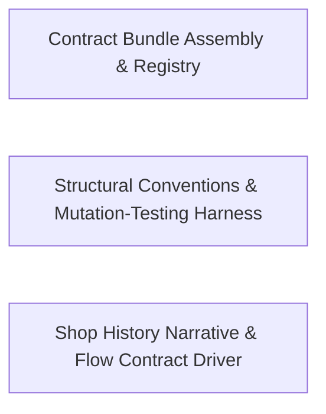

---
tags:
  - 2brain
  - 2brain/arch
  - project/boilerplate-node-backend
type: architecture
component: Shop_History_Narrative_Contract_Bundle_Registry
---

## Details

The story and the contract halves of the flow driver. On the narrative side, shop-history.ts defines the complete order book: ten filler shoppers with combinatorial product lines, the named-story orders (paid, shipped, delivered, declined, refunded, cancelled, deleted), the ShopHistory result type (subject-id map + per-order age in days), and the signInCustomerBase helper that authenticates each filler through the real login endpoint. The Caller / Attempt / Envelope / ScenarioFlowError types in client.ts form the typed contract between the narrative and the execution engine. On the contract-artifact side, the scripts/contracts/ bundle files define and register the AsyncAPI/OpenAPI bundle fragments that the scenario's HTTP calls must conform to, ensuring the flow driver exercises the contracted surface rather than an ad-hoc one.

### Contract Bundle Assembly & Registry
The contract-artifact machinery that defines, registers, and rebuilds the AsyncAPI/OpenAPI bundle fragments the scenario's HTTP calls must conform to. bundle-kinds.ts declares the ContractBundle/CompiledBundle/GeneratedBundle/BundleIdentity shapes and the assembleBundle/readCommittedBundle/isGenerated primitives. bundle-registry.ts is the single source of truth listing every document the repo produces and exposes findBundle. asyncapi-bundles.ts merges one whole AsyncAPI document per section into the public and backend bundles. openapi-bundle.ts and client-collections-bundle.ts assemble the OpenAPI document and the tool-specific runnable collections, while generate-asyncapi-types.ts and generate-request-content-types.ts derive the client types and content-type tables from the fragments. build-bundles.ts is the CLI entry that rebuilds or staleness-checks the bundles.

**Related Classes/Methods**:

- `scripts.contracts.asyncapi-bundles.asyncapiBundle`:239-250
- `scripts.contracts.client-collections-bundle.collectionContent`:250-256

**Source Files:**

- `scripts/contracts/asyncapi-bundles.ts`
  - `scripts.contracts.asyncapi-bundles.modulesWithAsyncapi` (L52-L58) - Class
  - `scripts.contracts.asyncapi-bundles.modulesWithAsyncapi.map() callback` (L55-L55) - Function
  - `scripts.contracts.asyncapi-bundles.modulesWithAsyncapi.filter() callback` (L56-L57) - Function
  - `scripts.contracts.asyncapi-bundles.sectionsInScope` (L99-L102) - Class
  - `scripts.contracts.asyncapi-bundles.sectionsInScope.ASYNC_SECTION_ORDER.filter() callback` (L102-L102) - Function
  - `scripts.contracts.asyncapi-bundles.asyncapiBundle` (L239-L250) - Class
  - `scripts.contracts.asyncapi-bundles.asyncapiBundle.content` (L244-L244) - Method
  - `scripts.contracts.asyncapi-bundles.asyncapiBundle.sources` (L245-L248) - Method
  - `scripts.contracts.asyncapi-bundles.asyncapiBundle.sources.map() callback` (L247-L247) - Function
  - `scripts.contracts.asyncapi-bundles.asyncapiPublicBundle` (L259-L269) - Class
  - `scripts.contracts.asyncapi-bundles.asyncapiPublicBundle.content` (L263-L263) - Method
  - `scripts.contracts.asyncapi-bundles.asyncapiPublicBundle.sources` (L264-L267) - Method
  - `scripts.contracts.asyncapi-bundles.asyncapiPublicBundle.sources.map() callback` (L266-L266) - Function
- `scripts/contracts/build-bundles.ts`
  - `scripts.contracts.build-bundles.CONTRACT_BUNDLES.map() callback` (L48-L48) - Function
  - `scripts.contracts.build-bundles.bundle.then() callback.stale` (L61-L63) - Class
  - `scripts.contracts.build-bundles.bundle.then() callback.stale.assembled.filter() callback` (L62-L62) - Function
  - `scripts.contracts.build-bundles.bundle.then() callback.stale.map() callback` (L65-L65) - Function
  - `scripts.contracts.build-bundles.generated.map() callback` (L91-L91) - Function
  - `scripts.contracts.build-bundles.run.authored` (L123-L123) - Class
  - `scripts.contracts.build-bundles.run.authored.CONTRACT_BUNDLES.filter() callback` (L123-L123) - Function
  - `scripts.contracts.build-bundles.catch() callback` (L149-L152) - Function
- `scripts/contracts/bundle-kinds.ts`
  - `scripts.contracts.bundle-kinds.BundleIdentity` (L28-L49) - Interface
  - `scripts.contracts.bundle-kinds.CompiledBundle` (L59-L64) - Interface
  - `scripts.contracts.bundle-kinds.GeneratedBundle` (L74-L78) - Interface
- `scripts/contracts/bundle-registry.ts`
  - `scripts.contracts.bundle-registry.collectionBundle` (L41-L48) - Class
  - `scripts.contracts.bundle-registry.collectionBundle.content` (L47-L47) - Method
  - `scripts.contracts.bundle-registry.collectionBundle.content.then() callback` (L47-L47) - Function
- `scripts/contracts/client-collections-bundle.ts`
  - `scripts.contracts.client-collections-bundle.sections` (L68-L69) - Class
  - `scripts.contracts.client-collections-bundle.sections.SECTION_ORDER.map() callback` (L69-L69) - Function
  - `scripts.contracts.client-collections-bundle.modulesDeclaringProbes` (L166-L173) - Class
  - `scripts.contracts.client-collections-bundle.modulesDeclaringProbes.map() callback` (L171-L171) - Function
  - `scripts.contracts.client-collections-bundle.modulesDeclaringProbes.filter() callback` (L172-L172) - Function
  - `scripts.contracts.client-collections-bundle.loadProbes` (L191-L212) - Class
  - `scripts.contracts.client-collections-bundle.loadProbes.<function>` (L191-L212) - Function
  - `scripts.contracts.client-collections-bundle.loadProbes.<function>.<function>` (L194-L211) - Function
  - `scripts.contracts.client-collections-bundle.loadProbes.<function>.<function>.map() callback` (L196-L207) - Function
  - `scripts.contracts.client-collections-bundle.loadProbes.<function>.<function>.map() callback.then() callback` (L200-L206) - Function
  - `scripts.contracts.client-collections-bundle.loadProbes.<function>.<function>.then() callback` (L209-L209) - Function
  - `scripts.contracts.client-collections-bundle.generate` (L225-L235) - Class
  - `scripts.contracts.client-collections-bundle.generate.then() callback` (L226-L234) - Function
  - `scripts.contracts.client-collections-bundle.allProbes` (L238-L239) - Class
  - `scripts.contracts.client-collections-bundle.allProbes.then() callback` (L239-L239) - Function
  - `scripts.contracts.client-collections-bundle.allProbes.then() callback.result.requests.filter() callback` (L239-L239) - Function
  - `scripts.contracts.client-collections-bundle.collectionContent` (L250-L256) - Class
  - `scripts.contracts.client-collections-bundle.collectionContent.then() callback` (L251-L256) - Function
- `scripts/contracts/generate-asyncapi-types.ts`
  - `scripts.contracts.generate-asyncapi-types.collectChannelMessageEntries` (L184-L201) - Class
  - `scripts.contracts.generate-asyncapi-types.collectChannelMessageEntries.filter() callback` (L190-L190) - Function
  - `scripts.contracts.generate-asyncapi-types.collectChannelMessageEntries.map() callback` (L191-L200) - Function
  - `scripts.contracts.generate-asyncapi-types.collectChannelMessageEntries.toSorted() callback` (L201-L201) - Function
  - `scripts.contracts.generate-asyncapi-types.renderPayloadMap.rows` (L269-L273) - Class
  - `scripts.contracts.generate-asyncapi-types.renderPayloadMap.rows.entries.map() callback` (L271-L271) - Function
  - `scripts.contracts.generate-asyncapi-types.sseEntries` (L381-L385) - Class
  - `scripts.contracts.generate-asyncapi-types.sseEntries.collectChannelMessageEntries() callback` (L384-L384) - Function
  - `scripts.contracts.generate-asyncapi-types.channelNamespaceBlocks` (L400-L402) - Class
  - `scripts.contracts.generate-asyncapi-types.channelNamespaceBlocks.map() callback` (L401-L401) - Function
- `scripts/contracts/generate-request-content-types.ts`
  - `scripts.contracts.generate-request-content-types.OperationObject` (L23-L25) - Interface
  - `scripts.contracts.generate-request-content-types.OpenApiDocument` (L28-L30) - Interface
  - `scripts.contracts.generate-request-content-types.compileTemplate.parameterCount.segments.filter() callback` (L83-L83) - Function
  - `scripts.contracts.generate-request-content-types.renderRows` (L94-L114) - Class
  - `scripts.contracts.generate-request-content-types.renderRows.flatMap() callback` (L96-L108) - Function
  - `scripts.contracts.generate-request-content-types.renderRows.flatMap() callback.BODY_METHODS.flatMap() callback` (L97-L108) - Function
  - `scripts.contracts.generate-request-content-types.renderRows.toSorted() callback` (L111-L112) - Function
  - `scripts.contracts.generate-request-content-types.renderRows.map() callback` (L114-L114) - Function
- `scripts/contracts/openapi-bundle.ts`
  - `scripts.contracts.openapi-bundle.rootPaths` (L123-L130) - Class
  - `scripts.contracts.openapi-bundle.rootPaths.filter() callback` (L128-L128) - Function
  - `scripts.contracts.openapi-bundle.rootPaths.map() callback` (L129-L129) - Function
  - `scripts.contracts.openapi-bundle.sectionPaths` (L133-L138) - Class
  - `scripts.contracts.openapi-bundle.sectionPaths.map() callback` (L137-L137) - Function
  - `scripts.contracts.openapi-bundle.operationsOf` (L190-L193) - Class
  - `scripts.contracts.openapi-bundle.operationsOf.flatMap() callback` (L191-L192) - Function
  - `scripts.contracts.openapi-bundle.operationsOf.flatMap() callback.OPERATION_METHODS.map() callback` (L192-L192) - Function
  - `scripts.contracts.openapi-bundle.operationsOf.flatMap() callback.filter() callback` (L192-L192) - Function
  - `scripts.contracts.openapi-bundle.openapiBundle` (L575-L582) - Class
  - `scripts.contracts.openapi-bundle.openapiBundle.sources` (L581-L581) - Method
  - `scripts.contracts.openapi-bundle.openapiBundle.sources.MODULE_SECTIONS.map() callback` (L581-L581) - Function
- `scripts/contracts/permission-actions-render.ts`
  - `scripts.contracts.permission-actions-render.readPermissionActions` (L17-L27) - Class
  - `scripts.contracts.permission-actions-render.readPermissionActions.actions.every() callback` (L22-L22) - Function
- `scripts/contracts/root-assembly.ts`
  - `scripts.contracts.root-assembly.pruneStaleReferences.declared` (L57-L59) - Class
  - `scripts.contracts.root-assembly.pruneStaleReferences.declared.fragments.flatMap() callback` (L58-L58) - Function
  - `scripts.contracts.root-assembly.pruneStaleReferences.declared.fragments.flatMap() callback.urls.map() callback` (L58-L58) - Function
- `scripts/contracts/section-order.ts`
  - `scripts.contracts.section-order.orderSections.known` (L22-L22) - Class
  - `scripts.contracts.section-order.orderSections.known.preferred.filter() callback` (L22-L22) - Function
- `scripts/eslint/no-hardcoded-user-text.ts`
  - `scripts.eslint.no-hardcoded-user-text.noHardcodedUserText` (L32-L84) - Class
  - `scripts.eslint.no-hardcoded-user-text.noHardcodedUserText.create` (L44-L83) - Method
  - `scripts.eslint.no-hardcoded-user-text.noHardcodedUserText.create.CallExpression` (L46-L81) - Method
- `scripts/ops/demo-remove-authorization.ts`
  - `scripts.ops.demo-remove-authorization.readRemovedAuthorization.survivors` (L49-L51) - Class
  - `scripts.ops.demo-remove-authorization.readRemovedAuthorization.survivors.filter() callback` (L50-L50) - Function
  - `scripts.ops.demo-remove-authorization.readRemovedAuthorization.survivors.flatMap() callback` (L51-L51) - Function
  - `scripts.ops.demo-remove-authorization.stripRoleGrants.out.lines.map() callback.next` (L82-L82) - Class
  - `scripts.ops.demo-remove-authorization.stripRoleGrants.out.lines.map() callback.next.find() callback` (L82-L82) - Function
- `scripts/ops/demo-remove-contract.ts`
  - `scripts.ops.demo-remove-contract.stripAccountExportSchema.mustReplace` (L30-L37) - Class
  - `scripts.ops.demo-remove-contract.stripAccountExportSchema.mustReplace.content.replace() callback` (L36-L36) - Function
- `scripts/ops/demo-remove-scenarios.ts`
  - `scripts.ops.demo-remove-scenarios.replaceOnce` (L24-L31) - Class
  - `scripts.ops.demo-remove-scenarios.replaceOnce.content.replace() callback` (L30-L30) - Function
  - `scripts.ops.demo-remove-scenarios.stripModuleDoubles` (L175-L205) - Class
  - `scripts.ops.demo-remove-scenarios.stripModuleDoubles.names.filter() callback` (L180-L180) - Function
  - `scripts.ops.demo-remove-scenarios.stripModuleDoubles.map() callback` (L181-L204) - Function
- `scripts/ops/reap-orphaned-images.ts`
  - `scripts.ops.reap-orphaned-images.main` (L77-L97) - Class
  - `scripts.ops.reap-orphaned-images.main.then() callback` (L78-L97) - Function
- `scripts/scaffold/central-edits.ts`
  - `scripts.scaffold.central-edits.appendToList.blank` (L41-L41) - Class
  - `scripts.scaffold.central-edits.appendToList.blank.lines.findIndex() callback` (L41-L41) - Function
- `scripts/scaffold/registry.ts`
  - `scripts.scaffold.registry.retermRun.first` (L71-L71) - Class
  - `scripts.scaffold.registry.retermRun.first.lines.findIndex() callback` (L71-L71) - Function
  - `scripts.scaffold.registry.registerModule.withImport` (L113-L119) - Class
  - `scripts.scaffold.registry.registerModule.withImport.insertInRun() callback` (L115-L115) - Function
- `scripts/setup/environment-file.ts`
  - `scripts.setup.environment-file.readEnvironmentValue` (L51-L55) - Class
  - `scripts.setup.environment-file.readEnvironmentValue.find() callback` (L54-L54) - Function

### Structural Conventions & Mutation-Testing Harness
The guardrails that keep the subsystem's code conforming to the repo's structural conventions and behaviorally sound. The scripts/eslint/ project-local rules enforce layering and contract discipline at the AST level: barrel-allowed-sources, controller-chain-must-catch, no-persistence-imports, comment-links, and no-hardcoded-user-text. The scripts/mutation/ Stryker harness scopes and shards mutation testing: mutate-scope.ts computes the mutable file set and line counts, baseline.ts/check-baseline.ts manage the mutation baseline, and the ci/ sub-package (cli.ts, merge.ts, waves.ts, slice-ignorer.ts) plus run-shards.ts/run-diff.ts/sharding.ts orchestrate sharded, wave-based CI mutation runs. Together these ensure the narrative driver and contract bundle code stay within the layered, contract-first architecture.

**Related Classes/Methods**:

- `scripts.eslint.no-persistence-imports.noPersistenceImports`:77-138
- `scripts.eslint.controller-chain-must-catch.controllerChainMustCatch`:125-164
- `scripts.eslint.barrel-allowed-sources.barrelAllowedSources`:80-279
- `scripts.mutation.mutate-scope.mutableFiles`:57-72

**Source Files:**

- `scripts/eslint/barrel-allowed-sources.ts`
  - `scripts.eslint.barrel-allowed-sources.barrelAllowedSources` (L80-L279) - Class
  - `scripts.eslint.barrel-allowed-sources.barrelAllowedSources.create` (L122-L278) - Method
  - `scripts.eslint.barrel-allowed-sources.barrelAllowedSources.create.Program` (L173-L181) - Method
  - `scripts.eslint.barrel-allowed-sources.barrelAllowedSources.create.ExportAllDeclaration` (L183-L214) - Method
  - `scripts.eslint.barrel-allowed-sources.barrelAllowedSources.create.ExportNamedDeclaration` (L216-L276) - Method
- `scripts/eslint/controller-chain-must-catch.ts`
  - `scripts.eslint.controller-chain-must-catch.controllerChainMustCatch` (L125-L164) - Class
  - `scripts.eslint.controller-chain-must-catch.controllerChainMustCatch.create` (L137-L163) - Method
  - `scripts.eslint.controller-chain-must-catch.controllerChainMustCatch.create.CallExpression` (L139-L161) - Method
- `scripts/eslint/no-persistence-imports.ts`
  - `scripts.eslint.no-persistence-imports.RuleOptions` (L40-L43) - Interface
  - `scripts.eslint.no-persistence-imports.noPersistenceImports` (L77-L138) - Class
  - `scripts.eslint.no-persistence-imports.noPersistenceImports.create` (L109-L137) - Method
  - `scripts.eslint.no-persistence-imports.noPersistenceImports.create.ImportDeclaration` (L115-L135) - Method
- `scripts/mutation/baseline.ts`
  - `scripts.mutation.baseline.formatRegressions.regressed` (L277-L277) - Class
  - `scripts.mutation.baseline.formatRegressions.regressed.comparisons.filter() callback` (L277-L277) - Function
- `scripts/mutation/ci/cli.ts`
  - `scripts.mutation.ci.cli.option.value` (L41-L43) - Class
  - `scripts.mutation.ci.cli.option.value.process.argv.find() callback` (L42-L42) - Function
  - `scripts.mutation.ci.cli.scope` (L87-L92) - Class
  - `scripts.mutation.ci.cli.scope.map() callback` (L88-L92) - Function
  - `scripts.mutation.ci.cli.readOutcomes` (L95-L108) - Class
  - `scripts.mutation.ci.cli.readOutcomes.filter() callback` (L99-L99) - Function
  - `scripts.mutation.ci.cli.readOutcomes.map() callback` (L100-L106) - Function
  - `scripts.mutation.ci.cli.planWave` (L111-L125) - Class
  - `scripts.mutation.ci.cli.planWave.plan.shards.map() callback` (L123-L123) - Function
  - `scripts.mutation.ci.cli.showShard.shard` (L130-L130) - Class
  - `scripts.mutation.ci.cli.showShard.shard.shards.find() callback` (L130-L130) - Function
  - `scripts.mutation.ci.cli.readFinished` (L149-L163) - Class
  - `scripts.mutation.ci.cli.readFinished.flatMap() callback` (L156-L162) - Function
  - `scripts.mutation.ci.cli.merge.plans` (L168-L171) - Class
  - `scripts.mutation.ci.cli.merge.plans.filter() callback` (L169-L169) - Function
  - `scripts.mutation.ci.cli.merge.plans.map() callback` (L170-L170) - Function
  - `scripts.mutation.ci.cli.merge.plans.toSorted() callback` (L171-L171) - Function
  - `scripts.mutation.ci.cli.weakest` (L189-L191) - Class
  - `scripts.mutation.ci.cli.merge.weakest.toSorted() callback` (L190-L190) - Function
- `scripts/mutation/ci/merge.ts`
  - `scripts.mutation.ci.merge.incompleteFiles` (L73-L93) - Class
  - `scripts.mutation.ci.merge.incompleteFiles.finished.flatMap() callback` (L78-L78) - Function
  - `scripts.mutation.ci.merge.incompleteFiles.scope.filter() callback` (L82-L91) - Function
  - `scripts.mutation.ci.merge.incompleteFiles.scope.filter() callback.toSorted() callback` (L85-L85) - Function
  - `scripts.mutation.ci.merge.incompleteFiles.map() callback` (L92-L92) - Function
  - `scripts.mutation.ci.merge.mergeReports.remap` (L177-L177) - Class
  - `scripts.mutation.ci.merge.mergeReports.remap.ids.map() callback` (L177-L177) - Function
  - `scripts.mutation.ci.merge.mergeReports.files` (L179-L194) - Class
  - `scripts.mutation.ci.merge.mergeReports.files.filter() callback` (L181-L181) - Function
  - `scripts.mutation.ci.merge.mergeReports.files.map() callback` (L182-L193) - Function
  - `scripts.mutation.ci.merge.mergeReports.files.map() callback.mutants.map() callback` (L186-L191) - Function
  - `scripts.mutation.ci.merge.mergeReports.top` (L198-L200) - Class
  - `scripts.mutation.ci.merge.mergeReports.top.filter() callback` (L199-L199) - Function
  - `scripts.mutation.ci.merge.renderHtml.at` (L216-L216) - Class
  - `scripts.mutation.ci.merge.renderHtml.at.lines.findIndex() callback` (L216-L216) - Function
  - `scripts.mutation.ci.merge.formatSummary` (L233-L285) - Class
  - `scripts.mutation.ci.merge.formatSummary.toSorted() callback` (L258-L258) - Function
  - `scripts.mutation.ci.merge.formatSummary.map() callback` (L259-L259) - Function
  - `scripts.mutation.ci.merge.formatSummary.weakest.map() callback` (L269-L269) - Function
  - `scripts.mutation.ci.merge.formatSummary.incomplete.map() callback` (L281-L281) - Function
- `scripts/mutation/ci/waves.ts`
  - `scripts.mutation.ci.waves.ScopeFile` (L43-L49) - Interface
  - `scripts.mutation.ci.waves.Unit` (L52-L54) - Interface
  - `scripts.mutation.ci.waves.CiShard` (L57-L63) - Interface
  - `scripts.mutation.ci.waves.WavePlan` (L69-L79) - Interface
  - `scripts.mutation.ci.waves.cut` (L89-L103) - Class
  - `scripts.mutation.ci.waves.cut.bounds` (L92-L95) - Class
  - `scripts.mutation.ci.waves.cut.bounds.Array.from() callback` (L94-L94) - Function
  - `scripts.mutation.ci.waves.cut.Array.from() callback` (L97-L102) - Function
  - `scripts.mutation.ci.waves.packUnits` (L125-L138) - Class
  - `scripts.mutation.ci.waves.packUnits.toSorted() callback` (L129-L129) - Function
  - `scripts.mutation.ci.waves.packUnits.units.filter() callback` (L129-L129) - Function
  - `scripts.mutation.ci.waves.packUnits.bin` (L130-L130) - Class
  - `scripts.mutation.ci.waves.packUnits.bin.bins.find() callback` (L130-L130) - Function
  - `scripts.mutation.ci.waves.packUnits.bins.map() callback` (L137-L137) - Function
  - `scripts.mutation.ci.waves.firstWave` (L164-L172) - Class
  - `scripts.mutation.ci.waves.firstWave.scope.flatMap() callback` (L168-L168) - Function
  - `scripts.mutation.ci.waves.firstWave.map() callback` (L170-L170) - Function
  - `scripts.mutation.ci.waves.retryOf.retry.shard.units.map() callback` (L187-L187) - Function
  - `scripts.mutation.ci.waves.retryOf.retry.pieces.map() callback` (L190-L190) - Function
  - `scripts.mutation.ci.waves.nextWave` (L203-L215) - Class
  - `scripts.mutation.ci.waves.nextWave.abandoned.results.flatMap() callback` (L208-L208) - Function
  - `scripts.mutation.ci.waves.strykerArguments.mutate.shard.units.map() callback` (L235-L235) - Function
- `scripts/mutation/mutate-scope.ts`
  - `scripts.mutation.mutate-scope.StrykerConfig` (L23-L25) - Interface
  - `scripts.mutation.mutate-scope.isMutable` (L43-L54) - Class
  - `scripts.mutation.mutate-scope.isMutable.include` (L44-L44) - Class
  - `scripts.mutation.mutate-scope.isMutable.include.patterns.filter() callback` (L44-L44) - Function
  - `scripts.mutation.mutate-scope.isMutable.include.some() callback` (L51-L51) - Function
  - `scripts.mutation.mutate-scope.mutableFiles` (L57-L72) - Class
  - `scripts.mutation.mutate-scope.mutableFiles.files.map() callback` (L70-L70) - Function
  - `scripts.mutation.mutate-scope.mutableFiles.filter() callback` (L71-L71) - Function
  - `scripts.mutation.mutate-scope.lineCount` (L75-L78) - Class
  - `scripts.mutation.mutate-scope.lineCount.filter() callback` (L78-L78) - Function
  - `scripts.mutation.mutate-scope.scopeWithLines` (L81-L82) - Class
  - `scripts.mutation.mutate-scope.scopeWithLines.map() callback` (L82-L82) - Function
  - `scripts.mutation.mutate-scope.changedMutable` (L95-L98) - Class
  - `scripts.mutation.mutate-scope.changedMutable.changed.filter() callback` (L97-L97) - Function
- `scripts/mutation/run-diff.ts`
  - `scripts.mutation.run-diff.changedFiles` (L52-L59) - Class
  - `scripts.mutation.run-diff.changedFiles.map() callback` (L58-L58) - Function
  - `scripts.mutation.run-diff.changedFiles.filter() callback` (L59-L59) - Function
- `scripts/mutation/run-shards.ts`
  - `scripts.mutation.run-shards.listArgument` (L45-L51) - Class
  - `scripts.mutation.run-shards.listArgument.process.argv.find() callback` (L47-L47) - Function
  - `scripts.mutation.run-shards.listArgument.map() callback` (L50-L50) - Function
  - `scripts.mutation.run-shards.numberArgument.raw` (L55-L55) - Class
  - `scripts.mutation.run-shards.numberArgument.raw.process.argv.find() callback` (L55-L55) - Function
- `scripts/mutation/sharding.ts`
  - `scripts.mutation.sharding.Shard` (L16-L20) - Interface
  - `scripts.mutation.sharding.packIntoShards` (L42-L66) - Class
  - `scripts.mutation.sharding.packIntoShards.files.toSorted() callback` (L53-L53) - Function
- `scripts/ops/demo-remove-authorization.ts`
  - `scripts.ops.demo-remove-authorization.pruneCase.chunk.replaceAll() callback.kept` (L119-L122) - Class
  - `scripts.ops.demo-remove-authorization.pruneCase.chunk.replaceAll() callback.kept.map() callback` (L121-L121) - Function
  - `scripts.ops.demo-remove-authorization.pruneCase.chunk.replaceAll() callback.kept.filter() callback` (L122-L122) - Function
- `scripts/ops/demo-remove-tests.ts`
  - `scripts.ops.demo-remove-tests.testRoots` (L17-L25) - Class
  - `scripts.ops.demo-remove-tests.testRoots.moduleTests` (L19-L23) - Class
  - `scripts.ops.demo-remove-tests.testRoots.moduleTests.filter() callback` (L21-L21) - Function
  - `scripts.ops.demo-remove-tests.testRoots.moduleTests.map() callback` (L22-L22) - Function
  - `scripts.ops.demo-remove-tests.testRoots.filter() callback` (L24-L24) - Function
  - `scripts.ops.demo-remove-tests.walkTypeScript` (L28-L33) - Class
  - `scripts.ops.demo-remove-tests.walkTypeScript.flatMap() callback` (L29-L33) - Function
  - `scripts.ops.demo-remove-tests.removeResidueTests.files` (L109-L109) - Class
  - `scripts.ops.demo-remove-tests.removeResidueTests.files.flatMap() callback` (L109-L109) - Function
  - `scripts.ops.demo-remove-tests.removeResidueTests.files.filter() callback` (L122-L122) - Function
- `scripts/scaffold/scaffold-module.ts`
  - `scripts.scaffold.scaffold-module.main.plan` (L41-L46) - Class
  - `scripts.scaffold.scaffold-module.main.plan.catch() callback` (L42-L45) - Function
- `scripts/setup/required-keys.ts`
  - `scripts.setup.required-keys.FillableKey` (L12-L15) - Interface
  - `scripts.setup.required-keys.fillableKeys` (L22-L29) - Class
  - `scripts.setup.required-keys.fillableKeys.map() callback` (L28-L28) - Function

### Shop History Narrative & Flow Contract Driver
The story-and-contract halves of the flow driver. shop-history.ts defines the complete order book: the FILLER_ORDERS combinatorial catalogue (ten shoppers, distinct product lines), the CUSTOMER_ORDERS large named orders, the residual CARTS, and the named-story lifecycle orders (paid/shipped/delivered/declined/refunded/cancelled/deleted) — all written by driving the application through POST /cart/checkout, POST /payments/…, and the lifecycle endpoints rather than by inserting rows. It exposes the ShopHistory result type (a subjects guarantee-name→row-id map plus an ages order-id→days-back map) and the signInCustomerBase helper that authenticates each filler through the real login endpoint. client.ts supplies the typed execution contract: Envelope, Attempt, Caller (a signed-in actor with call and attempt), and ScenarioFlowError (the runner's only error type). This is the primary flow spine of the subsystem.

**Related Classes/Methods**:

- `scenarios.flows.shop-history.signInCustomerBase`:258-263
- `scenarios.flows.client.ScenarioFlowError`:39-53

**Source Files:**

- `scenarios/flows/client.ts`
  - `scenarios.flows.client.Envelope` (L14-L17) - Interface
  - `scenarios.flows.client.Attempt` (L23-L31) - Interface
  - `scenarios.flows.client.ScenarioFlowError` (L39-L53) - Class
  - `scenarios.flows.client.ScenarioFlowError.constructor` (L46-L52) - Constructor
  - `scenarios.flows.client.Caller` (L56-L72) - Interface
  - `scenarios.flows.client.then() callback` (L77-L85) - Function
  - `scenarios.flows.client.send.headers.filter() callback` (L109-L109) - Function
  - `scenarios.flows.client.signIn` (L128-L154) - Class
  - `scenarios.flows.client.signIn.then() callback` (L132-L154) - Function
  - `scenarios.flows.client.signIn.then() callback.call` (L147-L152) - Method
  - `scenarios.flows.client.signIn.then() callback.call.then() callback` (L148-L152) - Function
- `scenarios/flows/shop-history.ts`
  - `scenarios.flows.shop-history.ShopHistory` (L50-L59) - Interface
  - `scenarios.flows.shop-history.FillerOrder` (L71-L74) - Interface
  - `scenarios.flows.shop-history.signInCustomerBase` (L258-L263) - Class
  - `scenarios.flows.shop-history.signInCustomerBase.map() callback` (L260-L261) - Function
  - `scenarios.flows.shop-history.signInCustomerBase.map() callback.then() callback` (L261-L261) - Function
  - `scenarios.flows.shop-history.signInCustomerBase.then() callback` (L263-L263) - Function
  - `scenarios.flows.shop-history.driveShopHistory.orderId.lines.map() callback` (L391-L391) - Function
  - `scenarios.flows.shop-history.ages` (L595-L600) - Class
  - `scenarios.flows.shop-history.driveShopHistory.ages.placed.map() callback` (L596-L599) - Function
- `scripts/contracts/asyncapi-bundles.ts`
  - `scripts.contracts.asyncapi-bundles.internalSections` (L69-L77) - Class
  - `scripts.contracts.asyncapi-bundles.filter() callback` (L71-L71) - Function
  - `scripts.contracts.asyncapi-bundles.internalSections.filter() callback` (L73-L74) - Function
  - `scripts.contracts.asyncapi-bundles.internalSections.map() callback` (L77-L77) - Function
  - `scripts.contracts.asyncapi-bundles.marker` (L143-L148) - Class
  - `scripts.contracts.asyncapi-bundles.marker.sections.map() callback` (L147-L147) - Function
- `scripts/contracts/authorization-bundle.ts`
  - `scripts.contracts.authorization-bundle.fragmentKeysBlock` (L92-L109) - Class
  - `scripts.contracts.authorization-bundle.sectionsOnDisk` (L112-L120) - Class
  - `scripts.contracts.authorization-bundle.sectionsOnDisk.map() callback` (L115-L115) - Function
  - `scripts.contracts.authorization-bundle.sectionsOnDisk.filter() callback` (L116-L117) - Function
  - `scripts.contracts.authorization-bundle.assembleAuthorizationKeys.keys` (L132-L134) - Class
  - `scripts.contracts.authorization-bundle.assembleAuthorizationKeys.keys.map() callback` (L133-L133) - Function
- `scripts/contracts/build-bundles.ts`
  - `scripts.contracts.build-bundles.unknown` (L42-L42) - Class
  - `scripts.contracts.build-bundles.unknown.named.filter() callback` (L42-L42) - Function
  - `scripts.contracts.build-bundles.bundle` (L57-L66) - Class
  - `scripts.contracts.build-bundles.bundle.bundles.map() callback` (L59-L59) - Function
  - `scripts.contracts.build-bundles.bundle.bundles.map() callback.then() callback` (L59-L59) - Function
  - `scripts.contracts.build-bundles.bundle.then() callback` (L60-L66) - Function
  - `scripts.contracts.build-bundles.run` (L75-L146) - Class
  - `scripts.contracts.build-bundles.run.selected` (L79-L79) - Class
  - `scripts.contracts.build-bundles.run.selected.named.map() callback` (L79-L79) - Function
  - `scripts.contracts.build-bundles.run.generated` (L87-L87) - Class
  - `scripts.contracts.build-bundles.run.generated.selected.filter() callback` (L87-L87) - Function
  - `scripts.contracts.build-bundles.run.generated.map() callback` (L95-L95) - Function
  - `scripts.contracts.build-bundles.run.stale.map() callback` (L144-L144) - Function
- `scripts/contracts/bundle-registry.ts`
  - `scripts.contracts.bundle-registry.findBundle` (L77-L78) - Class
  - `scripts.contracts.bundle-registry.findBundle.CONTRACT_BUNDLES.find() callback` (L78-L78) - Function
- `scripts/contracts/generate-asyncapi-types.ts`
  - `scripts.contracts.generate-asyncapi-types.AsyncApiChannel` (L32-L44) - Interface
  - `scripts.contracts.generate-asyncapi-types.AsyncApiMessage` (L47-L49) - Interface
  - `scripts.contracts.generate-asyncapi-types.AsyncApiServer` (L52-L54) - Interface
  - `scripts.contracts.generate-asyncapi-types.JsonSchema` (L57-L70) - Interface
  - `scripts.contracts.generate-asyncapi-types.AsyncApiDocument` (L73-L81) - Interface
  - `scripts.contracts.generate-asyncapi-types.toPascalCase` (L116-L123) - Class
  - `scripts.contracts.generate-asyncapi-types.toPascalCase.map() callback` (L122-L122) - Function
  - `scripts.contracts.generate-asyncapi-types.channelProtocols` (L213-L227) - Class
  - `scripts.contracts.generate-asyncapi-types.channelProtocols.map() callback` (L218-L226) - Function
  - `scripts.contracts.generate-asyncapi-types.channelProtocols.filter() callback` (L227-L227) - Function
  - `scripts.contracts.generate-asyncapi-types.channelPayloadSchemaNames` (L236-L244) - Class
  - `scripts.contracts.generate-asyncapi-types.filter() callback` (L242-L242) - Function
  - `scripts.contracts.generate-asyncapi-types.channelPayloadSchemaNames.map() callback` (L243-L243) - Function
  - `scripts.contracts.generate-asyncapi-types.channelPayloadSchemaNames.filter() callback` (L244-L244) - Function
  - `scripts.contracts.generate-asyncapi-types.renderChannelNamespace.entries` (L304-L306) - Class
  - `scripts.contracts.generate-asyncapi-types.renderChannelNamespace.entries.channelNames.map() callback` (L305-L305) - Function
  - `scripts.contracts.generate-asyncapi-types.modelNameConstraints` (L341-L343) - Class
  - `scripts.contracts.generate-asyncapi-types.modelNameConstraints.NAMING_FORMATTER` (L342-L342) - Method
  - `scripts.contracts.generate-asyncapi-types.queuePayloadSchemaNames` (L393-L397) - Class
  - `scripts.contracts.generate-asyncapi-types.queuePayloadSchemaNames.filter() callback` (L395-L395) - Function
  - `scripts.contracts.generate-asyncapi-types.queuePayloadSchemaNames.flatMap() callback` (L396-L396) - Function
  - `scripts.contracts.generate-asyncapi-types.messageTypeBlocks` (L405-L413) - Class
  - `scripts.contracts.generate-asyncapi-types.messageTypeBlocks.map() callback` (L406-L412) - Function
  - `scripts.contracts.generate-asyncapi-types.zodExpression` (L430-L508) - Class
  - `scripts.contracts.generate-asyncapi-types.zodExpression.schema.enum.map() callback` (L434-L434) - Function
  - `scripts.contracts.generate-asyncapi-types.zodExpression.members` (L443-L443) - Class
  - `scripts.contracts.generate-asyncapi-types.zodExpression.members.schema.oneOf.map() callback` (L443-L443) - Function
  - `scripts.contracts.generate-asyncapi-types.zodExpression.fields` (L482-L489) - Class
  - `scripts.contracts.generate-asyncapi-types.zodExpression.fields.map() callback` (L484-L487) - Function
  - `scripts.contracts.generate-asyncapi-types.renderZodSchemas` (L520-L527) - Class
  - `scripts.contracts.generate-asyncapi-types.renderZodSchemas.map() callback` (L525-L526) - Function
  - `scripts.contracts.generate-asyncapi-types.then() callback` (L587-L612) - Function
  - `scripts.contracts.generate-asyncapi-types.catch() callback` (L613-L616) - Function
- `scripts/contracts/openapi-bundle.ts`
  - `scripts.contracts.openapi-bundle.modulesWithOpenapi` (L73-L77) - Class
  - `scripts.contracts.openapi-bundle.modulesWithOpenapi.map() callback` (L76-L76) - Function
  - `scripts.contracts.openapi-bundle.modulesWithOpenapi.filter() callback` (L77-L77) - Function
  - `scripts.contracts.openapi-bundle.withErrorCodes` (L397-L418) - Class
  - `scripts.contracts.openapi-bundle.withErrorCodes.codes.map() callback` (L413-L413) - Function
- `scripts/contracts/permission-actions-render.ts`
  - `scripts.contracts.permission-actions-render.renderPermissionActions.rows` (L36-L36) - Class
  - `scripts.contracts.permission-actions-render.renderPermissionActions.rows.actions.map() callback` (L36-L36) - Function
- `scripts/contracts/root-assembly.ts`
  - `scripts.contracts.root-assembly.readModuleFragments` (L149-L172) - Class
  - `scripts.contracts.root-assembly.readModuleFragments.map() callback` (L158-L171) - Function
  - `scripts.contracts.root-assembly.readModuleFragments.map() callback.tags.operations.flatMap() callback` (L169-L169) - Function
- `scripts/contracts/validate-asyncapi.ts`
  - `scripts.contracts.validate-asyncapi.isInvalid` (L38-L43) - Class
  - `scripts.contracts.validate-asyncapi.isInvalid.diagnostics.some() callback` (L40-L42) - Function
  - `scripts.contracts.validate-asyncapi.files.map() callback` (L50-L62) - Function
  - `scripts.contracts.validate-asyncapi.files.map() callback.then() callback` (L51-L62) - Function
  - `scripts.contracts.validate-asyncapi.then() callback` (L65-L69) - Function
  - `scripts.contracts.validate-asyncapi.catch() callback` (L70-L73) - Function
- `scripts/ops/demo-remove-authorization.ts`
  - `scripts.ops.demo-remove-authorization.readRemovedAuthorization.removed` (L55-L55) - Class
  - `scripts.ops.demo-remove-authorization.readRemovedAuthorization.removed.names.flatMap() callback` (L55-L55) - Function
- `scripts/ops/demo-remove-registry.ts`
  - `scripts.ops.demo-remove-registry.removeModuleFolders` (L25-L29) - Class
  - `scripts.ops.demo-remove-registry.removeModuleFolders.names.map() callback` (L26-L29) - Function
  - `scripts.ops.demo-remove-registry.removeShopOwnedOpsScripts` (L107-L130) - Class
- `scripts/ops/demo-remove-scenarios.ts`
  - `scripts.ops.demo-remove-scenarios.removeShopOnlyScenarioFiles` (L55-L59) - Class
  - `scripts.ops.demo-remove-scenarios.removeShopOnlyScenarioFiles.SHOP_ONLY_FILES.map() callback` (L56-L59) - Function
  - `scripts.ops.demo-remove-scenarios.stripScenarioModuleEntries` (L124-L161) - Class
  - `scripts.ops.demo-remove-scenarios.stripScenarioModuleEntries.content.replaceAll() callback` (L149-L157) - Function
  - `scripts.ops.demo-remove-scenarios.stripScenarioModuleEntries.content.replaceAll() callback.kept` (L150-L153) - Class
  - `scripts.ops.demo-remove-scenarios.stripScenarioModuleEntries.content.replaceAll() callback.kept.map() callback` (L152-L152) - Function
  - `scripts.ops.demo-remove-scenarios.stripScenarioModuleEntries.content.replaceAll() callback.kept.filter() callback` (L153-L153) - Function
  - `scripts.ops.demo-remove-scenarios.stripScenarioModuleEntries.content.replaceAll() callback.kept.filter() callback.names.every() callback` (L153-L153) - Function
- `scripts/ops/demo-remove-tests.ts`
  - `scripts.ops.demo-remove-tests.removeResidueTests` (L108-L141) - Class
  - `scripts.ops.demo-remove-tests.removeResidueTests.deleted.map() callback` (L137-L140) - Function
- `scripts/ops/reap-orphaned-images.ts`
  - `scripts.ops.reap-orphaned-images.referencedFilenames.rows` (L54-L61) - Class
  - `scripts.ops.reap-orphaned-images.referencedFilenames.rows.collections.map() callback` (L55-L59) - Function
- `scripts/scaffold/apply.ts`
  - `scripts.scaffold.apply.takenSchemaNames.names` (L33-L40) - Class
  - `scripts.scaffold.apply.takenSchemaNames.names.map() callback` (L34-L34) - Function
  - `scripts.scaffold.apply.takenSchemaNames.names.filter() callback` (L35-L35) - Function
  - `scripts.scaffold.apply.takenSchemaNames.names.flatMap() callback` (L36-L40) - Function
- `scripts/scaffold/central-edits.ts`
  - `scripts.scaffold.central-edits.addParityEntry.closes` (L74-L74) - Class
  - `scripts.scaffold.central-edits.addParityEntry.closes.lines.findIndex() callback` (L74-L74) - Function
- `scripts/scaffold/registry.ts`
  - `scripts.scaffold.registry.isRegistered` (L53-L54) - Class
  - `scripts.scaffold.registry.isRegistered.some() callback` (L54-L54) - Function
  - `scripts.scaffold.registry.retermRun` (L65-L80) - Class
  - `scripts.scaffold.registry.retermRun.lines.map() callback` (L75-L78) - Function
- `scripts/setup/environment-file.ts`
  - `scripts.setup.environment-file.FillResult` (L16-L21) - Interface
  - `scripts.setup.environment-file.fillPlaceholders` (L31-L48) - Class
  - `scripts.setup.environment-file.fillPlaceholders.lines.map() callback` (L43-L43) - Function
