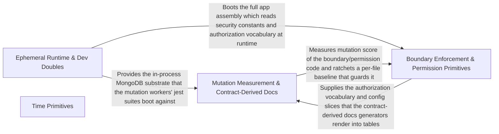

---
tags:
  - 2brain
  - 2brain/arch
  - project/boilerplate-node-backend
type: architecture
component: Test_Dev_Support_Infrastructure
---

## Details

The disposable substrate the scenario runner and test suites stand on — ephemeral in-process Mongo (EphemeralMongo, startInProcessMongod), development doubles (fake payment provider, mail log, webhook sink, OAuth fake), plus the repo's own quality scripts (eslint boundary rules, mutation testing shards, docs/rate-limit-budget generation) that keep the scenario surface and module boundaries honest.

### Ephemeral Runtime & Dev Doubles [[Expand]](./Ephemeral_Runtime_Dev_Doubles.md)
The disposable execution substrate for the demo profile and test suites. It boots a real single-member mongod replica set in-process (via mongodb-memory-server), wraps it in a minimal EphemeralMongo handle (uri + stop()), and provides the development doubles that replace external services: a fake payment provider, a webhook sink with its own TLS CA and SSRF exemption, and an OAuth fake. The run-server entry point assembles these into a self-contained, loopback-only API instance that the paired frontend's dev server and e2e suite run against. Scenario apply and waves orchestrate the seeding and flow execution on top of this substrate.

**Related Classes/Methods**:

- `scenarios.support.ephemeral-mongo.EphemeralMongo`:35-38

**Source Files:**

- `scenarios/apply.ts`
  - `scenarios.apply.filter() callback` (L91-L91) - Function
- `scenarios/run-server.ts`
  - `scenarios.run-server.waitUntilListening.poll` (L150-L158) - Class
  - `scenarios.run-server.waitUntilListening.poll.then() callback` (L153-L157) - Function
  - `scenarios.run-server.then() callback.process.once() callback` (L170-L180) - Function
  - `scenarios.run-server.then() callback.then() callback` (L246-L248) - Function
- `scenarios/support/doubles/payments/fake.ts`
  - `scenarios.support.doubles.payments.fake.FakeRefund` (L228-L233) - Interface
  - `scenarios.support.doubles.payments.fake.fakePaymentProvider` (L375-L579) - Class
  - `scenarios.support.doubles.payments.fake.fakePaymentProvider.prepare` (L380-L397) - Method
  - `scenarios.support.doubles.payments.fake.fakePaymentProvider.confirm` (L401-L416) - Method
  - `scenarios.support.doubles.payments.fake.fakePaymentProvider.retrieve` (L418-L425) - Method
  - `scenarios.support.doubles.payments.fake.fakePaymentProvider.refund` (L430-L497) - Method
  - `scenarios.support.doubles.payments.fake.fakePaymentProvider.retrieveRefund` (L499-L508) - Method
  - `scenarios.support.doubles.payments.fake.fakePaymentProvider.listRefunds` (L510-L521) - Method
  - `scenarios.support.doubles.payments.fake.fakePaymentProvider.listRefunds.filter() callback` (L513-L513) - Function
  - `scenarios.support.doubles.payments.fake.fakePaymentProvider.listRefunds.map() callback` (L514-L520) - Function
  - `scenarios.support.doubles.payments.fake.fakePaymentProvider.cancel` (L523-L543) - Method
  - `scenarios.support.doubles.payments.fake.fakePaymentProvider.parseWebhook` (L556-L578) - Method
  - `scenarios.support.doubles.payments.fake.fakePaymentProvider.parseWebhook.catch() callback` (L572-L575) - Function
  - `scenarios.support.doubles.payments.fake.fakePaymentProvider.parseWebhook.then() callback` (L578-L578) - Function
- `scenarios/support/doubles/payments/register.ts`
  - `scenarios.support.doubles.payments.register.loadFakePaymentProvider` (L17-L18) - Class
  - `scenarios.support.doubles.payments.register.loadFakePaymentProvider.then() callback` (L18-L18) - Function
  - `scenarios.support.doubles.payments.register.lazyFakePaymentProvider` (L26-L50) - Class
  - `scenarios.support.doubles.payments.register.lazyFakePaymentProvider.prepare` (L28-L31) - Method
  - `scenarios.support.doubles.payments.register.lazyFakePaymentProvider.prepare.then() callback` (L29-L30) - Function
  - `scenarios.support.doubles.payments.register.lazyFakePaymentProvider.confirm` (L32-L35) - Method
  - `scenarios.support.doubles.payments.register.lazyFakePaymentProvider.confirm.then() callback` (L33-L34) - Function
  - `scenarios.support.doubles.payments.register.lazyFakePaymentProvider.retrieve` (L36-L37) - Method
  - `scenarios.support.doubles.payments.register.lazyFakePaymentProvider.retrieve.then() callback` (L37-L37) - Function
  - `scenarios.support.doubles.payments.register.lazyFakePaymentProvider.refund` (L38-L41) - Method
  - `scenarios.support.doubles.payments.register.lazyFakePaymentProvider.refund.then() callback` (L39-L40) - Function
  - `scenarios.support.doubles.payments.register.lazyFakePaymentProvider.retrieveRefund` (L42-L43) - Method
  - `scenarios.support.doubles.payments.register.lazyFakePaymentProvider.retrieveRefund.then() callback` (L43-L43) - Function
  - `scenarios.support.doubles.payments.register.lazyFakePaymentProvider.listRefunds` (L44-L45) - Method
  - `scenarios.support.doubles.payments.register.lazyFakePaymentProvider.listRefunds.then() callback` (L45-L45) - Function
  - `scenarios.support.doubles.payments.register.lazyFakePaymentProvider.cancel` (L46-L47) - Method
  - `scenarios.support.doubles.payments.register.lazyFakePaymentProvider.cancel.then() callback` (L47-L47) - Function
  - `scenarios.support.doubles.payments.register.lazyFakePaymentProvider.parseWebhook` (L48-L49) - Method
  - `scenarios.support.doubles.payments.register.lazyFakePaymentProvider.parseWebhook.then() callback` (L49-L49) - Function
- `scenarios/support/doubles/webhook-sink.ts`
  - `scenarios.support.doubles.webhook-sink.trustSinkCertificateAuthority` (L28-L37) - Class
  - `scenarios.support.doubles.webhook-sink.trustSinkCertificateAuthority.defaults.some() callback` (L33-L33) - Function
- `scenarios/support/ephemeral-mongo.ts`
  - `scenarios.support.ephemeral-mongo.EphemeralMongo` (L35-L38) - Interface
- `scenarios/support/ephemeral-mongod.ts`
  - `scenarios.support.ephemeral-mongod.toEphemeralMongo` (L32-L35) - Class
  - `scenarios.support.ephemeral-mongod.toEphemeralMongo.stop` (L34-L34) - Method
  - `scenarios.support.ephemeral-mongod.toEphemeralMongo.stop.then() callback` (L34-L34) - Function
  - `scenarios.support.ephemeral-mongod.startInProcessMongod.timeout` (L51-L63) - Class
  - `scenarios.support.ephemeral-mongod.startInProcessMongod.timeout.<function>` (L51-L63) - Function
  - `scenarios.support.ephemeral-mongod.startInProcessMongod.timeout.<function>.setTimeout() callback` (L53-L60) - Function
- `scripts/mutation/ci/waves.ts`
  - `scripts.mutation.ci.waves.nextWave.results` (L198-L198) - Class
  - `scripts.mutation.ci.waves.nextWave.results.previous.shards.map() callback` (L198-L198) - Function
  - `scripts.mutation.ci.waves.nextWave.results.flatMap() callback` (L203-L203) - Function
- `scripts/mutation/mutate-scope.ts`
  - `scripts.mutation.mutate-scope.StrykerConfig` (L21-L23) - Interface
  - `scripts.mutation.mutate-scope.isMutable.exclude` (L43-L45) - Class
  - `scripts.mutation.mutate-scope.isMutable.exclude.patterns.filter() callback` (L44-L44) - Function
  - `scripts.mutation.mutate-scope.isMutable.exclude.map() callback` (L45-L45) - Function
  - `scripts.mutation.mutate-scope.isMutable.exclude.every() callback` (L50-L50) - Function
- `src/app/routes.ts`
  - `src.app.routes.app.use() callback` (L39-L42) - Function
- `src/infrastructure/adapters/image-signatures.ts`
  - `src.infrastructure.adapters.image-signatures.ACCEPTED_UPLOAD_MIMETYPES` (L59-L62) - Class
  - `src.infrastructure.adapters.image-signatures.ACCEPTED_UPLOAD_MIMETYPES.SUPPORTED_IMAGE_FORMATS.flatMap() callback` (L61-L61) - Function
  - `src.infrastructure.adapters.image-signatures.CANONICAL_MIME_BY_ALIAS` (L65-L69) - Class
  - `src.infrastructure.adapters.image-signatures.CANONICAL_MIME_BY_ALIAS.SUPPORTED_IMAGE_FORMATS.flatMap() callback` (L66-L67) - Function
  - `src.infrastructure.adapters.image-signatures.CANONICAL_MIME_BY_ALIAS.SUPPORTED_IMAGE_FORMATS.flatMap() callback.map() callback` (L67-L67) - Function
- `src/infrastructure/adapters/image.worker.ts`
  - `src.infrastructure.adapters.image.worker.REENCODABLE_MIMES` (L28-L33) - Class
  - `src.infrastructure.adapters.image.worker.REENCODABLE_MIMES.filter() callback` (L31-L31) - Function
  - `src.infrastructure.adapters.image.worker.REENCODABLE_MIMES.map() callback` (L32-L32) - Function
- `src/infrastructure/adapters/log-scrub.ts`
  - `src.infrastructure.adapters.log-scrub.scrubError.frames` (L60-L63) - Class
  - `src.infrastructure.adapters.log-scrub.scrubError.frames.filter() callback` (L62-L62) - Function
  - `src.infrastructure.adapters.log-scrub.ADDRESS` (L88-L97) - Class
  - `src.infrastructure.adapters.log-scrub.ADDRESS.<function>` (L88-L97) - Function
- `src/infrastructure/adapters/logger.ts`
  - `src.infrastructure.adapters.logger.SENSITIVE_KEYS` (L100-L100) - Class
  - `src.infrastructure.adapters.logger.SENSITIVE_KEYS.map() callback` (L100-L100) - Function
- `src/infrastructure/adapters/pdf.ts`
  - `src.infrastructure.adapters.pdf.refuseNonDataRequest` (L212-L218) - Class
  - `src.infrastructure.adapters.pdf.refuseNonDataRequest.answer.catch() callback` (L217-L217) - Function
- `src/infrastructure/adapters/ssrf-guard.ts`
  - `src.infrastructure.adapters.ssrf-guard.SafeOutboundTarget` (L49-L62) - Interface
  - `src.infrastructure.adapters.ssrf-guard.resolveAllAddresses.lookup.then() callback.addresses.results.flatMap() callback` (L167-L168) - Function
  - `src.infrastructure.adapters.ssrf-guard.resolveAllAddresses.lookup.then() callback.addresses` (L167-L169) - Class
- `src/infrastructure/config/define.ts`
  - `src.infrastructure.config.define.FieldInfo` (L26-L33) - Interface
  - `src.infrastructure.config.define.SliceProblems` (L36-L43) - Interface
  - `src.infrastructure.config.define.presenceBroken` (L146-L158) - Class
  - `src.infrastructure.config.define.presenceProblems.presence.info.filter() callback` (L220-L224) - Function
  - `src.infrastructure.config.define.presenceProblems.presence.map() callback` (L226-L226) - Function
  - `src.infrastructure.config.define.slice` (L242-L255) - Class
  - `src.infrastructure.config.define.configProblems.merged` (L296-L298) - Class
  - `src.infrastructure.config.define.configProblems.merged.all.flatMap() callback` (L297-L297) - Function
  - `src.infrastructure.config.define.configProblems.invalid.merged() callback` (L300-L300) - Function
  - `src.infrastructure.config.define.configProblems.presence.merged() callback` (L301-L301) - Function
  - `src.infrastructure.config.define.configProblems.checks.merged() callback` (L302-L302) - Function
  - `src.infrastructure.config.define.assertConfigIn.clauses` (L316-L322) - Class
  - `src.infrastructure.config.define.assertConfigIn.clauses.filter() callback` (L322-L322) - Function
- `src/infrastructure/config/fields.ts`
  - `src.infrastructure.config.fields.locale.transform() callback` (L450-L454) - Function
- `src/infrastructure/config/shared-rules/cookies.ts`
  - `src.infrastructure.config.shared-rules.cookies.cookies.refine() callback` (L42-L42) - Function
  - `src.infrastructure.config.shared-rules.cookies.cookiesSchema.cookies.refine() callback.every() callback` (L46-L46) - Function
  - `src.infrastructure.config.shared-rules.cookies.cookiesSchema.cookies.refine() callback` (L51-L54) - Function
  - `src.infrastructure.config.shared-rules.cookies.cookiesSchema.cookies.refine() callback.names` (L52-L52) - Class
  - `src.infrastructure.config.shared-rules.cookies.cookiesSchema.cookies.refine() callback.names.map() callback` (L52-L52) - Function
- `src/infrastructure/config/shared-rules/generate-spec.ts`
  - `src.infrastructure.config.shared-rules.generate-spec.GeneratedExport` (L22-L31) - Interface
  - `src.infrastructure.config.shared-rules.generate-spec.GenerateSpec` (L34-L39) - Interface
  - `src.infrastructure.config.shared-rules.generate-spec.KeyedEntry` (L42-L47) - Interface
  - `src.infrastructure.config.shared-rules.generate-spec.keyedListSchema` (L55-L61) - Class
  - `src.infrastructure.config.shared-rules.generate-spec.keyedListSchema.refine() callback` (L59-L59) - Function
  - `src.infrastructure.config.shared-rules.generate-spec.keyedListSchema.refine() callback.entries.map() callback` (L59-L59) - Function
- `src/infrastructure/config/shared-rules/metrics.ts`
  - `src.infrastructure.config.shared-rules.metrics.metricDataSchema` (L13-L35) - Class
  - `src.infrastructure.config.shared-rules.metrics.refine() callback` (L29-L29) - Function
  - `src.infrastructure.config.shared-rules.metrics.metricDataSchema.refine() callback` (L33-L33) - Function
  - `src.infrastructure.config.shared-rules.metrics.metricsSchema.refine() callback.names` (L43-L43) - Class
  - `src.infrastructure.config.shared-rules.metrics.metricsSchema.refine() callback.names.map() callback` (L43-L43) - Function
- `src/infrastructure/config/shared-rules/rate-limits.ts`
  - `src.infrastructure.config.shared-rules.rate-limits.camelCaseOf` (L39-L40) - Class
  - `src.infrastructure.config.shared-rules.rate-limits.camelCaseOf.namespace.replaceAll() callback` (L40-L40) - Function
  - `src.infrastructure.config.shared-rules.rate-limits.rateLimitsBlockSchema` (L43-L49) - Class
  - `src.infrastructure.config.shared-rules.rate-limits.rateLimitsBlockSchema.refine() callback` (L46-L47) - Function
  - `src.infrastructure.config.shared-rules.rate-limits.rateLimitsBlockSchema.refine() callback.every() callback` (L47-L47) - Function
- `src/infrastructure/config/store.ts`
  - `src.infrastructure.config.store.overrideEnvironment.before` (L116-L118) - Class
  - `src.infrastructure.config.store.overrideEnvironment.before.map() callback` (L117-L117) - Function
- `src/infrastructure/http/middlewares/cache.ts`
  - `src.infrastructure.http.middlewares.cache.CachedResponse` (L39-L44) - Interface
- `src/infrastructure/http/middlewares/idempotency.ts`
  - `src.infrastructure.http.middlewares.idempotency.DoNotRetrySubject` (L135-L140) - Interface
  - `src.infrastructure.http.middlewares.idempotency.OutcomeUnknownFacts` (L146-L155) - Interface
  - `src.infrastructure.http.middlewares.idempotency.Claim` (L180-L189) - Interface
- `src/infrastructure/http/middlewares/upload.ts`
  - `src.infrastructure.http.middlewares.upload.validateUploadedImages.then() callback.rejected` (L293-L297) - Class
  - `src.infrastructure.http.middlewares.upload.validateUploadedImages.then() callback.rejected.paths.filter() callback` (L294-L296) - Function
  - `src.infrastructure.http.middlewares.upload.validateUploadedImages.then() callback.rejected.map() callback` (L315-L315) - Function
  - `src.infrastructure.http.middlewares.upload.quarantineUploadedImages.then() callback.failed` (L429-L429) - Class
  - `src.infrastructure.http.middlewares.upload.quarantineUploadedImages.then() callback.failed.results.find() callback` (L429-L429) - Function
- `src/infrastructure/http/preconditions.ts`
  - `src.infrastructure.http.preconditions.tagsOf` (L29-L29) - Class
  - `src.infrastructure.http.preconditions.tagsOf.map() callback` (L29-L29) - Function
- `src/infrastructure/http/request.ts`
  - `src.infrastructure.http.request.parseFormCsvList.tokens` (L77-L80) - Class
  - `src.infrastructure.http.request.parseFormCsvList.tokens.entries.flatMap() callback` (L78-L78) - Function
  - `src.infrastructure.http.request.parseFormCsvList.tokens.map() callback` (L79-L79) - Function
  - `src.infrastructure.http.request.parseFormCsvList.tokens.filter() callback` (L80-L80) - Function
  - `src.infrastructure.http.request.readInput.undecoded` (L289-L289) - Class
  - `src.infrastructure.http.request.readInput.undecoded.stated.find() callback` (L289-L289) - Function
- `src/infrastructure/http/response.ts`
  - `src.infrastructure.http.response.ResponseNeutral` (L20-L25) - Interface
  - `src.infrastructure.http.response.ResponseSuccess` (L31-L38) - Interface
  - `src.infrastructure.http.response.ResponseErrorItem` (L41-L53) - Interface
  - `src.infrastructure.http.response.ResponseReject` (L59-L70) - Interface
  - `src.infrastructure.http.response.ProblemDetails` (L348-L361) - Interface
- `src/infrastructure/http/sse.ts`
  - `src.infrastructure.http.sse.openSseStream.reverifyTimer` (L120-L126) - Class
  - `src.infrastructure.http.sse.openSseStream.reverifyTimer.setInterval() callback` (L120-L126) - Function
  - `src.infrastructure.http.sse.openSseStream.reverifyTimer.setInterval() callback.then() callback` (L122-L124) - Function
- `src/infrastructure/observability/audit-changes.ts`
  - `src.infrastructure.observability.audit-changes.auditChanges.changedFields` (L83-L83) - Class
  - `src.infrastructure.observability.audit-changes.auditChanges.changedFields.fields.named.filter() callback` (L83-L83) - Function
- `src/infrastructure/observability/tracer.ts`
  - `src.infrastructure.observability.tracer.tracer.startActiveSpan() callback.then() callback` (L51-L51) - Function
- `src/infrastructure/persistence/money-field.ts`
  - `src.infrastructure.persistence.money-field.MoneyPathOptions` (L82-L89) - Interface
  - `src.infrastructure.persistence.money-field.moneyPath.validate.message` (L123-L124) - Method
- `src/infrastructure/persistence/report.ts`
  - `src.infrastructure.persistence.report.ReportWindow` (L15-L24) - Interface
- `src/infrastructure/runtime/busy.ts`
  - `src.infrastructure.runtime.busy.ServiceBusyError` (L13-L19) - Class
  - `src.infrastructure.runtime.busy.ServiceBusyError.constructor` (L15-L18) - Constructor
- `src/infrastructure/runtime/otel-sdk.ts`
  - `src.infrastructure.runtime.otel-sdk.redactUrlSecrets.query` (L125-L129) - Class
  - `src.infrastructure.runtime.otel-sdk.redactUrlSecrets.query.map() callback` (L128-L128) - Function
- `src/infrastructure/runtime/provider-registry.ts`
  - `src.infrastructure.runtime.provider-registry.ProviderRegistry` (L17-L34) - Interface
  - `src.infrastructure.runtime.provider-registry.ProviderRegistry.register` (L23-L23) - Method
  - `src.infrastructure.runtime.provider-registry.ProviderRegistry.names` (L26-L26) - Method
  - `src.infrastructure.runtime.provider-registry.ProviderRegistry.resolve` (L33-L33) - Method
  - `src.infrastructure.runtime.provider-registry.registryOver` (L41-L47) - Class
  - `src.infrastructure.runtime.provider-registry.registryOver.register` (L42-L44) - Method
  - `src.infrastructure.runtime.provider-registry.registryOver.names` (L45-L45) - Method
  - `src.infrastructure.runtime.provider-registry.registryOver.resolve` (L46-L46) - Method
- `src/infrastructure/runtime/span-scrub.ts`
  - `src.infrastructure.runtime.span-scrub.scrubSpan.events` (L30-L36) - Class
  - `src.infrastructure.runtime.span-scrub.scrubSpan.events.span.events.map() callback` (L30-L36) - Function
  - `src.infrastructure.runtime.span-scrub.scrubSpan.type` (L37-L39) - Class
  - `src.infrastructure.runtime.span-scrub.scrubSpan.type.events.find() callback` (L39-L39) - Function
- `src/modules/account/globals.d.ts`
  - `src.modules.account.globals.d.'express-serve-static-core'.Request` (L15-L22) - Interface
- `src/modules/account/oauth/providers/github.ts`
  - `src.modules.account.oauth.providers.github.identityOf.primary` (L80-L80) - Class
  - `src.modules.account.oauth.providers.github.identityOf.primary.emails.find() callback` (L80-L80) - Function
- `src/modules/account/oauth/providers/index.ts`
  - `src.modules.account.oauth.providers.index.enabledProviders` (L35-L36) - Class
  - `src.modules.account.oauth.providers.index.enabledProviders.filter() callback` (L36-L36) - Function
- `src/modules/account/repository.ts`
  - `src.modules.account.repository.insert` (L54-L56) - Class
  - `src.modules.account.repository.insert.then() callback` (L56-L56) - Function
  - `src.modules.account.repository.insertSession` (L159-L160) - Class
  - `src.modules.account.repository.insertSession.then() callback` (L160-L160) - Function
  - `src.modules.account.repository.supersedeSession` (L184-L201) - Class
  - `src.modules.account.repository.supersedeSession.then() callback` (L201-L201) - Function
  - `src.modules.account.repository.touchSession` (L212-L227) - Class
  - `src.modules.account.repository.touchSession.then() callback` (L227-L227) - Function
  - `src.modules.account.repository.removeSessionByHash` (L260-L264) - Class
  - `src.modules.account.repository.removeSessionByHash.then() callback` (L264-L264) - Function
  - `src.modules.account.repository.FamilyActivity` (L304-L311) - Interface
  - `src.modules.account.repository.sessionFamilyActivity.then() callback.stamps.rows.flatMap() callback` (L372-L373) - Function
  - `src.modules.account.repository.sessionFamilyActivity.then() callback.stamps` (L372-L374) - Class
  - `src.modules.account.repository.NewVerificationToken` (L481-L488) - Interface
  - `src.modules.account.repository.spendVerificationToken` (L565-L573) - Class
  - `src.modules.account.repository.spendVerificationToken.then() callback` (L573-L573) - Function
  - `src.modules.account.repository.userIdsWithLiveVerificationToken` (L615-L622) - Class
  - `src.modules.account.repository.userIdsWithLiveVerificationToken.then() callback` (L622-L622) - Function
- `src/modules/account/services/oauth.ts`
  - `src.modules.account.services.oauth.then() callback.then() callback` (L201-L216) - Function
- `src/modules/account/services/verification.ts`
  - `src.modules.account.services.verification.then() callback.then() callback.then() callback` (L380-L385) - Function
- `src/modules/account/session/account-view.ts`
  - `src.modules.account.session.account-view.modelVersion` (L44-L44) - Class
  - `src.modules.account.session.account-view.modelVersion.PERMISSION_RULES.map() callback` (L44-L44) - Function
- `src/modules/delivery/domain/lost.ts`
  - `src.modules.delivery.domain.lost.LostShipmentFacts` (L16-L20) - Interface
  - `src.modules.delivery.domain.lost.RestorableFulfillmentOrder` (L23-L28) - Interface
  - `src.modules.delivery.domain.lost.Restoration` (L31-L38) - Interface
  - `src.modules.delivery.domain.lost.planRestoration.shipped.shipment.lines.map() callback` (L114-L114) - Function
  - `src.modules.delivery.domain.lost.planRestoration.owedFulfillmentOrderIds.linked.map() callback` (L116-L116) - Function
  - `src.modules.delivery.domain.lost.withRestoration.known` (L142-L142) - Class
  - `src.modules.delivery.domain.lost.withRestoration.known.lines.map() callback` (L142-L142) - Function
  - `src.modules.delivery.domain.lost.withRestoration.dropped` (L153-L161) - Class
  - `src.modules.delivery.domain.lost.withRestoration.dropped.back.filter() callback` (L154-L154) - Function
  - `src.modules.delivery.domain.lost.withRestoration.dropped.map() callback` (L155-L161) - Function
  - `src.modules.delivery.domain.lost.OwedDate` (L166-L170) - Interface
  - `src.modules.delivery.domain.lost.owedDateOf.at.ahead.map() callback` (L191-L191) - Function
- `src/modules/delivery/domain/preorder.ts`
  - `src.modules.delivery.domain.preorder.SweepFacts` (L136-L140) - Interface
  - `src.modules.delivery.domain.preorder.BoardFacts` (L191-L195) - Interface
- `src/modules/delivery/domain/reship.ts`
  - `src.modules.delivery.domain.reship.planReopening.latestFirst` (L41-L43) - Class
  - `src.modules.delivery.domain.reship.planReopening.latestFirst.orders.filter() callback` (L42-L42) - Function
  - `src.modules.delivery.domain.reship.planReopening.latestFirst.toSorted() callback` (L43-L43) - Function
- `src/modules/invoicing/services/credit-breakdown.ts`
  - `src.modules.invoicing.services.credit-breakdown.creditBreakdownOf.items.map() callback` (L27-L30) - Function
- `src/modules/orders/domain/purchase-hold.ts`
  - `src.modules.orders.domain.purchase-hold.purchaseHoldUntil.counted` (L39-L42) - Class
  - `src.modules.orders.domain.purchase-hold.purchaseHoldUntil.counted.cancelTimes.map() callback` (L40-L40) - Function
  - `src.modules.orders.domain.purchase-hold.purchaseHoldUntil.counted.filter() callback` (L41-L41) - Function
  - `src.modules.orders.domain.purchase-hold.purchaseHoldUntil.counted.toSorted() callback` (L42-L42) - Function
- `src/modules/orders/domain/tax.ts`
  - `src.modules.orders.domain.tax.allocateLineTax.taxes` (L184-L184) - Class
  - `src.modules.orders.domain.tax.allocateLineTax.taxes.grossByLine.map() callback` (L184-L184) - Function
  - `src.modules.orders.domain.tax.lineTaxFromRateTotals.taxes` (L211-L215) - Class
  - `src.modules.orders.domain.tax.lineTaxFromRateTotals.taxes.map() callback` (L214-L214) - Function
  - `src.modules.orders.domain.tax.orderTaxBreakdown.lineTaxes` (L245-L249) - Class
  - `src.modules.orders.domain.tax.orderTaxBreakdown.lineTaxes.map() callback` (L248-L248) - Function
  - `src.modules.orders.domain.tax.orderTaxBreakdown.sortedGroups` (L257-L257) - Class
  - `src.modules.orders.domain.tax.orderTaxBreakdown.sortedGroups.toSorted() callback` (L257-L257) - Function
- `src/modules/orders/domain/totals.ts`
  - `src.modules.orders.domain.totals.LineItem` (L21-L25) - Interface
  - `src.modules.orders.domain.totals.LineItemTotals` (L28-L35) - Interface
  - `src.modules.orders.domain.totals.OrderTotalInput` (L68-L80) - Interface
- `src/modules/orders/emails.ts`
  - `src.modules.orders.emails.OrderLines` (L39-L63) - Interface
  - `src.modules.orders.emails.WithdrawalNotice` (L66-L76) - Interface
  - `src.modules.orders.emails.withdrawalNotice.excludedNote.titles.excluded.map() callback` (L149-L149) - Function
  - `src.modules.orders.emails.orderConfirmEmail.data.lines.order.items.map() callback` (L262-L270) - Function
- `src/modules/orders/model.ts`
  - `src.modules.orders.model.OrderDocumentItem` (L74-L98) - Interface
  - `src.modules.orders.model.OrderReference` (L101-L105) - Interface
  - `src.modules.orders.model.OrderDocument` (L114-L234) - Interface
  - `src.modules.orders.model.OrderNumberCounterDocument` (L670-L672) - Interface
  - `src.modules.orders.model.OrderEventDocument` (L694-L714) - Interface
- `src/modules/orders/repository.ts`
  - `src.modules.orders.repository.setProjection.changes` (L438-L442) - Class
  - `src.modules.orders.repository.setProjection.changes.filter() callback` (L440-L440) - Function
  - `src.modules.orders.repository.setProjection.changes.map() callback` (L441-L441) - Function
- `src/modules/orders/services/crud.ts`
  - `src.modules.orders.services.crud.create.removed` (L138-L138) - Class
  - `src.modules.orders.services.crud.create.removed.resolvedItems.filter() callback` (L138-L138) - Function
- `src/modules/orders/services/digest.ts`
  - `src.modules.orders.services.digest.ordersDigest` (L29-L50) - Class
  - `src.modules.orders.services.digest.ordersDigest.then() callback` (L50-L50) - Function
- `src/modules/orders/services/order-numbering.ts`
  - `src.modules.orders.services.order-numbering.allocateOrderNumber` (L46-L52) - Class
  - `src.modules.orders.services.order-numbering.allocateOrderNumber.then() callback` (L51-L51) - Function
- `src/modules/orders/services/place.ts`
  - `src.modules.orders.services.place.order` (L233-L253) - Class
  - `src.modules.orders.services.place.order.announceInTransaction() callback` (L234-L251) - Function
  - `src.modules.orders.services.place.order.announceInTransaction() callback.then() callback` (L238-L241) - Function
  - `src.modules.orders.services.place.order.announceInTransaction() callback.then() callback.then() callback` (L240-L240) - Function
- `src/modules/orders/services/stats.ts`
  - `src.modules.orders.services.stats.PaidBucket` (L40-L45) - Interface
  - `src.modules.orders.services.stats.ProductTotal` (L77-L83) - Interface
  - `src.modules.orders.services.stats.CategoryTotal` (L122-L127) - Interface
  - `src.modules.orders.services.stats.categoryTotals` (L134-L160) - Class
  - `src.modules.orders.services.stats.categoryTotals.then() callback` (L153-L159) - Function
  - `src.modules.orders.services.stats.categoryTotals.then() callback.rows.map() callback` (L154-L159) - Function
  - `src.modules.orders.services.stats.ProductSeriesRead` (L163-L166) - Interface
  - `src.modules.orders.services.stats.productSeries` (L173-L193) - Class
  - `src.modules.orders.services.stats.productSeries.then() callback` (L190-L193) - Function
  - `src.modules.orders.services.stats.productSeries.then() callback.buckets.rows.map() callback` (L192-L192) - Function
  - `src.modules.orders.services.stats.cancellationCohort` (L234-L252) - Class
  - `src.modules.orders.services.stats.cancellationCohort.then() callback` (L249-L252) - Function
  - `src.modules.orders.services.stats.AwaitingTransfers` (L255-L260) - Interface
  - `src.modules.orders.services.stats.PipelineRead` (L263-L266) - Interface
- `src/modules/payments/controllers/post-payment-confirm.ts`
  - `src.modules.payments.controllers.post-payment-confirm.postPaymentConfirm.then() callback.declined` (L38-L40) - Class
  - `src.modules.payments.controllers.post-payment-confirm.postPaymentConfirm.then() callback.declined.result.errors.some() callback` (L40-L40) - Function
- `src/modules/payments/controllers/post-payment-webhook.ts`
  - `src.modules.payments.controllers.post-payment-webhook.postPaymentWebhook` (L43-L92) - Class
  - `src.modules.payments.controllers.post-payment-webhook.postPaymentWebhook.then() callback` (L62-L64) - Function
  - `src.modules.payments.controllers.post-payment-webhook.postPaymentWebhook.catch() callback` (L65-L91) - Function
- `src/modules/payments/emails.ts`
  - `src.modules.payments.emails.paymentReceivedEmail.data.lines.order.items.map() callback` (L42-L47) - Function
  - `src.modules.payments.emails.TransferInstructions` (L139-L146) - Interface
- `src/modules/payments/model.ts`
  - `src.modules.payments.model.RefundLine` (L32-L37) - Interface
  - `src.modules.payments.model.RefundRecord` (L44-L122) - Interface
  - `src.modules.payments.model.DisputeRecord` (L129-L150) - Interface
  - `src.modules.payments.model.RefundSettlement` (L156-L166) - Interface
  - `src.modules.payments.model.PaymentDocument` (L171-L232) - Interface
- `src/modules/payments/presenter.ts`
  - `src.modules.payments.presenter.StaffFields` (L18-L21) - Interface
  - `src.modules.payments.presenter.staffFieldsOf.refunds.raw.refunds.map() callback` (L29-L32) - Function
  - `src.modules.payments.presenter.withStaffFields.refunds.wire.refunds.map() callback` (L44-L44) - Function
  - `src.modules.payments.presenter.presentPayment.wire.refunds.serialized.refunds.map() callback` (L102-L105) - Function
- `src/modules/payments/providers/errors.ts`
  - `src.modules.payments.providers.errors.PaymentInFlightError` (L15-L21) - Class
  - `src.modules.payments.providers.errors.PaymentInFlightError.constructor` (L17-L20) - Constructor
  - `src.modules.payments.providers.errors.PaymentProviderError` (L28-L40) - Class
  - `src.modules.payments.providers.errors.PaymentProviderError.constructor` (L33-L39) - Constructor
- `src/modules/payments/providers/index.ts`
  - `src.modules.payments.providers.index.ProviderPaymentState` (L44-L65) - Interface
  - `src.modules.payments.providers.index.PreparedPayment` (L68-L76) - Interface
  - `src.modules.payments.providers.index.RefundedByProvider` (L83-L91) - Interface
  - `src.modules.payments.providers.index.ProviderRefundState` (L97-L104) - Interface
  - `src.modules.payments.providers.index.ProviderRefund` (L110-L119) - Interface
  - `src.modules.payments.providers.index.ProviderWebhookEvent` (L141-L157) - Interface
  - `src.modules.payments.providers.index.PaymentProvider` (L174-L323) - Interface
  - `src.modules.payments.providers.index.PaymentProvider.prepare` (L192-L196) - Method
  - `src.modules.payments.providers.index.PaymentProvider.confirm` (L214-L214) - Method
  - `src.modules.payments.providers.index.PaymentProvider.retrieve` (L222-L222) - Method
  - `src.modules.payments.providers.index.PaymentProvider.refund` (L258-L262) - Method
  - `src.modules.payments.providers.index.PaymentProvider.retrieveRefund` (L270-L270) - Method
  - `src.modules.payments.providers.index.PaymentProvider.listRefunds` (L280-L280) - Method
  - `src.modules.payments.providers.index.PaymentProvider.cancel` (L296-L296) - Method
  - `src.modules.payments.providers.index.PaymentProvider.parseWebhook` (L322-L322) - Method
- `src/modules/payments/providers/webhook-signature.ts`
  - `src.modules.payments.providers.webhook-signature.WebhookRejected` (L42-L55) - Class
  - `src.modules.payments.providers.webhook-signature.WebhookRejected.constructor` (L48-L54) - Constructor
  - `src.modules.payments.providers.webhook-signature.verifyWebhookSignature.pairs` (L99-L102) - Class
  - `src.modules.payments.providers.webhook-signature.verifyWebhookSignature.pairs.map() callback` (L99-L102) - Function
  - `src.modules.payments.providers.webhook-signature.verifyWebhookSignature.timestamp` (L104-L104) - Class
  - `src.modules.payments.providers.webhook-signature.verifyWebhookSignature.timestamp.pairs.find() callback` (L104-L104) - Function
  - `src.modules.payments.providers.webhook-signature.verifyWebhookSignature.provided` (L107-L110) - Class
  - `src.modules.payments.providers.webhook-signature.verifyWebhookSignature.provided.pairs.filter() callback` (L108-L108) - Function
  - `src.modules.payments.providers.webhook-signature.verifyWebhookSignature.provided.map() callback` (L109-L109) - Function
- `src/modules/payments/repository.ts`
  - `src.modules.payments.repository.paymentRepository.findStaleInFlight` (L1184-L1196) - Method
- `src/modules/payments/services/effects.ts`
  - `src.modules.payments.services.effects.reconcileOne` (L102-L106) - Class
  - `src.modules.payments.services.effects.reconcileOne.then() callback` (L104-L105) - Function
- `src/modules/payments/services/errors.ts`
  - `src.modules.payments.services.errors.RefundLeftOpenError` (L36-L48) - Class
  - `src.modules.payments.services.errors.RefundLeftOpenError.constructor` (L41-L47) - Constructor
  - `src.modules.payments.services.errors.WebhookProviderUnknownError` (L54-L60) - Class
  - `src.modules.payments.services.errors.WebhookProviderUnknownError.constructor` (L56-L59) - Constructor
- `src/modules/payments/services/external-refunds.ts`
  - `src.modules.payments.services.external-refunds.ourRecord` (L37-L46) - Class
  - `src.modules.payments.services.external-refunds.ourRecord.payment.refunds.find() callback` (L42-L45) - Function
  - `src.modules.payments.services.external-refunds.writeImport` (L73-L111) - Class
  - `src.modules.payments.services.external-refunds.writeImport.then() callback` (L92-L110) - Function
  - `src.modules.payments.services.external-refunds.writeImport.then() callback.then() callback` (L109-L109) - Function
  - `src.modules.payments.services.external-refunds.importRefund` (L120-L154) - Class
  - `src.modules.payments.services.external-refunds.announceInTransaction() callback` (L127-L127) - Function
  - `src.modules.payments.services.external-refunds.importRefund.announceInTransaction() callback` (L128-L132) - Function
  - `src.modules.payments.services.external-refunds.importRefund.then() callback` (L133-L153) - Function
  - `src.modules.payments.services.external-refunds.importRefund.then() callback.then() callback` (L144-L152) - Function
  - `src.modules.payments.services.external-refunds.importRefund.then() callback.then() callback.done` (L146-L148) - Class
  - `src.modules.payments.services.external-refunds.importRefund.then() callback.then() callback.done.fresh.refunds.some() callback` (L147-L147) - Function
  - `src.modules.payments.services.external-refunds.syncProviderRefunds` (L184-L195) - Class
  - `src.modules.payments.services.external-refunds.syncProviderRefunds.then() callback` (L189-L194) - Function
  - `src.modules.payments.services.external-refunds.syncOne` (L204-L216) - Class
  - `src.modules.payments.services.external-refunds.syncOne.then() callback` (L211-L211) - Function
- `src/modules/payments/services/intent.ts`
  - `src.modules.payments.services.intent.rejectStrayIntent` (L44-L71) - Class
  - `src.modules.payments.services.intent.rejectStrayIntent.catch() callback` (L51-L58) - Function
  - `src.modules.payments.services.intent.rejectStrayIntent.then() callback` (L59-L71) - Function
  - `src.modules.payments.services.intent.cancelOpenIntent` (L164-L171) - Class
  - `src.modules.payments.services.intent.cancelOpenIntent.then() callback` (L168-L169) - Function
- `src/modules/payments/services/list.ts`
  - `src.modules.payments.services.list.listPayments.then() callback.then() callback.byId` (L106-L106) - Class
  - `src.modules.payments.services.list.listPayments.then() callback.then() callback.byId.orders.map() callback` (L106-L106) - Function
- `src/modules/payments/services/notify.ts`
  - `src.modules.payments.services.notify.completesPayment.refundedMinor` (L47-L54) - Class
  - `src.modules.payments.services.notify.completesPayment.refundedMinor.payment.refunds.filter() callback` (L49-L52) - Function
  - `src.modules.payments.services.notify.completesPayment.refundedMinor.reduce() callback` (L54-L54) - Function
  - `src.modules.payments.services.notify.mailRefundUndeliverable.then() callback.refund` (L132-L132) - Class
  - `src.modules.payments.services.notify.mailRefundUndeliverable.then() callback.refund.payment.refunds.find() callback` (L132-L132) - Function
- `src/modules/payments/services/refund-settlement.ts`
  - `src.modules.payments.services.refund-settlement.recordRefundFailure` (L272-L318) - Class
  - `src.modules.payments.services.refund-settlement.recordRefundFailure.announceInTransaction() callback.then() callback` (L297-L310) - Function
  - `src.modules.payments.services.refund-settlement.recordRefundFailure.announceInTransaction() callback.then() callback.then() callback` (L309-L309) - Function
  - `src.modules.payments.services.refund-settlement.recordRefundFailure.announceInTransaction() callback` (L312-L316) - Function
  - `src.modules.payments.services.refund-settlement.recordRefundFailure.then() callback` (L317-L317) - Function
- `src/modules/payments/services/refund-sync.ts`
  - `src.modules.payments.services.refund-sync.rereadRefund` (L66-L87) - Class
  - `src.modules.payments.services.refund-sync.then() callback` (L76-L76) - Function
  - `src.modules.payments.services.refund-sync.rereadRefund.then() callback` (L77-L77) - Function
  - `src.modules.payments.services.refund-sync.rereadRefund.catch() callback` (L78-L86) - Function
- `src/modules/payments/services/refunds.ts`
  - `src.modules.payments.services.refunds.keepPending` (L430-L438) - Class
  - `src.modules.payments.services.refunds.keepPending.then() callback` (L438-L438) - Function
  - `src.modules.payments.services.refunds.sendToProvider` (L450-L508) - Class
  - `src.modules.payments.services.refunds.sendToProvider.refuse` (L456-L459) - Class
  - `src.modules.payments.services.refunds.sendToProvider.refuse.then() callback` (L457-L459) - Function
  - `src.modules.payments.services.refunds.sendToProvider.then() callback` (L506-L506) - Function
  - `src.modules.payments.services.refunds.sendOpenedRefund.then() callback.refund` (L1365-L1365) - Class
  - `src.modules.payments.services.refunds.sendOpenedRefund.then() callback.refund.payment.refunds.find() callback` (L1365-L1365) - Function
- `src/modules/payments/services/settlement.ts`
  - `src.modules.payments.services.settlement.Settlement` (L66-L83) - Interface
  - `src.modules.payments.services.settlement.then() callback` (L319-L323) - Function
  - `src.modules.payments.services.settlement.confirmableOrder` (L550-L553) - Class
  - `src.modules.payments.services.settlement.confirmableOrder.then() callback` (L553-L553) - Function
  - `src.modules.payments.services.settlement.settleFound` (L572-L598) - Class
  - `src.modules.payments.services.settlement.settleFound.then() callback` (L585-L597) - Function
  - `src.modules.payments.services.settlement.settleFound.then() callback.then() callback` (L589-L595) - Function
  - `src.modules.payments.services.settlement.confirmPayment` (L615-L645) - Class
  - `src.modules.payments.services.settlement.confirmPayment.then() callback` (L621-L645) - Function
  - `src.modules.payments.services.settlement.confirmPayment.then() callback.settleFound() callback` (L630-L638) - Function
  - `src.modules.payments.services.settlement.confirmPayment.then() callback.settleFound() callback.then() callback` (L633-L637) - Function
  - `src.modules.payments.services.settlement.confirmPayment.then() callback.precheck` (L641-L641) - Method
  - `src.modules.payments.services.settlement.syncPayment` (L657-L681) - Class
  - `src.modules.payments.services.settlement.syncPayment.then() callback` (L662-L681) - Function
  - `src.modules.payments.services.settlement.syncPayment.then() callback.settleFound() callback` (L675-L678) - Function
  - `src.modules.payments.services.settlement.syncPayment.then() callback.settleFound() callback.then() callback` (L676-L677) - Function
  - `src.modules.payments.services.settlement.receiveWebhook` (L694-L706) - Class
  - `src.modules.payments.services.settlement.receiveWebhook.then() callback` (L701-L706) - Function
  - `src.modules.payments.services.settlement.receiveWebhook.then() callback.then() callback` (L705-L705) - Function
  - `src.modules.payments.services.settlement.settleFromProvider` (L861-L871) - Class
  - `src.modules.payments.services.settlement.settleFromProvider.then() callback` (L870-L870) - Function
- `src/modules/payments/services/view.ts`
  - `src.modules.payments.services.view.getRefund` (L117-L129) - Class
  - `src.modules.payments.services.view.getRefund.then() callback` (L122-L129) - Function
  - `src.modules.payments.services.view.cancelableRefunds` (L230-L235) - Class
  - `src.modules.payments.services.view.cancelableRefunds.payment.refunds.filter() callback` (L233-L233) - Function
  - `src.modules.payments.services.view.cancelableRefunds.map() callback` (L234-L234) - Function
- `src/modules/returns/domain/statement.ts`
  - `src.modules.returns.domain.statement.Statement` (L31-L35) - Interface
- `src/modules/returns/emails.ts`
  - `src.modules.returns.emails.ReturnNoticeInput` (L31-L53) - Interface
- `src/modules/returns/model.ts`
  - `src.modules.returns.model.ReturnLine` (L31-L42) - Interface
  - `src.modules.returns.model.ReturnDocument` (L45-L116) - Interface
  - `src.modules.returns.model.ReturnOrderLockDocument` (L223-L226) - Interface
- `src/modules/returns/services/cancel-remainder.ts`
  - `src.modules.returns.services.cancel-remainder.rowFor.byProduct` (L88-L88) - Class
  - `src.modules.returns.services.cancel-remainder.rowFor.byProduct.order.items.map() callback` (L88-L88) - Function
- `src/modules/returns/services/create.ts`
  - `src.modules.returns.services.create.Opening` (L117-L121) - Interface
  - `src.modules.returns.services.create.openFor.then() callback.returnable` (L323-L323) - Class
  - `src.modules.returns.services.create.openFor.then() callback.returnable.shipped.filter() callback` (L323-L323) - Function
- `src/modules/returns/services/options.ts`
  - `src.modules.returns.services.options.optionLines.titles` (L64-L66) - Class
  - `src.modules.returns.services.options.optionLines.titles.order.items.map() callback` (L65-L65) - Function
- `src/modules/stats/services/breakdowns.ts`
  - `src.modules.stats.services.breakdowns.then() callback.refunds.currencies.map() callback.invoiced` (L134-L134) - Class
  - `src.modules.stats.services.breakdowns.then() callback.refunds.currencies.map() callback.credited` (L135-L135) - Class
  - `src.modules.stats.services.breakdowns.getCustomerStats` (L150-L157) - Class
  - `src.modules.stats.services.breakdowns.getCustomerStats.then() callback` (L151-L157) - Function
  - `src.modules.stats.services.breakdowns.getPipelineStats` (L160-L169) - Class
  - `src.modules.stats.services.breakdowns.getPipelineStats.then() callback` (L161-L169) - Function
  - `src.modules.stats.services.breakdowns.getPipelineStats.then() callback.awaitingTransfers.snapshot.awaitingTransfers.map() callback` (L163-L168) - Function

### Boundary Enforcement & Permission Primitives [[Expand]](./Boundary_Enforcement_Permission_Primitives.md)
The mechanical enforcement layer that keeps module boundaries and controller-chain invariants honest. It comprises two custom ESLint rules — controllerChainMustCatch (every promise chain in a controller must end in .catch()) and friendMembers (a friends-only service member is callable only by its named modules) — plus the kernel's permission and ability primitives (PermissionRule, PRESET_ROLES, PERMISSION_SUBJECTS, DeclaredRule) that define the authorization vocabulary the rules reference. The setup/environment-file module provides the pure text-level operations (placeholder filling, value reading) that the dev-setup script uses to bootstrap a .env from .env-example. App-level security constants (RAW_BODY_PATHS) and kernel module-config slices round out the boundary surface.

**Related Classes/Methods**:

- `scripts.eslint.controller-chain-must-catch.controllerChainMustCatch`:125-164
- `src.kernel.permissions.PermissionRule`:89-131
- `src.app.security.RAW_BODY_PATHS`:38-42

**Source Files:**

- `scripts/audit/check-clean.ts`
  - `scripts.audit.check-clean.flatMap() callback.filter() callback` (L92-L92) - Function
  - `scripts.audit.check-clean.parseArguments.repos.repos.map() callback` (L127-L127) - Function
- `scripts/docs/check-references.ts`
  - `scripts.docs.check-references.deadScriptFindings.read` (L233-L236) - Class
  - `scripts.docs.check-references.deadScriptFindings.read.pages.map() callback` (L233-L236) - Function
- `scripts/eslint/controller-chain-must-catch.ts`
  - `scripts.eslint.controller-chain-must-catch.controllerChainMustCatch` (L125-L164) - Class
  - `scripts.eslint.controller-chain-must-catch.controllerChainMustCatch.create` (L137-L163) - Method
  - `scripts.eslint.controller-chain-must-catch.controllerChainMustCatch.create.CallExpression` (L139-L161) - Method
- `scripts/mutation/run-shards.ts`
  - `scripts.mutation.run-shards.main.recorded` (L201-L201) - Class
  - `scripts.mutation.run-shards.main.recorded.shards.filter() callback` (L201-L201) - Function
  - `scripts.mutation.run-shards.then() callback` (L223-L223) - Function
- `scripts/setup/environment-file.ts`
  - `scripts.setup.environment-file.readEnvironmentValue` (L51-L55) - Class
  - `scripts.setup.environment-file.readEnvironmentValue.find() callback` (L54-L54) - Function
- `src/app/boot-rendering.ts`
  - `src.app.boot-rendering.then() callback` (L27-L29) - Function
- `src/app/security.ts`
  - `src.app.security.RAW_BODY_PATHS.enabledModules.flatMap() callback` (L38-L41) - Function
  - `src.app.security.RAW_BODY_PATHS` (L38-L42) - Class
  - `src.app.security.RAW_BODY_PATHS.enabledModules.flatMap() callback.map() callback` (L39-L40) - Function
- `src/cluster.ts`
  - `src.cluster.supervise.scheduleRespawn.timer` (L72-L75) - Class
  - `src.cluster.supervise.scheduleRespawn.timer.setTimeout() callback` (L72-L75) - Function
- `src/domain-primitives/money.ts`
  - `src.domain-primitives.money.apportion.shares` (L276-L276) - Class
  - `src.domain-primitives.money.apportion.shares.weights.map() callback` (L276-L276) - Function
- `src/kernel/ability.ts`
  - `src.kernel.ability.holdsSet.set` (L187-L187) - Class
  - `src.kernel.ability.holdsSet.set.PERMISSION_SETS.find() callback` (L187-L187) - Function
  - `src.kernel.ability.holdsSet.set.rules.every() callback` (L192-L195) - Function
- `src/kernel/module-config.ts`
  - `src.kernel.module-config.moduleConfigSlices` (L39-L40) - Class
  - `src.kernel.module-config.moduleConfigSlices.appModules.flatMap() callback` (L40-L40) - Function
- `src/kernel/permissions.ts`
  - `src.kernel.permissions.PermissionRule` (L89-L131) - Interface
  - `src.kernel.permissions.DeclaredRule` (L283-L286) - Interface
  - `src.kernel.permissions.byId` (L297-L297) - Class
  - `src.kernel.permissions.byId.PERMISSION_RULES.map() callback` (L297-L297) - Function
  - `src.kernel.permissions.setsByName` (L309-L309) - Class
  - `src.kernel.permissions.setsByName.PERMISSION_SETS.map() callback` (L309-L309) - Function
  - `src.kernel.permissions.undeclared` (L312-L312) - Class
  - `src.kernel.permissions.undeclared.set.rules.filter() callback` (L312-L312) - Function
  - `src.kernel.permissions.expandSets` (L339-L353) - Class
  - `src.kernel.permissions.expandSets.names.flatMap() callback` (L341-L351) - Function
  - `src.kernel.permissions.PRESET_ROLES` (L378-L381) - Class
  - `src.kernel.permissions.PRESET_ROLES.rolesDocument.roles.map() callback` (L378-L381) - Function
  - `src.kernel.permissions.byRoleName` (L430-L430) - Class
  - `src.kernel.permissions.byRoleName.PRESET_ROLES.map() callback` (L430-L430) - Function
  - `src.kernel.permissions.declaredRulesOfScope` (L654-L662) - Class
  - `src.kernel.permissions.declaredRulesOfScope.AUTHORIZATION_SCOPES.map() callback` (L655-L661) - Function
  - `src.kernel.permissions.declaredRulesOfScope.AUTHORIZATION_SCOPES.map() callback.PERMISSION_RULES.filter() callback` (L658-L659) - Function
  - `src.kernel.permissions.declaredRulesOfScope.AUTHORIZATION_SCOPES.map() callback.map() callback` (L660-L660) - Function
- `src/kernel/registry.ts`
  - `src.kernel.registry.BrowserEventTarget` (L207-L216) - Interface
  - `src.kernel.registry.BrowserEventTarget.toReport` (L215-L215) - Method
- `src/kernel/translation.ts`
  - `src.kernel.translation.planTranslations.otherLocale` (L279-L279) - Class
  - `src.kernel.translation.planTranslations.otherLocale.find() callback` (L279-L279) - Function
- `src/modules/access/services/grants.ts`
  - `src.modules.access.services.grants.GrantRefusal` (L43-L48) - Interface
  - `src.modules.access.services.grants.grantableRoles` (L147-L150) - Class
  - `src.modules.access.services.grants.grantableRoles.PRESET_ROLES.filter() callback` (L149-L149) - Function
  - `src.modules.access.services.grants.grantableRoles.map() callback` (L150-L150) - Function
- `src/modules/audit-logs/service.ts`
  - `src.modules.audit-logs.service.Consultations` (L158-L161) - Interface
- `src/modules/cart/model.ts`
  - `src.modules.cart.model.CartItem` (L25-L28) - Interface
- `src/modules/cart/repository.ts`
  - `src.modules.cart.repository.unchangedOrMissing.then() callback.current` (L132-L132) - Class
  - `src.modules.cart.repository.unchangedOrMissing.then() callback.current.existing.items.find() callback` (L132-L132) - Function
  - `src.modules.cart.repository.resolveAddMiss.then() callback.currentQuantity.existing.items.find() callback` (L159-L160) - Function
  - `src.modules.cart.repository.resolveAddMiss.then() callback.currentQuantity` (L159-L161) - Class
- `src/modules/cart/services/checkout.ts`
  - `src.modules.cart.services.checkout.refuseOverLimit.overLimit` (L419-L419) - Class
  - `src.modules.cart.services.checkout.refuseOverLimit.overLimit.joined.filter() callback` (L419-L419) - Function
  - `src.modules.cart.services.checkout.runCheckout.joined` (L612-L612) - Class
  - `src.modules.cart.services.checkout.runCheckout.joined.lines.filter() callback` (L612-L612) - Function
- `src/modules/cart/services/items.ts`
  - `src.modules.cart.services.items.cartShippingMethodSet.then() callback.joined` (L295-L295) - Class
  - `src.modules.cart.services.items.cartShippingMethodSet.then() callback.joined.lines.filter() callback` (L295-L295) - Function
- `src/modules/cart/services/merge.ts`
  - `src.modules.cart.services.merge.announceRemoved.removed` (L155-L155) - Class
  - `src.modules.cart.services.merge.announceRemoved.removed.results.filter() callback` (L155-L155) - Function
  - `src.modules.cart.services.merge.announceRemoved.removed.map() callback` (L159-L162) - Function
  - `src.modules.cart.services.merge.announceRemoved.removed.map() callback.then() callback` (L162-L162) - Function
- `src/modules/cart/services/reorder.ts`
  - `src.modules.cart.services.reorder.reorderIntoCart.then() callback.requested` (L58-L61) - Class
  - `src.modules.cart.services.reorder.reorderIntoCart.then() callback.requested.order.items.map() callback` (L58-L61) - Function
  - `src.modules.cart.services.reorder.reorderIntoCart.then() callback.then() callback.unaddable` (L66-L68) - Class
  - `src.modules.cart.services.reorder.reorderIntoCart.then() callback.then() callback.unaddable.lines.every() callback` (L67-L67) - Function
- `src/modules/cart/services/shelf.ts`
  - `src.modules.cart.services.shelf.readShelf.then() callback.byId` (L37-L37) - Class
  - `src.modules.cart.services.shelf.readShelf.then() callback.byId.products.map() callback` (L37-L37) - Function
  - `src.modules.cart.services.shelf.readShelf.then() callback.lines` (L40-L40) - Class
  - `src.modules.cart.services.shelf.readShelf.then() callback.lines.ids.map() callback` (L40-L40) - Function
- `src/modules/cart/services/view.ts`
  - `src.modules.cart.services.view.CartLine` (L39-L42) - Interface
  - `src.modules.cart.services.view.readCartLines.productIds` (L63-L63) - Class
  - `src.modules.cart.services.view.readCartLines.productIds.cart.items.map() callback` (L63-L63) - Function
- `src/modules/delivery/domain/fulfillment.ts`
  - `src.modules.delivery.domain.fulfillment.groupOrderLines.parts` (L174-L174) - Class
  - `src.modules.delivery.domain.fulfillment.groupOrderLines.parts.lines.map() callback` (L174-L174) - Function
  - `src.modules.delivery.domain.fulfillment.groupOrderLines.nowBespoke` (L178-L178) - Class
  - `src.modules.delivery.domain.fulfillment.groupOrderLines.nowBespoke.now.filter() callback` (L178-L178) - Function
  - `src.modules.delivery.domain.fulfillment.checkShipLines.all` (L278-L280) - Class
  - `src.modules.delivery.domain.fulfillment.checkShipLines.all.filter() callback` (L279-L279) - Function
  - `src.modules.delivery.domain.fulfillment.checkShipLines.all.map() callback` (L280-L280) - Function
  - `src.modules.delivery.domain.fulfillment.checkShipLines.lines.requested.map() callback` (L294-L294) - Function
  - `src.modules.delivery.domain.fulfillment.summarize.live` (L378-L381) - Class
  - `src.modules.delivery.domain.fulfillment.summarize.live.fulfillmentOrders.filter() callback` (L379-L380) - Function
  - `src.modules.delivery.domain.fulfillment.summarize.held` (L382-L382) - Class
  - `src.modules.delivery.domain.fulfillment.summarize.held.live.filter() callback` (L382-L382) - Function
  - `src.modules.delivery.domain.fulfillment.summarize.arrivals` (L385-L387) - Class
  - `src.modules.delivery.domain.fulfillment.summarize.arrivals.shipments.map() callback` (L386-L386) - Function
  - `src.modules.delivery.domain.fulfillment.summarize.arrivals.filter() callback` (L387-L387) - Function
- `src/modules/delivery/domain/lost.ts`
  - `src.modules.delivery.domain.lost.withLoss.owedBy` (L72-L72) - Class
  - `src.modules.delivery.domain.lost.withLoss.owedBy.owed.map() callback` (L72-L72) - Function
  - `src.modules.delivery.domain.lost.planRestoration.origin` (L99-L99) - Class
  - `src.modules.delivery.domain.lost.planRestoration.origin.orders.find() callback` (L99-L99) - Function
  - `src.modules.delivery.domain.lost.withRestoration.owedBy` (L133-L135) - Class
  - `src.modules.delivery.domain.lost.withRestoration.owedBy.restoration.owed.map() callback` (L134-L134) - Function
  - `src.modules.delivery.domain.lost.owedDateOf.ahead` (L186-L188) - Class
  - `src.modules.delivery.domain.lost.owedDateOf.ahead.restockDates.filter() callback` (L187-L187) - Function
- `src/modules/delivery/domain/preorder.ts`
  - `src.modules.delivery.domain.preorder.expectedDateOf.known` (L75-L75) - Class
  - `src.modules.delivery.domain.preorder.expectedDateOf.known.dates.filter() callback` (L75-L75) - Function
  - `src.modules.delivery.domain.preorder.expectedDateOf.known.map() callback` (L78-L78) - Function
- `src/modules/delivery/domain/reship.ts`
  - `src.modules.delivery.domain.reship.ReopenableFulfillmentOrder` (L14-L21) - Interface
  - `src.modules.delivery.domain.reship.Reopening` (L24-L27) - Interface
  - `src.modules.delivery.domain.reship.planReopening.shipped` (L48-L50) - Class
  - `src.modules.delivery.domain.reship.planReopening.shipped.order.lines.filter() callback` (L49-L49) - Function
  - `src.modules.delivery.domain.reship.planReopening.shipped.reduce() callback` (L50-L50) - Function
  - `src.modules.delivery.domain.reship.shareOwed.left` (L73-L73) - Class
  - `src.modules.delivery.domain.reship.shareOwed.left.owed.map() callback` (L73-L73) - Function
- `src/modules/delivery/emails.ts`
  - `src.modules.delivery.emails.EmailLine` (L17-L20) - Interface
  - `src.modules.delivery.emails.ShippedEmailInput` (L26-L38) - Interface
  - `src.modules.delivery.emails.DeliveredEmailInput` (L41-L46) - Interface
  - `src.modules.delivery.emails.LostEmailInput` (L49-L62) - Interface
  - `src.modules.delivery.emails.FulfillmentDelayedEmailInput` (L65-L76) - Interface
  - `src.modules.delivery.emails.lineTexts` (L93-L94) - Class
  - `src.modules.delivery.emails.lineTexts.lines.map() callback` (L94-L94) - Function
  - `src.modules.delivery.emails.HoldNoticeEmailInput` (L219-L226) - Interface
- `src/modules/delivery/events.ts`
  - `src.modules.delivery.events.ShipmentEventLine` (L13-L16) - Interface
  - `src.modules.delivery.events.ShipmentEventPayload` (L19-L24) - Interface
  - `src.modules.delivery.events.ShipmentLostOwedLine` (L27-L30) - Interface
  - `src.modules.delivery.events.ShipmentLostPayload` (L36-L49) - Interface
  - `src.modules.delivery.events.ShipmentShippedPayload` (L52-L58) - Interface
  - `src.modules.delivery.events.FulfillmentOrderDelayed` (L61-L83) - Interface
  - `src.modules.delivery.events.FulfillmentOrderHoldNoticed` (L89-L100) - Interface
  - `src.modules.delivery.events.'@kernel/events'.DomainEventMap` (L104-L146) - Interface
- `src/modules/delivery/services/cut.ts`
  - `src.modules.delivery.services.cut.writeShipment.lines.lines.map() callback.title.before.lines.find() callback` (L92-L92) - Function
  - `src.modules.delivery.services.cut.then() callback.then() callback.then() callback` (L137-L138) - Function
- `src/modules/delivery/services/read.ts`
  - `src.modules.delivery.services.read.orderIdOfFulfillmentOrder` (L104-L109) - Class
  - `src.modules.delivery.services.read.orderIdOfFulfillmentOrder.then() callback` (L109-L109) - Function
- `src/modules/orders/domain/rules.ts`
  - `src.modules.orders.domain.rules.checkOrderLines` (L25-L30) - Class
  - `src.modules.orders.domain.rules.checkOrderLines.lines.some() callback` (L27-L27) - Function
- `src/modules/orders/domain/tax.ts`
  - `src.modules.orders.domain.tax.TaxableLineItem` (L23-L27) - Interface
  - `src.modules.orders.domain.tax.LineTaxBreakdown` (L37-L41) - Interface
  - `src.modules.orders.domain.tax.TaxRateSummary` (L48-L54) - Interface
  - `src.modules.orders.domain.tax.OrderTaxBreakdown` (L57-L89) - Interface
  - `src.modules.orders.domain.tax.OrderTaxInput` (L92-L103) - Interface
  - `src.modules.orders.domain.tax.RateGroup` (L127-L133) - Interface
  - `src.modules.orders.domain.tax.allocateLineTax.indexes` (L186-L186) - Class
  - `src.modules.orders.domain.tax.allocateLineTax.indexes.rates.flatMap() callback` (L186-L186) - Function
  - `src.modules.orders.domain.tax.lineTaxFromRateTotals` (L204-L221) - Class
  - `src.modules.orders.domain.tax.lineTaxFromRateTotals.rates` (L209-L209) - Class
  - `src.modules.orders.domain.tax.lineTaxFromRateTotals.rates.items.map() callback` (L209-L209) - Function
  - `src.modules.orders.domain.tax.lineTaxFromRateTotals.grossByLine` (L210-L210) - Class
  - `src.modules.orders.domain.tax.lineTaxFromRateTotals.grossByLine.items.map() callback` (L210-L210) - Function
  - `src.modules.orders.domain.tax.lineTaxFromRateTotals.grossByLine.map() callback` (L216-L220) - Function
  - `src.modules.orders.domain.tax.orderTaxBreakdown.rates` (L234-L234) - Class
  - `src.modules.orders.domain.tax.orderTaxBreakdown.rates.items.map() callback` (L234-L234) - Function
  - `src.modules.orders.domain.tax.orderTaxBreakdown.grossAmounts` (L236-L236) - Class
  - `src.modules.orders.domain.tax.orderTaxBreakdown.grossAmounts.items.map() callback` (L236-L236) - Function
  - `src.modules.orders.domain.tax.lines` (L251-L255) - Class
  - `src.modules.orders.domain.tax.orderTaxBreakdown.lines.items.map() callback` (L251-L255) - Function
  - `src.modules.orders.domain.tax.orderTaxBreakdown.taxSummary.sortedGroups.map() callback` (L269-L270) - Function
  - `src.modules.orders.domain.tax.taxSummary` (L269-L271) - Class
  - `src.modules.orders.domain.tax.shippingByRate` (L273-L281) - Class
  - `src.modules.orders.domain.tax.orderTaxBreakdown.shippingByRate.sortedGroups.map() callback` (L274-L275) - Function
  - `src.modules.orders.domain.tax.orderTaxBreakdown.shippingByRate.filter() callback` (L278-L280) - Function
  - `src.modules.orders.domain.tax.shippingNetTotal.sumOf() callback` (L284-L284) - Function
  - `src.modules.orders.domain.tax.orderTaxBreakdown.netTotal.sumOf() callback` (L289-L289) - Function
  - `src.modules.orders.domain.tax.orderTaxBreakdown.taxTotal.sumOf() callback` (L296-L296) - Function
  - `src.modules.orders.domain.tax.orderTaxBreakdown.shippingTaxAmount.sumOf() callback` (L301-L301) - Function
- `src/modules/orders/repository.ts`
  - `src.modules.orders.repository.announceInTransaction() callback.then() callback.then() callback` (L733-L740) - Function
- `src/modules/orders/services/actions.ts`
  - `src.modules.orders.services.actions.withListActions.then() callback.byId` (L240-L240) - Class
  - `src.modules.orders.services.actions.withListActions.then() callback.byId.documents.map() callback` (L240-L240) - Function
- `src/modules/orders/services/cancel.ts`
  - `src.modules.orders.services.cancel.CancelAttempt` (L251-L255) - Interface
- `src/modules/orders/services/current.ts`
  - `src.modules.orders.services.current.resolveCurrentImages.then() callback.byId` (L57-L57) - Class
  - `src.modules.orders.services.current.resolveCurrentImages.then() callback.byId.products.map() callback` (L57-L57) - Function
- `src/modules/orders/services/guarantee.ts`
  - `src.modules.orders.services.guarantee.extendGuarantee` (L21-L30) - Class
  - `src.modules.orders.services.guarantee.extendGuarantee.then() callback` (L22-L30) - Function
- `src/modules/orders/services/place.ts`
  - `src.modules.orders.services.place.placeOrder.verdict` (L148-L150) - Class
  - `src.modules.orders.services.place.placeOrder.verdict.input.lines.map() callback` (L149-L149) - Function
  - `src.modules.orders.services.place.placeOrder.outcome` (L171-L185) - Class
  - `src.modules.orders.services.place.placeOrder.outcome.input.lines.map() callback` (L175-L183) - Function
- `src/modules/orders/services/stats.ts`
  - `src.modules.orders.services.stats.paidBuckets` (L51-L74) - Class
  - `src.modules.orders.services.stats.paidBuckets.then() callback` (L67-L73) - Function
  - `src.modules.orders.services.stats.paidBuckets.then() callback.rows.map() callback` (L68-L73) - Function
  - `src.modules.orders.services.stats.productTotals` (L90-L119) - Class
  - `src.modules.orders.services.stats.productTotals.then() callback` (L111-L118) - Function
  - `src.modules.orders.services.stats.productTotals.then() callback.rows.map() callback` (L112-L118) - Function
  - `src.modules.orders.services.stats.customerCounts` (L200-L227) - Class
  - `src.modules.orders.services.stats.customerCounts.then() callback` (L224-L227) - Function
- `src/modules/payments/domain/display-status.ts`
  - `src.modules.payments.domain.display-status.displayStatusOf` (L35-L53) - Class
  - `src.modules.payments.domain.display-status.displayStatusOf.refunds.some() callback` (L42-L42) - Function
  - `src.modules.payments.domain.display-status.displayStatusOf.refunds.every() callback` (L44-L44) - Function
- `src/modules/payments/domain/disputes.ts`
  - `src.modules.payments.domain.disputes.DisputeFacts` (L17-L22) - Interface
  - `src.modules.payments.domain.disputes.DisputablePayment` (L25-L27) - Interface
  - `src.modules.payments.domain.disputes.hasOpenDispute` (L60-L61) - Class
  - `src.modules.payments.domain.disputes.hasOpenDispute.some() callback` (L61-L61) - Function
  - `src.modules.payments.domain.disputes.hasOpenChargeback` (L68-L71) - Class
  - `src.modules.payments.domain.disputes.hasOpenChargeback.some() callback` (L70-L70) - Function
  - `src.modules.payments.domain.disputes.lostToChargebacks` (L79-L88) - Class
  - `src.modules.payments.domain.disputes.lostToChargebacks.filter() callback` (L83-L85) - Function
  - `src.modules.payments.domain.disputes.lostToChargebacks.map() callback` (L87-L87) - Function
- `src/modules/payments/domain/lifecycle.ts`
  - `src.modules.payments.domain.lifecycle.MONEY_DID_NOT_MOVE_FAILURES` (L166-L169) - Class
  - `src.modules.payments.domain.lifecycle.MONEY_DID_NOT_MOVE_FAILURES.FINAL_REFUND_FAILURES.filter() callback` (L167-L167) - Function
  - `src.modules.payments.domain.lifecycle.RefundFacts` (L191-L202) - Interface
  - `src.modules.payments.domain.lifecycle.RefundablePayment` (L205-L210) - Interface
  - `src.modules.payments.domain.lifecycle.exceedsBy` (L244-L253) - Class
  - `src.modules.payments.domain.lifecycle.exceedsBy.payment.refunds.filter() callback` (L248-L248) - Function
  - `src.modules.payments.domain.lifecycle.exceedsBy.map() callback` (L249-L249) - Function
  - `src.modules.payments.domain.lifecycle.RefundDue` (L309-L314) - Interface
- `src/modules/payments/repository.ts`
  - `src.modules.payments.repository.paymentRepository.findByIdScoped` (L464-L465) - Method
  - `src.modules.payments.repository.paymentRepository.findByOrderId` (L475-L479) - Method
- `src/modules/payments/services/deadline.ts`
  - `src.modules.payments.services.deadline.refundLegalDue` (L21-L29) - Class
  - `src.modules.payments.services.deadline.refundLegalDue.then() callback` (L25-L29) - Function
- `src/modules/payments/services/effects.ts`
  - `src.modules.payments.services.effects.retryOneRefund` (L75-L76) - Class
  - `src.modules.payments.services.effects.retryOneRefund.then() callback` (L76-L76) - Function
- `src/modules/payments/services/list.ts`
  - `src.modules.payments.services.list.exceedingRows` (L189-L205) - Class
  - `src.modules.payments.services.list.exceedingRows.payments.flatMap() callback` (L190-L204) - Function
  - `src.modules.payments.services.list.exceedingRows.payments.flatMap() callback.payment.refunds.filter() callback` (L192-L192) - Function
  - `src.modules.payments.services.list.exceedingRows.payments.flatMap() callback.map() callback` (L194-L203) - Function
  - `src.modules.payments.services.list.refundedForGood` (L211-L219) - Class
  - `src.modules.payments.services.list.refundedForGood.payment.refunds.filter() callback` (L215-L215) - Function
  - `src.modules.payments.services.list.refundedForGood.map() callback` (L216-L216) - Function
  - `src.modules.payments.services.list.disputeRows` (L228-L250) - Class
  - `src.modules.payments.services.list.disputeRows.payments.flatMap() callback` (L229-L249) - Function
  - `src.modules.payments.services.list.disputeRows.payments.flatMap() callback.payment.disputes.filter() callback` (L231-L231) - Function
  - `src.modules.payments.services.list.disputeRows.payments.flatMap() callback.map() callback` (L232-L249) - Function
  - `src.modules.payments.services.list.listAttention.then() callback.held` (L284-L284) - Class
  - `src.modules.payments.services.list.listAttention.then() callback.held.exceeding.map() callback` (L284-L284) - Function
- `src/modules/payments/services/notify.ts`
  - `src.modules.payments.services.notify.mailRefundIssued` (L80-L113) - Class
  - `src.modules.payments.services.notify.mailRefundIssued.then() callback` (L85-L105) - Function
  - `src.modules.payments.services.notify.mailRefundIssued.then() callback.refund` (L86-L86) - Class
  - `src.modules.payments.services.notify.mailRefundIssued.then() callback.refund.payment.refunds.find() callback` (L86-L86) - Function
  - `src.modules.payments.services.notify.mailRefundIssued.then() callback.orderService.mailBuyer() callback` (L90-L104) - Function
  - `src.modules.payments.services.notify.mailRefundIssued.catch() callback` (L106-L113) - Function
  - `src.modules.payments.services.notify.mailRefundUndeliverable` (L124-L158) - Class
  - `src.modules.payments.services.notify.mailRefundUndeliverable.then() callback` (L131-L150) - Function
  - `src.modules.payments.services.notify.mailRefundUndeliverable.then() callback.orderService.mailBuyer() callback` (L134-L149) - Function
  - `src.modules.payments.services.notify.mailRefundUndeliverable.catch() callback` (L151-L158) - Function
- `src/modules/payments/services/refund-settlement.ts`
  - `src.modules.payments.services.refund-settlement.isFullyRefunded` (L71-L73) - Class
  - `src.modules.payments.services.refund-settlement.isFullyRefunded.payment.refunds.every() callback` (L73-L73) - Function
  - `src.modules.payments.services.refund-settlement.writeSettlement` (L173-L194) - Class
  - `src.modules.payments.services.refund-settlement.writeSettlement.then() callback` (L182-L193) - Function
  - `src.modules.payments.services.refund-settlement.writeSettlement.then() callback.then() callback` (L192-L192) - Function
  - `src.modules.payments.services.refund-settlement.settleRefund` (L209-L226) - Class
  - `src.modules.payments.services.refund-settlement.settleRefund.announceInTransaction() callback` (L218-L222) - Function
  - `src.modules.payments.services.refund-settlement.settleRefund.then() callback` (L223-L226) - Function
  - `src.modules.payments.services.refund-settlement.stampAfterReversal` (L326-L329) - Class
  - `src.modules.payments.services.refund-settlement.stampAfterReversal.payment.refunds.some() callback` (L327-L327) - Function
  - `src.modules.payments.services.refund-settlement.writeReversal` (L342-L378) - Class
  - `src.modules.payments.services.refund-settlement.writeReversal.then() callback` (L356-L377) - Function
  - `src.modules.payments.services.refund-settlement.writeReversal.then() callback.stamp.then() callback` (L366-L374) - Function
  - `src.modules.payments.services.refund-settlement.writeReversal.then() callback.then() callback` (L376-L376) - Function
  - `src.modules.payments.services.refund-settlement.reverseRefund` (L394-L422) - Class
  - `src.modules.payments.services.refund-settlement.reverseRefund.announceInTransaction() callback` (L402-L420) - Function
- `src/modules/payments/services/refunds.ts`
  - `src.modules.payments.services.refunds.leaveForOperator` (L214-L233) - Class
  - `src.modules.payments.services.refunds.leaveForOperator.then() callback` (L219-L233) - Function
  - `src.modules.payments.services.refunds.openRefund` (L299-L390) - Class
  - `src.modules.payments.services.refunds.openRefund.write` (L337-L362) - Class
  - `src.modules.payments.services.refunds.openRefund.write.then() callback` (L347-L361) - Function
  - `src.modules.payments.services.refunds.openRefund.write.then() callback.then() callback` (L360-L360) - Function
  - `src.modules.payments.services.refunds.openRefund.then() callback` (L371-L389) - Function
  - `src.modules.payments.services.refunds.openRefund.then() callback.then() callback` (L384-L387) - Function
  - `src.modules.payments.services.refunds.attemptKeepingGoing` (L576-L601) - Class
  - `src.modules.payments.services.refunds.attemptKeepingGoing.then() callback` (L593-L596) - Function
  - `src.modules.payments.services.refunds.attemptKeepingGoing.then() callback.taken` (L594-L594) - Class
  - `src.modules.payments.services.refunds.attemptKeepingGoing.then() callback.taken.claimed.refunds.find() callback` (L594-L594) - Function
  - `src.modules.payments.services.refunds.attemptKeepingGoing.catch() callback` (L597-L600) - Function
  - `src.modules.payments.services.refunds.settledElsewhere` (L647-L657) - Class
  - `src.modules.payments.services.refunds.settledElsewhere.then() callback` (L650-L656) - Function
  - `src.modules.payments.services.refunds.settledElsewhere.then() callback.fresh.refunds.some() callback` (L652-L653) - Function
  - `src.modules.payments.services.refunds.openAtProvider` (L668-L677) - Class
  - `src.modules.payments.services.refunds.openAtProvider.then() callback` (L671-L676) - Function
  - `src.modules.payments.services.refunds.openAtProvider.then() callback.fresh.refunds.some() callback` (L673-L673) - Function
  - `src.modules.payments.services.refunds.performCardRefund` (L691-L724) - Class
  - `src.modules.payments.services.refunds.performCardRefund.then() callback` (L698-L723) - Function
  - `src.modules.payments.services.refunds.performCardRefund.then() callback.then() callback` (L708-L722) - Function
  - `src.modules.payments.services.refunds.performCardRefund.then() callback.then() callback.then() callback` (L713-L720) - Function
  - `src.modules.payments.services.refunds.performRefund` (L743-L756) - Class
  - `src.modules.payments.services.refunds.performRefund.then() callback` (L748-L756) - Function
  - `src.modules.payments.services.refunds.refusedRefundAnswer` (L816-L827) - Class
  - `src.modules.payments.services.refunds.refusedRefundAnswer.then() callback` (L823-L826) - Function
  - `src.modules.payments.services.refunds.refundFoundPayment` (L840-L875) - Class
  - `src.modules.payments.services.refunds.refundFoundPayment.then() callback` (L868-L873) - Function
  - `src.modules.payments.services.refunds.refundPayment` (L888-L898) - Class
  - `src.modules.payments.services.refunds.refundPayment.then() callback` (L896-L897) - Function
  - `src.modules.payments.services.refunds.lostSettleRace` (L930-L940) - Class
  - `src.modules.payments.services.refunds.lostSettleRace.then() callback` (L933-L939) - Function
  - `src.modules.payments.services.refunds.lostSettleRace.then() callback.fresh.refunds.some() callback` (L935-L936) - Function
  - `src.modules.payments.services.refunds.settleRefundByHand` (L962-L989) - Class
  - `src.modules.payments.services.refunds.settleRefundByHand.then() callback` (L968-L989) - Function
  - `src.modules.payments.services.refunds.settleRefundByHand.then() callback.refund` (L969-L969) - Class
  - `src.modules.payments.services.refunds.settleRefundByHand.then() callback.refund.payment.refunds.find() callback` (L969-L969) - Function
  - `src.modules.payments.services.refunds.settleRefundByHand.then() callback.then() callback` (L984-L987) - Function
  - `src.modules.payments.services.refunds.writeCancel` (L1037-L1079) - Class
  - `src.modules.payments.services.refunds.writeCancel.then() callback` (L1060-L1078) - Function
  - `src.modules.payments.services.refunds.writeCancel.then() callback.then() callback` (L1077-L1077) - Function
  - `src.modules.payments.services.refunds.cancelRefund` (L1098-L1142) - Class
  - `src.modules.payments.services.refunds.cancelRefund.then() callback` (L1106-L1142) - Function
  - `src.modules.payments.services.refunds.cancelRefund.then() callback.refund` (L1107-L1107) - Class
  - `src.modules.payments.services.refunds.cancelRefund.then() callback.refund.payment.refunds.find() callback` (L1107-L1107) - Function
  - `src.modules.payments.services.refunds.cancelRefund.then() callback.announceInTransaction() callback` (L1116-L1120) - Function
  - `src.modules.payments.services.refunds.cancelRefund.then() callback.then() callback` (L1122-L1140) - Function
  - `src.modules.payments.services.refunds.refundForOrder.then() callback.catch() callback` (L1206-L1214) - Function
  - `src.modules.payments.services.refunds.openReturnRefund` (L1276-L1327) - Class
  - `src.modules.payments.services.refunds.openReturnRefund.then() callback` (L1289-L1327) - Function
  - `src.modules.payments.services.refunds.openReturnRefund.then() callback.then() callback` (L1320-L1326) - Function
  - `src.modules.payments.services.refunds.returnRefundState` (L1337-L1345) - Class
  - `src.modules.payments.services.refunds.returnRefundState.then() callback` (L1341-L1345) - Function
  - `src.modules.payments.services.refunds.returnRefundState.then() callback.refund` (L1342-L1342) - Class
  - `src.modules.payments.services.refunds.returnRefundState.then() callback.refund.payment.refunds.find() callback` (L1342-L1342) - Function
  - `src.modules.payments.services.refunds.sendOpenedRefund` (L1357-L1386) - Class
  - `src.modules.payments.services.refunds.sendOpenedRefund.then() callback` (L1364-L1377) - Function
  - `src.modules.payments.services.refunds.sendOpenedRefund.then() callback.then() callback` (L1376-L1376) - Function
  - `src.modules.payments.services.refunds.sendOpenedRefund.catch() callback` (L1378-L1386) - Function
  - `src.modules.payments.services.refunds.settledRefundPayloads` (L1397-L1407) - Class
  - `src.modules.payments.services.refunds.settledRefundPayloads.then() callback` (L1400-L1406) - Function
  - `src.modules.payments.services.refunds.settledRefundPayloads.then() callback.payment.refunds.filter() callback` (L1403-L1403) - Function
  - `src.modules.payments.services.refunds.settledRefundPayloads.then() callback.toSorted() callback` (L1404-L1404) - Function
  - `src.modules.payments.services.refunds.settledRefundPayloads.then() callback.map() callback` (L1405-L1405) - Function
- `src/modules/payments/services/settlement.ts`
  - `src.modules.payments.services.settlement.afterSettlement` (L309-L353) - Class
  - `src.modules.payments.services.settlement.afterSettlement.catch() callback` (L337-L345) - Function
  - `src.modules.payments.services.settlement.afterSettlement.then() callback` (L346-L350) - Function
  - `src.modules.payments.services.settlement.reportAttempt.declined` (L491-L492) - Class
  - `src.modules.payments.services.settlement.reportAttempt.declined.result.errors.some() callback` (L492-L492) - Function
- `src/modules/payments/services/stats.ts`
  - `src.modules.payments.services.stats.MixRow` (L12-L18) - Interface
  - `src.modules.payments.services.stats.methodMix` (L25-L34) - Class
  - `src.modules.payments.services.stats.methodMix.then() callback` (L26-L33) - Function
  - `src.modules.payments.services.stats.methodMix.then() callback.rows.map() callback` (L27-L33) - Function
- `src/modules/payments/services/view.ts`
  - `src.modules.payments.services.view.getForOrder` (L43-L53) - Class
  - `src.modules.payments.services.view.getForOrder.then() callback` (L49-L52) - Function
  - `src.modules.payments.services.view.getForOrder.then() callback.then() callback` (L51-L51) - Function
  - `src.modules.payments.services.view.orderIdOf` (L85-L88) - Class
  - `src.modules.payments.services.view.orderIdOf.then() callback` (L88-L88) - Function
  - `src.modules.payments.services.view.getById` (L97-L107) - Class
  - `src.modules.payments.services.view.getById.then() callback` (L103-L106) - Function
  - `src.modules.payments.services.view.getById.then() callback.then() callback` (L105-L105) - Function
  - `src.modules.payments.services.view.getRefund.then() callback.refund` (L123-L127) - Class
  - `src.modules.payments.services.view.getRefund.then() callback.refund.refunds.find() callback` (L125-L125) - Function
  - `src.modules.payments.services.view.refundOf` (L139-L142) - Class
  - `src.modules.payments.services.view.refundOf.refunds.find() callback` (L141-L141) - Function
  - `src.modules.payments.services.view.presentWithActions` (L274-L280) - Class
  - `src.modules.payments.services.view.presentWithActions.then() callback` (L280-L280) - Function
- `src/modules/products/browser-events.ts`
  - `src.modules.products.browser-events.productsBrowserEvents.[productsAnalyticsEvents.PRODUCT_VIEWED].toReport` (L20-L23) - Method
  - `src.modules.products.browser-events.productsBrowserEvents.[productsAnalyticsEvents.PRODUCTS_SEARCHED].toReport` (L26-L29) - Method
- `src/modules/returns/domain/status-projection.ts`
  - `src.modules.returns.domain.status-projection.ProjectedReturn` (L13-L20) - Interface
  - `src.modules.returns.domain.status-projection.holding.some() callback` (L53-L53) - Function
  - `src.modules.returns.domain.status-projection.projectReturnStatus.everything` (L58-L60) - Class
  - `src.modules.returns.domain.status-projection.projectReturnStatus.everything.every() callback` (L59-L59) - Function
- `src/modules/returns/services/cancellation-refund.ts`
  - `src.modules.returns.services.cancellation-refund.cancellationRefundOn.ordered` (L32-L35) - Class
  - `src.modules.returns.services.cancellation-refund.cancellationRefundOn.ordered.order.items.map() callback` (L32-L35) - Function
  - `src.modules.returns.services.cancellation-refund.cancellationRefundOn.lines.lines.map() callback` (L41-L44) - Function
- `src/modules/returns/services/create.ts`
  - `src.modules.returns.services.create.writeReturn.byProduct` (L141-L141) - Class
  - `src.modules.returns.services.create.writeReturn.byProduct.order.items.map() callback` (L141-L141) - Function
- `src/modules/returns/services/receive.ts`
  - `src.modules.returns.services.receive.claimAndRestock.announceInTransaction() callback.others` (L234-L234) - Class
  - `src.modules.returns.services.receive.claimAndRestock.announceInTransaction() callback.others.everyReturn.filter() callback` (L234-L234) - Function
- `src/modules/stats/services/breakdowns.ts`
  - `src.modules.stats.services.breakdowns.getCategoryStats` (L60-L69) - Class
  - `src.modules.stats.services.breakdowns.getCategoryStats.then() callback` (L61-L69) - Function
  - `src.modules.stats.services.breakdowns.getCategoryStats.then() callback.categories.rows.map() callback` (L63-L68) - Function
  - `src.modules.stats.services.breakdowns.getProductSeries` (L76-L96) - Class
  - `src.modules.stats.services.breakdowns.getProductSeries.then() callback` (L83-L96) - Function
  - `src.modules.stats.services.breakdowns.getProductSeries.then() callback.ordered` (L84-L84) - Class
  - `src.modules.stats.services.breakdowns.getProductSeries.then() callback.ordered.sold.buckets.map() callback` (L84-L84) - Function
  - `src.modules.stats.services.breakdowns.getProductSeries.then() callback.buckets.period.bucketStarts.map() callback` (L90-L94) - Function
  - `src.modules.stats.services.breakdowns.getOperationsStats` (L118-L144) - Class
  - `src.modules.stats.services.breakdowns.getOperationsStats.then() callback` (L124-L144) - Function
  - `src.modules.stats.services.breakdowns.getOperationsStats.then() callback.refunds.currencies.map() callback` (L132-L142) - Function
  - `src.modules.stats.services.breakdowns.getOperationsStats.then() callback.refunds.currencies.map() callback.invoiced.rows.map() callback` (L134-L134) - Function
  - `src.modules.stats.services.breakdowns.getOperationsStats.then() callback.refunds.currencies.map() callback.credited.rows.map() callback` (L135-L135) - Function

### Mutation Measurement & Contract-Derived Docs [[Expand]](./Mutation_Measurement_Contract_Derived_Docs.md)
The measurement and documentation pipeline that keeps the scenario surface and module boundaries honest over time. On the measurement side, it runs Stryker mutation testing in bin-packed shards, banking each shard's report on disk and merging into a per-file ratchet baseline that never lowers a score. On the documentation side, it generates contract-derived tables and diagrams from the live module manifests and kernel registry: the rate-limit budget table, the role matrix, the module dependency graph, the scenario registries, the jobs catalogue, and the audit-actions table. The setup/required-keys module defines the fillable key set that environment-file operates on. App-level config slices (APP_CONFIG_SLICES) and the security.txt builder (buildSecurityTxt) are the production-side counterparts that the docs generators read from.

**Related Classes/Methods**:

- `scripts.mutation.stryker-run.runStryker`:91-187
- `scripts.docs.generate-rate-limit-budgets.rows`:35-40
- `scripts.setup.required-keys.fillableKeys`:22-29
- `src.app.security-txt.buildSecurityTxt`:47-73

**Source Files:**

- `scripts/audit/code-shape/scripts/shallow-candidates.ts`
  - `scripts.audit.code-shape.scripts.shallow-candidates.callArgumentsOf` (L206-L217) - Class
  - `scripts.audit.code-shape.scripts.shallow-candidates.callArgumentsOf.call.arguments.some() callback` (L214-L214) - Function
  - `scripts.audit.code-shape.scripts.shallow-candidates.collectUsage.record` (L331-L353) - Class
  - `scripts.audit.code-shape.scripts.shallow-candidates.collectUsage.record.symbol.declarations.some() callback` (L338-L338) - Function
- `scripts/docs/generate-rate-limit-budgets.ts`
  - `scripts.docs.generate-rate-limit-budgets.rows` (L35-L40) - Class
  - `scripts.docs.generate-rate-limit-budgets.rows.enabledModules.flatMap() callback` (L36-L37) - Function
  - `scripts.docs.generate-rate-limit-budgets.rows.enabledModules.flatMap() callback.map() callback` (L37-L37) - Function
  - `scripts.docs.generate-rate-limit-budgets.rows.INFRASTRUCTURE_RATE_LIMITS.map() callback` (L39-L39) - Function
  - `scripts.docs.generate-rate-limit-budgets.then() callback` (L67-L69) - Function
- `scripts/mutation/ci/merge.ts`
  - `scripts.mutation.ci.merge.mergeReports.files` (L188-L203) - Class
  - `scripts.mutation.ci.merge.mergeReports.files.filter() callback` (L190-L190) - Function
  - `scripts.mutation.ci.merge.mergeReports.files.map() callback` (L191-L202) - Function
  - `scripts.mutation.ci.merge.mergeReports.files.map() callback.mutants.map() callback` (L195-L200) - Function
  - `scripts.mutation.ci.merge.formatSummary.mutantCount` (L290-L290) - Class
  - `scripts.mutation.ci.merge.formatSummary.mutantCount.reduce() callback` (L290-L290) - Function
  - `scripts.mutation.ci.merge.tally` (L334-L348) - Class
  - `scripts.mutation.ci.merge.tally.flatMap() callback` (L338-L338) - Function
  - `scripts.mutation.ci.merge.tally.count` (L341-L342) - Class
  - `scripts.mutation.ci.merge.tally.count.statuses.reduce() callback` (L342-L342) - Function
- `scripts/mutation/run-shards.ts`
  - `scripts.mutation.run-shards.completed` (L84-L84) - Class
  - `scripts.mutation.run-shards.completed.filter() callback` (L84-L84) - Function
  - `scripts.mutation.run-shards.completed.shards.map() callback` (L84-L84) - Function
- `scripts/mutation/stryker-run.ts`
  - `scripts.mutation.stryker-run.runStryker` (L91-L187) - Class
  - `scripts.mutation.stryker-run.runStryker.then() callback` (L132-L185) - Function
  - `scripts.mutation.stryker-run.runStryker.then() callback.<function>` (L133-L185) - Function
  - `scripts.mutation.stryker-run.runStryker.then() callback.<function>.stryker.stdout.on('data') callback` (L161-L180) - Function
  - `scripts.mutation.stryker-run.runStryker.then() callback.<function>.stryker.on('exit') callback` (L182-L183) - Function
- `scripts/setup/environment-file.ts`
  - `scripts.setup.environment-file.FillResult` (L16-L21) - Interface
  - `scripts.setup.environment-file.fillPlaceholders` (L31-L48) - Class
  - `scripts.setup.environment-file.fillPlaceholders.lines.map() callback` (L43-L43) - Function
- `scripts/setup/required-keys.ts`
  - `scripts.setup.required-keys.FillableKey` (L12-L15) - Interface
  - `scripts.setup.required-keys.fillableKeys` (L22-L29) - Class
  - `scripts.setup.required-keys.fillableKeys.map() callback` (L28-L28) - Function
- `src/app/config.ts`
  - `src.app.config.APP_CONFIG_SLICES` (L103-L139) - Class
  - `src.app.config.APP_CONFIG_SLICES.map() callback` (L139-L139) - Function
- `src/app/security-txt.ts`
  - `src.app.security-txt.SecurityTxtSettings` (L13-L22) - Interface
  - `src.app.security-txt.buildSecurityTxt` (L47-L73) - Class
  - `src.app.security-txt.buildSecurityTxt.filter() callback` (L70-L70) - Function
- `src/app/system-routes.ts`
  - `src.app.system-routes.router.get('/readyz') callback` (L40-L42) - Function
  - `src.app.system-routes.router.get('/.well-known/security.txt') callback` (L50-L58) - Function
- `src/domain-primitives/money.ts`
  - `src.domain-primitives.money.ISO_4217_EXPONENTS` (L45-L63) - Class
  - `src.domain-primitives.money.ISO_4217_EXPONENTS.flatMap() callback` (L62-L62) - Function
  - `src.domain-primitives.money.ISO_4217_EXPONENTS.flatMap() callback.map() callback` (L62-L62) - Function
  - `src.domain-primitives.money.apportion` (L272-L287) - Class
  - `src.domain-primitives.money.apportion.weights.map() callback` (L274-L274) - Function
- `src/domain-primitives/time.ts`
  - `src.domain-primitives.time.wallClockAsUtc.field` (L115-L116) - Class
  - `src.domain-primitives.time.wallClockAsUtc.field.parts.find() callback` (L116-L116) - Function
- `src/infrastructure/adapters/filesystem.ts`
  - `src.infrastructure.adapters.filesystem.pruneUnreferenced.then() callback.orphaned` (L210-L210) - Class
  - `src.infrastructure.adapters.filesystem.pruneUnreferenced.then() callback.orphaned.entries.filter() callback` (L210-L210) - Function
  - `src.infrastructure.adapters.filesystem.pruneUnreferenced.then() callback.orphaned.map() callback` (L213-L227) - Function
  - `src.infrastructure.adapters.filesystem.pruneUnreferenced.then() callback.orphaned.map() callback.then() callback` (L225-L225) - Function
- `src/infrastructure/adapters/image-signatures.ts`
  - `src.infrastructure.adapters.image-signatures.HEADER_LENGTH` (L72-L78) - Class
  - `src.infrastructure.adapters.image-signatures.HEADER_LENGTH.SUPPORTED_IMAGE_FORMATS.flatMap() callback` (L73-L76) - Function
  - `src.infrastructure.adapters.image-signatures.HEADER_LENGTH.SUPPORTED_IMAGE_FORMATS.flatMap() callback.map() callback` (L75-L75) - Function
- `src/infrastructure/adapters/image-store.ts`
  - `src.infrastructure.adapters.image-store.EXTENSION_OF` (L144-L146) - Class
  - `src.infrastructure.adapters.image-store.EXTENSION_OF.imageRuleData.formats.map() callback` (L145-L145) - Function
- `src/infrastructure/adapters/logger.ts`
  - `src.infrastructure.adapters.logger.SENSITIVE_FIELDS` (L70-L76) - Class
  - `src.infrastructure.adapters.logger.SENSITIVE_FIELDS.filter() callback` (L74-L74) - Function
  - `src.infrastructure.adapters.logger.SENSITIVE_FIELDS.map() callback` (L75-L75) - Function
- `src/infrastructure/adapters/orphaned-images.ts`
  - `src.infrastructure.adapters.orphaned-images.referencedFilenames.rows` (L41-L48) - Class
  - `src.infrastructure.adapters.orphaned-images.referencedFilenames.rows.collections.map() callback` (L42-L46) - Function
  - `src.infrastructure.adapters.orphaned-images.OrphanSweep` (L59-L64) - Interface
- `src/infrastructure/adapters/pdf.ts`
  - `src.infrastructure.adapters.pdf.RenderTimeoutError` (L68-L73) - Class
  - `src.infrastructure.adapters.pdf.RenderTimeoutError.constructor` (L69-L72) - Constructor
  - `src.infrastructure.adapters.pdf.renderHtmlToPdf.render` (L134-L134) - Class
  - `src.infrastructure.adapters.pdf.renderHtmlToPdf.render.withRenderSlot() callback` (L134-L134) - Function
  - `src.infrastructure.adapters.pdf.renderOnce` (L164-L168) - Class
  - `src.infrastructure.adapters.pdf.renderOnce.then() callback` (L168-L168) - Function
  - `src.infrastructure.adapters.pdf.withDeadline` (L180-L202) - Class
  - `src.infrastructure.adapters.pdf.withDeadline.deadline` (L183-L190) - Class
  - `src.infrastructure.adapters.pdf.withDeadline.deadline.<function>` (L183-L190) - Function
  - `src.infrastructure.adapters.pdf.withDeadline.deadline.<function>.setTimeout() callback` (L184-L189) - Function
  - `src.infrastructure.adapters.pdf.withDeadline.deadline.<function>.setTimeout() callback.catch() callback` (L187-L187) - Function
  - `src.infrastructure.adapters.pdf.withDeadline.finally() callback` (L197-L200) - Function
  - `src.infrastructure.adapters.pdf.printIn` (L227-L264) - Class
  - `src.infrastructure.adapters.pdf.printIn.then() callback` (L232-L262) - Function
  - `src.infrastructure.adapters.pdf.then() callback.then() callback` (L240-L240) - Function
  - `src.infrastructure.adapters.pdf.printIn.then() callback.then() callback` (L262-L262) - Function
- `src/infrastructure/adapters/queue.ts`
  - `src.infrastructure.adapters.queue.then() callback` (L591-L591) - Function
  - `src.infrastructure.adapters.queue.PublishOptions` (L626-L633) - Interface
  - `src.infrastructure.adapters.queue.publishToQueue.then() callback.<function>.timer` (L680-L684) - Class
  - `src.infrastructure.adapters.queue.publishToQueue.then() callback.<function>.timer.setTimeout() callback` (L680-L684) - Function
  - `src.infrastructure.adapters.queue.ConsumeOptions` (L720-L737) - Interface
  - `src.infrastructure.adapters.queue.handleDelivery.issues.verdict.error.issues.map() callback` (L915-L915) - Function
  - `src.infrastructure.adapters.queue.settled.then() callback` (L930-L930) - Function
- `src/infrastructure/adapters/ssrf-guard.ts`
  - `src.infrastructure.adapters.ssrf-guard.resolveSafeOutboundTarget.then() callback.then() callback.unsafe` (L286-L288) - Class
  - `src.infrastructure.adapters.ssrf-guard.resolveSafeOutboundTarget.then() callback.then() callback.unsafe.addresses.find() callback` (L288-L288) - Function
- `src/infrastructure/config/define.ts`
  - `src.infrastructure.config.define.ConfigError` (L77-L83) - Class
  - `src.infrastructure.config.define.ConfigError.constructor` (L79-L82) - Constructor
  - `src.infrastructure.config.define.presenceBroken.members` (L148-L148) - Class
  - `src.infrastructure.config.define.presenceBroken.members.filter() callback` (L148-L148) - Function
  - `src.infrastructure.config.define.presenceBroken.members.some() callback` (L152-L155) - Function
  - `src.infrastructure.config.define.describeShape` (L161-L166) - Class
  - `src.infrastructure.config.define.describeShape.map() callback` (L162-L166) - Function
- `src/infrastructure/config/fields.ts`
  - `src.infrastructure.config.fields.CommonOptions` (L95-L100) - Interface
  - `src.infrastructure.config.fields.BuildOptions` (L121-L126) - Interface
  - `src.infrastructure.config.fields.build.rule` (L142-L142) - Class
  - `src.infrastructure.config.fields.build.rule.transform() callback` (L142-L142) - Function
  - `src.infrastructure.config.fields.RangeOptions` (L152-L159) - Interface
  - `src.infrastructure.config.fields.TextOptions` (L309-L314) - Interface
  - `src.infrastructure.config.fields.CsvOptions` (L496-L501) - Interface
- `src/infrastructure/config/shared-rules/images.ts`
  - `src.infrastructure.config.shared-rules.images.imagesSchema.images.refine() callback` (L51-L54) - Function
  - `src.infrastructure.config.shared-rules.images.imagesSchema.images.refine() callback.mimes` (L52-L52) - Class
  - `src.infrastructure.config.shared-rules.images.imagesSchema.images.refine() callback.mimes.formats.flatMap() callback` (L52-L52) - Function
- `src/infrastructure/config/shared-rules/metrics.ts`
  - `src.infrastructure.config.shared-rules.metrics.metricsSchema` (L41-L47) - Class
  - `src.infrastructure.config.shared-rules.metrics.metricsSchema.refine() callback` (L42-L45) - Function
- `src/infrastructure/http/controller.ts`
  - `src.infrastructure.http.controller.parseBody.flagged` (L126-L126) - Class
  - `src.infrastructure.http.controller.parseBody.flagged.refusals.map() callback` (L126-L126) - Function
- `src/infrastructure/http/middlewares/method-not-allowed.ts`
  - `src.infrastructure.http.middlewares.method-not-allowed.allowedMethods.methods` (L38-L47) - Class
  - `src.infrastructure.http.middlewares.method-not-allowed.allowedMethods.methods.routes.filter() callback` (L41-L44) - Function
  - `src.infrastructure.http.middlewares.method-not-allowed.allowedMethods.methods.flatMap() callback` (L46-L46) - Function
- `src/infrastructure/http/middlewares/upload.ts`
  - `src.infrastructure.http.middlewares.upload.UnsupportedUploadTypeError` (L130-L130) - Class
  - `src.infrastructure.http.middlewares.upload.quarantineUploadedImages.then() callback.keys` (L435-L439) - Class
  - `src.infrastructure.http.middlewares.upload.quarantineUploadedImages.then() callback.keys.results.map() callback` (L438-L438) - Function
- `src/infrastructure/http/request.ts`
  - `src.infrastructure.http.request.RequestInputDeclaration` (L127-L160) - Interface
  - `src.infrastructure.http.request.readInput.sources.map() callback` (L251-L252) - Function
  - `src.infrastructure.http.request.readInput.sources` (L251-L253) - Class
  - `src.infrastructure.http.request.readInput.stated` (L283-L285) - Class
  - `src.infrastructure.http.request.readInput.stated.sources.map() callback` (L284-L284) - Function
  - `src.infrastructure.http.request.readInput.stated.filter() callback` (L285-L285) - Function
- `src/infrastructure/http/response.ts`
  - `src.infrastructure.http.response.retryAfterOf` (L328-L331) - Class
  - `src.infrastructure.http.response.retryAfterOf.rejection.errors.map() callback` (L330-L330) - Function
  - `src.infrastructure.http.response.retryAfterOf.find() callback` (L331-L331) - Function
- `src/infrastructure/observability/audit.ts`
  - `src.infrastructure.observability.audit.AuditActionMap` (L39-L39) - Interface
  - `src.infrastructure.observability.audit.AuditEvent` (L61-L114) - Interface
  - `src.infrastructure.observability.audit.AuditEntry` (L120-L125) - Interface
- `src/infrastructure/persistence/changes.ts`
  - `src.infrastructure.persistence.changes.setAndUnset.$set` (L34-L34) - Class
  - `src.infrastructure.persistence.changes.setAndUnset.$set.entries.filter() callback` (L34-L34) - Function
  - `src.infrastructure.persistence.changes.setAndUnset.$unset` (L35-L37) - Class
  - `src.infrastructure.persistence.changes.setAndUnset.$unset.entries.filter() callback` (L36-L36) - Function
  - `src.infrastructure.persistence.changes.setAndUnset.$unset.map() callback` (L36-L36) - Function
- `src/infrastructure/persistence/create-repository.ts`
  - `src.infrastructure.persistence.create-repository.FindAllOptions` (L55-L64) - Interface
  - `src.infrastructure.persistence.create-repository.SearchSpec` (L74-L107) - Interface
  - `src.infrastructure.persistence.create-repository.PaginatedResult` (L229-L232) - Interface
  - `src.infrastructure.persistence.create-repository.RepositoryOptions` (L235-L244) - Interface
  - `src.infrastructure.persistence.create-repository.createRepository.normalize.transformed.items.map() callback` (L375-L376) - Function
  - `src.infrastructure.persistence.create-repository.createRepository.normalize.transformed` (L375-L377) - Class
  - `src.infrastructure.persistence.create-repository.findByIds` (L422-L425) - Class
  - `src.infrastructure.persistence.create-repository.createRepository.findByIds.then() callback` (L423-L424) - Function
  - `src.infrastructure.persistence.create-repository.createRepository.findByIds.then() callback._id.$in.ids.map() callback` (L424-L424) - Function
  - `src.infrastructure.persistence.create-repository.save` (L444-L447) - Class
  - `src.infrastructure.persistence.create-repository.createRepository.save.fencedSave() callback` (L447-L447) - Function
  - `src.infrastructure.persistence.create-repository.deleteOne` (L460-L465) - Class
  - `src.infrastructure.persistence.create-repository.createRepository.deleteOne.checkedDelete() callback` (L464-L464) - Function
  - `src.infrastructure.persistence.create-repository.search` (L476-L502) - Class
  - `src.infrastructure.persistence.create-repository.createRepository.search.then() callback` (L491-L500) - Function
  - `src.infrastructure.persistence.create-repository.createRepository.search.then() callback.then() callback` (L497-L500) - Function
- `src/infrastructure/persistence/money-field.ts`
  - `src.infrastructure.persistence.money-field.WalkableSchemaType` (L152-L155) - Interface
  - `src.infrastructure.persistence.money-field.MoneyWalkableSchema` (L158-L160) - Interface
- `src/infrastructure/persistence/revision-plugin.ts`
  - `src.infrastructure.persistence.revision-plugin.stampsUpdatedAt` (L65-L70) - Class
  - `src.infrastructure.persistence.revision-plugin.stampsUpdatedAt.setters.map() callback` (L66-L67) - Function
  - `src.infrastructure.persistence.revision-plugin.stampsUpdatedAt.setters` (L66-L68) - Class
  - `src.infrastructure.persistence.revision-plugin.stampsUpdatedAt.setters.some() callback` (L69-L69) - Function
  - `src.infrastructure.persistence.revision-plugin.incrementOnUpdate` (L81-L97) - Function
  - `src.infrastructure.persistence.revision-plugin.revisionPlugin` (L107-L120) - Class
  - `src.infrastructure.persistence.revision-plugin.revisionPlugin.flagEdit` (L112-L116) - Function
- `src/infrastructure/persistence/yearly-counter.ts`
  - `src.infrastructure.persistence.yearly-counter.YearlyCounterDocument` (L12-L14) - Interface
  - `src.infrastructure.persistence.yearly-counter.incrementYearlyCounter` (L26-L41) - Class
  - `src.infrastructure.persistence.yearly-counter.incrementYearlyCounter.then() callback` (L41-L41) - Function
- `src/kernel/registry.ts`
  - `src.kernel.registry.resolveRateLimits` (L711-L712) - Class
  - `src.kernel.registry.resolveRateLimits.appModules.flatMap() callback` (L712-L712) - Function
- `src/modules/cart/services/view.ts`
  - `src.modules.cart.services.view.readCartLines.then() callback.byId` (L66-L66) - Class
  - `src.modules.cart.services.view.readCartLines.then() callback.byId.products.map() callback` (L66-L66) - Function
  - `src.modules.cart.services.view.buildView.joined` (L144-L144) - Class
  - `src.modules.cart.services.view.buildView.joined.lines.filter() callback` (L144-L144) - Function
- `src/modules/delivery/domain/fulfillment.ts`
  - `src.modules.delivery.domain.fulfillment.FulfillmentLine` (L20-L27) - Interface
  - `src.modules.delivery.domain.fulfillment.GroupableLine` (L30-L53) - Interface
  - `src.modules.delivery.domain.fulfillment.FulfillmentOrderDraft` (L56-L68) - Interface
  - `src.modules.delivery.domain.fulfillment.Waiting` (L104-L111) - Interface
  - `src.modules.delivery.domain.fulfillment.groupOrderLines.now` (L175-L175) - Class
  - `src.modules.delivery.domain.fulfillment.groupOrderLines.now.parts.flatMap() callback` (L175-L175) - Function
  - `src.modules.delivery.domain.fulfillment.groupOrderLines.waiting` (L176-L176) - Class
  - `src.modules.delivery.domain.fulfillment.groupOrderLines.waiting.parts.flatMap() callback` (L176-L176) - Function
  - `src.modules.delivery.domain.fulfillment.groupOrderLines.nowOrdinary` (L177-L177) - Class
  - `src.modules.delivery.domain.fulfillment.groupOrderLines.nowOrdinary.now.filter() callback` (L177-L177) - Function
  - `src.modules.delivery.domain.fulfillment.drafts.map() callback` (L205-L219) - Function
  - `src.modules.delivery.domain.fulfillment.drafts.map() callback.lines` (L206-L206) - Class
  - `src.modules.delivery.domain.fulfillment.ProductQuantity` (L251-L254) - Interface
  - `src.modules.delivery.domain.fulfillment.withShipped.add` (L321-L321) - Class
  - `src.modules.delivery.domain.fulfillment.withShipped.add.shipped.map() callback` (L321-L321) - Function
  - `src.modules.delivery.domain.fulfillment.SummaryInputs` (L349-L359) - Interface
  - `src.modules.delivery.domain.fulfillment.FulfillmentReport` (L362-L369) - Interface
  - `src.modules.delivery.domain.fulfillment.summarize.last` (L388-L388) - Class
  - `src.modules.delivery.domain.fulfillment.summarize.last.arrivals.toSorted() callback` (L388-L388) - Function
  - `src.modules.delivery.domain.fulfillment.summarize.awaitingStock.held.filter() callback` (L395-L395) - Function
  - `src.modules.delivery.domain.fulfillment.summarize.undelivered.shipments.filter() callback` (L399-L399) - Function
  - `src.modules.delivery.domain.fulfillment.ActionCandidate` (L405-L410) - Interface
- `src/modules/delivery/domain/lost.ts`
  - `src.modules.delivery.domain.lost.sumOf` (L46-L54) - Class
  - `src.modules.delivery.domain.lost.sumOf.orders.flatMap() callback` (L52-L52) - Function
  - `src.modules.delivery.domain.lost.sumOf.filter() callback` (L53-L53) - Function
  - `src.modules.delivery.domain.lost.sumOf.reduce() callback` (L54-L54) - Function
  - `src.modules.delivery.domain.lost.withLoss.lostBy` (L71-L71) - Class
  - `src.modules.delivery.domain.lost.withLoss.lostBy.lost.map() callback` (L71-L71) - Function
  - `src.modules.delivery.domain.lost.planRestoration.linked` (L101-L101) - Class
  - `src.modules.delivery.domain.lost.planRestoration.linked.orders.filter() callback` (L101-L101) - Function
  - `src.modules.delivery.domain.lost.planRestoration.owedQuantity` (L105-L105) - Class
  - `src.modules.delivery.domain.lost.planRestoration.owedQuantity.sumOf() callback` (L105-L105) - Function
  - `src.modules.delivery.domain.lost.withRestoration.back` (L136-L141) - Class
  - `src.modules.delivery.domain.lost.withRestoration.back.shipment.lines.map() callback` (L136-L141) - Function
  - `src.modules.delivery.domain.lost.withRestoration.updated.lines.map() callback.found` (L144-L144) - Class
  - `src.modules.delivery.domain.lost.withRestoration.updated.lines.map() callback.found.back.find() callback` (L144-L144) - Function
- `src/modules/invoicing/domain/credit-shares.ts`
  - `src.modules.invoicing.domain.credit-shares.CreditableInvoice` (L35-L43) - Interface
  - `src.modules.invoicing.domain.credit-shares.RefundedGoods` (L46-L50) - Interface
  - `src.modules.invoicing.domain.credit-shares.CreditLine` (L53-L60) - Interface
  - `src.modules.invoicing.domain.credit-shares.goodsWeights` (L70-L90) - Class
  - `src.modules.invoicing.domain.credit-shares.goodsWeights.weights` (L72-L72) - Class
  - `src.modules.invoicing.domain.credit-shares.goodsWeights.weights.taxSummary.map() callback` (L72-L72) - Function
  - `src.modules.invoicing.domain.credit-shares.goodsWeights.line` (L78-L78) - Class
  - `src.modules.invoicing.domain.credit-shares.goodsWeights.line.lines.find() callback` (L78-L78) - Function
  - `src.modules.invoicing.domain.credit-shares.goodsWeights.shippingShares` (L83-L86) - Class
  - `src.modules.invoicing.domain.credit-shares.goodsWeights.shippingShares.shippingByRate.map() callback` (L85-L85) - Function
  - `src.modules.invoicing.domain.credit-shares.goodsWeights.taxSummary.map() callback` (L89-L89) - Function
  - `src.modules.invoicing.domain.credit-shares.creditShares` (L101-L126) - Class
  - `src.modules.invoicing.domain.credit-shares.creditShares.everyRate` (L108-L108) - Class
  - `src.modules.invoicing.domain.credit-shares.creditShares.everyRate.taxSummary.map() callback` (L108-L108) - Function
  - `src.modules.invoicing.domain.credit-shares.creditShares.taxSummary.flatMap() callback` (L114-L124) - Function
- `src/modules/invoicing/domain/tax-items.ts`
  - `src.modules.invoicing.domain.tax-items.asTaxItems` (L12-L18) - Class
  - `src.modules.invoicing.domain.tax-items.asTaxItems.lines.map() callback` (L15-L18) - Function
- `src/modules/invoicing/emails.ts`
  - `src.modules.invoicing.emails.DocumentVatRow` (L50-L60) - Interface
  - `src.modules.invoicing.emails.DocumentTaxSummaryRow` (L63-L69) - Interface
  - `src.modules.invoicing.emails.DocumentVatBlock` (L72-L100) - Interface
  - `src.modules.invoicing.emails.buildVatBlock.shippingTaxAt` (L162-L162) - Class
  - `src.modules.invoicing.emails.buildVatBlock.shippingTaxAt.document.shippingByRate.map() callback` (L162-L162) - Function
  - `src.modules.invoicing.emails.buildVatBlock.goodsTaxByRate` (L163-L174) - Class
  - `src.modules.invoicing.emails.buildVatBlock.goodsTaxByRate.document.taxSummary.map() callback` (L164-L173) - Function
  - `src.modules.invoicing.emails.buildVatBlock.rows.document.lines.map() callback` (L177-L186) - Function
  - `src.modules.invoicing.emails.rows` (L177-L186) - Class
  - `src.modules.invoicing.emails.buildVatBlock.shipping.rows.shippingByRate.map() callback` (L217-L223) - Function
  - `src.modules.invoicing.emails.buildVatBlock.summaryRows.taxSummary.map() callback` (L227-L231) - Function
- `src/modules/invoicing/model.ts`
  - `src.modules.invoicing.model.InvoiceLine` (L28-L46) - Interface
  - `src.modules.invoicing.model.InvoiceParty` (L49-L55) - Interface
  - `src.modules.invoicing.model.FrozenTaxDocument` (L70-L109) - Interface
  - `src.modules.invoicing.model.InvoiceDocument` (L112-L112) - Interface
  - `src.modules.invoicing.model.CreditNoteDocument` (L122-L129) - Interface
  - `src.modules.invoicing.model.NumberCounterDocument` (L265-L267) - Interface
- `src/modules/invoicing/repository.ts`
  - `src.modules.invoicing.repository.DocumentBucketRow` (L31-L39) - Interface
  - `src.modules.invoicing.repository.sumDocuments` (L48-L82) - Class
  - `src.modules.invoicing.repository.sumDocuments.then() callback` (L76-L81) - Function
  - `src.modules.invoicing.repository.sumDocuments.then() callback.rows.map() callback` (L77-L81) - Function
  - `src.modules.invoicing.repository.WithId` (L88-L90) - Interface
  - `src.modules.invoicing.repository.insertInvoice` (L100-L106) - Class
  - `src.modules.invoicing.repository.insertInvoice.then() callback` (L106-L106) - Function
  - `src.modules.invoicing.repository.insertCreditNote` (L151-L160) - Class
  - `src.modules.invoicing.repository.insertCreditNote.then() callback` (L160-L160) - Function
  - `src.modules.invoicing.repository.BuyerBearingDocument` (L163-L167) - Interface
  - `src.modules.invoicing.repository.buyerSweepOf` (L175-L192) - Class
  - `src.modules.invoicing.repository.buyerSweepOf.findBefore` (L177-L182) - Method
  - `src.modules.invoicing.repository.buyerSweepOf.erase` (L184-L191) - Method
  - `src.modules.invoicing.repository.buyerSweepOf.erase.then() callback` (L191-L191) - Function
  - `src.modules.invoicing.repository.invoicingRepository` (L223-L242) - Class
  - `src.modules.invoicing.repository.invoicingRepository.sumInvoices` (L229-L229) - Method
  - `src.modules.invoicing.repository.invoicingRepository.sumCreditNotes` (L230-L230) - Method
  - `src.modules.invoicing.repository.invoicingRepository.incrementInvoiceNumberCounter` (L238-L239) - Method
  - `src.modules.invoicing.repository.invoicingRepository.incrementCreditNoteNumberCounter` (L240-L241) - Method
- `src/modules/invoicing/services/issue-credit-note.ts`
  - `src.modules.invoicing.services.issue-credit-note.issueCreditNote` (L148-L197) - Class
  - `src.modules.invoicing.services.issue-credit-note.issueCreditNote.then() callback` (L149-L197) - Function
  - `src.modules.invoicing.services.issue-credit-note.issueCreditNote.then() callback.withTransaction() callback` (L157-L195) - Function
  - `src.modules.invoicing.services.issue-credit-note.issueCreditNote.then() callback.withTransaction() callback.then() callback` (L158-L194) - Function
  - `src.modules.invoicing.services.issue-credit-note.issueCreditNote.then() callback.withTransaction() callback.then() callback.then() callback` (L194-L194) - Function
  - `src.modules.invoicing.services.issue-credit-note.issueCreditNote.then() callback.readWinner() callback` (L196-L196) - Function
- `src/modules/invoicing/services/issue-invoice.ts`
  - `src.modules.invoicing.services.issue-invoice.frozenLines` (L41-L49) - Class
  - `src.modules.invoicing.services.issue-invoice.frozenLines.order.items.map() callback` (L42-L49) - Function
  - `src.modules.invoicing.services.issue-invoice.issueInvoice` (L62-L134) - Class
  - `src.modules.invoicing.services.issue-invoice.issueInvoice.withTransaction() callback` (L79-L132) - Function
  - `src.modules.invoicing.services.issue-invoice.issueInvoice.withTransaction() callback.then() callback` (L80-L131) - Function
  - `src.modules.invoicing.services.issue-invoice.issueInvoice.withTransaction() callback.then() callback.then() callback` (L120-L130) - Function
  - `src.modules.invoicing.services.issue-invoice.issueInvoice.withTransaction() callback.then() callback.then() callback.then() callback` (L130-L130) - Function
  - `src.modules.invoicing.services.issue-invoice.issueInvoice.readWinner() callback` (L133-L133) - Function
- `src/modules/invoicing/services/numbering.ts`
  - `src.modules.invoicing.services.numbering.allocateInvoiceNumber` (L31-L36) - Class
  - `src.modules.invoicing.services.numbering.allocateInvoiceNumber.then() callback` (L35-L35) - Function
  - `src.modules.invoicing.services.numbering.allocateCreditNoteNumber` (L47-L55) - Class
  - `src.modules.invoicing.services.numbering.allocateCreditNoteNumber.then() callback` (L54-L54) - Function
  - `src.modules.invoicing.services.numbering.readWinner` (L66-L76) - Class
  - `src.modules.invoicing.services.numbering.readWinner.<function>` (L68-L76) - Function
  - `src.modules.invoicing.services.numbering.readWinner.<function>.then() callback` (L70-L75) - Function
- `src/modules/invoicing/services/stats.ts`
  - `src.modules.invoicing.services.stats.DocumentTotals` (L17-L27) - Interface
  - `src.modules.invoicing.services.stats.MoneyBucket` (L30-L35) - Interface
  - `src.modules.invoicing.services.stats.moneyBuckets` (L62-L82) - Class
  - `src.modules.invoicing.services.stats.moneyBuckets.then() callback` (L66-L82) - Function
- `src/modules/orders/domain/fulfillment.ts`
  - `src.modules.orders.domain.fulfillment.fulfillmentStatusFilter.withValue` (L156-L163) - Class
  - `src.modules.orders.domain.fulfillment.fulfillmentStatusFilter.withValue.statusesWhere() callback` (L159-L161) - Function
  - `src.modules.orders.domain.fulfillment.fulfillmentStatusFilter.inFlight` (L165-L165) - Class
  - `src.modules.orders.domain.fulfillment.fulfillmentStatusFilter.inFlight.statusesWhere() callback` (L165-L165) - Function
- `src/modules/orders/domain/status-traits.ts`
  - `src.modules.orders.domain.status-traits.OrderStatusTraits` (L26-L34) - Interface
  - `src.modules.orders.domain.status-traits.statusesWhere` (L83-L86) - Class
  - `src.modules.orders.domain.status-traits.statusesWhere.filter() callback` (L86-L86) - Function
- `src/modules/orders/domain/tax.ts`
  - `src.modules.orders.domain.tax.allocateLineTax.shares` (L187-L190) - Class
  - `src.modules.orders.domain.tax.allocateLineTax.shares.indexes.map() callback` (L189-L189) - Function
  - `src.modules.orders.domain.tax.orderTaxBreakdown.sumOf` (L258-L259) - Class
  - `src.modules.orders.domain.tax.orderTaxBreakdown.sumOf.sortedGroups.map() callback` (L259-L259) - Function
  - `src.modules.orders.domain.tax.orderTaxBreakdown.shippingNetTotal` (L283-L286) - Class
  - `src.modules.orders.domain.tax.orderTaxBreakdown.shippingNetTotal.sumOf() callback` (L285-L285) - Function
  - `src.modules.orders.domain.tax.netTotal` (L287-L290) - Class
  - `src.modules.orders.domain.tax.netTotal.sumOf() callback` (L288-L288) - Function
- `src/modules/orders/services/crud.ts`
  - `src.modules.orders.services.crud.resolveItemProducts` (L85-L97) - Class
  - `src.modules.orders.services.crud.resolveItemProducts.items.map() callback` (L92-L95) - Function
  - `src.modules.orders.services.crud.resolveItemProducts.items.map() callback.then() callback` (L95-L95) - Function
- `src/modules/orders/services/place.ts`
  - `src.modules.orders.services.place.withOwedLines.items.map() callback.quantity` (L119-L119) - Class
  - `src.modules.orders.services.place.withOwedLines.items.map() callback.quantity.owed.find() callback` (L119-L119) - Function
- `src/modules/orders/services/stats.ts`
  - `src.modules.orders.services.stats.pipeline` (L289-L341) - Class
  - `src.modules.orders.services.stats.pipeline.then() callback` (L333-L341) - Function
  - `src.modules.orders.services.stats.pipeline.then() callback.awaitingTransfers.facet.transfers.map() callback` (L334-L339) - Function
- `src/modules/products/domain/backorder.ts`
  - `src.modules.products.domain.backorder.BackorderFacts` (L13-L22) - Interface
- `src/modules/products/domain/buyable.ts`
  - `src.modules.products.domain.buyable.BuyableFacts` (L14-L17) - Interface
- `src/modules/products/domain/preorder.ts`
  - `src.modules.products.domain.preorder.PreorderFacts` (L10-L17) - Interface
- `src/modules/products/model.ts`
  - `src.modules.products.model.ProductRecord` (L30-L65) - Interface
  - `src.modules.products.model.ProductDocument` (L92-L102) - Interface
  - `src.modules.products.model.zodProductCreateSchema` (L230-L232) - Class
  - `src.modules.products.model.zodProductCreateSchema.CreateProductBody.superRefine() callback` (L230-L232) - Function
  - `src.modules.products.model.zodProductReplaceSchema` (L239-L241) - Class
  - `src.modules.products.model.zodProductReplaceSchema.ReplaceProductByIdBody.superRefine() callback` (L239-L241) - Function
  - `src.modules.products.model.zodProductUpdateSchema` (L247-L249) - Class
  - `src.modules.products.model.zodProductUpdateSchema.UpdateProductByIdBody.superRefine() callback` (L247-L249) - Function
- `src/modules/returns/domain/accounting.ts`
  - `src.modules.returns.domain.accounting.AccountedReturn` (L15-L23) - Interface
  - `src.modules.returns.domain.accounting.OrderAccounts` (L26-L31) - Interface
  - `src.modules.returns.domain.accounting.accountsOf.settled` (L54-L54) - Class
  - `src.modules.returns.domain.accounting.accountsOf.settled.returns.filter() callback` (L54-L54) - Function
- `src/modules/returns/domain/quantities.ts`
  - `src.modules.returns.domain.quantities.ProductIdLike` (L14-L16) - Interface
  - `src.modules.returns.domain.quantities.ProductIdLike.toString` (L15-L15) - Method
  - `src.modules.returns.domain.quantities.lines` (L94-L96) - Class
  - `src.modules.returns.domain.quantities.lines.map() callback` (L96-L96) - Function
- `src/modules/returns/domain/refund-amount.ts`
  - `src.modules.returns.domain.refund-amount.goodsOf` (L66-L74) - Class
  - `src.modules.returns.domain.refund-amount.goodsOf.lines.map() callback` (L71-L72) - Function
- `src/modules/returns/domain/refund-due.ts`
  - `src.modules.returns.domain.refund-due.RefundDueInput` (L19-L31) - Interface
  - `src.modules.returns.domain.refund-due.ReturnRefundDue` (L34-L39) - Interface
  - `src.modules.returns.domain.refund-due.earliestOf` (L45-L48) - Class
  - `src.modules.returns.domain.refund-due.earliestOf.instants.filter() callback` (L47-L47) - Function
  - `src.modules.returns.domain.refund-due.earliestOf.toSorted() callback` (L48-L48) - Function
- `src/modules/returns/domain/restock.ts`
  - `src.modules.returns.domain.restock.RestockRequest` (L11-L14) - Interface
  - `src.modules.returns.domain.restock.ReturnedLine` (L17-L20) - Interface
  - `src.modules.returns.domain.restock.resolveRestock.line` (L51-L51) - Class
  - `src.modules.returns.domain.restock.resolveRestock.line.lines.find() callback` (L51-L51) - Function
  - `src.modules.returns.domain.restock.resolveRestock.restocked.lines.map() callback` (L60-L60) - Function
- `src/modules/returns/domain/status-projection.ts`
  - `src.modules.returns.domain.status-projection.projectReturnStatus.holding` (L45-L51) - Class
  - `src.modules.returns.domain.status-projection.projectReturnStatus.holding.returns.filter() callback` (L46-L50) - Function
  - `src.modules.returns.domain.status-projection.projectReturnStatus.holding.some() callback` (L54-L54) - Function
- `src/modules/returns/repository.ts`
  - `src.modules.returns.repository.returnRepository.sumReceived` (L155-L172) - Method
- `src/modules/returns/services/cancel-remainder.ts`
  - `src.modules.returns.services.cancel-remainder.Canceled` (L61-L68) - Interface
  - `src.modules.returns.services.cancel-remainder.createCancellation.then() callback.then() callback.option` (L307-L307) - Class
  - `src.modules.returns.services.cancel-remainder.createCancellation.then() callback.then() callback.option.options.find() callback` (L307-L307) - Function
- `src/modules/returns/services/cancellation-refund.ts`
  - `src.modules.returns.services.cancellation-refund.cancellationRefundOn.price` (L36-L38) - Class
  - `src.modules.returns.services.cancellation-refund.cancellationRefundOn.price.order.items.map() callback` (L37-L37) - Function
- `src/modules/returns/services/digest.ts`
  - `src.modules.returns.services.digest.ReturnsDigest` (L14-L19) - Interface
  - `src.modules.returns.services.digest.ReturnsDigestAllowances` (L22-L27) - Interface
  - `src.modules.returns.services.digest.returnsDigest` (L38-L61) - Class
  - `src.modules.returns.services.digest.returnsDigest.then() callback` (L60-L60) - Function
- `src/modules/returns/services/proof.ts`
  - `src.modules.returns.services.proof.ProofOfSendingInput` (L39-L46) - Interface
  - `src.modules.returns.services.proof.stampProof.withTransaction() callback.others` (L109-L109) - Class
  - `src.modules.returns.services.proof.stampProof.withTransaction() callback.others.everyReturn.filter() callback` (L109-L109) - Function
- `src/modules/returns/services/receive.ts`
  - `src.modules.returns.services.receive.quote.ordered` (L153-L156) - Class
  - `src.modules.returns.services.receive.quote.ordered.order.items.map() callback` (L153-L156) - Function
  - `src.modules.returns.services.receive.receiveFor.then() callback.restockedTo` (L476-L479) - Class
  - `src.modules.returns.services.receive.receiveFor.then() callback.restockedTo.received.lines.map() callback` (L476-L479) - Function
  - `src.modules.returns.services.receive.receiveFor.then() callback.restockedTo.filter() callback` (L485-L485) - Function
- `src/modules/returns/services/stats.ts`
  - `src.modules.returns.services.stats.ReturnedBucket` (L12-L16) - Interface
  - `src.modules.returns.services.stats.returnedBuckets` (L22-L34) - Class
  - `src.modules.returns.services.stats.returnedBuckets.then() callback` (L28-L33) - Function
  - `src.modules.returns.services.stats.returnedBuckets.then() callback.rows.map() callback` (L29-L33) - Function
  - `src.modules.returns.services.stats.returnedByProduct` (L40-L48) - Class
  - `src.modules.returns.services.stats.returnedByProduct.then() callback` (L48-L48) - Function
  - `src.modules.returns.services.stats.returnedByProduct.then() callback.rows.map() callback` (L48-L48) - Function
  - `src.modules.returns.services.stats.returnedSeries` (L55-L68) - Class
  - `src.modules.returns.services.stats.returnedSeries.then() callback` (L68-L68) - Function
  - `src.modules.returns.services.stats.returnedSeries.then() callback.rows.map() callback` (L68-L68) - Function
- `src/modules/returns/services/withdraw.ts`
  - `src.modules.returns.services.withdraw.withdrawEligibleGroups.eligible.groups.filter() callback` (L151-L152) - Function
  - `src.modules.returns.services.withdraw.withdrawEligibleGroups.eligible` (L151-L153) - Class
  - `src.modules.returns.services.withdraw.withdrawEligibleGroups.eligible.groups.filter() callback.lines.every() callback` (L152-L152) - Function
  - `src.modules.returns.services.withdraw.then() callback.then() callback` (L232-L233) - Function
- `src/modules/stats/services/breakdowns.ts`
  - `src.modules.stats.services.breakdowns.getProductStats` (L30-L54) - Class
  - `src.modules.stats.services.breakdowns.getProductStats.then() callback` (L37-L54) - Function
  - `src.modules.stats.services.breakdowns.getProductStats.then() callback.reversed` (L38-L38) - Class
  - `src.modules.stats.services.breakdowns.getProductStats.then() callback.reversed.returned.map() callback` (L38-L38) - Function
  - `src.modules.stats.services.breakdowns.getProductStats.then() callback.products.sold.map() callback` (L41-L52) - Function
  - `src.modules.stats.services.breakdowns.getPaymentMix` (L102-L112) - Class
  - `src.modules.stats.services.breakdowns.getPaymentMix.then() callback` (L103-L112) - Function
  - `src.modules.stats.services.breakdowns.getPaymentMix.then() callback.rows.rows.map() callback` (L105-L111) - Function

### Time Primitives
A low-level, domain-agnostic time utility (`zonedStartOfDay`, `dayInZone`, `oneCalendarMonthLaterUtc`) that spells out day boundaries and calendar-month deadlines used across the codebase, with a secondary concern of generating the GDPR cookie-inventory documentation table from the shared cookie rules.

**Related Classes/Methods**: _None_

**Source Files:**

- `scripts/audit/check-clean.ts`
  - `scripts.audit.check-clean.diffSnapshots` (L82-L95) - Class
  - `scripts.audit.check-clean.diffSnapshots.flatMap() callback` (L88-L95) - Function
  - `scripts.audit.check-clean.flatMap() callback.map() callback` (L92-L92) - Function
  - `scripts.audit.check-clean.diffSnapshots.flatMap() callback.map() callback` (L93-L93) - Function
  - `scripts.audit.check-clean.diffSnapshots.flatMap() callback.filter() callback` (L94-L94) - Function
  - `scripts.audit.check-clean.main.changed` (L151-L157) - Class
  - `scripts.audit.check-clean.main.changed.roots.flatMap() callback` (L151-L157) - Function
  - `scripts.audit.check-clean.main.changed.roots.flatMap() callback.map() callback` (L156-L156) - Function
- `scripts/audit/code-shape/scripts/generate-shallow-candidates.ts`
  - `scripts.audit.code-shape.scripts.generate-shallow-candidates.scopeArguments` (L32-L34) - Class
  - `scripts.audit.code-shape.scripts.generate-shallow-candidates.scopeArguments.filter() callback` (L34-L34) - Function
- `scripts/docs/code-citations.ts`
  - `scripts.docs.code-citations.deadCodeCitations.pages` (L74-L74) - Class
  - `scripts.docs.code-citations.deadCodeCitations.pages.files.filter() callback` (L74-L74) - Function
- `scripts/docs/document-facts.ts`
  - `scripts.docs.document-facts.DocumentPage` (L10-L15) - Interface
  - `scripts.docs.document-facts.FactFinding` (L20-L25) - Interface
- `scripts/mutation/ci/merge.ts`
  - `scripts.mutation.ci.merge.mergeTests.idMaps` (L109-L125) - Class
- `src/app/security.ts`
  - `src.app.security.app.use() callback` (L277-L280) - Function
- `src/domain-primitives/time.ts`
  - `src.domain-primitives.time.zonedStartOfDay` (L142-L162) - Class
  - `src.domain-primitives.time.zonedStartOfDay.toSorted() callback` (L159-L159) - Function
  - `src.domain-primitives.time.zonedStartOfDay.find() callback` (L160-L160) - Function
- `src/modules/audit-logs/repository.ts`
  - `src.modules.audit-logs.repository.ConsultationRow` (L154-L159) - Interface
- `src/modules/audit-logs/service.ts`
  - `src.modules.audit-logs.service.Consultation` (L150-L155) - Interface
- `src/modules/cart/repository.ts`
  - `src.modules.cart.repository.pushNewLine.catch() callback.then() callback.holdsLine` (L89-L89) - Class
  - `src.modules.cart.repository.pushNewLine.catch() callback.then() callback.holdsLine.existing.items.some() callback` (L89-L89) - Function
- `src/modules/delivery/services/cut.ts`
  - `src.modules.delivery.services.cut.writeShipment.lines.lines.map() callback` (L89-L93) - Function
- `src/modules/orders/services/cancel.ts`
  - `src.modules.orders.services.cancel.write.order.withTimeline() callback` (L86-L90) - Function
- `src/modules/payments/services/refunds.ts`
  - `src.modules.payments.services.refunds.writeCancel.then() callback.then() callback.final.refunds.some() callback` (L1073-L1073) - Function
  - `src.modules.payments.services.refunds.refundForOrder.then() callback.then() callback` (L1217-L1220) - Function
- `src/modules/products/domain/actions.ts`
  - `src.modules.products.domain.actions.ProductStanding` (L10-L15) - Interface
- `src/modules/shop-tasks/module.ts`
  - `src.modules.shop-tasks.module.onRegistered` (L52-L57) - Class
  - `src.modules.shop-tasks.module.onRegistered.registerOutcomeUnknownSink() callback` (L53-L56) - Function
- `src/modules/stats/domain/figures.ts`
  - `src.modules.stats.domain.figures.RawFigures` (L20-L32) - Interface
  - `src.modules.stats.domain.figures.Figures` (L35-L49) - Interface
