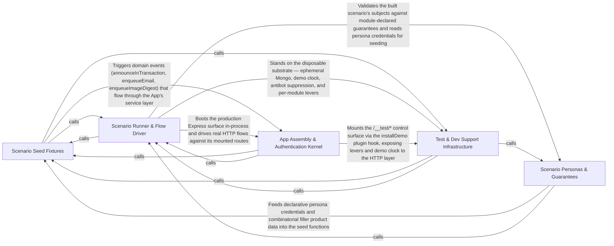

---
tags:
  - 2brain
  - 2brain/arch
  - project/boilerplate-node-backend
type: architecture
component: overview
---

## Details

This repository is a contract-first, modular e-commerce REST API boilerplate whose demo/test surface is organized around a scenario concept: a named, whole-database state (e.g. shop, blank) that the repo knows how to seed and, where applicable, "live" by driving real HTTP flows against a throwaway loopback listener. The five components partition that surface: Group 5 declares who the demo accounts are and what the catalogue looks like (personas, filler, guarantees); Group 1 writes those rows into a database through a shared SeedRepository primitive; Group 2 is the runner that boots the app in-process, seeds, drives flows, and serves the demo profile; Group 3 is the production app assembly (routes, security, kernel authentication) that the runner boots and that the flows exercise; and Group 4 supplies the disposable infrastructure (ephemeral Mongo, development doubles, webhook sink) plus the repo's own quality scripts (eslint rules, mutation testing, docs generation) that keep the scenario surface honest. Data flows from personas/filler → seeders → database → booted app → loopback-driven flows → guarantee checks, with the support layer and scripts acting as the substrate underneath.

### Scenario Seed Fixtures [[Expand]](./Scenario_Seed_Fixtures.md)
Per-module seeders that write the demo dataset's rows (accounts, addresses, products, blank, example) into a database through the shared SeedRepository / OwnedSeedRepository primitive, using insertIfAbsent / insertIfAbsentForOwner so re-runs skip rather than rewrite and pre-save hooks (e.g. password hashing) still run.

**Related Classes/Methods**:

- `scenarios.seed.insertIfAbsent`:60-64
- `scenarios.seed.insertIfAbsentForOwner`:76-80
- `scenarios.products.seedProductsCollection`:510-520
- `scenarios.accounts.seedAccessModel`:154-171

**Source Files:**

- `scenarios/accounts.ts`
  - `scenarios.accounts.seedAccessModel` (L154-L171) - Class
  - `scenarios.accounts.seedAccessModel.then() callback.PERSONA_NAMES.flatMap() callback` (L159-L167) - Function
  - `scenarios.accounts.seedAccessModel.then() callback.PERSONA_NAMES.flatMap() callback.memberships.map() callback` (L160-L166) - Function
  - `scenarios.accounts.seedAccessModel.then() callback` (L171-L171) - Function
- `scenarios/addresses.ts`
  - `scenarios.addresses.seedAddressBooksCollection` (L103-L106) - Class
  - `scenarios.addresses.seedAddressBooksCollection.addressBookFixtures.map() callback` (L105-L105) - Function
- `scenarios/blank.ts`
  - `scenarios.blank.seedBlank` (L24-L32) - Class
  - `scenarios.blank.then() callback` (L26-L30) - Function
  - `scenarios.blank.seedBlank.then() callback` (L32-L32) - Function
- `scenarios/example.ts`
  - `scenarios.example.seedExampleCollection` (L70-L71) - Class
  - `scenarios.example.seedExampleCollection.exampleFixtures.map() callback` (L71-L71) - Function
- `scenarios/flows/actions.ts`
  - `scenarios.flows.actions.Line` (L15-L18) - Interface
  - `scenarios.flows.actions.CartSummaryData` (L21-L23) - Interface
  - `scenarios.flows.actions.CheckoutData` (L26-L28) - Interface
  - `scenarios.flows.actions.PaymentData` (L31-L34) - Interface
  - `scenarios.flows.actions.receiveStock` (L52-L55) - Class
  - `scenarios.flows.actions.receiveStock.then() callback` (L55-L55) - Function
  - `scenarios.flows.actions.ensureAddress` (L63-L78) - Class
  - `scenarios.flows.actions.ensureAddress.then() callback` (L78-L78) - Function
  - `scenarios.flows.actions.openPayment` (L128-L129) - Class
  - `scenarios.flows.actions.openPayment.then() callback` (L129-L129) - Function
  - `scenarios.flows.actions.submitCard` (L142-L159) - Class
  - `scenarios.flows.actions.submitCard.then() callback` (L149-L159) - Function
  - `scenarios.flows.actions.syncPayment` (L165-L168) - Class
  - `scenarios.flows.actions.syncPayment.then() callback` (L168-L168) - Function
  - `scenarios.flows.actions.recordOfflinePayment` (L191-L196) - Class
  - `scenarios.flows.actions.recordOfflinePayment.then() callback` (L196-L196) - Function
  - `scenarios.flows.actions.startProcessing` (L205-L206) - Class
  - `scenarios.flows.actions.startProcessing.then() callback` (L206-L206) - Function
  - `scenarios.flows.actions.FulfillmentData` (L209-L217) - Interface
  - `scenarios.flows.actions.readFulfillment` (L222-L233) - Class
  - `scenarios.flows.actions.readFulfillment.then() callback` (L227-L232) - Function
  - `scenarios.flows.actions.readFulfillment.then() callback.then() callback` (L232-L232) - Function
  - `scenarios.flows.actions.shipOrder` (L253-L261) - Class
  - `scenarios.flows.actions.shipOrder.then() callback` (L254-L260) - Function
  - `scenarios.flows.actions.shipOrder.then() callback.fulfillmentOrders.filter() callback` (L257-L257) - Function
  - `scenarios.flows.actions.shipOrder.then() callback.inSequence() callback` (L259-L259) - Function
  - `scenarios.flows.actions.shipPart` (L271-L284) - Class
  - `scenarios.flows.actions.shipPart.then() callback` (L277-L284) - Function
  - `scenarios.flows.actions.shipPart.then() callback.then() callback` (L283-L283) - Function
  - `scenarios.flows.actions.holdOrder` (L292-L300) - Class
  - `scenarios.flows.actions.holdOrder.then() callback` (L293-L299) - Function
  - `scenarios.flows.actions.holdOrder.then() callback.then() callback` (L299-L299) - Function
  - `scenarios.flows.actions.deliverOrder` (L308-L314) - Class
  - `scenarios.flows.actions.deliverOrder.then() callback` (L309-L313) - Function
  - `scenarios.flows.actions.deliverOrder.then() callback.shipments.filter() callback` (L311-L311) - Function
  - `scenarios.flows.actions.deliverOrder.then() callback.inSequence() callback` (L312-L312) - Function
  - `scenarios.flows.actions.cancelRemainder` (L323-L340) - Class
  - `scenarios.flows.actions.cancelRemainder.then() callback` (L340-L340) - Function
  - `scenarios.flows.actions.cancelOrder` (L346-L347) - Class
  - `scenarios.flows.actions.cancelOrder.then() callback` (L347-L347) - Function
  - `scenarios.flows.actions.requestReturn` (L358-L366) - Class
  - `scenarios.flows.actions.requestReturn.then() callback` (L366-L366) - Function
  - `scenarios.flows.actions.softDeleteOrder` (L373-L374) - Class
  - `scenarios.flows.actions.softDeleteOrder.then() callback` (L374-L374) - Function
  - `scenarios.flows.actions.replaceProductImage` (L393-L397) - Class
  - `scenarios.flows.actions.replaceProductImage.then() callback` (L396-L396) - Function
  - `scenarios.flows.actions.hardDeleteProduct` (L405-L406) - Class
  - `scenarios.flows.actions.hardDeleteProduct.then() callback` (L406-L406) - Function
- `scenarios/flows/backdate.ts`
  - `scenarios.flows.backdate.mover() callback` (L67-L67) - Function
  - `scenarios.flows.backdate.backdateOrder` (L127-L130) - Class
  - `scenarios.flows.backdate.backdateOrder.TRAILS.map() callback` (L130-L130) - Function
  - `scenarios.flows.backdate.backdateOrder.then() callback` (L130-L130) - Function
  - `scenarios.flows.backdate.backdateHistory` (L161-L166) - Class
  - `scenarios.flows.backdate.then() callback` (L163-L164) - Function
  - `scenarios.flows.backdate.backdateHistory.then() callback.map() callback` (L164-L164) - Function
  - `scenarios.flows.backdate.backdateHistory.then() callback` (L166-L166) - Function
- `scenarios/flows/client.ts`
  - `scenarios.flows.client.ScenarioFlowError` (L41-L55) - Class
  - `scenarios.flows.client.ScenarioFlowError.constructor` (L48-L54) - Constructor
  - `scenarios.flows.client.answerChallenge` (L129-L148) - Class
  - `scenarios.flows.client.answerChallenge.then() callback` (L141-L146) - Function
  - `scenarios.flows.client.signIn` (L164-L202) - Class
  - `scenarios.flows.client.signIn.then() callback` (L176-L202) - Function
  - `scenarios.flows.client.signIn.then() callback.call` (L193-L200) - Method
  - `scenarios.flows.client.signIn.then() callback.call.then() callback` (L194-L200) - Function
- `scenarios/flows/shop-history.ts`
  - `scenarios.flows.shop-history.signInCustomerBase` (L252-L257) - Class
  - `scenarios.flows.shop-history.signInCustomerBase.map() callback` (L254-L255) - Function
  - `scenarios.flows.shop-history.signInCustomerBase.map() callback.then() callback` (L255-L255) - Function
  - `scenarios.flows.shop-history.signInCustomerBase.then() callback` (L257-L257) - Function
  - `scenarios.flows.shop-history.banOneCustomer` (L286-L287) - Class
  - `scenarios.flows.shop-history.banOneCustomer.then() callback` (L287-L287) - Function
  - `scenarios.flows.shop-history.signOutEveryone` (L298-L301) - Class
  - `scenarios.flows.shop-history.signOutEveryone.callers.map() callback` (L299-L299) - Function
  - `scenarios.flows.shop-history.signOutEveryone.then() callback` (L300-L300) - Function
  - `scenarios.flows.shop-history.requireBankTransfer` (L333-L339) - Class
  - `scenarios.flows.shop-history.requireBankTransfer.then() callback` (L334-L339) - Function
  - `scenarios.flows.shop-history.requireBankTransfer.then() callback.methods.some() callback` (L335-L335) - Function
  - `scenarios.flows.shop-history.driveShopHistory` (L353-L652) - Class
  - `scenarios.flows.shop-history.driveShopHistory.orderId.lines.map() callback` (L386-L386) - Function
  - `scenarios.flows.shop-history.driveShopHistory.<function>` (L431-L441) - Function
  - `scenarios.flows.shop-history.driveShopHistory.ages` (L640-L645) - Class
  - `scenarios.flows.shop-history.driveShopHistory.ages.placed.map() callback` (L641-L644) - Function
- `scenarios/locales.ts`
  - `scenarios.locales.seedLocalesCollection.languages` (L225-L227) - Class
  - `scenarios.locales.seedLocalesCollection.languages.localeFixtures.map() callback` (L226-L226) - Function
  - `scenarios.locales.seedLocalesCollection.entries` (L228-L230) - Class
  - `scenarios.locales.seedLocalesCollection.entries.localeEntryFixtures.map() callback` (L229-L229) - Function
- `scenarios/products.ts`
  - `scenarios.products.fillerProductRows` (L376-L387) - Class
  - `scenarios.products.fillerProductRows.FILLER_PRODUCTS.map() callback` (L377-L386) - Function
  - `scenarios.products.OPENING_STOCK` (L400-L414) - Class
  - `scenarios.products.OPENING_STOCK.FILLER_PRODUCTS.map() callback` (L412-L412) - Function
  - `scenarios.products.PRODUCT_COPY_BY_ID` (L431-L438) - Class
  - `scenarios.products.PRODUCT_COPY_BY_ID.map() callback` (L433-L433) - Function
  - `scenarios.products.PRODUCT_COPY_BY_ID.FILLER_PRODUCTS.map() callback` (L436-L436) - Function
  - `scenarios.products.writeSeedTranslations` (L473-L488) - Class
  - `scenarios.products.writeSeedTranslations.then() callback` (L479-L487) - Function
  - `scenarios.products.writeSeedTranslations.then() callback.then() callback` (L486-L486) - Function
  - `scenarios.products.seedProductsCollection` (L510-L520) - Class
  - `scenarios.products.seedProductsCollection.productFixtures.map() callback` (L511-L511) - Function
  - `scenarios.products.seedProductsCollection.then() callback` (L512-L519) - Function
  - `scenarios.products.seedProductsCollection.then() callback.productFixtures.map() callback` (L514-L517) - Function
  - `scenarios.products.seedProductsCollection.then() callback.then() callback` (L519-L519) - Function
- `scenarios/seed.ts`
  - `scenarios.seed.SeedRepository` (L19-L22) - Interface
  - `scenarios.seed.OwnedSeedRepository` (L27-L30) - Interface
  - `scenarios.seed.insertIfAbsentBy` (L45-L52) - Class
  - `scenarios.seed.insertIfAbsentBy.then() callback` (L50-L51) - Function
  - `scenarios.seed.insertIfAbsentBy.then() callback.then() callback` (L51-L51) - Function
  - `scenarios.seed.insertIfAbsent` (L60-L64) - Class
  - `scenarios.seed.insertIfAbsent.insertIfAbsentBy() callback` (L64-L64) - Function
  - `scenarios.seed.insertIfAbsentForOwner` (L76-L80) - Class
  - `scenarios.seed.insertIfAbsentForOwner.insertIfAbsentBy() callback` (L80-L80) - Function
- `scenarios/shop-modules.ts`
  - `scenarios.shop-modules.ShopModuleEntry` (L16-L38) - Interface
  - `scenarios.shop-modules.asWaveEntries` (L60-L68) - Class
  - `scenarios.shop-modules.asWaveEntries.map() callback` (L64-L67) - Function
  - `scenarios.shop-modules.historyEdits` (L74-L81) - Class
  - `scenarios.shop-modules.historyEdits.flatMap() callback` (L78-L79) - Function
  - `scenarios.shop-modules.baselineShopModules` (L88-L96) - Class
  - `scenarios.shop-modules.baselineShopModules.filter() callback` (L95-L95) - Function
- `scenarios/shop.scenario.ts`
  - `scenarios.shop.scenario.seedShop` (L26-L29) - Class
  - `scenarios.shop.scenario.then() callback` (L28-L28) - Function
  - `scenarios.shop.scenario.seedShop.then() callback` (L29-L29) - Function
- `scenarios/support/development-doubles.ts`
  - `scenarios.support.development-doubles.registerOAuthProvider('fake') callback` (L46-L46) - Function
- `scenarios/users.ts`
  - `scenarios.users.seedUsersCollection` (L217-L218) - Class
  - `scenarios.users.seedUsersCollection.userFixtures.map() callback` (L218-L218) - Function
  - `scenarios.users.seedNamedUsersCollection` (L224-L225) - Class
  - `scenarios.users.seedNamedUsersCollection.namedUsers.map() callback` (L225-L225) - Function
- `scenarios/waves.ts`
  - `scenarios.waves.WaveEntry` (L11-L15) - Interface
  - `scenarios.waves.runInWaves` (L57-L65) - Class
  - `scenarios.waves.runInWaves.wave.map() callback` (L62-L62) - Function
- `scenarios/webhooks.ts`
  - `scenarios.webhooks.seedWebhooksCollection` (L61-L83) - Class
  - `scenarios.webhooks.seedWebhooksCollection.then() callback` (L82-L82) - Function
- `scenarios/wishlist.ts`
  - `scenarios.wishlist.seedWishlistsCollection` (L36-L39) - Class
  - `scenarios.wishlist.seedWishlistsCollection.wishlistFixtures.map() callback` (L38-L38) - Function
- `scripts/contracts/permission-security.ts`
  - `scripts.contracts.permission-security.sendsEnrollment` (L72-L106) - Class
  - `scripts.contracts.permission-security.sendsEnrollment.PRESET_ROLES.some() callback` (L77-L104) - Function
  - `scripts.contracts.permission-security.sendsEnrollment.PRESET_ROLES.some() callback.some() callback` (L78-L104) - Function
- `scripts/docs/generate-role-matrix.ts`
  - `scripts.docs.generate-role-matrix.cell` (L122-L145) - Class
  - `scripts.docs.generate-role-matrix.cell.map() callback` (L139-L143) - Function
  - `scripts.docs.generate-role-matrix.effectiveTable` (L148-L159) - Class
  - `scripts.docs.generate-role-matrix.effectiveTable.personas.map() callback` (L152-L158) - Function
  - `scripts.docs.generate-role-matrix.effectiveTable.personas.map() callback.modules.map() callback` (L156-L156) - Function
  - `scripts.docs.generate-role-matrix.moduleBody` (L233-L261) - Class
  - `scripts.docs.generate-role-matrix.moduleBody.callers` (L234-L234) - Class
  - `scripts.docs.generate-role-matrix.moduleBody.callers.personas.map() callback` (L234-L234) - Function
  - `scripts.docs.generate-role-matrix.moduleBody.rows.PERMISSION_RULES.filter() callback` (L235-L235) - Function
  - `scripts.docs.generate-role-matrix.moduleBody.rows` (L235-L249) - Class
  - `scripts.docs.generate-role-matrix.moduleBody.rows.map() callback` (L236-L248) - Function
  - `scripts.docs.generate-role-matrix.moduleBody.rows.map() callback.callers.map() callback` (L246-L246) - Function
  - `scripts.docs.generate-role-matrix.moduleBody.personas.map() callback` (L252-L252) - Function
  - `scripts.docs.generate-role-matrix.pages` (L264-L271) - Class
  - `scripts.docs.generate-role-matrix.pages.map() callback` (L266-L270) - Function
- `scripts/ops/check-config.ts`
  - `scripts.ops.check-config.runScript() callback` (L20-L20) - Function
- `scripts/ops/reencrypt.ts`
  - `scripts.ops.reencrypt.runAll` (L44-L51) - Class
  - `scripts.ops.reencrypt.runAll.then() callback` (L50-L50) - Function
  - `scripts.ops.reencrypt.main` (L54-L59) - Class
  - `scripts.ops.reencrypt.main.then() callback` (L57-L59) - Function
- `src/domain-primitives/lifecycle.ts`
  - `src.domain-primitives.lifecycle.LifecycleEvent` (L14-L21) - Interface
  - `src.domain-primitives.lifecycle.LifecycleTable` (L24-L33) - Interface
  - `src.domain-primitives.lifecycle.Lifecycle` (L36-L55) - Interface
  - `src.domain-primitives.lifecycle.defineLifecycle` (L65-L112) - Class
  - `src.domain-primitives.lifecycle.eventsFrom` (L97-L98) - Class
  - `src.domain-primitives.lifecycle.defineLifecycle.eventsFrom.names.filter() callback` (L98-L98) - Function
  - `src.domain-primitives.lifecycle.defineLifecycle.fromOf` (L103-L103) - Method
  - `src.domain-primitives.lifecycle.defineLifecycle.toOf` (L104-L104) - Method
  - `src.domain-primitives.lifecycle.defineLifecycle.reachableFrom` (L106-L108) - Method
  - `src.domain-primitives.lifecycle.defineLifecycle.reachableFrom.map() callback` (L107-L107) - Function
  - `src.domain-primitives.lifecycle.defineLifecycle.canTransition` (L109-L110) - Method
  - `src.domain-primitives.lifecycle.defineLifecycle.canTransition.some() callback` (L110-L110) - Function
- `src/domain-primitives/time.ts`
  - `src.domain-primitives.time.dayInZone.field` (L78-L79) - Class
  - `src.domain-primitives.time.dayInZone.field.parts.find() callback` (L79-L79) - Function
- `src/globals.d.ts`
  - `src.globals.d.'express-serve-static-core'.Request` (L12-L84) - Interface
- `src/infrastructure/adapters/image.worker.ts`
  - `src.infrastructure.adapters.image.worker.enqueueIfImagePending` (L335-L359) - Class
  - `src.infrastructure.adapters.image.worker.enqueueIfImagePending.then() callback` (L351-L358) - Function
- `src/infrastructure/adapters/redis.ts`
  - `src.infrastructure.adapters.redis.then() callback` (L123-L123) - Function
  - `src.infrastructure.adapters.redis.isRedisConnectionError` (L149-L150) - Class
  - `src.infrastructure.adapters.redis.isRedisConnectionError.REDIS_CONNECTION_ERRORS.some() callback` (L150-L150) - Function
- `src/infrastructure/config/shared-rules/registry.ts`
  - `src.infrastructure.config.shared-rules.registry.SharedRuleEntry` (L26-L31) - Interface
- `src/infrastructure/http/errors.ts`
  - `src.infrastructure.http.errors.ConflictError` (L40-L42) - Class
  - `src.infrastructure.http.errors.databaseErrorInterpreter` (L69-L114) - Function
- `src/infrastructure/http/middlewares/cache.ts`
  - `src.infrastructure.http.middlewares.cache.CacheOptions` (L168-L231) - Interface
- `src/infrastructure/http/middlewares/idempotency.ts`
  - `src.infrastructure.http.middlewares.idempotency.requireIdempotencyKey` (L710-L725) - Class
  - `src.infrastructure.http.middlewares.idempotency.requireIdempotencyKey.requireIdempotencyKey` (L711-L725) - Function
- `src/infrastructure/http/middlewares/rate-limit.ts`
  - `src.infrastructure.http.middlewares.rate-limit.BudgetCharge` (L292-L297) - Interface
- `src/infrastructure/http/middlewares/upload.ts`
  - `src.infrastructure.http.middlewares.upload.withLocaleRestored` (L208-L215) - Class
  - `src.infrastructure.http.middlewares.upload.withLocaleRestored.<function>` (L210-L215) - Function
  - `src.infrastructure.http.middlewares.upload.withLocaleRestored.<function>.middleware() callback` (L211-L215) - Function
  - `src.infrastructure.http.middlewares.upload.then() callback.digested.map() callback` (L389-L389) - Function
  - `src.infrastructure.http.middlewares.upload.upload` (L505-L507) - Class
  - `src.infrastructure.http.middlewares.upload.upload.image` (L506-L506) - Method
- `src/infrastructure/http/response.ts`
  - `src.infrastructure.http.response.normalizeErrors` (L230-L258) - Class
  - `src.infrastructure.http.response.normalizeErrors.inputErrors.map() callback` (L239-L257) - Function
  - `src.infrastructure.http.response.validationErrors` (L495-L501) - Class
  - `src.infrastructure.http.response.validationErrors.error.issues.map() callback` (L496-L501) - Function
- `src/infrastructure/i18n/catalog.ts`
  - `src.infrastructure.i18n.catalog.localeCandidatesFor` (L79-L84) - Class
  - `src.infrastructure.i18n.catalog.localeCandidatesFor.filter() callback` (L82-L82) - Function
- `src/infrastructure/i18n/context.ts`
  - `src.infrastructure.i18n.context.LocaleContext` (L22-L32) - Interface
- `src/infrastructure/observability/audit-changes.ts`
  - `src.infrastructure.observability.audit-changes.FieldChange` (L16-L19) - Interface
  - `src.infrastructure.observability.audit-changes.AuditChanges` (L34-L39) - Interface
  - `src.infrastructure.observability.audit-changes.AuditedFields` (L42-L47) - Interface
  - `src.infrastructure.observability.audit-changes.auditChanges.changes` (L78-L82) - Class
  - `src.infrastructure.observability.audit-changes.auditChanges.changes.fields.valued.filter() callback` (L80-L80) - Function
  - `src.infrastructure.observability.audit-changes.auditChanges.changes.map() callback` (L81-L81) - Function
- `src/infrastructure/persistence/changes.ts`
  - `src.infrastructure.persistence.changes.SetAndUnset` (L19-L22) - Interface
- `src/infrastructure/persistence/conditional-status.ts`
  - `src.infrastructure.persistence.conditional-status.ConditionalStatusOptions` (L14-L19) - Interface
- `src/infrastructure/persistence/create-repository.ts`
  - `src.infrastructure.persistence.create-repository.buildWhere.ids` (L169-L171) - Class
  - `src.infrastructure.persistence.create-repository.buildWhere.ids.value.filter() callback` (L170-L170) - Function
  - `src.infrastructure.persistence.create-repository.buildWhere.ids.map() callback` (L171-L171) - Function
  - `src.infrastructure.persistence.create-repository.Repository` (L253-L322) - Interface
  - `src.infrastructure.persistence.create-repository.createRepository` (L359-L520) - Function
  - `src.infrastructure.persistence.create-repository.createRepository.buildWhere` (L518-L518) - Method
- `src/infrastructure/persistence/image-writeback.ts`
  - `src.infrastructure.persistence.image-writeback.imageWritebackFor` (L26-L49) - Class
  - `src.infrastructure.persistence.image-writeback.imageWritebackFor.<function>` (L28-L49) - Function
  - `src.infrastructure.persistence.image-writeback.imageWritebackFor.<function>.then() callback` (L39-L48) - Function
  - `src.infrastructure.persistence.image-writeback.imageWritebackFor.<function>.then() callback.then() callback` (L48-L48) - Function
- `src/infrastructure/persistence/money-field.ts`
  - `src.infrastructure.persistence.money-field.isWritableAmount` (L95-L101) - Class
  - `src.infrastructure.persistence.money-field.isWritableAmount.<function>` (L97-L101) - Function
  - `src.infrastructure.persistence.money-field.moneyPlugin` (L139-L149) - Class
  - `src.infrastructure.persistence.money-field.moneyPlugin.reviveLean` (L145-L147) - Function
  - `src.infrastructure.persistence.money-field.moneyPathsOf` (L179-L187) - Class
  - `src.infrastructure.persistence.money-field.moneyPathsOf.schema.eachPath() callback` (L181-L185) - Function
- `src/infrastructure/persistence/search.ts`
  - `src.infrastructure.persistence.search.readAll.collectFrom` (L98-L102) - Class
  - `src.infrastructure.persistence.search.readAll.collectFrom.then() callback` (L99-L102) - Function
  - `src.infrastructure.persistence.search.addTextFilter` (L150-L160) - Class
  - `src.infrastructure.persistence.search.addTextFilter.fields.map() callback` (L157-L159) - Function
- `src/infrastructure/persistence/serialize.ts`
  - `src.infrastructure.persistence.serialize.SerializeOptions` (L24-L44) - Interface
  - `src.infrastructure.persistence.serialize.SerializableSchema` (L53-L55) - Interface
  - `src.infrastructure.persistence.serialize.applySerialization` (L64-L115) - Class
  - `src.infrastructure.persistence.serialize.transform` (L70-L96) - Class
  - `src.infrastructure.persistence.serialize.applySerialization.transform.toString` (L74-L74) - Method
  - `src.infrastructure.persistence.serialize.applySerialization.transform` (L105-L111) - Method
- `src/infrastructure/persistence/translatable-columns.ts`
  - `src.infrastructure.persistence.translatable-columns.TranslatableColumns` (L20-L42) - Interface
  - `src.infrastructure.persistence.translatable-columns.translatableColumnsOf` (L49-L98) - Class
  - `src.infrastructure.persistence.translatable-columns.translatableColumnsOf.revisionOf` (L53-L64) - Method
  - `src.infrastructure.persistence.translatable-columns.translatableColumnsOf.writeDerived` (L66-L81) - Method
  - `src.infrastructure.persistence.translatable-columns.translatableColumnsOf.writeDerived.map() callback` (L74-L74) - Function
  - `src.infrastructure.persistence.translatable-columns.translatableColumnsOf.writeDerived.then() callback` (L81-L81) - Function
  - `src.infrastructure.persistence.translatable-columns.translatableColumnsOf.markEdited` (L83-L97) - Method
  - `src.infrastructure.persistence.translatable-columns.translatableColumnsOf.markEdited.then() callback` (L93-L96) - Function
- `src/infrastructure/persistence/versioning.ts`
  - `src.infrastructure.persistence.versioning.Precondition` (L33-L38) - Interface
  - `src.infrastructure.persistence.versioning.PreconditionFailedError` (L44-L46) - Class
  - `src.infrastructure.persistence.versioning.accepts` (L165-L168) - Class
  - `src.infrastructure.persistence.versioning.accepts.precondition.etags.some() callback` (L168-L168) - Function
  - `src.infrastructure.persistence.versioning.armed` (L182-L187) - Class
  - `src.infrastructure.persistence.versioning.armed.finally() callback` (L184-L186) - Function
  - `src.infrastructure.persistence.versioning.fencedSave` (L205-L218) - Class
  - `src.infrastructure.persistence.versioning.fencedSave.catch() callback` (L215-L217) - Function
  - `src.infrastructure.persistence.versioning.preconditionFilter.versions` (L235-L237) - Class
  - `src.infrastructure.persistence.versioning.preconditionFilter.versions.precondition.etags.map() callback` (L236-L236) - Function
  - `src.infrastructure.persistence.versioning.preconditionFilter.versions.filter() callback` (L237-L237) - Function
  - `src.infrastructure.persistence.versioning.DeleteOutcome` (L244-L247) - Interface
  - `src.infrastructure.persistence.versioning.checkedDelete` (L258-L270) - Class
  - `src.infrastructure.persistence.versioning.then() callback` (L263-L263) - Function
  - `src.infrastructure.persistence.versioning.checkedDelete.then() callback` (L267-L269) - Function
- `src/infrastructure/runtime/after-commit.ts`
  - `src.infrastructure.runtime.after-commit.afterCommit` (L20-L31) - Class
  - `src.infrastructure.runtime.after-commit.afterCommit.catch() callback` (L28-L31) - Function
- `src/infrastructure/runtime/database.ts`
  - `src.infrastructure.runtime.database.attemptConnect.then() callback` (L135-L135) - Function
- `src/infrastructure/security/breached-passwords/index.ts`
  - `src.infrastructure.security.breached-passwords.index.assertPasswordNotBreached` (L126-L129) - Class
  - `src.infrastructure.security.breached-passwords.index.assertPasswordNotBreached.then() callback` (L127-L128) - Function
- `src/infrastructure/security/password-hash.ts`
  - `src.infrastructure.security.password-hash.Derivation` (L42-L47) - Interface
  - `src.infrastructure.security.password-hash.hashPassword` (L70-L81) - Class
  - `src.infrastructure.security.password-hash.hashPassword.then() callback` (L78-L79) - Function
  - `src.infrastructure.security.password-hash.verifyPassword` (L106-L121) - Class
  - `src.infrastructure.security.password-hash.verifyPassword.then() callback` (L120-L120) - Function
- `src/infrastructure/security/reencrypt.ts`
  - `src.infrastructure.security.reencrypt.EncryptedField` (L31-L40) - Interface
  - `src.infrastructure.security.reencrypt.ReencryptReport` (L46-L51) - Interface
  - `src.infrastructure.security.reencrypt.ReencryptJob` (L54-L65) - Interface
  - `src.infrastructure.security.reencrypt.reencryptOf` (L79-L82) - Class
  - `src.infrastructure.security.reencrypt.reencryptOf.<function>` (L81-L82) - Function
  - `src.infrastructure.security.reencrypt.reencryptCollection` (L146-L177) - Class
  - `src.infrastructure.security.reencrypt.reencryptCollection.then() callback` (L164-L176) - Function
  - `src.infrastructure.security.reencrypt.reencryptCollection.then() callback.apply.then() callback` (L170-L175) - Function
- `src/kernel/ability.ts`
  - `src.kernel.ability.holds` (L164-L177) - Class
  - `src.kernel.ability.holds.some() callback` (L176-L176) - Function
  - `src.kernel.ability.holdsSet` (L186-L197) - Class
  - `src.kernel.ability.heldRules` (L203-L204) - Class
  - `src.kernel.ability.heldRules.map() callback` (L204-L204) - Function
  - `src.kernel.ability.permitsOnRows` (L218-L236) - Class
  - `src.kernel.ability.permitsOnRows.<function>` (L227-L235) - Function
  - `src.kernel.ability.permitsOnRows.<function>.actions.map() callback` (L229-L232) - Function
- `src/kernel/access/query.ts`
  - `src.kernel.access.query.coerce` (L62-L69) - Class
  - `src.kernel.access.query.coerce.userId` (L68-L68) - Method
  - `src.kernel.access.query.toStorage` (L77-L102) - Class
  - `src.kernel.access.query.toStorage.query.map() callback` (L79-L79) - Function
  - `src.kernel.access.query.collapse` (L122-L135) - Class
  - `src.kernel.access.query.collapse.branches.some() callback` (L129-L129) - Function
- `src/kernel/middlewares/authorizations.ts`
  - `src.kernel.middlewares.authorizations.requirePermission` (L567-L700) - Class
  - `src.kernel.middlewares.authorizations.requirePermission.requirePermissionGuard` (L588-L694) - Function
  - `src.kernel.middlewares.authorizations.cookieGuard` (L767-L810) - Class
  - `src.kernel.middlewares.authorizations.cookieGuard.cookieSessionGuard` (L777-L807) - Function
  - `src.kernel.middlewares.authorizations.cookieGuard.cookieSessionGuard.then() callback` (L790-L803) - Function
  - `src.kernel.middlewares.authorizations.cookieGuard.cookieSessionGuard.catch() callback` (L804-L806) - Function
  - `src.kernel.middlewares.authorizations.requirePermissionViaCookie` (L827-L836) - Class
  - `src.kernel.middlewares.authorizations.requirePermissionViaCookie.cookieGuard('requirePermissionViaCookieGuard') callback` (L833-L834) - Function
  - `src.kernel.middlewares.authorizations.stillHoldsRuleViaCookie` (L871-L879) - Class
  - `src.kernel.middlewares.authorizations.stillHoldsRuleViaCookie.then() callback` (L878-L878) - Function
  - `src.kernel.middlewares.authorizations.stillHoldsRuleViaCookie.catch() callback` (L879-L879) - Function
  - `src.kernel.middlewares.authorizations.FreshAuthOptions` (L895-L903) - Interface
  - `src.kernel.middlewares.authorizations.requireFreshAuth` (L920-L966) - Class
  - `src.kernel.middlewares.authorizations.requireFreshAuth.<function>` (L922-L966) - Function
  - `src.kernel.middlewares.authorizations.requireFreshAuthWhen` (L985-L1001) - Class
  - `src.kernel.middlewares.authorizations.requireFreshAuthWhen.<function>` (L991-L1001) - Function
- `src/kernel/outbox.ts`
  - `src.kernel.outbox.'./events'.DomainEventMap` (L45-L52) - Interface
  - `src.kernel.outbox.OutboxEventDocument` (L65-L85) - Interface
  - `src.kernel.outbox.enqueueOutboxEvent` (L160-L170) - Class
  - `src.kernel.outbox.enqueueOutboxEvent.then() callback` (L170-L170) - Function
  - `src.kernel.outbox.OutboxRow` (L173-L180) - Interface
  - `src.kernel.outbox.RelayResult` (L183-L187) - Interface
  - `src.kernel.outbox.OutboxAnnouncement` (L428-L435) - Interface
  - `src.kernel.outbox.announceWithin` (L471-L479) - Class
  - `src.kernel.outbox.announceWithin.then() callback` (L476-L479) - Function
  - `src.kernel.outbox.announceWithin.then() callback.then() callback` (L478-L478) - Function
  - `src.kernel.outbox.announceInTransaction` (L492-L499) - Class
  - `src.kernel.outbox.announceInTransaction.withTransaction() callback` (L496-L496) - Function
  - `src.kernel.outbox.announceInTransaction.then() callback` (L496-L499) - Function
  - `src.kernel.outbox.setOutboxPendingReader() callback` (L515-L515) - Function
- `src/kernel/permissions.ts`
  - `src.kernel.permissions.PermissionSet` (L152-L158) - Interface
  - `src.kernel.permissions.PresetRole` (L170-L184) - Interface
  - `src.kernel.permissions.AudienceRole` (L208-L214) - Interface
  - `src.kernel.permissions.PERMISSION_RULES` (L289-L294) - Class
  - `src.kernel.permissions.PERMISSION_RULES.keysDocument.rules.map() callback` (L289-L294) - Function
  - `src.kernel.permissions.callerInScope` (L600-L613) - Function
  - `src.kernel.permissions.scopeOfSubject` (L640-L641) - Class
  - `src.kernel.permissions.scopeOfSubject.PERMISSION_RULES.find() callback` (L641-L641) - Function
  - `src.kernel.permissions.holdsEveryDeclaredRule` (L671-L680) - Class
  - `src.kernel.permissions.holdsEveryDeclaredRule.declared.every() callback` (L679-L679) - Function
- `src/kernel/translation.ts`
  - `src.kernel.translation.TranslationPort` (L60-L166) - Interface
  - `src.kernel.translation.TranslationWritePlan` (L179-L182) - Interface
  - `src.kernel.translation.Translatable` (L352-L354) - Interface
  - `src.kernel.translation.applyTranslations` (L371-L391) - Class
  - `src.kernel.translation.applyTranslations.resolved` (L378-L383) - Class
  - `src.kernel.translation.applyTranslations.resolved.items.map() callback` (L380-L380) - Function
  - `src.kernel.translation.applyTranslations.items.map() callback` (L387-L390) - Function
- `src/modules/access/audit.ts`
  - `src.modules.access.audit.'@infrastructure/observability/audit'.AuditActionMap` (L19-L21) - Interface
- `src/modules/access/model.ts`
  - `src.modules.access.model.TenantDocument` (L33-L39) - Interface
  - `src.modules.access.model.MembershipDocument` (L49-L56) - Interface
- `src/modules/access/repository.ts`
  - `src.modules.access.repository.tenantRepository` (L15-L36) - Class
  - `src.modules.access.repository.tenantRepository.upsertBySlug` (L20-L35) - Method
  - `src.modules.access.repository.membershipRepository` (L39-L108) - Class
  - `src.modules.access.repository.membershipRepository.findByUserId` (L41-L42) - Method
  - `src.modules.access.repository.membershipRepository.findOne` (L45-L50) - Method
  - `src.modules.access.repository.membershipRepository.upsertRole` (L57-L72) - Method
  - `src.modules.access.repository.membershipRepository.deleteById` (L79-L83) - Method
  - `src.modules.access.repository.membershipRepository.deleteByUserId` (L90-L92) - Method
  - `src.modules.access.repository.membershipRepository.findByUserIds` (L95-L100) - Method
  - `src.modules.access.repository.membershipRepository.findUserIdsByRoles` (L103-L107) - Method
- `src/modules/access/services/grants.ts`
  - `src.modules.access.services.grants.AccessInvariantError` (L30-L36) - Class
  - `src.modules.access.services.grants.AccessInvariantError.constructor` (L32-L35) - Constructor
- `src/modules/access/services/memberships.ts`
  - `src.modules.access.services.memberships.assignRole` (L60-L95) - Class
  - `src.modules.access.services.memberships.assignRole.attempt` (L69-L73) - Class
  - `src.modules.access.services.memberships.attempt.then() callback` (L70-L70) - Function
  - `src.modules.access.services.memberships.assignRole.attempt.then() callback` (L82-L93) - Function
  - `src.modules.access.services.memberships.revokeRole` (L112-L159) - Class
  - `src.modules.access.services.memberships.revokeRole.attempt` (L124-L136) - Class
  - `src.modules.access.services.memberships.revokeRole.attempt.then() callback.then() callback` (L135-L135) - Function
  - `src.modules.access.services.memberships.revokeRole.attempt.then() callback` (L146-L157) - Function
  - `src.modules.access.services.memberships.eraseMemberships` (L172-L173) - Class
  - `src.modules.access.services.memberships.eraseMemberships.then() callback` (L173-L173) - Function
  - `src.modules.access.services.memberships.rolesOf` (L184-L193) - Class
  - `src.modules.access.services.memberships.rolesOf.then() callback` (L188-L193) - Function
  - `src.modules.access.services.memberships.rolesOf.then() callback.tenant.memberships.find() callback` (L190-L190) - Function
  - `src.modules.access.services.memberships.rolesOf.then() callback.platform.memberships.find() callback` (L192-L192) - Function
  - `src.modules.access.services.memberships.rolesOfMany` (L201-L213) - Class
  - `src.modules.access.services.memberships.rolesOfMany.then() callback` (L211-L212) - Function
  - `src.modules.access.services.memberships.rolesOfMany.then() callback.memberships.map() callback` (L212-L212) - Function
  - `src.modules.access.services.memberships.membersHolding.roles` (L250-L255) - Class
  - `src.modules.access.services.memberships.membersHolding.roles.PRESET_ROLES.filter() callback` (L251-L254) - Function
  - `src.modules.access.services.memberships.membersHolding.roles.PRESET_ROLES.filter() callback.role.sets.some() callback` (L254-L254) - Function
  - `src.modules.access.services.memberships.membersHolding.roles.map() callback` (L255-L255) - Function
- `src/modules/access/services/protection.ts`
  - `src.modules.access.services.protection.holdsStaffRole` (L35-L36) - Class
  - `src.modules.access.services.protection.holdsStaffRole.then() callback` (L36-L36) - Function
  - `src.modules.access.services.protection.staffHoldersAmong` (L45-L49) - Class
  - `src.modules.access.services.protection.staffHoldersAmong.then() callback` (L49-L49) - Function
  - `src.modules.access.services.protection.canChangeAccount` (L71-L80) - Class
  - `src.modules.access.services.protection.canChangeAccount.then() callback` (L77-L78) - Function
  - `src.modules.access.services.protection.roleProtectedRefusal` (L102-L116) - Class
  - `src.modules.access.services.protection.roleProtectedRefusal.then() callback` (L106-L116) - Function
- `src/modules/account/analytics.ts`
  - `src.modules.account.analytics.'@infrastructure/observability/analytics'.AnalyticsEventMap` (L26-L28) - Interface
- `src/modules/account/audit.ts`
  - `src.modules.account.audit.'@infrastructure/observability/audit'.AuditActionMap` (L93-L95) - Interface
- `src/modules/account/domain/email-change.ts`
  - `src.modules.account.domain.email-change.EmailChangeFields` (L46-L52) - Interface
- `src/modules/account/domain/revocation.ts`
  - `src.modules.account.domain.revocation.RevocationRow` (L20-L26) - Interface
- `src/modules/account/events.ts`
  - `src.modules.account.events.'@kernel/events'.DomainEventMap` (L14-L51) - Interface
- `src/modules/account/mail-budget.ts`
  - `src.modules.account.mail-budget.mailRecipientRefusal` (L60-L71) - Class
  - `src.modules.account.mail-budget.mailRecipientRefusal.then() callback` (L64-L71) - Function
- `src/modules/account/model.ts`
  - `src.modules.account.model.AccountExportDocument` (L30-L39) - Interface
  - `src.modules.account.model.SessionDocument` (L75-L108) - Interface
  - `src.modules.account.model.VerificationTokenDocument` (L151-L163) - Interface
- `src/modules/account/repository.ts`
  - `src.modules.account.repository.deleteById` (L89-L93) - Class
  - `src.modules.account.repository.deleteById.then() callback` (L93-L93) - Function
  - `src.modules.account.repository.deleteByUserId` (L103-L113) - Class
  - `src.modules.account.repository.deleteByUserId.then() callback` (L108-L112) - Function
  - `src.modules.account.repository.deleteByUserId.then() callback.then() callback` (L112-L112) - Function
  - `src.modules.account.repository.deleteByUserId.then() callback.then() callback.rows.map() callback` (L112-L112) - Function
  - `src.modules.account.repository.removeSessionFamily` (L275-L279) - Class
  - `src.modules.account.repository.removeSessionFamily.then() callback` (L279-L279) - Function
  - `src.modules.account.repository.removeSessionFamilyExcept` (L289-L301) - Class
  - `src.modules.account.repository.removeSessionFamilyExcept.then() callback` (L301-L301) - Function
  - `src.modules.account.repository.findLiveFamilyRow` (L323-L339) - Class
  - `src.modules.account.repository.findLiveFamilyRow.then() callback` (L339-L339) - Function
  - `src.modules.account.repository.sessionFamilyActivity` (L352-L384) - Class
  - `src.modules.account.repository.sessionFamilyActivity.then() callback` (L370-L384) - Function
  - `src.modules.account.repository.sessionFamilyActivity.then() callback.lastActiveAt.rows.map() callback` (L379-L379) - Function
  - `src.modules.account.repository.sessionFamilyActivity.then() callback.startedAt.rows.map() callback` (L381-L381) - Function
  - `src.modules.account.repository.touchSessionFamily` (L396-L416) - Class
  - `src.modules.account.repository.touchSessionFamily.then() callback` (L416-L416) - Function
  - `src.modules.account.repository.removeSessionFamilyByHash` (L426-L429) - Class
  - `src.modules.account.repository.removeSessionFamilyByHash.then() callback` (L427-L428) - Function
  - `src.modules.account.repository.removeAllSessions` (L438-L442) - Class
  - `src.modules.account.repository.removeAllSessions.then() callback` (L442-L442) - Function
  - `src.modules.account.repository.upsertLiveToken` (L497-L522) - Class
  - `src.modules.account.repository.upsertLiveToken.catch() callback` (L515-L520) - Function
  - `src.modules.account.repository.upsertLiveToken.then() callback` (L521-L521) - Function
  - `src.modules.account.repository.issueVerificationToken` (L530-L535) - Class
  - `src.modules.account.repository.issueVerificationToken.then() callback` (L535-L535) - Function
  - `src.modules.account.repository.removeVerificationTokens` (L581-L588) - Class
  - `src.modules.account.repository.removeVerificationTokens.then() callback` (L588-L588) - Function
  - `src.modules.account.repository.lastVerificationTokenSentAt` (L597-L606) - Class
  - `src.modules.account.repository.lastVerificationTokenSentAt.then() callback` (L606-L606) - Function
  - `src.modules.account.repository.removeAllVerificationTokens` (L630-L634) - Class
  - `src.modules.account.repository.removeAllVerificationTokens.then() callback` (L634-L634) - Function
  - `src.modules.account.repository.upsertErasureLedgerRow` (L670-L719) - Class
  - `src.modules.account.repository.upsertErasureLedgerRow.catch() callback` (L714-L717) - Function
  - `src.modules.account.repository.upsertErasureLedgerRow.then() callback` (L718-L718) - Function
- `src/modules/account/roles.ts`
  - `src.modules.account.roles.isUnrestrictedCaller` (L16-L19) - Class
  - `src.modules.account.roles.isUnrestrictedCaller.then() callback` (L19-L19) - Function
- `src/modules/account/services/account-deletion.ts`
  - `src.modules.account.services.account-deletion.restoreWrites` (L123-L130) - Class
  - `src.modules.account.services.account-deletion.restoreWrites.<function>` (L125-L130) - Function
  - `src.modules.account.services.account-deletion.restoreWrites.<function>.then() callback` (L128-L129) - Function
  - `src.modules.account.services.account-deletion.restoreWrites.<function>.then() callback.then() callback` (L129-L129) - Function
  - `src.modules.account.services.account-deletion.finishRestore` (L140-L147) - Class
  - `src.modules.account.services.account-deletion.finishRestore.then() callback` (L145-L147) - Function
  - `src.modules.account.services.account-deletion.restoreAccountByLink` (L193-L207) - Class
  - `src.modules.account.services.account-deletion.restoreAccountByLink.redeemLiveToken() callback` (L198-L199) - Function
  - `src.modules.account.services.account-deletion.restoreAccountByLink.redeemLiveToken() callback.then() callback` (L199-L199) - Function
  - `src.modules.account.services.account-deletion.restoreAccountByLink.then() callback` (L200-L205) - Function
  - `src.modules.account.services.account-deletion.restoreAccountByLink.then() callback.then() callback` (L202-L203) - Function
  - `src.modules.account.services.account-deletion.handleRestoredByStaff` (L217-L224) - Class
  - `src.modules.account.services.account-deletion.handleRestoredByStaff.then() callback` (L221-L224) - Function
- `src/modules/account/services/caller.ts`
  - `src.modules.account.services.caller.withOwnAccount` (L28-L37) - Class
  - `src.modules.account.services.caller.withOwnAccount.then() callback` (L37-L37) - Function
  - `src.modules.account.services.caller.recordAccountAudit` (L49-L60) - Class
  - `src.modules.account.services.caller.recordAccountAudit.then() callback` (L54-L60) - Function
- `src/modules/account/services/deletion-sign-in.ts`
  - `src.modules.account.services.deletion-sign-in.redeem` (L62-L79) - Class
  - `src.modules.account.services.deletion-sign-in.redeem.then() callback` (L74-L77) - Function
  - `src.modules.account.services.deletion-sign-in.redeem.then() callback.then() callback` (L76-L76) - Function
  - `src.modules.account.services.deletion-sign-in.restoreAtSignIn` (L89-L95) - Class
  - `src.modules.account.services.deletion-sign-in.restoreAtSignIn.then() callback` (L94-L94) - Function
  - `src.modules.account.services.deletion-sign-in.restoreAtSignIn.catch() callback` (L95-L95) - Function
- `src/modules/account/services/email-change.ts`
  - `src.modules.account.services.email-change.requestEmailChange` (L58-L88) - Class
  - `src.modules.account.services.email-change.requestEmailChange.withOwnAccount() callback.then() callback` (L78-L84) - Function
  - `src.modules.account.services.email-change.requestEmailChange.catch() callback` (L87-L87) - Function
  - `src.modules.account.services.email-change.requestEmailChange.then() callback` (L88-L88) - Function
  - `src.modules.account.services.email-change.saveRequestedEmail` (L101-L125) - Class
  - `src.modules.account.services.email-change.saveRequestedEmail.then() callback` (L106-L125) - Function
  - `src.modules.account.services.email-change.saveRequestedEmail.then() callback.then() callback` (L115-L123) - Function
  - `src.modules.account.services.email-change.saveRequestedEmail.then() callback.then() callback.then() callback` (L119-L122) - Function
  - `src.modules.account.services.email-change.saveRequestedEmail.then() callback.then() callback.then() callback.then() callback` (L120-L121) - Function
  - `src.modules.account.services.email-change.cancelPendingEmailChange` (L134-L150) - Class
  - `src.modules.account.services.email-change.cancelPendingEmailChange.then() callback` (L140-L149) - Function
  - `src.modules.account.services.email-change.then() callback.then() callback` (L147-L147) - Function
  - `src.modules.account.services.email-change.cancelPendingEmailChange.then() callback.then() callback` (L148-L148) - Function
  - `src.modules.account.services.email-change.cancelPendingEmailChange.catch() callback` (L150-L150) - Function
  - `src.modules.account.services.email-change.revokeCanceledChange` (L156-L169) - Class
  - `src.modules.account.services.email-change.revokeCanceledChange.then() callback` (L162-L168) - Function
  - `src.modules.account.services.email-change.notifyEmailChangeRequested` (L201-L207) - Class
  - `src.modules.account.services.email-change.notifyEmailChangeRequested.then() callback` (L202-L207) - Function
- `src/modules/account/services/login.ts`
  - `src.modules.account.services.login.login` (L38-L67) - Class
  - `src.modules.account.services.login.login.then() callback` (L48-L64) - Function
  - `src.modules.account.services.login.login.then() callback.then() callback` (L56-L63) - Function
  - `src.modules.account.services.login.login.catch() callback` (L65-L65) - Function
  - `src.modules.account.services.login.verifyOwnPassword` (L81-L92) - Class
  - `src.modules.account.services.login.verifyOwnPassword.withOwnAccount() callback` (L86-L92) - Function
  - `src.modules.account.services.login.verifyOwnPassword.withOwnAccount() callback.then() callback` (L89-L90) - Function
- `src/modules/account/services/logout.ts`
  - `src.modules.account.services.logout.SessionRevocation` (L25-L30) - Interface
  - `src.modules.account.services.logout.logoutCurrentSession` (L83-L105) - Class
  - `src.modules.account.services.logout.logoutCurrentSession.then() callback` (L90-L105) - Function
  - `src.modules.account.services.logout.logoutEverywhere` (L112-L147) - Class
  - `src.modules.account.services.logout.logoutEverywhere.then() callback.then() callback` (L128-L129) - Function
  - `src.modules.account.services.logout.logoutEverywhere.catch() callback` (L133-L133) - Function
  - `src.modules.account.services.logout.logoutEverywhere.then() callback` (L134-L147) - Function
- `src/modules/account/services/oauth.ts`
  - `src.modules.account.services.oauth.OAuthEmailUnverifiedError` (L38-L44) - Class
  - `src.modules.account.services.oauth.OAuthEmailUnverifiedError.constructor` (L40-L43) - Constructor
  - `src.modules.account.services.oauth.OAuthAccountUnverifiedError` (L57-L63) - Class
  - `src.modules.account.services.oauth.OAuthAccountUnverifiedError.constructor` (L59-L62) - Constructor
  - `src.modules.account.services.oauth.OAuthAccountUnavailableError` (L71-L77) - Class
  - `src.modules.account.services.oauth.OAuthAccountUnavailableError.constructor` (L73-L76) - Constructor
  - `src.modules.account.services.oauth.OAuthAccountExistsError` (L87-L95) - Class
  - `src.modules.account.services.oauth.OAuthAccountExistsError.constructor` (L89-L94) - Constructor
  - `src.modules.account.services.oauth.OAuthIdentityTakenError` (L102-L108) - Class
  - `src.modules.account.services.oauth.OAuthIdentityTakenError.constructor` (L104-L107) - Constructor
  - `src.modules.account.services.oauth.OAuthLinkExpiredError` (L114-L119) - Class
  - `src.modules.account.services.oauth.OAuthLinkExpiredError.constructor` (L115-L118) - Constructor
  - `src.modules.account.services.oauth.linkProviderToSignedInAccount` (L183-L231) - Class
  - `src.modules.account.services.oauth.linkProviderToSignedInAccount.then() callback` (L192-L231) - Function
  - `src.modules.account.services.oauth.linkProviderToSignedInAccount.then() callback.then() callback.spendThen() callback` (L204-L209) - Function
  - `src.modules.account.services.oauth.linkProviderToSignedInAccount.then() callback.then() callback.catch() callback` (L210-L215) - Function
  - `src.modules.account.services.oauth.linkProviderToSignedInAccount.then() callback.then() callback` (L217-L230) - Function
  - `src.modules.account.services.oauth.linkProviderToSignedInAccount.then() callback.then() callback.then() callback` (L226-L229) - Function
  - `src.modules.account.services.oauth.signupFromOAuth` (L256-L305) - Class
  - `src.modules.account.services.oauth.signupFromOAuth.then() callback` (L263-L304) - Function
  - `src.modules.account.services.oauth.signupFromOAuth.then() callback.catch() callback` (L289-L289) - Function
  - `src.modules.account.services.oauth.signupFromOAuth.then() callback.then() callback` (L290-L304) - Function
  - `src.modules.account.services.oauth.loginOrCreateFromOAuth` (L339-L383) - Class
  - `src.modules.account.services.oauth.loginOrCreateFromOAuth.then() callback` (L349-L383) - Function
  - `src.modules.account.services.oauth.loginOrCreateFromOAuth.then() callback.then() callback` (L360-L382) - Function
  - `src.modules.account.services.oauth.loginOrCreateFromOAuth.then() callback.then() callback.then() callback` (L371-L374) - Function
- `src/modules/account/services/password-reset-request.ts`
  - `src.modules.account.services.password-reset-request.resetRecentlySent` (L34-L37) - Class
  - `src.modules.account.services.password-reset-request.resetRecentlySent.then() callback` (L36-L36) - Function
- `src/modules/account/services/password-reset.ts`
  - `src.modules.account.services.password-reset.afterReset` (L53-L98) - Class
  - `src.modules.account.services.password-reset.afterReset.catch() callback` (L66-L74) - Function
  - `src.modules.account.services.password-reset.resetWith` (L120-L153) - Class
  - `src.modules.account.services.password-reset.resetWith.then() callback` (L136-L152) - Function
  - `src.modules.account.services.password-reset.resetWith.then() callback.then() callback` (L145-L150) - Function
  - `src.modules.account.services.password-reset.resetWith.then() callback.then() callback.then() callback` (L147-L148) - Function
  - `src.modules.account.services.password-reset.completePasswordReset` (L172-L189) - Class
  - `src.modules.account.services.password-reset.completePasswordReset.then() callback` (L183-L186) - Function
  - `src.modules.account.services.password-reset.completePasswordReset.catch() callback` (L188-L188) - Function
- `src/modules/account/services/password.ts`
  - `src.modules.account.services.password.validatePasswordChange.parseResult` (L48-L65) - Class
  - `src.modules.account.services.password.validatePasswordChange.parseResult.superRefine() callback` (L53-L61) - Function
  - `src.modules.account.services.password.passwordChange` (L87-L108) - Class
  - `src.modules.account.services.password.passwordChange.then() callback` (L97-L107) - Function
  - `src.modules.account.services.password.passwordChange.then() callback.then() callback` (L102-L105) - Function
  - `src.modules.account.services.password.passwordChange.then() callback.catch() callback` (L106-L106) - Function
  - `src.modules.account.services.password.passwordWrite` (L122-L142) - Class
  - `src.modules.account.services.password.passwordWrite.<function>` (L129-L142) - Function
  - `src.modules.account.services.password.passwordWrite.<function>.write` (L131-L136) - Class
  - `src.modules.account.services.password.passwordWrite.<function>.write.then() callback` (L134-L135) - Function
  - `src.modules.account.services.password.passwordWrite.<function>.write.then() callback.then() callback` (L135-L135) - Function
  - `src.modules.account.services.password.passwordWrite.<function>.announceWithin() callback` (L138-L139) - Function
  - `src.modules.account.services.password.afterPasswordWrite` (L151-L155) - Class
  - `src.modules.account.services.password.afterPasswordWrite.then() callback` (L155-L155) - Function
  - `src.modules.account.services.password.passwordChangeWithCurrent` (L181-L209) - Class
  - `src.modules.account.services.password.passwordChangeWithCurrent.outcome` (L190-L199) - Class
  - `src.modules.account.services.password.outcome.then() callback` (L194-L197) - Function
  - `src.modules.account.services.password.passwordChangeWithCurrent.outcome.catch() callback` (L199-L199) - Function
  - `src.modules.account.services.password.passwordChangeWithCurrent.outcome.then() callback` (L201-L208) - Function
- `src/modules/account/services/profile.ts`
  - `src.modules.account.services.profile.getOwnProfile` (L33-L42) - Class
  - `src.modules.account.services.profile.getOwnProfile.then() callback` (L41-L41) - Function
  - `src.modules.account.services.profile.writeProfile` (L67-L90) - Class
  - `src.modules.account.services.profile.writeProfile.announceWithdrawal` (L76-L84) - Class
  - `src.modules.account.services.profile.writeProfile.announceWithdrawal.<function>` (L77-L83) - Function
  - `src.modules.account.services.profile.writeProfile.then() callback` (L86-L89) - Function
  - `src.modules.account.services.profile.updateProfile` (L99-L124) - Class
  - `src.modules.account.services.profile.updateProfile.withOwnAccount() callback` (L106-L119) - Function
  - `src.modules.account.services.profile.updateProfile.withOwnAccount() callback.then() callback` (L110-L118) - Function
  - `src.modules.account.services.profile.updateProfile.catch() callback` (L120-L120) - Function
  - `src.modules.account.services.profile.updateProfile.then() callback` (L121-L124) - Function
- `src/modules/account/services/reauth.ts`
  - `src.modules.account.services.reauth.ReauthProven` (L64-L66) - Interface
  - `src.modules.account.services.reauth.reauthMethods` (L88-L93) - Class
  - `src.modules.account.services.reauth.reauthMethods.withOwnAccount() callback` (L91-L91) - Function
  - `src.modules.account.services.reauth.deliverCode` (L99-L111) - Class
  - `src.modules.account.services.reauth.deliverCode.then() callback.then() callback` (L109-L109) - Function
  - `src.modules.account.services.reauth.deliverCode.then() callback` (L110-L110) - Function
  - `src.modules.account.services.reauth.sendReauthCode` (L122-L144) - Class
  - `src.modules.account.services.reauth.sendReauthCode.withOwnAccount() callback` (L127-L135) - Function
  - `src.modules.account.services.reauth.sendReauthCode.then() callback` (L137-L144) - Function
  - `src.modules.account.services.reauth.proveMethod` (L163-L191) - Class
  - `src.modules.account.services.reauth.proveMethod.proved.then() callback` (L182-L189) - Function
  - `src.modules.account.services.reauth.proveOtp` (L198-L209) - Class
  - `src.modules.account.services.reauth.proveOtp.then() callback` (L206-L207) - Function
  - `src.modules.account.services.reauth.reauth` (L224-L242) - Class
  - `src.modules.account.services.reauth.reauth.withOwnAccount() callback` (L229-L232) - Function
  - `src.modules.account.services.reauth.reauth.withOwnAccount() callback.then() callback` (L230-L231) - Function
  - `src.modules.account.services.reauth.reauth.then() callback` (L235-L242) - Function
- `src/modules/account/services/revocation.ts`
  - `src.modules.account.services.revocation.moveEpoch` (L71-L81) - Class
  - `src.modules.account.services.revocation.announceInTransaction() callback` (L77-L78) - Function
  - `src.modules.account.services.revocation.moveEpoch.announceInTransaction() callback.then() callback` (L78-L78) - Function
  - `src.modules.account.services.revocation.moveEpoch.announceInTransaction() callback` (L79-L79) - Function
  - `src.modules.account.services.revocation.moveEpoch.then() callback` (L80-L80) - Function
  - `src.modules.account.services.revocation.settle` (L91-L104) - Class
  - `src.modules.account.services.revocation.settle.then() callback` (L96-L96) - Function
  - `src.modules.account.services.revocation.settle.catch() callback` (L97-L104) - Function
  - `src.modules.account.services.revocation.revokeFor` (L114-L115) - Class
  - `src.modules.account.services.revocation.revokeFor.then() callback` (L115-L115) - Function
- `src/modules/account/services/signup.ts`
  - `src.modules.account.services.signup.signupSchema` (L37-L55) - Class
  - `src.modules.account.services.signup.signupSchema.termsAccepted.error` (L46-L46) - Method
  - `src.modules.account.services.signup.signupSchema.superRefine() callback` (L48-L55) - Function
  - `src.modules.account.services.signup.guardBreachedPassword` (L70-L73) - Class
  - `src.modules.account.services.signup.guardBreachedPassword.then() callback` (L71-L72) - Function
  - `src.modules.account.services.signup.guardEmailPolicy` (L82-L94) - Class
  - `src.modules.account.services.signup.guardEmailPolicy.then() callback` (L83-L93) - Function
  - `src.modules.account.services.signup.createAccountIfEmailFree` (L101-L132) - Class
  - `src.modules.account.services.signup.createAccountIfEmailFree.then() callback` (L106-L131) - Function
  - `src.modules.account.services.signup.createAccountIfEmailFree.then() callback.then() callback` (L126-L129) - Function
  - `src.modules.account.services.signup.createAccountIfEmailFree.then() callback.then() callback.then() callback` (L129-L129) - Function
  - `src.modules.account.services.signup.createAccountIfEmailFree.catch() callback` (L132-L132) - Function
  - `src.modules.account.services.signup.signup` (L141-L189) - Class
  - `src.modules.account.services.signup.signup.outcome` (L149-L157) - Class
  - `src.modules.account.services.signup.outcome.then() callback` (L152-L152) - Function
  - `src.modules.account.services.signup.signup.outcome.then() callback` (L159-L188) - Function
- `src/modules/account/services/tokens.ts`
  - `src.modules.account.services.tokens.findLiveTokenEntry` (L91-L102) - Class
  - `src.modules.account.services.tokens.findLiveTokenEntry.then() callback` (L95-L101) - Function
  - `src.modules.account.services.tokens.findLiveTokenEntry.then() callback.then() callback` (L100-L100) - Function
  - `src.modules.account.services.tokens.findLiveToken` (L112-L116) - Class
  - `src.modules.account.services.tokens.findLiveToken.then() callback` (L116-L116) - Function
  - `src.modules.account.services.tokens.spendThen` (L158-L169) - Class
  - `src.modules.account.services.tokens.spendThen.withTransaction() callback` (L163-L164) - Function
  - `src.modules.account.services.tokens.spendThen.withTransaction() callback.then() callback` (L164-L164) - Function
  - `src.modules.account.services.tokens.spendThen.then() callback` (L165-L169) - Function
  - `src.modules.account.services.tokens.redeemLiveToken` (L183-L190) - Class
  - `src.modules.account.services.tokens.redeemLiveToken.then() callback` (L188-L189) - Function
  - `src.modules.account.services.tokens.redeemLiveToken.then() callback.spendThen() callback` (L189-L189) - Function
- `src/modules/account/services/two-factor-challenge.ts`
  - `src.modules.account.services.two-factor-challenge.buildLoginChallenge` (L64-L79) - Class
  - `src.modules.account.services.two-factor-challenge.buildLoginChallenge.then() callback` (L72-L78) - Function
  - `src.modules.account.services.two-factor-challenge.buildLoginChallenge.then() callback.methods.armed.map() callback` (L76-L76) - Function
  - `src.modules.account.services.two-factor-challenge.sendLoginCode.outcome` (L95-L101) - Class
  - `src.modules.account.services.two-factor-challenge.sendLoginCode.outcome.then() callback` (L96-L100) - Function
  - `src.modules.account.services.two-factor-challenge.sendLoginCode.outcome.catch() callback` (L101-L101) - Function
  - `src.modules.account.services.two-factor-challenge.VerifiedChallenge` (L107-L110) - Interface
  - `src.modules.account.services.two-factor-challenge.redeemChallenge` (L120-L134) - Class
  - `src.modules.account.services.two-factor-challenge.redeemChallenge.spendThen() callback` (L127-L127) - Function
  - `src.modules.account.services.two-factor-challenge.redeemChallenge.then() callback` (L128-L133) - Function
  - `src.modules.account.services.two-factor-challenge.redeemChallenge.then() callback.then() callback` (L132-L132) - Function
  - `src.modules.account.services.two-factor-challenge.verifyLoginChallenge` (L145-L176) - Class
  - `src.modules.account.services.two-factor-challenge.verifyLoginChallenge.outcome` (L150-L163) - Class
  - `src.modules.account.services.two-factor-challenge.verifyLoginChallenge.outcome.then() callback.then() callback` (L159-L160) - Function
  - `src.modules.account.services.two-factor-challenge.verifyLoginChallenge.outcome.then() callback.then() callback.settleVerdict() callback` (L160-L160) - Function
  - `src.modules.account.services.two-factor-challenge.verifyLoginChallenge.outcome.catch() callback` (L163-L163) - Function
  - `src.modules.account.services.two-factor-challenge.verifyLoginChallenge.outcome.then() callback` (L168-L175) - Function
- `src/modules/account/services/two-factor-enrollment.ts`
  - `src.modules.account.services.two-factor-enrollment.announceAuthenticatorLoss` (L75-L91) - Class
  - `src.modules.account.services.two-factor-enrollment.announceAuthenticatorLoss.user.twoFactorMethods.every() callback` (L76-L76) - Function
  - `src.modules.account.services.two-factor-enrollment.announceAuthenticatorLoss.then() callback` (L77-L90) - Function
  - `src.modules.account.services.two-factor-enrollment.then() callback.announceInTransaction() callback` (L83-L83) - Function
  - `src.modules.account.services.two-factor-enrollment.announceAuthenticatorLoss.then() callback.announceInTransaction() callback` (L84-L88) - Function
  - `src.modules.account.services.two-factor-enrollment.announceAuthenticatorLoss.then() callback.then() callback` (L89-L89) - Function
  - `src.modules.account.services.two-factor-enrollment.twoFactorStatus` (L98-L121) - Class
  - `src.modules.account.services.two-factor-enrollment.twoFactorStatus.withOwnAccount() callback` (L101-L121) - Function
  - `src.modules.account.services.two-factor-enrollment.twoFactorStatus.withOwnAccount() callback.enrolledNames` (L105-L105) - Class
  - `src.modules.account.services.two-factor-enrollment.twoFactorStatus.withOwnAccount() callback.enrolledNames.enrolled.map() callback` (L105-L105) - Function
  - `src.modules.account.services.two-factor-enrollment.twoFactorStatus.withOwnAccount() callback.methods.enrolled.map() callback` (L109-L112) - Function
  - `src.modules.account.services.two-factor-enrollment.twoFactorStatus.withOwnAccount() callback.available.filter() callback` (L114-L114) - Function
  - `src.modules.account.services.two-factor-enrollment.twoFactorStatus.withOwnAccount() callback.available.map() callback` (L115-L118) - Function
  - `src.modules.account.services.two-factor-enrollment.twoFactorStatus.catch() callback` (L121-L121) - Function
  - `src.modules.account.services.two-factor-enrollment.setupTwoFactorMethod` (L132-L160) - Class
  - `src.modules.account.services.two-factor-enrollment.setupTwoFactorMethod.withOwnAccount() callback` (L142-L159) - Function
  - `src.modules.account.services.two-factor-enrollment.setupTwoFactorMethod.withOwnAccount() callback.then() callback` (L156-L157) - Function
  - `src.modules.account.services.two-factor-enrollment.setupTwoFactorMethod.withOwnAccount() callback.then() callback.settleVerdict() callback` (L157-L157) - Function
  - `src.modules.account.services.two-factor-enrollment.setupTwoFactorMethod.catch() callback` (L159-L159) - Function
  - `src.modules.account.services.two-factor-enrollment.beginSetup` (L168-L190) - Class
  - `src.modules.account.services.two-factor-enrollment.beginSetup.then() callback` (L182-L189) - Function
  - `src.modules.account.services.two-factor-enrollment.beginSetup.then() callback.then() callback` (L188-L188) - Function
  - `src.modules.account.services.two-factor-enrollment.sendMethodCode.outcome` (L209-L211) - Class
  - `src.modules.account.services.two-factor-enrollment.sendMethodCode.outcome.withOwnAccount() callback` (L209-L211) - Function
  - `src.modules.account.services.two-factor-enrollment.sendMethodCode.outcome.catch() callback` (L211-L211) - Function
  - `src.modules.account.services.two-factor-enrollment.confirmTwoFactorMethod.outcome` (L236-L251) - Class
  - `src.modules.account.services.two-factor-enrollment.confirmTwoFactorMethod.outcome.withOwnAccount() callback` (L236-L251) - Function
  - `src.modules.account.services.two-factor-enrollment.confirmTwoFactorMethod.outcome.withOwnAccount() callback.entry` (L237-L237) - Class
  - `src.modules.account.services.two-factor-enrollment.confirmTwoFactorMethod.outcome.withOwnAccount() callback.entry.user.twoFactorMethods.find() callback` (L237-L237) - Function
  - `src.modules.account.services.two-factor-enrollment.confirmTwoFactorMethod.outcome.withOwnAccount() callback.then() callback` (L243-L249) - Function
  - `src.modules.account.services.two-factor-enrollment.confirmTwoFactorMethod.outcome.withOwnAccount() callback.then() callback.then() callback` (L245-L248) - Function
  - `src.modules.account.services.two-factor-enrollment.confirmTwoFactorMethod.outcome.catch() callback` (L251-L251) - Function
  - `src.modules.account.services.two-factor-enrollment.armMethod` (L260-L292) - Class
  - `src.modules.account.services.two-factor-enrollment.armMethod.then() callback` (L281-L290) - Function
  - `src.modules.account.services.two-factor-enrollment.armMethod.then() callback.then() callback` (L282-L289) - Function
  - `src.modules.account.services.two-factor-enrollment.removeTwoFactorMethod.outcome` (L317-L358) - Class
  - `src.modules.account.services.two-factor-enrollment.removeTwoFactorMethod.outcome.withVerifiedCode() callback.user.twoFactorMethods.findIndex() callback` (L323-L323) - Function
  - `src.modules.account.services.two-factor-enrollment.removeTwoFactorMethod.outcome.withVerifiedCode() callback` (L329-L357) - Function
  - `src.modules.account.services.two-factor-enrollment.removeTwoFactorMethod.outcome.withVerifiedCode() callback.hadAuthenticator.user.twoFactorMethods.some() callback` (L330-L331) - Function
  - `src.modules.account.services.two-factor-enrollment.removeTwoFactorMethod.outcome.withVerifiedCode() callback.hadAuthenticator` (L330-L332) - Class
  - `src.modules.account.services.two-factor-enrollment.removeTwoFactorMethod.outcome.withVerifiedCode() callback.then() callback` (L346-L355) - Function
  - `src.modules.account.services.two-factor-enrollment.disableTwoFactor.outcome` (L376-L399) - Class
  - `src.modules.account.services.two-factor-enrollment.outcome.withVerifiedCode() callback` (L380-L383) - Function
  - `src.modules.account.services.two-factor-enrollment.disableTwoFactor.outcome.withVerifiedCode() callback` (L384-L398) - Function
  - `src.modules.account.services.two-factor-enrollment.disableTwoFactor.outcome.withVerifiedCode() callback.hadAuthenticator.user.twoFactorMethods.some() callback` (L385-L386) - Function
  - `src.modules.account.services.two-factor-enrollment.disableTwoFactor.outcome.withVerifiedCode() callback.hadAuthenticator` (L385-L387) - Class
  - `src.modules.account.services.two-factor-enrollment.outcome.withVerifiedCode() callback.then() callback` (L392-L392) - Function
  - `src.modules.account.services.two-factor-enrollment.disableTwoFactor.outcome.withVerifiedCode() callback.then() callback` (L394-L397) - Function
  - `src.modules.account.services.two-factor-enrollment.regenerateBackupCodes.outcome` (L418-L439) - Class
  - `src.modules.account.services.two-factor-enrollment.regenerateBackupCodes.outcome.withVerifiedCode() callback` (L426-L438) - Function
  - `src.modules.account.services.two-factor-enrollment.regenerateBackupCodes.outcome.withVerifiedCode() callback.then() callback` (L431-L437) - Function
- `src/modules/account/services/two-factor-lockout.ts`
  - `src.modules.account.services.two-factor-lockout.verifyInOrder` (L55-L65) - Class
  - `src.modules.account.services.two-factor-lockout.verifyInOrder.then() callback` (L64-L64) - Function
  - `src.modules.account.services.two-factor-lockout.verifyAnyFactor` (L71-L74) - Class
  - `src.modules.account.services.two-factor-lockout.verifyAnyFactor.then() callback` (L73-L73) - Function
  - `src.modules.account.services.two-factor-lockout.verifyArmedFactor` (L94-L110) - Class
  - `src.modules.account.services.two-factor-lockout.verifyArmedFactor.then() callback` (L101-L110) - Function
  - `src.modules.account.services.two-factor-lockout.verifyArmedFactor.then() callback.then() callback` (L105-L108) - Function
  - `src.modules.account.services.two-factor-lockout.verifyArmedFactor.then() callback.then() callback.then() callback` (L107-L107) - Function
  - `src.modules.account.services.two-factor-lockout.proveSecondFactor` (L137-L150) - Class
  - `src.modules.account.services.two-factor-lockout.proveSecondFactor.then() callback` (L145-L148) - Function
  - `src.modules.account.services.two-factor-lockout.proveSecondFactor.then() callback.settleVerdict() callback` (L146-L147) - Function
  - `src.modules.account.services.two-factor-lockout.proveSecondFactor.then() callback.settleVerdict() callback.then() callback` (L147-L147) - Function
  - `src.modules.account.services.two-factor-lockout.withVerifiedCode` (L165-L179) - Class
  - `src.modules.account.services.two-factor-lockout.withVerifiedCode.withOwnAccount() callback` (L172-L179) - Function
  - `src.modules.account.services.two-factor-lockout.withVerifiedCode.withOwnAccount() callback.then() callback` (L176-L177) - Function
  - `src.modules.account.services.two-factor-lockout.withVerifiedCode.withOwnAccount() callback.then() callback.settleVerdict() callback` (L177-L177) - Function
  - `src.modules.account.services.two-factor-lockout.withVerifiedCode.catch() callback` (L179-L179) - Function
- `src/modules/account/services/two-factor-outcomes.ts`
  - `src.modules.account.services.two-factor-outcomes.audited` (L81-L94) - Class
  - `src.modules.account.services.two-factor-outcomes.audited.outcome.then() callback` (L87-L94) - Function
  - `src.modules.account.services.two-factor-outcomes.rejectWrongCode` (L104-L113) - Class
  - `src.modules.account.services.two-factor-outcomes.rejectWrongCode.catch() callback` (L109-L112) - Function
  - `src.modules.account.services.two-factor-outcomes.rejectWrongCode.then() callback` (L113-L113) - Function
  - `src.modules.account.services.two-factor-outcomes.armedEntries` (L181-L182) - Class
  - `src.modules.account.services.two-factor-outcomes.armedEntries.filter() callback` (L182-L182) - Function
  - `src.modules.account.services.two-factor-outcomes.deliverArmedCode` (L198-L215) - Class
  - `src.modules.account.services.two-factor-outcomes.deliverArmedCode.armed` (L203-L203) - Class
  - `src.modules.account.services.two-factor-outcomes.deliverArmedCode.armed.find() callback` (L203-L203) - Function
  - `src.modules.account.services.two-factor-outcomes.deliverArmedCode.then() callback` (L212-L213) - Function
  - `src.modules.account.services.two-factor-outcomes.deliverArmedCode.then() callback.then() callback` (L213-L213) - Function
- `src/modules/account/services/verification.ts`
  - `src.modules.account.services.verification.requestEmailVerification` (L115-L124) - Class
  - `src.modules.account.services.verification.requestEmailVerification.then() callback` (L119-L124) - Function
  - `src.modules.account.services.verification.resendCooldownRemaining` (L136-L140) - Class
  - `src.modules.account.services.verification.resendCooldownRemaining.then() callback` (L140-L140) - Function
  - `src.modules.account.services.verification.pacedSend` (L154-L171) - Class
  - `src.modules.account.services.verification.pacedSend.then() callback` (L161-L170) - Function
  - `src.modules.account.services.verification.pacedSend.then() callback.then() callback` (L170-L170) - Function
  - `src.modules.account.services.verification.requestEmailVerificationFor` (L185-L208) - Class
  - `src.modules.account.services.verification.requestEmailVerificationFor.then() callback` (L189-L208) - Function
  - `src.modules.account.services.verification.requestEmailVerificationFor.then() callback.pacedSend() callback` (L200-L206) - Function
  - `src.modules.account.services.verification.requestEmailVerificationFor.then() callback.pacedSend() callback.then() callback` (L201-L205) - Function
  - `src.modules.account.services.verification.resendPendingEmailVerificationFor` (L223-L245) - Class
  - `src.modules.account.services.verification.resendPendingEmailVerificationFor.withOwnAccount() callback` (L227-L245) - Function
  - `src.modules.account.services.verification.resendPendingEmailVerificationFor.withOwnAccount() callback.pacedSend() callback` (L233-L243) - Function
  - `src.modules.account.services.verification.resendPendingEmailVerificationFor.withOwnAccount() callback.pacedSend() callback.then() callback` (L234-L243) - Function
  - `src.modules.account.services.verification.auditProvenAddress` (L273-L278) - Class
  - `src.modules.account.services.verification.auditProvenAddress.then() callback` (L278-L278) - Function
  - `src.modules.account.services.verification.undoWrite` (L311-L318) - Class
  - `src.modules.account.services.verification.undoWrite.then() callback` (L312-L318) - Function
  - `src.modules.account.services.verification.confirmEmailVerification` (L330-L344) - Class
  - `src.modules.account.services.verification.confirmEmailVerification.redeemLiveToken() callback` (L334-L335) - Function
  - `src.modules.account.services.verification.confirmEmailVerification.then() callback` (L336-L343) - Function
  - `src.modules.account.services.verification.confirmEmailVerification.then() callback.then() callback` (L342-L342) - Function
  - `src.modules.account.services.verification.confirmEmailChange` (L358-L389) - Class
  - `src.modules.account.services.verification.confirmEmailChange.then() callback` (L362-L389) - Function
  - `src.modules.account.services.verification.confirmEmailChange.then() callback.spendThen() callback` (L367-L372) - Function
  - `src.modules.account.services.verification.confirmEmailChange.then() callback.spendThen() callback.then() callback` (L371-L371) - Function
  - `src.modules.account.services.verification.confirmEmailChange.then() callback.then() callback` (L373-L388) - Function
  - `src.modules.account.services.verification.confirmEmailChange.then() callback.then() callback.then() callback` (L387-L387) - Function
  - `src.modules.account.services.verification.undoEmailChangeByToken` (L407-L433) - Class
  - `src.modules.account.services.verification.undoEmailChangeByToken.then() callback` (L411-L432) - Function
  - `src.modules.account.services.verification.undoEmailChangeByToken.then() callback.then() callback.spendThen() callback` (L415-L416) - Function
  - `src.modules.account.services.verification.undoEmailChangeByToken.then() callback.then() callback` (L419-L430) - Function
  - `src.modules.account.services.verification.undoEmailChangeByToken.then() callback.then() callback.then() callback` (L425-L425) - Function
- `src/modules/account/two-factor/backup-codes.ts`
  - `src.modules.account.two-factor.backup-codes.generateBackupCodes` (L50-L51) - Class
  - `src.modules.account.two-factor.backup-codes.generateBackupCodes.Array.from() callback` (L51-L51) - Function
  - `src.modules.account.two-factor.backup-codes.hashBackupCodes` (L54-L55) - Class
  - `src.modules.account.two-factor.backup-codes.hashBackupCodes.codes.map() callback` (L55-L55) - Function
- `src/modules/account/two-factor/delivered-code-verify.ts`
  - `src.modules.account.two-factor.delivered-code-verify.verifyDeliveredCode` (L24-L48) - Class
  - `src.modules.account.two-factor.delivered-code-verify.verifyDeliveredCode.then() callback` (L46-L46) - Function
- `src/modules/account/two-factor/methods/email.ts`
  - `src.modules.account.two-factor.methods.email.deliverEmailCode` (L48-L75) - Class
  - `src.modules.account.two-factor.methods.email.deliverEmailCode.then() callback` (L67-L74) - Function
  - `src.modules.account.two-factor.methods.email.emailMethod` (L85-L114) - Class
  - `src.modules.account.two-factor.methods.email.emailMethod.available` (L93-L93) - Method
  - `src.modules.account.two-factor.methods.email.emailMethod.eligibility` (L95-L98) - Method
  - `src.modules.account.two-factor.methods.email.emailMethod.target` (L100-L100) - Method
  - `src.modules.account.two-factor.methods.email.emailMethod.setup` (L104-L108) - Method
  - `src.modules.account.two-factor.methods.email.emailMethod.setup.then() callback` (L105-L108) - Function
  - `src.modules.account.two-factor.methods.email.emailMethod.send` (L110-L110) - Method
  - `src.modules.account.two-factor.methods.email.emailMethod.verify` (L112-L113) - Method
- `src/modules/account/two-factor/methods/totp.ts`
  - `src.modules.account.two-factor.methods.totp.totpMethod` (L17-L63) - Class
  - `src.modules.account.two-factor.methods.totp.totpMethod.available` (L20-L20) - Method
  - `src.modules.account.two-factor.methods.totp.totpMethod.eligibility` (L21-L21) - Method
  - `src.modules.account.two-factor.methods.totp.totpMethod.target` (L22-L22) - Method
  - `src.modules.account.two-factor.methods.totp.totpMethod.setup` (L24-L39) - Method
  - `src.modules.account.two-factor.methods.totp.totpMethod.verify` (L41-L62) - Method
  - `src.modules.account.two-factor.methods.totp.totpMethod.verify.then() callback` (L47-L61) - Function
  - `src.modules.account.two-factor.methods.totp.totpMethod.verify.then() callback.then() callback` (L57-L60) - Function
- `src/modules/account/two-factor/registry.ts`
  - `src.modules.account.two-factor.registry.MethodEligibility` (L17-L22) - Interface
  - `src.modules.account.two-factor.registry.TwoFactorMethodHandler` (L29-L68) - Interface
  - `src.modules.account.two-factor.registry.TwoFactorMethodHandler.available` (L41-L41) - Method
  - `src.modules.account.two-factor.registry.TwoFactorMethodHandler.eligibility` (L44-L44) - Method
  - `src.modules.account.two-factor.registry.TwoFactorMethodHandler.target` (L47-L47) - Method
  - `src.modules.account.two-factor.registry.TwoFactorMethodHandler.setup` (L53-L57) - Method
  - `src.modules.account.two-factor.registry.TwoFactorMethodHandler.verify` (L60-L60) - Method
  - `src.modules.account.two-factor.registry.TwoFactorMethodHandler.send` (L63-L67) - Method
  - `src.modules.account.two-factor.registry.HANDLERS.map() callback` (L79-L79) - Function
  - `src.modules.account.two-factor.registry.availableTwoFactorMethods` (L84-L85) - Class
  - `src.modules.account.two-factor.registry.availableTwoFactorMethods.HANDLERS.filter() callback` (L85-L85) - Function
  - `src.modules.account.two-factor.registry.twoFactorMethod` (L94-L95) - Class
  - `src.modules.account.two-factor.registry.twoFactorMethod.find() callback` (L95-L95) - Function
  - `src.modules.account.two-factor.registry.orderedEntries` (L104-L110) - Class
  - `src.modules.account.two-factor.registry.orderedEntries.flatMap() callback` (L107-L110) - Function
  - `src.modules.account.two-factor.registry.flatMap() callback.entry` (L108-L108) - Class
  - `src.modules.account.two-factor.registry.orderedEntries.flatMap() callback.entry.entries.find() callback` (L108-L108) - Function
- `src/modules/account/two-factor/totp.ts`
  - `src.modules.account.two-factor.totp.verifyTotpCode` (L91-L118) - Class
  - `src.modules.account.two-factor.totp.verifyTotpCode.then() callback` (L105-L111) - Function
  - `src.modules.account.two-factor.totp.verifyTotpCode.catch() callback` (L117-L117) - Function
- `src/modules/addresses/model.ts`
  - `src.modules.addresses.model.AddressItem` (L15-L30) - Interface
  - `src.modules.addresses.model.AddressBookDocument` (L33-L38) - Interface
- `src/modules/addresses/pii.ts`
  - `src.modules.addresses.pii.decryptAddressItem` (L105-L111) - Class
  - `src.modules.addresses.pii.decryptAddressItem.mapPiiFields() callback` (L108-L109) - Function
- `src/modules/addresses/presenter.ts`
  - `src.modules.addresses.presenter.AddressesView` (L12-L14) - Interface
  - `src.modules.addresses.presenter.presentAddresses.addresses.map() callback` (L46-L46) - Function
- `src/modules/addresses/reencrypt.ts`
  - `src.modules.addresses.reencrypt.fieldsOf` (L14-L29) - Class
  - `src.modules.addresses.reencrypt.fieldsOf.book.items.flatMap() callback` (L15-L28) - Function
  - `src.modules.addresses.reencrypt.fieldsOf.book.items.flatMap() callback.ADDRESS_PII_FIELDS.flatMap() callback` (L16-L28) - Function
- `src/modules/addresses/repository.ts`
  - `src.modules.addresses.repository.loadEntry.entry.book.items.find() callback` (L101-L101) - Function
  - `src.modules.addresses.repository.addressBookRepository` (L117-L282) - Class
  - `src.modules.addresses.repository.addressBookRepository.create` (L148-L156) - Method
  - `src.modules.addresses.repository.addressBookRepository.create.items.map() callback` (L152-L153) - Function
  - `src.modules.addresses.repository.addressBookRepository.findByUserId` (L162-L166) - Method
  - `src.modules.addresses.repository.addressBookRepository.findByUserId.then() callback` (L166-L166) - Function
  - `src.modules.addresses.repository.addressBookRepository.addEntry` (L181-L211) - Method
  - `src.modules.addresses.repository.addressBookRepository.addEntry.catch() callback` (L196-L210) - Function
  - `src.modules.addresses.repository.addressBookRepository.addEntry.catch() callback.then() callback` (L201-L209) - Function
  - `src.modules.addresses.repository.addressBookRepository.updateEntry` (L218-L238) - Method
  - `src.modules.addresses.repository.addressBookRepository.setDefault` (L245-L255) - Method
  - `src.modules.addresses.repository.addressBookRepository.removeEntry` (L261-L270) - Method
  - `src.modules.addresses.repository.addressBookRepository.removeEntry.book.items.filter() callback` (L266-L266) - Function
  - `src.modules.addresses.repository.addressBookRepository.deleteByUserId` (L275-L281) - Method
  - `src.modules.addresses.repository.addressBookRepository.deleteByUserId.then() callback` (L279-L281) - Function
- `src/modules/addresses/service.ts`
  - `src.modules.addresses.service.list` (L31-L32) - Class
  - `src.modules.addresses.service.list.then() callback` (L32-L32) - Function
  - `src.modules.addresses.service.get` (L41-L48) - Class
  - `src.modules.addresses.service.get.then() callback` (L45-L48) - Function
  - `src.modules.addresses.service.create` (L54-L66) - Class
  - `src.modules.addresses.service.create.then() callback` (L58-L66) - Function
  - `src.modules.addresses.service.update` (L72-L81) - Class
  - `src.modules.addresses.service.update.then() callback` (L77-L81) - Function
  - `src.modules.addresses.service.setDefault` (L87-L95) - Class
  - `src.modules.addresses.service.setDefault.then() callback` (L91-L95) - Function
  - `src.modules.addresses.service.remove` (L101-L108) - Class
  - `src.modules.addresses.service.remove.then() callback` (L105-L108) - Function
  - `src.modules.addresses.service.forCheckout` (L116-L121) - Class
  - `src.modules.addresses.service.forCheckout.then() callback` (L117-L121) - Function
  - `src.modules.addresses.service.then() callback.book.items.find() callback` (L119-L119) - Function
  - `src.modules.addresses.service.forCheckout.then() callback.book.items.find() callback` (L120-L120) - Function
- `src/modules/api-keys/audit.ts`
  - `src.modules.api-keys.audit.'@infrastructure/observability/audit'.AuditActionMap` (L18-L20) - Interface
- `src/modules/api-keys/credentials.ts`
  - `src.modules.api-keys.credentials.MintedApiKey` (L34-L38) - Interface
- `src/modules/api-keys/model.ts`
  - `src.modules.api-keys.model.ApiKeyDocument` (L15-L27) - Interface
  - `src.modules.api-keys.model.apiKeySchema.permissions.validate.validator` (L62-L62) - Method
- `src/modules/api-keys/services/actions.ts`
  - `src.modules.api-keys.services.actions.actionsForRows` (L22-L30) - Class
  - `src.modules.api-keys.services.actions.actionsForRows.<function>` (L29-L29) - Function
- `src/modules/api-keys/services/api-keys.ts`
  - `src.modules.api-keys.services.api-keys.findOwnApiKeys` (L131-L143) - Class
  - `src.modules.api-keys.services.api-keys.findOwnApiKeys.readAll() callback` (L134-L141) - Function
  - `src.modules.api-keys.services.api-keys.findOwnApiKeys.readAll() callback.then() callback` (L141-L141) - Function
  - `src.modules.api-keys.services.api-keys.findOwnApiKeys.then() callback` (L143-L143) - Function
  - `src.modules.api-keys.services.api-keys.findOwnApiKeys.then() callback.rows.map() callback` (L143-L143) - Function
  - `src.modules.api-keys.services.api-keys.withStatus` (L159-L176) - Class
  - `src.modules.api-keys.services.api-keys.withStatus.rows.map() callback` (L160-L160) - Function
  - `src.modules.api-keys.services.api-keys.withStatus.then() callback` (L160-L175) - Function
  - `src.modules.api-keys.services.api-keys.withStatus.then() callback.map() callback` (L162-L165) - Function
  - `src.modules.api-keys.services.api-keys.withStatus.then() callback.map() callback.then() callback` (L165-L165) - Function
  - `src.modules.api-keys.services.api-keys.withStatus.then() callback.then() callback` (L167-L175) - Function
  - `src.modules.api-keys.services.api-keys.withStatus.then() callback.then() callback.rows.map() callback` (L170-L174) - Function
  - `src.modules.api-keys.services.api-keys.list` (L182-L192) - Class
  - `src.modules.api-keys.services.api-keys.list.then() callback` (L186-L191) - Function
  - `src.modules.api-keys.services.api-keys.list.then() callback.then() callback` (L187-L191) - Function
  - `src.modules.api-keys.services.api-keys.get` (L201-L209) - Class
  - `src.modules.api-keys.services.api-keys.get.then() callback` (L205-L209) - Function
  - `src.modules.api-keys.services.api-keys.get.then() callback.then() callback` (L208-L208) - Function
  - `src.modules.api-keys.services.api-keys.mint` (L220-L275) - Class
  - `src.modules.api-keys.services.api-keys.mint.invalid` (L230-L230) - Class
  - `src.modules.api-keys.services.api-keys.mint.invalid.body.permissions.filter() callback` (L230-L230) - Function
  - `src.modules.api-keys.services.api-keys.mint.then() callback` (L258-L274) - Function
  - `src.modules.api-keys.services.api-keys.revoke` (L284-L304) - Class
  - `src.modules.api-keys.services.api-keys.revoke.then() callback` (L288-L304) - Function
  - `src.modules.api-keys.services.api-keys.revoke.then() callback.then() callback` (L294-L303) - Function
- `src/modules/api-keys/services/resolver.ts`
  - `src.modules.api-keys.services.resolver.currentCallerOf` (L37-L51) - Class
  - `src.modules.api-keys.services.resolver.currentCallerOf.then() callback` (L38-L51) - Function
  - `src.modules.api-keys.services.resolver.currentCallerOf.then() callback.then() callback` (L41-L50) - Function
  - `src.modules.api-keys.services.resolver.missFor` (L58-L62) - Class
  - `src.modules.api-keys.services.resolver.missFor.then() callback` (L59-L62) - Function
  - `src.modules.api-keys.services.resolver.fromBearerToken` (L70-L129) - Class
  - `src.modules.api-keys.services.resolver.fromBearerToken.then() callback` (L74-L128) - Function
  - `src.modules.api-keys.services.resolver.fromBearerToken.then() callback.then() callback` (L78-L127) - Function
  - `src.modules.api-keys.services.resolver.then() callback.then() callback.catch() callback` (L87-L93) - Function
  - `src.modules.api-keys.services.resolver.fromBearerToken.then() callback.then() callback.catch() callback` (L97-L103) - Function
- `src/modules/audit-logs/model.ts`
  - `src.modules.audit-logs.model.AuditLogDocument` (L40-L42) - Interface
  - `src.modules.audit-logs.model.applyAuditLogTransform` (L188-L195) - Class
  - `src.modules.audit-logs.model.applyAuditLogTransform.after` (L191-L194) - Method
- `src/modules/cart/analytics.ts`
  - `src.modules.cart.analytics.'@infrastructure/observability/analytics'.AnalyticsEventMap` (L34-L36) - Interface
- `src/modules/cart/audit.ts`
  - `src.modules.cart.audit.'@infrastructure/observability/audit'.AuditActionMap` (L21-L23) - Interface
- `src/modules/cart/domain/availability.ts`
  - `src.modules.cart.domain.availability.AvailabilityProduct` (L13-L24) - Interface
  - `src.modules.cart.domain.availability.AvailabilityFacts` (L27-L39) - Interface
- `src/modules/cart/domain/merge.ts`
  - `src.modules.cart.domain.merge.MergeLineFacts` (L11-L27) - Interface
  - `src.modules.cart.domain.merge.MergePlan` (L30-L35) - Interface
- `src/modules/cart/domain/rules.ts`
  - `src.modules.cart.domain.rules.CartLineCandidate` (L17-L40) - Interface
  - `src.modules.cart.domain.rules.UnavailableCartLine` (L43-L47) - Interface
  - `src.modules.cart.domain.rules.CheckoutShortfall` (L53-L59) - Interface
  - `src.modules.cart.domain.rules.WeighedCartLine` (L62-L65) - Interface
  - `src.modules.cart.domain.rules.needsShipping` (L102-L103) - Class
  - `src.modules.cart.domain.rules.needsShipping.lines.some() callback` (L103-L103) - Function
  - `src.modules.cart.domain.rules.evaluateCheckout.judged` (L166-L174) - Class
  - `src.modules.cart.domain.rules.evaluateCheckout.judged.lines.map() callback` (L166-L174) - Function
  - `src.modules.cart.domain.rules.evaluateCheckout.unavailable` (L176-L178) - Class
  - `src.modules.cart.domain.rules.evaluateCheckout.unavailable.judged.filter() callback` (L177-L177) - Function
  - `src.modules.cart.domain.rules.evaluateCheckout.unavailable.map() callback` (L178-L178) - Function
  - `src.modules.cart.domain.rules.evaluateCheckout.shortfalls.judged.flatMap() callback` (L183-L193) - Function
  - `src.modules.cart.domain.rules.shortfalls` (L183-L194) - Class
- `src/modules/cart/events.ts`
  - `src.modules.cart.events.'@kernel/events'.DomainEventMap` (L9-L44) - Interface
- `src/modules/cart/factories.ts`
  - `src.modules.cart.factories.CartOverrides` (L17-L22) - Interface
- `src/modules/cart/model.ts`
  - `src.modules.cart.model.CartDocument` (L36-L59) - Interface
- `src/modules/cart/presenter.ts`
  - `src.modules.cart.presenter.JudgedCartLine` (L15-L19) - Interface
  - `src.modules.cart.presenter.CartFacts` (L22-L35) - Interface
  - `src.modules.cart.presenter.presentCart.items.lines.map() callback` (L54-L59) - Function
  - `src.modules.cart.presenter.presentCart.checkoutable.lines.every() callback` (L69-L69) - Function
- `src/modules/cart/repository.ts`
  - `src.modules.cart.repository.LineWrite` (L30-L33) - Interface
  - `src.modules.cart.repository.pushNewLine` (L64-L95) - Class
  - `src.modules.cart.repository.pushNewLine.then() callback` (L82-L82) - Function
  - `src.modules.cart.repository.pushNewLine.catch() callback` (L83-L94) - Function
  - `src.modules.cart.repository.pushNewLine.catch() callback.then() callback` (L88-L93) - Function
  - `src.modules.cart.repository.unchangedOrPushed` (L103-L113) - Class
  - `src.modules.cart.repository.unchangedOrPushed.then() callback` (L111-L112) - Function
  - `src.modules.cart.repository.unchangedOrMissing` (L123-L135) - Class
  - `src.modules.cart.repository.unchangedOrMissing.then() callback` (L131-L135) - Function
  - `src.modules.cart.repository.resolveAddMiss` (L149-L172) - Class
  - `src.modules.cart.repository.resolveAddMiss.then() callback` (L158-L172) - Function
  - `src.modules.cart.repository.upsertLine` (L193-L265) - Class
  - `src.modules.cart.repository.upsertLine.then() callback` (L247-L258) - Function
  - `src.modules.cart.repository.then() callback.then() callback` (L251-L252) - Function
  - `src.modules.cart.repository.upsertLine.then() callback.then() callback` (L255-L256) - Function
  - `src.modules.cart.repository.upsertLine.catch() callback` (L260-L263) - Function
  - `src.modules.cart.repository.cartRepository` (L273-L432) - Class
  - `src.modules.cart.repository.cartRepository.findByUserId` (L303-L303) - Method
  - `src.modules.cart.repository.cartRepository.removeLine` (L316-L323) - Method
  - `src.modules.cart.repository.cartRepository.clearLines` (L331-L338) - Method
  - `src.modules.cart.repository.cartRepository.clearLinesIfUnchanged` (L357-L376) - Method
  - `src.modules.cart.repository.cartRepository.setShippingMethod` (L385-L394) - Method
  - `src.modules.cart.repository.cartRepository.deleteByUserId` (L403-L409) - Method
  - `src.modules.cart.repository.cartRepository.deleteByUserId.then() callback` (L407-L409) - Function
  - `src.modules.cart.repository.cartRepository.removeProductFromAll` (L421-L431) - Method
- `src/modules/cart/services/checkout.ts`
  - `src.modules.cart.services.checkout.resolvePaymentMethod.methodInfo.find() callback` (L116-L116) - Function
  - `src.modules.cart.services.checkout.buildStockRefusal.details.lines.refusal.shortfalls.map() callback` (L318-L323) - Function
  - `src.modules.cart.services.checkout.refuseOverLimit.details.productIds.overLimit.map() callback` (L426-L426) - Function
  - `src.modules.cart.services.checkout.placeLinesOf` (L463-L474) - Class
  - `src.modules.cart.services.checkout.placeLinesOf.joined.map() callback` (L465-L473) - Function
  - `src.modules.cart.services.checkout.CheckoutPlacement` (L477-L490) - Interface
  - `src.modules.cart.services.checkout.placeOrderInputOf` (L500-L544) - Class
  - `src.modules.cart.services.checkout.placeOrderInputOf.commitWith` (L540-L543) - Method
  - `src.modules.cart.services.checkout.placeOrderInputOf.commitWith.then() callback` (L543-L543) - Function
  - `src.modules.cart.services.checkout.refusalForPlaceOrder.shortfalls.outcome.shortfalls.map() callback` (L564-L569) - Function
  - `src.modules.cart.services.checkout.runCheckout.positionByProduct` (L641-L645) - Class
  - `src.modules.cart.services.checkout.runCheckout.positionByProduct.lines.map() callback` (L642-L642) - Function
  - `src.modules.cart.services.checkout.runCheckout.verdict` (L646-L656) - Class
  - `src.modules.cart.services.checkout.runCheckout.verdict.lines.map() callback` (L647-L655) - Function
  - `src.modules.cart.services.checkout.orderConfirm` (L718-L747) - Class
  - `src.modules.cart.services.checkout.orderConfirm.catch() callback` (L724-L724) - Function
  - `src.modules.cart.services.checkout.orderConfirm.then() callback` (L725-L747) - Function
- `src/modules/cart/services/items.ts`
  - `src.modules.cart.services.items.cartGet` (L36-L37) - Class
  - `src.modules.cart.services.items.cartGet.then() callback` (L37-L37) - Function
  - `src.modules.cart.services.items.cartViewOf` (L45-L46) - Class
  - `src.modules.cart.services.items.cartViewOf.then() callback` (L46-L46) - Function
  - `src.modules.cart.services.items.cartGetForView` (L52-L59) - Class
  - `src.modules.cart.services.items.cartGetForView.then() callback` (L53-L59) - Function
  - `src.modules.cart.services.items.upsertCartItem` (L98-L118) - Class
  - `src.modules.cart.services.items.upsertCartItem.then() callback` (L104-L118) - Function
  - `src.modules.cart.services.items.upsertCartItem.then() callback.then() callback` (L108-L117) - Function
  - `src.modules.cart.services.items.upsertCartItem.then() callback.then() callback.then() callback` (L114-L115) - Function
  - `src.modules.cart.services.items.cartItemAdd` (L184-L192) - Class
  - `src.modules.cart.services.items.cartItemAdd.then() callback` (L190-L191) - Function
  - `src.modules.cart.services.items.cartItemUpdateQuantity` (L198-L206) - Class
  - `src.modules.cart.services.items.cartItemUpdateQuantity.then() callback` (L204-L205) - Function
  - `src.modules.cart.services.items.cartItemRemoveById` (L225-L245) - Class
  - `src.modules.cart.services.items.cartItemRemoveById.then() callback` (L230-L245) - Function
  - `src.modules.cart.services.items.cartItemRemoveById.then() callback.then() callback` (L244-L244) - Function
  - `src.modules.cart.services.items.cartRemove` (L253-L263) - Class
  - `src.modules.cart.services.items.cartRemove.then() callback` (L254-L262) - Function
  - `src.modules.cart.services.items.cartRemove.then() callback.then() callback` (L255-L262) - Function
  - `src.modules.cart.services.items.cartShippingMethodSet` (L278-L318) - Class
  - `src.modules.cart.services.items.cartShippingMethodSet.then() callback` (L294-L317) - Function
  - `src.modules.cart.services.items.cartShippingMethodSet.then() callback.then() callback` (L316-L316) - Function
- `src/modules/cart/services/merge.ts`
  - `src.modules.cart.services.merge.MergeResult` (L27-L30) - Interface
  - `src.modules.cart.services.merge.MergeStep` (L33-L36) - Interface
  - `src.modules.cart.services.merge.heldIn` (L39-L40) - Class
  - `src.modules.cart.services.merge.heldIn.cart.items.find() callback` (L40-L40) - Function
  - `src.modules.cart.services.merge.writeAdd` (L50-L65) - Class
  - `src.modules.cart.services.merge.writeAdd.then() callback` (L56-L65) - Function
  - `src.modules.cart.services.merge.writeAdd.then() callback.then() callback` (L59-L62) - Function
  - `src.modules.cart.services.merge.mergeLine` (L73-L111) - Class
  - `src.modules.cart.services.merge.mergeLine.written.then() callback` (L94-L110) - Function
  - `src.modules.cart.services.merge.mergeLines.shelves` (L125-L125) - Class
  - `src.modules.cart.services.merge.mergeLines.shelves.lines.map() callback` (L125-L125) - Function
  - `src.modules.cart.services.merge.cartMerge` (L179-L188) - Class
  - `src.modules.cart.services.merge.cartMerge.then() callback` (L184-L187) - Function
  - `src.modules.cart.services.merge.then() callback.then() callback` (L186-L186) - Function
  - `src.modules.cart.services.merge.cartMerge.then() callback.then() callback` (L187-L187) - Function
- `src/modules/cart/services/preorder.ts`
  - `src.modules.cart.services.preorder.preorderIdsOf` (L28-L35) - Class
  - `src.modules.cart.services.preorder.preorderIdsOf.lines.filter() callback` (L33-L33) - Function
  - `src.modules.cart.services.preorder.preorderIdsOf.map() callback` (L34-L34) - Function
  - `src.modules.cart.services.preorder.backorderIdsOf` (L43-L50) - Class
  - `src.modules.cart.services.preorder.backorderIdsOf.lines.filter() callback` (L48-L48) - Function
  - `src.modules.cart.services.preorder.backorderIdsOf.map() callback` (L49-L49) - Function
- `src/modules/cart/services/reorder.ts`
  - `src.modules.cart.services.reorder.reorderIntoCart` (L46-L100) - Class
  - `src.modules.cart.services.reorder.then() callback` (L55-L83) - Function
  - `src.modules.cart.services.reorder.reorderIntoCart.then() callback.then() callback` (L63-L82) - Function
  - `src.modules.cart.services.reorder.reorderIntoCart.then() callback.then() callback.lines.some() callback` (L69-L69) - Function
  - `src.modules.cart.services.reorder.reorderIntoCart.then() callback.then() callback.then() callback` (L79-L80) - Function
  - `src.modules.cart.services.reorder.reorderIntoCart.catch() callback` (L84-L84) - Function
  - `src.modules.cart.services.reorder.reorderIntoCart.then() callback` (L85-L99) - Function
- `src/modules/cart/services/shelf.ts`
  - `src.modules.cart.services.shelf.Shelf` (L18-L25) - Interface
  - `src.modules.cart.services.shelf.readShelf` (L34-L55) - Class
  - `src.modules.cart.services.shelf.readShelf.then() callback` (L36-L54) - Function
  - `src.modules.cart.services.shelf.readShelf.then() callback.then() callback` (L42-L52) - Function
  - `src.modules.cart.services.shelf.readShelf.then() callback.then() callback.ids.map() callback` (L44-L51) - Function
  - `src.modules.cart.services.shelf.productAvailabilityFor` (L86-L92) - Class
  - `src.modules.cart.services.shelf.productAvailabilityFor.then() callback` (L90-L91) - Function
  - `src.modules.cart.services.shelf.productAvailabilityFor.then() callback.map() callback` (L91-L91) - Function
- `src/modules/cart/services/view.ts`
  - `src.modules.cart.services.view.readCartLines` (L59-L74) - Class
  - `src.modules.cart.services.view.readCartLines.then() callback` (L65-L73) - Function
  - `src.modules.cart.services.view.readCartLines.then() callback.cart.items.map() callback` (L68-L72) - Function
  - `src.modules.cart.services.view.shippingOptionsFor.options.SHIPPING_METHODS.filter() callback` (L108-L108) - Function
  - `src.modules.cart.services.view.shippingOptionsFor.options.map() callback` (L109-L114) - Function
  - `src.modules.cart.services.view.effectiveShippingChoice` (L128-L132) - Class
  - `src.modules.cart.services.view.effectiveShippingChoice.options.some() callback` (L132-L132) - Function
  - `src.modules.cart.services.view.shippingCost` (L147-L149) - Class
  - `src.modules.cart.services.view.buildView.shippingCost.options.find() callback` (L148-L148) - Function
  - `src.modules.cart.services.view.buildView.lines.lines.map() callback` (L151-L160) - Function
  - `src.modules.cart.services.view.toCartView` (L183-L192) - Class
  - `src.modules.cart.services.view.toCartView.then() callback` (L184-L191) - Function
  - `src.modules.cart.services.view.toCartView.then() callback.lines.map() callback` (L187-L187) - Function
  - `src.modules.cart.services.view.toCartView.then() callback.then() callback` (L191-L191) - Function
- `src/modules/delivery/audit.ts`
  - `src.modules.delivery.audit.'@infrastructure/observability/audit'.AuditActionMap` (L31-L33) - Interface
- `src/modules/delivery/domain/fulfillment.ts`
  - `src.modules.delivery.domain.fulfillment.remainingOf` (L81-L82) - Class
  - `src.modules.delivery.domain.fulfillment.remainingOf.lines.reduce() callback` (L82-L82) - Function
  - `src.modules.delivery.domain.fulfillment.kindOf` (L88-L89) - Class
  - `src.modules.delivery.domain.fulfillment.kindOf.lines.some() callback` (L89-L89) - Function
  - `src.modules.delivery.domain.fulfillment.promisedAt` (L145-L146) - Class
  - `src.modules.delivery.domain.fulfillment.promisedAt.group.map() callback` (L146-L146) - Function
  - `src.modules.delivery.domain.fulfillment.groupOrderLines` (L170-L223) - Class
  - `src.modules.delivery.domain.fulfillment.groupOrderLines.openGroup.lines.group.map() callback` (L195-L195) - Function
  - `src.modules.delivery.domain.fulfillment.groupOrderLines.drafts` (L200-L220) - Class
  - `src.modules.delivery.domain.fulfillment.groupOrderLines.drafts.toSorted() callback` (L204-L204) - Function
  - `src.modules.delivery.domain.fulfillment.groupOrderLines.drafts.map() callback.lines.group.map() callback` (L206-L206) - Function
  - `src.modules.delivery.domain.fulfillment.groupOrderLines.drafts.map() callback.lines.lines.map() callback` (L212-L212) - Function
  - `src.modules.delivery.domain.fulfillment.groupOrderLines.drafts.map() callback` (L222-L222) - Function
  - `src.modules.delivery.domain.fulfillment.statusOfLines` (L233-L248) - Class
  - `src.modules.delivery.domain.fulfillment.statusOfLines.lines.some() callback` (L245-L245) - Function
  - `src.modules.delivery.domain.fulfillment.checkShipLines.left` (L275-L275) - Class
  - `src.modules.delivery.domain.fulfillment.checkShipLines.left.lines.map() callback` (L275-L275) - Function
  - `src.modules.delivery.domain.fulfillment.withShipped` (L317-L326) - Class
  - `src.modules.delivery.domain.fulfillment.withShipped.lines.map() callback` (L322-L325) - Function
  - `src.modules.delivery.domain.fulfillment.withRemainderCanceled` (L332-L336) - Class
  - `src.modules.delivery.domain.fulfillment.withRemainderCanceled.lines.map() callback` (L333-L336) - Function
  - `src.modules.delivery.domain.fulfillment.remainderLines` (L343-L346) - Class
  - `src.modules.delivery.domain.fulfillment.remainderLines.lines.filter() callback` (L345-L345) - Function
  - `src.modules.delivery.domain.fulfillment.remainderLines.map() callback` (L346-L346) - Function
  - `src.modules.delivery.domain.fulfillment.summarize.units` (L383-L384) - Class
  - `src.modules.delivery.domain.fulfillment.summarize.units.group.reduce() callback` (L384-L384) - Function
- `src/modules/delivery/domain/lost.ts`
  - `src.modules.delivery.domain.lost.withLoss` (L66-L80) - Class
  - `src.modules.delivery.domain.lost.withLoss.lines.map() callback` (L74-L78) - Function
  - `src.modules.delivery.domain.lost.withLoss.filter() callback` (L79-L79) - Function
  - `src.modules.delivery.domain.lost.withRestoration.updated` (L143-L152) - Class
  - `src.modules.delivery.domain.lost.withRestoration.updated.lines.map() callback` (L143-L152) - Function
- `src/modules/delivery/domain/preorder.ts`
  - `src.modules.delivery.domain.preorder.SlipFacts` (L35-L42) - Interface
  - `src.modules.delivery.domain.preorder.expectedDateOf` (L68-L79) - Class
  - `src.modules.delivery.domain.preorder.expectedDateOf.dates` (L72-L74) - Class
  - `src.modules.delivery.domain.preorder.expectedDateOf.dates.lines.filter() callback` (L73-L73) - Function
  - `src.modules.delivery.domain.preorder.expectedDateOf.dates.map() callback` (L74-L74) - Function
  - `src.modules.delivery.domain.preorder.MoveFacts` (L103-L108) - Interface
- `src/modules/delivery/domain/rates.ts`
  - `src.modules.delivery.domain.rates.findShippingMethod` (L49-L50) - Class
  - `src.modules.delivery.domain.rates.findShippingMethod.SHIPPING_METHODS.find() callback` (L50-L50) - Function
  - `src.modules.delivery.domain.rates.cheapestStandardShipping.prices.SHIPPING_METHODS.filter() callback` (L123-L123) - Function
  - `src.modules.delivery.domain.rates.cheapestStandardShipping.prices.map() callback` (L123-L124) - Function
  - `src.modules.delivery.domain.rates.cheapestStandardShipping.prices` (L123-L125) - Class
- `src/modules/delivery/domain/reship.ts`
  - `src.modules.delivery.domain.reship.planReopening` (L37-L59) - Class
  - `src.modules.delivery.domain.reship.planReopening.map() callback` (L58-L58) - Function
- `src/modules/delivery/domain/tracking.ts`
  - `src.modules.delivery.domain.tracking.TrackingFacts` (L11-L16) - Interface
- `src/modules/delivery/model.ts`
  - `src.modules.delivery.model.ShipmentLineDocument` (L35-L39) - Interface
  - `src.modules.delivery.model.FulfillmentOrderDocument` (L42-L101) - Interface
  - `src.modules.delivery.model.ShipmentDocument` (L104-L134) - Interface
- `src/modules/delivery/pii.ts`
  - `src.modules.delivery.pii.encryptDestination` (L45-L51) - Class
  - `src.modules.delivery.pii.encryptDestination.mapDestination() callback` (L49-L50) - Function
  - `src.modules.delivery.pii.decryptDestination` (L58-L61) - Class
  - `src.modules.delivery.pii.decryptDestination.mapDestination() callback` (L59-L60) - Function
- `src/modules/delivery/presenter.ts`
  - `src.modules.delivery.presenter.presentLines` (L30-L38) - Class
  - `src.modules.delivery.presenter.presentLines.lines.map() callback` (L31-L38) - Function
  - `src.modules.delivery.presenter.presentExportShipment.lines.shipment.lines.map() callback` (L77-L81) - Function
- `src/modules/delivery/repository.ts`
  - `src.modules.delivery.repository.BoardFilters` (L45-L56) - Interface
  - `src.modules.delivery.repository.ProductSummaryRow` (L59-L69) - Interface
  - `src.modules.delivery.repository.boardWhere.orderId.$in.filters.orderIds.map() callback` (L144-L144) - Function
  - `src.modules.delivery.repository.fulfillmentOrderRepository` (L177-L496) - Class
  - `src.modules.delivery.repository.fulfillmentOrderRepository.findByOrderId` (L226-L231) - Method
  - `src.modules.delivery.repository.fulfillmentOrderRepository.findByOrderIds` (L238-L242) - Method
  - `src.modules.delivery.repository.fulfillmentOrderRepository.findByOrderIds.orderId.$in.orderIds.map() callback` (L240-L240) - Function
  - `src.modules.delivery.repository.fulfillmentOrderRepository.findInSession` (L249-L250) - Method
  - `src.modules.delivery.repository.fulfillmentOrderRepository.insertIfAbsent` (L263-L287) - Method
  - `src.modules.delivery.repository.fulfillmentOrderRepository.insertIfAbsent.then() callback` (L287-L287) - Function
  - `src.modules.delivery.repository.fulfillmentOrderRepository.claim` (L299-L312) - Method
  - `src.modules.delivery.repository.fulfillmentOrderRepository.findWaitingForProduct` (L319-L328) - Method
  - `src.modules.delivery.repository.fulfillmentOrderRepository.findDatePassed` (L336-L343) - Method
  - `src.modules.delivery.repository.fulfillmentOrderRepository.searchBoard` (L353-L364) - Method
  - `src.modules.delivery.repository.fulfillmentOrderRepository.searchBoard.then() callback` (L363-L363) - Function
  - `src.modules.delivery.repository.fulfillmentOrderRepository.summarizeProducts` (L377-L474) - Method
  - `src.modules.delivery.repository.fulfillmentOrderRepository.summarizeProducts.then() callback` (L469-L472) - Function
  - `src.modules.delivery.repository.fulfillmentOrderRepository.summarizeProducts.then() callback.items.result.items.map() callback` (L470-L470) - Function
  - `src.modules.delivery.repository.fulfillmentOrderRepository.scrubHoldNotesBefore` (L487-L495) - Method
  - `src.modules.delivery.repository.fulfillmentOrderRepository.scrubHoldNotesBefore.then() callback` (L495-L495) - Function
  - `src.modules.delivery.repository.LossRecord` (L499-L506) - Interface
  - `src.modules.delivery.repository.shipmentRepository` (L509-L716) - Class
  - `src.modules.delivery.repository.shipmentRepository.findByOrderId` (L551-L556) - Method
  - `src.modules.delivery.repository.shipmentRepository.findByOrderIds` (L564-L568) - Method
  - `src.modules.delivery.repository.shipmentRepository.findByOrderIds.orderId.$in.orderIds.map() callback` (L566-L566) - Function
  - `src.modules.delivery.repository.shipmentRepository.findByFulfillmentOrderIds` (L575-L580) - Method
  - `src.modules.delivery.repository.shipmentRepository.findByFulfillmentOrderIds.fulfillmentOrderId.$in.fulfillmentOrderIds.map() callback` (L578-L578) - Function
  - `src.modules.delivery.repository.shipmentRepository.findInSession` (L587-L587) - Method
  - `src.modules.delivery.repository.shipmentRepository.nextNumber` (L596-L601) - Method
  - `src.modules.delivery.repository.shipmentRepository.nextNumber.then() callback` (L601-L601) - Function
  - `src.modules.delivery.repository.shipmentRepository.markDelivered` (L614-L624) - Method
  - `src.modules.delivery.repository.shipmentRepository.markLost` (L633-L648) - Method
  - `src.modules.delivery.repository.shipmentRepository.markFound` (L657-L667) - Method
  - `src.modules.delivery.repository.shipmentRepository.scrubLostNotesBefore` (L676-L684) - Method
  - `src.modules.delivery.repository.shipmentRepository.scrubLostNotesBefore.then() callback` (L684-L684) - Function
  - `src.modules.delivery.repository.shipmentRepository.setTrackingCode` (L692-L699) - Method
  - `src.modules.delivery.repository.shipmentRepository.unsetDestinations` (L707-L715) - Method
  - `src.modules.delivery.repository.shipmentRepository.unsetDestinations.then() callback` (L715-L715) - Function
- `src/modules/delivery/services/act.ts`
  - `src.modules.delivery.services.act.ActRefusal` (L27-L38) - Class
  - `src.modules.delivery.services.act.ActRefusal.constructor` (L34-L37) - Constructor
  - `src.modules.delivery.services.act.runAct` (L71-L80) - Class
  - `src.modules.delivery.services.act.runAct.then() callback` (L73-L76) - Function
  - `src.modules.delivery.services.act.runAct.catch() callback` (L77-L80) - Function
- `src/modules/delivery/services/actions.ts`
  - `src.modules.delivery.services.actions.Standing` (L34-L39) - Interface
- `src/modules/delivery/services/announce.ts`
  - `src.modules.delivery.services.announce.shipmentPayload.lines.shipment.lines.map() callback` (L36-L36) - Function
  - `src.modules.delivery.services.announce.announceShipped` (L47-L79) - Class
  - `src.modules.delivery.services.announce.announceShipped.then() callback` (L69-L78) - Function
  - `src.modules.delivery.services.announce.announceDelivered` (L88-L115) - Class
  - `src.modules.delivery.services.announce.announceDelivered.then() callback` (L108-L114) - Function
  - `src.modules.delivery.services.announce.LossNotice` (L118-L129) - Interface
  - `src.modules.delivery.services.announce.announceLost` (L140-L179) - Class
  - `src.modules.delivery.services.announce.announceLost.then() callback` (L163-L177) - Function
  - `src.modules.delivery.services.announce.announceHeld` (L221-L252) - Class
  - `src.modules.delivery.services.announce.announceHeld.then() callback` (L252-L252) - Function
  - `src.modules.delivery.services.announce.announceReleased` (L260-L285) - Class
  - `src.modules.delivery.services.announce.announceReleased.then() callback` (L275-L284) - Function
  - `src.modules.delivery.services.announce.announceDelayed` (L335-L357) - Class
  - `src.modules.delivery.services.announce.announceDelayed.then() callback` (L355-L356) - Function
- `src/modules/delivery/services/board.ts`
  - `src.modules.delivery.services.board.listPreorderFulfillmentOrders.items.items.map() callback.shipments.filter() callback` (L108-L108) - Function
- `src/modules/delivery/services/cancel-remainder.ts`
  - `src.modules.delivery.services.cancel-remainder.cancelRemainder.otherLive` (L96-L99) - Class
  - `src.modules.delivery.services.cancel-remainder.cancelRemainder.otherLive.others.some() callback` (L97-L98) - Function
  - `src.modules.delivery.services.cancel-remainder.cancelAllForOrder` (L135-L156) - Class
  - `src.modules.delivery.services.cancel-remainder.cancelAllForOrder.runAct() callback` (L136-L156) - Function
  - `src.modules.delivery.services.cancel-remainder.cancelAllForOrder.then() callback` (L156-L156) - Function
- `src/modules/delivery/services/cut.ts`
  - `src.modules.delivery.services.cut.CutInput` (L21-L36) - Interface
  - `src.modules.delivery.services.cut.Cut` (L39-L42) - Interface
  - `src.modules.delivery.services.cut.destinationFor` (L51-L61) - Class
  - `src.modules.delivery.services.cut.destinationFor.then() callback` (L57-L60) - Function
  - `src.modules.delivery.services.cut.cutShipment` (L111-L148) - Class
  - `src.modules.delivery.services.cut.cutShipment.then() callback` (L128-L147) - Function
  - `src.modules.delivery.services.cut.cutShipment.then() callback.then() callback` (L134-L145) - Function
  - `src.modules.delivery.services.cut.cutShipment.then() callback.then() callback.then() callback` (L140-L144) - Function
  - `src.modules.delivery.services.cut.cutShipment.then() callback.then() callback.then() callback.then() callback` (L144-L144) - Function
- `src/modules/delivery/services/deliver.ts`
  - `src.modules.delivery.services.deliver.Delivered` (L35-L40) - Interface
  - `src.modules.delivery.services.deliver.deliverShipment` (L88-L114) - Class
  - `src.modules.delivery.services.deliver.deliverShipment.runAct() callback` (L93-L93) - Function
  - `src.modules.delivery.services.deliver.deliverShipment.then() callback` (L93-L113) - Function
- `src/modules/delivery/services/digest.ts`
  - `src.modules.delivery.services.digest.countAwaitingTracking` (L47-L63) - Class
  - `src.modules.delivery.services.digest.countAwaitingTracking.shipments.filter() callback` (L60-L61) - Function
  - `src.modules.delivery.services.digest.deliveryDigest` (L71-L97) - Class
  - `src.modules.delivery.services.digest.deliveryDigest.holdReason.$in.filter() callback` (L82-L82) - Function
  - `src.modules.delivery.services.digest.deliveryDigest.then() callback` (L92-L97) - Function
- `src/modules/delivery/services/ensure.ts`
  - `src.modules.delivery.services.ensure.groupableLinesOf` (L26-L44) - Class
  - `src.modules.delivery.services.ensure.groupableLinesOf.order.items.map() callback` (L27-L44) - Function
  - `src.modules.delivery.services.ensure.ensureFulfillmentOrders` (L57-L88) - Class
  - `src.modules.delivery.services.ensure.ensureFulfillmentOrders.then() callback` (L58-L88) - Function
  - `src.modules.delivery.services.ensure.ensureFulfillmentOrders.then() callback.then() callback` (L61-L87) - Function
  - `src.modules.delivery.services.ensure.ensureFulfillmentOrders.then() callback.then() callback.withTransaction() callback` (L65-L82) - Function
  - `src.modules.delivery.services.ensure.ensureFulfillmentOrders.then() callback.then() callback.catch() callback` (L82-L86) - Function
- `src/modules/delivery/services/found.ts`
  - `src.modules.delivery.services.found.planFor.facts.lines.shipment.lines.map() callback` (L38-L42) - Function
  - `src.modules.delivery.services.found.planFor.restoration.orders.map() callback` (L48-L52) - Function
  - `src.modules.delivery.services.found.restorableIds` (L63-L79) - Class
  - `src.modules.delivery.services.found.restorableIds.then() callback` (L72-L77) - Function
  - `src.modules.delivery.services.found.restorableIds.then() callback.lost.filter() callback` (L75-L75) - Function
  - `src.modules.delivery.services.found.restorableIds.then() callback.map() callback` (L76-L76) - Function
  - `src.modules.delivery.services.found.viewShipmentOf` (L88-L95) - Class
  - `src.modules.delivery.services.found.viewShipmentOf.then() callback` (L93-L94) - Function
  - `src.modules.delivery.services.found.closeOwed` (L111-L132) - Class
  - `src.modules.delivery.services.found.closeOwed.orders.filter() callback` (L116-L116) - Function
  - `src.modules.delivery.services.found.restoreLostShipment` (L144-L185) - Class
  - `src.modules.delivery.services.found.restoreLostShipment.origin` (L157-L157) - Class
  - `src.modules.delivery.services.found.restoreLostShipment.origin.orders.find() callback` (L157-L157) - Function
  - `src.modules.delivery.services.found.restoreLostShipment.facts.lines.flatMap() callback` (L175-L181) - Function
- `src/modules/delivery/services/fulfill.ts`
  - `src.modules.delivery.services.fulfill.Fulfilled` (L38-L41) - Interface
  - `src.modules.delivery.services.fulfill.fulfillFulfillmentOrder` (L97-L127) - Class
  - `src.modules.delivery.services.fulfill.fulfillFulfillmentOrder.runAct() callback` (L104-L104) - Function
  - `src.modules.delivery.services.fulfill.fulfillFulfillmentOrder.then() callback` (L105-L125) - Function
  - `src.modules.delivery.services.fulfill.fulfillFulfillmentOrder.then() callback.shipment.lines.map() callback` (L112-L112) - Function
  - `src.modules.delivery.services.fulfill.then() callback.then() callback` (L113-L121) - Function
  - `src.modules.delivery.services.fulfill.fulfillFulfillmentOrder.then() callback.then() callback` (L122-L123) - Function
- `src/modules/delivery/services/holds.ts`
  - `src.modules.delivery.services.holds.HoldInput` (L33-L40) - Interface
  - `src.modules.delivery.services.holds.Changed` (L43-L48) - Interface
  - `src.modules.delivery.services.holds.guarded` (L134-L160) - Class
  - `src.modules.delivery.services.holds.guarded.then() callback` (L141-L160) - Function
  - `src.modules.delivery.services.holds.guarded.then() callback.then() callback` (L155-L158) - Function
  - `src.modules.delivery.services.holds.holdFulfillmentOrder` (L170-L182) - Class
  - `src.modules.delivery.services.holds.holdFulfillmentOrder.guarded() callback` (L178-L178) - Function
  - `src.modules.delivery.services.holds.releaseFulfillmentOrder` (L191-L202) - Class
  - `src.modules.delivery.services.holds.releaseFulfillmentOrder.guarded() callback` (L198-L198) - Function
- `src/modules/delivery/services/lost.ts`
  - `src.modules.delivery.services.lost.LostInput` (L37-L44) - Interface
  - `src.modules.delivery.services.lost.Lost` (L47-L50) - Interface
  - `src.modules.delivery.services.lost.lostAct` (L66-L158) - Class
  - `src.modules.delivery.services.lost.lostAct.lines` (L102-L105) - Class
  - `src.modules.delivery.services.lost.lostAct.lines.shipment.lines.map() callback` (L102-L105) - Function
  - `src.modules.delivery.services.lost.owed` (L107-L109) - Class
  - `src.modules.delivery.services.lost.lostAct.owed.taken.filter() callback` (L108-L108) - Function
  - `src.modules.delivery.services.lost.lostAct.owed.map() callback` (L109-L109) - Function
  - `src.modules.delivery.services.lost.lostAct.titleOf` (L128-L129) - Method
  - `src.modules.delivery.services.lost.lostAct.titleOf.shipment.lines.find() callback` (L129-L129) - Function
  - `src.modules.delivery.services.lost.lostAct.owed.owed.map() callback` (L148-L151) - Function
  - `src.modules.delivery.services.lost.lostAct.owed.owed.map() callback.title.shipment.lines.find() callback` (L149-L149) - Function
  - `src.modules.delivery.services.lost.markShipmentLost` (L169-L195) - Class
  - `src.modules.delivery.services.lost.markShipmentLost.runAct() callback` (L175-L175) - Function
  - `src.modules.delivery.services.lost.markShipmentLost.then() callback` (L175-L195) - Function
  - `src.modules.delivery.services.lost.then() callback.then() callback` (L189-L189) - Function
  - `src.modules.delivery.services.lost.markShipmentLost.then() callback.then() callback` (L190-L193) - Function
- `src/modules/delivery/services/override-sync.ts`
  - `src.modules.delivery.services.override-sync.shipRemainder` (L31-L49) - Class
  - `src.modules.delivery.services.override-sync.shipRemainder.then() callback` (L49-L49) - Function
  - `src.modules.delivery.services.override-sync.syncWithOverride` (L76-L86) - Class
  - `src.modules.delivery.services.override-sync.syncWithOverride.runAct() callback` (L79-L85) - Function
  - `src.modules.delivery.services.override-sync.syncWithOverride.then() callback` (L85-L85) - Function
- `src/modules/delivery/services/owed.ts`
  - `src.modules.delivery.services.owed.Owed` (L21-L24) - Interface
  - `src.modules.delivery.services.owed.OwedOrigin` (L27-L33) - Interface
  - `src.modules.delivery.services.owed.promiseFor` (L40-L50) - Class
  - `src.modules.delivery.services.owed.promiseFor.owed.map() callback` (L41-L41) - Function
  - `src.modules.delivery.services.owed.promiseFor.then() callback` (L41-L49) - Function
  - `src.modules.delivery.services.owed.promiseFor.then() callback.owed.map() callback` (L44-L45) - Function
  - `src.modules.delivery.services.owed.promiseFor.then() callback.owed.map() callback.products.find() callback` (L45-L45) - Function
  - `src.modules.delivery.services.owed.createOwedFulfillmentOrder.lines.owed.map() callback` (L72-L78) - Function
  - `src.modules.delivery.services.owed.lines` (L72-L78) - Class
  - `src.modules.delivery.services.owed.createOwedFulfillmentOrder.number.siblings.map() callback` (L82-L82) - Function
- `src/modules/delivery/services/preorder-sweep.ts`
  - `src.modules.delivery.services.preorder-sweep.noticeOne` (L38-L52) - Class
  - `src.modules.delivery.services.preorder-sweep.noticeOne.runAct() callback` (L39-L52) - Function
  - `src.modules.delivery.services.preorder-sweep.noticeOne.then() callback` (L52-L52) - Function
- `src/modules/delivery/services/process.ts`
  - `src.modules.delivery.services.process.listMethods.methods.SHIPPING_METHODS.map() callback` (L36-L36) - Function
  - `src.modules.delivery.services.process.processOrder` (L56-L80) - Class
  - `src.modules.delivery.services.process.processOrder.then() callback` (L61-L80) - Function
  - `src.modules.delivery.services.process.then() callback.then() callback` (L68-L68) - Function
  - `src.modules.delivery.services.process.processOrder.then() callback.then() callback` (L69-L79) - Function
- `src/modules/delivery/services/progress.ts`
  - `src.modules.delivery.services.progress.ProgressReport` (L19-L25) - Interface
  - `src.modules.delivery.services.progress.reportProgress` (L36-L53) - Class
  - `src.modules.delivery.services.progress.reportProgress.then() callback` (L38-L52) - Function
  - `src.modules.delivery.services.progress.reportProgress.then() callback.then() callback` (L39-L52) - Function
  - `src.modules.delivery.services.progress.reportProgress.then() callback.then() callback.then() callback` (L43-L51) - Function
  - `src.modules.delivery.services.progress.settleOrder` (L87-L97) - Class
  - `src.modules.delivery.services.progress.settleOrder.then() callback` (L93-L97) - Function
- `src/modules/delivery/services/read.ts`
  - `src.modules.delivery.services.read.listFulfillmentOrdersForOrder` (L40-L62) - Class
  - `src.modules.delivery.services.read.listFulfillmentOrdersForOrder.then() callback` (L44-L62) - Function
  - `src.modules.delivery.services.read.listFulfillmentOrdersForOrder.then() callback.then() callback` (L51-L60) - Function
  - `src.modules.delivery.services.read.listFulfillmentOrdersForOrder.then() callback.then() callback.fulfillmentOrders.map() callback` (L53-L58) - Function
  - `src.modules.delivery.services.read.listShipmentsForOrder` (L71-L95) - Class
  - `src.modules.delivery.services.read.listShipmentsForOrder.then() callback` (L75-L95) - Function
  - `src.modules.delivery.services.read.listShipmentsForOrder.then() callback.then() callback` (L80-L93) - Function
  - `src.modules.delivery.services.read.listShipmentsForOrder.then() callback.then() callback.then() callback` (L82-L92) - Function
  - `src.modules.delivery.services.read.listShipmentsForOrder.then() callback.then() callback.then() callback.shipments.map() callback` (L84-L90) - Function
  - `src.modules.delivery.services.read.getShipment` (L120-L136) - Class
  - `src.modules.delivery.services.read.getShipment.then() callback` (L124-L136) - Function
  - `src.modules.delivery.services.read.getShipment.then() callback.then() callback` (L129-L134) - Function
  - `src.modules.delivery.services.read.getShipment.then() callback.then() callback.then() callback` (L131-L132) - Function
  - `src.modules.delivery.services.read.getFulfillmentOrder` (L146-L160) - Class
  - `src.modules.delivery.services.read.getFulfillmentOrder.then() callback` (L150-L160) - Function
  - `src.modules.delivery.services.read.getFulfillmentOrder.then() callback.then() callback` (L155-L158) - Function
  - `src.modules.delivery.services.read.shippedQuantities` (L168-L177) - Class
  - `src.modules.delivery.services.read.shippedQuantities.then() callback` (L169-L177) - Function
  - `src.modules.delivery.services.read.shippedQuantities.then() callback.filter() callback` (L175-L175) - Function
  - `src.modules.delivery.services.read.shippedQuantities.then() callback.map() callback` (L176-L176) - Function
  - `src.modules.delivery.services.read.RemainderOption` (L180-L185) - Interface
  - `src.modules.delivery.services.read.remainderOptions` (L196-L212) - Class
  - `src.modules.delivery.services.read.remainderOptions.then() callback` (L197-L212) - Function
  - `src.modules.delivery.services.read.remainderOptions.then() callback.live` (L198-L198) - Class
  - `src.modules.delivery.services.read.remainderOptions.then() callback.live.all.filter() callback` (L198-L198) - Function
  - `src.modules.delivery.services.read.remainderOptions.then() callback.live.map() callback` (L201-L211) - Function
  - `src.modules.delivery.services.read.remainderOptions.then() callback.live.map() callback.lines.fulfillmentOrder.lines.filter() callback` (L205-L205) - Function
  - `src.modules.delivery.services.read.remainderOptions.then() callback.live.map() callback.lines.map() callback` (L206-L210) - Function
- `src/modules/delivery/services/reencrypt.ts`
  - `src.modules.delivery.services.reencrypt.fieldsOf` (L15-L28) - Class
  - `src.modules.delivery.services.reencrypt.fieldsOf.POSTAL_ADDRESS_FIELDS.flatMap() callback` (L16-L28) - Function
- `src/modules/delivery/services/release-allocated.ts`
  - `src.modules.delivery.services.release-allocated.waitingOn` (L27-L30) - Class
  - `src.modules.delivery.services.release-allocated.waitingOn.fulfillmentOrder.lines.filter() callback` (L29-L29) - Function
  - `src.modules.delivery.services.release-allocated.waitingOn.reduce() callback` (L30-L30) - Function
  - `src.modules.delivery.services.release-allocated.heldFor` (L39-L55) - Class
  - `src.modules.delivery.services.release-allocated.heldFor.then() callback` (L42-L54) - Function
  - `src.modules.delivery.services.release-allocated.heldFor.then() callback.all.filter() callback` (L45-L48) - Function
  - `src.modules.delivery.services.release-allocated.heldFor.then() callback.toSorted() callback` (L51-L53) - Function
  - `src.modules.delivery.services.release-allocated.releaseAllocated` (L65-L83) - Class
  - `src.modules.delivery.services.release-allocated.releaseAllocated.then() callback` (L73-L83) - Function
  - `src.modules.delivery.services.release-allocated.releaseAllocated.then() callback.total` (L74-L74) - Class
  - `src.modules.delivery.services.release-allocated.releaseAllocated.then() callback.total.held.reduce() callback` (L74-L74) - Function
- `src/modules/delivery/services/release-date-impact.ts`
  - `src.modules.delivery.services.release-date-impact.verdictsFor` (L66-L90) - Class
  - `src.modules.delivery.services.release-date-impact.verdictsFor.then() callback` (L75-L89) - Function
  - `src.modules.delivery.services.release-date-impact.verdictsFor.then() callback.waiting.flatMap() callback` (L81-L88) - Function
  - `src.modules.delivery.services.release-date-impact.previewDateImpact` (L111-L126) - Class
  - `src.modules.delivery.services.release-date-impact.previewDateImpact.then() callback` (L116-L126) - Function
  - `src.modules.delivery.services.release-date-impact.previewDateImpact.then() callback.then() callback` (L125-L125) - Function
- `src/modules/delivery/services/reship.ts`
  - `src.modules.delivery.services.reship.reopenForReplacement` (L67-L112) - Class
  - `src.modules.delivery.services.reship.reopenForReplacement.reopenings` (L76-L84) - Class
  - `src.modules.delivery.services.reship.reopenForReplacement.reopenings.orders.map() callback` (L77-L82) - Function
  - `src.modules.delivery.services.reship.reopenForReplacement.owed` (L89-L91) - Class
  - `src.modules.delivery.services.reship.reopenForReplacement.owed.taken.filter() callback` (L90-L90) - Function
  - `src.modules.delivery.services.reship.reopenForReplacement.owed.map() callback` (L91-L91) - Function
  - `src.modules.delivery.services.reship.reopenForReplacement.titleOf` (L98-L100) - Method
  - `src.modules.delivery.services.reship.reopenForReplacement.titleOf.find() callback` (L99-L99) - Function
  - `src.modules.delivery.services.reship.reopenForReplacement.titleOf.orders.flatMap() callback` (L99-L99) - Function
- `src/modules/delivery/services/ship.ts`
  - `src.modules.delivery.services.ship.ShipInput` (L43-L48) - Interface
  - `src.modules.delivery.services.ship.Shipped` (L51-L55) - Interface
  - `src.modules.delivery.services.ship.afterShipped` (L142-L151) - Class
  - `src.modules.delivery.services.ship.afterShipped.shipped.shipment.lines.map() callback` (L143-L143) - Function
  - `src.modules.delivery.services.ship.afterShipped.then() callback` (L143-L151) - Function
  - `src.modules.delivery.services.ship.shipFulfillmentOrder` (L162-L185) - Class
  - `src.modules.delivery.services.ship.shipFulfillmentOrder.runAct() callback` (L171-L171) - Function
  - `src.modules.delivery.services.ship.shipFulfillmentOrder.then() callback` (L172-L183) - Function
  - `src.modules.delivery.services.ship.shipFulfillmentOrder.then() callback.then() callback` (L177-L181) - Function
- `src/modules/delivery/services/slip.ts`
  - `src.modules.delivery.services.slip.expectedFrom` (L39-L49) - Class
  - `src.modules.delivery.services.slip.expectedFrom.fulfillmentOrder.lines.map() callback` (L41-L41) - Function
  - `src.modules.delivery.services.slip.expectedFrom.then() callback` (L42-L48) - Function
  - `src.modules.delivery.services.slip.expectedFrom.then() callback.expectedDateOfWaiting() callback` (L43-L48) - Function
  - `src.modules.delivery.services.slip.judgeOne` (L132-L143) - Class
  - `src.modules.delivery.services.slip.judgeOne.runAct() callback` (L133-L143) - Function
  - `src.modules.delivery.services.slip.judgeOne.then() callback` (L143-L143) - Function
- `src/modules/delivery/services/split.ts`
  - `src.modules.delivery.services.split.Split` (L28-L33) - Interface
  - `src.modules.delivery.services.split.splitAct.covers` (L98-L101) - Class
  - `src.modules.delivery.services.split.splitAct.covers.held.lines.every() callback` (L98-L101) - Function
  - `src.modules.delivery.services.split.splitAct.released.number.siblings.map() callback` (L133-L133) - Function
  - `src.modules.delivery.services.split.splitForAllocation` (L163-L177) - Class
  - `src.modules.delivery.services.split.splitForAllocation.then() callback` (L167-L177) - Function
  - `src.modules.delivery.services.split.splitForAllocation.then() callback.then() callback` (L170-L176) - Function
  - `src.modules.delivery.services.split.splitForAllocation.then() callback.then() callback.runAct() callback` (L173-L173) - Function
  - `src.modules.delivery.services.split.splitForAllocation.then() callback.then() callback.then() callback` (L174-L174) - Function
- `src/modules/delivery/services/tracking.ts`
  - `src.modules.delivery.services.tracking.editShipmentTracking` (L76-L104) - Class
  - `src.modules.delivery.services.tracking.editShipmentTracking.then() callback` (L82-L104) - Function
  - `src.modules.delivery.services.tracking.editShipmentTracking.then() callback.then() callback` (L89-L103) - Function
  - `src.modules.delivery.services.tracking.then() callback.then() callback.then() callback` (L93-L94) - Function
  - `src.modules.delivery.services.tracking.editShipmentTracking.then() callback.then() callback.then() callback` (L97-L102) - Function
  - `src.modules.delivery.services.tracking.then() callback.then() callback.then() callback.then() callback` (L100-L100) - Function
  - `src.modules.delivery.services.tracking.editShipmentTracking.then() callback.then() callback.then() callback.then() callback` (L101-L101) - Function
- `src/modules/example/analytics.ts`
  - `src.modules.example.analytics.'@infrastructure/observability/analytics'.AnalyticsEventMap` (L18-L20) - Interface
- `src/modules/example/audit.ts`
  - `src.modules.example.audit.'@infrastructure/observability/audit'.AuditActionMap` (L17-L19) - Interface
- `src/modules/example/events.ts`
  - `src.modules.example.events.'@kernel/events'.DomainEventMap` (L13-L16) - Interface
- `src/modules/example/factories.ts`
  - `src.modules.example.factories.ExampleOverrides` (L15-L28) - Interface
- `src/modules/example/model.ts`
  - `src.modules.example.model.ExampleDocument` (L27-L40) - Interface
  - `src.modules.example.model.applyExampleTransform` (L79-L84) - Class
  - `src.modules.example.model.applyExampleTransform.after` (L81-L83) - Method
- `src/modules/example/repository.ts`
  - `src.modules.example.repository.exampleRepository` (L34-L112) - Class
  - `src.modules.example.repository.exampleRepository.findScoped` (L65-L65) - Method
  - `src.modules.example.repository.exampleRepository.deleteAllOf` (L75-L86) - Method
  - `src.modules.example.repository.exampleRepository.deleteAllOf.then() callback` (L81-L85) - Function
  - `src.modules.example.repository.exampleRepository.deleteAllOf.then() callback.then() callback` (L85-L85) - Function
  - `src.modules.example.repository.exampleRepository.deleteAllOf.then() callback.then() callback.withCover.flatMap() callback` (L85-L85) - Function
  - `src.modules.example.repository.exampleRepository.moveFrom` (L99-L103) - Method
- `src/modules/example/services/actions.ts`
  - `src.modules.example.services.actions.ActionRow` (L18-L23) - Interface
  - `src.modules.example.services.actions.actionsForRows` (L30-L34) - Class
  - `src.modules.example.services.actions.actionsForRows.<function>` (L33-L33) - Function
- `src/modules/example/services/cover.ts`
  - `src.modules.example.services.cover.applyCover` (L45-L81) - Class
  - `src.modules.example.services.cover.then() callback` (L56-L68) - Function
  - `src.modules.example.services.cover.applyCover.then() callback.afterCommit('image enqueue') callback` (L60-L65) - Function
  - `src.modules.example.services.cover.applyCover.then() callback.then() callback` (L70-L70) - Function
  - `src.modules.example.services.cover.applyCover.then() callback` (L80-L80) - Function
  - `src.modules.example.services.cover.setCover` (L92-L103) - Class
  - `src.modules.example.services.cover.setCover.then() callback` (L99-L103) - Function
- `src/modules/example/services/crud.ts`
  - `src.modules.example.services.crud.create` (L76-L104) - Class
  - `src.modules.example.services.crud.create.then() callback` (L103-L103) - Function
  - `src.modules.example.services.crud.publishedById` (L113-L116) - Class
  - `src.modules.example.services.crud.publishedById.then() callback` (L116-L116) - Function
  - `src.modules.example.services.crud.translatedOne` (L125-L128) - Class
  - `src.modules.example.services.crud.translatedOne.then() callback` (L127-L127) - Function
  - `src.modules.example.services.crud.getById` (L139-L143) - Class
  - `src.modules.example.services.crud.getById.then() callback` (L142-L142) - Function
  - `src.modules.example.services.crud.search` (L151-L174) - Class
  - `src.modules.example.services.crud.search.then() callback` (L164-L174) - Function
  - `src.modules.example.services.crud.search.then() callback.items.map() callback` (L166-L166) - Function
  - `src.modules.example.services.crud.search.then() callback.then() callback.items.map() callback` (L168-L169) - Function
  - `src.modules.example.services.crud.search.then() callback.then() callback` (L173-L173) - Function
  - `src.modules.example.services.crud.applyUpdate` (L185-L210) - Class
  - `src.modules.example.services.crud.applyUpdate.then() callback` (L200-L209) - Function
  - `src.modules.example.services.crud.applyUpdate.then() callback.then() callback` (L208-L208) - Function
  - `src.modules.example.services.crud.updateById` (L223-L236) - Class
  - `src.modules.example.services.crud.updateById.then() callback` (L231-L235) - Function
  - `src.modules.example.services.crud.deleteLoaded` (L244-L259) - Class
  - `src.modules.example.services.crud.deleteLoaded.then() callback` (L251-L259) - Function
  - `src.modules.example.services.crud.removeById` (L268-L276) - Class
  - `src.modules.example.services.crud.removeById.then() callback` (L272-L276) - Function
- `src/modules/example/services/owner.ts`
  - `src.modules.example.services.owner.ownerNameOf` (L27-L28) - Class
  - `src.modules.example.services.owner.ownerNameOf.then() callback` (L28-L28) - Function
  - `src.modules.example.services.owner.ownerNamesOf` (L36-L41) - Class
  - `src.modules.example.services.owner.ownerNamesOf.map() callback` (L38-L39) - Function
  - `src.modules.example.services.owner.ownerNamesOf.map() callback.then() callback` (L39-L39) - Function
  - `src.modules.example.services.owner.ownerNamesOf.then() callback` (L41-L41) - Function
  - `src.modules.example.services.owner.presentForCaller` (L49-L59) - Class
  - `src.modules.example.services.owner.presentForCaller.then() callback` (L53-L58) - Function
  - `src.modules.example.services.owner.presentPublic` (L66-L69) - Class
  - `src.modules.example.services.owner.presentPublic.then() callback` (L67-L68) - Function
- `src/modules/example/services/personal-data.ts`
  - `src.modules.example.services.personal-data.collectPersonalData` (L27-L44) - Class
  - `src.modules.example.services.personal-data.collectPersonalData.readAll() callback` (L30-L38) - Function
  - `src.modules.example.services.personal-data.collectPersonalData.then() callback` (L42-L43) - Function
  - `src.modules.example.services.personal-data.collectPersonalData.then() callback.map() callback` (L43-L43) - Function
- `src/modules/example/services/transition.ts`
  - `src.modules.example.services.transition.writeMove` (L95-L124) - Class
  - `src.modules.example.services.transition.announceInTransaction() callback` (L110-L110) - Function
  - `src.modules.example.services.transition.writeMove.announceInTransaction() callback` (L111-L119) - Function
  - `src.modules.example.services.transition.writeMove.then() callback` (L120-L123) - Function
  - `src.modules.example.services.transition.applyEvent` (L139-L165) - Class
  - `src.modules.example.services.transition.applyEvent.then() callback` (L146-L165) - Function
  - `src.modules.example.services.transition.applyEvent.then() callback.then() callback` (L152-L164) - Function
  - `src.modules.example.services.transition.applyEvent.then() callback.then() callback.then() callback` (L161-L162) - Function
- `src/modules/inventory/audit.ts`
  - `src.modules.inventory.audit.'@infrastructure/observability/audit'.AuditActionMap` (L25-L27) - Interface
- `src/modules/inventory/domain/hold-lines.ts`
  - `src.modules.inventory.domain.hold-lines.HoldLine` (L14-L18) - Interface
  - `src.modules.inventory.domain.hold-lines.HoldTake` (L21-L26) - Interface
  - `src.modules.inventory.domain.hold-lines.takeFromHold.toLines` (L77-L84) - Class
  - `src.modules.inventory.domain.hold-lines.takeFromHold.toLines.filter() callback` (L79-L79) - Function
  - `src.modules.inventory.domain.hold-lines.takeFromHold.toLines.map() callback` (L80-L84) - Function
  - `src.modules.inventory.domain.hold-lines.withAdded` (L98-L106) - Class
  - `src.modules.inventory.domain.hold-lines.withAdded.filter() callback` (L105-L105) - Function
- `src/modules/inventory/domain/transitions.ts`
  - `src.modules.inventory.domain.transitions.CounterDelta` (L29-L34) - Interface
- `src/modules/inventory/events.ts`
  - `src.modules.inventory.events.'@kernel/events'.DomainEventMap` (L16-L51) - Interface
- `src/modules/inventory/metrics.ts`
  - `src.modules.inventory.metrics._inventoryReservedUnitsTotal` (L38-L45) - Class
  - `src.modules.inventory.metrics._inventoryReservedUnitsTotal.collect` (L42-L44) - Method
- `src/modules/inventory/model.ts`
  - `src.modules.inventory.model.StockMovementDocument` (L31-L36) - Interface
  - `src.modules.inventory.model.StockLevelDocument` (L115-L147) - Interface
  - `src.modules.inventory.model.ReservationItem` (L221-L226) - Interface
  - `src.modules.inventory.model.ReservationDocument` (L250-L262) - Interface
- `src/modules/inventory/presenter.ts`
  - `src.modules.inventory.presenter.PreorderProductFacts` (L14-L20) - Interface
- `src/modules/inventory/repository.ts`
  - `src.modules.inventory.repository.StockLevelRow` (L115-L122) - Interface
  - `src.modules.inventory.repository.PreorderLevelRow` (L134-L144) - Interface
  - `src.modules.inventory.repository.toReservationItems` (L152-L159) - Class
  - `src.modules.inventory.repository.toReservationItems.lines.map() callback` (L155-L159) - Function
  - `src.modules.inventory.repository.orderedByProduct` (L168-L177) - Class
  - `src.modules.inventory.repository.orderedByProduct.then() callback` (L177-L177) - Function
  - `src.modules.inventory.repository.orderedByProduct.then() callback.rows.map() callback` (L177-L177) - Function
  - `src.modules.inventory.repository.outstandingByProduct` (L186-L219) - Class
  - `src.modules.inventory.repository.outstandingByProduct.then() callback` (L209-L219) - Function
  - `src.modules.inventory.repository.stockLevelRepository` (L226-L501) - Class
  - `src.modules.inventory.repository.stockLevelRepository.insertIfAbsent` (L270-L287) - Method
  - `src.modules.inventory.repository.stockLevelRepository.insertIfAbsent.then() callback` (L287-L287) - Function
  - `src.modules.inventory.repository.stockLevelRepository.findManyByProductIds` (L295-L296) - Method
  - `src.modules.inventory.repository.stockLevelRepository.findManyByProductIds.productId.$in.productIds.map() callback` (L296-L296) - Function
  - `src.modules.inventory.repository.stockLevelRepository.findByProductId` (L303-L307) - Method
  - `src.modules.inventory.repository.stockLevelRepository.deleteByProductId` (L317-L321) - Method
  - `src.modules.inventory.repository.stockLevelRepository.deleteByProductId.then() callback` (L321-L321) - Function
  - `src.modules.inventory.repository.stockLevelRepository.applyDelta` (L338-L364) - Method
  - `src.modules.inventory.repository.stockLevelRepository.applyDelta.then() callback` (L364-L364) - Function
  - `src.modules.inventory.repository.stockLevelRepository.stockBoard` (L378-L402) - Method
  - `src.modules.inventory.repository.stockLevelRepository.stockBoard.then() callback` (L391-L401) - Function
  - `src.modules.inventory.repository.stockLevelRepository.stockBoard.then() callback.items.rows.map() callback` (L392-L399) - Function
  - `src.modules.inventory.repository.stockLevelRepository.setBackorderLimit` (L413-L425) - Method
  - `src.modules.inventory.repository.stockLevelRepository.setBackorderLimit.then() callback` (L425-L425) - Function
  - `src.modules.inventory.repository.stockLevelRepository.preorderBoard` (L435-L473) - Method
  - `src.modules.inventory.repository.stockLevelRepository.preorderBoard.then() callback` (L454-L472) - Function
  - `src.modules.inventory.repository.stockLevelRepository.preorderBoard.then() callback.then() callback` (L457-L470) - Function
  - `src.modules.inventory.repository.stockLevelRepository.preorderBoard.then() callback.then() callback.items.rows.map() callback` (L458-L468) - Function
  - `src.modules.inventory.repository.stockLevelRepository.lowAvailabilityProductIds` (L485-L490) - Method
  - `src.modules.inventory.repository.stockLevelRepository.lowAvailabilityProductIds.then() callback` (L490-L490) - Function
  - `src.modules.inventory.repository.stockLevelRepository.lowAvailabilityProductIds.then() callback.rows.map() callback` (L490-L490) - Function
  - `src.modules.inventory.repository.stockLevelRepository.sumReserved` (L497-L500) - Method
  - `src.modules.inventory.repository.stockLevelRepository.sumReserved.then() callback` (L500-L500) - Function
  - `src.modules.inventory.repository.reservationRepository` (L525-L802) - Class
  - `src.modules.inventory.repository.reservationRepository.insertHold` (L578-L590) - Method
  - `src.modules.inventory.repository.reservationRepository.insertHold.then() callback` (L586-L586) - Function
  - `src.modules.inventory.repository.reservationRepository.insertHold.catch() callback` (L587-L590) - Function
  - `src.modules.inventory.repository.reservationRepository.findByOrderId` (L598-L599) - Method
  - `src.modules.inventory.repository.reservationRepository.claimStatus` (L611-L621) - Method
  - `src.modules.inventory.repository.reservationRepository.findOpenByOrderId` (L631-L635) - Method
  - `src.modules.inventory.repository.reservationRepository.replaceItems` (L648-L660) - Method
  - `src.modules.inventory.repository.reservationRepository.topUpItems` (L674-L728) - Method
  - `src.modules.inventory.repository.reservationRepository.topUpItems.then() callback` (L679-L728) - Function
  - `src.modules.inventory.repository.topUpItems.then() callback.then() callback` (L694-L694) - Function
  - `src.modules.inventory.repository.topUpItems.then() callback.items` (L696-L709) - Class
  - `src.modules.inventory.repository.reservationRepository.topUpItems.then() callback.items.hold.items.map() callback` (L698-L702) - Function
  - `src.modules.inventory.repository.reservationRepository.topUpItems.then() callback.items.added.map() callback` (L704-L708) - Function
  - `src.modules.inventory.repository.reservationRepository.topUpItems.then() callback.then() callback` (L727-L727) - Function
  - `src.modules.inventory.repository.reservationRepository.findPaidPreorderHolds` (L739-L747) - Method
  - `src.modules.inventory.repository.reservationRepository.findExpired` (L757-L762) - Method
  - `src.modules.inventory.repository.reservationRepository.pushItems` (L775-L783) - Method
  - `src.modules.inventory.repository.reservationRepository.pushItems.then() callback` (L783-L783) - Function
  - `src.modules.inventory.repository.reservationRepository.extendExpiry` (L794-L801) - Method
- `src/modules/inventory/services/admin.ts`
  - `src.modules.inventory.services.admin.levelFor` (L33-L36) - Class
  - `src.modules.inventory.services.admin.levelFor.then() callback` (L36-L36) - Function
  - `src.modules.inventory.services.admin.receiveAndAllocate` (L50-L68) - Class
  - `src.modules.inventory.services.admin.receiveAndAllocate.withTransaction() callback` (L56-L63) - Function
  - `src.modules.inventory.services.admin.receiveAndAllocate.withTransaction() callback.then() callback.then() callback` (L63-L63) - Function
  - `src.modules.inventory.services.admin.receiveAndAllocate.then() callback` (L64-L68) - Function
  - `src.modules.inventory.services.admin.receiveAndAllocate.then() callback.then() callback` (L67-L67) - Function
  - `src.modules.inventory.services.admin.AdminStockTransition` (L74-L92) - Interface
  - `src.modules.inventory.services.admin.applyAdminStockTransition` (L98-L140) - Class
  - `src.modules.inventory.services.admin.applyAdminStockTransition.then() callback` (L112-L140) - Function
  - `src.modules.inventory.services.admin.applyAdminStockTransition.then() callback.applied.then() callback` (L119-L139) - Function
  - `src.modules.inventory.services.admin.applyAdminStockTransition.then() callback.applied.then() callback.then() callback` (L126-L138) - Function
  - `src.modules.inventory.services.admin.receive` (L153-L168) - Class
  - `src.modules.inventory.services.admin.receive.buildAuditMetadata` (L167-L167) - Method
  - `src.modules.inventory.services.admin.adjust` (L181-L214) - Class
  - `src.modules.inventory.services.admin.adjust.onFailure` (L201-L211) - Method
  - `src.modules.inventory.services.admin.adjust.onFailure.then() callback` (L202-L211) - Function
  - `src.modules.inventory.services.admin.adjust.buildAuditMetadata` (L213-L213) - Method
  - `src.modules.inventory.services.admin.setBackorderLimit` (L226-L270) - Class
  - `src.modules.inventory.services.admin.setBackorderLimit.then() callback` (L231-L270) - Function
  - `src.modules.inventory.services.admin.then() callback.then() callback.then() callback` (L241-L246) - Function
  - `src.modules.inventory.services.admin.setBackorderLimit.then() callback.then() callback.then() callback` (L254-L254) - Function
  - `src.modules.inventory.services.admin.setBackorderLimit.then() callback.then() callback` (L256-L268) - Function
- `src/modules/inventory/services/allocate.ts`
  - `src.modules.inventory.services.allocate.Allocation` (L24-L29) - Interface
  - `src.modules.inventory.services.allocate.waiting` (L80-L82) - Class
  - `src.modules.inventory.services.allocate.allocateProduct.waiting.hold.items.filter() callback` (L81-L81) - Function
  - `src.modules.inventory.services.allocate.allocateProduct.waiting.reduce() callback` (L82-L82) - Function
- `src/modules/inventory/services/holds.ts`
  - `src.modules.inventory.services.holds.serveQueueAfter` (L35-L50) - Class
  - `src.modules.inventory.services.holds.serveQueueAfter.then() callback` (L49-L49) - Function
  - `src.modules.inventory.services.holds.claimAndApply` (L68-L90) - Class
  - `src.modules.inventory.services.holds.claimAndApply.claimAndMove` (L75-L81) - Class
  - `src.modules.inventory.services.holds.claimAndApply.claimAndMove.then() callback` (L76-L81) - Function
  - `src.modules.inventory.services.holds.claimAndApply.claimAndMove.then() callback.then() callback` (L80-L80) - Function
  - `src.modules.inventory.services.holds.claimAndApply.then() callback` (L85-L89) - Function
  - `src.modules.inventory.services.holds.claimAndApply.then() callback.then() callback` (L88-L88) - Function
  - `src.modules.inventory.services.holds.commitWithin` (L215-L250) - Class
  - `src.modules.inventory.services.holds.commitWithin.then() callback` (L243-L243) - Function
  - `src.modules.inventory.services.holds.commitForOrder` (L274-L284) - Class
  - `src.modules.inventory.services.holds.commitForOrder.withTransaction() callback` (L277-L277) - Function
  - `src.modules.inventory.services.holds.commitForOrder.then() callback` (L278-L282) - Function
  - `src.modules.inventory.services.holds.commitForOrder.then() callback.then() callback` (L281-L281) - Function
  - `src.modules.inventory.services.holds.takeLines` (L325-L351) - Class
  - `src.modules.inventory.services.holds.takeLines.then() callback` (L332-L351) - Function
  - `src.modules.inventory.services.holds.takeLines.then() callback.then() callback` (L345-L350) - Function
  - `src.modules.inventory.services.holds.takeLines.then() callback.then() callback.then() callback` (L349-L349) - Function
  - `src.modules.inventory.services.holds.shipLinesForOrder` (L367-L380) - Class
  - `src.modules.inventory.services.holds.shipLinesForOrder.then() callback` (L372-L380) - Function
  - `src.modules.inventory.services.holds.shipLinesForOrder.then() callback.then() callback` (L376-L379) - Function
  - `src.modules.inventory.services.holds.refreshStockCacheForOrder` (L466-L481) - Class
  - `src.modules.inventory.services.holds.refreshStockCacheForOrder.then() callback` (L469-L472) - Function
  - `src.modules.inventory.services.holds.refreshStockCacheForOrder.then() callback.map() callback` (L471-L471) - Function
  - `src.modules.inventory.services.holds.refreshStockCacheForOrder.catch() callback` (L474-L481) - Function
  - `src.modules.inventory.services.holds.extendHoldForOrder` (L493-L496) - Class
  - `src.modules.inventory.services.holds.extendHoldForOrder.then() callback` (L496-L496) - Function
  - `src.modules.inventory.services.holds.isHoldReleased` (L508-L509) - Class
  - `src.modules.inventory.services.holds.isHoldReleased.then() callback` (L509-L509) - Function
  - `src.modules.inventory.services.holds.isStockBoundToOrder` (L521-L524) - Class
  - `src.modules.inventory.services.holds.isStockBoundToOrder.then() callback` (L524-L524) - Function
- `src/modules/inventory/services/levels.ts`
  - `src.modules.inventory.services.levels.openLevel` (L38-L39) - Class
  - `src.modules.inventory.services.levels.openLevel.then() callback` (L39-L39) - Function
  - `src.modules.inventory.services.levels.availableFor` (L70-L84) - Class
  - `src.modules.inventory.services.levels.availableFor.then() callback` (L75-L84) - Function
  - `src.modules.inventory.services.levels.availableFor.then() callback.levels.map() callback` (L83-L83) - Function
  - `src.modules.inventory.services.levels.listPreorders.items.items.map() callback` (L109-L119) - Function
  - `src.modules.inventory.services.levels.listLevels.items.items.map() callback` (L151-L152) - Function
  - `src.modules.inventory.services.levels.getLevel` (L165-L178) - Class
  - `src.modules.inventory.services.levels.getLevel.then() callback` (L168-L178) - Function
  - `src.modules.inventory.services.levels.getLevel.then() callback.then() callback` (L173-L176) - Function
  - `src.modules.inventory.services.levels.lowStockCount` (L186-L190) - Class
  - `src.modules.inventory.services.levels.lowStockCount.then() callback` (L190-L190) - Function
- `src/modules/inventory/services/reserve.ts`
  - `src.modules.inventory.services.reserve.giveBack` (L32-L42) - Class
  - `src.modules.inventory.services.reserve.giveBack.then() callback` (L34-L34) - Function
  - `src.modules.inventory.services.reserve.giveBack.catch() callback` (L35-L42) - Function
  - `src.modules.inventory.services.reserve.inLockOrder` (L55-L57) - Class
  - `src.modules.inventory.services.reserve.inLockOrder.lines.toSorted() callback` (L57-L57) - Function
  - `src.modules.inventory.services.reserve.OwedRefused` (L79-L79) - Class
  - `src.modules.inventory.services.reserve.HoldClaimed` (L82-L82) - Class
  - `src.modules.inventory.services.reserve.takeSpillLine.parts.withTransaction() callback` (L116-L157) - Function
  - `src.modules.inventory.services.reserve.takeSpillLine.parts` (L116-L161) - Class
  - `src.modules.inventory.services.reserve.takeSpillLine.parts.catch() callback` (L157-L161) - Function
  - `src.modules.inventory.services.reserve.owedPartsOf` (L175-L183) - Class
  - `src.modules.inventory.services.reserve.owedPartsOf.parts.filter() callback` (L182-L182) - Function
  - `src.modules.inventory.services.reserve.owedPartsOf.map() callback` (L183-L183) - Function
  - `src.modules.inventory.services.reserve.takeLine.taken` (L195-L204) - Class
  - `src.modules.inventory.services.reserve.takeLine.taken.withTransaction() callback` (L195-L204) - Function
- `src/modules/inventory/services/returns.ts`
  - `src.modules.inventory.services.returns.restockReturnedLines` (L26-L39) - Class
  - `src.modules.inventory.services.returns.then() callback` (L33-L37) - Function
  - `src.modules.inventory.services.returns.restockReturnedLines.then() callback.lines.map() callback` (L35-L35) - Function
  - `src.modules.inventory.services.returns.restockReturnedLines.then() callback` (L39-L39) - Function
- `src/modules/inventory/services/sweep.ts`
  - `src.modules.inventory.services.sweep.expireOne` (L38-L52) - Class
  - `src.modules.inventory.services.sweep.announceInTransaction() callback` (L40-L43) - Function
  - `src.modules.inventory.services.sweep.expireOne.announceInTransaction() callback.then() callback` (L41-L42) - Function
  - `src.modules.inventory.services.sweep.expireOne.announceInTransaction() callback` (L44-L48) - Function
  - `src.modules.inventory.services.sweep.expireOne.then() callback` (L49-L51) - Function
  - `src.modules.inventory.services.sweep.expireOne.then() callback.then() callback` (L51-L51) - Function
- `src/modules/inventory/services/top-up.ts`
  - `src.modules.inventory.services.top-up.linesOf` (L76-L80) - Class
  - `src.modules.inventory.services.top-up.linesOf.taken.flatMap() callback` (L77-L80) - Function
  - `src.modules.inventory.services.top-up.reserveMoreForOrder` (L94-L110) - Class
  - `src.modules.inventory.services.top-up.reserveMoreForOrder.lines.toSorted() callback` (L101-L101) - Function
- `src/modules/inventory/services/transition.ts`
  - `src.modules.inventory.services.transition.refreshStockCache` (L28-L51) - Class
  - `src.modules.inventory.services.transition.refreshStockCache.then() callback` (L31-L42) - Function
  - `src.modules.inventory.services.transition.refreshStockCache.then() callback.then() callback` (L41-L41) - Function
  - `src.modules.inventory.services.transition.refreshStockCache.catch() callback` (L44-L51) - Function
- `src/modules/invoicing/audit.ts`
  - `src.modules.invoicing.audit.'@infrastructure/observability/audit'.AuditActionMap` (L17-L19) - Interface
- `src/modules/invoicing/pii.ts`
  - `src.modules.invoicing.pii.encryptInvoiceParty` (L60-L65) - Class
  - `src.modules.invoicing.pii.encryptInvoiceParty.mapParty() callback` (L65-L65) - Function
  - `src.modules.invoicing.pii.decryptInvoiceParty` (L72-L79) - Class
  - `src.modules.invoicing.pii.decryptInvoiceParty.mapParty() callback` (L77-L78) - Function
- `src/modules/invoicing/services/for-caller.ts`
  - `src.modules.invoicing.services.for-caller.ReadFor` (L28-L31) - Interface
  - `src.modules.invoicing.services.for-caller.invoiceForCaller` (L77-L94) - Class
  - `src.modules.invoicing.services.for-caller.invoiceForCaller.then() callback` (L81-L94) - Function
  - `src.modules.invoicing.services.for-caller.invoiceForCaller.then() callback.then() callback` (L84-L92) - Function
  - `src.modules.invoicing.services.for-caller.creditNotesForCaller` (L104-L114) - Class
  - `src.modules.invoicing.services.for-caller.creditNotesForCaller.then() callback` (L109-L114) - Function
  - `src.modules.invoicing.services.for-caller.creditNotesForCaller.then() callback.then() callback` (L113-L113) - Function
  - `src.modules.invoicing.services.for-caller.creditNoteForCaller` (L126-L140) - Class
  - `src.modules.invoicing.services.for-caller.creditNoteForCaller.then() callback` (L132-L140) - Function
  - `src.modules.invoicing.services.for-caller.creditNoteForCaller.then() callback.then() callback` (L137-L138) - Function
- `src/modules/invoicing/services/issue-credit-note.ts`
  - `src.modules.invoicing.services.issue-credit-note.RefundedInput` (L25-L34) - Interface
  - `src.modules.invoicing.services.issue-credit-note.creditableOf.lines.invoice.lines.map() callback` (L42-L46) - Function
  - `src.modules.invoicing.services.issue-credit-note.appendIssuedRow` (L116-L131) - Class
  - `src.modules.invoicing.services.issue-credit-note.appendIssuedRow.then() callback` (L131-L131) - Function
- `src/modules/invoicing/services/reencrypt.ts`
  - `src.modules.invoicing.services.reencrypt.partyFields` (L15-L31) - Class
  - `src.modules.invoicing.services.reencrypt.partyFields.PARTY_FIELDS.flatMap() callback` (L19-L31) - Function
  - `src.modules.invoicing.services.reencrypt.reencryptInvoices` (L39-L60) - Class
  - `src.modules.invoicing.services.reencrypt.fieldsOf` (L47-L47) - Method
  - `src.modules.invoicing.services.reencrypt.reencryptInvoices.fieldsOf` (L55-L55) - Method
  - `src.modules.invoicing.services.reencrypt.reencryptInvoices.then() callback` (L59-L59) - Function
- `src/modules/locales/audit.ts`
  - `src.modules.locales.audit.'@infrastructure/observability/audit'.AuditActionMap` (L35-L37) - Interface
- `src/modules/locales/model.ts`
  - `src.modules.locales.model.LocaleDocument` (L50-L56) - Interface
  - `src.modules.locales.model.LocaleEntryDocument` (L59-L63) - Interface
  - `src.modules.locales.model.TranslationDocument` (L66-L70) - Interface
  - `src.modules.locales.model.derivesBaseLanguage` (L162-L164) - Function
  - `src.modules.locales.model.translationSchema.fields.default` (L273-L273) - Method
- `src/modules/locales/module.ts`
  - `src.modules.locales.module.onRegistered` (L35-L68) - Class
  - `src.modules.locales.module.onRegistered.registerLocaleOverrideProvider() callback` (L40-L40) - Function
  - `src.modules.locales.module.onRegistered.readAll` (L55-L58) - Method
  - `src.modules.locales.module.onRegistered.readAll.then() callback` (L58-L58) - Function
  - `src.modules.locales.module.onRegistered.readAll.then() callback.rows.map() callback` (L58-L58) - Function
  - `src.modules.locales.module.onRegistered.canPreviewDrafts` (L60-L60) - Method
  - `src.modules.locales.module.onRegistered.readServed` (L61-L64) - Method
  - `src.modules.locales.module.onRegistered.readServed.then() callback` (L64-L64) - Function
  - `src.modules.locales.module.onRegistered.readServed.then() callback.rows.map() callback` (L64-L64) - Function
- `src/modules/locales/repository.ts`
  - `src.modules.locales.repository.EntryInput` (L43-L46) - Interface
  - `src.modules.locales.repository.EntryChange` (L49-L52) - Interface
  - `src.modules.locales.repository.ImportCounts` (L55-L59) - Interface
  - `src.modules.locales.repository.bumpRevision` (L181-L191) - Class
  - `src.modules.locales.repository.bumpRevision.then() callback` (L191-L191) - Function
  - `src.modules.locales.repository.fenceRevision` (L203-L214) - Class
  - `src.modules.locales.repository.fenceRevision.then() callback` (L211-L213) - Function
  - `src.modules.locales.repository.valuesByKey` (L220-L231) - Class
  - `src.modules.locales.repository.valuesByKey.then() callback` (L231-L231) - Function
  - `src.modules.locales.repository.valuesByKey.then() callback.rows.map() callback` (L231-L231) - Function
  - `src.modules.locales.repository.currentRevision` (L237-L244) - Class
  - `src.modules.locales.repository.currentRevision.then() callback` (L244-L244) - Function
  - `src.modules.locales.repository.createEntry` (L247-L258) - Class
  - `src.modules.locales.repository.createEntry.withTransaction() callback` (L252-L257) - Function
  - `src.modules.locales.repository.createEntry.withTransaction() callback.then() callback` (L255-L256) - Function
  - `src.modules.locales.repository.createEntry.withTransaction() callback.then() callback.then() callback` (L256-L256) - Function
  - `src.modules.locales.repository.saveEntryValue` (L266-L291) - Class
  - `src.modules.locales.repository.saveEntryValue.then() callback` (L271-L271) - Function
  - `src.modules.locales.repository.saveEntryValue.withTransaction() callback` (L273-L289) - Function
  - `src.modules.locales.repository.saveEntryValue.withTransaction() callback.then() callback` (L283-L289) - Function
  - `src.modules.locales.repository.saveEntryValue.withTransaction() callback.then() callback.then() callback` (L285-L288) - Function
  - `src.modules.locales.repository.removeEntry` (L294-L297) - Class
  - `src.modules.locales.repository.removeEntry.withTransaction() callback` (L295-L296) - Function
  - `src.modules.locales.repository.removeEntry.withTransaction() callback.then() callback` (L296-L296) - Function
  - `src.modules.locales.repository.importEntries` (L315-L375) - Class
  - `src.modules.locales.repository.importEntries.withTransaction() callback` (L321-L375) - Function
  - `src.modules.locales.repository.importEntries.withTransaction() callback.changedEntries` (L341-L341) - Class
  - `src.modules.locales.repository.importEntries.withTransaction() callback.changedEntries.filter() callback` (L341-L341) - Function
  - `src.modules.locales.repository.importEntries.withTransaction() callback.changedEntries.map() callback` (L347-L353) - Function
  - `src.modules.locales.repository.LocaleCascadeCounts` (L378-L383) - Interface
  - `src.modules.locales.repository.localeRepository` (L679-L701) - Class
  - `src.modules.locales.repository.localeRepository.save` (L689-L694) - Method
  - `src.modules.locales.repository.localeRepository.save.fencedSave() callback` (L692-L692) - Function
- `src/modules/locales/routes.ts`
  - `src.modules.locales.routes.messagesCache` (L50-L55) - Class
  - `src.modules.locales.routes.messagesCache.scopeKey` (L54-L54) - Method
  - `src.modules.locales.routes.publicLocaleCache` (L69-L74) - Class
  - `src.modules.locales.routes.publicLocaleCache.scopeKey` (L73-L73) - Method
- `src/modules/locales/services/capabilities.ts`
  - `src.modules.locales.services.capabilities.readLanguage` (L258-L267) - Class
  - `src.modules.locales.services.capabilities.readLanguage.then() callback` (L263-L267) - Function
- `src/modules/locales/services/entries.ts`
  - `src.modules.locales.services.entries.findEntryInLanguage` (L46-L53) - Class
  - `src.modules.locales.services.entries.findEntryInLanguage.then() callback` (L53-L53) - Function
  - `src.modules.locales.services.entries.searchEntries` (L61-L91) - Class
  - `src.modules.locales.services.entries.searchEntries.then() callback` (L70-L91) - Function
  - `src.modules.locales.services.entries.searchEntries.then() callback.then() callback` (L87-L88) - Function
  - `src.modules.locales.services.entries.getEntry` (L157-L168) - Class
  - `src.modules.locales.services.entries.getEntry.then() callback` (L165-L166) - Function
  - `src.modules.locales.services.entries.updateEntry` (L174-L209) - Class
  - `src.modules.locales.services.entries.updateEntry.then() callback` (L184-L208) - Function
  - `src.modules.locales.services.entries.updateEntry.then() callback.then() callback` (L192-L207) - Function
  - `src.modules.locales.services.entries.removeEntry` (L217-L244) - Class
  - `src.modules.locales.services.entries.removeEntry.then() callback` (L226-L243) - Function
  - `src.modules.locales.services.entries.removeEntry.then() callback.then() callback` (L230-L242) - Function
- `src/modules/locales/services/languages.ts`
  - `src.modules.locales.services.languages.createLanguage` (L77-L114) - Class
  - `src.modules.locales.services.languages.createLanguage.then() callback` (L85-L113) - Function
  - `src.modules.locales.services.languages.createLanguage.then() callback.then() callback` (L102-L112) - Function
  - `src.modules.locales.services.languages.createLanguage.then() callback.then() callback.then() callback` (L111-L111) - Function
  - `src.modules.locales.services.languages.updateLanguage` (L124-L160) - Class
  - `src.modules.locales.services.languages.updateLanguage.then() callback` (L129-L160) - Function
  - `src.modules.locales.services.languages.updateLanguage.then() callback.then() callback` (L147-L159) - Function
  - `src.modules.locales.services.languages.updateLanguage.then() callback.then() callback.then() callback` (L158-L158) - Function
  - `src.modules.locales.services.languages.setActive` (L172-L219) - Class
  - `src.modules.locales.services.languages.setActive.then() callback` (L177-L219) - Function
  - `src.modules.locales.services.languages.setActive.then() callback.then() callback` (L203-L218) - Function
  - `src.modules.locales.services.languages.setActive.then() callback.then() callback.then() callback` (L217-L217) - Function
  - `src.modules.locales.services.languages.removeLanguage` (L240-L271) - Class
  - `src.modules.locales.services.languages.removeLanguage.then() callback` (L246-L271) - Function
  - `src.modules.locales.services.languages.removeLanguage.then() callback.then() callback` (L258-L270) - Function
  - `src.modules.locales.services.languages.removeLanguage.then() callback.then() callback.then() callback` (L267-L268) - Function
- `src/modules/locales/services/translations.ts`
  - `src.modules.locales.services.translations.EntityTranslationsResult` (L40-L46) - Interface
  - `src.modules.locales.services.translations.planSlot` (L112-L171) - Class
  - `src.modules.locales.services.translations.planSlot.then() callback` (L163-L170) - Function
  - `src.modules.locales.services.translations.clearOmittedInPayload` (L423-L434) - Class
  - `src.modules.locales.services.translations.clearOmittedInPayload.map() callback` (L428-L433) - Function
- `src/modules/notifications/controllers/get-notifications-stream.ts`
  - `src.modules.notifications.controllers.get-notifications-stream.getNotificationsStream` (L21-L35) - Class
  - `src.modules.notifications.controllers.get-notifications-stream.getNotificationsStream.notificationsService.stream() callback` (L34-L34) - Function
- `src/modules/notifications/factories.ts`
  - `src.modules.notifications.factories.NotificationOverrides` (L13-L29) - Interface
- `src/modules/notifications/model.ts`
  - `src.modules.notifications.model.NotificationCommon` (L36-L51) - Interface
- `src/modules/notifications/presenter.ts`
  - `src.modules.notifications.presenter.NotificationsView` (L11-L13) - Interface
  - `src.modules.notifications.presenter.presentNotifications.items.notifications.map() callback` (L40-L40) - Function
- `src/modules/notifications/repository.ts`
  - `src.modules.notifications.repository.notificationRepository` (L39-L232) - Class
  - `src.modules.notifications.repository.notificationRepository.listOwn` (L72-L76) - Method
  - `src.modules.notifications.repository.notificationRepository.listStaff` (L82-L90) - Method
  - `src.modules.notifications.repository.notificationRepository.insertMany` (L98-L99) - Method
  - `src.modules.notifications.repository.notificationRepository.insertStaffOnce` (L107-L114) - Method
  - `src.modules.notifications.repository.notificationRepository.insertStaffOnce.then() callback` (L110-L110) - Function
  - `src.modules.notifications.repository.notificationRepository.insertStaffOnce.catch() callback` (L111-L114) - Function
  - `src.modules.notifications.repository.notificationRepository.findSummary` (L117-L118) - Method
  - `src.modules.notifications.repository.notificationRepository.writeSummary` (L126-L136) - Method
  - `src.modules.notifications.repository.notificationRepository.deleteSummaries` (L139-L147) - Method
  - `src.modules.notifications.repository.notificationRepository.deleteSummaries.rows.map() callback` (L146-L146) - Function
  - `src.modules.notifications.repository.notificationRepository.findOwned` (L150-L151) - Method
  - `src.modules.notifications.repository.notificationRepository.deleteOwned` (L157-L161) - Method
  - `src.modules.notifications.repository.notificationRepository.deleteOwned.then() callback` (L161-L161) - Function
  - `src.modules.notifications.repository.notificationRepository.deleteByUserId` (L165-L171) - Method
  - `src.modules.notifications.repository.notificationRepository.deleteByUserId.then() callback` (L169-L171) - Function
  - `src.modules.notifications.repository.notificationRepository.deleteByAudience` (L177-L193) - Method
  - `src.modules.notifications.repository.notificationRepository.deleteByAudience.then() callback` (L184-L192) - Function
  - `src.modules.notifications.repository.notificationRepository.deleteByAudience.then() callback.then() callback` (L191-L191) - Function
  - `src.modules.notifications.repository.notificationRepository.markAllRead` (L196-L205) - Method
  - `src.modules.notifications.repository.notificationRepository.markAllRead.then() callback` (L203-L205) - Function
  - `src.modules.notifications.repository.notificationRepository.trimToNewest` (L213-L231) - Method
- `src/modules/notifications/services/inbox.ts`
  - `src.modules.notifications.services.inbox.notificationsListStaffNotices` (L38-L45) - Class
  - `src.modules.notifications.services.inbox.notificationsListStaffNotices.then() callback` (L39-L44) - Function
  - `src.modules.notifications.services.inbox.notificationsListStaffNotices.then() callback.rows.map() callback` (L40-L44) - Function
  - `src.modules.notifications.services.inbox.notificationsListVisible` (L64-L76) - Class
  - `src.modules.notifications.services.inbox.notificationsListVisible.then() callback` (L70-L75) - Function
  - `src.modules.notifications.services.inbox.notificationsListVisible.then() callback.filter() callback` (L73-L73) - Function
  - `src.modules.notifications.services.inbox.notificationsListVisible.then() callback.toSorted() callback` (L74-L74) - Function
  - `src.modules.notifications.services.inbox.notificationGet` (L82-L92) - Class
  - `src.modules.notifications.services.inbox.notificationGet.then() callback` (L88-L91) - Function
  - `src.modules.notifications.services.inbox.trimInbox` (L99-L111) - Class
  - `src.modules.notifications.services.inbox.trimInbox.then() callback` (L108-L111) - Function
  - `src.modules.notifications.services.inbox.notificationsCreate` (L121-L132) - Class
  - `src.modules.notifications.services.inbox.notificationsCreate.created.map() callback` (L130-L130) - Function
  - `src.modules.notifications.services.inbox.notificationsCreateStaffOnce` (L141-L150) - Class
  - `src.modules.notifications.services.inbox.notificationsCreateStaffOnce.then() callback` (L142-L150) - Function
  - `src.modules.notifications.services.inbox.notificationsClearSummary` (L205-L209) - Class
  - `src.modules.notifications.services.inbox.notificationsClearSummary.then() callback` (L206-L209) - Function
  - `src.modules.notifications.services.inbox.notificationDelete` (L215-L224) - Class
  - `src.modules.notifications.services.inbox.notificationDelete.then() callback` (L219-L224) - Function
  - `src.modules.notifications.services.inbox.notificationsDismissAll` (L233-L248) - Class
  - `src.modules.notifications.services.inbox.notificationsDismissAll.then() callback` (L243-L247) - Function
  - `src.modules.notifications.services.inbox.notificationsReadAll` (L251-L257) - Class
  - `src.modules.notifications.services.inbox.notificationsReadAll.then() callback` (L253-L256) - Function
- `src/modules/notifications/services/staff.ts`
  - `src.modules.notifications.services.staff.tell` (L59-L73) - Class
  - `src.modules.notifications.services.staff.tell.then() callback` (L70-L73) - Function
  - `src.modules.notifications.services.staff.staffRecipients` (L82-L88) - Class
  - `src.modules.notifications.services.staff.staffRecipients.then() callback` (L88-L88) - Function
  - `src.modules.notifications.services.staff.notifyStaffMember` (L114-L117) - Class
  - `src.modules.notifications.services.staff.notifyStaffMember.then() callback` (L115-L117) - Function
- `src/modules/notifications/services/subscribers.ts`
  - `src.modules.notifications.services.subscribers.onWebhookSubscriptionAutoDisabled` (L20-L30) - Class
  - `src.modules.notifications.services.subscribers.onWebhookSubscriptionAutoDisabled.then() callback` (L30-L30) - Function
  - `src.modules.notifications.services.subscribers.onOutboxEventDead` (L33-L43) - Class
  - `src.modules.notifications.services.subscribers.onOutboxEventDead.then() callback` (L43-L43) - Function
  - `src.modules.notifications.services.subscribers.onTaskOpened` (L113-L116) - Class
  - `src.modules.notifications.services.subscribers.onTaskOpened.then() callback` (L114-L115) - Function
  - `src.modules.notifications.services.subscribers.onTaskOverdue` (L123-L128) - Class
  - `src.modules.notifications.services.subscribers.onTaskOverdue.then() callback` (L124-L127) - Function
  - `src.modules.notifications.services.subscribers.onTaskDueSoon` (L135-L140) - Class
  - `src.modules.notifications.services.subscribers.onTaskDueSoon.then() callback` (L136-L139) - Function
- `src/modules/notifications/staff-routing.ts`
  - `src.modules.notifications.staff-routing.StaffRoute` (L22-L35) - Interface
  - `src.modules.notifications.staff-routing.StaffLink` (L38-L41) - Interface
  - `src.modules.notifications.staff-routing.callerHoldsAnySet` (L160-L161) - Class
  - `src.modules.notifications.staff-routing.callerHoldsAnySet.sets.some() callback` (L161-L161) - Function
- `src/modules/observability/audit.ts`
  - `src.modules.observability.audit.'@infrastructure/observability/audit'.AuditActionMap` (L19-L21) - Interface
- `src/modules/observability/controllers/get-observability-events.ts`
  - `src.modules.observability.controllers.get-observability-events.getObservabilityEvents` (L23-L38) - Class
  - `src.modules.observability.controllers.get-observability-events.getObservabilityEvents.observabilityService.streamObservabilityMetrics() callback` (L35-L36) - Function
- `src/modules/orders/analytics.ts`
  - `src.modules.orders.analytics.'@infrastructure/observability/analytics'.AnalyticsEventMap` (L26-L28) - Interface
- `src/modules/orders/audit.ts`
  - `src.modules.orders.audit.'@infrastructure/observability/audit'.AuditActionMap` (L39-L41) - Interface
- `src/modules/orders/domain/backorder.ts`
  - `src.modules.orders.domain.backorder.OwedLine` (L11-L20) - Interface
- `src/modules/orders/domain/deletion.ts`
  - `src.modules.orders.domain.deletion.DeletionCandidate` (L12-L19) - Interface
- `src/modules/orders/domain/fulfillment.ts`
  - `src.modules.orders.domain.fulfillment.FulfillmentSummary` (L21-L34) - Interface
- `src/modules/orders/domain/lifecycle.ts`
  - `src.modules.orders.domain.lifecycle.OrderEvent` (L31-L35) - Interface
  - `src.modules.orders.domain.lifecycle.overridableTargetsFrom` (L248-L252) - Class
  - `src.modules.orders.domain.lifecycle.overridableTargetsFrom.OVERRIDABLE_SEQUENCE.filter() callback` (L252-L252) - Function
  - `src.modules.orders.domain.lifecycle.statusesReachableFrom` (L259-L263) - Class
  - `src.modules.orders.domain.lifecycle.statusesReachableFrom.filter() callback` (L263-L263) - Function
  - `src.modules.orders.domain.lifecycle.statusesLeadingTo` (L270-L271) - Class
  - `src.modules.orders.domain.lifecycle.statusesLeadingTo.filter() callback` (L271-L271) - Function
- `src/modules/orders/domain/rules.ts`
  - `src.modules.orders.domain.rules.OrderLineCandidate` (L8-L11) - Interface
  - `src.modules.orders.domain.rules.HasBuyer` (L33-L35) - Interface
  - `src.modules.orders.domain.rules.ShippableLineCandidate` (L56-L58) - Interface
  - `src.modules.orders.domain.rules.isDigitalOnlyOrder` (L74-L75) - Class
  - `src.modules.orders.domain.rules.isDigitalOnlyOrder.lines.every() callback` (L75-L75) - Function
- `src/modules/orders/domain/tax.ts`
  - `src.modules.orders.domain.tax.orderTaxBreakdown.shippingWeights.items.map() callback` (L239-L240) - Function
  - `src.modules.orders.domain.tax.orderTaxBreakdown.shippingWeights` (L239-L241) - Class
- `src/modules/orders/domain/timeline.ts`
  - `src.modules.orders.domain.timeline.BUYER_VISIBLE_TYPES` (L88-L91) - Class
  - `src.modules.orders.domain.timeline.BUYER_VISIBLE_TYPES.filter() callback` (L90-L90) - Function
  - `src.modules.orders.domain.timeline.BUYER_VISIBLE_TYPES.map() callback` (L91-L91) - Function
- `src/modules/orders/domain/withdrawal.ts`
  - `src.modules.orders.domain.withdrawal.DispatchCandidate` (L18-L22) - Interface
  - `src.modules.orders.domain.withdrawal.AddressCandidate` (L35-L41) - Interface
  - `src.modules.orders.domain.withdrawal.WithdrawalClockCandidate` (L174-L177) - Interface
  - `src.modules.orders.domain.withdrawal.DeliveryClock` (L192-L197) - Interface
  - `src.modules.orders.domain.withdrawal.WithdrawableLine` (L216-L218) - Interface
  - `src.modules.orders.domain.withdrawal.WithdrawalCandidate` (L230-L238) - Interface
  - `src.modules.orders.domain.withdrawal.withdrawalRefusalOf` (L255-L268) - Class
  - `src.modules.orders.domain.withdrawal.withdrawalRefusalOf.order.items.every() callback` (L260-L260) - Function
- `src/modules/orders/emails.ts`
  - `src.modules.orders.emails.withdrawalCase` (L84-L88) - Class
  - `src.modules.orders.emails.withdrawalCase.withdrawable` (L85-L85) - Class
  - `src.modules.orders.emails.withdrawalCase.withdrawable.order.items.filter() callback` (L85-L85) - Function
  - `src.modules.orders.emails.withdrawalCase.withdrawable.some() callback` (L87-L87) - Function
  - `src.modules.orders.emails.withdrawalNotice.excluded` (L143-L143) - Class
  - `src.modules.orders.emails.withdrawalNotice.excluded.order.items.filter() callback` (L143-L143) - Function
- `src/modules/orders/events.ts`
  - `src.modules.orders.events.'@kernel/events'.DomainEventMap` (L14-L111) - Interface
- `src/modules/orders/model.ts`
  - `src.modules.orders.model.applyOrderLineProductTransform` (L309-L316) - Class
  - `src.modules.orders.model.applyOrderLineProductTransform.after` (L310-L315) - Method
  - `src.modules.orders.model.applyOrderTransform` (L642-L657) - Class
  - `src.modules.orders.model.applyOrderTransform.after` (L646-L656) - Method
- `src/modules/orders/pii.ts`
  - `src.modules.orders.pii.OrderPiiFields` (L37-L41) - Interface
  - `src.modules.orders.pii.encryptOrderPii` (L78-L90) - Class
  - `src.modules.orders.pii.encryptOrderPii.mapAddress() callback` (L84-L85) - Function
  - `src.modules.orders.pii.decryptOrderAddress` (L97-L104) - Class
  - `src.modules.orders.pii.decryptOrderAddress.mapAddress() callback` (L102-L103) - Function
- `src/modules/orders/presenter.ts`
  - `src.modules.orders.presenter.presentTimeline` (L88-L91) - Class
  - `src.modules.orders.presenter.presentTimeline.events.map() callback` (L91-L91) - Function
- `src/modules/orders/repository.ts`
  - `src.modules.orders.repository.search` (L157-L188) - Class
  - `src.modules.orders.repository.search.then() callback` (L175-L186) - Function
  - `src.modules.orders.repository.search.then() callback.then() callback` (L182-L185) - Function
  - `src.modules.orders.repository.countMatching` (L197-L204) - Class
  - `src.modules.orders.repository.countMatching.then() callback` (L204-L204) - Function
  - `src.modules.orders.repository.streamMatching` (L214-L227) - Function
  - `src.modules.orders.repository.findByIdScoped` (L239-L246) - Class
  - `src.modules.orders.repository.findByIdScoped.then() callback` (L246-L246) - Function
  - `src.modules.orders.repository.extendConformity` (L344-L362) - Class
  - `src.modules.orders.repository.extendConformity.then() callback` (L362-L362) - Function
  - `src.modules.orders.repository.markMoneyReceived` (L409-L418) - Class
  - `src.modules.orders.repository.markMoneyReceived.then() callback` (L418-L418) - Function
  - `src.modules.orders.repository.setProjection` (L429-L454) - Class
  - `src.modules.orders.repository.setProjection.then() callback` (L452-L452) - Function
  - `src.modules.orders.repository.findManyReferences` (L532-L543) - Class
  - `src.modules.orders.repository.findManyReferences._id.$in.ids.map() callback` (L534-L534) - Function
  - `src.modules.orders.repository.findManyReferences.then() callback` (L537-L542) - Function
  - `src.modules.orders.repository.findManyReferences.then() callback.rows.map() callback` (L538-L542) - Function
  - `src.modules.orders.repository.findOpenUnpaidIdsOf` (L555-L567) - Class
  - `src.modules.orders.repository.findOpenUnpaidIdsOf.then() callback` (L567-L567) - Function
  - `src.modules.orders.repository.findOpenUnpaidIdsOf.then() callback.orders.map() callback` (L567-L567) - Function
  - `src.modules.orders.repository.findCanceledIdsOf` (L577-L584) - Class
  - `src.modules.orders.repository.findCanceledIdsOf.then() callback` (L581-L584) - Function
  - `src.modules.orders.repository.findCanceledIdsOf.then() callback.paid.map() callback` (L582-L582) - Function
  - `src.modules.orders.repository.findCanceledIdsOf.then() callback.paid.orders.filter() callback` (L582-L582) - Function
  - `src.modules.orders.repository.findCanceledIdsOf.then() callback.unpaid.map() callback` (L583-L583) - Function
  - `src.modules.orders.repository.findCanceledIdsOf.then() callback.unpaid.orders.filter() callback` (L583-L583) - Function
  - `src.modules.orders.repository.PiiClaimWindow` (L589-L594) - Interface
  - `src.modules.orders.repository.detachUserId` (L661-L670) - Class
  - `src.modules.orders.repository.detachUserId.then() callback` (L670-L670) - Function
  - `src.modules.orders.repository.startPiiClock` (L679-L687) - Class
  - `src.modules.orders.repository.startPiiClock.then() callback` (L687-L687) - Function
  - `src.modules.orders.repository.scrubBatch` (L708-L750) - Class
  - `src.modules.orders.repository.announceInTransaction() callback` (L710-L743) - Function
  - `src.modules.orders.repository.scrubBatch.announceInTransaction() callback.then() callback` (L716-L742) - Function
  - `src.modules.orders.repository.scrubBatch.announceInTransaction() callback.then() callback._id.$in.due.map() callback` (L719-L719) - Function
  - `src.modules.orders.repository.scrubBatch.announceInTransaction() callback.then() callback.then() callback.orderId.$in.due.map() callback` (L736-L736) - Function
  - `src.modules.orders.repository.scrubBatch.announceInTransaction() callback.then() callback.then() callback` (L742-L742) - Function
  - `src.modules.orders.repository.scrubBatch.announceInTransaction() callback.then() callback.then() callback.due.map() callback` (L742-L742) - Function
  - `src.modules.orders.repository.scrubBatch.announceInTransaction() callback` (L744-L749) - Function
  - `src.modules.orders.repository.scrubBatch.announceInTransaction() callback.scrubbedIds.map() callback` (L745-L749) - Function
  - `src.modules.orders.repository.scrubBatch.then() callback` (L750-L750) - Function
  - `src.modules.orders.repository.scrubDueForAnonymization.scrubbed` (L784-L788) - Class
  - `src.modules.orders.repository.scrubDueForAnonymization.scrubbed.due.map() callback` (L785-L785) - Function
  - `src.modules.orders.repository.deleteCanceledUnpaid` (L815-L843) - Class
  - `src.modules.orders.repository.deleteCanceledUnpaid.checkedDelete() callback` (L818-L842) - Function
  - `src.modules.orders.repository.deleteCanceledUnpaid.checkedDelete() callback.then() callback` (L835-L838) - Function
  - `src.modules.orders.repository.deleteCanceledUnpaid.checkedDelete() callback.finally() callback` (L839-L841) - Function
  - `src.modules.orders.repository.deleteCanceledUnpaid.then() callback` (L842-L842) - Function
  - `src.modules.orders.repository.orderEventRepository` (L958-L1111) - Class
  - `src.modules.orders.repository.orderEventRepository.findPageByOrderId` (L994-L1008) - Method
  - `src.modules.orders.repository.orderEventRepository.findPageByOrderId.then() callback` (L1007-L1007) - Function
  - `src.modules.orders.repository.orderEventRepository.findByOrderIds` (L1015-L1019) - Method
  - `src.modules.orders.repository.orderEventRepository.findByOrderIds.orderId.$in.orderIds.map() callback` (L1017-L1017) - Function
  - `src.modules.orders.repository.orderEventRepository.findBuyerCancelTimes` (L1033-L1046) - Method
  - `src.modules.orders.repository.orderEventRepository.findBuyerCancelTimes.orderId.$in.orderIds.map() callback` (L1036-L1036) - Function
  - `src.modules.orders.repository.orderEventRepository.findBuyerCancelTimes.then() callback` (L1046-L1046) - Function
  - `src.modules.orders.repository.orderEventRepository.findBuyerCancelTimes.then() callback.rows.map() callback` (L1046-L1046) - Function
  - `src.modules.orders.repository.orderEventRepository.clearActor` (L1055-L1059) - Method
  - `src.modules.orders.repository.orderEventRepository.clearActor.then() callback` (L1059-L1059) - Function
  - `src.modules.orders.repository.orderEventRepository.scrubTextBefore` (L1068-L1072) - Method
  - `src.modules.orders.repository.orderEventRepository.scrubTextBefore.then() callback` (L1072-L1072) - Function
  - `src.modules.orders.repository.orderEventRepository.clearNoteText` (L1083-L1096) - Method
  - `src.modules.orders.repository.orderEventRepository.deleteByOrderId` (L1104-L1108) - Method
  - `src.modules.orders.repository.orderEventRepository.deleteByOrderId.then() callback` (L1108-L1108) - Function
- `src/modules/orders/services/actions.ts`
  - `src.modules.orders.services.actions.startAndOverrideActions.overrideStatus.filter() callback` (L70-L70) - Function
  - `src.modules.orders.services.actions.withActions` (L215-L223) - Class
  - `src.modules.orders.services.actions.withActions.then() callback` (L216-L222) - Function
  - `src.modules.orders.services.actions.withListActions` (L233-L252) - Class
  - `src.modules.orders.services.actions.withListActions.page.items.map() callback` (L239-L239) - Function
  - `src.modules.orders.services.actions.withListActions.then() callback` (L239-L252) - Function
  - `src.modules.orders.services.actions.withListActions.then() callback.items.page.items.flatMap() callback` (L244-L249) - Function
- `src/modules/orders/services/address.ts`
  - `src.modules.orders.services.address.correctShippingAddress` (L50-L85) - Class
  - `src.modules.orders.services.address.correctShippingAddress.then() callback` (L55-L85) - Function
  - `src.modules.orders.services.address.then() callback.withTimeline() callback` (L69-L70) - Function
  - `src.modules.orders.services.address.correctShippingAddress.then() callback.withTimeline() callback` (L71-L71) - Function
  - `src.modules.orders.services.address.correctShippingAddress.then() callback.then() callback` (L73-L84) - Function
- `src/modules/orders/services/cancel.ts`
  - `src.modules.orders.services.cancel.moveToCanceled` (L74-L116) - Class
  - `src.modules.orders.services.cancel.moveToCanceled.write.order` (L85-L98) - Class
  - `src.modules.orders.services.cancel.moveToCanceled.write.order.withTimeline() callback` (L91-L97) - Function
  - `src.modules.orders.services.cancel.moveToCanceled.then() callback` (L113-L114) - Function
  - `src.modules.orders.services.cancel.moveToCanceled.then() callback.then() callback` (L114-L114) - Function
  - `src.modules.orders.services.cancel.CauseRules` (L133-L153) - Interface
  - `src.modules.orders.services.cancel.attemptCancel` (L270-L306) - Class
  - `src.modules.orders.services.cancel.attemptCancel.then() callback` (L305-L305) - Function
  - `src.modules.orders.services.cancel.refusalOf` (L314-L327) - Class
  - `src.modules.orders.services.cancel.refusalOf.then() callback` (L318-L326) - Function
  - `src.modules.orders.services.cancel.cancel` (L343-L354) - Class
  - `src.modules.orders.services.cancel.cancel.then() callback` (L352-L353) - Function
  - `src.modules.orders.services.cancel.withdrawWithin` (L425-L451) - Class
  - `src.modules.orders.services.cancel.withdrawWithin.then() callback` (L441-L450) - Function
  - `src.modules.orders.services.cancel.withdrawWithin.then() callback.settle` (L445-L448) - Method
  - `src.modules.orders.services.cancel.withdrawWithin.then() callback.settle.then() callback` (L448-L448) - Function
- `src/modules/orders/services/crud.ts`
  - `src.modules.orders.services.crud.create.details.productIds.removed.map() callback` (L144-L144) - Function
  - `src.modules.orders.services.crud.create.details.lines.outcome.shortfalls.map() callback` (L171-L172) - Function
  - `src.modules.orders.services.crud.update` (L194-L201) - Class
  - `src.modules.orders.services.crud.update.then() callback` (L200-L200) - Function
  - `src.modules.orders.services.crud.updateById` (L206-L230) - Class
  - `src.modules.orders.services.crud.updateById.then() callback` (L211-L230) - Function
  - `src.modules.orders.services.crud.updateById.then() callback.then() callback` (L219-L229) - Function
- `src/modules/orders/services/current.ts`
  - `src.modules.orders.services.current.OrderLineCurrent` (L14-L17) - Interface
  - `src.modules.orders.services.current.OrderLineShape` (L20-L23) - Interface
  - `src.modules.orders.services.current.OrderShape` (L26-L28) - Interface
  - `src.modules.orders.services.current.resolveCurrentImages` (L50-L73) - Class
  - `src.modules.orders.services.current.resolveCurrentImages.then() callback` (L56-L72) - Function
- `src/modules/orders/services/digest.ts`
  - `src.modules.orders.services.digest.OrdersDigest` (L14-L19) - Interface
  - `src.modules.orders.services.digest.shippingMethodsOf` (L58-L68) - Class
  - `src.modules.orders.services.digest.shippingMethodsOf.then() callback` (L66-L67) - Function
  - `src.modules.orders.services.digest.shippingMethodsOf.then() callback.orders.map() callback` (L67-L67) - Function
- `src/modules/orders/services/export.ts`
  - `src.modules.orders.services.export.OrderExport` (L53-L58) - Interface
  - `src.modules.orders.services.export.csvRows` (L66-L72) - Function
  - `src.modules.orders.services.export.openOrderExport` (L86-L115) - Class
  - `src.modules.orders.services.export.openOrderExport.then() callback` (L94-L114) - Function
- `src/modules/orders/services/fulfillment.ts`
  - `src.modules.orders.services.fulfillment.isPayableNow` (L130-L137) - Class
  - `src.modules.orders.services.fulfillment.isPayableNow.then() callback` (L133-L136) - Function
  - `src.modules.orders.services.fulfillment.isPayableNow.then() callback.then() callback` (L135-L135) - Function
- `src/modules/orders/services/override.ts`
  - `src.modules.orders.services.override.applyOverride` (L46-L117) - Class
  - `src.modules.orders.services.override.applyOverride.write` (L78-L90) - Class
  - `src.modules.orders.services.override.write.withTimeline() callback` (L79-L80) - Function
  - `src.modules.orders.services.override.applyOverride.write.withTimeline() callback` (L81-L89) - Function
  - `src.modules.orders.services.override.applyOverride.move.then() callback` (L104-L116) - Function
  - `src.modules.orders.services.override.overrideStatus` (L142-L166) - Class
  - `src.modules.orders.services.override.overrideStatus.then() callback` (L148-L166) - Function
  - `src.modules.orders.services.override.overrideStatus.then() callback.then() callback` (L161-L164) - Function
- `src/modules/orders/services/place.ts`
  - `src.modules.orders.services.place.PlaceOrderLine` (L40-L50) - Interface
  - `src.modules.orders.services.place.PlaceOrderShipping` (L61-L66) - Interface
  - `src.modules.orders.services.place.PlaceOrderInput` (L69-L90) - Interface
  - `src.modules.orders.services.place.OrderSuperseded` (L101-L101) - Class
  - `src.modules.orders.services.place.withOwedLines` (L111-L128) - Class
  - `src.modules.orders.services.place.withOwedLines.items.map() callback` (L117-L127) - Function
  - `src.modules.orders.services.place.placeOrder` (L147-L270) - Class
  - `src.modules.orders.services.place.placeOrder.orderItems` (L153-L158) - Class
  - `src.modules.orders.services.place.orderItems.input.lines.map() callback` (L156-L156) - Function
  - `src.modules.orders.services.place.placeOrder.orderItems.input.lines.map() callback` (L157-L157) - Function
  - `src.modules.orders.services.place.placeOrder.order.announceInTransaction() callback.then() callback` (L243-L250) - Function
  - `src.modules.orders.services.place.placeOrder.order.announceInTransaction() callback.then() callback.then() callback` (L246-L249) - Function
  - `src.modules.orders.services.place.placeOrder.order.announceInTransaction() callback` (L252-L252) - Function
  - `src.modules.orders.services.place.placeOrder.catch() callback` (L259-L266) - Function
- `src/modules/orders/services/read.ts`
  - `src.modules.orders.services.read.search` (L64-L82) - Class
  - `src.modules.orders.services.read.search.then() callback` (L72-L81) - Function
  - `src.modules.orders.services.read.search.then() callback.then() callback` (L74-L81) - Function
  - `src.modules.orders.services.read.ownOrderIds` (L91-L98) - Class
  - `src.modules.orders.services.read.ownOrderIds.readAll() callback` (L93-L96) - Function
  - `src.modules.orders.services.read.ownOrderIds.readAll() callback.then() callback` (L96-L96) - Function
  - `src.modules.orders.services.read.ownOrderIds.then() callback` (L98-L98) - Function
  - `src.modules.orders.services.read.ownOrderIds.then() callback.orders.map() callback` (L98-L98) - Function
  - `src.modules.orders.services.read.OrderBrief` (L101-L109) - Interface
  - `src.modules.orders.services.read.orderBriefsByIds` (L119-L136) - Class
  - `src.modules.orders.services.read.orderBriefsByIds.then() callback` (L123-L135) - Function
  - `src.modules.orders.services.read.orderBriefsByIds.then() callback.orders.map() callback` (L125-L134) - Function
  - `src.modules.orders.services.read.findOwnOrders` (L146-L153) - Class
  - `src.modules.orders.services.read.findOwnOrders.readAll() callback` (L148-L151) - Function
  - `src.modules.orders.services.read.findOwnOrders.readAll() callback.then() callback` (L150-L150) - Function
- `src/modules/orders/services/reencrypt.ts`
  - `src.modules.orders.services.reencrypt.fieldsOf.addresses.ADDRESS_PATHS.flatMap() callback` (L18-L31) - Function
  - `src.modules.orders.services.reencrypt.fieldsOf.addresses` (L18-L32) - Class
  - `src.modules.orders.services.reencrypt.fieldsOf.addresses.ADDRESS_PATHS.flatMap() callback.POSTAL_ADDRESS_FIELDS.flatMap() callback` (L19-L31) - Function
  - `src.modules.orders.services.reencrypt.reencryptOrders` (L66-L80) - Class
  - `src.modules.orders.services.reencrypt.reencryptOrders.then() callback` (L69-L79) - Function
  - `src.modules.orders.services.reencrypt.reencryptOrders.then() callback.then() callback` (L79-L79) - Function
- `src/modules/orders/services/remove.ts`
  - `src.modules.orders.services.remove.hardDeleteCanceled` (L61-L71) - Class
  - `src.modules.orders.services.remove.hardDeleteCanceled.then() callback` (L62-L71) - Function
  - `src.modules.orders.services.remove.then() callback.then() callback` (L64-L64) - Function
  - `src.modules.orders.services.remove.hardDeleteCanceled.then() callback.then() callback` (L68-L69) - Function
  - `src.modules.orders.services.remove.remove` (L92-L134) - Class
  - `src.modules.orders.services.remove.remove.then() callback` (L124-L133) - Function
  - `src.modules.orders.services.remove.restoreById` (L143-L164) - Class
  - `src.modules.orders.services.remove.restoreById.then() callback` (L147-L164) - Function
  - `src.modules.orders.services.remove.restoreById.then() callback.then() callback` (L155-L163) - Function
  - `src.modules.orders.services.remove.removeById` (L172-L181) - Class
  - `src.modules.orders.services.remove.removeById.then() callback` (L177-L181) - Function
- `src/modules/orders/services/ship-stock.ts`
  - `src.modules.orders.services.ship-stock.announceMoveShippingStock` (L30-L43) - Class
  - `src.modules.orders.services.ship-stock.announceMoveShippingStock.announceInTransaction() callback` (L36-L39) - Function
  - `src.modules.orders.services.ship-stock.announceMoveShippingStock.announceInTransaction() callback.then() callback` (L37-L38) - Function
  - `src.modules.orders.services.ship-stock.announceMoveShippingStock.announceInTransaction() callback.then() callback.then() callback` (L38-L38) - Function
  - `src.modules.orders.services.ship-stock.announceMoveShippingStock.then() callback` (L41-L42) - Function
  - `src.modules.orders.services.ship-stock.announceMoveShippingStock.then() callback.then() callback` (L42-L42) - Function
- `src/modules/orders/services/snapshot.ts`
  - `src.modules.orders.services.snapshot.resolveSnapshotProducts` (L37-L52) - Class
  - `src.modules.orders.services.snapshot.resolveSnapshotProducts.runWithLocale() callback` (L41-L51) - Function
  - `src.modules.orders.services.snapshot.resolveSnapshotProducts.runWithLocale() callback.products.map() callback` (L44-L44) - Function
  - `src.modules.orders.services.snapshot.resolveSnapshotProducts.runWithLocale() callback.then() callback` (L46-L50) - Function
  - `src.modules.orders.services.snapshot.resolveSnapshotProducts.runWithLocale() callback.then() callback.products.map() callback` (L47-L50) - Function
  - `src.modules.orders.services.snapshot.freezeOrderLines` (L65-L99) - Class
  - `src.modules.orders.services.snapshot.freezeOrderLines.then() callback` (L70-L98) - Function
  - `src.modules.orders.services.snapshot.freezeOrderLines.then() callback.resolvedProducts.map() callback` (L71-L98) - Function
- `src/modules/orders/services/status.ts`
  - `src.modules.orders.services.status.markSystemMove` (L80-L99) - Class
  - `src.modules.orders.services.status.markSystemMove.withTimeline() callback` (L92-L95) - Function
  - `src.modules.orders.services.status.markSystemMove.announceMove() callback` (L97-L97) - Function
  - `src.modules.orders.services.status.settleRetaken` (L117-L127) - Class
  - `src.modules.orders.services.status.settleRetaken.then() callback` (L123-L127) - Function
  - `src.modules.orders.services.status.settleRetaken.then() callback.then() callback` (L126-L126) - Function
  - `src.modules.orders.services.status.markPaid` (L159-L197) - Class
  - `src.modules.orders.services.status.markPaid.movePaid` (L166-L173) - Class
  - `src.modules.orders.services.status.movePaid.withTimeline() callback` (L167-L167) - Function
  - `src.modules.orders.services.status.markPaid.movePaid.withTimeline() callback` (L168-L172) - Function
  - `src.modules.orders.services.status.markPaid.announceMove() callback.then() callback` (L180-L194) - Function
  - `src.modules.orders.services.status.markPaid.announceMove() callback.then() callback.then() callback` (L189-L192) - Function
  - `src.modules.orders.services.status.markPaid.announceMove() callback.then() callback.then() callback.settleRetaken() callback` (L192-L192) - Function
  - `src.modules.orders.services.status.markPaid.announceMove() callback` (L195-L195) - Function
  - `src.modules.orders.services.status.markDelivered` (L295-L315) - Class
  - `src.modules.orders.services.status.withTimeline() callback` (L309-L309) - Function
  - `src.modules.orders.services.status.markDelivered.withTimeline() callback` (L311-L311) - Function
  - `src.modules.orders.services.status.markDelivered.announceMove() callback` (L313-L313) - Function
  - `src.modules.orders.services.status.markFulfillmentComplete` (L332-L361) - Class
  - `src.modules.orders.services.status.markFulfillmentComplete.then() callback` (L338-L361) - Function
  - `src.modules.orders.services.status.then() callback.withTimeline() callback` (L350-L350) - Function
  - `src.modules.orders.services.status.markFulfillmentComplete.then() callback.withTimeline() callback` (L351-L354) - Function
  - `src.modules.orders.services.status.markFulfillmentComplete.then() callback.announceWithin() callback` (L356-L359) - Function
  - `src.modules.orders.services.status.markFulfillmentComplete.then() callback.announceWithin() callback.events.map() callback` (L357-L358) - Function
  - `src.modules.orders.services.status.markUndeliverable` (L377-L412) - Class
  - `src.modules.orders.services.status.markUndeliverable.withTimeline() callback` (L391-L396) - Function
  - `src.modules.orders.services.status.markUndeliverable.announceWithin() callback` (L398-L402) - Function
  - `src.modules.orders.services.status.markUndeliverable.then() callback` (L403-L411) - Function
  - `src.modules.orders.services.status.markUndeliverable.then() callback.reportCanceled` (L407-L409) - Method
  - `src.modules.orders.services.status.FulfillmentSettlement` (L415-L418) - Interface
  - `src.modules.orders.services.status.settleFulfillment` (L435-L457) - Class
  - `src.modules.orders.services.status.settleFulfillment.then() callback` (L441-L457) - Function
  - `src.modules.orders.services.status.settleFulfillment.then() callback.then() callback` (L447-L448) - Function
  - `src.modules.orders.services.status.settleFulfillment.then() callback.moved.then() callback` (L456-L456) - Function
  - `src.modules.orders.services.status.reopenForFulfillment` (L468-L482) - Class
  - `src.modules.orders.services.status.reopenForFulfillment.then() callback` (L473-L482) - Function
  - `src.modules.orders.services.status.reopenForFulfillment.then() callback.move.then() callback` (L481-L481) - Function
- `src/modules/orders/services/timeline.ts`
  - `src.modules.orders.services.timeline.appendTimeline` (L86-L90) - Class
  - `src.modules.orders.services.timeline.appendTimeline.then() callback` (L90-L90) - Function
  - `src.modules.orders.services.timeline.withTimeline` (L115-L125) - Class
  - `src.modules.orders.services.timeline.withTimeline.<function>` (L120-L125) - Function
  - `src.modules.orders.services.timeline.withTimeline.<function>.then() callback` (L121-L124) - Function
  - `src.modules.orders.services.timeline.withTimeline.<function>.then() callback.then() callback` (L123-L123) - Function
  - `src.modules.orders.services.timeline.addNote` (L136-L156) - Class
  - `src.modules.orders.services.timeline.addNote.then() callback` (L141-L156) - Function
  - `src.modules.orders.services.timeline.addNote.then() callback.withTransaction() callback` (L144-L145) - Function
  - `src.modules.orders.services.timeline.addNote.then() callback.then() callback` (L146-L155) - Function
  - `src.modules.orders.services.timeline.deleteNote` (L167-L184) - Class
  - `src.modules.orders.services.timeline.deleteNote.then() callback` (L172-L184) - Function
  - `src.modules.orders.services.timeline.readTimeline` (L206-L219) - Class
  - `src.modules.orders.services.timeline.readTimeline.then() callback` (L215-L218) - Function
  - `src.modules.orders.services.timeline.collectTimelineOf` (L230-L242) - Class
  - `src.modules.orders.services.timeline.collectTimelineOf.then() callback` (L233-L241) - Function
  - `src.modules.orders.services.timeline.collectTimelineOf.then() callback.then() callback` (L234-L240) - Function
  - `src.modules.orders.services.timeline.collectTimelineOf.then() callback.then() callback.events.map() callback` (L235-L240) - Function
  - `src.modules.orders.services.timeline.deleteTimelineOf` (L275-L276) - Class
  - `src.modules.orders.services.timeline.deleteTimelineOf.then() callback` (L276-L276) - Function
- `src/modules/payments/analytics.ts`
  - `src.modules.payments.analytics.'@infrastructure/observability/analytics'.AnalyticsEventMap` (L26-L28) - Interface
- `src/modules/payments/audit.ts`
  - `src.modules.payments.audit.'@infrastructure/observability/audit'.AuditActionMap` (L61-L63) - Interface
- `src/modules/payments/domain/display-status.ts`
  - `src.modules.payments.domain.display-status.DisplayStatusInput` (L22-L28) - Interface
- `src/modules/payments/events.ts`
  - `src.modules.payments.events.DisputeEventPayload` (L15-L27) - Interface
  - `src.modules.payments.events.'@kernel/events'.DomainEventMap` (L31-L193) - Interface
- `src/modules/payments/globals.d.ts`
  - `src.modules.payments.globals.d.'express-serve-static-core'.Request` (L15-L24) - Interface
- `src/modules/payments/model.ts`
  - `src.modules.payments.model.applyPaymentTransform` (L439-L450) - Class
  - `src.modules.payments.model.applyPaymentTransform.after` (L441-L449) - Method
  - `src.modules.payments.model.applyPaymentTransform.after.serialized.refunds.map() callback` (L446-L447) - Function
- `src/modules/payments/providers/webhook-signature.ts`
  - `src.modules.payments.providers.webhook-signature.verifyWebhookSignature.matches` (L122-L125) - Class
  - `src.modules.payments.providers.webhook-signature.verifyWebhookSignature.matches.flatMap() callback` (L122-L125) - Function
  - `src.modules.payments.providers.webhook-signature.verifyWebhookSignature.matches.flatMap() callback.provided.map() callback` (L124-L124) - Function
- `src/modules/payments/repository.ts`
  - `src.modules.payments.repository.aggregateRefundRows` (L219-L223) - Class
  - `src.modules.payments.repository.aggregateRefundRows.then() callback` (L220-L223) - Function
  - `src.modules.payments.repository.upsertOutcome` (L250-L269) - Class
  - `src.modules.payments.repository.upsertOutcome.then() callback` (L258-L264) - Function
  - `src.modules.payments.repository.upsertOutcome.catch() callback` (L266-L269) - Function
  - `src.modules.payments.repository.paymentRepository` (L313-L1197) - Class
  - `src.modules.payments.repository.paymentRepository.ownerScope` (L452-L452) - Method
  - `src.modules.payments.repository.paymentRepository.attachProviderRef` (L500-L508) - Method
  - `src.modules.payments.repository.paymentRepository.attachProviderRef.then() callback` (L508-L508) - Function
  - `src.modules.payments.repository.paymentRepository.upsertIntent` (L519-L531) - Method
  - `src.modules.payments.repository.paymentRepository.upsertOffline` (L540-L555) - Method
  - `src.modules.payments.repository.paymentRepository.openTransfer` (L564-L579) - Method
  - `src.modules.payments.repository.paymentRepository.updateStatusIfIn` (L586-L590) - Method
  - `src.modules.payments.repository.paymentRepository.detachUserId` (L601-L609) - Method
  - `src.modules.payments.repository.paymentRepository.detachUserId.then() callback` (L609-L609) - Function
  - `src.modules.payments.repository.paymentRepository.deleteAbandonedBefore` (L622-L634) - Method
  - `src.modules.payments.repository.paymentRepository.deleteAbandonedBefore.then() callback` (L634-L634) - Function
  - `src.modules.payments.repository.paymentRepository.addRefund` (L655-L672) - Method
  - `src.modules.payments.repository.paymentRepository.markCancelEventHandled` (L681-L688) - Method
  - `src.modules.payments.repository.paymentRepository.markCancelEventHandled.then() callback` (L688-L688) - Function
  - `src.modules.payments.repository.paymentRepository.importRefund` (L704-L716) - Method
  - `src.modules.payments.repository.paymentRepository.findOverRefunded` (L725-L735) - Method
  - `src.modules.payments.repository.paymentRepository.settleRefund` (L749-L781) - Method
  - `src.modules.payments.repository.paymentRepository.failRefund` (L795-L819) - Method
  - `src.modules.payments.repository.paymentRepository.claimRefund` (L833-L851) - Method
  - `src.modules.payments.repository.paymentRepository.attachRefundRef` (L863-L880) - Method
  - `src.modules.payments.repository.paymentRepository.reverseRefund` (L896-L924) - Method
  - `src.modules.payments.repository.paymentRepository.cancelRefund` (L940-L965) - Method
  - `src.modules.payments.repository.paymentRepository.searchStaff` (L974-L993) - Method
  - `src.modules.payments.repository.paymentRepository.sumMix` (L999-L1014) - Method
  - `src.modules.payments.repository.paymentRepository.searchRefunds` (L1022-L1045) - Method
  - `src.modules.payments.repository.paymentRepository.findOpenRefundRows` (L1055-L1077) - Method
  - `src.modules.payments.repository.paymentRepository.findWithOpenRefunds` (L1087-L1107) - Method
  - `src.modules.payments.repository.paymentRepository.recordDispute` (L1121-L1164) - Method
  - `src.modules.payments.repository.paymentRepository.recordDispute.then() callback` (L1146-L1163) - Function
  - `src.modules.payments.repository.paymentRepository.recordDispute.then() callback.previous.before.disputes.find() callback` (L1151-L1151) - Function
  - `src.modules.payments.repository.paymentRepository.recordDispute.then() callback.then() callback` (L1160-L1161) - Function
  - `src.modules.payments.repository.paymentRepository.findWithOpenDisputes` (L1171-L1172) - Method
- `src/modules/payments/services/announce.ts`
  - `src.modules.payments.services.announce.recordDecline` (L35-L73) - Class
  - `src.modules.payments.services.announce.announceInTransaction() callback` (L41-L67) - Function
  - `src.modules.payments.services.announce.recordDecline.announceInTransaction() callback.SETTLEABLE_PAYMENT_STATUSES.filter() callback` (L47-L47) - Function
  - `src.modules.payments.services.announce.recordDecline.announceInTransaction() callback.then() callback` (L54-L66) - Function
  - `src.modules.payments.services.announce.recordDecline.announceInTransaction() callback.then() callback.then() callback` (L65-L65) - Function
  - `src.modules.payments.services.announce.recordDecline.announceInTransaction() callback` (L68-L72) - Function
- `src/modules/payments/services/deadline.ts`
  - `src.modules.payments.services.deadline.refundLegalDue.then() callback.refund` (L26-L26) - Class
  - `src.modules.payments.services.deadline.refundLegalDue.then() callback.refund.payment.refunds.find() callback` (L26-L26) - Function
- `src/modules/payments/services/disputes.ts`
  - `src.modules.payments.services.disputes.storeDispute` (L137-L157) - Class
  - `src.modules.payments.services.disputes.announceInTransaction() callback` (L142-L151) - Function
  - `src.modules.payments.services.disputes.storeDispute.announceInTransaction() callback.then() callback` (L145-L150) - Function
  - `src.modules.payments.services.disputes.storeDispute.announceInTransaction() callback.then() callback.then() callback` (L148-L148) - Function
  - `src.modules.payments.services.disputes.storeDispute.announceInTransaction() callback` (L152-L156) - Function
- `src/modules/payments/services/intent.ts`
  - `src.modules.payments.services.intent.cancelOpenIntentForOrder` (L196-L223) - Class
  - `src.modules.payments.services.intent.cancelOpenIntentForOrder.then() callback` (L197-L223) - Function
  - `src.modules.payments.services.intent.cancelOpenIntentForOrder.then() callback.then() callback` (L204-L205) - Function
  - `src.modules.payments.services.intent.cancelOpenIntentForOrder.then() callback.catch() callback.then() callback` (L213-L213) - Function
  - `src.modules.payments.services.intent.cancelOpenIntentForOrder.then() callback.catch() callback` (L215-L222) - Function
- `src/modules/payments/services/list.ts`
  - `src.modules.payments.services.list.listPayments` (L79-L115) - Class
  - `src.modules.payments.services.list.listPayments.labels` (L94-L97) - Class
  - `src.modules.payments.services.list.listPayments.labels.filter() callback` (L97-L97) - Function
  - `src.modules.payments.services.list.listPayments.then() callback` (L104-L113) - Function
  - `src.modules.payments.services.list.listPayments.then() callback.items.map() callback` (L105-L105) - Function
  - `src.modules.payments.services.list.listPayments.then() callback.then() callback` (L105-L113) - Function
  - `src.modules.payments.services.list.listPayments.then() callback.then() callback.items.items.map() callback` (L108-L109) - Function
  - `src.modules.payments.services.list.listRefunds` (L141-L146) - Class
  - `src.modules.payments.services.list.listRefunds.then() callback` (L146-L146) - Function
  - `src.modules.payments.services.list.listRefunds.then() callback.items.items.map() callback` (L146-L146) - Function
  - `src.modules.payments.services.list.listAttention` (L257-L305) - Class
  - `src.modules.payments.services.list.listAttention.then() callback` (L283-L304) - Function
  - `src.modules.payments.services.list.listAttention.then() callback.items.stale.filter() callback` (L289-L289) - Function
  - `src.modules.payments.services.list.then() callback.items.map() callback` (L290-L290) - Function
  - `src.modules.payments.services.list.listAttention.then() callback.items.refused.filter() callback` (L292-L292) - Function
  - `src.modules.payments.services.list.listAttention.then() callback.items.map() callback` (L293-L293) - Function
  - `src.modules.payments.services.list.listAttention.then() callback.items.reversed.map() callback` (L294-L295) - Function
  - `src.modules.payments.services.list.listAttention.then() callback.items.manual.map() callback` (L299-L300) - Function
  - `src.modules.payments.services.list.listAttention.then() callback.items.toSorted() callback` (L302-L302) - Function
- `src/modules/payments/services/notify.ts`
  - `src.modules.payments.services.notify.mailTransferExpired` (L207-L212) - Class
  - `src.modules.payments.services.notify.mailTransferExpired.orderService.mailBuyerOfOrder() callback` (L208-L212) - Function
- `src/modules/payments/services/offline.ts`
  - `src.modules.payments.services.offline.OfflinePaymentInput` (L35-L39) - Interface
  - `src.modules.payments.services.offline.recordOfflinePayment.refusal` (L82-L90) - Class
  - `src.modules.payments.services.offline.recordOfflinePayment.refusal.then() callback` (L83-L83) - Function
  - `src.modules.payments.services.offline.recordOfflinePayment.refusal.catch() callback` (L84-L90) - Function
- `src/modules/payments/services/refunds.ts`
  - `src.modules.payments.services.refunds.RefundRequest` (L87-L114) - Interface
  - `src.modules.payments.services.refunds.OpenedRefund` (L126-L129) - Interface
  - `src.modules.payments.services.refunds.RefundOutcome` (L132-L142) - Interface
  - `src.modules.payments.services.refunds.write.then() callback.then() callback` (L359-L359) - Function
  - `src.modules.payments.services.refunds.then() callback.then() callback.then() callback` (L712-L712) - Function
  - `src.modules.payments.services.refunds.RefundRequested` (L800-L805) - Interface
  - `src.modules.payments.services.refunds.then() callback.announceInTransaction() callback` (L1115-L1115) - Function
  - `src.modules.payments.services.refunds.OpenedReturnRefund` (L1247-L1252) - Interface
- `src/modules/payments/services/retention.ts`
  - `src.modules.payments.services.retention.findOwnPayments` (L43-L51) - Class
  - `src.modules.payments.services.retention.findOwnPayments.readAll() callback` (L45-L49) - Function
  - `src.modules.payments.services.retention.findOwnPaymentsForExport` (L90-L91) - Class
  - `src.modules.payments.services.retention.findOwnPaymentsForExport.then() callback` (L91-L91) - Function
  - `src.modules.payments.services.retention.findOwnPaymentsForExport.then() callback.payments.map() callback` (L91-L91) - Function
- `src/modules/payments/services/settlement.ts`
  - `src.modules.payments.services.settlement.settleMismatch` (L152-L225) - Class
  - `src.modules.payments.services.settlement.settleMismatch.withTransaction() callback` (L160-L186) - Function
  - `src.modules.payments.services.settlement.settleMismatch.then() callback` (L186-L224) - Function
  - `src.modules.payments.services.settlement.settlePayment` (L379-L443) - Class
  - `src.modules.payments.services.settlement.settlePayment.then() callback.catch() callback` (L410-L417) - Function
  - `src.modules.payments.services.settlement.settlePayment.withTransaction() callback` (L440-L441) - Function
  - `src.modules.payments.services.settlement.settlePayment.then() callback` (L442-L442) - Function
- `src/modules/payments/services/view.ts`
  - `src.modules.payments.services.view.listForOrder` (L64-L75) - Class
  - `src.modules.payments.services.view.listForOrder.then() callback` (L68-L75) - Function
  - `src.modules.payments.services.view.listForOrder.then() callback.then() callback` (L74-L74) - Function
  - `src.modules.payments.services.view.settleableByHand` (L216-L221) - Class
  - `src.modules.payments.services.view.settleableByHand.payment.refunds.filter() callback` (L219-L219) - Function
  - `src.modules.payments.services.view.settleableByHand.map() callback` (L220-L220) - Function
- `src/modules/products/analytics.ts`
  - `src.modules.products.analytics.'@infrastructure/observability/analytics'.AnalyticsEventMap` (L19-L21) - Interface
- `src/modules/products/audit.ts`
  - `src.modules.products.audit.'@infrastructure/observability/audit'.AuditActionMap` (L18-L20) - Interface
- `src/modules/products/controllers/post-product-restore.ts`
  - `src.modules.products.controllers.post-product-restore.restoreProducts.present` (L18-L18) - Method
- `src/modules/products/controllers/post-product.ts`
  - `src.modules.products.controllers.post-product.createProduct.then() callback` (L76-L89) - Function
- `src/modules/products/events.ts`
  - `src.modules.products.events.'@kernel/events'.DomainEventMap` (L10-L76) - Interface
- `src/modules/products/model.ts`
  - `src.modules.products.model.RefinableProduct` (L201-L206) - Interface
- `src/modules/products/repository.ts`
  - `src.modules.products.repository.ListedProduct` (L40-L45) - Interface
  - `src.modules.products.repository.StockCounters` (L51-L62) - Interface
  - `src.modules.products.repository.productRepository` (L65-L240) - Class
  - `src.modules.products.repository.productRepository.publicScope` (L107-L107) - Method
  - `src.modules.products.repository.productRepository.findByIdScoped` (L121-L122) - Method
  - `src.modules.products.repository.productRepository.findByIdRawScoped` (L133-L137) - Method
  - `src.modules.products.repository.productRepository.findPublicById` (L146-L147) - Method
  - `src.modules.products.repository.productRepository.listedPage` (L158-L167) - Method
  - `src.modules.products.repository.productRepository.listedPage.then() callback` (L167-L167) - Function
  - `src.modules.products.repository.productRepository.listedPage.then() callback.rows.map() callback` (L167-L167) - Function
  - `src.modules.products.repository.productRepository.facets` (L176-L204) - Method
  - `src.modules.products.repository.productRepository.facets.then() callback` (L198-L204) - Function
  - `src.modules.products.repository.productRepository.facets.then() callback.categories.map() callback` (L199-L202) - Function
  - `src.modules.products.repository.productRepository.facets.then() callback.tags.map() callback` (L203-L203) - Function
  - `src.modules.products.repository.productRepository.syncStockCache` (L219-L227) - Method
- `src/modules/products/services/crud.ts`
  - `src.modules.products.services.crud.sanitizeStringArray` (L44-L47) - Class
  - `src.modules.products.services.crud.sanitizeStringArray.values.map() callback` (L46-L46) - Function
  - `src.modules.products.services.crud.enqueuePendingImage` (L125-L131) - Class
  - `src.modules.products.services.crud.enqueuePendingImage.afterCommit('image enqueue') callback` (L128-L128) - Function
  - `src.modules.products.services.crud.insertProduct` (L154-L184) - Class
  - `src.modules.products.services.crud.insertProduct.then() callback` (L177-L183) - Function
  - `src.modules.products.services.crud.insertProduct.then() callback.then() callback` (L183-L183) - Function
  - `src.modules.products.services.crud.finishCreate` (L193-L219) - Class
  - `src.modules.products.services.crud.finishCreate.afterCommit('re-read') callback` (L202-L202) - Function
  - `src.modules.products.services.crud.finishCreate.afterCommit('re-read') callback.then() callback` (L202-L202) - Function
  - `src.modules.products.services.crud.finishCreate.then() callback` (L205-L217) - Function
  - `src.modules.products.services.crud.finishCreate.then() callback.afterCommit('audit') callback` (L208-L214) - Function
  - `src.modules.products.services.crud.finishCreate.then() callback.then() callback` (L217-L217) - Function
  - `src.modules.products.services.crud.ProductUpdateOutcome` (L258-L267) - Interface
  - `src.modules.products.services.crud.DateChange` (L288-L291) - Interface
  - `src.modules.products.services.crud.applyUpdate` (L345-L435) - Class
  - `src.modules.products.services.crud.then() callback` (L407-L432) - Function
  - `src.modules.products.services.crud.then() callback.then() callback` (L414-L420) - Function
  - `src.modules.products.services.crud.applyUpdate.then() callback.then() callback` (L432-L432) - Function
  - `src.modules.products.services.crud.applyUpdate.then() callback` (L434-L434) - Function
  - `src.modules.products.services.crud.finishUpdate` (L443-L451) - Class
  - `src.modules.products.services.crud.finishUpdate.then() callback` (L448-L449) - Function
  - `src.modules.products.services.crud.updateByIdInTransaction` (L461-L477) - Class
  - `src.modules.products.services.crud.updateByIdInTransaction.then() callback` (L470-L476) - Function
  - `src.modules.products.services.crud.finishUpdateById` (L487-L517) - Class
  - `src.modules.products.services.crud.finishUpdateById.afterCommit('audit') callback` (L494-L512) - Function
  - `src.modules.products.services.crud.finishUpdateById.then() callback` (L517-L517) - Function
- `src/modules/products/services/lookups.ts`
  - `src.modules.products.services.lookups.countPublic` (L69-L88) - Class
  - `src.modules.products.services.lookups.countPublic.then() callback` (L75-L87) - Function
  - `src.modules.products.services.lookups.countPublic.then() callback._id.$in.ids.map() callback` (L78-L78) - Function
  - `src.modules.products.services.lookups.syncStockCache` (L100-L112) - Class
  - `src.modules.products.services.lookups.syncStockCache.withTransaction() callback` (L101-L110) - Function
  - `src.modules.products.services.lookups.syncStockCache.then() callback` (L110-L112) - Function
  - `src.modules.products.services.lookups.translationsWithFallback` (L155-L160) - Class
  - `src.modules.products.services.lookups.translationsWithFallback.then() callback` (L158-L159) - Function
  - `src.modules.products.services.lookups.titlesOf` (L170-L178) - Class
  - `src.modules.products.services.lookups.titlesOf.then() callback` (L171-L177) - Function
  - `src.modules.products.services.lookups.titlesOf.then() callback.map() callback` (L173-L176) - Function
  - `src.modules.products.services.lookups.titlesById` (L186-L187) - Class
  - `src.modules.products.services.lookups.titlesById.then() callback` (L187-L187) - Function
- `src/modules/products/services/read.ts`
  - `src.modules.products.services.read.resolveToLocale` (L37-L38) - Class
  - `src.modules.products.services.read.resolveToLocale.then() callback` (L38-L38) - Function
  - `src.modules.products.services.read.getById` (L52-L62) - Class
  - `src.modules.products.services.read.getById.then() callback` (L61-L61) - Function
  - `src.modules.products.services.read.getByIdForCaller` (L76-L94) - Class
  - `src.modules.products.services.read.getByIdForCaller.then() callback` (L85-L92) - Function
  - `src.modules.products.services.read.presentWithStanding` (L117-L125) - Class
  - `src.modules.products.services.read.presentWithStanding.then() callback` (L125-L125) - Function
  - `src.modules.products.services.read.withTranslations` (L135-L145) - Class
  - `src.modules.products.services.read.withTranslations.then() callback` (L142-L143) - Function
- `src/modules/products/services/remove.ts`
  - `src.modules.products.services.remove.removeById` (L114-L125) - Class
  - `src.modules.products.services.remove.removeById.then() callback` (L121-L124) - Function
  - `src.modules.products.services.remove.restoreById` (L136-L156) - Class
  - `src.modules.products.services.remove.restoreById.then() callback` (L140-L156) - Function
  - `src.modules.products.services.remove.restoreById.then() callback.then() callback` (L147-L155) - Function
- `src/modules/products/services/search.ts`
  - `src.modules.products.services.search.search` (L37-L59) - Class
  - `src.modules.products.services.search.search.resultPromise.then() callback` (L56-L57) - Function
  - `src.modules.products.services.search.search.resultPromise.then() callback.then() callback` (L57-L57) - Function
  - `src.modules.products.services.search.searchWithTranslatedText` (L68-L94) - Class
  - `src.modules.products.services.search.searchWithTranslatedText.then() callback` (L83-L93) - Function
  - `src.modules.products.services.search.searchWithTranslatedText.then() callback.union.$or._id.$in.translatedIds.map() callback` (L88-L88) - Function
  - `src.modules.products.services.search.searchForCaller` (L105-L119) - Class
  - `src.modules.products.services.search.searchForCaller.then() callback` (L110-L119) - Function
  - `src.modules.products.services.search.searchForCaller.then() callback.items.result.items.map() callback` (L115-L116) - Function
- `src/modules/products/services/translated-write.ts`
  - `src.modules.products.services.translated-write.toUpsertTranslationsRequest` (L36-L53) - Class
  - `src.modules.products.services.translated-write.toUpsertTranslationsRequest.map() callback` (L40-L52) - Function
  - `src.modules.products.services.translated-write.prefixTranslationErrors.errors.rejection.errors.map() callback` (L62-L68) - Function
  - `src.modules.products.services.translated-write.create.product.withTransaction() callback` (L99-L119) - Function
  - `src.modules.products.services.translated-write.create.product` (L99-L120) - Class
  - `src.modules.products.services.translated-write.create.product.withTransaction() callback.then() callback` (L111-L118) - Function
  - `src.modules.products.services.translated-write.create.product.withTransaction() callback.then() callback.then() callback` (L118-L118) - Function
  - `src.modules.products.services.translated-write.updateById.result.withTransaction() callback` (L163-L178) - Function
  - `src.modules.products.services.translated-write.updateById.result` (L163-L179) - Class
  - `src.modules.products.services.translated-write.updateById.result.withTransaction() callback.then() callback` (L168-L177) - Function
  - `src.modules.products.services.translated-write.updateById.result.withTransaction() callback.then() callback.then() callback` (L176-L176) - Function
  - `src.modules.products.services.translated-write.clearOmittedLocales` (L197-L212) - Class
  - `src.modules.products.services.translated-write.clearOmittedLocales.then() callback` (L201-L212) - Function
  - `src.modules.products.services.translated-write.then() callback.translations` (L203-L208) - Class
  - `src.modules.products.services.translated-write.clearOmittedLocales.then() callback.translations.map() callback` (L204-L207) - Function
- `src/modules/returns/audit.ts`
  - `src.modules.returns.audit.'@infrastructure/observability/audit'.AuditActionMap` (L25-L27) - Interface
- `src/modules/returns/domain/accounting.ts`
  - `src.modules.returns.domain.accounting.accountsOf.accountedFor.settled.flatMap() callback` (L60-L60) - Function
- `src/modules/returns/domain/quantities.ts`
  - `src.modules.returns.domain.quantities.ProductQuantity` (L8-L11) - Interface
  - `src.modules.returns.domain.quantities.wireLines` (L24-L27) - Class
  - `src.modules.returns.domain.quantities.wireLines.lines.map() callback` (L27-L27) - Function
  - `src.modules.returns.domain.quantities.returnableLinesOf` (L48-L56) - Class
  - `src.modules.returns.domain.quantities.returnableLinesOf.items.filter() callback` (L55-L55) - Function
  - `src.modules.returns.domain.quantities.returnableLinesOf.map() callback` (L56-L56) - Function
  - `src.modules.returns.domain.quantities.checkRequestedLines.lines.filter() callback` (L95-L95) - Function
  - `src.modules.returns.domain.quantities.checkRequestedLines.lines.map() callback` (L109-L109) - Function
  - `src.modules.returns.domain.quantities.takesLastUnit` (L122-L131) - Class
  - `src.modules.returns.domain.quantities.takesLastUnit.every() callback` (L129-L129) - Function
- `src/modules/returns/domain/reasons.ts`
  - `src.modules.returns.domain.reasons.FrozenDeadlines` (L32-L37) - Interface
- `src/modules/returns/domain/refund-amount.ts`
  - `src.modules.returns.domain.refund-amount.RefundInputs` (L33-L46) - Interface
  - `src.modules.returns.domain.refund-amount.RefundBreakdown` (L49-L54) - Interface
  - `src.modules.returns.domain.refund-amount.CancellationInputs` (L118-L126) - Interface
- `src/modules/returns/domain/statement.ts`
  - `src.modules.returns.domain.statement.StatementInput` (L17-L28) - Interface
- `src/modules/returns/domain/status-projection.ts`
  - `src.modules.returns.domain.status-projection.projectReturnStatus` (L39-L62) - Class
  - `src.modules.returns.domain.status-projection.projectReturnStatus.back` (L56-L56) - Class
  - `src.modules.returns.domain.status-projection.projectReturnStatus.back.holding.flatMap() callback` (L56-L56) - Function
- `src/modules/returns/events.ts`
  - `src.modules.returns.events.'@kernel/events'.DomainEventMap` (L12-L56) - Interface
- `src/modules/returns/repository.ts`
  - `src.modules.returns.repository.returnRepository` (L46-L207) - Class
  - `src.modules.returns.repository.returnRepository.claimStatus` (L93-L97) - Method
  - `src.modules.returns.repository.returnRepository.claimProof` (L109-L116) - Method
  - `src.modules.returns.repository.returnRepository.findByOrderId` (L123-L128) - Method
  - `src.modules.returns.repository.returnRepository.lockOrder` (L137-L145) - Method
  - `src.modules.returns.repository.returnRepository.lockOrder.then() callback` (L145-L145) - Function
  - `src.modules.returns.repository.returnRepository.findByOrderIds` (L178-L182) - Method
  - `src.modules.returns.repository.returnRepository.findByOrderIds.orderId.$in.orderIds.map() callback` (L180-L180) - Function
  - `src.modules.returns.repository.returnRepository.scrubFreeTextBefore` (L195-L206) - Method
  - `src.modules.returns.repository.returnRepository.scrubFreeTextBefore.then() callback` (L206-L206) - Function
- `src/modules/returns/services/cancel-remainder.ts`
  - `src.modules.returns.services.cancel-remainder.rowFor.lines.lines.map() callback` (L101-L110) - Function
  - `src.modules.returns.services.cancel-remainder.cancelUnderLock` (L130-L193) - Class
  - `src.modules.returns.services.cancel-remainder.cancelUnderLock.withTransaction() callback` (L138-L193) - Function
  - `src.modules.returns.services.cancel-remainder.cancelUnderLock.withTransaction() callback.canceled.lines.map() callback` (L158-L158) - Function
  - `src.modules.returns.services.cancel-remainder.refund` (L203-L208) - Class
  - `src.modules.returns.services.cancel-remainder.refund.then() callback` (L207-L207) - Function
  - `src.modules.returns.services.cancel-remainder.announceCanceled` (L218-L232) - Class
  - `src.modules.returns.services.cancel-remainder.announceCanceled.done.lines.map() callback` (L228-L228) - Function
  - `src.modules.returns.services.cancel-remainder.then() callback` (L229-L229) - Function
  - `src.modules.returns.services.cancel-remainder.announceCanceled.then() callback` (L231-L231) - Function
  - `src.modules.returns.services.cancel-remainder.createCancellation` (L292-L340) - Class
  - `src.modules.returns.services.cancel-remainder.createCancellation.then() callback` (L301-L339) - Function
  - `src.modules.returns.services.cancel-remainder.createCancellation.then() callback.then() callback` (L306-L338) - Function
  - `src.modules.returns.services.cancel-remainder.createCancellation.then() callback.then() callback.then() callback` (L327-L332) - Function
  - `src.modules.returns.services.cancel-remainder.createCancellation.then() callback.then() callback.catch() callback` (L334-L337) - Function
- `src/modules/returns/services/cancel-right.ts`
  - `src.modules.returns.services.cancel-right.cancelRefusalOf` (L40-L63) - Class
  - `src.modules.returns.services.cancel-right.cancelRefusalOf.excluded` (L57-L61) - Class
  - `src.modules.returns.services.cancel-right.cancelRefusalOf.excluded.order.items.filter() callback` (L59-L59) - Function
  - `src.modules.returns.services.cancel-right.cancelRefusalOf.excluded.map() callback` (L60-L60) - Function
  - `src.modules.returns.services.cancel-right.cancelRefusalOf.remainder.some() callback` (L62-L62) - Function
- `src/modules/returns/services/cancel.ts`
  - `src.modules.returns.services.cancel.notCancelable` (L38-L49) - Class
  - `src.modules.returns.services.cancel.notCancelable.then() callback` (L39-L49) - Function
  - `src.modules.returns.services.cancel.cancelReturn` (L61-L113) - Class
  - `src.modules.returns.services.cancel.cancelReturn.withTransaction() callback` (L66-L99) - Function
  - `src.modules.returns.services.cancel.cancelReturn.withTransaction() callback.then() callback` (L85-L98) - Function
  - `src.modules.returns.services.cancel.cancelReturn.withTransaction() callback.then() callback.then() callback` (L97-L97) - Function
  - `src.modules.returns.services.cancel.cancelReturn.then() callback` (L100-L113) - Function
  - `src.modules.returns.services.cancel.cancelReturn.then() callback.then() callback` (L110-L111) - Function
- `src/modules/returns/services/close.ts`
  - `src.modules.returns.services.close.claimClosed` (L43-L78) - Class
  - `src.modules.returns.services.close.claimClosed.then() callback` (L56-L77) - Function
  - `src.modules.returns.services.close.claimClosed.then() callback.then() callback` (L76-L76) - Function
  - `src.modules.returns.services.close.closeReturn` (L93-L100) - Class
  - `src.modules.returns.services.close.closeReturn.announceInTransaction() callback` (L94-L94) - Function
  - `src.modules.returns.services.close.closeReturn.then() callback` (L95-L99) - Function
  - `src.modules.returns.services.close.closeReturn.then() callback.then() callback` (L98-L98) - Function
  - `src.modules.returns.services.close.notClosable` (L107-L117) - Class
  - `src.modules.returns.services.close.notClosable.then() callback` (L108-L116) - Function
  - `src.modules.returns.services.close.closeReturnByHand` (L130-L146) - Class
  - `src.modules.returns.services.close.closeReturnByHand.withTransaction() callback` (L135-L135) - Function
  - `src.modules.returns.services.close.closeReturnByHand.then() callback` (L135-L146) - Function
  - `src.modules.returns.services.close.closeReturnByHand.then() callback.then() callback` (L145-L145) - Function
- `src/modules/returns/services/create.ts`
  - `src.modules.returns.services.create.alreadyReturned` (L83-L88) - Class
  - `src.modules.returns.services.create.alreadyReturned.then() callback` (L86-L87) - Function
  - `src.modules.returns.services.create.alreadyReturned.then() callback.flatMap() callback` (L87-L87) - Function
  - `src.modules.returns.services.create.writeReturn` (L134-L186) - Class
  - `src.modules.returns.services.create.writeReturn.lines.lines.map() callback` (L155-L164) - Function
  - `src.modules.returns.services.create.writeReturn.then() callback.then() callback` (L185-L185) - Function
  - `src.modules.returns.services.create.excludedProductIds` (L192-L197) - Class
  - `src.modules.returns.services.create.excludedProductIds.order.items.filter() callback` (L195-L195) - Function
  - `src.modules.returns.services.create.excludedProductIds.map() callback` (L196-L196) - Function
  - `src.modules.returns.services.create.openUnderLock` (L221-L257) - Class
  - `src.modules.returns.services.create.openUnderLock.withTransaction() callback` (L227-L256) - Function
  - `src.modules.returns.services.create.withTransaction() callback.then() callback` (L230-L230) - Function
  - `src.modules.returns.services.create.openUnderLock.withTransaction() callback.then() callback` (L231-L256) - Function
  - `src.modules.returns.services.create.withTransaction() callback.then() callback.policyExceptions` (L240-L247) - Class
  - `src.modules.returns.services.create.openUnderLock.withTransaction() callback.then() callback.policyExceptions.verdict.lines.some() callback` (L245-L245) - Function
  - `src.modules.returns.services.create.openUnderLock.withTransaction() callback.then() callback.then() callback` (L255-L255) - Function
  - `src.modules.returns.services.create.announceOpened` (L266-L274) - Class
  - `src.modules.returns.services.create.announceOpened.then() callback` (L273-L273) - Function
  - `src.modules.returns.services.create.openFor` (L286-L333) - Class
  - `src.modules.returns.services.create.openFor.withdrawBeforeDispatch() callback` (L311-L312) - Function
  - `src.modules.returns.services.create.openFor.then() callback` (L317-L332) - Function
  - `src.modules.returns.services.create.openFor.then() callback.input.lines.some() callback` (L320-L320) - Function
  - `src.modules.returns.services.create.openFor.then() callback.then() callback` (L327-L331) - Function
  - `src.modules.returns.services.create.openReturn` (L342-L370) - Class
  - `src.modules.returns.services.create.openReturn.then() callback` (L347-L370) - Function
- `src/modules/returns/services/decide.ts`
  - `src.modules.returns.services.decide.notDecidable` (L39-L49) - Class
  - `src.modules.returns.services.decide.notDecidable.then() callback` (L40-L48) - Function
  - `src.modules.returns.services.decide.decide` (L59-L105) - Class
  - `src.modules.returns.services.decide.decide.withTransaction() callback` (L70-L101) - Function
  - `src.modules.returns.services.decide.decide.withTransaction() callback.then() callback` (L79-L100) - Function
  - `src.modules.returns.services.decide.withTransaction() callback.then() callback.then() callback` (L91-L97) - Function
  - `src.modules.returns.services.decide.decide.withTransaction() callback.then() callback.then() callback` (L99-L99) - Function
  - `src.modules.returns.services.decide.decide.then() callback` (L102-L103) - Function
  - `src.modules.returns.services.decide.settleDecision` (L116-L155) - Class
  - `src.modules.returns.services.decide.settleDecision.catch() callback` (L129-L137) - Function
  - `src.modules.returns.services.decide.settleDecision.then() callback` (L154-L154) - Function
- `src/modules/returns/services/notify.ts`
  - `src.modules.returns.services.notify.withReturn` (L27-L41) - Class
  - `src.modules.returns.services.notify.withReturn.then() callback` (L33-L33) - Function
  - `src.modules.returns.services.notify.withReturn.catch() callback` (L34-L41) - Function
  - `src.modules.returns.services.notify.sendNotice` (L49-L61) - Class
  - `src.modules.returns.services.notify.sendNotice.orderService.mailBuyerOfOrder() callback` (L54-L61) - Function
  - `src.modules.returns.services.notify.mailReturnRequested` (L70-L101) - Class
  - `src.modules.returns.services.notify.mailReturnRequested.withReturn() callback` (L73-L101) - Function
  - `src.modules.returns.services.notify.mailReturnDecided` (L121-L136) - Class
  - `src.modules.returns.services.notify.mailReturnDecided.withReturn() callback` (L125-L135) - Function
  - `src.modules.returns.services.notify.mailReturnClosed` (L154-L168) - Class
  - `src.modules.returns.services.notify.mailReturnClosed.withReturn() callback` (L160-L167) - Function
- `src/modules/returns/services/options.ts`
  - `src.modules.returns.services.options.optionLines` (L59-L75) - Class
  - `src.modules.returns.services.options.optionLines.filter() callback` (L68-L68) - Function
  - `src.modules.returns.services.options.optionLines.map() callback` (L69-L74) - Function
  - `src.modules.returns.services.options.OfferedReasons` (L78-L84) - Interface
  - `src.modules.returns.services.options.offeredReasons.exceptions.reasons.filter() callback` (L111-L111) - Function
  - `src.modules.returns.services.options.getReturnOptions` (L124-L177) - Class
  - `src.modules.returns.services.options.getReturnOptions.then() callback` (L128-L177) - Function
  - `src.modules.returns.services.options.getReturnOptions.then() callback.then() callback` (L135-L176) - Function
  - `src.modules.returns.services.options.getReturnOptions.then() callback.then() callback.excluded` (L141-L145) - Class
  - `src.modules.returns.services.options.getReturnOptions.then() callback.then() callback.excluded.order.items.filter() callback` (L143-L143) - Function
  - `src.modules.returns.services.options.getReturnOptions.then() callback.then() callback.excluded.map() callback` (L144-L144) - Function
  - `src.modules.returns.services.options.getReturnOptions.then() callback.then() callback.excludedOffered` (L146-L146) - Class
  - `src.modules.returns.services.options.getReturnOptions.then() callback.then() callback.excludedOffered.reasons.some() callback` (L146-L146) - Function
  - `src.modules.returns.services.options.then() callback.then() callback.returnable` (L147-L149) - Class
  - `src.modules.returns.services.options.getReturnOptions.then() callback.then() callback.returnable.shipped.filter() callback` (L148-L148) - Function
  - `src.modules.returns.services.options.getReturnOptions.then() callback.then() callback.back` (L150-L152) - Class
  - `src.modules.returns.services.options.getReturnOptions.then() callback.then() callback.back.flatMap() callback` (L152-L152) - Function
  - `src.modules.returns.services.options.getReturnOptions.then() callback.then() callback.cancelable.remainders.map() callback` (L163-L174) - Function
- `src/modules/returns/services/outcome.ts`
  - `src.modules.returns.services.outcome.CreateReturnInput` (L31-L47) - Interface
  - `src.modules.returns.services.outcome.Opener` (L50-L55) - Interface
- `src/modules/returns/services/ownership.ts`
  - `src.modules.returns.services.ownership.OpenableOrder` (L14-L18) - Interface
  - `src.modules.returns.services.ownership.ownOrder` (L26-L32) - Class
  - `src.modules.returns.services.ownership.ownOrder.then() callback` (L32-L32) - Function
  - `src.modules.returns.services.ownership.openableOrder` (L41-L52) - Class
  - `src.modules.returns.services.ownership.openableOrder.then() callback` (L45-L52) - Function
  - `src.modules.returns.services.ownership.openableOrder.then() callback.then() callback` (L51-L51) - Function
- `src/modules/returns/services/personal-data.ts`
  - `src.modules.returns.services.personal-data.toExportReturn.lines.returned.lines.map() callback` (L29-L33) - Function
  - `src.modules.returns.services.personal-data.collectPersonalData` (L42-L46) - Class
  - `src.modules.returns.services.personal-data.then() callback` (L45-L45) - Function
  - `src.modules.returns.services.personal-data.collectPersonalData.then() callback` (L46-L46) - Function
  - `src.modules.returns.services.personal-data.collectPersonalData.then() callback.returns.map() callback` (L46-L46) - Function
- `src/modules/returns/services/projection.ts`
  - `src.modules.returns.services.projection.syncReturnStatus` (L20-L51) - Class
  - `src.modules.returns.services.projection.syncReturnStatus.then() callback` (L22-L43) - Function
  - `src.modules.returns.services.projection.syncReturnStatus.then() callback.canceled` (L27-L29) - Class
  - `src.modules.returns.services.projection.syncReturnStatus.then() callback.canceled.returns.filter() callback` (L28-L28) - Function
  - `src.modules.returns.services.projection.syncReturnStatus.then() callback.canceled.flatMap() callback` (L29-L29) - Function
  - `src.modules.returns.services.projection.syncReturnStatus.then() callback.status` (L30-L41) - Class
  - `src.modules.returns.services.projection.syncReturnStatus.then() callback.status.returns.map() callback` (L31-L36) - Function
  - `src.modules.returns.services.projection.syncReturnStatus.then() callback.then() callback` (L42-L42) - Function
  - `src.modules.returns.services.projection.syncReturnStatus.catch() callback` (L44-L51) - Function
- `src/modules/returns/services/proof.ts`
  - `src.modules.returns.services.proof.lostRace` (L62-L65) - Class
  - `src.modules.returns.services.proof.lostRace.then() callback` (L65-L65) - Function
  - `src.modules.returns.services.proof.stampProof` (L94-L151) - Class
  - `src.modules.returns.services.proof.stampProof.withTransaction() callback` (L100-L151) - Function
  - `src.modules.returns.services.proof.recordProofOfSending` (L162-L209) - Class
  - `src.modules.returns.services.proof.recordProofOfSending.then() callback` (L167-L209) - Function
  - `src.modules.returns.services.proof.recordProofOfSending.then() callback.then() callback` (L180-L208) - Function
  - `src.modules.returns.services.proof.recordProofOfSending.then() callback.then() callback.then() callback` (L183-L207) - Function
  - `src.modules.returns.services.proof.recordProofOfSending.then() callback.then() callback.then() callback.then() callback` (L206-L206) - Function
- `src/modules/returns/services/read.ts`
  - `src.modules.returns.services.read.ReturnFilters` (L32-L39) - Interface
  - `src.modules.returns.services.read.StatusOnly` (L42-L46) - Interface
  - `src.modules.returns.services.read.actionsForCaller` (L60-L85) - Class
  - `src.modules.returns.services.read.actionsForCaller.<function>` (L65-L84) - Function
  - `src.modules.returns.services.read.listReturns` (L104-L127) - Class
  - `src.modules.returns.services.read.listReturns.withCallerActions.items.items.map() callback` (L116-L116) - Function
  - `src.modules.returns.services.read.listReturns.then() callback` (L125-L125) - Function
  - `src.modules.returns.services.read.getReturn` (L136-L152) - Class
  - `src.modules.returns.services.read.getReturn.then() callback` (L140-L152) - Function
  - `src.modules.returns.services.read.getReturn.then() callback.visible.then() callback` (L147-L150) - Function
- `src/modules/returns/services/receive.ts`
  - `src.modules.returns.services.receive.ReceiveReturnInput` (L69-L79) - Interface
  - `src.modules.returns.services.receive.stampRestocked` (L119-L120) - Class
  - `src.modules.returns.services.receive.stampRestocked.restocked.map() callback` (L120-L120) - Function
  - `src.modules.returns.services.receive.restockedLines` (L128-L134) - Class
  - `src.modules.returns.services.receive.restockedLines.map() callback` (L133-L133) - Function
  - `src.modules.returns.services.receive.restockedLines.filter() callback` (L134-L134) - Function
  - `src.modules.returns.services.receive.claimAndRestock` (L221-L336) - Class
  - `src.modules.returns.services.receive.announceInTransaction() callback` (L230-L323) - Function
  - `src.modules.returns.services.receive.claimAndRestock.announceInTransaction() callback` (L325-L335) - Function
  - `src.modules.returns.services.receive.refundAndClose` (L348-L362) - Class
  - `src.modules.returns.services.receive.refundAndClose.finish` (L353-L354) - Class
  - `src.modules.returns.services.receive.refundAndClose.finish.then() callback` (L354-L354) - Function
  - `src.modules.returns.services.receive.refundAndClose.then() callback` (L361-L361) - Function
  - `src.modules.returns.services.receive.closeAfterProofRefund` (L373-L392) - Class
  - `src.modules.returns.services.receive.closeAfterProofRefund.then() callback` (L379-L391) - Function
  - `src.modules.returns.services.receive.closeAfterProofRefund.then() callback.then() callback` (L386-L390) - Function
  - `src.modules.returns.services.receive.closeAfterProofRefund.then() callback.then() callback.then() callback` (L390-L390) - Function
  - `src.modules.returns.services.receive.receiveFor` (L404-L514) - Class
  - `src.modules.returns.services.receive.receiveFor.catch() callback` (L459-L462) - Function
  - `src.modules.returns.services.receive.receiveFor.then() callback` (L463-L512) - Function
  - `src.modules.returns.services.receive.receiveFor.then() callback.map() callback` (L487-L487) - Function
  - `src.modules.returns.services.receive.receiveFor.then() callback.then() callback` (L511-L511) - Function
  - `src.modules.returns.services.receive.receiveReturn` (L524-L538) - Class
  - `src.modules.returns.services.receive.receiveReturn.then() callback` (L529-L538) - Function
  - `src.modules.returns.services.receive.receiveReturn.then() callback.then() callback` (L533-L537) - Function
- `src/modules/returns/services/withdraw.ts`
  - `src.modules.returns.services.withdraw.cancelAndRecord` (L100-L123) - Class
  - `src.modules.returns.services.withdraw.cancelAndRecord.withTransaction() callback` (L106-L123) - Function
  - `src.modules.returns.services.withdraw.withdrawEligibleGroups.excluded` (L145-L149) - Class
  - `src.modules.returns.services.withdraw.withdrawEligibleGroups.excluded.order.items.filter() callback` (L147-L147) - Function
  - `src.modules.returns.services.withdraw.withdrawEligibleGroups.excluded.map() callback` (L148-L148) - Function
  - `src.modules.returns.services.withdraw.withdrawBeforeDispatch` (L212-L240) - Class
  - `src.modules.returns.services.withdraw.withdrawBeforeDispatch.bespokeAndStarted` (L220-L221) - Class
  - `src.modules.returns.services.withdraw.withdrawBeforeDispatch.bespokeAndStarted.order.items.some() callback` (L221-L221) - Function
  - `src.modules.returns.services.withdraw.withdrawBeforeDispatch.then() callback` (L228-L239) - Function
  - `src.modules.returns.services.withdraw.withdrawBeforeDispatch.then() callback.then() callback` (L238-L238) - Function
- `src/modules/shop-tasks/domain/openings.ts`
  - `src.modules.shop-tasks.domain.openings.ShopOpening` (L21-L36) - Interface
  - `src.modules.shop-tasks.domain.openings.LegalDeadline` (L107-L112) - Interface
  - `src.modules.shop-tasks.domain.openings.DelayFacts` (L225-L238) - Interface
  - `src.modules.shop-tasks.domain.openings.bindsThisShipment` (L247-L248) - Class
  - `src.modules.shop-tasks.domain.openings.bindsThisShipment.FTC_JURISDICTIONS.some() callback` (L248-L248) - Function
- `src/modules/shop-tasks/module.ts`
  - `src.modules.shop-tasks.module.default` (L60-L100) - Class
  - `src.modules.shop-tasks.module.default.subscribe` (L68-L97) - Method
- `src/modules/shop-tasks/services/delayed.ts`
  - `src.modules.shop-tasks.services.delayed.onFulfillmentOrderDelayed` (L19-L25) - Class
  - `src.modules.shop-tasks.services.delayed.onFulfillmentOrderDelayed.then() callback` (L25-L25) - Function
- `src/modules/shop-tasks/services/digest.ts`
  - `src.modules.shop-tasks.services.digest.readFigures` (L87-L121) - Class
  - `src.modules.shop-tasks.services.digest.readFigures.then() callback.items.filter() callback` (L108-L108) - Function
  - `src.modules.shop-tasks.services.digest.readFigures.then() callback` (L114-L120) - Function
- `src/modules/shop-tasks/services/notices.ts`
  - `src.modules.shop-tasks.services.notices.removedFor` (L24-L33) - Class
  - `src.modules.shop-tasks.services.notices.removedFor.userIds.map() callback` (L28-L33) - Function
  - `src.modules.shop-tasks.services.notices.shopNotices` (L36-L197) - Class
  - `src.modules.shop-tasks.services.notices.shopNotices.onCartLinesRemoved` (L38-L39) - Method
  - `src.modules.shop-tasks.services.notices.shopNotices.onWishlistItemsRemoved` (L42-L43) - Method
  - `src.modules.shop-tasks.services.notices.shopNotices.onStockAlertSent` (L46-L58) - Method
  - `src.modules.shop-tasks.services.notices.shopNotices.onCartMergeRefused` (L61-L69) - Method
  - `src.modules.shop-tasks.services.notices.shopNotices.onFulfillmentOrderHoldNoticed` (L76-L94) - Method
  - `src.modules.shop-tasks.services.notices.shopNotices.onShipmentLost` (L101-L124) - Method
  - `src.modules.shop-tasks.services.notices.shopNotices.onFulfillmentOrderDelayedNotice` (L131-L152) - Method
  - `src.modules.shop-tasks.services.notices.shopNotices.onPurchaseHoldPlaced` (L155-L171) - Method
  - `src.modules.shop-tasks.services.notices.shopNotices.onPurchaseHoldPlaced.then() callback` (L171-L171) - Function
  - `src.modules.shop-tasks.services.notices.shopNotices.onReturnRequested` (L178-L196) - Method
  - `src.modules.shop-tasks.services.notices.shopNotices.onReturnRequested.then() callback` (L196-L196) - Function
- `src/modules/shop-tasks/services/outcome-unknown.ts`
  - `src.modules.shop-tasks.services.outcome-unknown.OperationTelling` (L35-L42) - Interface
  - `src.modules.shop-tasks.services.outcome-unknown.OPERATIONS.refund.name` (L73-L73) - Method
  - `src.modules.shop-tasks.services.outcome-unknown.OPERATIONS.ship.name` (L78-L79) - Method
  - `src.modules.shop-tasks.services.outcome-unknown.tellOutcomeUnknown` (L99-L143) - Class
  - `src.modules.shop-tasks.services.outcome-unknown.tellOutcomeUnknown.then() callback` (L135-L135) - Function
  - `src.modules.shop-tasks.services.outcome-unknown.tellOutcomeUnknown.catch() callback` (L136-L142) - Function
- `src/modules/shop-tasks/services/tasks.ts`
  - `src.modules.shop-tasks.services.tasks.guarded` (L68-L72) - Class
  - `src.modules.shop-tasks.services.tasks.guarded.catch() callback` (L69-L72) - Function
  - `src.modules.shop-tasks.services.tasks.shopTasks` (L82-L245) - Class
  - `src.modules.shop-tasks.services.tasks.shopTasks.onRefundOwedByHand` (L84-L94) - Method
  - `src.modules.shop-tasks.services.tasks.shopTasks.onRefundOwedByHand.guarded('payment.refund_owed_by_hand') callback` (L88-L93) - Function
  - `src.modules.shop-tasks.services.tasks.shopTasks.onRefundFailed` (L101-L118) - Method
  - `src.modules.shop-tasks.services.tasks.shopTasks.onRefundFailed.guarded('payment.refund_failed') callback` (L102-L117) - Function
  - `src.modules.shop-tasks.services.tasks.shopTasks.onRefundFailed.guarded('payment.refund_failed') callback.then() callback` (L106-L115) - Function
  - `src.modules.shop-tasks.services.tasks.shopTasks.onRefundReversed` (L126-L143) - Method
  - `src.modules.shop-tasks.services.tasks.shopTasks.onRefundReversed.guarded('payment.refund_reversed') callback` (L127-L142) - Function
  - `src.modules.shop-tasks.services.tasks.shopTasks.onRefundReversed.guarded('payment.refund_reversed') callback.then() callback` (L132-L141) - Function
  - `src.modules.shop-tasks.services.tasks.shopTasks.onRefundClosed` (L146-L152) - Method
  - `src.modules.shop-tasks.services.tasks.shopTasks.onRefundClosed.guarded('refund closed') callback` (L147-L151) - Function
  - `src.modules.shop-tasks.services.tasks.shopTasks.onAmountMismatch` (L155-L162) - Method
  - `src.modules.shop-tasks.services.tasks.shopTasks.onAmountMismatch.guarded('payment.amount_mismatch') callback` (L156-L161) - Function
  - `src.modules.shop-tasks.services.tasks.shopTasks.onDispute` (L169-L193) - Method
  - `src.modules.shop-tasks.services.tasks.shopTasks.onDispute.guarded('payment dispute') callback` (L170-L193) - Function
  - `src.modules.shop-tasks.services.tasks.shopTasks.onDispute.guarded('payment dispute') callback.then() callback` (L181-L186) - Function
  - `src.modules.shop-tasks.services.tasks.shopTasks.onHoldOrphaned` (L196-L203) - Method
  - `src.modules.shop-tasks.services.tasks.shopTasks.onHoldOrphaned.guarded('inventory.hold_orphaned') callback` (L197-L202) - Function
  - `src.modules.shop-tasks.services.tasks.shopTasks.onOrderCanceled` (L206-L212) - Method
  - `src.modules.shop-tasks.services.tasks.shopTasks.onOrderCanceled.guarded('order.canceled') callback` (L207-L211) - Function
  - `src.modules.shop-tasks.services.tasks.shopTasks.onShipped` (L215-L228) - Method
  - `src.modules.shop-tasks.services.tasks.shopTasks.onShipped.guarded('shipment.shipped') callback` (L216-L227) - Function
  - `src.modules.shop-tasks.services.tasks.shopTasks.onShipped.guarded('shipment.shipped') callback.then() callback` (L222-L226) - Function
  - `src.modules.shop-tasks.services.tasks.shopTasks.onFulfillmentOrderCanceled` (L231-L237) - Method
  - `src.modules.shop-tasks.services.tasks.shopTasks.onFulfillmentOrderCanceled.guarded('fulfillment_order.canceled') callback` (L232-L236) - Function
  - `src.modules.shop-tasks.services.tasks.shopTasks.onDelayed` (L240-L244) - Method
  - `src.modules.shop-tasks.services.tasks.shopTasks.onDelayed.guarded('fulfillment_order.delayed') callback` (L241-L244) - Function
- `src/modules/shop-tasks/services/work-summary.ts`
  - `src.modules.shop-tasks.services.work-summary.Badge` (L19-L23) - Interface
  - `src.modules.shop-tasks.services.work-summary.BADGES` (L41-L79) - Class
  - `src.modules.shop-tasks.services.work-summary.BADGES.count.then() callback` (L58-L58) - Function
  - `src.modules.shop-tasks.services.work-summary.BADGES.count` (L77-L77) - Method
- `src/modules/stats/services/sales.ts`
  - `src.modules.stats.services.sales.rawFiguresFor` (L38-L64) - Class
  - `src.modules.stats.services.sales.rawFiguresFor.then() callback` (L43-L64) - Function
  - `src.modules.stats.services.sales.getSalesStats` (L84-L107) - Class
  - `src.modules.stats.services.sales.getSalesStats.then() callback` (L86-L106) - Function
  - `src.modules.stats.services.sales.getSalesStats.then() callback.currencies.map() callback` (L90-L104) - Function
  - `src.modules.stats.services.sales.getSalesStats.then() callback.currencies.map() callback.buckets.period.bucketStarts.map() callback` (L96-L102) - Function
- `src/modules/stock-alerts/events.ts`
  - `src.modules.stock-alerts.events.'@kernel/events'.DomainEventMap` (L9-L21) - Interface
- `src/modules/stock-alerts/model.ts`
  - `src.modules.stock-alerts.model.StockAlertDocument` (L14-L19) - Interface
- `src/modules/stock-alerts/presenter.ts`
  - `src.modules.stock-alerts.presenter.presentStockAlerts.items.alerts.map() callback` (L12-L15) - Function
- `src/modules/stock-alerts/repository.ts`
  - `src.modules.stock-alerts.repository.upsertRequest` (L29-L45) - Class
  - `src.modules.stock-alerts.repository.upsertRequest.then() callback` (L42-L45) - Function
  - `src.modules.stock-alerts.repository.stockAlertRepository` (L51-L139) - Class
  - `src.modules.stock-alerts.repository.stockAlertRepository.ask` (L74-L85) - Method
  - `src.modules.stock-alerts.repository.stockAlertRepository.ask.then() callback` (L81-L84) - Function
  - `src.modules.stock-alerts.repository.stockAlertRepository.cancel` (L88-L92) - Method
  - `src.modules.stock-alerts.repository.stockAlertRepository.cancel.then() callback` (L92-L92) - Function
  - `src.modules.stock-alerts.repository.stockAlertRepository.findByUserId` (L95-L99) - Method
  - `src.modules.stock-alerts.repository.stockAlertRepository.findByProductId` (L102-L106) - Method
  - `src.modules.stock-alerts.repository.stockAlertRepository.distinctProductIds` (L109-L113) - Method
  - `src.modules.stock-alerts.repository.stockAlertRepository.distinctProductIds.then() callback` (L113-L113) - Function
  - `src.modules.stock-alerts.repository.stockAlertRepository.deleteById` (L116-L120) - Method
  - `src.modules.stock-alerts.repository.stockAlertRepository.deleteById.then() callback` (L120-L120) - Function
  - `src.modules.stock-alerts.repository.stockAlertRepository.deleteByUserId` (L123-L129) - Method
  - `src.modules.stock-alerts.repository.stockAlertRepository.deleteByUserId.then() callback` (L127-L129) - Function
  - `src.modules.stock-alerts.repository.stockAlertRepository.deleteByProductId` (L132-L138) - Method
  - `src.modules.stock-alerts.repository.stockAlertRepository.deleteByProductId.then() callback` (L136-L138) - Function
- `src/modules/stock-alerts/service.ts`
  - `src.modules.stock-alerts.service.list` (L33-L34) - Class
  - `src.modules.stock-alerts.service.list.then() callback` (L34-L34) - Function
  - `src.modules.stock-alerts.service.ask` (L46-L70) - Class
  - `src.modules.stock-alerts.service.ask.then() callback` (L50-L70) - Function
  - `src.modules.stock-alerts.service.ask.then() callback.then() callback` (L60-L68) - Function
  - `src.modules.stock-alerts.service.ask.then() callback.then() callback.then() callback` (L68-L68) - Function
  - `src.modules.stock-alerts.service.cancel` (L78-L85) - Class
  - `src.modules.stock-alerts.service.cancel.then() callback` (L82-L85) - Function
  - `src.modules.stock-alerts.service.cancel.then() callback.then() callback` (L84-L84) - Function
  - `src.modules.stock-alerts.service.exportRows` (L91-L92) - Class
  - `src.modules.stock-alerts.service.exportRows.then() callback` (L92-L92) - Function
  - `src.modules.stock-alerts.service.answerOne` (L129-L146) - Class
  - `src.modules.stock-alerts.service.announceInTransaction() callback` (L134-L137) - Function
  - `src.modules.stock-alerts.service.answerOne.announceInTransaction() callback.then() callback` (L137-L137) - Function
  - `src.modules.stock-alerts.service.answerOne.announceInTransaction() callback` (L138-L142) - Function
  - `src.modules.stock-alerts.service.answerOne.then() callback` (L143-L146) - Function
  - `src.modules.stock-alerts.service.answerOne.then() callback.then() callback` (L145-L145) - Function
- `src/modules/tasks/access.ts`
  - `src.modules.tasks.access.heldRouteSets` (L26-L27) - Class
  - `src.modules.tasks.access.heldRouteSets.PERMISSION_SETS.map() callback` (L27-L27) - Function
  - `src.modules.tasks.access.heldRouteSets.filter() callback` (L27-L27) - Function
  - `src.modules.tasks.access.roleMayWorkRouteSet` (L81-L88) - Class
  - `src.modules.tasks.access.roleMayWorkRouteSet.set` (L86-L86) - Class
  - `src.modules.tasks.access.roleMayWorkRouteSet.set.PERMISSION_SETS.find() callback` (L86-L86) - Function
  - `src.modules.tasks.access.roleMayWorkRouteSet.set.rules.every() callback` (L87-L87) - Function
- `src/modules/tasks/domain/actions.ts`
  - `src.modules.tasks.domain.actions.ActionFacts` (L11-L18) - Interface
  - `src.modules.tasks.domain.actions.TaskActionFlags` (L21-L29) - Interface
- `src/modules/tasks/domain/lifecycle.ts`
  - `src.modules.tasks.domain.lifecycle.TaskFacts` (L18-L26) - Interface
  - `src.modules.tasks.domain.lifecycle.TaskPatch` (L29-L32) - Interface
- `src/modules/tasks/domain/ownership.ts`
  - `src.modules.tasks.domain.ownership.OwnerRef` (L8-L12) - Interface
  - `src.modules.tasks.domain.ownership.OwnTasksFilter` (L18-L21) - Interface
- `src/modules/tasks/domain/system.ts`
  - `src.modules.tasks.domain.system.SystemOpening` (L22-L44) - Interface
- `src/modules/tasks/model.ts`
  - `src.modules.tasks.model.applyTaskTransform` (L298-L313) - Class
  - `src.modules.tasks.model.applyTaskTransform.after` (L300-L312) - Method
  - `src.modules.tasks.model.applyTaskTransform.after.serialized.notes.map() callback` (L307-L311) - Function
- `src/modules/tasks/repository.ts`
  - `src.modules.tasks.repository.forgetStaff.then() callback` (L313-L322) - Function
- `src/modules/tasks/services/contact.ts`
  - `src.modules.tasks.services.contact.create.then() callback.announceInTransaction() callback` (L94-L101) - Function
- `src/modules/tasks/services/personal-data.ts`
  - `src.modules.tasks.services.personal-data.findOwnTasks` (L47-L55) - Class
  - `src.modules.tasks.services.personal-data.findOwnTasks.readAll() callback` (L49-L53) - Function
  - `src.modules.tasks.services.personal-data.findOwnTasksForExport` (L91-L92) - Class
  - `src.modules.tasks.services.personal-data.findOwnTasksForExport.then() callback` (L92-L92) - Function
  - `src.modules.tasks.services.personal-data.findOwnTasksForExport.then() callback.tasks.map() callback` (L92-L92) - Function
  - `src.modules.tasks.services.personal-data.findSystemTasksForExport` (L123-L136) - Class
  - `src.modules.tasks.services.personal-data.findSystemTasksForExport.readAll() callback` (L127-L134) - Function
  - `src.modules.tasks.services.personal-data.findSystemTasksForExport.then() callback` (L136-L136) - Function
  - `src.modules.tasks.services.personal-data.findSystemTasksForExport.then() callback.tasks.map() callback` (L136-L136) - Function
- `src/modules/tasks/services/read.ts`
  - `src.modules.tasks.services.read.search` (L77-L92) - Class
  - `src.modules.tasks.services.read.search.then() callback` (L83-L90) - Function
  - `src.modules.tasks.services.read.search.then() callback.items.map() callback` (L84-L84) - Function
  - `src.modules.tasks.services.read.search.then() callback.then() callback` (L84-L90) - Function
  - `src.modules.tasks.services.read.search.then() callback.then() callback.items.items.map() callback` (L87-L87) - Function
  - `src.modules.tasks.services.read.getById` (L103-L122) - Class
  - `src.modules.tasks.services.read.getById.then() callback` (L107-L122) - Function
  - `src.modules.tasks.services.read.getById.then() callback.then() callback` (L114-L120) - Function
  - `src.modules.tasks.services.read.earlierThan` (L131-L150) - Class
  - `src.modules.tasks.services.read.earlierThan.then() callback` (L143-L149) - Function
  - `src.modules.tasks.services.read.earlierThan.then() callback.rows.map() callback` (L144-L149) - Function
- `src/modules/tasks/services/remove.ts`
  - `src.modules.tasks.services.remove.removeById` (L32-L51) - Class
  - `src.modules.tasks.services.remove.removeById.then() callback` (L36-L51) - Function
  - `src.modules.tasks.services.remove.removeById.then() callback.then() callback` (L42-L50) - Function
- `src/modules/tasks/services/system.ts`
  - `src.modules.tasks.services.system.open.announceInTransaction() callback` (L47-L64) - Function
  - `src.modules.tasks.services.system.then() callback` (L102-L124) - Function
- `src/modules/tasks/services/workflow.ts`
  - `src.modules.tasks.services.workflow.present` (L107-L110) - Class
  - `src.modules.tasks.services.workflow.present.then() callback` (L108-L109) - Function
  - `src.modules.tasks.services.workflow.loadWorkable` (L119-L128) - Class
  - `src.modules.tasks.services.workflow.loadWorkable.then() callback` (L123-L128) - Function
  - `src.modules.tasks.services.workflow.move.then() callback.then() callback` (L176-L195) - Function
  - `src.modules.tasks.services.workflow.mayBeAssigned` (L209-L215) - Class
  - `src.modules.tasks.services.workflow.mayBeAssigned.then() callback` (L210-L215) - Function
  - `src.modules.tasks.services.workflow.mayBeAssigned.then() callback.then() callback` (L214-L214) - Function
  - `src.modules.tasks.services.workflow.announceInTransaction() callback` (L237-L237) - Function
  - `src.modules.tasks.services.workflow.assign` (L263-L298) - Class
  - `src.modules.tasks.services.workflow.assign.then() callback` (L268-L298) - Function
  - `src.modules.tasks.services.workflow.assign.then() callback.then() callback` (L277-L297) - Function
  - `src.modules.tasks.services.workflow.assign.then() callback.then() callback.then() callback` (L286-L296) - Function
  - `src.modules.tasks.services.workflow.assign.then() callback.then() callback.then() callback.then() callback` (L295-L295) - Function
  - `src.modules.tasks.services.workflow.unassign` (L307-L326) - Class
  - `src.modules.tasks.services.workflow.unassign.then() callback` (L311-L326) - Function
  - `src.modules.tasks.services.workflow.unassign.then() callback.then() callback` (L315-L325) - Function
  - `src.modules.tasks.services.workflow.unassign.then() callback.then() callback.then() callback` (L324-L324) - Function
  - `src.modules.tasks.services.workflow.addNote` (L336-L363) - Class
  - `src.modules.tasks.services.workflow.addNote.then() callback` (L341-L363) - Function
  - `src.modules.tasks.services.workflow.addNote.then() callback.then() callback` (L353-L362) - Function
  - `src.modules.tasks.services.workflow.addNote.then() callback.then() callback.then() callback` (L361-L361) - Function
  - `src.modules.tasks.services.workflow.summary` (L371-L392) - Class
  - `src.modules.tasks.services.workflow.summary.then() callback` (L386-L391) - Function
- `src/modules/tasks/views.ts`
  - `src.modules.tasks.views.assigneeNamesOf` (L29-L43) - Class
  - `src.modules.tasks.views.assigneeNamesOf.toString` (L30-L30) - Method
  - `src.modules.tasks.views.assigneeNamesOf.then() callback` (L38-L41) - Function
  - `src.modules.tasks.views.assigneeNamesOf.then() callback.items.map() callback` (L40-L40) - Function
  - `src.modules.tasks.views.viewerOf` (L51-L69) - Class
  - `src.modules.tasks.views.viewerOf.of` (L55-L68) - Method
- `src/modules/users/analytics.ts`
  - `src.modules.users.analytics.'@infrastructure/observability/analytics'.AnalyticsEventMap` (L21-L23) - Interface
- `src/modules/users/audit.ts`
  - `src.modules.users.audit.'@infrastructure/observability/audit'.AuditActionMap` (L52-L54) - Interface
- `src/modules/users/events.ts`
  - `src.modules.users.events.'@kernel/events'.DomainEventMap` (L16-L58) - Interface
- `src/modules/users/model.ts`
  - `src.modules.users.model.userSchema.pre('save') callback` (L727-L736) - Function
  - `src.modules.users.model.applyUserTransform` (L783-L801) - Class
  - `src.modules.users.model.applyUserTransform.after` (L792-L800) - Method
- `src/modules/users/repository.ts`
  - `src.modules.users.repository.stampDaily` (L81-L95) - Class
  - `src.modules.users.repository.stampDaily.then() callback` (L95-L95) - Function
  - `src.modules.users.repository.clearedCode` (L150-L151) - Class
  - `src.modules.users.repository.clearedCode.DELIVERED_CODE_FIELDS.map() callback` (L151-L151) - Function
  - `src.modules.users.repository.userRepository` (L158-L1023) - Class
  - `src.modules.users.repository.userRepository.updateMany` (L253-L254) - Method
  - `src.modules.users.repository.userRepository.findByIdWithCredentials` (L259-L264) - Method
  - `src.modules.users.repository.userRepository.findOneWithCredentials` (L269-L270) - Method
  - `src.modules.users.repository.userRepository.findByIdWithPendingEmail` (L277-L277) - Method
  - `src.modules.users.repository.userRepository.emailOrPendingEmailTaken` (L289-L296) - Method
  - `src.modules.users.repository.userRepository.emailOrPendingEmailTaken.then() callback` (L296-L296) - Function
  - `src.modules.users.repository.userRepository.emailTaken` (L304-L308) - Method
  - `src.modules.users.repository.userRepository.emailTaken.then() callback` (L308-L308) - Function
  - `src.modules.users.repository.userRepository.findStaffContacts` (L316-L324) - Method
  - `src.modules.users.repository.userRepository.findStaffContacts._id.$in.ids.map() callback` (L319-L319) - Function
  - `src.modules.users.repository.userRepository.findAuthenticatableById` (L334-L337) - Method
  - `src.modules.users.repository.userRepository.findForSignInByEmail` (L346-L351) - Method
  - `src.modules.users.repository.userRepository.findForSignInByOAuthIdentity` (L358-L367) - Method
  - `src.modules.users.repository.userRepository.clearLapsedPreviousEmail` (L379-L390) - Method
  - `src.modules.users.repository.userRepository.clearLapsedPreviousEmail._id.$nin.keepUserIds.map() callback` (L384-L384) - Function
  - `src.modules.users.repository.userRepository.clearLapsedPreviousEmail.then() callback` (L390-L390) - Function
  - `src.modules.users.repository.userRepository.linkOAuthAccount` (L402-L412) - Method
  - `src.modules.users.repository.userRepository.linkOAuthAccount.then() callback` (L412-L412) - Function
  - `src.modules.users.repository.userRepository.unlinkOAuthAccount` (L422-L430) - Method
  - `src.modules.users.repository.userRepository.unlinkOAuthAccount.then() callback` (L430-L430) - Function
  - `src.modules.users.repository.userRepository.reserveMfaAttempt` (L447-L496) - Method
  - `src.modules.users.repository.userRepository.reserveMfaAttempt.then() callback` (L491-L494) - Function
  - `src.modules.users.repository.userRepository.resetMfaAttempts` (L502-L513) - Method
  - `src.modules.users.repository.userRepository.resetMfaAttempts.then() callback` (L513-L513) - Function
  - `src.modules.users.repository.userRepository.bumpSessionEpoch` (L520-L532) - Method
  - `src.modules.users.repository.userRepository.bumpSessionEpoch.then() callback` (L532-L532) - Function
  - `src.modules.users.repository.userRepository.claimTotpStep` (L542-L558) - Method
  - `src.modules.users.repository.userRepository.claimTotpStep.then() callback` (L558-L558) - Function
  - `src.modules.users.repository.userRepository.spendBackupCode` (L570-L578) - Method
  - `src.modules.users.repository.userRepository.spendBackupCode.then() callback` (L578-L578) - Function
  - `src.modules.users.repository.userRepository.spendDeliveredCode` (L592-L607) - Method
  - `src.modules.users.repository.userRepository.spendDeliveredCode.codeSlotFilter() callback` (L595-L602) - Function
  - `src.modules.users.repository.userRepository.spendDeliveredCode.then() callback` (L607-L607) - Function
  - `src.modules.users.repository.userRepository.recordDeliveredMiss` (L619-L645) - Method
  - `src.modules.users.repository.userRepository.recordDeliveredMiss.codeSlotFilter() callback` (L622-L628) - Function
  - `src.modules.users.repository.recordDeliveredMiss.then() callback` (L633-L643) - Function
  - `src.modules.users.repository.userRepository.recordDeliveredMiss.then() callback.codeSlotFilter() callback` (L636-L639) - Function
  - `src.modules.users.repository.userRepository.recordDeliveredMiss.then() callback` (L645-L645) - Function
  - `src.modules.users.repository.userRepository.armReauthCode` (L655-L663) - Method
  - `src.modules.users.repository.userRepository.armReauthCode.then() callback` (L663-L663) - Function
  - `src.modules.users.repository.userRepository.writeTwoFactor` (L678-L708) - Method
  - `src.modules.users.repository.userRepository.writeTwoFactor.then() callback` (L700-L707) - Function
  - `src.modules.users.repository.userRepository.touchLastActive` (L726-L726) - Method
  - `src.modules.users.repository.userRepository.touchApiKeyUse` (L735-L735) - Method
  - `src.modules.users.repository.userRepository.markInactivityMinimised` (L744-L752) - Method
  - `src.modules.users.repository.userRepository.markInactivityMinimised.then() callback` (L752-L752) - Function
  - `src.modules.users.repository.userRepository.markInactivityWarned` (L761-L769) - Method
  - `src.modules.users.repository.userRepository.markInactivityWarned.then() callback` (L769-L769) - Function
  - `src.modules.users.repository.userRepository.saveWithoutEdit` (L778-L781) - Method
  - `src.modules.users.repository.userRepository.saveWithoutEdit.fencedSave() callback` (L781-L781) - Function
  - `src.modules.users.repository.userRepository.claimPurchaseHold` (L794-L810) - Method
  - `src.modules.users.repository.userRepository.claimPurchaseHold.then() callback` (L810-L810) - Function
  - `src.modules.users.repository.userRepository.claimPurchaseHoldReview` (L823-L831) - Method
  - `src.modules.users.repository.userRepository.claimPurchaseHoldReview.then() callback` (L831-L831) - Function
  - `src.modules.users.repository.userRepository.reduceExpiredPurchaseHolds` (L843-L865) - Method
  - `src.modules.users.repository.userRepository.reduceExpiredPurchaseHolds.then() callback` (L865-L865) - Function
  - `src.modules.users.repository.userRepository.findInactiveUnminimised` (L874-L890) - Method
  - `src.modules.users.repository.userRepository.findInactiveUnwarned` (L896-L902) - Method
  - `src.modules.users.repository.userRepository.findWarnedStillInactive` (L909-L916) - Method
  - `src.modules.users.repository.userRepository.findReaperSoftDeletedPastGrace` (L919-L928) - Method
  - `src.modules.users.repository.userRepository.forgetHoldSetter` (L937-L945) - Method
  - `src.modules.users.repository.userRepository.forgetHoldSetter.then() callback` (L945-L945) - Function
  - `src.modules.users.repository.userRepository.findScheduledDeletionsDue` (L948-L949) - Method
  - `src.modules.users.repository.userRepository.restoreScheduledDeletion` (L959-L968) - Method
  - `src.modules.users.repository.userRepository.restoreScheduledDeletion.then() callback` (L968-L968) - Function
  - `src.modules.users.repository.userRepository.setOwnerDeletionState` (L980-L1002) - Method
  - `src.modules.users.repository.userRepository.setOwnerDeletionState.then() callback` (L1002-L1002) - Function
  - `src.modules.users.repository.userRepository.claimScheduledErasure` (L1014-L1022) - Method
  - `src.modules.users.repository.userRepository.claimScheduledErasure.then() callback` (L1022-L1022) - Function
- `src/modules/users/routes.ts`
  - `src.modules.users.routes.changesPowers` (L44-L52) - Class
- `src/modules/users/services/activation.ts`
  - `src.modules.users.services.activation.activate` (L40-L65) - Class
  - `src.modules.users.services.activation.activate.withClearedAccount() callback` (L44-L65) - Function
  - `src.modules.users.services.activation.activate.withClearedAccount() callback.then() callback` (L56-L64) - Function
  - `src.modules.users.services.activation.deactivate` (L76-L121) - Class
  - `src.modules.users.services.activation.deactivate.withClearedAccount() callback` (L80-L121) - Function
  - `src.modules.users.services.activation.deactivate.withClearedAccount() callback.withTransaction() callback` (L93-L102) - Function
  - `src.modules.users.services.activation.withClearedAccount() callback.withTransaction() callback.announceWithin() callback` (L96-L96) - Function
  - `src.modules.users.services.activation.deactivate.withClearedAccount() callback.withTransaction() callback.announceWithin() callback` (L97-L101) - Function
  - `src.modules.users.services.activation.deactivate.withClearedAccount() callback.then() callback` (L103-L120) - Function
- `src/modules/users/services/cleared-account.ts`
  - `src.modules.users.services.cleared-account.withClearedAccount` (L30-L42) - Class
  - `src.modules.users.services.cleared-account.withClearedAccount.then() callback` (L35-L42) - Function
  - `src.modules.users.services.cleared-account.withClearedAccount.then() callback.then() callback` (L41-L41) - Function
- `src/modules/users/services/create.ts`
  - `src.modules.users.services.create.create` (L43-L138) - Class
  - `src.modules.users.services.create.then() callback` (L67-L106) - Function
  - `src.modules.users.services.create.then() callback.announceInTransaction() callback` (L73-L100) - Function
  - `src.modules.users.services.create.create.then() callback.announceInTransaction() callback.then() callback` (L86-L99) - Function
  - `src.modules.users.services.create.create.then() callback.announceInTransaction() callback.then() callback.then() callback` (L99-L99) - Function
  - `src.modules.users.services.create.create.then() callback.announceInTransaction() callback` (L101-L105) - Function
  - `src.modules.users.services.create.create.then() callback` (L137-L137) - Function
- `src/modules/users/services/credentials.ts`
  - `src.modules.users.services.credentials.saveAnnouncingEmail` (L99-L108) - Class
  - `src.modules.users.services.credentials.saveAnnouncingEmail.announceWithin() callback` (L103-L107) - Function
  - `src.modules.users.services.credentials.persistTwoFactorWrite` (L226-L244) - Class
  - `src.modules.users.services.credentials.persistTwoFactorWrite.then() callback` (L238-L243) - Function
  - `src.modules.users.services.credentials.persistTwoFactorMethods` (L263-L266) - Class
  - `src.modules.users.services.credentials.persistTwoFactorMethods.then() callback` (L266-L266) - Function
  - `src.modules.users.services.credentials.armReauthCode` (L275-L283) - Class
  - `src.modules.users.services.credentials.armReauthCode.then() callback` (L279-L282) - Function
  - `src.modules.users.services.credentials.spendDeliveredCode` (L311-L321) - Class
  - `src.modules.users.services.credentials.spendDeliveredCode.then() callback` (L318-L321) - Function
  - `src.modules.users.services.credentials.spendBackupCode` (L372-L381) - Class
  - `src.modules.users.services.credentials.spendBackupCode.then() callback` (L373-L381) - Function
  - `src.modules.users.services.credentials.spendBackupCode.then() callback.user.twoFactorBackupCodes.filter() callback` (L376-L376) - Function
- `src/modules/users/services/image.ts`
  - `src.modules.users.services.image.enqueueIfPending` (L19-L25) - Class
  - `src.modules.users.services.image.enqueueIfPending.afterCommit('image enqueue') callback` (L22-L22) - Function
- `src/modules/users/services/own-account.ts`
  - `src.modules.users.services.own-account.softDeleteInactive` (L61-L73) - Class
  - `src.modules.users.services.own-account.softDeleteInactive.then() callback` (L72-L72) - Function
  - `src.modules.users.services.own-account.softDeleteInactive.then() callback.then() callback` (L72-L72) - Function
  - `src.modules.users.services.own-account.scheduleOwnDeletion` (L105-L124) - Class
  - `src.modules.users.services.own-account.scheduleOwnDeletion.withTransaction() callback` (L115-L122) - Function
  - `src.modules.users.services.own-account.scheduleOwnDeletion.withTransaction() callback.then() callback` (L118-L121) - Function
  - `src.modules.users.services.own-account.scheduleOwnDeletion.withTransaction() callback.then() callback.then() callback` (L120-L120) - Function
  - `src.modules.users.services.own-account.restoreOwnAccount` (L137-L141) - Class
  - `src.modules.users.services.own-account.eraseScheduledDeletion` (L154-L159) - Class
  - `src.modules.users.services.own-account.eraseScheduledDeletion.erase() callback` (L159-L159) - Function
  - `src.modules.users.services.own-account.eraseAgain` (L197-L206) - Class
  - `src.modules.users.services.own-account.eraseAgain.then() callback` (L205-L205) - Function
  - `src.modules.users.services.own-account.restoreDeletionState` (L218-L238) - Class
  - `src.modules.users.services.own-account.restoreDeletionState.then() callback` (L224-L237) - Function
  - `src.modules.users.services.own-account.restoreDeletionState.then() callback.then() callback` (L226-L236) - Function
- `src/modules/users/services/purchase-hold.ts`
  - `src.modules.users.services.purchase-hold.purchaseHoldOf` (L88-L92) - Class
  - `src.modules.users.services.purchase-hold.purchaseHoldOf.then() callback` (L92-L92) - Function
  - `src.modules.users.services.purchase-hold.saveAnnouncingReview` (L155-L166) - Class
  - `src.modules.users.services.purchase-hold.saveAnnouncingReview.announceInTransaction() callback` (L158-L165) - Function
  - `src.modules.users.services.purchase-hold.setPurchaseHold` (L179-L226) - Class
  - `src.modules.users.services.purchase-hold.setPurchaseHold.withClearedAccount() callback` (L184-L226) - Function
  - `src.modules.users.services.purchase-hold.setPurchaseHold.withClearedAccount() callback.then() callback` (L215-L225) - Function
  - `src.modules.users.services.purchase-hold.liftPurchaseHold` (L239-L268) - Class
  - `src.modules.users.services.purchase-hold.liftPurchaseHold.withClearedAccount() callback` (L243-L268) - Function
  - `src.modules.users.services.purchase-hold.liftPurchaseHold.withClearedAccount() callback.then() callback` (L258-L267) - Function
  - `src.modules.users.services.purchase-hold.takeAutomaticPurchaseHold` (L291-L321) - Class
  - `src.modules.users.services.purchase-hold.takeAutomaticPurchaseHold.then() callback` (L299-L320) - Function
  - `src.modules.users.services.purchase-hold.takeAutomaticPurchaseHold.then() callback.catch() callback` (L316-L317) - Function
  - `src.modules.users.services.purchase-hold.takeAutomaticPurchaseHold.then() callback.then() callback` (L319-L319) - Function
  - `src.modules.users.services.purchase-hold.flagPurchaseHoldReview` (L333-L354) - Class
  - `src.modules.users.services.purchase-hold.flagPurchaseHoldReview.announceInTransaction() callback.then() callback` (L338-L338) - Function
  - `src.modules.users.services.purchase-hold.flagPurchaseHoldReview.announceInTransaction() callback` (L339-L343) - Function
  - `src.modules.users.services.purchase-hold.flagPurchaseHoldReview.then() callback` (L344-L354) - Function
- `src/modules/users/services/read.ts`
  - `src.modules.users.services.read.staffContacts` (L67-L76) - Class
  - `src.modules.users.services.read.staffContacts.then() callback` (L70-L75) - Function
  - `src.modules.users.services.read.staffContacts.then() callback.users.map() callback` (L71-L75) - Function
  - `src.modules.users.services.read.toUserContract` (L87-L101) - Class
  - `src.modules.users.services.read.toUserContract.then() callback` (L90-L100) - Function
  - `src.modules.users.services.read.toUserListItems` (L112-L135) - Class
  - `src.modules.users.services.read.toUserListItems.then() callback` (L121-L133) - Function
  - `src.modules.users.services.read.toUserListItems.then() callback.rows.map() callback` (L122-L132) - Function
- `src/modules/users/services/reaper.ts`
  - `src.modules.users.services.reaper.minimiseInactiveBefore` (L69-L84) - Class
  - `src.modules.users.services.reaper.minimiseInactiveBefore.then() callback` (L72-L84) - Function
  - `src.modules.users.services.reaper.minimiseInactiveBefore.then() callback.catch() callback` (L75-L82) - Function
- `src/modules/users/services/reencrypt.ts`
  - `src.modules.users.services.reencrypt.reencryptUserPhones` (L19-L37) - Class
  - `src.modules.users.services.reencrypt.reencryptUserPhones.fieldsOf` (L24-L34) - Method
  - `src.modules.users.services.reencrypt.TwoFactorSecretRing` (L46-L49) - Interface
  - `src.modules.users.services.reencrypt.reencryptTwoFactorSecrets` (L58-L80) - Class
  - `src.modules.users.services.reencrypt.reencryptTwoFactorSecrets.fieldsOf` (L65-L77) - Method
  - `src.modules.users.services.reencrypt.reencryptTwoFactorSecrets.fieldsOf.user.twoFactorMethods.flatMap() callback` (L66-L76) - Function
- `src/modules/users/services/remove.ts`
  - `src.modules.users.services.remove.erase` (L95-L122) - Class
  - `src.modules.users.services.remove.erase.withTransaction() callback` (L101-L104) - Function
  - `src.modules.users.services.remove.erase.withTransaction() callback.then() callback` (L102-L103) - Function
  - `src.modules.users.services.remove.erase.then() callback` (L105-L122) - Function
  - `src.modules.users.services.remove.then() callback.then() callback` (L109-L109) - Function
  - `src.modules.users.services.remove.erase.then() callback.then() callback` (L121-L121) - Function
  - `src.modules.users.services.remove.remove` (L141-L169) - Class
  - `src.modules.users.services.remove.remove.then() callback` (L157-L168) - Function
  - `src.modules.users.services.remove.restoreScheduled` (L181-L215) - Class
  - `src.modules.users.services.remove.announceInTransaction() callback` (L192-L195) - Function
  - `src.modules.users.services.remove.restoreScheduled.announceInTransaction() callback.then() callback` (L195-L195) - Function
  - `src.modules.users.services.remove.restoreScheduled.announceInTransaction() callback` (L196-L200) - Function
  - `src.modules.users.services.remove.restoreScheduled.then() callback` (L201-L214) - Function
  - `src.modules.users.services.remove.restoreScheduled.then() callback.then() callback` (L213-L213) - Function
  - `src.modules.users.services.remove.restoreById` (L226-L248) - Class
  - `src.modules.users.services.remove.restoreById.withClearedAccount() callback` (L230-L248) - Function
  - `src.modules.users.services.remove.restoreById.withClearedAccount() callback.then() callback` (L239-L247) - Function
  - `src.modules.users.services.remove.removeById` (L255-L260) - Class
  - `src.modules.users.services.remove.removeById.withClearedAccount() callback` (L260-L260) - Function
- `src/modules/users/services/role.ts`
  - `src.modules.users.services.role.heldRoleOf` (L37-L38) - Class
  - `src.modules.users.services.role.heldRoleOf.then() callback` (L38-L38) - Function
  - `src.modules.users.services.role.writeRole` (L60-L69) - Class
  - `src.modules.users.services.role.writeRole.withTransaction() callback` (L64-L69) - Function
  - `src.modules.users.services.role.writeRole.withTransaction() callback.then() callback.then() callback` (L68-L68) - Function
  - `src.modules.users.services.role.assignUserRole` (L82-L124) - Class
  - `src.modules.users.services.role.assignUserRole.then() callback` (L87-L124) - Function
  - `src.modules.users.services.role.assignUserRole.then() callback.then() callback` (L100-L123) - Function
  - `src.modules.users.services.role.assignUserRole.then() callback.then() callback.writeRole() callback` (L108-L117) - Function
  - `src.modules.users.services.role.assignUserRole.then() callback.then() callback.then() callback` (L118-L122) - Function
  - `src.modules.users.services.role.revokeUserRole` (L134-L157) - Class
  - `src.modules.users.services.role.revokeUserRole.then() callback` (L138-L157) - Function
  - `src.modules.users.services.role.revokeUserRole.then() callback.then() callback` (L146-L156) - Function
  - `src.modules.users.services.role.revokeUserRole.then() callback.then() callback.writeRole() callback` (L150-L151) - Function
  - `src.modules.users.services.role.revokeUserRole.then() callback.then() callback.then() callback` (L152-L155) - Function
- `src/modules/users/services/sign-in-methods.ts`
  - `src.modules.users.services.sign-in-methods.exportSignInMethods` (L24-L40) - Class
  - `src.modules.users.services.sign-in-methods.exportSignInMethods.then() callback` (L25-L39) - Function
  - `src.modules.users.services.sign-in-methods.exportSignInMethods.then() callback.providers.user.oauthAccounts.map() callback` (L28-L32) - Function
  - `src.modules.users.services.sign-in-methods.exportSignInMethods.then() callback.twoFactor.user.twoFactorMethods.flatMap() callback` (L35-L36) - Function
- `src/modules/users/services/update.ts`
  - `src.modules.users.services.update.update` (L38-L84) - Class
  - `src.modules.users.services.update.update.then() callback` (L78-L82) - Function
  - `src.modules.users.services.update.rectifiedFields` (L96-L118) - Class
  - `src.modules.users.services.update.rectifiedFields.filter() callback` (L116-L116) - Function
  - `src.modules.users.services.update.announcing` (L128-L143) - Class
  - `src.modules.users.services.update.announcing.<function>` (L135-L143) - Function
  - `src.modules.users.services.update.announcing.<function>.then() callback` (L136-L142) - Function
  - `src.modules.users.services.update.saveInTransaction` (L157-L166) - Class
  - `src.modules.users.services.update.saveInTransaction.withTransaction() callback` (L158-L166) - Function
  - `src.modules.users.services.update.saveInTransaction.withTransaction() callback.then() callback.then() callback` (L165-L165) - Function
  - `src.modules.users.services.update.saveThenClean.then() callback.imageCleanup` (L182-L184) - Class
  - `src.modules.users.services.update.saveThenClean.then() callback.imageCleanup.then() callback` (L186-L186) - Function
  - `src.modules.users.services.update.applyUpdate` (L200-L219) - Class
  - `src.modules.users.services.update.applyUpdate.then() callback` (L208-L218) - Function
  - `src.modules.users.services.update.updateById` (L229-L236) - Class
  - `src.modules.users.services.update.updateById.withClearedAccount() callback` (L236-L236) - Function
- `src/modules/users/two-factor-write.ts`
  - `src.modules.users.two-factor-write.modifiedFieldsOf` (L119-L123) - Class
  - `src.modules.users.two-factor-write.modifiedFieldsOf.ENTRY_FIELDS.filter() callback` (L122-L122) - Function
- `src/modules/webhooks/audit.ts`
  - `src.modules.webhooks.audit.'@infrastructure/observability/audit'.AuditActionMap` (L27-L29) - Interface
- `src/modules/webhooks/events.ts`
  - `src.modules.webhooks.events.'@kernel/events'.DomainEventMap` (L9-L23) - Interface
- `src/modules/webhooks/model.ts`
  - `src.modules.webhooks.model.WebhookSecretRingEntry` (L26-L30) - Interface
  - `src.modules.webhooks.model.WebhookSubscriptionDocument` (L33-L65) - Interface
  - `src.modules.webhooks.model.webhookSubscriptionSchema.eventTypes.validate.validator` (L97-L97) - Method
  - `src.modules.webhooks.model.applyWebhookSubscriptionTransform` (L159-L169) - Class
  - `src.modules.webhooks.model.applyWebhookSubscriptionTransform.after` (L161-L168) - Method
  - `src.modules.webhooks.model.applyWebhookSubscriptionTransform.after.map() callback` (L164-L164) - Function
  - `src.modules.webhooks.model.WebhookDeliveryDocument` (L192-L217) - Interface
- `src/modules/webhooks/repository.ts`
  - `src.modules.webhooks.repository.findEnabledIdsAmong` (L70-L75) - Class
  - `src.modules.webhooks.repository.findEnabledIdsAmong._id.$in.ids.map() callback` (L72-L72) - Function
  - `src.modules.webhooks.repository.findEnabledIdsAmong.then() callback` (L75-L75) - Function
  - `src.modules.webhooks.repository.findEnabledIdsAmong.then() callback.rows.map() callback` (L75-L75) - Function
  - `src.modules.webhooks.repository.recordFailure` (L96-L114) - Class
  - `src.modules.webhooks.repository.recordFailure.then() callback` (L106-L113) - Function
- `src/modules/webhooks/secrets.ts`
  - `src.modules.webhooks.secrets.liveRingEntries` (L87-L97) - Class
  - `src.modules.webhooks.secrets.liveRingEntries.ring.filter() callback` (L93-L95) - Function
  - `src.modules.webhooks.secrets.retiringRingSecrets` (L106-L120) - Class
  - `src.modules.webhooks.secrets.retiringRingSecrets.map() callback` (L113-L119) - Function
  - `src.modules.webhooks.secrets.retiringRingSecrets.map() callback.retiresAt.ring.findIndex() callback` (L116-L116) - Function
  - `src.modules.webhooks.secrets.activeRingSecrets` (L131-L135) - Class
  - `src.modules.webhooks.secrets.activeRingSecrets.map() callback` (L135-L135) - Function
  - `src.modules.webhooks.secrets.removeRingSecret` (L138-L141) - Class
  - `src.modules.webhooks.secrets.removeRingSecret.ring.filter() callback` (L141-L141) - Function
- `src/modules/webhooks/services/actions.ts`
  - `src.modules.webhooks.services.actions.Standing` (L23-L30) - Interface
  - `src.modules.webhooks.services.actions.standingOn` (L36-L40) - Class
  - `src.modules.webhooks.services.actions.SubscriptionState` (L43-L50) - Interface
- `src/modules/webhooks/services/attempt.ts`
  - `src.modules.webhooks.services.attempt.recordSuccess` (L93-L115) - Class
  - `src.modules.webhooks.services.attempt.recordSuccess.then() callback` (L108-L113) - Function
  - `src.modules.webhooks.services.attempt.recordSuccess.then() callback.then() callback` (L112-L112) - Function
  - `src.modules.webhooks.services.attempt.attemptDelivery` (L203-L236) - Class
  - `src.modules.webhooks.services.attempt.attemptDelivery.then() callback` (L231-L234) - Function
  - `src.modules.webhooks.services.attempt.processDeliveryJob` (L257-L265) - Class
  - `src.modules.webhooks.services.attempt.processDeliveryJob.then() callback` (L258-L265) - Function
  - `src.modules.webhooks.services.attempt.processDeliveryJob.then() callback.then() callback` (L264-L264) - Function
- `src/modules/webhooks/services/deliveries.ts`
  - `src.modules.webhooks.services.deliveries.DeliveryListFilters` (L32-L37) - Interface
  - `src.modules.webhooks.services.deliveries.list` (L53-L84) - Class
  - `src.modules.webhooks.services.deliveries.list.then() callback` (L68-L84) - Function
  - `src.modules.webhooks.services.deliveries.list.then() callback.items.map() callback` (L72-L72) - Function
  - `src.modules.webhooks.services.deliveries.list.then() callback.then() callback` (L73-L83) - Function
  - `src.modules.webhooks.services.deliveries.list.then() callback.then() callback.items.items.map() callback` (L74-L81) - Function
  - `src.modules.webhooks.services.deliveries.get` (L93-L114) - Class
  - `src.modules.webhooks.services.deliveries.get.then() callback` (L97-L114) - Function
  - `src.modules.webhooks.services.deliveries.get.then() callback.then() callback` (L102-L112) - Function
- `src/modules/webhooks/services/publish.ts`
  - `src.modules.webhooks.services.publish.createDeliveryRow` (L36-L55) - Class
  - `src.modules.webhooks.services.publish.createDeliveryRow.catch() callback` (L52-L55) - Function
- `src/modules/webhooks/services/reencrypt.ts`
  - `src.modules.webhooks.services.reencrypt.fieldsOf` (L14-L20) - Class
  - `src.modules.webhooks.services.reencrypt.fieldsOf.subscription.secrets.map() callback` (L15-L20) - Function
- `src/modules/webhooks/services/subscriptions.ts`
  - `src.modules.webhooks.services.subscriptions.refuseUnsafeUrl` (L62-L76) - Class
  - `src.modules.webhooks.services.subscriptions.refuseUnsafeUrl.then() callback` (L64-L64) - Function
  - `src.modules.webhooks.services.subscriptions.refuseUnsafeUrl.catch() callback` (L65-L76) - Function
  - `src.modules.webhooks.services.subscriptions.list` (L128-L150) - Class
  - `src.modules.webhooks.services.subscriptions.list.then() callback` (L146-L149) - Function
  - `src.modules.webhooks.services.subscriptions.list.then() callback.items.items.map() callback` (L147-L147) - Function
  - `src.modules.webhooks.services.subscriptions.create` (L241-L272) - Class
  - `src.modules.webhooks.services.subscriptions.create.then() callback` (L251-L271) - Function
  - `src.modules.webhooks.services.subscriptions.create.then() callback.then() callback` (L270-L270) - Function
  - `src.modules.webhooks.services.subscriptions.update` (L292-L342) - Class
  - `src.modules.webhooks.services.subscriptions.update.then() callback` (L299-L342) - Function
  - `src.modules.webhooks.services.subscriptions.update.then() callback.then() callback` (L332-L341) - Function
  - `src.modules.webhooks.services.subscriptions.enable` (L359-L389) - Class
  - `src.modules.webhooks.services.subscriptions.enable.then() callback` (L365-L389) - Function
  - `src.modules.webhooks.services.subscriptions.enable.then() callback.then() callback` (L380-L388) - Function
  - `src.modules.webhooks.services.subscriptions.disable` (L398-L423) - Class
  - `src.modules.webhooks.services.subscriptions.disable.then() callback` (L404-L423) - Function
  - `src.modules.webhooks.services.subscriptions.disable.then() callback.then() callback` (L414-L422) - Function
  - `src.modules.webhooks.services.subscriptions.createSecret` (L433-L463) - Class
  - `src.modules.webhooks.services.subscriptions.createSecret.then() callback` (L439-L463) - Function
  - `src.modules.webhooks.services.subscriptions.createSecret.then() callback.then() callback` (L454-L462) - Function
  - `src.modules.webhooks.services.subscriptions.removeSecret` (L472-L503) - Class
  - `src.modules.webhooks.services.subscriptions.removeSecret.then() callback` (L479-L503) - Function
  - `src.modules.webhooks.services.subscriptions.removeSecret.then() callback.then() callback` (L494-L502) - Function
  - `src.modules.webhooks.services.subscriptions.remove` (L506-L524) - Class
  - `src.modules.webhooks.services.subscriptions.remove.then() callback` (L512-L524) - Function
  - `src.modules.webhooks.services.subscriptions.remove.then() callback.then() callback` (L515-L523) - Function
- `src/modules/wishlist/analytics.ts`
  - `src.modules.wishlist.analytics.'@infrastructure/observability/analytics'.AnalyticsEventMap` (L19-L21) - Interface
- `src/modules/wishlist/events.ts`
  - `src.modules.wishlist.events.'@kernel/events'.DomainEventMap` (L9-L22) - Interface
- `src/modules/wishlist/model.ts`
  - `src.modules.wishlist.model.WishlistItem` (L22-L24) - Interface
  - `src.modules.wishlist.model.WishlistDocument` (L32-L37) - Interface
- `src/modules/wishlist/presenter.ts`
  - `src.modules.wishlist.presenter.WishlistView` (L12-L14) - Interface
  - `src.modules.wishlist.presenter.savedProductIds` (L17-L18) - Class
  - `src.modules.wishlist.presenter.savedProductIds.map() callback` (L18-L18) - Function
  - `src.modules.wishlist.presenter.presentWishlist.items.map() callback` (L30-L33) - Function
- `src/modules/wishlist/repository.ts`
  - `src.modules.wishlist.repository.wishlistRepository` (L36-L163) - Class
  - `src.modules.wishlist.repository.wishlistRepository.findByUserId` (L54-L55) - Method
  - `src.modules.wishlist.repository.wishlistRepository.addLine` (L77-L122) - Method
  - `src.modules.wishlist.repository.wishlistRepository.addLine.held` (L115-L115) - Class
  - `src.modules.wishlist.repository.wishlistRepository.addLine.held.before.items.some() callback` (L115-L115) - Function
  - `src.modules.wishlist.repository.wishlistRepository.removeLine` (L129-L136) - Method
  - `src.modules.wishlist.repository.wishlistRepository.deleteByUserId` (L142-L148) - Method
  - `src.modules.wishlist.repository.wishlistRepository.deleteByUserId.then() callback` (L146-L148) - Function
  - `src.modules.wishlist.repository.wishlistRepository.removeProductFromAll` (L155-L162) - Method
- `src/modules/wishlist/service.ts`
  - `src.modules.wishlist.service.present` (L34-L37) - Class
  - `src.modules.wishlist.service.present.then() callback` (L37-L37) - Function
  - `src.modules.wishlist.service.exportLines` (L49-L52) - Class
  - `src.modules.wishlist.service.exportLines.then() callback` (L52-L52) - Function
  - `src.modules.wishlist.service.exportLines.then() callback.map() callback` (L52-L52) - Function
  - `src.modules.wishlist.service.add` (L63-L85) - Class
  - `src.modules.wishlist.service.add.then() callback` (L68-L85) - Function
  - `src.modules.wishlist.service.add.then() callback.then() callback` (L70-L84) - Function
  - `src.modules.wishlist.service.add.then() callback.then() callback.then() callback` (L83-L83) - Function
  - `src.modules.wishlist.service.remove` (L93-L106) - Class
  - `src.modules.wishlist.service.remove.then() callback` (L98-L106) - Function
  - `src.modules.wishlist.service.remove.then() callback.then() callback` (L105-L105) - Function
  - `src.modules.wishlist.service.moveToCart` (L123-L154) - Class
  - `src.modules.wishlist.service.moveToCart.then() callback` (L128-L154) - Function
  - `src.modules.wishlist.service.moveToCart.then() callback.saved` (L129-L129) - Class
  - `src.modules.wishlist.service.moveToCart.then() callback.saved.wishlist.items.some() callback` (L129-L129) - Function
  - `src.modules.wishlist.service.moveToCart.then() callback.then() callback` (L132-L153) - Function
  - `src.modules.wishlist.service.moveToCart.then() callback.then() callback.added.errors.some() callback` (L139-L140) - Function
  - `src.modules.wishlist.service.moveToCart.then() callback.then() callback.then() callback` (L145-L152) - Function
  - `src.modules.wishlist.service.moveToCart.then() callback.then() callback.then() callback.then() callback` (L151-L151) - Function
- `src/types/server-image.ts`
  - `src.types.server-image.ServerImageFields` (L10-L17) - Interface

### Scenario Runner & Flow Driver [[Expand]](./Scenario_Runner_Flow_Driver.md)
The scenario registry and its two entry points — scenarios/apply.ts (the npm run scenario:apply CLI that boots the app in-process, seeds, and drives flows) and scenarios/run-server.ts (the npm run demo profile that serves the seeded app on NODE_PORT) — plus the loopback flow driver that runs the real checkout/payment/shipping endpoints against a throwaway 127.0.0.1 listener.

**Related Classes/Methods**:

- `scenarios.index.buildScenario`:98-115
- `scenarios.apply.bootAppInProcess`:118-123
- `scenarios.flows.loopback.withLoopbackServer`:25-47

**Source Files:**

- `scenarios/apply.ts`
  - `scenarios.apply.bootAppInProcess` (L118-L123) - Class
  - `scenarios.apply.bootAppInProcess.then() callback` (L119-L123) - Function
  - `scenarios.apply.bootAppInProcess.then() callback.then() callback` (L122-L122) - Function
  - `scenarios.apply.seed` (L126-L204) - Function
  - `scenarios.apply.runScript() callback` (L234-L234) - Function
  - `scenarios.apply.then() callback` (L234-L235) - Function
- `scenarios/flows/actions.ts`
  - `scenarios.flows.actions.cancelRemainder.then() callback.open.fulfillmentOrders.find() callback` (L330-L331) - Function
  - `scenarios.flows.actions.cancelRemainder.then() callback.open` (L330-L332) - Class
  - `scenarios.flows.actions.cancelRemainder.then() callback.open.fulfillmentOrders.find() callback.lines.some() callback` (L331-L331) - Function
- `scenarios/flows/backdate.ts`
  - `scenarios.flows.backdate.mover` (L37-L54) - Class
  - `scenarios.flows.backdate.mover.<function>` (L39-L54) - Function
  - `scenarios.flows.backdate.TRAILS` (L66-L98) - Class
  - `scenarios.flows.backdate.TRAILS.mover() callback` (L97-L97) - Function
  - `scenarios.flows.backdate.shiftStage` (L108-L119) - Class
  - `scenarios.flows.backdate.shiftStage.dates.map() callback` (L110-L118) - Function
- `scenarios/flows/client.ts`
  - `scenarios.flows.client.Problem` (L17-L19) - Interface
  - `scenarios.flows.client.Attempt` (L25-L33) - Interface
  - `scenarios.flows.client.Caller` (L58-L74) - Interface
  - `scenarios.flows.client.readAttempt` (L77-L94) - Class
  - `scenarios.flows.client.readAttempt.then() callback.errorMessages.map() callback` (L85-L85) - Function
  - `scenarios.flows.client.readAttempt.then() callback` (L88-L93) - Function
- `scenarios/flows/loopback.ts`
  - `scenarios.flows.loopback.withLoopbackServer` (L25-L47) - Class
  - `scenarios.flows.loopback.withLoopbackServer.<function>` (L29-L39) - Function
  - `scenarios.flows.loopback.withLoopbackServer.<function>.server` (L30-L37) - Class
  - `scenarios.flows.loopback.withLoopbackServer.<function>.server.app.listen('127.0.0.1') callback` (L30-L37) - Function
  - `scenarios.flows.loopback.withLoopbackServer.<function>.server.app.listen('127.0.0.1') callback.close` (L35-L35) - Method
  - `scenarios.flows.loopback.withLoopbackServer.<function>.server.app.listen('127.0.0.1') callback.close.<function>` (L35-L35) - Function
  - `scenarios.flows.loopback.withLoopbackServer.<function>.server.app.listen('127.0.0.1') callback.close.<function>.server.close() callback` (L35-L35) - Function
  - `scenarios.flows.loopback.withLoopbackServer.then() callback` (L39-L46) - Function
  - `scenarios.flows.loopback.then() callback.then() callback.then() callback` (L41-L41) - Function
  - `scenarios.flows.loopback.withLoopbackServer.then() callback.then() callback` (L42-L45) - Function
  - `scenarios.flows.loopback.withLoopbackServer.then() callback.then() callback.then() callback` (L43-L45) - Function
- `scenarios/flows/shop-history.ts`
  - `scenarios.flows.shop-history.FillerOrder` (L58-L61) - Interface
- `scenarios/index.ts`
  - `scenarios.index.Scenario` (L28-L42) - Interface
  - `scenarios.index.buildScenario` (L98-L115) - Class
  - `scenarios.index.then() callback` (L110-L111) - Function
  - `scenarios.index.buildScenario.then() callback.withoutHumanChallenge() callback` (L111-L111) - Function
  - `scenarios.index.buildScenario.then() callback` (L113-L113) - Function
- `scenarios/locales.ts`
  - `scenarios.locales.localeEntryFixtures.LOCALE_ENTRIES.map() callback` (L209-L216) - Function
  - `scenarios.locales.localeEntryFixtures` (L209-L217) - Class
  - `scenarios.locales.driveLocaleEntryEdit` (L247-L256) - Class
  - `scenarios.locales.driveLocaleEntryEdit.then() callback` (L256-L256) - Function
- `scenarios/products.ts`
  - `scenarios.products.ProductCopy` (L51-L54) - Interface
- `scenarios/run-server.ts`
  - `scenarios.run-server.poll.then() callback` (L152-L152) - Function
  - `scenarios.run-server.then() callback` (L164-L249) - Function
  - `scenarios.run-server.then() callback.process.once() callback.catch() callback` (L174-L178) - Function
  - `scenarios.run-server.then() callback.process.once() callback.then() callback` (L179-L179) - Function
  - `scenarios.run-server.then() callback.then() callback.extension.install` (L238-L240) - Method
  - `scenarios.run-server.then() callback.then() callback.extension.afterBoot` (L241-L241) - Method
  - `scenarios.run-server.catch() callback` (L250-L253) - Function
- `scenarios/support/database-snapshot.ts`
  - `scenarios.support.database-snapshot.emptyDatabase` (L28-L31) - Class
  - `scenarios.support.database-snapshot.emptyDatabase.map() callback` (L30-L30) - Function
  - `scenarios.support.database-snapshot.emptyDatabase.then() callback` (L31-L31) - Function
  - `scenarios.support.database-snapshot.captureDatabase` (L64-L72) - Class
  - `scenarios.support.database-snapshot.captureDatabase.map() callback` (L66-L70) - Function
  - `scenarios.support.database-snapshot.captureDatabase.map() callback.then() callback` (L70-L70) - Function
  - `scenarios.support.database-snapshot.captureDatabase.then() callback` (L72-L72) - Function
  - `scenarios.support.database-snapshot.restoreDatabaseCopy` (L85-L96) - Class
  - `scenarios.support.database-snapshot.restoreDatabaseCopy.then() callback.filter() callback` (L90-L90) - Function
  - `scenarios.support.database-snapshot.restoreDatabaseCopy.then() callback.map() callback` (L91-L92) - Function
  - `scenarios.support.database-snapshot.restoreDatabaseCopy.then() callback` (L96-L96) - Function
- `scenarios/support/demo-clock.ts`
  - `scenarios.support.demo-clock.DemoClock` (L21-L35) - Interface
  - `scenarios.support.demo-clock.installDemoClock` (L64-L87) - Class
  - `scenarios.support.demo-clock.installDemoClock.uninstall` (L74-L74) - Method
  - `scenarios.support.demo-clock.installDemoClock.now` (L75-L75) - Method
  - `scenarios.support.demo-clock.installDemoClock.offsetMs` (L76-L76) - Method
  - `scenarios.support.demo-clock.installDemoClock.advance` (L77-L82) - Method
  - `scenarios.support.demo-clock.installDemoClock.reset` (L83-L85) - Method
- `scenarios/support/demo.ts`
  - `scenarios.support.demo.UnknownScenarioError` (L52-L57) - Class
  - `scenarios.support.demo.UnknownScenarioError.constructor` (L54-L56) - Constructor
  - `scenarios.support.demo.ScenarioCopy` (L60-L65) - Interface
  - `scenarios.support.demo.buildOnce` (L93-L110) - Class
  - `scenarios.support.demo.buildOnce.then() callback` (L94-L110) - Function
  - `scenarios.support.demo.then() callback.then() callback` (L102-L102) - Function
  - `scenarios.support.demo.buildOnce.then() callback.then() callback` (L103-L108) - Function
  - `scenarios.support.demo.buildOnce.then() callback.then() callback.then() callback` (L104-L108) - Function
  - `scenarios.support.demo.runRestore` (L129-L145) - Class
  - `scenarios.support.demo.runRestore.then() callback.then() callback` (L132-L134) - Function
  - `scenarios.support.demo.runRestore.then() callback` (L145-L145) - Function
  - `scenarios.support.demo.restoreScenario` (L159-L166) - Class
  - `scenarios.support.demo.restoreScenario.outcome` (L160-L160) - Class
  - `scenarios.support.demo.restoreScenario.outcome.restoreQueue.then() callback` (L160-L160) - Function
  - `scenarios.support.demo.outcome.then() callback` (L162-L162) - Function
  - `scenarios.support.demo.restoreScenario.outcome.then() callback` (L163-L163) - Function
  - `scenarios.support.demo.jobLevers` (L208-L209) - Class
  - `scenarios.support.demo.jobLevers.jobs.map() callback` (L209-L209) - Function
  - `scenarios.support.demo.installDemo` (L217-L301) - Class
  - `scenarios.support.demo.installDemo.app.post('/__test/restore') callback` (L224-L242) - Function
  - `scenarios.support.demo.installDemo.app.post('/__test/restore') callback.then() callback` (L232-L232) - Function
  - `scenarios.support.demo.installDemo.app.post('/__test/restore') callback.catch() callback` (L233-L241) - Function
  - `scenarios.support.demo.installDemo.app.get('/__test/scenario') callback` (L244-L246) - Function
  - `scenarios.support.demo.installDemo.app.get('/__test/clock') callback` (L248-L252) - Function
  - `scenarios.support.demo.installDemo.app.post('/__test/clock') callback` (L254-L266) - Function
  - `scenarios.support.demo.installDemo.app.get('/__test/jobs') callback` (L268-L270) - Function
  - `scenarios.support.demo.installDemo.app.post('/__test/jobs/:name') callback` (L272-L293) - Function
  - `scenarios.support.demo.installDemo.app.post('/__test/jobs/:name') callback.then() callback` (L277-L287) - Function
  - `scenarios.support.demo.installDemo.app.post('/__test/jobs/:name') callback.then() callback.then() callback` (L284-L286) - Function
  - `scenarios.support.demo.installDemo.app.post('/__test/jobs/:name') callback.catch() callback` (L288-L292) - Function
  - `scenarios.support.demo.installDemo.app.get('/__test/emails') callback` (L298-L300) - Function
- `scenarios/support/doubles/mail-log.ts`
  - `scenarios.support.doubles.mail-log.logMailTransport` (L20-L35) - Class
  - `scenarios.support.doubles.mail-log.logMailTransport.delivers` (L21-L21) - Method
  - `scenarios.support.doubles.mail-log.logMailTransport.send` (L22-L34) - Method
  - `scenarios.support.doubles.mail-log.logMailTransport.send.then() callback` (L23-L33) - Function
- `scenarios/support/doubles/mail-outbox.ts`
  - `scenarios.support.doubles.mail-outbox.DemoOutboxEmail` (L17-L42) - Interface
  - `scenarios.support.doubles.mail-outbox.recordDemoEmail.lines.filter() callback` (L69-L69) - Function
  - `scenarios.support.doubles.mail-outbox.recordDemoEmail.lines.map() callback` (L70-L70) - Function
  - `scenarios.support.doubles.mail-outbox.recordDemoEmail.attachments.request.attachments.map() callback` (L72-L72) - Function
  - `scenarios.support.doubles.mail-outbox.outboxMailTransport` (L86-L92) - Class
  - `scenarios.support.doubles.mail-outbox.outboxMailTransport.delivers` (L87-L87) - Method
  - `scenarios.support.doubles.mail-outbox.outboxMailTransport.send` (L88-L91) - Method
- `scenarios/support/doubles/payments/fake.ts`
  - `scenarios.support.doubles.payments.fake.KeyedAnswer` (L220-L225) - Interface
  - `scenarios.support.doubles.payments.fake.parseWebhook.then() callback` (L560-L565) - Function
- `scenarios/support/doubles/payments/levers.ts`
  - `scenarios.support.doubles.payments.levers.REFUND_FAILURE_BODY.orderId.refine('not an order id') callback` (L29-L29) - Function
  - `scenarios.support.doubles.payments.levers.DISPUTE_BODY.orderId.refine('not an order id') callback` (L40-L40) - Function
  - `scenarios.support.doubles.payments.levers.providerRefOf` (L61-L62) - Class
  - `scenarios.support.doubles.payments.levers.providerRefOf.then() callback` (L62-L62) - Function
  - `scenarios.support.doubles.payments.levers.installDisputeLever` (L69-L110) - Class
  - `scenarios.support.doubles.payments.levers.installDisputeLever.app.post('/__test/payments/dispute') callback` (L70-L109) - Function
  - `scenarios.support.doubles.payments.levers.installDisputeLever.app.post('/__test/payments/dispute') callback.then() callback` (L79-L103) - Function
  - `scenarios.support.doubles.payments.levers.installDisputeLever.app.post('/__test/payments/dispute') callback.then() callback.then() callback` (L102-L102) - Function
  - `scenarios.support.doubles.payments.levers.installDisputeLever.app.post('/__test/payments/dispute') callback.catch() callback` (L104-L108) - Function
  - `scenarios.support.doubles.payments.levers.installLever` (L116-L141) - Class
  - `scenarios.support.doubles.payments.levers.installLever.app.post('/__test/payments/refund-failure') callback` (L118-L140) - Function
  - `scenarios.support.doubles.payments.levers.installLever.app.post('/__test/payments/refund-failure') callback.then() callback` (L126-L134) - Function
  - `scenarios.support.doubles.payments.levers.installLever.app.post('/__test/payments/refund-failure') callback.catch() callback` (L135-L139) - Function
- `scenarios/support/ephemeral-mongo.ts`
  - `scenarios.support.ephemeral-mongo.startEphemeralMongo` (L73-L86) - Class
  - `scenarios.support.ephemeral-mongo.startEphemeralMongo.stop` (L80-L80) - Method
- `scenarios/support/ephemeral-mongod.ts`
  - `scenarios.support.ephemeral-mongod.startInProcessMongod` (L48-L90) - Class
  - `scenarios.support.ephemeral-mongod.startInProcessMongod.catch() callback` (L85-L88) - Function
  - `scenarios.support.ephemeral-mongod.startInProcessMongod.finally() callback` (L89-L89) - Function
- `scenarios/tools/generate-seed-images.ts`
  - `scenarios.tools.generate-seed-images.ImageEntry` (L36-L39) - Interface
  - `scenarios.tools.generate-seed-images.main` (L149-L174) - Class
  - `scenarios.tools.generate-seed-images.written.map() callback` (L160-L160) - Function
  - `scenarios.tools.generate-seed-images.main.written.map() callback` (L164-L164) - Function
  - `scenarios.tools.generate-seed-images.catch() callback` (L177-L180) - Function
- `scripts/db/bootstrap-access.ts`
  - `scripts.db.bootstrap-access.main` (L26-L31) - Class
  - `scripts.db.bootstrap-access.then() callback` (L28-L28) - Function
  - `scripts.db.bootstrap-access.main.then() callback` (L29-L31) - Function
- `scripts/db/cache-clear.ts`
  - `scripts.db.cache-clear.runScript() callback` (L46-L46) - Function
- `scripts/db/index-sync.ts`
  - `scripts.db.index-sync.ReplacedIndex` (L33-L38) - Interface
  - `scripts.db.index-sync.IndexDiff` (L43-L56) - Interface
  - `scripts.db.index-sync.IndexSyncOptions` (L61-L64) - Interface
  - `scripts.db.index-sync.RegisteredModel` (L86-L95) - Interface
  - `scripts.db.index-sync.UniqueIndex` (L100-L107) - Interface
  - `scripts.db.index-sync.uniqueIndexes` (L132-L142) - Class
  - `scripts.db.index-sync.uniqueIndexes.flatMap() callback` (L133-L141) - Function
  - `scripts.db.index-sync.uniqueIndexes.flatMap() callback.filter() callback` (L136-L136) - Function
  - `scripts.db.index-sync.uniqueIndexes.flatMap() callback.map() callback` (L137-L141) - Function
  - `scripts.db.index-sync.findDuplicates.$match.keys.map() callback` (L161-L161) - Function
  - `scripts.db.index-sync.findDuplicates.$group._id.keys.map() callback` (L167-L167) - Function
  - `scripts.db.index-sync.findBlockingDuplicates.pending` (L199-L207) - Class
  - `scripts.db.index-sync.findBlockingDuplicates.pending.plan.flatMap() callback` (L202-L205) - Function
  - `scripts.db.index-sync.findBlockingDuplicates.pending.plan.flatMap() callback.toReplace.map() callback` (L203-L203) - Function
  - `scripts.db.index-sync.findBlockingDuplicates.pending.plan.flatMap() callback.map() callback` (L204-L204) - Function
  - `scripts.db.index-sync.storedIndexesOf` (L242-L250) - Class
  - `scripts.db.index-sync.storedIndexesOf.catch() callback` (L247-L250) - Function
  - `scripts.db.index-sync.classify.storedKeyOf` (L270-L274) - Class
  - `scripts.db.index-sync.classify.storedKeyOf.stored.flatMap() callback` (L271-L272) - Function
  - `scripts.db.index-sync.classify.at` (L282-L282) - Class
  - `scripts.db.index-sync.classify.at.created.findIndex() callback` (L282-L282) - Function
  - `scripts.db.index-sync.applyIndexSync` (L342-L375) - Class
  - `scripts.db.index-sync.applyIndexSync.blocking.map() callback` (L349-L349) - Function
  - `scripts.db.index-sync.applyIndexSync.modelOf` (L353-L353) - Class
  - `scripts.db.index-sync.applyIndexSync.modelOf.map() callback` (L353-L353) - Function
  - `scripts.db.index-sync.applyIndexSync.plan.filter() callback` (L355-L355) - Function
  - `scripts.db.index-sync.applyIndexSync.drops` (L359-L363) - Class
  - `scripts.db.index-sync.applyIndexSync.drops.diff.toReplace.map() callback` (L360-L360) - Function
- `scripts/db/sync-indexes.ts`
  - `scripts.db.sync-indexes.describe` (L38-L53) - Class
  - `scripts.db.sync-indexes.describe.toCreate.map() callback` (L48-L48) - Function
  - `scripts.db.sync-indexes.describe.toReplace.map() callback` (L49-L49) - Function
  - `scripts.db.sync-indexes.describe.toDropRetired.map() callback` (L50-L50) - Function
  - `scripts.db.sync-indexes.describe.toDropUndeclared.map() callback` (L51-L51) - Function
  - `scripts.db.sync-indexes.describe.kept.map() callback` (L52-L52) - Function
  - `scripts.db.sync-indexes.report` (L56-L63) - Class
  - `scripts.db.sync-indexes.report.plan.map() callback` (L62-L62) - Function
  - `scripts.db.sync-indexes.sync` (L66-L93) - Class
  - `scripts.db.sync-indexes.sync.plan.some() callback` (L88-L88) - Function
  - `scripts.db.sync-indexes.runScript() callback` (L98-L98) - Function
- `scripts/ops/prepare-job.ts`
  - `scripts.ops.prepare-job.runJobWork` (L36-L45) - Class
  - `scripts.ops.prepare-job.runJobWork.run` (L37-L37) - Class
  - `scripts.ops.prepare-job.runJobWork.run.then() callback` (L37-L37) - Function
  - `scripts.ops.prepare-job.runJobWork.withLease() callback` (L41-L41) - Function
  - `scripts.ops.prepare-job.runJobWork.withLease() callback.then() callback` (L41-L41) - Function
  - `scripts.ops.prepare-job.runJobWork.then() callback` (L41-L44) - Function
- `scripts/ops/reapply-erasures.ts`
  - `scripts.ops.reapply-erasures.replay` (L69-L78) - Class
  - `scripts.ops.reapply-erasures.replay.then() callback.then() callback` (L76-L76) - Function
  - `scripts.ops.reapply-erasures.runScript() callback` (L98-L98) - Function
- `scripts/ops/reencrypt.ts`
  - `scripts.ops.reencrypt.walks.enabledModules.flatMap() callback` (L34-L35) - Function
  - `scripts.ops.reencrypt.walks` (L34-L36) - Class
  - `scripts.ops.reencrypt.then() callback` (L56-L56) - Function
- `scripts/ops/run-job.ts`
  - `scripts.ops.run-job.execute` (L38-L43) - Class
  - `scripts.ops.run-job.then() callback` (L40-L40) - Function
  - `scripts.ops.run-job.execute.then() callback` (L43-L43) - Function
  - `scripts.ops.run-job.runScript() callback` (L74-L74) - Function
- `scripts/run-script.ts`
  - `scripts.run-script.refuseToRun` (L32-L48) - Class
  - `scripts.run-script.then() callback` (L39-L39) - Function
  - `scripts.run-script.refuseToRun.then() callback` (L40-L46) - Function
  - `scripts.run-script.runScript` (L106-L118) - Class
  - `scripts.run-script.runScript.then() callback` (L117-L117) - Function
- `scripts/scaffold/demo-remove-validation-labels.ts`
  - `scripts.scaffold.demo-remove-validation-labels.contractsIn` (L27-L32) - Class
  - `scripts.scaffold.demo-remove-validation-labels.contractsIn.filter() callback` (L30-L30) - Function
  - `scripts.scaffold.demo-remove-validation-labels.contractsIn.map() callback` (L31-L31) - Function
  - `scripts.scaffold.demo-remove-validation-labels.requestFields` (L88-L99) - Class
  - `scripts.scaffold.demo-remove-validation-labels.requestFields.eachObject() callback` (L92-L97) - Function
  - `scripts.scaffold.demo-remove-validation-labels.anyFields` (L105-L112) - Class
  - `scripts.scaffold.demo-remove-validation-labels.anyFields.eachObject() callback` (L107-L110) - Function
  - `scripts.scaffold.demo-remove-validation-labels.readRemovedFields.surviving` (L128-L132) - Class
  - `scripts.scaffold.demo-remove-validation-labels.readRemovedFields.surviving.flatMap() callback` (L129-L130) - Function
  - `scripts.scaffold.demo-remove-validation-labels.readRemovedFields.removed` (L133-L133) - Class
  - `scripts.scaffold.demo-remove-validation-labels.readRemovedFields.removed.names.flatMap() callback` (L133-L133) - Function
- `scripts/security/refresh-breached-passwords.ts`
  - `scripts.security.refresh-breached-passwords.downloadCorpus` (L70-L77) - Class
  - `scripts.security.refresh-breached-passwords.downloadCorpus.map() callback` (L76-L76) - Function
  - `scripts.security.refresh-breached-passwords.main.survivors.lines.filter() callback` (L85-L85) - Function
  - `scripts.security.refresh-breached-passwords.survivors` (L85-L85) - Class
  - `scripts.security.refresh-breached-passwords.runScript() callback` (L100-L100) - Function
- `src/app.ts`
  - `src.app.AppInstance` (L59-L81) - Interface
  - `src.app.AppExtension` (L88-L101) - Interface
  - `src.app.AppOptions` (L104-L116) - Interface
  - `src.app.boot.then() callback` (L145-L145) - Function
  - `src.app.createApp.boot.then() callback` (L161-L161) - Function
  - `src.app.start.then() callback` (L175-L175) - Function
  - `src.app.createApp.start.then() callback` (L176-L197) - Function
  - `src.app.createApp.start.then() callback.then() callback` (L184-L196) - Function
  - `src.app.createApp.stop.shutdownInfra() callback` (L206-L207) - Function
  - `src.app.createApp.stop.finally() callback` (L208-L211) - Function
- `src/app/boot-rendering.ts`
  - `src.app.boot-rendering.bootRendering` (L23-L30) - Class
  - `src.app.boot-rendering.bootRendering.then() callback` (L30-L30) - Function
- `src/app/config-routes.ts`
  - `src.app.config-routes.router.get('/config') callback` (L35-L52) - Function
  - `src.app.config-routes.router.get('/config') callback.then() callback` (L38-L50) - Function
- `src/app/error-handling.ts`
  - `src.app.error-handling.installErrorHandling` (L212-L237) - Class
  - `src.app.error-handling.installErrorHandling.process.on('uncaughtException') callback` (L225-L236) - Function
- `src/app/jobs.ts`
  - `src.app.jobs.appJobs` (L24-L65) - Class
  - `src.app.jobs.run` (L27-L37) - Method
  - `src.app.jobs.run.then() callback` (L33-L35) - Function
  - `src.app.jobs.appJobs.run` (L60-L63) - Method
  - `src.app.jobs.appJobs.run.then() callback` (L61-L63) - Function
- `src/app/security.ts`
  - `src.app.security.isRawBodyPath` (L51-L57) - Class
  - `src.app.security.isRawBodyPath.RAW_BODY_PATHS.some() callback` (L54-L55) - Function
  - `src.app.security.installSecurity` (L103-L230) - Class
  - `src.app.security.installSecurity.app.use() callback` (L143-L146) - Function
  - `src.app.security.installRequestParsing` (L238-L299) - Class
  - `src.app.security.installRequestParsing.jsonParser` (L251-L267) - Class
  - `src.app.security.installRequestParsing.jsonParser.verify` (L260-L266) - Method
  - `src.app.security.installRequestParsing.app.use() callback` (L289-L290) - Function
- `src/app/static-assets.ts`
  - `src.app.static-assets.installStatic` (L19-L52) - Class
  - `src.app.static-assets.installStatic.setHeaders` (L44-L49) - Method
- `src/app/telemetry.ts`
  - `src.app.telemetry.installTelemetry` (L22-L44) - Class
  - `src.app.telemetry.installTelemetry.app.use() callback` (L26-L43) - Function
  - `src.app.telemetry.installTelemetry.app.use() callback.response.once('finish') callback` (L32-L41) - Function
- `src/app/workers.ts`
  - `src.app.workers.registerWorkers` (L29-L67) - Class
  - `src.app.workers.registerWorkers.registerImageWritebackResolver() callback` (L37-L37) - Function
  - `src.app.workers.registerWorkers.map() callback` (L62-L62) - Function
  - `src.app.workers.registerWorkers.then() callback` (L63-L66) - Function
- `src/cluster.ts`
  - `src.cluster.supervise` (L41-L174) - Class
  - `src.cluster.supervise.startPrimaryShutdown.forceShutdownTimer` (L105-L113) - Class
  - `src.cluster.supervise.startPrimaryShutdown.forceShutdownTimer.setTimeout() callback` (L105-L113) - Function
  - `src.cluster.supervise.cluster.on('exit') callback` (L121-L170) - Function
  - `src.cluster.supervise.process.on('SIGTERM') callback` (L172-L172) - Function
  - `src.cluster.supervise.process.on('SIGINT') callback` (L173-L173) - Function
  - `src.cluster.then() callback` (L183-L183) - Function
  - `src.cluster.catch() callback` (L197-L203) - Function
- `src/infrastructure/adapters/antibot-providers/altcha-store.ts`
  - `src.infrastructure.adapters.antibot-providers.altcha-store.claim` (L94-L100) - Class
  - `src.infrastructure.adapters.antibot-providers.altcha-store.claim.then() callback` (L99-L99) - Function
- `src/infrastructure/adapters/antibot-providers/altcha.ts`
  - `src.infrastructure.adapters.antibot-providers.altcha.issue` (L47-L59) - Class
  - `src.infrastructure.adapters.antibot-providers.altcha.issue.then() callback` (L56-L59) - Function
  - `src.infrastructure.adapters.antibot-providers.altcha.check` (L106-L125) - Class
  - `src.infrastructure.adapters.antibot-providers.altcha.then() callback` (L115-L120) - Function
  - `src.infrastructure.adapters.antibot-providers.altcha.check.then() callback.then() callback` (L119-L119) - Function
  - `src.infrastructure.adapters.antibot-providers.altcha.check.then() callback` (L123-L123) - Function
  - `src.infrastructure.adapters.antibot-providers.altcha.altchaProvider` (L128-L135) - Class
  - `src.infrastructure.adapters.antibot-providers.altcha.altchaProvider.publicParameters` (L132-L132) - Method
  - `src.infrastructure.adapters.antibot-providers.altcha.altchaProvider.verify` (L134-L134) - Method
  - `src.infrastructure.adapters.antibot-providers.altcha.altchaProvider.verify.catch() callback` (L134-L134) - Function
- `src/infrastructure/adapters/antibot-providers/index.ts`
  - `src.infrastructure.adapters.antibot-providers.index.HumanChallengeProvider` (L58-L90) - Interface
  - `src.infrastructure.adapters.antibot-providers.index.HumanChallengeProvider.publicParameters` (L71-L71) - Method
  - `src.infrastructure.adapters.antibot-providers.index.HumanChallengeProvider.verify` (L89-L89) - Method
- `src/infrastructure/adapters/antibot-providers/none.ts`
  - `src.infrastructure.adapters.antibot-providers.none.noneProvider` (L11-L15) - Class
  - `src.infrastructure.adapters.antibot-providers.none.noneProvider.publicParameters` (L13-L13) - Method
  - `src.infrastructure.adapters.antibot-providers.none.noneProvider.verify` (L14-L14) - Method
- `src/infrastructure/adapters/antibot-providers/turnstile.ts`
  - `src.infrastructure.adapters.antibot-providers.turnstile.siteverify` (L38-L59) - Class
  - `src.infrastructure.adapters.antibot-providers.turnstile.then() callback` (L52-L53) - Function
  - `src.infrastructure.adapters.antibot-providers.turnstile.siteverify.then() callback` (L55-L58) - Function
  - `src.infrastructure.adapters.antibot-providers.turnstile.turnstileProvider` (L62-L69) - Class
  - `src.infrastructure.adapters.antibot-providers.turnstile.turnstileProvider.publicParameters` (L64-L67) - Method
  - `src.infrastructure.adapters.antibot-providers.turnstile.turnstileProvider.verify` (L68-L68) - Method
  - `src.infrastructure.adapters.antibot-providers.turnstile.turnstileProvider.verify.catch() callback` (L68-L68) - Function
- `src/infrastructure/adapters/antibot.ts`
  - `src.infrastructure.adapters.antibot.addressesOf` (L48-L52) - Class
  - `src.infrastructure.adapters.antibot.addressesOf.lookup.catch() callback` (L49-L52) - Function
  - `src.infrastructure.adapters.antibot.hasAddressRecord` (L60-L70) - Class
  - `src.infrastructure.adapters.antibot.hasAddressRecord.then() callback` (L66-L69) - Function
  - `src.infrastructure.adapters.antibot.hasMxRecord` (L80-L95) - Class
  - `src.infrastructure.adapters.antibot.hasMxRecord.then() callback` (L83-L87) - Function
  - `src.infrastructure.adapters.antibot.hasMxRecord.then() callback.records.some() callback` (L86-L86) - Function
  - `src.infrastructure.adapters.antibot.hasMxRecord.catch() callback` (L88-L95) - Function
  - `src.infrastructure.adapters.antibot.checkEmailPolicy` (L107-L138) - Class
  - `src.infrastructure.adapters.antibot.checkEmailPolicy.then() callback` (L108-L138) - Function
  - `src.infrastructure.adapters.antibot.checkEmailPolicy.then() callback.then() callback` (L137-L137) - Function
- `src/infrastructure/adapters/cache.ts`
  - `src.infrastructure.adapters.cache.cacheConnection` (L38-L63) - Class
  - `src.infrastructure.adapters.cache.cacheConnection.isReady` (L44-L44) - Method
  - `src.infrastructure.adapters.cache.cacheConnection.connect` (L45-L61) - Method
  - `src.infrastructure.adapters.cache.cacheConnection.connect.then() callback` (L60-L60) - Function
  - `src.infrastructure.adapters.cache.startCache` (L89-L89) - Class
  - `src.infrastructure.adapters.cache.startCache.then() callback` (L89-L89) - Function
  - `src.infrastructure.adapters.cache.getCacheValue` (L102-L121) - Class
  - `src.infrastructure.adapters.cache.getCacheValue.then() callback` (L105-L111) - Function
  - `src.infrastructure.adapters.cache.getCacheValue.then() callback.then() callback` (L110-L110) - Function
  - `src.infrastructure.adapters.cache.getCacheValue.catch() callback` (L112-L121) - Function
  - `src.infrastructure.adapters.cache.setCacheValue` (L133-L188) - Class
  - `src.infrastructure.adapters.cache.setCacheValue.then() callback` (L149-L178) - Function
  - `src.infrastructure.adapters.cache.setCacheValue.then() callback.then() callback.cacheTags.map() callback` (L165-L171) - Function
  - `src.infrastructure.adapters.cache.setCacheValue.then() callback.then() callback` (L176-L176) - Function
  - `src.infrastructure.adapters.cache.setCacheValue.catch() callback` (L179-L187) - Function
  - `src.infrastructure.adapters.cache.indexUnderTag` (L206-L223) - Class
  - `src.infrastructure.adapters.cache.indexUnderTag.then() callback` (L221-L221) - Function
  - `src.infrastructure.adapters.cache.claimCacheRefresh` (L239-L258) - Class
  - `src.infrastructure.adapters.cache.claimCacheRefresh.then() callback` (L242-L248) - Function
  - `src.infrastructure.adapters.cache.claimCacheRefresh.then() callback.then() callback` (L247-L247) - Function
  - `src.infrastructure.adapters.cache.claimCacheRefresh.catch() callback` (L249-L258) - Function
  - `src.infrastructure.adapters.cache.invalidateCacheTags` (L270-L315) - Class
  - `src.infrastructure.adapters.cache.invalidateCacheTags.then() callback` (L276-L304) - Function
  - `src.infrastructure.adapters.cache.invalidateCacheTags.then() callback.cacheTags.map() callback` (L283-L299) - Function
  - `src.infrastructure.adapters.cache.then() callback.cacheTags.map() callback.then() callback` (L293-L293) - Function
  - `src.infrastructure.adapters.cache.invalidateCacheTags.then() callback.cacheTags.map() callback.then() callback.then() callback` (L297-L297) - Function
  - `src.infrastructure.adapters.cache.invalidateCacheTags.then() callback.then() callback` (L300-L303) - Function
  - `src.infrastructure.adapters.cache.invalidateCacheTags.then() callback.then() callback.deleted.perTag.reduce() callback` (L301-L301) - Function
  - `src.infrastructure.adapters.cache.invalidateCacheTags.catch() callback` (L305-L314) - Function
  - `src.infrastructure.adapters.cache.invalidateCacheTagsLogged` (L327-L342) - Class
  - `src.infrastructure.adapters.cache.invalidateCacheTagsLogged.then() callback` (L328-L342) - Function
  - `src.infrastructure.adapters.cache.ClearCacheResult` (L351-L362) - Interface
  - `src.infrastructure.adapters.cache.clearCache` (L402-L434) - Class
  - `src.infrastructure.adapters.cache.clearCache.then() callback` (L405-L419) - Function
  - `src.infrastructure.adapters.cache.clearCache.then() callback.then() callback` (L415-L418) - Function
  - `src.infrastructure.adapters.cache.clearCache.catch() callback` (L420-L434) - Function
- `src/infrastructure/adapters/config.ts`
  - `src.infrastructure.adapters.config.mailConfig` (L28-L56) - Class
  - `src.infrastructure.adapters.config.mailConfig.check` (L44-L55) - Method
  - `src.infrastructure.adapters.config.mailConfig.check.SMTP_COMPANIONS.filter() callback` (L47-L47) - Function
  - `src.infrastructure.adapters.config.outboundConfig` (L132-L141) - Class
  - `src.infrastructure.adapters.config.outboundConfig.check` (L137-L140) - Method
  - `src.infrastructure.adapters.config.outboundConfig.check.config.NODE_OUTBOUND_ALLOWED_PORTS.filter() callback` (L139-L139) - Function
  - `src.infrastructure.adapters.config.outboundConfig.check.map() callback` (L140-L140) - Function
  - `src.infrastructure.adapters.config.antibotConfig` (L164-L192) - Class
  - `src.infrastructure.adapters.config.antibotConfig.check` (L176-L191) - Method
- `src/infrastructure/adapters/document-store.ts`
  - `src.infrastructure.adapters.document-store.readDocument` (L48-L60) - Class
  - `src.infrastructure.adapters.document-store.then() callback` (L53-L53) - Function
  - `src.infrastructure.adapters.document-store.readDocument.then() callback` (L54-L58) - Function
  - `src.infrastructure.adapters.document-store.writeDocument` (L71-L78) - Class
  - `src.infrastructure.adapters.document-store.writeDocument.then() callback` (L75-L76) - Function
  - `src.infrastructure.adapters.document-store.writeDocument.then() callback.writeFileAtomically() callback` (L76-L76) - Function
- `src/infrastructure/adapters/email.worker.ts`
  - `src.infrastructure.adapters.email.worker.discardJobAttachments` (L26-L29) - Class
  - `src.infrastructure.adapters.email.worker.discardJobAttachments.attachments.map() callback` (L29-L29) - Function
  - `src.infrastructure.adapters.email.worker.discardJobAttachments.then() callback` (L29-L29) - Function
  - `src.infrastructure.adapters.email.worker.handleEmailJob` (L40-L74) - Class
  - `src.infrastructure.adapters.email.worker.handleEmailJob.then() callback.then() callback` (L64-L64) - Function
  - `src.infrastructure.adapters.email.worker.handleEmailJob.catch() callback` (L65-L72) - Function
- `src/infrastructure/adapters/export-store.ts`
  - `src.infrastructure.adapters.export-store.produceInto` (L57-L66) - Class
  - `src.infrastructure.adapters.export-store.produceInto.then() callback` (L61-L65) - Function
  - `src.infrastructure.adapters.export-store.produceInto.then() callback.finally() callback` (L65-L65) - Function
  - `src.infrastructure.adapters.export-store.produceInto.then() callback.produce() callback` (L65-L65) - Function
  - `src.infrastructure.adapters.export-store.produceInto.then() callback.produce() callback.then() callback` (L65-L65) - Function
  - `src.infrastructure.adapters.export-store.writeExport` (L77-L87) - Class
  - `src.infrastructure.adapters.export-store.writeExport.then() callback` (L84-L85) - Function
  - `src.infrastructure.adapters.export-store.writeExport.then() callback.writeFileAtomically() callback` (L85-L85) - Function
  - `src.infrastructure.adapters.export-store.openExport` (L96-L108) - Class
  - `src.infrastructure.adapters.export-store.then() callback` (L101-L101) - Function
  - `src.infrastructure.adapters.export-store.openExport.then() callback` (L102-L106) - Function
- `src/infrastructure/adapters/filesystem.ts`
  - `src.infrastructure.adapters.filesystem.deleteFile` (L50-L60) - Class
  - `src.infrastructure.adapters.filesystem.deleteFile.toolkitDeleteFile() callback` (L52-L59) - Function
  - `src.infrastructure.adapters.filesystem.unlinkIfPresent` (L76-L91) - Class
  - `src.infrastructure.adapters.filesystem.unlinkIfPresent.then() callback` (L83-L90) - Function
  - `src.infrastructure.adapters.filesystem.writeFileAtomically` (L102-L118) - Class
  - `src.infrastructure.adapters.filesystem.writeFileAtomically.then() callback` (L110-L110) - Function
  - `src.infrastructure.adapters.filesystem.writeFileAtomically.catch() callback` (L111-L116) - Function
  - `src.infrastructure.adapters.filesystem.writeFileAtomically.catch() callback.then() callback` (L114-L116) - Function
  - `src.infrastructure.adapters.filesystem.ReapResult` (L132-L135) - Interface
  - `src.infrastructure.adapters.filesystem.reapDirectory` (L149-L184) - Class
  - `src.infrastructure.adapters.filesystem.reapDirectory.catch() callback` (L151-L162) - Function
  - `src.infrastructure.adapters.filesystem.reapDirectory.then() callback` (L163-L183) - Function
  - `src.infrastructure.adapters.filesystem.reapDirectory.then() callback.entries.map() callback` (L165-L179) - Function
  - `src.infrastructure.adapters.filesystem.reapDirectory.then() callback.entries.map() callback.then() callback` (L168-L171) - Function
  - `src.infrastructure.adapters.filesystem.reapDirectory.then() callback.entries.map() callback.then() callback.then() callback` (L170-L170) - Function
  - `src.infrastructure.adapters.filesystem.reapDirectory.then() callback.entries.map() callback.catch() callback` (L173-L178) - Function
  - `src.infrastructure.adapters.filesystem.reapDirectory.then() callback.then() callback` (L180-L183) - Function
  - `src.infrastructure.adapters.filesystem.pruneUnreferenced` (L199-L232) - Class
  - `src.infrastructure.adapters.filesystem.pruneUnreferenced.catch() callback` (L205-L208) - Function
  - `src.infrastructure.adapters.filesystem.pruneUnreferenced.then() callback` (L209-L232) - Function
  - `src.infrastructure.adapters.filesystem.then() callback.orphaned.map() callback.then() callback` (L216-L223) - Function
  - `src.infrastructure.adapters.filesystem.pruneUnreferenced.then() callback.then() callback` (L228-L231) - Function
- `src/infrastructure/adapters/image-signatures.ts`
  - `src.infrastructure.adapters.image-signatures.ImageFormat` (L20-L33) - Interface
  - `src.infrastructure.adapters.image-signatures.hasMarker` (L86-L88) - Class
  - `src.infrastructure.adapters.image-signatures.hasMarker.marker.bytes.every() callback` (L88-L88) - Function
  - `src.infrastructure.adapters.image-signatures.identifyImage` (L96-L101) - Class
  - `src.infrastructure.adapters.image-signatures.identifyImage.SUPPORTED_IMAGE_FORMATS.find() callback` (L98-L100) - Function
  - `src.infrastructure.adapters.image-signatures.identifyImage.SUPPORTED_IMAGE_FORMATS.find() callback.every() callback` (L100-L100) - Function
  - `src.infrastructure.adapters.image-signatures.extensionForImage` (L142-L143) - Class
  - `src.infrastructure.adapters.image-signatures.extensionForImage.SUPPORTED_IMAGE_FORMATS.find() callback` (L143-L143) - Function
- `src/infrastructure/adapters/image-store.ts`
  - `src.infrastructure.adapters.image-store.ImageStore` (L31-L109) - Interface
  - `src.infrastructure.adapters.image-store.ImageStore.quarantine` (L41-L41) - Method
  - `src.infrastructure.adapters.image-store.ImageStore.readQuarantined` (L50-L50) - Method
  - `src.infrastructure.adapters.image-store.ImageStore.removeQuarantined` (L61-L61) - Method
  - `src.infrastructure.adapters.image-store.ImageStore.promote` (L82-L82) - Method
  - `src.infrastructure.adapters.image-store.ImageStore.putDerivative` (L96-L96) - Method
  - `src.infrastructure.adapters.image-store.ImageStore.remove` (L108-L108) - Method
  - `src.infrastructure.adapters.image-store.writeAtomically` (L189-L190) - Class
  - `src.infrastructure.adapters.image-store.writeAtomically.writeFileAtomically() callback` (L190-L190) - Function
  - `src.infrastructure.adapters.image-store.filesystemImageStore` (L196-L255) - Class
  - `src.infrastructure.adapters.image-store.filesystemImageStore.quarantine` (L197-L205) - Method
  - `src.infrastructure.adapters.image-store.filesystemImageStore.readQuarantined` (L207-L207) - Method
  - `src.infrastructure.adapters.image-store.filesystemImageStore.removeQuarantined` (L209-L209) - Method
  - `src.infrastructure.adapters.image-store.filesystemImageStore.promote` (L211-L221) - Method
  - `src.infrastructure.adapters.image-store.filesystemImageStore.putDerivative` (L223-L230) - Method
  - `src.infrastructure.adapters.image-store.filesystemImageStore.remove` (L232-L254) - Method
  - `src.infrastructure.adapters.image-store.filesystemImageStore.remove.then() callback` (L252-L252) - Function
- `src/infrastructure/adapters/image.worker.ts`
  - `src.infrastructure.adapters.image.worker.UnsupportedImageFormatError` (L46-L48) - Class
  - `src.infrastructure.adapters.image.worker.DigestedImageUrls` (L76-L81) - Interface
  - `src.infrastructure.adapters.image.worker.digestQuarantinedImage` (L135-L166) - Class
  - `src.infrastructure.adapters.image.worker.digestQuarantinedImage.then() callback` (L136-L166) - Function
  - `src.infrastructure.adapters.image.worker.then() callback.then() callback` (L146-L147) - Function
  - `src.infrastructure.adapters.image.worker.digestQuarantinedImage.then() callback.then() callback.then() callback` (L147-L147) - Function
  - `src.infrastructure.adapters.image.worker.digestQuarantinedImage.then() callback.catch() callback` (L149-L157) - Function
  - `src.infrastructure.adapters.image.worker.digestQuarantinedImage.then() callback.then() callback` (L165-L165) - Function
  - `src.infrastructure.adapters.image.worker.settleWriteback` (L188-L216) - Class
  - `src.infrastructure.adapters.image.worker.settleWriteback.then() callback` (L195-L216) - Function
  - `src.infrastructure.adapters.image.worker.then() callback.clearQuarantine.then() callback` (L211-L211) - Function
  - `src.infrastructure.adapters.image.worker.settleWriteback.then() callback.then() callback` (L212-L212) - Function
  - `src.infrastructure.adapters.image.worker.settleWriteback.then() callback.clearQuarantine.then() callback` (L215-L215) - Function
  - `src.infrastructure.adapters.image.worker.handleImageDigestJob` (L228-L268) - Class
  - `src.infrastructure.adapters.image.worker.handleImageDigestJob.then() callback` (L249-L250) - Function
  - `src.infrastructure.adapters.image.worker.handleImageDigestJob.then() callback.then() callback` (L250-L250) - Function
  - `src.infrastructure.adapters.image.worker.handleImageDigestJob.catch() callback` (L252-L267) - Function
  - `src.infrastructure.adapters.image.worker.handleImageDigestJob.catch() callback.then() callback` (L258-L258) - Function
  - `src.infrastructure.adapters.image.worker.enqueueImageDigest` (L286-L315) - Class
  - `src.infrastructure.adapters.image.worker.enqueueImageDigest.runInline` (L290-L299) - Class
  - `src.infrastructure.adapters.image.worker.enqueueImageDigest.runInline.then() callback` (L291-L298) - Function
  - `src.infrastructure.adapters.image.worker.enqueueImageDigest.runInline.then() callback.then() callback` (L298-L298) - Function
  - `src.infrastructure.adapters.image.worker.enqueueImageDigest.then() callback` (L307-L314) - Function
- `src/infrastructure/adapters/limits-redis.ts`
  - `src.infrastructure.adapters.limits-redis.buildLimitsClient` (L48-L56) - Class
  - `src.infrastructure.adapters.limits-redis.buildLimitsClient.redisClient.on('error') callback` (L53-L53) - Function
  - `src.infrastructure.adapters.limits-redis.connectionFor` (L66-L114) - Class
  - `src.infrastructure.adapters.limits-redis.connectionFor.connection` (L75-L103) - Class
  - `src.infrastructure.adapters.limits-redis.connectionFor.connection.isEnabled` (L81-L81) - Method
  - `src.infrastructure.adapters.limits-redis.connectionFor.connection.connect` (L82-L94) - Method
  - `src.infrastructure.adapters.limits-redis.connection.connect.then() callback` (L87-L87) - Function
  - `src.infrastructure.adapters.limits-redis.connectionFor.connection.connect.then() callback` (L88-L92) - Function
  - `src.infrastructure.adapters.limits-redis.connectionFor.connection.isReady` (L95-L95) - Method
  - `src.infrastructure.adapters.limits-redis.connectionFor.connection.close` (L96-L99) - Method
  - `src.infrastructure.adapters.limits-redis.connectionFor.connection.onRecovered` (L100-L102) - Method
  - `src.infrastructure.adapters.limits-redis.connectionFor.forget` (L107-L110) - Method
  - `src.infrastructure.adapters.limits-redis.sendToLimits` (L127-L138) - Class
  - `src.infrastructure.adapters.limits-redis.sendToLimits.then() callback` (L130-L136) - Function
  - `src.infrastructure.adapters.limits-redis.sendToLimits.then() callback.catch() callback` (L131-L136) - Function
  - `src.infrastructure.adapters.limits-redis.claimLimitsKey` (L160-L174) - Class
  - `src.infrastructure.adapters.limits-redis.claimLimitsKey.then() callback` (L168-L168) - Function
  - `src.infrastructure.adapters.limits-redis.claimLimitsKey.catch() callback` (L169-L173) - Function
  - `src.infrastructure.adapters.limits-redis.isLimitsKeyClaimed` (L184-L195) - Class
  - `src.infrastructure.adapters.limits-redis.isLimitsKeyClaimed.then() callback` (L189-L189) - Function
  - `src.infrastructure.adapters.limits-redis.isLimitsKeyClaimed.catch() callback` (L190-L194) - Function
- `src/infrastructure/adapters/logger.ts`
  - `src.infrastructure.adapters.logger.Logger` (L41-L56) - Interface
  - `src.infrastructure.adapters.logger.Logger.debug` (L43-L43) - Method
  - `src.infrastructure.adapters.logger.Logger.info` (L46-L46) - Method
  - `src.infrastructure.adapters.logger.Logger.warn` (L49-L49) - Method
  - `src.infrastructure.adapters.logger.Logger.error` (L52-L52) - Method
  - `src.infrastructure.adapters.logger.Logger.log` (L55-L55) - Method
  - `src.infrastructure.adapters.logger.redactWalk.result` (L215-L217) - Class
  - `src.infrastructure.adapters.logger.redactWalk.result.input.map() callback` (L216-L216) - Function
  - `src.infrastructure.adapters.logger.traceContextFormat` (L322-L327) - Class
  - `src.infrastructure.adapters.logger.traceContextFormat.winston.format() callback` (L322-L327) - Function
- `src/infrastructure/adapters/mail-spool.ts`
  - `src.infrastructure.adapters.mail-spool.spoolAttachment` (L46-L51) - Class
  - `src.infrastructure.adapters.mail-spool.spoolAttachment.then() callback` (L50-L50) - Function
  - `src.infrastructure.adapters.mail-spool.discardSpooled` (L72-L79) - Class
  - `src.infrastructure.adapters.mail-spool.discardSpooled.then() callback` (L77-L77) - Function
  - `src.infrastructure.adapters.mail-spool.reapSpooled` (L92-L93) - Class
  - `src.infrastructure.adapters.mail-spool.reapSpooled.then() callback` (L93-L93) - Function
- `src/infrastructure/adapters/mail-transports.ts`
  - `src.infrastructure.adapters.mail-transports.OutgoingMail` (L28-L40) - Interface
  - `src.infrastructure.adapters.mail-transports.MailTransportAdapter` (L43-L62) - Interface
  - `src.infrastructure.adapters.mail-transports.smtpTransport` (L67-L70) - Class
  - `src.infrastructure.adapters.mail-transports.smtpTransport.delivers` (L68-L68) - Method
  - `src.infrastructure.adapters.mail-transports.smtpTransport.send` (L69-L69) - Method
  - `src.infrastructure.adapters.mail-transports.smtpTransport.send.then() callback` (L69-L69) - Function
- `src/infrastructure/adapters/mailer.ts`
  - `src.infrastructure.adapters.mailer.ResolvedAttachment` (L41-L44) - Interface
  - `src.infrastructure.adapters.mailer.resolveAttachments` (L58-L73) - Class
  - `src.infrastructure.adapters.mailer.resolveAttachments.attachments.map() callback` (L62-L72) - Function
  - `src.infrastructure.adapters.mailer.resolveAttachments.attachments.map() callback.then() callback` (L64-L64) - Function
  - `src.infrastructure.adapters.mailer.resolveAttachments.then() callback` (L73-L73) - Function
  - `src.infrastructure.adapters.mailer.renderMessage` (L87-L129) - Class
  - `src.infrastructure.adapters.mailer.renderMessage.then() callback` (L110-L129) - Function
  - `src.infrastructure.adapters.mailer.sendTemplatedEmail` (L150-L194) - Class
  - `src.infrastructure.adapters.mailer.sendTemplatedEmail.withSpan('email.send') callback` (L158-L193) - Function
  - `src.infrastructure.adapters.mailer.withSpan('email.send') callback.then() callback` (L175-L181) - Function
  - `src.infrastructure.adapters.mailer.sendTemplatedEmail.withSpan('email.send') callback.then() callback.render` (L180-L180) - Method
  - `src.infrastructure.adapters.mailer.sendTemplatedEmail.withSpan('email.send') callback.then() callback` (L183-L189) - Function
  - `src.infrastructure.adapters.mailer.EmailContent` (L202-L214) - Interface
  - `src.infrastructure.adapters.mailer.sendInline` (L222-L233) - Class
  - `src.infrastructure.adapters.mailer.sendInline.then() callback` (L228-L228) - Function
  - `src.infrastructure.adapters.mailer.sendInline.finally() callback` (L229-L232) - Function
  - `src.infrastructure.adapters.mailer.sendInline.finally() callback.map() callback` (L230-L230) - Function
  - `src.infrastructure.adapters.mailer.sendInline.finally() callback.then() callback` (L231-L231) - Function
  - `src.infrastructure.adapters.mailer.enqueueEmail` (L256-L305) - Class
  - `src.infrastructure.adapters.mailer.enqueueEmail.dispatch` (L270-L290) - Class
  - `src.infrastructure.adapters.mailer.enqueueEmail.dispatch.then() callback` (L276-L290) - Function
  - `src.infrastructure.adapters.mailer.enqueueEmail.dispatch.catch() callback` (L296-L304) - Function
- `src/infrastructure/adapters/managed-connection.ts`
  - `src.infrastructure.adapters.managed-connection.UnavailabilityLatch` (L21-L27) - Interface
  - `src.infrastructure.adapters.managed-connection.unavailabilityLatch` (L37-L52) - Class
  - `src.infrastructure.adapters.managed-connection.unavailabilityLatch.report` (L41-L45) - Method
  - `src.infrastructure.adapters.managed-connection.unavailabilityLatch.clear` (L46-L50) - Method
  - `src.infrastructure.adapters.managed-connection.ManagedConnectionOptions` (L63-L112) - Interface
  - `src.infrastructure.adapters.managed-connection.ManagedConnection` (L115-L158) - Interface
  - `src.infrastructure.adapters.managed-connection.manageConnection` (L167-L282) - Class
  - `src.infrastructure.adapters.managed-connection.manageConnection.latch` (L183-L191) - Class
  - `src.infrastructure.adapters.managed-connection.manageConnection.latch.unavailabilityLatch() callback` (L183-L191) - Function
  - `src.infrastructure.adapters.managed-connection.manageConnection.NotConfigured` (L194-L194) - Class
  - `src.infrastructure.adapters.managed-connection.manageConnection.attempt.running` (L200-L218) - Class
  - `src.infrastructure.adapters.managed-connection.manageConnection.attempt.running.then() callback` (L201-L209) - Function
  - `src.infrastructure.adapters.managed-connection.manageConnection.attempt.running.catch() callback` (L210-L214) - Function
  - `src.infrastructure.adapters.managed-connection.manageConnection.attempt.running.finally() callback` (L215-L218) - Function
  - `src.infrastructure.adapters.managed-connection.get` (L233-L240) - Class
  - `src.infrastructure.adapters.managed-connection.manageConnection.get.catch() callback` (L239-L239) - Function
  - `src.infrastructure.adapters.managed-connection.manageConnection.state` (L246-L253) - Method
  - `src.infrastructure.adapters.managed-connection.manageConnection.forget` (L255-L257) - Method
  - `src.infrastructure.adapters.managed-connection.manageConnection.stop` (L261-L280) - Method
  - `src.infrastructure.adapters.managed-connection.manageConnection.stop.catch() callback` (L273-L273) - Function
  - `src.infrastructure.adapters.managed-connection.manageConnection.stop.finally() callback` (L274-L278) - Function
- `src/infrastructure/adapters/pinned-https.ts`
  - `src.infrastructure.adapters.pinned-https.PinnedHttpsRequestOptions` (L17-L26) - Interface
  - `src.infrastructure.adapters.pinned-https.pinnedHttpsRequest` (L41-L72) - Class
  - `src.infrastructure.adapters.pinned-https.pinnedHttpsRequest.then() callback` (L46-L71) - Function
  - `src.infrastructure.adapters.pinned-https.pinnedHttpsRequest.then() callback.<function>` (L47-L71) - Function
- `src/infrastructure/adapters/queue.ts`
  - `src.infrastructure.adapters.queue.unavailabilityLog.unavailabilityLatch() callback` (L111-L113) - Function
  - `src.infrastructure.adapters.queue.unavailabilityLog` (L111-L114) - Class
  - `src.infrastructure.adapters.queue.setupChannel` (L146-L189) - Class
  - `src.infrastructure.adapters.queue.setupChannel.ch.on('error') callback` (L159-L162) - Function
  - `src.infrastructure.adapters.queue.setupChannel.ch.on('close') callback` (L163-L186) - Function
  - `src.infrastructure.adapters.queue.setupChannel.ch.on('close') callback.retry` (L182-L184) - Class
  - `src.infrastructure.adapters.queue.setupChannel.ch.on('close') callback.retry.setTimeout() callback` (L182-L184) - Function
  - `src.infrastructure.adapters.queue.ensureConnecting` (L240-L274) - Class
  - `src.infrastructure.adapters.queue.ensureConnecting.then() callback` (L252-L270) - Function
  - `src.infrastructure.adapters.queue.ensureConnecting.then() callback.catch() callback` (L255-L255) - Function
  - `src.infrastructure.adapters.queue.ensureConnecting.then() callback.model.on('connect') callback` (L260-L264) - Function
  - `src.infrastructure.adapters.queue.ensureConnecting.then() callback.model.on('disconnect') callback` (L265-L268) - Function
  - `src.infrastructure.adapters.queue.stopQueue` (L346-L370) - Class
  - `src.infrastructure.adapters.queue.stopQueue.then() callback` (L364-L367) - Function
  - `src.infrastructure.adapters.queue.stopQueue.catch() callback` (L368-L368) - Function
  - `src.infrastructure.adapters.queue.cancelConsumers` (L380-L385) - Class
  - `src.infrastructure.adapters.queue.cancelConsumers.tags.map() callback` (L384-L384) - Function
  - `src.infrastructure.adapters.queue.cancelConsumers.then() callback` (L384-L384) - Function
  - `src.infrastructure.adapters.queue.parkedCounts` (L477-L501) - Class
  - `src.infrastructure.adapters.queue.parkedCounts.then() callback` (L483-L498) - Function
  - `src.infrastructure.adapters.queue.parkedCounts.then() callback.map() callback` (L485-L488) - Function
  - `src.infrastructure.adapters.queue.parkedCounts.then() callback.map() callback.then() callback` (L488-L488) - Function
  - `src.infrastructure.adapters.queue.parkedCounts.then() callback.then() callback` (L491-L494) - Function
  - `src.infrastructure.adapters.queue.parkedCounts.then() callback.then() callback.results.flatMap() callback` (L492-L493) - Function
  - `src.infrastructure.adapters.queue.parkedCounts.then() callback.finally() callback` (L496-L498) - Function
  - `src.infrastructure.adapters.queue.parkedCounts.then() callback.finally() callback.catch() callback` (L497-L497) - Function
  - `src.infrastructure.adapters.queue.parkedCounts.catch() callback` (L500-L500) - Function
  - `src.infrastructure.adapters.queue.assertJobQueue` (L579-L621) - Class
  - `src.infrastructure.adapters.queue.assertJobQueue.then() callback` (L620-L620) - Function
  - `src.infrastructure.adapters.queue.publishToQueue` (L667-L715) - Class
  - `src.infrastructure.adapters.queue.publishToQueue.then() callback` (L677-L709) - Function
  - `src.infrastructure.adapters.queue.publishToQueue.then() callback.<function>` (L678-L709) - Function
  - `src.infrastructure.adapters.queue.publishToQueue.then() callback.<function>.ch.sendToQueue() callback` (L702-L707) - Function
  - `src.infrastructure.adapters.queue.publishToQueue.catch() callback` (L711-L714) - Function
  - `src.infrastructure.adapters.queue.retryLater` (L835-L870) - Class
  - `src.infrastructure.adapters.queue.retryLater.ch.sendToQueue() callback` (L852-L865) - Function
  - `src.infrastructure.adapters.queue.handleDelivery.settled` (L929-L955) - Class
  - `src.infrastructure.adapters.queue.handleDelivery.settled.then() callback` (L931-L936) - Function
  - `src.infrastructure.adapters.queue.handleDelivery.settled.catch() callback` (L937-L955) - Function
  - `src.infrastructure.adapters.queue.bindConsumer` (L981-L1013) - Class
  - `src.infrastructure.adapters.queue.bindConsumer.then() callback.ch.consume() callback` (L1000-L1006) - Function
  - `src.infrastructure.adapters.queue.bindConsumer.then() callback` (L1009-L1011) - Function
  - `src.infrastructure.adapters.queue.consumeFromQueue` (L1047-L1053) - Class
  - `src.infrastructure.adapters.queue.consumeFromQueue.consumerBindings.set() callback` (L1050-L1050) - Function
- `src/infrastructure/adapters/redis.ts`
  - `src.infrastructure.adapters.redis.closeRedisClient` (L120-L126) - Class
  - `src.infrastructure.adapters.redis.closeRedisClient.then() callback` (L124-L124) - Function
- `src/infrastructure/adapters/remote-image.ts`
  - `src.infrastructure.adapters.remote-image.download` (L40-L50) - Class
  - `src.infrastructure.adapters.remote-image.download.then() callback` (L44-L50) - Function
  - `src.infrastructure.adapters.remote-image.digestBytes` (L57-L74) - Class
  - `src.infrastructure.adapters.remote-image.digestBytes.then() callback` (L63-L67) - Function
  - `src.infrastructure.adapters.remote-image.digestBytes.then() callback.finally() callback` (L65-L66) - Function
  - `src.infrastructure.adapters.remote-image.digestBytes.catch() callback` (L69-L72) - Function
  - `src.infrastructure.adapters.remote-image.digestBytes.catch() callback.then() callback` (L70-L72) - Function
  - `src.infrastructure.adapters.remote-image.rehostRemoteImage` (L83-L96) - Class
  - `src.infrastructure.adapters.remote-image.rehostRemoteImage.catch() callback` (L89-L95) - Function
- `src/infrastructure/adapters/smtp-transport.ts`
  - `src.infrastructure.adapters.smtp-transport.sendBySmtp` (L85-L86) - Class
  - `src.infrastructure.adapters.smtp-transport.sendBySmtp.then() callback` (L86-L86) - Function
- `src/infrastructure/adapters/ssrf-guard.ts`
  - `src.infrastructure.adapters.ssrf-guard.SsrfRefusedError` (L30-L43) - Class
  - `src.infrastructure.adapters.ssrf-guard.SsrfRefusedError.constructor` (L38-L42) - Constructor
  - `src.infrastructure.adapters.ssrf-guard.resolveAllAddresses.lookup` (L166-L176) - Class
  - `src.infrastructure.adapters.ssrf-guard.resolveAllAddresses.lookup.then() callback` (L166-L176) - Function
  - `src.infrastructure.adapters.ssrf-guard.rejectOnAbort` (L211-L219) - Class
  - `src.infrastructure.adapters.ssrf-guard.rejectOnAbort.<function>` (L212-L219) - Function
  - `src.infrastructure.adapters.ssrf-guard.rejectOnAbort.<function>.signal.addEventListener('abort') callback` (L218-L218) - Function
  - `src.infrastructure.adapters.ssrf-guard.buildPinnedLookup` (L232-L243) - Class
  - `src.infrastructure.adapters.ssrf-guard.buildPinnedLookup.<function>` (L234-L242) - Function
  - `src.infrastructure.adapters.ssrf-guard.resolveSafeOutboundTarget` (L264-L301) - Class
  - `src.infrastructure.adapters.ssrf-guard.resolveSafeOutboundTarget.then() callback` (L281-L300) - Function
  - `src.infrastructure.adapters.ssrf-guard.resolveSafeOutboundTarget.then() callback.then() callback` (L282-L300) - Function
- `src/infrastructure/config/define.ts`
  - `src.infrastructure.config.define.ConfigSlice` (L46-L58) - Interface
  - `src.infrastructure.config.define.ConfigSlice.inspect` (L57-L57) - Method
  - `src.infrastructure.config.define.ConfigDefinition` (L194-L204) - Interface
  - `src.infrastructure.config.define.ConfigDefinition.check` (L203-L203) - Method
  - `src.infrastructure.config.define.defineConfig.slice.inspect` (L245-L254) - Method
  - `src.infrastructure.config.define.configProblems.all` (L293-L293) - Class
  - `src.infrastructure.config.define.configProblems.all.slices.map() callback` (L293-L293) - Function
  - `src.infrastructure.config.define.defineProbe` (L364-L365) - Class
  - `src.infrastructure.config.define.defineProbe.check` (L365-L365) - Method
- `src/infrastructure/config/fields.ts`
  - `src.infrastructure.config.fields.Presence` (L59-L80) - Interface
  - `src.infrastructure.config.fields.Field` (L85-L92) - Interface
  - `src.infrastructure.config.fields.build` (L138-L149) - Function
  - `src.infrastructure.config.fields.int` (L198-L209) - Function
  - `src.infrastructure.config.fields.int.transform() callback` (L205-L205) - Function
  - `src.infrastructure.config.fields.decimal` (L218-L232) - Function
  - `src.infrastructure.config.fields.decimal.transform() callback` (L228-L228) - Function
  - `src.infrastructure.config.fields.flag` (L241-L255) - Function
  - `src.infrastructure.config.fields.choice` (L272-L294) - Function
  - `src.infrastructure.config.fields.choice.transform() callback` (L280-L280) - Function
  - `src.infrastructure.config.fields.choice.z.custom() callback` (L286-L288) - Function
  - `src.infrastructure.config.fields.choice.error` (L289-L289) - Method
  - `src.infrastructure.config.fields.text` (L323-L329) - Function
  - `src.infrastructure.config.fields.text.transform() callback` (L326-L326) - Function
  - `src.infrastructure.config.fields.email` (L338-L343) - Function
  - `src.infrastructure.config.fields.timeZone` (L376-L388) - Function
  - `src.infrastructure.config.fields.timeZone.transform() callback` (L380-L385) - Function
  - `src.infrastructure.config.fields.currency` (L398-L410) - Function
  - `src.infrastructure.config.fields.currency.transform() callback` (L402-L407) - Function
  - `src.infrastructure.config.fields.country` (L424-L433) - Class
  - `src.infrastructure.config.fields.country.transform() callback` (L426-L431) - Function
  - `src.infrastructure.config.fields.locale` (L446-L457) - Function
  - `src.infrastructure.config.fields.locales` (L465-L472) - Class
  - `src.infrastructure.config.fields.locales.superRefine() callback` (L467-L470) - Function
  - `src.infrastructure.config.fields.locales.superRefine() callback.members.every() callback` (L468-L468) - Function
  - `src.infrastructure.config.fields.listRule` (L510-L516) - Class
  - `src.infrastructure.config.fields.listRule.transform() callback` (L511-L515) - Function
  - `src.infrastructure.config.fields.listRule.transform() callback.map() callback` (L514-L514) - Function
  - `src.infrastructure.config.fields.listRule.transform() callback.filter() callback` (L515-L515) - Function
  - `src.infrastructure.config.fields.csv` (L523-L527) - Class
  - `src.infrastructure.config.fields.csv.listRule() callback` (L525-L525) - Function
  - `src.infrastructure.config.fields.countries` (L535-L542) - Class
  - `src.infrastructure.config.fields.countries.listRule() callback` (L537-L537) - Function
  - `src.infrastructure.config.fields.countries.superRefine() callback` (L537-L540) - Function
  - `src.infrastructure.config.fields.countries.superRefine() callback.members.every() callback` (L538-L538) - Function
  - `src.infrastructure.config.fields.keyRing` (L550-L554) - Class
  - `src.infrastructure.config.fields.keyRing.listRule() callback` (L552-L552) - Function
- `src/infrastructure/config/store.ts`
  - `src.infrastructure.config.store.StoreState` (L24-L37) - Interface
  - `src.infrastructure.config.store.overrideEnvironment` (L113-L129) - Class
  - `src.infrastructure.config.store.overrideEnvironment.<function>` (L122-L128) - Function
- `src/infrastructure/http/config.ts`
  - `src.infrastructure.http.config.rateLimitBudgetConfig.shape.budgets.map() callback` (L115-L118) - Function
- `src/infrastructure/http/frontend-link.ts`
  - `src.infrastructure.http.frontend-link.frontendLink` (L61-L69) - Class
- `src/infrastructure/http/ids.ts`
  - `src.infrastructure.http.ids.SchemaNode` (L105-L120) - Interface
  - `src.infrastructure.http.ids.isIdString` (L149-L154) - Class
  - `src.infrastructure.http.ids.isIdString.some() callback` (L151-L153) - Function
  - `src.infrastructure.http.ids.collectIdPaths` (L162-L179) - Class
  - `src.infrastructure.http.ids.flatMap() callback` (L167-L168) - Function
  - `src.infrastructure.http.ids.collectIdPaths.flatMap() callback` (L177-L177) - Function
  - `src.infrastructure.http.ids.CarriedId` (L199-L202) - Interface
  - `src.infrastructure.http.ids.carriedAt` (L211-L224) - Class
  - `src.infrastructure.http.ids.carriedAt.value.flatMap() callback` (L217-L218) - Function
  - `src.infrastructure.http.ids.malformedIdIssues` (L237-L248) - Class
  - `src.infrastructure.http.ids.malformedIdIssues.flatMap() callback` (L243-L243) - Function
  - `src.infrastructure.http.ids.malformedIdIssues.filter() callback` (L245-L246) - Function
  - `src.infrastructure.http.ids.malformedIdIssues.map() callback` (L248-L248) - Function
- `src/infrastructure/http/middlewares/cache.ts`
  - `src.infrastructure.http.middlewares.cache.armCacheWrite` (L352-L387) - Class
  - `src.infrastructure.http.middlewares.cache.armCacheWrite.<function>` (L360-L386) - Function
  - `src.infrastructure.http.middlewares.cache.serveOrArm` (L477-L559) - Class
  - `src.infrastructure.http.middlewares.cache.serveOrArm.then() callback` (L507-L552) - Function
  - `src.infrastructure.http.middlewares.cache.serveOrArm.then() callback.then() callback` (L536-L551) - Function
  - `src.infrastructure.http.middlewares.cache.invalidateCache` (L647-L658) - Class
  - `src.infrastructure.http.middlewares.cache.invalidateCache.<function>` (L648-L658) - Function
  - `src.infrastructure.http.middlewares.cache.invalidateCache.<function>.response.on('finish') callback` (L649-L655) - Function
- `src/infrastructure/http/middlewares/content-type.ts`
  - `src.infrastructure.http.middlewares.content-type.declaredOperation` (L49-L54) - Class
  - `src.infrastructure.http.middlewares.content-type.declaredOperation.operations.find() callback` (L54-L54) - Function
  - `src.infrastructure.http.middlewares.content-type.requireDeclaredContentType` (L68-L97) - Class
  - `src.infrastructure.http.middlewares.content-type.requireDeclaredContentType.<function>` (L71-L96) - Function
- `src/infrastructure/http/middlewares/human-challenge.ts`
  - `src.infrastructure.http.middlewares.human-challenge.humanChallengeGate` (L36-L64) - Class
  - `src.infrastructure.http.middlewares.human-challenge.humanChallengeGate.then() callback` (L55-L61) - Function
  - `src.infrastructure.http.middlewares.human-challenge.humanChallengeGate.catch() callback` (L63-L63) - Function
- `src/infrastructure/http/middlewares/idempotency-model.ts`
  - `src.infrastructure.http.middlewares.idempotency-model.IdempotencyRecordDocument` (L28-L43) - Interface
- `src/infrastructure/http/middlewares/method-not-allowed.ts`
  - `src.infrastructure.http.middlewares.method-not-allowed.answerOptions` (L126-L156) - Class
  - `src.infrastructure.http.middlewares.method-not-allowed.answerOptions.<function>` (L131-L155) - Function
- `src/infrastructure/http/middlewares/rate-limit-store.ts`
  - `src.infrastructure.http.middlewares.rate-limit-store.lazyRedisStore` (L62-L112) - Class
  - `src.infrastructure.http.middlewares.rate-limit-store.lazyRedisStore.store` (L66-L101) - Class
  - `src.infrastructure.http.middlewares.rate-limit-store.lazyRedisStore.store.sendCommand` (L72-L72) - Method
  - `src.infrastructure.http.middlewares.rate-limit-store.lazyRedisStore.store.catch() callback` (L87-L96) - Function
  - `src.infrastructure.http.middlewares.rate-limit-store.lazyRedisStore.init` (L104-L106) - Method
  - `src.infrastructure.http.middlewares.rate-limit-store.lazyRedisStore.increment` (L107-L107) - Method
  - `src.infrastructure.http.middlewares.rate-limit-store.lazyRedisStore.decrement` (L108-L108) - Method
  - `src.infrastructure.http.middlewares.rate-limit-store.lazyRedisStore.resetKey` (L109-L109) - Method
  - `src.infrastructure.http.middlewares.rate-limit-store.lazyRedisStore.get` (L110-L110) - Method
  - `src.infrastructure.http.middlewares.rate-limit-store.failoverStore` (L129-L172) - Class
  - `src.infrastructure.http.middlewares.rate-limit-store.failoverStore.route` (L147-L160) - Class
  - `src.infrastructure.http.middlewares.rate-limit-store.route.then() callback` (L151-L151) - Function
  - `src.infrastructure.http.middlewares.rate-limit-store.failoverStore.route.then() callback` (L152-L155) - Function
  - `src.infrastructure.http.middlewares.rate-limit-store.failoverStore.route.catch() callback` (L156-L159) - Function
  - `src.infrastructure.http.middlewares.rate-limit-store.failoverStore.init` (L163-L166) - Method
  - `src.infrastructure.http.middlewares.rate-limit-store.failoverStore.increment` (L167-L167) - Method
  - `src.infrastructure.http.middlewares.rate-limit-store.failoverStore.increment.route() callback` (L167-L167) - Function
  - `src.infrastructure.http.middlewares.rate-limit-store.failoverStore.decrement` (L168-L168) - Method
  - `src.infrastructure.http.middlewares.rate-limit-store.failoverStore.decrement.route() callback` (L168-L168) - Function
  - `src.infrastructure.http.middlewares.rate-limit-store.failoverStore.decrement.then() callback` (L168-L168) - Function
  - `src.infrastructure.http.middlewares.rate-limit-store.failoverStore.resetKey` (L169-L169) - Method
  - `src.infrastructure.http.middlewares.rate-limit-store.failoverStore.resetKey.route() callback` (L169-L169) - Function
  - `src.infrastructure.http.middlewares.rate-limit-store.failoverStore.resetKey.then() callback` (L169-L169) - Function
  - `src.infrastructure.http.middlewares.rate-limit-store.failoverStore.get` (L170-L170) - Method
  - `src.infrastructure.http.middlewares.rate-limit-store.failoverStore.get.route() callback` (L170-L170) - Function
  - `src.infrastructure.http.middlewares.rate-limit-store.resetMemoryRateLimitCounters` (L218-L220) - Class
  - `src.infrastructure.http.middlewares.rate-limit-store.resetMemoryRateLimitCounters.map() callback` (L219-L219) - Function
  - `src.infrastructure.http.middlewares.rate-limit-store.Escalation` (L253-L258) - Interface
  - `src.infrastructure.http.middlewares.rate-limit-store.escalatingStore` (L281-L332) - Class
  - `src.infrastructure.http.middlewares.rate-limit-store.escalatingStore.levels.Array.from() callback` (L286-L287) - Function
  - `src.infrastructure.http.middlewares.rate-limit-store.escalatingStore.levels` (L286-L288) - Class
  - `src.infrastructure.http.middlewares.rate-limit-store.escalatingStore.init` (L307-L315) - Method
  - `src.infrastructure.http.middlewares.rate-limit-store.escalatingStore.increment` (L316-L324) - Method
  - `src.infrastructure.http.middlewares.rate-limit-store.escalatingStore.decrement` (L326-L326) - Method
  - `src.infrastructure.http.middlewares.rate-limit-store.escalatingStore.decrement.then() callback` (L326-L326) - Function
  - `src.infrastructure.http.middlewares.rate-limit-store.escalatingStore.resetKey` (L327-L330) - Method
  - `src.infrastructure.http.middlewares.rate-limit-store.escalatingStore.resetKey.map() callback` (L329-L329) - Function
  - `src.infrastructure.http.middlewares.rate-limit-store.escalatingStore.resetKey.then() callback` (L330-L330) - Function
  - `src.infrastructure.http.middlewares.rate-limit-store.clearRateLimitCounters` (L392-L410) - Class
  - `src.infrastructure.http.middlewares.rate-limit-store.then() callback` (L401-L401) - Function
  - `src.infrastructure.http.middlewares.rate-limit-store.clearRateLimitCounters.then() callback` (L402-L402) - Function
  - `src.infrastructure.http.middlewares.rate-limit-store.clearRateLimitCounters.catch() callback` (L403-L408) - Function
  - `src.infrastructure.http.middlewares.rate-limit-store.clearRateLimitCounters.finally() callback` (L409-L409) - Function
- `src/infrastructure/http/middlewares/rate-limit.ts`
  - `src.infrastructure.http.middlewares.rate-limit.limiterLogger` (L196-L201) - Class
  - `src.infrastructure.http.middlewares.rate-limit.limiterLogger.warn` (L197-L198) - Method
  - `src.infrastructure.http.middlewares.rate-limit.limiterLogger.error` (L199-L200) - Method
- `src/infrastructure/http/middlewares/request-logger.ts`
  - `src.infrastructure.http.middlewares.request-logger.requestLogger` (L16-L41) - Class
  - `src.infrastructure.http.middlewares.request-logger.requestLogger.response.once('finish') callback` (L20-L38) - Function
- `src/infrastructure/http/middlewares/store-breaker.ts`
  - `src.infrastructure.http.middlewares.store-breaker.Breaker` (L16-L29) - Interface
  - `src.infrastructure.http.middlewares.store-breaker.createBreaker` (L37-L57) - Class
  - `src.infrastructure.http.middlewares.store-breaker.createBreaker.admit` (L42-L47) - Method
  - `src.infrastructure.http.middlewares.store-breaker.createBreaker.succeeded` (L48-L51) - Method
  - `src.infrastructure.http.middlewares.store-breaker.createBreaker.failed` (L52-L55) - Method
- `src/infrastructure/http/middlewares/upload.ts`
  - `src.infrastructure.http.middlewares.upload.resolveUploadDestination` (L68-L86) - Class
  - `src.infrastructure.http.middlewares.upload.resolveUploadDestination.then() callback` (L84-L84) - Function
  - `src.infrastructure.http.middlewares.upload.resolveUploadDestination.catch() callback` (L85-L85) - Function
  - `src.infrastructure.http.middlewares.upload.validateUploadedImages` (L277-L320) - Class
  - `src.infrastructure.http.middlewares.upload.validateUploadedImages.paths.map() callback` (L291-L291) - Function
  - `src.infrastructure.http.middlewares.upload.validateUploadedImages.then() callback` (L292-L318) - Function
  - `src.infrastructure.http.middlewares.upload.validateUploadedImages.then() callback.then() callback` (L315-L317) - Function
  - `src.infrastructure.http.middlewares.upload.validateUploadedImages.catch() callback` (L319-L319) - Function
  - `src.infrastructure.http.middlewares.upload.cleanupAfterPartialQuarantine` (L332-L341) - Class
  - `src.infrastructure.http.middlewares.upload.cleanupAfterPartialQuarantine.staged.map() callback` (L337-L337) - Function
  - `src.infrastructure.http.middlewares.upload.cleanupAfterPartialQuarantine.results.filter() callback` (L339-L339) - Function
  - `src.infrastructure.http.middlewares.upload.cleanupAfterPartialQuarantine.map() callback` (L340-L340) - Function
  - `src.infrastructure.http.middlewares.upload.releaseUnclaimedUpload` (L353-L361) - Class
  - `src.infrastructure.http.middlewares.upload.releaseUnclaimedUpload.response.once('close') callback` (L354-L360) - Function
  - `src.infrastructure.http.middlewares.upload.digestQuarantinedKeysInline` (L374-L402) - Class
  - `src.infrastructure.http.middlewares.upload.digestQuarantinedKeysInline.keys.map() callback` (L386-L386) - Function
  - `src.infrastructure.http.middlewares.upload.digestQuarantinedKeysInline.then() callback` (L388-L397) - Function
  - `src.infrastructure.http.middlewares.upload.digestQuarantinedKeysInline.then() callback.digested.map() callback` (L390-L390) - Function
  - `src.infrastructure.http.middlewares.upload.digestQuarantinedKeysInline.then() callback.keys.map() callback` (L394-L394) - Function
  - `src.infrastructure.http.middlewares.upload.digestQuarantinedKeysInline.then() callback.then() callback` (L394-L395) - Function
  - `src.infrastructure.http.middlewares.upload.digestQuarantinedKeysInline.catch() callback` (L398-L401) - Function
  - `src.infrastructure.http.middlewares.upload.digestQuarantinedKeysInline.catch() callback.keys.map() callback` (L399-L399) - Function
  - `src.infrastructure.http.middlewares.upload.digestQuarantinedKeysInline.catch() callback.then() callback` (L399-L400) - Function
  - `src.infrastructure.http.middlewares.upload.quarantineUploadedImages` (L416-L482) - Class
  - `src.infrastructure.http.middlewares.upload.quarantineUploadedImages.staged.map() callback` (L426-L426) - Function
  - `src.infrastructure.http.middlewares.upload.quarantineUploadedImages.then() callback` (L428-L476) - Function
  - `src.infrastructure.http.middlewares.upload.quarantineUploadedImages.then() callback.then() callback` (L431-L432) - Function
  - `src.infrastructure.http.middlewares.upload.quarantineUploadedImages.catch() callback` (L481-L481) - Function
- `src/infrastructure/http/read-capped-body.ts`
  - `src.infrastructure.http.read-capped-body.readCappedText` (L51-L57) - Class
  - `src.infrastructure.http.read-capped-body.readCappedText.then() callback` (L54-L55) - Function
- `src/infrastructure/http/uploads.ts`
  - `src.infrastructure.http.uploads.getFormFiles` (L24-L26) - Function
  - `src.infrastructure.http.uploads.RequestImage` (L29-L58) - Interface
  - `src.infrastructure.http.uploads.readUploadedImage` (L68-L113) - Class
  - `src.infrastructure.http.uploads.deleteUpload` (L88-L88) - Method
  - `src.infrastructure.http.uploads.readUploadedImage.deleteUpload` (L111-L111) - Method
- `src/infrastructure/http/validation-messages.ts`
  - `src.infrastructure.http.validation-messages.registerValidationMessages` (L154-L157) - Class
  - `src.infrastructure.http.validation-messages.registerValidationMessages.customError` (L156-L156) - Method
- `src/infrastructure/i18n/catalog.ts`
  - `src.infrastructure.i18n.catalog.dictionaryFilesIn` (L35-L50) - Class
  - `src.infrastructure.i18n.catalog.dictionaryFilesIn.filter() callback` (L39-L39) - Function
  - `src.infrastructure.i18n.catalog.listSupportedLocales` (L103-L115) - Class
  - `src.infrastructure.i18n.catalog.loadLocaleResources` (L222-L228) - Class
  - `src.infrastructure.i18n.catalog.loadLocaleResources.map() callback` (L224-L227) - Function
- `src/infrastructure/i18n/overrides.ts`
  - `src.infrastructure.i18n.overrides.LocaleOverlay` (L19-L31) - Interface
  - `src.infrastructure.i18n.overrides.refreshLocaleOverrides` (L132-L147) - Class
  - `src.infrastructure.i18n.overrides.refreshLocaleOverrides.then() callback` (L136-L136) - Function
  - `src.infrastructure.i18n.overrides.refreshLocaleOverrides.catch() callback` (L137-L146) - Function
  - `src.infrastructure.i18n.overrides.startLocaleOverrideRefresh` (L172-L177) - Class
  - `src.infrastructure.i18n.overrides.startLocaleOverrideRefresh.setInterval() callback` (L175-L175) - Function
- `src/infrastructure/i18n/served.ts`
  - `src.infrastructure.i18n.served.ServedLanguages` (L18-L23) - Interface
  - `src.infrastructure.i18n.served.listServedLocales.fromFiles` (L56-L56) - Class
  - `src.infrastructure.i18n.served.listServedLocales.fromFiles.filter() callback` (L56-L56) - Function
  - `src.infrastructure.i18n.served.draftLocaleFor` (L68-L71) - Class
  - `src.infrastructure.i18n.served.draftLocaleFor.find() callback` (L70-L70) - Function
- `src/infrastructure/object-guards.ts`
  - `src.infrastructure.object-guards.stripUndefined` (L29-L32) - Class
  - `src.infrastructure.object-guards.stripUndefined.filter() callback` (L32-L32) - Function
- `src/infrastructure/observability/analytics/index.ts`
  - `src.infrastructure.observability.analytics.index.AnalyticsProvider` (L83-L119) - Interface
  - `src.infrastructure.observability.analytics.index.AnalyticsProvider.capture` (L91-L91) - Method
  - `src.infrastructure.observability.analytics.index.AnalyticsProvider.configured` (L99-L99) - Method
  - `src.infrastructure.observability.analytics.index.AnalyticsProvider.forget` (L110-L110) - Method
  - `src.infrastructure.observability.analytics.index.AnalyticsProvider.shutdown` (L118-L118) - Method
  - `src.infrastructure.observability.analytics.index.shutdownAnalytics` (L222-L229) - Class
  - `src.infrastructure.observability.analytics.index.shutdownAnalytics.then() callback` (L224-L228) - Function
- `src/infrastructure/observability/analytics/none.ts`
  - `src.infrastructure.observability.analytics.none.noneAnalyticsProvider` (L14-L34) - Class
  - `src.infrastructure.observability.analytics.none.noneAnalyticsProvider.capture` (L17-L19) - Method
  - `src.infrastructure.observability.analytics.none.noneAnalyticsProvider.forget` (L22-L24) - Method
  - `src.infrastructure.observability.analytics.none.noneAnalyticsProvider.configured` (L27-L29) - Method
  - `src.infrastructure.observability.analytics.none.noneAnalyticsProvider.shutdown` (L31-L33) - Method
- `src/infrastructure/observability/analytics/posthog.ts`
  - `src.infrastructure.observability.analytics.posthog.BulkDeleteResponse` (L54-L57) - Interface
  - `src.infrastructure.observability.analytics.posthog.posthogAnalyticsProvider` (L79-L167) - Class
  - `src.infrastructure.observability.analytics.posthog.posthogAnalyticsProvider.configured` (L82-L84) - Method
  - `src.infrastructure.observability.analytics.posthog.posthogAnalyticsProvider.capture` (L86-L112) - Method
  - `src.infrastructure.observability.analytics.posthog.posthogAnalyticsProvider.forget` (L122-L150) - Method
  - `src.infrastructure.observability.analytics.posthog.posthogAnalyticsProvider.forget.then() callback` (L140-L149) - Function
  - `src.infrastructure.observability.analytics.posthog.posthogAnalyticsProvider.forget.then() callback.then() callback` (L145-L148) - Function
  - `src.infrastructure.observability.analytics.posthog.posthogAnalyticsProvider.shutdown` (L156-L166) - Method
- `src/infrastructure/observability/analytics/umami.ts`
  - `src.infrastructure.observability.analytics.umami.umamiAnalyticsProvider` (L78-L165) - Class
  - `src.infrastructure.observability.analytics.umami.umamiAnalyticsProvider.configured` (L83-L85) - Method
  - `src.infrastructure.observability.analytics.umami.umamiAnalyticsProvider.capture` (L87-L150) - Method
  - `src.infrastructure.observability.analytics.umami.umamiAnalyticsProvider.capture.then() callback` (L130-L142) - Function
  - `src.infrastructure.observability.analytics.umami.umamiAnalyticsProvider.capture.catch() callback` (L143-L149) - Function
  - `src.infrastructure.observability.analytics.umami.umamiAnalyticsProvider.forget` (L153-L155) - Method
  - `src.infrastructure.observability.analytics.umami.umamiAnalyticsProvider.shutdown` (L162-L164) - Method
- `src/infrastructure/observability/metric-config.ts`
  - `src.infrastructure.observability.metric-config.MetricData` (L15-L19) - Interface
- `src/infrastructure/observability/metrics-http.ts`
  - `src.infrastructure.observability.metrics-http.RequestMetricInput` (L93-L99) - Interface
- `src/infrastructure/observability/metrics-outbox.ts`
  - `src.infrastructure.observability.metrics-outbox._outboxPendingGauge` (L57-L72) - Class
  - `src.infrastructure.observability.metrics-outbox._outboxPendingGauge.collect` (L60-L71) - Method
  - `src.infrastructure.observability.metrics-outbox._outboxPendingGauge.collect.then() callback` (L67-L69) - Function
  - `src.infrastructure.observability.metrics-outbox._outboxPendingGauge.collect.catch() callback` (L70-L70) - Function
- `src/infrastructure/observability/metrics-registry.ts`
  - `src.infrastructure.observability.metrics-registry._processUptimeGauge` (L40-L46) - Class
  - `src.infrastructure.observability.metrics-registry._processUptimeGauge.collect` (L43-L45) - Method
  - `src.infrastructure.observability.metrics-registry._heapSizeLimitGauge` (L56-L62) - Class
  - `src.infrastructure.observability.metrics-registry._heapSizeLimitGauge.collect` (L59-L61) - Method
  - `src.infrastructure.observability.metrics-registry.collectJobGauge` (L81-L95) - Class
  - `src.infrastructure.observability.metrics-registry.collectJobGauge.then() callback` (L88-L93) - Function
  - `src.infrastructure.observability.metrics-registry.collectJobGauge.catch() callback` (L94-L94) - Function
  - `src.infrastructure.observability.metrics-registry._jobLastSuccessGauge` (L105-L111) - Class
  - `src.infrastructure.observability.metrics-registry._jobLastSuccessGauge.collect` (L108-L110) - Method
  - `src.infrastructure.observability.metrics-registry._jobLastSuccessGauge.collect.collectJobGauge() callback` (L109-L109) - Function
  - `src.infrastructure.observability.metrics-registry._jobLastRunGauge` (L119-L125) - Class
  - `src.infrastructure.observability.metrics-registry._jobLastRunGauge.collect` (L122-L124) - Method
  - `src.infrastructure.observability.metrics-registry._jobLastRunGauge.collect.collectJobGauge() callback` (L123-L123) - Function
- `src/infrastructure/observability/tracer.ts`
  - `src.infrastructure.observability.tracer.withSpan` (L37-L70) - Class
  - `src.infrastructure.observability.tracer.withSpan.tracer.startActiveSpan() callback` (L42-L69) - Function
  - `src.infrastructure.observability.tracer.withSpan.tracer.startActiveSpan() callback.then() callback` (L60-L67) - Function
- `src/infrastructure/persistence/command-metrics.ts`
  - `src.infrastructure.persistence.command-metrics.PendingCommand` (L29-L32) - Interface
  - `src.infrastructure.persistence.command-metrics.observeDatabaseCommands` (L56-L84) - Class
  - `src.infrastructure.persistence.command-metrics.observeDatabaseCommands.client.on('commandStarted') callback` (L76-L81) - Function
  - `src.infrastructure.persistence.command-metrics.observeDatabaseCommands.client.on('commandSucceeded') callback` (L82-L82) - Function
  - `src.infrastructure.persistence.command-metrics.observeDatabaseCommands.client.on('commandFailed') callback` (L83-L83) - Function
- `src/infrastructure/persistence/factories.ts`
  - `src.infrastructure.persistence.factories.FactoryIdentity` (L16-L23) - Interface
- `src/infrastructure/persistence/lease.ts`
  - `src.infrastructure.persistence.lease.LeaseDocument` (L36-L43) - Interface
  - `src.infrastructure.persistence.lease.LeaseSummary` (L84-L89) - Interface
  - `src.infrastructure.persistence.lease.listLeaseSummaries` (L99-L112) - Class
  - `src.infrastructure.persistence.lease.listLeaseSummaries.then() callback` (L105-L111) - Function
  - `src.infrastructure.persistence.lease.listLeaseSummaries.then() callback.rows.map() callback` (L106-L111) - Function
  - `src.infrastructure.persistence.lease.acquireLease` (L124-L139) - Class
  - `src.infrastructure.persistence.lease.acquireLease.then() callback` (L134-L134) - Function
  - `src.infrastructure.persistence.lease.acquireLease.catch() callback` (L135-L138) - Function
  - `src.infrastructure.persistence.lease.releaseLease` (L159-L191) - Class
  - `src.infrastructure.persistence.lease.releaseLease.catch() callback` (L180-L191) - Function
  - `src.infrastructure.persistence.lease.recordJobOutcome` (L205-L234) - Class
  - `src.infrastructure.persistence.lease.recordJobOutcome.catch() callback` (L225-L234) - Function
  - `src.infrastructure.persistence.lease.withLease` (L248-L266) - Class
  - `src.infrastructure.persistence.lease.withLease.then() callback` (L255-L265) - Function
  - `src.infrastructure.persistence.lease.then() callback.then() callback.then() callback` (L259-L259) - Function
  - `src.infrastructure.persistence.lease.withLease.then() callback.then() callback` (L260-L263) - Function
  - `src.infrastructure.persistence.lease.withLease.then() callback.then() callback.then() callback` (L261-L263) - Function
- `src/infrastructure/runtime/cluster-policy.ts`
  - `src.infrastructure.runtime.cluster-policy.CrashPolicy` (L27-L36) - Interface
  - `src.infrastructure.runtime.cluster-policy.recentCrashes` (L51-L54) - Class
  - `src.infrastructure.runtime.cluster-policy.crashVerdict.recentCrashes.history.filter() callback` (L52-L52) - Function
- `src/infrastructure/runtime/database.ts`
  - `src.infrastructure.runtime.database.start.attemptConnect` (L130-L160) - Class
  - `src.infrastructure.runtime.database.start.attemptConnect.then() callback` (L136-L159) - Function
  - `src.infrastructure.runtime.database.start.attemptConnect.then() callback.then() callback` (L158-L158) - Function
  - `src.infrastructure.runtime.database.watchConnection` (L183-L192) - Class
  - `src.infrastructure.runtime.database.watchConnection.mongoose.connection.on('disconnected') callback` (L187-L189) - Function
  - `src.infrastructure.runtime.database.watchConnection.mongoose.connection.on('reconnected') callback` (L190-L190) - Function
  - `src.infrastructure.runtime.database.stopDatabase` (L201-L219) - Class
  - `src.infrastructure.runtime.database.stopDatabase.then() callback` (L207-L214) - Function
  - `src.infrastructure.runtime.database.stopDatabase.finally() callback` (L216-L218) - Function
- `src/infrastructure/runtime/otel-sdk.ts`
  - `src.infrastructure.runtime.otel-sdk.publicEndpointPropagator` (L165-L175) - Class
  - `src.infrastructure.runtime.otel-sdk.publicEndpointPropagator.inject` (L168-L170) - Method
  - `src.infrastructure.runtime.otel-sdk.publicEndpointPropagator.extract` (L172-L172) - Method
  - `src.infrastructure.runtime.otel-sdk.publicEndpointPropagator.fields` (L173-L173) - Method
- `src/infrastructure/runtime/server-lifecycle.ts`
  - `src.infrastructure.runtime.server-lifecycle.listenOn` (L44-L54) - Class
  - `src.infrastructure.runtime.server-lifecycle.listenOn.<function>` (L45-L54) - Function
  - `src.infrastructure.runtime.server-lifecycle.failBoot` (L65-L71) - Class
  - `src.infrastructure.runtime.server-lifecycle.failBoot.catch() callback` (L69-L69) - Function
  - `src.infrastructure.runtime.server-lifecycle.failBoot.finally() callback` (L70-L70) - Function
  - `src.infrastructure.runtime.server-lifecycle.closeServer` (L111-L128) - Class
  - `src.infrastructure.runtime.server-lifecycle.closeServer.<function>` (L112-L128) - Function
  - `src.infrastructure.runtime.server-lifecycle.closeServer.<function>.cutTimer` (L113-L116) - Class
  - `src.infrastructure.runtime.server-lifecycle.closeServer.<function>.cutTimer.setTimeout() callback` (L114-L114) - Function
  - `src.infrastructure.runtime.server-lifecycle.closeServer.<function>.server.close() callback` (L119-L126) - Function
  - `src.infrastructure.runtime.server-lifecycle.shutdownInfra` (L141-L171) - Class
  - `src.infrastructure.runtime.server-lifecycle.shutdownInfra.then() callback` (L171-L171) - Function
  - `src.infrastructure.runtime.server-lifecycle.registerSignalHandlers` (L178-L231) - Class
  - `src.infrastructure.runtime.server-lifecycle.registerSignalHandlers.onProcessSignal` (L183-L225) - Class
  - `src.infrastructure.runtime.server-lifecycle.registerSignalHandlers.onProcessSignal.forcedExitTimer` (L195-L199) - Class
  - `src.infrastructure.runtime.server-lifecycle.registerSignalHandlers.onProcessSignal.forcedExitTimer.setTimeout() callback` (L195-L199) - Function
  - `src.infrastructure.runtime.server-lifecycle.onProcessSignal.then() callback` (L207-L207) - Function
  - `src.infrastructure.runtime.server-lifecycle.registerSignalHandlers.onProcessSignal.then() callback` (L208-L214) - Function
  - `src.infrastructure.runtime.server-lifecycle.registerSignalHandlers.onProcessSignal.catch() callback` (L215-L224) - Function
  - `src.infrastructure.runtime.server-lifecycle.registerSignalHandlers.process.on('SIGTERM') callback` (L228-L228) - Function
  - `src.infrastructure.runtime.server-lifecycle.registerSignalHandlers.process.on('SIGINT') callback` (L230-L230) - Function
- `src/infrastructure/runtime/settle.ts`
  - `src.infrastructure.runtime.settle.settleWithin` (L14-L30) - Class
  - `src.infrastructure.runtime.settle.settleWithin.then() callback` (L27-L27) - Function
  - `src.infrastructure.runtime.settle.settleWithin.finally() callback` (L27-L28) - Function
- `src/infrastructure/runtime/span-scrub.ts`
  - `src.infrastructure.runtime.span-scrub.scrubSpan` (L27-L56) - Class
  - `src.infrastructure.runtime.span-scrub.scrubSpan.get` (L48-L54) - Method
  - `src.infrastructure.runtime.span-scrub.scrubbingExporter` (L63-L72) - Class
  - `src.infrastructure.runtime.span-scrub.scrubbingExporter.export` (L64-L69) - Method
  - `src.infrastructure.runtime.span-scrub.scrubbingExporter.export.spans.map() callback` (L66-L66) - Function
  - `src.infrastructure.runtime.span-scrub.scrubbingExporter.shutdown` (L70-L70) - Method
  - `src.infrastructure.runtime.span-scrub.scrubbingExporter.forceFlush` (L71-L71) - Method
- `src/infrastructure/security/breached-passwords/index.ts`
  - `src.infrastructure.security.breached-passwords.index.bundledList` (L32-L36) - Class
  - `src.infrastructure.security.breached-passwords.index.bundledList.filter() callback` (L35-L35) - Function
  - `src.infrastructure.security.breached-passwords.index.checkHibpRange` (L58-L97) - Class
  - `src.infrastructure.security.breached-passwords.index.checkHibpRange.then() callback` (L79-L87) - Function
  - `src.infrastructure.security.breached-passwords.index.checkHibpRange.then() callback.match` (L80-L85) - Class
  - `src.infrastructure.security.breached-passwords.index.checkHibpRange.then() callback.match.map() callback` (L82-L82) - Function
  - `src.infrastructure.security.breached-passwords.index.checkHibpRange.then() callback.match.find() callback` (L85-L85) - Function
  - `src.infrastructure.security.breached-passwords.index.checkHibpRange.catch() callback` (L88-L96) - Function
- `src/kernel/events.ts`
  - `src.kernel.events.DomainEventMap` (L21-L21) - Interface
  - `src.kernel.events.DomainEventMeta` (L35-L41) - Interface
- `src/kernel/outbox.ts`
  - `src.kernel.outbox.claim` (L220-L245) - Class
  - `src.kernel.outbox.claim.then() callback` (L244-L244) - Function
  - `src.kernel.outbox.dispatch` (L252-L266) - Class
  - `src.kernel.outbox.dispatch.then() callback` (L265-L265) - Function
  - `src.kernel.outbox.markPublished` (L283-L297) - Class
  - `src.kernel.outbox.markPublished.then() callback` (L293-L297) - Function
  - `src.kernel.outbox.markFailed` (L307-L350) - Class
  - `src.kernel.outbox.markFailed.then() callback` (L330-L349) - Function
  - `src.kernel.outbox.markFailed.then() callback.then() callback` (L348-L348) - Function
  - `src.kernel.outbox.relayOne` (L353-L361) - Class
  - `src.kernel.outbox.relayOne.then() callback` (L354-L361) - Function
  - `src.kernel.outbox.relayOne.then() callback.then() callback` (L356-L359) - Function
  - `src.kernel.outbox.relayOutbox` (L386-L402) - Class
  - `src.kernel.outbox.relayOutbox.outcomes` (L395-L395) - Class
  - `src.kernel.outbox.relayOutbox.outcomes.heads.map() callback` (L395-L395) - Function
  - `src.kernel.outbox.relayOutbox.outcomes.every() callback` (L398-L398) - Function
  - `src.kernel.outbox.nudgeOutbox.pass` (L414-L420) - Class
  - `src.kernel.outbox.nudgeOutbox.pass.catch() callback` (L414-L420) - Function
  - `src.kernel.outbox.settleOutboxNudges` (L508-L509) - Class
  - `src.kernel.outbox.settleOutboxNudges.then() callback` (L509-L509) - Function
- `src/kernel/registry.ts`
  - `src.kernel.registry.ImageTarget` (L31-L49) - Interface
  - `src.kernel.registry.ModuleConsumer` (L65-L81) - Interface
  - `src.kernel.registry.ModuleConsumer.handler` (L70-L70) - Method
  - `src.kernel.registry.TranslatableTarget` (L93-L150) - Interface
  - `src.kernel.registry.PublicEventProjection` (L158-L164) - Interface
  - `src.kernel.registry.PublicEventTarget` (L183-L189) - Interface
  - `src.kernel.registry.PersonalDataSubject` (L222-L239) - Interface
  - `src.kernel.registry.JobDeclaration` (L249-L277) - Interface
  - `src.kernel.registry.PersonalDataSection` (L289-L319) - Interface
  - `src.kernel.registry.RouteMount` (L343-L349) - Interface
  - `src.kernel.registry.AppModule` (L361-L525) - Interface
  - `src.kernel.registry.resolveImageTargets` (L560-L568) - Class
  - `src.kernel.registry.resolveImageTargets.appModules.flatMap() callback` (L566-L566) - Function
  - `src.kernel.registry.resolveConsumers` (L579-L580) - Class
  - `src.kernel.registry.resolveConsumers.appModules.flatMap() callback` (L580-L580) - Function
  - `src.kernel.registry.resolveTranslatables` (L595-L603) - Class
  - `src.kernel.registry.resolveTranslatables.appModules.flatMap() callback` (L601-L601) - Function
  - `src.kernel.registry.resolvePublicEvents` (L618-L626) - Class
  - `src.kernel.registry.resolvePublicEvents.appModules.flatMap() callback` (L624-L624) - Function
  - `src.kernel.registry.resolveBrowserEvents` (L635-L642) - Class
  - `src.kernel.registry.resolveBrowserEvents.appModules.flatMap() callback` (L640-L640) - Function
  - `src.kernel.registry.resolvePersonalDataSections` (L655-L660) - Class
  - `src.kernel.registry.resolvePersonalDataSections.appModules.flatMap() callback` (L658-L659) - Function
  - `src.kernel.registry.resolvePersonalDataErasers` (L672-L677) - Class
  - `src.kernel.registry.resolvePersonalDataErasers.flatMap() callback` (L675-L676) - Function
  - `src.kernel.registry.resolvePersonalDataMinimisers` (L686-L691) - Class
  - `src.kernel.registry.resolvePersonalDataMinimisers.flatMap() callback` (L689-L690) - Function
- `src/main.ts`
  - `src.main.catch() callback` (L25-L31) - Function
- `src/modules.ts`
  - `src.modules.enabledModuleDirectories` (L92-L95) - Class
  - `src.modules.enabledModuleDirectories.enabledModules.map() callback` (L94-L94) - Function
  - `src.modules.enabledModuleDirectories.filter() callback` (L95-L95) - Function
- `src/modules/access/module.ts`
  - `src.modules.access.module.default.personalData.collect` (L27-L33) - Method
  - `src.modules.access.module.default.personalData.collect.then() callback` (L28-L32) - Function
  - `src.modules.access.module.default.personalData.collect.then() callback.memberships.map() callback` (L29-L32) - Function
  - `src.modules.access.module.default.personalData.erase` (L35-L35) - Method
- `src/modules/account/emails.ts`
  - `src.modules.account.emails.verifyRequestEmail` (L107-L124) - Class
  - `src.modules.account.emails.verifyRequestEmail.body` (L117-L122) - Method
  - `src.modules.account.emails.emailChangeNoticeEmail` (L135-L152) - Class
  - `src.modules.account.emails.emailChangeNoticeEmail.body` (L145-L149) - Method
  - `src.modules.account.emails.resetRequestEmail` (L155-L167) - Class
  - `src.modules.account.emails.resetRequestEmail.body` (L160-L165) - Method
  - `src.modules.account.emails.setupRequestEmail` (L176-L193) - Class
  - `src.modules.account.emails.setupRequestEmail.body` (L181-L191) - Method
  - `src.modules.account.emails.twoFactorCodeEmail` (L207-L224) - Class
  - `src.modules.account.emails.twoFactorCodeEmail.body` (L217-L222) - Method
  - `src.modules.account.emails.reauthCodeEmail` (L234-L251) - Class
  - `src.modules.account.emails.reauthCodeEmail.body` (L244-L249) - Method
  - `src.modules.account.emails.twoFactorChangedEmail` (L264-L280) - Class
  - `src.modules.account.emails.twoFactorChangedEmail.body` (L274-L277) - Method
  - `src.modules.account.emails.signInMethodChangedEmail` (L295-L311) - Class
  - `src.modules.account.emails.signInMethodChangedEmail.body` (L305-L308) - Method
  - `src.modules.account.emails.twoFactorLockedEmail` (L320-L335) - Class
  - `src.modules.account.emails.twoFactorLockedEmail.body` (L329-L332) - Method
  - `src.modules.account.emails.resetConfirmEmail` (L344-L370) - Class
  - `src.modules.account.emails.resetConfirmEmail.body` (L353-L367) - Method
  - `src.modules.account.emails.resetConfirmEmail.body.providers.providers.providers.map() callback` (L361-L361) - Function
  - `src.modules.account.emails.passwordChangedEmail` (L379-L390) - Class
  - `src.modules.account.emails.passwordChangedEmail.body` (L384-L387) - Method
  - `src.modules.account.emails.deletionScheduledEmail` (L419-L439) - Class
  - `src.modules.account.emails.deletionScheduledEmail.body` (L429-L436) - Method
  - `src.modules.account.emails.accountRestoredEmail` (L447-L463) - Class
  - `src.modules.account.emails.accountRestoredEmail.body` (L456-L460) - Method
  - `src.modules.account.emails.accountDeletedEmail` (L466-L476) - Class
  - `src.modules.account.emails.accountDeletedEmail.body` (L471-L474) - Method
  - `src.modules.account.emails.inactivityWarningEmail` (L482-L495) - Class
  - `src.modules.account.emails.inactivityWarningEmail.body` (L491-L493) - Method
  - `src.modules.account.emails.exportFailedEmail` (L504-L514) - Class
  - `src.modules.account.emails.exportFailedEmail.body` (L509-L512) - Method
  - `src.modules.account.emails.exportReadyEmail` (L524-L537) - Class
  - `src.modules.account.emails.exportReadyEmail.body` (L529-L535) - Method
- `src/modules/account/jobs.ts`
  - `src.modules.account.jobs.accountJobs` (L37-L67) - Class
  - `src.modules.account.jobs.run.then() callback` (L47-L50) - Function
  - `src.modules.account.jobs.accountJobs.run.then() callback` (L56-L59) - Function
- `src/modules/account/module.ts`
  - `src.modules.account.module.default` (L70-L154) - Class
  - `src.modules.account.module.personalData.collect` (L85-L85) - Method
  - `src.modules.account.module.personalData.erase` (L86-L86) - Method
  - `src.modules.account.module.default.personalData.collect` (L102-L102) - Method
  - `src.modules.account.module.default.personalData.erase` (L103-L103) - Method
  - `src.modules.account.module.default.subscribe` (L123-L151) - Method
  - `src.modules.account.module.subscribe.onDomainEvent() callback` (L129-L130) - Function
  - `src.modules.account.module.default.subscribe.onDomainEvent() callback.then() callback` (L130-L130) - Function
  - `src.modules.account.module.default.subscribe.onDomainEvent() callback` (L148-L149) - Function
- `src/modules/account/oauth/config.ts`
  - `src.modules.account.oauth.config.oauthConfig` (L29-L37) - Class
- `src/modules/account/oauth/providers/client.ts`
  - `src.modules.account.oauth.providers.client.providerFetch` (L25-L44) - Class
  - `src.modules.account.oauth.providers.client.providerFetch.signal.filter() callback` (L31-L31) - Function
  - `src.modules.account.oauth.providers.client.providerFetch.then() callback` (L35-L43) - Function
  - `src.modules.account.oauth.providers.client.providerFetch.then() callback.then() callback` (L37-L42) - Function
- `src/modules/account/services/account-deletion.ts`
  - `src.modules.account.services.account-deletion.AccountDeletionSchedule` (L39-L44) - Interface
  - `src.modules.account.services.account-deletion.scheduleAccountDeletion` (L61-L109) - Class
  - `src.modules.account.services.account-deletion.scheduleAccountDeletion.accountUserService.scheduleOwnDeletion() callback` (L71-L72) - Function
  - `src.modules.account.services.account-deletion.scheduleAccountDeletion.then() callback` (L82-L107) - Function
- `src/modules/account/services/deletion-sign-in.ts`
  - `src.modules.account.services.deletion-sign-in.buildDeletionPending` (L34-L46) - Class
  - `src.modules.account.services.deletion-sign-in.buildDeletionPending.then() callback` (L39-L45) - Function
  - `src.modules.account.services.deletion-sign-in.RestoredSignIn` (L49-L52) - Interface
- `src/modules/account/services/email-change.ts`
  - `src.modules.account.services.email-change.sendEmailChangeMail` (L181-L194) - Class
  - `src.modules.account.services.email-change.sendEmailChangeMail.then() callback` (L194-L194) - Function
- `src/modules/account/services/export-job.ts`
  - `src.modules.account.services.export-job.mailRequester` (L85-L94) - Class
  - `src.modules.account.services.export-job.mailRequester.then() callback` (L89-L94) - Function
  - `src.modules.account.services.export-job.mailLink` (L101-L104) - Class
  - `src.modules.account.services.export-job.mailLink.mailRequester() callback` (L103-L103) - Function
  - `src.modules.account.services.export-job.settleAnnouncing` (L115-L132) - Class
  - `src.modules.account.services.export-job.announceInTransaction() callback` (L120-L126) - Function
  - `src.modules.account.services.export-job.settleAnnouncing.announceInTransaction() callback` (L127-L131) - Function
  - `src.modules.account.services.export-job.buildAndSettle` (L142-L148) - Class
  - `src.modules.account.services.export-job.buildAndSettle.writeExport() callback` (L146-L146) - Function
  - `src.modules.account.services.export-job.buildAndSettle.then() callback` (L147-L147) - Function
  - `src.modules.account.services.export-job.removeFileIfRowGone` (L157-L160) - Class
  - `src.modules.account.services.export-job.removeFileIfRowGone.then() callback.then() callback` (L160-L160) - Function
  - `src.modules.account.services.export-job.afterBuild` (L173-L187) - Class
  - `src.modules.account.services.export-job.afterBuild.catch() callback` (L180-L186) - Function
  - `src.modules.account.services.export-job.mailFailure` (L195-L198) - Class
  - `src.modules.account.services.export-job.mailFailure.mailRequester() callback` (L196-L196) - Function
  - `src.modules.account.services.export-job.mailFailure.catch() callback` (L196-L198) - Function
  - `src.modules.account.services.export-job.fail` (L208-L224) - Class
  - `src.modules.account.services.export-job.fail.then() callback` (L215-L223) - Function
  - `src.modules.account.services.export-job.fail.then() callback.then() callback` (L222-L222) - Function
  - `src.modules.account.services.export-job.runExportJob` (L235-L254) - Class
  - `src.modules.account.services.export-job.runExportJob.then() callback` (L236-L254) - Function
  - `src.modules.account.services.export-job.runExportJob.then() callback.then() callback` (L240-L253) - Function
  - `src.modules.account.services.export-job.then() callback.then() callback.then() callback` (L243-L243) - Function
  - `src.modules.account.services.export-job.runExportJob.then() callback.then() callback.then() callback` (L252-L252) - Function
- `src/modules/account/services/export-rows.ts`
  - `src.modules.account.services.export-rows.removeRow` (L20-L21) - Class
  - `src.modules.account.services.export-rows.removeRow.then() callback` (L21-L21) - Function
  - `src.modules.account.services.export-rows.reapExpiredExports` (L32-L44) - Class
  - `src.modules.account.services.export-rows.reapExpiredExports.drain` (L33-L39) - Class
  - `src.modules.account.services.export-rows.reapExpiredExports.drain.then() callback` (L34-L39) - Function
  - `src.modules.account.services.export-rows.reapExpiredExports.drain.then() callback.due.map() callback` (L36-L36) - Function
  - `src.modules.account.services.export-rows.reapExpiredExports.drain.then() callback.then() callback` (L36-L37) - Function
  - `src.modules.account.services.export-rows.reapExpiredExports.then() callback` (L41-L42) - Function
  - `src.modules.account.services.export-rows.reapExpiredExports.then() callback.then() callback` (L42-L42) - Function
- `src/modules/account/services/export.ts`
  - `src.modules.account.services.export.insertRow` (L85-L108) - Class
  - `src.modules.account.services.export.insertRow.then() callback` (L99-L106) - Function
  - `src.modules.account.services.export.insertRow.then() callback.then() callback` (L101-L105) - Function
  - `src.modules.account.services.export.dispatch` (L115-L134) - Class
  - `src.modules.account.services.export.dispatch.then() callback` (L119-L134) - Function
  - `src.modules.account.services.export.dispatch.then() callback.running` (L124-L132) - Class
  - `src.modules.account.services.export.dispatch.then() callback.running.catch() callback` (L125-L131) - Function
  - `src.modules.account.services.export.dispatch.then() callback.running.finally() callback` (L132-L132) - Function
  - `src.modules.account.services.export.ExportRowChoice` (L137-L140) - Interface
  - `src.modules.account.services.export.rowOrRefusal` (L153-L168) - Class
  - `src.modules.account.services.export.rowOrRefusal.then() callback` (L158-L168) - Function
  - `src.modules.account.services.export.rowOrRefusal.then() callback.then() callback` (L164-L166) - Function
  - `src.modules.account.services.export.rowOrRefusal.then() callback.then() callback.then() callback` (L166-L166) - Function
  - `src.modules.account.services.export.requestExport` (L187-L218) - Class
  - `src.modules.account.services.export.requestExport.withOwnAccount() callback` (L193-L215) - Function
  - `src.modules.account.services.export.requestExport.withOwnAccount() callback.then() callback` (L194-L215) - Function
  - `src.modules.account.services.export.requestExport.withOwnAccount() callback.then() callback.then() callback` (L212-L213) - Function
  - `src.modules.account.services.export.readOwnExport` (L227-L235) - Class
  - `src.modules.account.services.export.readOwnExport.then() callback` (L228-L235) - Function
  - `src.modules.account.services.export.openOwnExport` (L247-L265) - Class
  - `src.modules.account.services.export.openOwnExport.then() callback` (L251-L265) - Function
  - `src.modules.account.services.export.openOwnExport.then() callback.then() callback` (L254-L264) - Function
  - `src.modules.account.services.export.eraseExports` (L275-L281) - Class
  - `src.modules.account.services.export.eraseExports.then() callback` (L279-L280) - Function
  - `src.modules.account.services.export.eraseExports.then() callback.<function>` (L279-L280) - Function
  - `src.modules.account.services.export.eraseExports.then() callback.<function>.files.map() callback` (L280-L280) - Function
  - `src.modules.account.services.export.eraseExports.then() callback.<function>.then() callback` (L280-L280) - Function
- `src/modules/account/services/oauth.ts`
  - `src.modules.account.services.oauth.notifySignInMethod` (L131-L149) - Class
  - `src.modules.account.services.oauth.notifySignInMethod.catch() callback` (L146-L148) - Function
  - `src.modules.account.services.oauth.discardAvatar` (L250-L253) - Class
  - `src.modules.account.services.oauth.discardAvatar.then() callback` (L251-L253) - Function
  - `src.modules.account.services.oauth.unlinkOAuthProvider` (L435-L454) - Class
  - `src.modules.account.services.oauth.unlinkOAuthProvider.then() callback` (L440-L454) - Function
  - `src.modules.account.services.oauth.unlinkOAuthProvider.then() callback.then() callback` (L450-L453) - Function
- `src/modules/account/services/password-reset-request.ts`
  - `src.modules.account.services.password-reset-request.mailResetLink` (L64-L84) - Class
  - `src.modules.account.services.password-reset-request.mailResetLink.then() callback` (L65-L84) - Function
  - `src.modules.account.services.password-reset-request.mailResetLink.then() callback.then() callback` (L68-L83) - Function
  - `src.modules.account.services.password-reset-request.requestPasswordReset` (L104-L134) - Class
  - `src.modules.account.services.password-reset-request.requestPasswordReset.attempt` (L108-L112) - Class
  - `src.modules.account.services.password-reset-request.requestPasswordReset.attempt.then() callback` (L111-L111) - Function
  - `src.modules.account.services.password-reset-request.requestPasswordReset.attempt.catch() callback` (L118-L123) - Function
  - `src.modules.account.services.password-reset-request.requestPasswordReset.then() callback` (L124-L133) - Function
  - `src.modules.account.services.password-reset-request.requestAccountSetup` (L142-L152) - Class
  - `src.modules.account.services.password-reset-request.requestAccountSetup.then() callback` (L143-L152) - Function
- `src/modules/account/services/password-reset.ts`
  - `src.modules.account.services.password-reset.afterReset.mail` (L85-L92) - Class
  - `src.modules.account.services.password-reset.afterReset.mail.map() callback` (L91-L91) - Function
- `src/modules/account/services/password.ts`
  - `src.modules.account.services.password.notifyPasswordChanged` (L161-L172) - Class
  - `src.modules.account.services.password.notifyPasswordChanged.catch() callback` (L169-L171) - Function
- `src/modules/account/services/previous-email-cleanup.ts`
  - `src.modules.account.services.previous-email-cleanup.reapLapsedPreviousEmails` (L22-L25) - Class
  - `src.modules.account.services.previous-email-cleanup.reapLapsedPreviousEmails.then() callback` (L25-L25) - Function
- `src/modules/account/services/purge-deletions.ts`
  - `src.modules.account.services.purge-deletions.PurgeCounts` (L21-L28) - Interface
  - `src.modules.account.services.purge-deletions.purgeOne` (L37-L67) - Class
  - `src.modules.account.services.purge-deletions.purgeOne.then() callback` (L44-L61) - Function
  - `src.modules.account.services.purge-deletions.purgeOne.catch() callback` (L62-L66) - Function
- `src/modules/account/services/reap-inactive.ts`
  - `src.modules.account.services.reap-inactive.warn` (L32-L43) - Class
  - `src.modules.account.services.reap-inactive.warn.then() callback` (L41-L41) - Function
  - `src.modules.account.services.reap-inactive.minimiseStage` (L49-L53) - Class
  - `src.modules.account.services.reap-inactive.minimiseStage.then() callback` (L50-L53) - Function
  - `src.modules.account.services.reap-inactive.InactiveReapCounts` (L56-L65) - Interface
- `src/modules/account/services/sessions.ts`
  - `src.modules.account.services.sessions.exportSessions` (L50-L53) - Class
  - `src.modules.account.services.sessions.exportSessions.then() callback` (L53-L53) - Function
  - `src.modules.account.services.sessions.exportSessions.then() callback.map() callback` (L53-L53) - Function
  - `src.modules.account.services.sessions.eraseSessionsAndTokens` (L62-L65) - Class
  - `src.modules.account.services.sessions.eraseSessionsAndTokens.then() callback` (L65-L65) - Function
- `src/modules/account/services/tokens.ts`
  - `src.modules.account.services.tokens.issueToken` (L39-L58) - Class
  - `src.modules.account.services.tokens.issueToken.then() callback` (L57-L57) - Function
- `src/modules/account/services/two-factor-outcomes.ts`
  - `src.modules.account.services.two-factor-outcomes.notifyChange` (L57-L75) - Class
  - `src.modules.account.services.two-factor-outcomes.notifyChange.catch() callback` (L72-L74) - Function
  - `src.modules.account.services.two-factor-outcomes.notifyLocked` (L143-L155) - Class
  - `src.modules.account.services.two-factor-outcomes.notifyLocked.catch() callback` (L152-L154) - Function
- `src/modules/account/services/verification.ts`
  - `src.modules.account.services.verification.VERIFICATION_TARGETS.[EMAIL_VERIFY_TOKEN_TYPE].addressOf` (L65-L65) - Method
  - `src.modules.account.services.verification.VERIFICATION_TARGETS.[EMAIL_CHANGE_TOKEN_TYPE].addressOf` (L66-L66) - Method
  - `src.modules.account.services.verification.sendVerificationEmail` (L77-L107) - Class
  - `src.modules.account.services.verification.sendVerificationEmail.then() callback` (L92-L106) - Function
- `src/modules/account/session/listing.ts`
  - `src.modules.account.session.listing.newestPerFamily` (L26-L35) - Class
  - `src.modules.account.session.listing.newestPerFamily.rows.filter() callback` (L34-L34) - Function
- `src/modules/account/two-factor/totp.ts`
  - `src.modules.account.two-factor.totp.TotpVerification` (L76-L81) - Interface
- `src/modules/addresses/factories.ts`
  - `src.modules.addresses.factories.AddressBookOverrides` (L14-L19) - Interface
- `src/modules/addresses/module.ts`
  - `src.modules.addresses.module.default.personalData.collect` (L31-L32) - Method
  - `src.modules.addresses.module.default.personalData.collect.then() callback` (L32-L32) - Function
  - `src.modules.addresses.module.default.personalData.erase` (L35-L35) - Method
- `src/modules/antibot/service.ts`
  - `src.modules.antibot.service.antibotService` (L26-L38) - Class
  - `src.modules.antibot.service.antibotService.config` (L27-L37) - Method
  - `src.modules.antibot.service.antibotService.config.then() callback` (L30-L37) - Function
- `src/modules/api-keys/module.ts`
  - `src.modules.api-keys.module.default` (L34-L64) - Class
  - `src.modules.api-keys.module.default.subscribe` (L38-L49) - Method
  - `src.modules.api-keys.module.subscribe.onDomainEvent() callback` (L42-L43) - Function
  - `src.modules.api-keys.module.default.subscribe.onDomainEvent() callback` (L46-L47) - Function
  - `src.modules.api-keys.module.default.personalData.collect` (L55-L55) - Method
  - `src.modules.api-keys.module.default.personalData.erase` (L61-L61) - Method
- `src/modules/api-keys/services/api-keys.ts`
  - `src.modules.api-keys.services.api-keys.notifyMinted` (L87-L120) - Class
  - `src.modules.api-keys.services.api-keys.notifyMinted.then() callback` (L90-L116) - Function
  - `src.modules.api-keys.services.api-keys.notifyMinted.catch() callback` (L117-L119) - Function
  - `src.modules.api-keys.services.api-keys.notifyRevoked` (L314-L340) - Class
  - `src.modules.api-keys.services.api-keys.notifyRevoked.then() callback` (L321-L333) - Function
  - `src.modules.api-keys.services.api-keys.notifyRevoked.then() callback.mail` (L323-L327) - Class
  - `src.modules.api-keys.services.api-keys.notifyRevoked.then() callback.mail.revoked.map() callback` (L326-L326) - Function
  - `src.modules.api-keys.services.api-keys.notifyRevoked.catch() callback` (L334-L340) - Function
  - `src.modules.api-keys.services.api-keys.revokeAllMintedBy` (L351-L370) - Class
  - `src.modules.api-keys.services.api-keys.revokeAllMintedBy.then() callback` (L352-L370) - Function
  - `src.modules.api-keys.services.api-keys.revokeAllMintedBy.then() callback.live.map() callback` (L357-L357) - Function
  - `src.modules.api-keys.services.api-keys.revokeAllMintedBy.then() callback.then() callback` (L360-L369) - Function
- `src/modules/api-keys/services/resolver.ts`
  - `src.modules.api-keys.services.resolver.fromBearerToken.then() callback.then() callback.held` (L108-L108) - Class
  - `src.modules.api-keys.services.resolver.fromBearerToken.then() callback.then() callback.held.apiKey.permissions.filter() callback` (L108-L108) - Function
- `src/modules/audit-logs/module.ts`
  - `src.modules.audit-logs.module.personalData.collect` (L43-L43) - Method
  - `src.modules.audit-logs.module.default.personalData.collect` (L47-L47) - Method
- `src/modules/audit-logs/service.ts`
  - `src.modules.audit-logs.service.record` (L38-L50) - Class
  - `src.modules.audit-logs.service.record.catch() callback` (L39-L49) - Function
  - `src.modules.audit-logs.service.findConsultationsOf` (L173-L189) - Class
  - `src.modules.audit-logs.service.findConsultationsOf.then() callback` (L179-L188) - Function
  - `src.modules.audit-logs.service.findConsultationsOf.then() callback.entries.rows.map() callback` (L181-L187) - Function
- `src/modules/cart/module.ts`
  - `src.modules.cart.module.default` (L25-L58) - Class
  - `src.modules.cart.module.default.personalData.collect` (L36-L41) - Method
  - `src.modules.cart.module.default.personalData.collect.then() callback` (L39-L40) - Function
  - `src.modules.cart.module.default.personalData.collect.then() callback.lines.map() callback` (L40-L40) - Function
  - `src.modules.cart.module.default.personalData.erase` (L43-L43) - Method
  - `src.modules.cart.module.default.subscribe` (L46-L56) - Method
  - `src.modules.cart.module.default.subscribe.onDomainEvent() callback` (L49-L54) - Function
  - `src.modules.cart.module.default.subscribe.onDomainEvent() callback.then() callback` (L52-L53) - Function
- `src/modules/cart/services/cleanup.ts`
  - `src.modules.cart.services.cleanup.productRemoveFromCartsById` (L39-L48) - Class
  - `src.modules.cart.services.cleanup.productRemoveFromCartsById.then() callback` (L43-L48) - Function
  - `src.modules.cart.services.cleanup.productRemoveFromCartsById.then() callback.then() callback` (L46-L46) - Function
- `src/modules/cart/services/merge.ts`
  - `src.modules.cart.services.merge.announceRemoved` (L154-L165) - Class
  - `src.modules.cart.services.merge.announceRemoved.then() callback` (L164-L164) - Function
- `src/modules/delivery/jobs.ts`
  - `src.modules.delivery.jobs.deliveryJobs` (L16-L32) - Class
  - `src.modules.delivery.jobs.run` (L19-L22) - Method
  - `src.modules.delivery.jobs.run.then() callback` (L21-L21) - Function
  - `src.modules.delivery.jobs.deliveryJobs.run` (L26-L29) - Method
  - `src.modules.delivery.jobs.deliveryJobs.run.then() callback` (L27-L29) - Function
- `src/modules/delivery/module.ts`
  - `src.modules.delivery.module.shipmentData.lines.payload.lines.map() callback` (L56-L56) - Function
  - `src.modules.delivery.module.publicEvents.[SHIPMENT_SHIPPED].toPublicEvent` (L67-L70) - Method
  - `src.modules.delivery.module.publicEvents.[SHIPMENT_DELIVERED].toPublicEvent` (L73-L76) - Method
  - `src.modules.delivery.module.publicEvents.[SHIPMENT_LOST].toPublicEvent` (L80-L83) - Method
  - `src.modules.delivery.module.default` (L88-L158) - Class
  - `src.modules.delivery.module.personalData.collect` (L107-L113) - Method
  - `src.modules.delivery.module.personalData.collect.then() callback` (L110-L110) - Function
  - `src.modules.delivery.module.default.personalData.collect.then() callback.shipments.map() callback` (L112-L112) - Function
  - `src.modules.delivery.module.default.personalData.collect` (L117-L121) - Method
  - `src.modules.delivery.module.default.personalData.collect.then() callback` (L121-L121) - Function
  - `src.modules.delivery.module.default.personalData.collect.then() callback.all.map() callback` (L121-L121) - Function
  - `src.modules.delivery.module.default.subscribe` (L130-L155) - Method
  - `src.modules.delivery.module.subscribe.onDomainEvent() callback` (L131-L132) - Function
  - `src.modules.delivery.module.default.subscribe.onDomainEvent() callback` (L152-L153) - Function
- `src/modules/delivery/services/notify.ts`
  - `src.modules.delivery.services.notify.emailLines` (L32-L33) - Class
  - `src.modules.delivery.services.notify.emailLines.shipment.lines.map() callback` (L33-L33) - Function
  - `src.modules.delivery.services.notify.mailShipped` (L42-L80) - Class
  - `src.modules.delivery.services.notify.mailShipped.then() callback` (L51-L70) - Function
  - `src.modules.delivery.services.notify.mailShipped.then() callback.orderService.mailBuyerOfOrder() callback` (L53-L69) - Function
  - `src.modules.delivery.services.notify.mailShipped.catch() callback` (L72-L79) - Function
  - `src.modules.delivery.services.notify.mailTrackingChanged` (L91-L111) - Class
  - `src.modules.delivery.services.notify.mailTrackingChanged.orderService.mailBuyerOfOrder() callback` (L96-L105) - Function
  - `src.modules.delivery.services.notify.mailTrackingChanged.catch() callback` (L106-L111) - Function
  - `src.modules.delivery.services.notify.mailDelivered` (L120-L152) - Class
  - `src.modules.delivery.services.notify.mailDelivered.then() callback` (L126-L143) - Function
  - `src.modules.delivery.services.notify.mailDelivered.then() callback.orderService.mailBuyerOfOrder() callback` (L128-L142) - Function
  - `src.modules.delivery.services.notify.mailDelivered.catch() callback` (L145-L152) - Function
  - `src.modules.delivery.services.notify.mailLost` (L162-L192) - Class
  - `src.modules.delivery.services.notify.mailLost.then() callback` (L165-L183) - Function
  - `src.modules.delivery.services.notify.mailLost.then() callback.orderService.mailBuyerOfOrder() callback` (L167-L182) - Function
  - `src.modules.delivery.services.notify.mailLost.catch() callback` (L185-L192) - Function
  - `src.modules.delivery.services.notify.mailDelayed` (L201-L212) - Class
  - `src.modules.delivery.services.notify.mailDelayed.orderService.mailBuyerOfOrder() callback` (L202-L212) - Function
  - `src.modules.delivery.services.notify.mailHoldNoticed` (L220-L229) - Class
  - `src.modules.delivery.services.notify.mailHoldNoticed.orderService.mailBuyerOfOrder() callback` (L221-L229) - Function
- `src/modules/delivery/services/preorder-sweep.ts`
  - `src.modules.delivery.services.preorder-sweep.PreorderSweepResult` (L25-L28) - Interface
- `src/modules/delivery/services/retention.ts`
  - `src.modules.delivery.services.retention.scrubHoldNotes` (L25-L33) - Class
  - `src.modules.delivery.services.retention.scrubHoldNotes.then() callback` (L28-L33) - Function
  - `src.modules.delivery.services.retention.scrubLostNotes` (L42-L50) - Class
  - `src.modules.delivery.services.retention.scrubLostNotes.then() callback` (L45-L50) - Function
- `src/modules/example/module.ts`
  - `src.modules.example.module.publicEvents.[EXAMPLE_PUBLISHED].toPublicEvent` (L48-L51) - Method
  - `src.modules.example.module.default` (L56-L87) - Class
  - `src.modules.example.module.default.subscribe` (L63-L65) - Method
  - `src.modules.example.module.default.personalData.erase` (L82-L82) - Method
- `src/modules/example/services/notify.ts`
  - `src.modules.example.services.notify.mailOwnerOfPublished` (L27-L37) - Class
  - `src.modules.example.services.notify.mailOwnerOfPublished.then() callback` (L28-L37) - Function
- `src/modules/example/services/personal-data.ts`
  - `src.modules.example.services.personal-data.eraseForUser` (L53-L61) - Class
  - `src.modules.example.services.personal-data.eraseForUser.then() callback` (L57-L60) - Function
  - `src.modules.example.services.personal-data.eraseForUser.then() callback.<function>` (L57-L60) - Function
  - `src.modules.example.services.personal-data.eraseForUser.then() callback.<function>.imageUrls.map() callback` (L58-L58) - Function
  - `src.modules.example.services.personal-data.eraseForUser.then() callback.<function>.then() callback` (L59-L59) - Function
- `src/modules/inventory/jobs.ts`
  - `src.modules.inventory.jobs.inventoryJobs` (L14-L22) - Class
  - `src.modules.inventory.jobs.inventoryJobs.run` (L17-L17) - Method
- `src/modules/inventory/module.ts`
  - `src.modules.inventory.module.default` (L31-L74) - Class
  - `src.modules.inventory.module.default.subscribe` (L44-L63) - Method
  - `src.modules.inventory.module.subscribe.onDomainEvent() callback` (L45-L45) - Function
  - `src.modules.inventory.module.default.subscribe.onDomainEvent() callback` (L62-L62) - Function
- `src/modules/inventory/services/holds.ts`
  - `src.modules.inventory.services.holds.serveQueueAfter.freed` (L44-L46) - Class
  - `src.modules.inventory.services.holds.serveQueueAfter.freed.lines.filter() callback` (L45-L45) - Function
  - `src.modules.inventory.services.holds.serveQueueAfter.freed.map() callback` (L46-L46) - Function
  - `src.modules.inventory.services.holds.claimAndMove.then() callback.then() callback` (L79-L79) - Function
  - `src.modules.inventory.services.holds.retakeReleasedForOrder.lines` (L157-L163) - Class
  - `src.modules.inventory.services.holds.retakeReleasedForOrder.lines.hold.items.map() callback` (L158-L162) - Function
  - `src.modules.inventory.services.holds.retakeReleasedForOrder.lines.toSorted() callback` (L163-L163) - Function
  - `src.modules.inventory.services.holds.retakeReleasedForOrder.productIds.lines.map() callback` (L199-L199) - Function
  - `src.modules.inventory.services.holds.commitWithin.preorderProducts` (L222-L224) - Class
  - `src.modules.inventory.services.holds.commitWithin.preorderProducts.hold.items.filter() callback` (L223-L223) - Function
  - `src.modules.inventory.services.holds.commitWithin.preorderProducts.map() callback` (L224-L224) - Function
  - `src.modules.inventory.services.holds.then() callback.then() callback.then() callback` (L348-L348) - Function
- `src/modules/inventory/services/levels.ts`
  - `src.modules.inventory.services.levels.listPreorders.products` (L104-L104) - Class
  - `src.modules.inventory.services.levels.listPreorders.products.items.map() callback` (L104-L104) - Function
  - `src.modules.inventory.services.levels.listPreorders.byId` (L105-L105) - Class
  - `src.modules.inventory.services.levels.listPreorders.byId.products.map() callback` (L105-L105) - Function
  - `src.modules.inventory.services.levels.listLevels.products` (L147-L147) - Class
  - `src.modules.inventory.services.levels.listLevels.products.items.map() callback` (L147-L147) - Function
  - `src.modules.inventory.services.levels.listLevels.titleOf` (L148-L148) - Class
  - `src.modules.inventory.services.levels.listLevels.titleOf.products.map() callback` (L148-L148) - Function
- `src/modules/inventory/services/sweep.ts`
  - `src.modules.inventory.services.sweep.tryExpireOne` (L63-L72) - Class
  - `src.modules.inventory.services.sweep.tryExpireOne.catch() callback` (L64-L72) - Function
- `src/modules/invoicing/jobs.ts`
  - `src.modules.invoicing.jobs.invoicingJobs` (L17-L37) - Class
  - `src.modules.invoicing.jobs.run` (L21-L26) - Method
  - `src.modules.invoicing.jobs.run.then() callback` (L23-L25) - Function
  - `src.modules.invoicing.jobs.invoicingJobs.run` (L32-L35) - Method
  - `src.modules.invoicing.jobs.invoicingJobs.run.then() callback` (L33-L35) - Function
- `src/modules/invoicing/module.ts`
  - `src.modules.invoicing.module.default` (L32-L80) - Class
  - `src.modules.invoicing.module.default.personalData.collect` (L43-L43) - Method
  - `src.modules.invoicing.module.default.subscribe` (L53-L77) - Method
  - `src.modules.invoicing.module.subscribe.onDomainEvent() callback` (L54-L67) - Function
  - `src.modules.invoicing.module.subscribe.onDomainEvent() callback.then() callback` (L62-L62) - Function
  - `src.modules.invoicing.module.default.subscribe.onDomainEvent() callback.then() callback` (L65-L65) - Function
  - `src.modules.invoicing.module.default.subscribe.onDomainEvent() callback` (L68-L75) - Function
- `src/modules/invoicing/presenter.ts`
  - `src.modules.invoicing.presenter.ExportedDocument` (L13-L19) - Interface
- `src/modules/invoicing/providers/index.ts`
  - `src.modules.invoicing.providers.index.EInvoicingProvider` (L36-L47) - Interface
  - `src.modules.invoicing.providers.index.EInvoicingProvider.render` (L46-L46) - Method
- `src/modules/invoicing/providers/pdf.ts`
  - `src.modules.invoicing.providers.pdf.pdfEInvoicingProvider` (L37-L50) - Class
  - `src.modules.invoicing.providers.pdf.pdfEInvoicingProvider.render` (L40-L49) - Method
  - `src.modules.invoicing.providers.pdf.render.then() callback` (L48-L48) - Function
  - `src.modules.invoicing.providers.pdf.pdfEInvoicingProvider.render.then() callback` (L49-L49) - Function
- `src/modules/invoicing/services/issue-credit-note.ts`
  - `src.modules.invoicing.services.issue-credit-note.creditSettledRefunds` (L226-L231) - Class
  - `src.modules.invoicing.services.issue-credit-note.creditSettledRefunds.then() callback` (L227-L231) - Function
- `src/modules/invoicing/services/personal-data.ts`
  - `src.modules.invoicing.services.personal-data.collectPersonalData` (L19-L38) - Class
  - `src.modules.invoicing.services.personal-data.collectPersonalData.then() callback` (L22-L37) - Function
  - `src.modules.invoicing.services.personal-data.collectPersonalData.then() callback.orders.map() callback` (L24-L28) - Function
  - `src.modules.invoicing.services.personal-data.collectPersonalData.then() callback.then() callback` (L30-L37) - Function
  - `src.modules.invoicing.services.personal-data.collectPersonalData.then() callback.then() callback.invoices.pairs.flatMap() callback` (L31-L32) - Function
  - `src.modules.invoicing.services.personal-data.collectPersonalData.then() callback.then() callback.creditNotes.pairs.flatMap() callback` (L34-L35) - Function
  - `src.modules.invoicing.services.personal-data.collectPersonalData.then() callback.then() callback.creditNotes.pairs.flatMap() callback.creditNotes.map() callback` (L35-L35) - Function
- `src/modules/invoicing/services/render.ts`
  - `src.modules.invoicing.services.render.readStored` (L56-L65) - Class
  - `src.modules.invoicing.services.render.readStored.catch() callback` (L57-L65) - Function
  - `src.modules.invoicing.services.render.storeBestEffort` (L73-L81) - Class
  - `src.modules.invoicing.services.render.then() callback` (L75-L75) - Function
  - `src.modules.invoicing.services.render.storeBestEffort.then() callback` (L76-L80) - Function
  - `src.modules.invoicing.services.render.storedOrRendered` (L91-L97) - Class
  - `src.modules.invoicing.services.render.storedOrRendered.then() callback.then() callback` (L95-L95) - Function
  - `src.modules.invoicing.services.render.renderInvoicePdf` (L115-L118) - Class
  - `src.modules.invoicing.services.render.renderInvoicePdf.storedOrRendered() callback` (L116-L117) - Function
  - `src.modules.invoicing.services.render.renderCreditNotePdf` (L125-L132) - Class
  - `src.modules.invoicing.services.render.renderCreditNotePdf.storedOrRendered() callback` (L126-L131) - Function
- `src/modules/invoicing/services/retention.ts`
  - `src.modules.invoicing.services.retention.BuyerErasureReport` (L18-L21) - Interface
  - `src.modules.invoicing.services.retention.eraseKind` (L32-L54) - Class
  - `src.modules.invoicing.services.retention.eraseKind.then() callback.candidates.filter() callback` (L36-L36) - Function
  - `src.modules.invoicing.services.retention.eraseKind.then() callback` (L38-L53) - Function
  - `src.modules.invoicing.services.retention.eraseKind.then() callback.due.map() callback` (L44-L44) - Function
  - `src.modules.invoicing.services.retention.eraseKind.then() callback.then() callback` (L47-L52) - Function
  - `src.modules.invoicing.services.retention.eraseKind.then() callback.then() callback.due.map() callback` (L49-L50) - Function
  - `src.modules.invoicing.services.retention.eraseKind.then() callback.then() callback.then() callback` (L52-L52) - Function
  - `src.modules.invoicing.services.retention.eraseDueBuyers` (L62-L68) - Class
  - `src.modules.invoicing.services.retention.eraseDueBuyers.then() callback` (L67-L67) - Function
- `src/modules/locales/apps.ts`
  - `src.modules.locales.apps.extraFrontendApps` (L28-L32) - Class
  - `src.modules.locales.apps.extraFrontendApps.NODE_LOCALE_APPS_EXTRA.map() callback` (L29-L32) - Function
  - `src.modules.locales.apps.listApps` (L35-L46) - Class
  - `src.modules.locales.apps.listApps.rows.filter() callback` (L45-L45) - Function
  - `src.modules.locales.apps.frontendAppIds` (L49-L52) - Class
  - `src.modules.locales.apps.frontendAppIds.filter() callback` (L51-L51) - Function
  - `src.modules.locales.apps.frontendAppIds.map() callback` (L52-L52) - Function
  - `src.modules.locales.apps.isKnownApp` (L55-L55) - Class
  - `src.modules.locales.apps.isKnownApp.some() callback` (L55-L55) - Function
- `src/modules/locales/module.ts`
  - `src.modules.locales.module.default.personalData.collect` (L90-L90) - Method
  - `src.modules.locales.module.default.personalData.erase` (L91-L91) - Method
- `src/modules/locales/repository.ts`
  - `src.modules.locales.repository.countEntriesByLocale` (L125-L135) - Class
  - `src.modules.locales.repository.countEntriesByLocale.then() callback` (L135-L135) - Function
  - `src.modules.locales.repository.countEntriesByLocale.then() callback.rows.map() callback` (L135-L135) - Function
  - `src.modules.locales.repository.servedTags` (L448-L457) - Class
  - `src.modules.locales.repository.servedTags.then() callback` (L457-L457) - Function
  - `src.modules.locales.repository.findServedEntityTranslations` (L463-L473) - Class
  - `src.modules.locales.repository.findServedEntityTranslations.then() callback` (L467-L472) - Function
  - `src.modules.locales.repository.resolveEntityFields` (L485-L530) - Class
  - `src.modules.locales.repository.resolveEntityFields.then() callback.locale.$in.localeCandidates.map() callback` (L499-L499) - Function
  - `src.modules.locales.repository.resolveEntityFields.then() callback.locale.$in.filter() callback` (L500-L500) - Function
  - `src.modules.locales.repository.resolveEntityFields.then() callback` (L507-L530) - Function
  - `src.modules.locales.repository.resolveEntityFields.then() callback.leastSpecificFirst` (L515-L517) - Class
  - `src.modules.locales.repository.resolveEntityFields.then() callback.leastSpecificFirst.localeCandidates.map() callback` (L516-L516) - Function
  - `src.modules.locales.repository.findEntityIdsByFieldMatch` (L543-L568) - Class
  - `src.modules.locales.repository.findEntityIdsByFieldMatch.then() callback.locale.$in.localeCandidates.map() callback` (L557-L557) - Function
  - `src.modules.locales.repository.findEntityIdsByFieldMatch.then() callback.locale.$in.filter() callback` (L558-L558) - Function
  - `src.modules.locales.repository.findEntityIdsByFieldMatch.then() callback.$or.fields.map() callback` (L560-L562) - Function
  - `src.modules.locales.repository.findEntityIdsByFieldMatch.then() callback` (L568-L568) - Function
  - `src.modules.locales.repository.findEntityIdsByFieldMatch.then() callback.rows.map() callback` (L568-L568) - Function
- `src/modules/locales/services/actions.ts`
  - `src.modules.locales.services.actions.LanguageStanding` (L19-L24) - Interface
- `src/modules/locales/services/capabilities.ts`
  - `src.modules.locales.services.capabilities.mergeCapabilities` (L137-L163) - Class
  - `src.modules.locales.services.capabilities.mergeCapabilities.toSorted() callback` (L162-L162) - Function
  - `src.modules.locales.services.capabilities.readDynamicTier` (L170-L196) - Class
  - `src.modules.locales.services.capabilities.readDynamicTier.then() callback` (L184-L188) - Function
  - `src.modules.locales.services.capabilities.readDynamicTier.catch() callback` (L189-L196) - Function
  - `src.modules.locales.services.capabilities.listCapabilities` (L226-L245) - Class
  - `src.modules.locales.services.capabilities.listCapabilities.then() callback` (L230-L245) - Function
  - `src.modules.locales.services.capabilities.readLanguage.then() callback.language` (L264-L264) - Class
  - `src.modules.locales.services.capabilities.readLanguage.then() callback.language.locales.find() callback` (L264-L264) - Function
  - `src.modules.locales.services.capabilities.describeStoredLanguage` (L275-L289) - Class
  - `src.modules.locales.services.capabilities.describeStoredLanguage.then() callback` (L279-L289) - Function
- `src/modules/locales/services/entries.ts`
  - `src.modules.locales.services.entries.rejectBadBatch.keys` (L254-L254) - Class
  - `src.modules.locales.services.entries.rejectBadBatch.keys.inputs.map() callback` (L254-L254) - Function
  - `src.modules.locales.services.entries.rejectBadBatch.badKey` (L256-L256) - Class
  - `src.modules.locales.services.entries.rejectBadBatch.badKey.keys.find() callback` (L256-L256) - Function
  - `src.modules.locales.services.entries.importEntries.inputs` (L298-L301) - Class
  - `src.modules.locales.services.entries.importEntries.inputs.map() callback` (L298-L301) - Function
  - `src.modules.locales.services.entries.importEntries.written` (L307-L307) - Class
  - `src.modules.locales.services.entries.importEntries.written.inputs.filter() callback` (L307-L307) - Function
  - `src.modules.locales.services.entries.importEntries.written.map() callback` (L307-L307) - Function
  - `src.modules.locales.services.entries.importEntries.deleted` (L308-L308) - Class
  - `src.modules.locales.services.entries.importEntries.deleted.inputs.filter() callback` (L308-L308) - Function
  - `src.modules.locales.services.entries.importEntries.deleted.map() callback` (L308-L308) - Function
  - `src.modules.locales.services.entries.importEntries.survivors` (L330-L331) - Class
  - `src.modules.locales.services.entries.importEntries.survivors.stored.filter() callback` (L331-L331) - Function
- `src/modules/locales/services/keys.ts`
  - `src.modules.locales.services.keys.findUnsafeKeySegment` (L104-L105) - Class
  - `src.modules.locales.services.keys.findUnsafeKeySegment.find() callback` (L105-L105) - Function
- `src/modules/locales/services/messages.ts`
  - `src.modules.locales.services.messages.readMessages` (L34-L52) - Class
  - `src.modules.locales.services.messages.readMessages.then() callback` (L41-L51) - Function
  - `src.modules.locales.services.messages.readMessages.then() callback.then() callback` (L44-L49) - Function
  - `src.modules.locales.services.messages.readApiOverrides` (L64-L92) - Class
  - `src.modules.locales.services.messages.readApiOverrides.then() callback` (L65-L92) - Function
  - `src.modules.locales.services.messages.readLocaleOverlay` (L99-L104) - Class
  - `src.modules.locales.services.messages.readLocaleOverlay.then() callback` (L104-L104) - Function
- `src/modules/locales/services/translatables.ts`
  - `src.modules.locales.services.translatables.translatableCacheTags` (L34-L36) - Class
  - `src.modules.locales.services.translatables.translatableCacheTags.flatMap() callback` (L35-L35) - Function
- `src/modules/locales/services/translations.ts`
  - `src.modules.locales.services.translations.planSlot.planFields.unknownField` (L131-L133) - Class
  - `src.modules.locales.services.translations.planSlot.planFields.unknownField.find() callback` (L132-L132) - Function
  - `src.modules.locales.services.translations.withCanonicalKeys` (L183-L186) - Class
  - `src.modules.locales.services.translations.withCanonicalKeys.map() callback` (L185-L185) - Function
  - `src.modules.locales.services.translations.writePlannedTranslations.fallbackWrite` (L278-L281) - Class
  - `src.modules.locales.services.translations.writePlannedTranslations.fallbackWrite.planned.find() callback` (L279-L280) - Function
  - `src.modules.locales.services.translations.planForPort` (L293-L309) - Class
  - `src.modules.locales.services.translations.planForPort.then() callback` (L297-L308) - Function
  - `src.modules.locales.services.translations.planForPort.then() callback.planned.plan.planned.map() callback` (L303-L306) - Function
  - `src.modules.locales.services.translations.writeForPort` (L315-L334) - Class
  - `src.modules.locales.services.translations.writeForPort.writePlan.planned.map() callback` (L327-L330) - Function
  - `src.modules.locales.services.translations.applyTranslationBatch` (L349-L399) - Class
  - `src.modules.locales.services.translations.applyTranslationBatch.withTransaction() callback` (L368-L383) - Function
  - `src.modules.locales.services.translations.applyTranslationBatch.metadata.upserted.map() callback` (L393-L393) - Function
  - `src.modules.locales.services.translations.applyTranslationBatch.metadata.upserted.planned.filter() callback` (L393-L393) - Function
  - `src.modules.locales.services.translations.applyTranslationBatch.metadata.deleted.map() callback` (L394-L394) - Function
  - `src.modules.locales.services.translations.applyTranslationBatch.metadata.deleted.planned.filter() callback` (L394-L394) - Function
  - `src.modules.locales.services.translations.replaceEntityTranslations.checkedLocales` (L460-L460) - Class
  - `src.modules.locales.services.translations.replaceEntityTranslations.checkedLocales.existing.map() callback` (L460-L460) - Function
  - `src.modules.locales.services.translations.replaceEntityTranslations.deletions` (L463-L467) - Class
  - `src.modules.locales.services.translations.replaceEntityTranslations.deletions.filter() callback` (L465-L465) - Function
  - `src.modules.locales.services.translations.replaceEntityTranslations.deletions.map() callback` (L466-L466) - Function
  - `src.modules.locales.services.translations.getEntityTranslations` (L478-L503) - Class
  - `src.modules.locales.services.translations.getEntityTranslations.then() callback` (L488-L502) - Function
- `src/modules/notifications/module.ts`
  - `src.modules.notifications.module.default` (L27-L58) - Class
  - `src.modules.notifications.module.personalData.collect` (L34-L35) - Method
  - `src.modules.notifications.module.default.personalData.collect.then() callback` (L35-L35) - Function
  - `src.modules.notifications.module.default.personalData.erase` (L37-L37) - Method
  - `src.modules.notifications.module.default.personalData.collect` (L42-L42) - Method
  - `src.modules.notifications.module.default.subscribe` (L45-L55) - Method
- `src/modules/notifications/services/stream.ts`
  - `src.modules.notifications.services.stream.openStreamCount` (L56-L57) - Class
  - `src.modules.notifications.services.stream.openStreamCount.reduce() callback` (L57-L57) - Function
  - `src.modules.notifications.services.stream.streamNotifications.heartbeat` (L82-L84) - Class
  - `src.modules.notifications.services.stream.streamNotifications.heartbeat.setInterval() callback` (L82-L84) - Function
- `src/modules/observability/controllers/get-observability-metrics.ts`
  - `src.modules.observability.controllers.get-observability-metrics.getObservabilityMetrics` (L20-L34) - Class
  - `src.modules.observability.controllers.get-observability-metrics.getObservabilityMetrics.then() callback` (L25-L27) - Function
  - `src.modules.observability.controllers.get-observability-metrics.getObservabilityMetrics.catch() callback` (L28-L33) - Function
- `src/modules/observability/metrics.ts`
  - `src.modules.observability.metrics._dependencyUp` (L21-L31) - Class
  - `src.modules.observability.metrics._dependencyUp.collect` (L26-L30) - Method
- `src/modules/observability/services/dependency-health.ts`
  - `src.modules.observability.services.dependency-health.DependencyHealth` (L18-L22) - Interface
  - `src.modules.observability.services.dependency-health.overallStatus` (L52-L55) - Class
  - `src.modules.observability.services.dependency-health.overallStatus.every() callback` (L53-L53) - Function
- `src/modules/observability/services/health.ts`
  - `src.modules.observability.services.health.buildObservabilityHealth` (L28-L99) - Class
  - `src.modules.observability.services.health.buildObservabilityHealth.then() callback` (L29-L99) - Function
- `src/modules/observability/services/job-health.ts`
  - `src.modules.observability.services.job-health.jobHealth` (L19-L26) - Class
  - `src.modules.observability.services.job-health.jobHealth.then() callback` (L20-L25) - Function
  - `src.modules.observability.services.job-health.jobHealth.then() callback.summaries.map() callback` (L21-L25) - Function
- `src/modules/orders/config.ts`
  - `src.modules.orders.config.orderPagePath` (L104-L106) - Class
  - `src.modules.orders.config.orderPagePath.NODE_FRONTEND_LINK_ORDER.replaceAll('{id}') callback` (L106-L106) - Function
- `src/modules/orders/factories.ts`
  - `src.modules.orders.factories.makeOrder.items.map() callback` (L145-L151) - Function
- `src/modules/orders/jobs.ts`
  - `src.modules.orders.jobs.ordersJobs` (L14-L21) - Class
  - `src.modules.orders.jobs.ordersJobs.run` (L18-L19) - Method
  - `src.modules.orders.jobs.ordersJobs.run.then() callback.then() callback` (L19-L19) - Function
- `src/modules/orders/module.ts`
  - `src.modules.orders.module.publicEvents.[ORDER_CREATED].toPublicEvent` (L44-L47) - Method
  - `src.modules.orders.module.publicEvents.[ORDER_STATUS_CHANGED].toPublicEvent` (L50-L53) - Method
  - `src.modules.orders.module.publicEvents.[ORDER_CANCELED].toPublicEvent` (L56-L60) - Method
  - `src.modules.orders.module.publicEvents.[ORDER_REDACTED].toPublicEvent` (L63-L66) - Method
  - `src.modules.orders.module.default` (L71-L171) - Class
  - `src.modules.orders.module.personalData.collect` (L84-L84) - Method
  - `src.modules.orders.module.default.personalData.erase` (L88-L88) - Method
  - `src.modules.orders.module.default.personalData.collect` (L97-L97) - Method
  - `src.modules.orders.module.default.subscribe` (L108-L124) - Method
  - `src.modules.orders.module.subscribe.onDomainEvent() callback` (L109-L110) - Function
  - `src.modules.orders.module.default.subscribe.onDomainEvent() callback` (L118-L122) - Function
  - `src.modules.orders.module.default.subscribe.onDomainEvent() callback.then() callback` (L122-L122) - Function
- `src/modules/orders/services/cancel-mail.ts`
  - `src.modules.orders.services.cancel-mail.mailOrderCanceled` (L20-L42) - Class
  - `src.modules.orders.services.cancel-mail.mailOrderCanceled.mailBuyerOfOrder() callback` (L28-L41) - Function
- `src/modules/orders/services/crud.ts`
  - `src.modules.orders.services.crud.lineLimitRefusal` (L34-L54) - Class
  - `src.modules.orders.services.crud.lineLimitRefusal.items.some() callback` (L45-L45) - Function
- `src/modules/orders/services/notify.ts`
  - `src.modules.orders.services.notify.mailBuyer` (L37-L67) - Class
  - `src.modules.orders.services.notify.catch() callback` (L45-L54) - Function
  - `src.modules.orders.services.notify.mailBuyer.then() callback` (L55-L57) - Function
  - `src.modules.orders.services.notify.mailBuyer.catch() callback` (L58-L66) - Function
  - `src.modules.orders.services.notify.mailBuyerOfOrder` (L77-L92) - Class
  - `src.modules.orders.services.notify.mailBuyerOfOrder.then() callback` (L82-L83) - Function
  - `src.modules.orders.services.notify.mailBuyerOfOrder.then() callback.mailBuyer() callback` (L83-L83) - Function
  - `src.modules.orders.services.notify.mailBuyerOfOrder.catch() callback` (L85-L92) - Function
  - `src.modules.orders.services.notify.mailOrderPlaced` (L101-L106) - Class
  - `src.modules.orders.services.notify.mailOrderPlaced.mailBuyerOfOrder() callback` (L102-L106) - Function
- `src/modules/orders/services/purchase-hold.ts`
  - `src.modules.orders.services.purchase-hold.Findings` (L38-L43) - Interface
  - `src.modules.orders.services.purchase-hold.findingsFor` (L51-L76) - Class
  - `src.modules.orders.services.purchase-hold.findingsFor.then() callback` (L62-L76) - Function
  - `src.modules.orders.services.purchase-hold.actOn` (L87-L108) - Class
  - `src.modules.orders.services.purchase-hold.then() callback` (L93-L100) - Function
  - `src.modules.orders.services.purchase-hold.actOn.then() callback.then() callback` (L99-L99) - Function
  - `src.modules.orders.services.purchase-hold.actOn.then() callback` (L105-L107) - Function
  - `src.modules.orders.services.purchase-hold.considerPurchaseHold` (L119-L137) - Class
  - `src.modules.orders.services.purchase-hold.considerPurchaseHold.then() callback` (L127-L133) - Function
  - `src.modules.orders.services.purchase-hold.considerPurchaseHold.then() callback.then() callback` (L132-L132) - Function
  - `src.modules.orders.services.purchase-hold.considerPurchaseHold.catch() callback` (L134-L136) - Function
- `src/modules/orders/services/retention.ts`
  - `src.modules.orders.services.retention.detachUserId` (L25-L30) - Class
  - `src.modules.orders.services.retention.detachUserId.then() callback` (L26-L30) - Function
  - `src.modules.orders.services.retention.startOrderPiiClock` (L39-L48) - Class
  - `src.modules.orders.services.retention.startOrderPiiClock.then() callback` (L40-L48) - Function
  - `src.modules.orders.services.retention.anonymizeDueOrders` (L56-L68) - Class
  - `src.modules.orders.services.retention.anonymizeDueOrders.then() callback` (L62-L68) - Function
  - `src.modules.orders.services.retention.cancelUnpaidOrders` (L80-L103) - Class
  - `src.modules.orders.services.retention.cancelUnpaidOrders.orderIds.map() callback` (L82-L101) - Function
  - `src.modules.orders.services.retention.cancelUnpaidOrders.orderIds.map() callback.then() callback` (L84-L92) - Function
  - `src.modules.orders.services.retention.cancelUnpaidOrders.orderIds.map() callback.catch() callback` (L93-L101) - Function
  - `src.modules.orders.services.retention.cancelUnpaidOrders.then() callback` (L103-L103) - Function
  - `src.modules.orders.services.retention.eraseUserOrders` (L119-L129) - Class
  - `src.modules.orders.services.retention.eraseUserOrders.then() callback` (L123-L128) - Function
  - `src.modules.orders.services.retention.then() callback.then() callback` (L127-L127) - Function
  - `src.modules.orders.services.retention.eraseUserOrders.then() callback.then() callback` (L128-L128) - Function
- `src/modules/orders/services/timeline.ts`
  - `src.modules.orders.services.timeline.clearTimelineActor` (L250-L251) - Class
  - `src.modules.orders.services.timeline.clearTimelineActor.then() callback` (L251-L251) - Function
  - `src.modules.orders.services.timeline.scrubTimelineText` (L259-L267) - Class
  - `src.modules.orders.services.timeline.scrubTimelineText.then() callback` (L262-L267) - Function
- `src/modules/payments/config.ts`
  - `src.modules.payments.config.PaymentMethodInfo` (L70-L74) - Interface
  - `src.modules.payments.config.webhookSecretRing` (L127-L128) - Class
  - `src.modules.payments.config.webhookSecretRing.map() callback` (L128-L128) - Function
  - `src.modules.payments.config.paymentsConfig` (L139-L168) - Class
  - `src.modules.payments.config.paymentsConfig.check` (L159-L167) - Method
  - `src.modules.payments.config.paymentsConfig.check.some() callback` (L162-L162) - Function
- `src/modules/payments/domain/transfer-reference.ts`
  - `src.modules.payments.domain.transfer-reference.numericStringFor` (L37-L38) - Class
  - `src.modules.payments.domain.transfer-reference.numericStringFor.value.replaceAll() callback` (L38-L38) - Function
- `src/modules/payments/jobs.ts`
  - `src.modules.payments.jobs.paymentsJobs` (L15-L27) - Class
  - `src.modules.payments.jobs.run` (L18-L18) - Method
  - `src.modules.payments.jobs.paymentsJobs.run` (L22-L22) - Method
  - `src.modules.payments.jobs.paymentsJobs.run.then() callback` (L22-L22) - Function
- `src/modules/payments/module.ts`
  - `src.modules.payments.module.publicEvents.[PAYMENT_SUCCEEDED].toPublicEvent` (L47-L50) - Method
  - `src.modules.payments.module.publicEvents.[PAYMENT_FAILED].toPublicEvent` (L53-L56) - Method
  - `src.modules.payments.module.publicEvents.[PAYMENT_REFUNDED].toPublicEvent` (L59-L68) - Method
  - `src.modules.payments.module.publicEvents.[PAYMENT_REFUND_FAILED].toPublicEvent` (L71-L82) - Method
  - `src.modules.payments.module.publicEvents.[PAYMENT_DISPUTE_OPENED].toPublicEvent` (L85-L89) - Method
  - `src.modules.payments.module.publicEvents.[PAYMENT_DISPUTE_UPDATED].toPublicEvent` (L92-L96) - Method
  - `src.modules.payments.module.publicEvents.[PAYMENT_REFUND_REVERSED].toPublicEvent` (L99-L109) - Method
  - `src.modules.payments.module.default` (L114-L174) - Class
  - `src.modules.payments.module.default.personalData.collect` (L134-L134) - Method
  - `src.modules.payments.module.default.personalData.erase` (L137-L137) - Method
  - `src.modules.payments.module.default.subscribe` (L140-L162) - Method
  - `src.modules.payments.module.subscribe.onDomainEvent() callback` (L147-L150) - Function
  - `src.modules.payments.module.default.subscribe.onDomainEvent() callback.then() callback` (L148-L149) - Function
  - `src.modules.payments.module.default.subscribe.onDomainEvent() callback` (L154-L154) - Function
- `src/modules/payments/repository.ts`
  - `src.modules.payments.repository.MixSums` (L109-L113) - Interface
  - `src.modules.payments.repository.RecordedDispute` (L116-L123) - Interface
  - `src.modules.payments.repository.RefundRow` (L126-L131) - Interface
  - `src.modules.payments.repository.RefundFilters` (L134-L142) - Interface
  - `src.modules.payments.repository.UpsertedPayment` (L239-L242) - Interface
  - `src.modules.payments.repository.paymentRepository.findByProviderRef` (L488-L489) - Method
- `src/modules/payments/services/disputes.ts`
  - `src.modules.payments.services.disputes.applyDisputeDelivery` (L167-L194) - Class
  - `src.modules.payments.services.disputes.applyDisputeDelivery.then() callback` (L182-L193) - Function
- `src/modules/payments/services/effects.ts`
  - `src.modules.payments.services.effects.sweepDue.done` (L42-L50) - Class
  - `src.modules.payments.services.effects.sweepDue.done.catch() callback` (L42-L50) - Function
- `src/modules/payments/services/notify.ts`
  - `src.modules.payments.services.notify.mailPaymentReceived` (L63-L70) - Class
  - `src.modules.payments.services.notify.mailPaymentReceived.orderService.mailBuyerOfOrder() callback` (L66-L70) - Function
  - `src.modules.payments.services.notify.mailTransferInstructions` (L168-L199) - Class
  - `src.modules.payments.services.notify.mailTransferInstructions.orderService.mailBuyer() callback` (L178-L190) - Function
  - `src.modules.payments.services.notify.mailTransferInstructions.catch() callback` (L191-L198) - Function
- `src/modules/payments/services/refund-settlement.ts`
  - `src.modules.payments.services.refund-settlement.announceInTransaction() callback` (L279-L311) - Function
- `src/modules/payments/services/refunds.ts`
  - `src.modules.payments.services.refunds.refundForOrder` (L1188-L1222) - Class
  - `src.modules.payments.services.refunds.refundForOrder.then() callback` (L1198-L1221) - Function
- `src/modules/payments/services/retention.ts`
  - `src.modules.payments.services.retention.detachUserId` (L25-L35) - Class
  - `src.modules.payments.services.retention.detachUserId.then() callback` (L26-L35) - Function
  - `src.modules.payments.services.retention.toExportPayment.refunds.payment.refunds.map() callback` (L66-L75) - Function
  - `src.modules.payments.services.retention.reapAbandonedPayments` (L102-L115) - Class
  - `src.modules.payments.services.retention.reapAbandonedPayments.then() callback` (L108-L114) - Function
- `src/modules/payments/services/settlement.ts`
  - `src.modules.payments.services.settlement.returnMismatchedMoney` (L118-L138) - Class
  - `src.modules.payments.services.settlement.returnMismatchedMoney.then() callback` (L130-L130) - Function
  - `src.modules.payments.services.settlement.returnMismatchedMoney.catch() callback` (L131-L138) - Function
  - `src.modules.payments.services.settlement.applyDisputeEvent` (L800-L818) - Class
  - `src.modules.payments.services.settlement.applyDisputeEvent.then() callback` (L805-L818) - Function
  - `src.modules.payments.services.settlement.applyRefundDelivery` (L829-L847) - Class
  - `src.modules.payments.services.settlement.applyRefundDelivery.then() callback` (L834-L847) - Function
  - `src.modules.payments.services.settlement.applyWebhookSettlement` (L888-L912) - Class
  - `src.modules.payments.services.settlement.applyWebhookSettlement.then() callback` (L889-L912) - Function
  - `src.modules.payments.services.settlement.applyWebhookSettlement.then() callback.then() callback` (L901-L911) - Function
- `src/modules/payments/services/transfer.ts`
  - `src.modules.payments.services.transfer.openTransferPayment` (L29-L52) - Class
  - `src.modules.payments.services.transfer.openTransferPayment.then() callback` (L30-L52) - Function
  - `src.modules.payments.services.transfer.openTransferPayment.then() callback.then() callback` (L41-L51) - Function
- `src/modules/products/services/lookups.ts`
  - `src.modules.products.services.lookups.isLive` (L39-L42) - Class
  - `src.modules.products.services.lookups.isLive.then() callback` (L42-L42) - Function
- `src/modules/products/services/remove.ts`
  - `src.modules.products.services.remove.announceDeleted` (L35-L48) - Class
  - `src.modules.products.services.remove.announceDeleted.then() callback` (L41-L46) - Function
  - `src.modules.products.services.remove.announceDeleted.then() callback.announceInTransaction() callback` (L42-L46) - Function
  - `src.modules.products.services.remove.remove` (L63-L105) - Class
  - `src.modules.products.services.remove.announceDeleted() callback` (L85-L89) - Function
  - `src.modules.products.services.remove.announceDeleted() callback.then() callback` (L88-L88) - Function
  - `src.modules.products.services.remove.remove.announceDeleted() callback.then() callback` (L89-L89) - Function
  - `src.modules.products.services.remove.remove.announceDeleted() callback` (L99-L100) - Function
  - `src.modules.products.services.remove.remove.then() callback` (L101-L104) - Function
- `src/modules/returns/jobs.ts`
  - `src.modules.returns.jobs.returnsJobs` (L13-L18) - Class
  - `src.modules.returns.jobs.returnsJobs.run` (L16-L16) - Method
- `src/modules/returns/module.ts`
  - `src.modules.returns.module.publicEvents.[RETURN_REQUESTED].toPublicEvent` (L37-L46) - Method
  - `src.modules.returns.module.publicEvents.[RETURN_RECEIVED].toPublicEvent` (L49-L52) - Method
  - `src.modules.returns.module.publicEvents.[RETURN_CLOSED].toPublicEvent` (L55-L64) - Method
  - `src.modules.returns.module.default` (L69-L106) - Class
  - `src.modules.returns.module.default.subscribe` (L82-L90) - Method
  - `src.modules.returns.module.default.subscribe.onDomainEvent() callback` (L83-L84) - Function
  - `src.modules.returns.module.default.subscribe.onDomainEvent() callback.then() callback` (L84-L84) - Function
  - `src.modules.returns.module.default.personalData.collect` (L94-L94) - Method
- `src/modules/returns/services/retention.ts`
  - `src.modules.returns.services.retention.scrubReturnText` (L22-L30) - Class
  - `src.modules.returns.services.retention.scrubReturnText.then() callback` (L25-L30) - Function
- `src/modules/shop-tasks/emails.ts`
  - `src.modules.shop-tasks.emails.staffDigestEmail.data.lines.items.map() callback` (L35-L42) - Function
- `src/modules/shop-tasks/jobs.ts`
  - `src.modules.shop-tasks.jobs.digestJob` (L16-L23) - Class
  - `src.modules.shop-tasks.jobs.digestJob.run` (L18-L21) - Method
  - `src.modules.shop-tasks.jobs.digestJob.run.then() callback` (L19-L21) - Function
- `src/modules/shop-tasks/services/digest.ts`
  - `src.modules.shop-tasks.services.digest.Summary` (L42-L46) - Interface
  - `src.modules.shop-tasks.services.digest.SUMMARIES` (L49-L84) - Class
  - `src.modules.shop-tasks.services.digest.SUMMARIES.count` (L82-L82) - Method
  - `src.modules.shop-tasks.services.digest.runStaffDigest` (L173-L198) - Class
  - `src.modules.shop-tasks.services.digest.runStaffDigest.SUMMARIES.filter() callback` (L181-L181) - Function
- `src/modules/sitemap/service.ts`
  - `src.modules.sitemap.service.Languages` (L19-L24) - Interface
- `src/modules/stats/domain/calendar.ts`
  - `src.modules.stats.domain.calendar.CalendarDay` (L12-L16) - Interface
- `src/modules/stats/domain/range.ts`
  - `src.modules.stats.domain.range.CalendarRange` (L27-L33) - Interface
- `src/modules/stats/services/range.ts`
  - `src.modules.stats.services.range.resolvePeriod.period.bucketStarts.range.bucketStarts.map() callback` (L81-L81) - Function
- `src/modules/stock-alerts/emails.ts`
  - `src.modules.stock-alerts.emails.BackInStockEmailInput` (L12-L17) - Interface
- `src/modules/stock-alerts/jobs.ts`
  - `src.modules.stock-alerts.jobs.stockAlertsJobs` (L16-L25) - Class
  - `src.modules.stock-alerts.jobs.stockAlertsJobs.run` (L19-L22) - Method
  - `src.modules.stock-alerts.jobs.stockAlertsJobs.run.then() callback` (L20-L22) - Function
- `src/modules/stock-alerts/module.ts`
  - `src.modules.stock-alerts.module.default` (L22-L49) - Class
  - `src.modules.stock-alerts.module.default.personalData.collect` (L30-L30) - Method
  - `src.modules.stock-alerts.module.default.personalData.erase` (L32-L32) - Method
  - `src.modules.stock-alerts.module.default.subscribe` (L35-L46) - Method
  - `src.modules.stock-alerts.module.subscribe.onDomainEvent() callback` (L36-L37) - Function
  - `src.modules.stock-alerts.module.default.subscribe.onDomainEvent() callback` (L41-L44) - Function
  - `src.modules.stock-alerts.module.default.subscribe.onDomainEvent() callback.then() callback` (L44-L44) - Function
- `src/modules/stock-alerts/service.ts`
  - `src.modules.stock-alerts.service.titleFor` (L114-L118) - Class
  - `src.modules.stock-alerts.service.titleFor.map() callback` (L116-L116) - Function
  - `src.modules.stock-alerts.service.mailBuyer` (L158-L186) - Class
  - `src.modules.stock-alerts.service.mailBuyer.then() callback` (L165-L178) - Function
  - `src.modules.stock-alerts.service.mailBuyer.catch() callback` (L179-L186) - Function
- `src/modules/tasks/jobs.ts`
  - `src.modules.tasks.jobs.tasksJobs` (L15-L28) - Class
  - `src.modules.tasks.jobs.tasksJobs.run` (L18-L24) - Method
  - `src.modules.tasks.jobs.tasksJobs.run.then() callback` (L21-L23) - Function
- `src/modules/tasks/module.ts`
  - `src.modules.tasks.module.default` (L23-L55) - Class
  - `src.modules.tasks.module.personalData.collect` (L35-L35) - Method
  - `src.modules.tasks.module.default.personalData.erase` (L37-L37) - Method
  - `src.modules.tasks.module.default.personalData.collect` (L43-L43) - Method
- `src/modules/tasks/services/contact.ts`
  - `src.modules.tasks.services.contact.create` (L57-L104) - Class
  - `src.modules.tasks.services.contact.create.then() callback` (L65-L103) - Function
  - `src.modules.tasks.services.contact.then() callback.announceInTransaction() callback` (L71-L93) - Function
  - `src.modules.tasks.services.contact.mailMainMailbox` (L118-L166) - Class
  - `src.modules.tasks.services.contact.mailMainMailbox.then() callback` (L121-L165) - Function
  - `src.modules.tasks.services.contact.mailMainMailbox.then() callback.then() callback` (L159-L159) - Function
  - `src.modules.tasks.services.contact.mailMainMailbox.then() callback.catch() callback` (L160-L164) - Function
- `src/modules/tasks/services/personal-data.ts`
  - `src.modules.tasks.services.personal-data.mailErasureNotice` (L30-L37) - Class
  - `src.modules.tasks.services.personal-data.mailErasureNotice.then() callback` (L36-L36) - Function
  - `src.modules.tasks.services.personal-data.exportNotesOf` (L63-L64) - Class
  - `src.modules.tasks.services.personal-data.exportNotesOf.task.notes.map() callback` (L64-L64) - Function
- `src/modules/users/emails.ts`
  - `src.modules.users.emails.PurchaseHoldNotice` (L15-L28) - Interface
- `src/modules/users/jobs.ts`
  - `src.modules.users.jobs.usersJobs` (L15-L25) - Class
  - `src.modules.users.jobs.usersJobs.run` (L18-L22) - Method
  - `src.modules.users.jobs.usersJobs.run.then() callback` (L19-L22) - Function
- `src/modules/users/module.ts`
  - `src.modules.users.module.publicEvents.[USER_ERASED].toPublicEvent` (L52-L55) - Method
  - `src.modules.users.module.publicEvents.[USER_PROFILE_CHANGED].toPublicEvent` (L58-L62) - Method
  - `src.modules.users.module.default` (L67-L107) - Class
  - `src.modules.users.module.default.subscribe` (L78-L84) - Method
  - `src.modules.users.module.default.subscribe.onDomainEvent() callback` (L83-L83) - Function
  - `src.modules.users.module.personalData.collect` (L95-L95) - Method
  - `src.modules.users.module.default.personalData.collect` (L100-L100) - Method
- `src/modules/users/services/credentials.ts`
  - `src.modules.users.services.credentials.setPassword.isEdit` (L54-L54) - Class
  - `src.modules.users.services.credentials.setPassword.isEdit.some() callback` (L54-L54) - Function
  - `src.modules.users.services.credentials.announceWithin() callback` (L102-L102) - Function
  - `src.modules.users.services.credentials.mirrorSpentCode.entry` (L295-L295) - Class
  - `src.modules.users.services.credentials.mirrorSpentCode.entry.user.twoFactorMethods.find() callback` (L295-L295) - Function
- `src/modules/users/services/purchase-hold.ts`
  - `src.modules.users.services.purchase-hold.countingSinceOf` (L71-L80) - Class
  - `src.modules.users.services.purchase-hold.countingSinceOf.marks` (L74-L76) - Class
  - `src.modules.users.services.purchase-hold.countingSinceOf.marks.filter() callback` (L75-L75) - Function
  - `src.modules.users.services.purchase-hold.countingSinceOf.marks.map() callback` (L79-L79) - Function
  - `src.modules.users.services.purchase-hold.purchaseHoldCountingSince` (L100-L101) - Class
  - `src.modules.users.services.purchase-hold.purchaseHoldCountingSince.then() callback` (L101-L101) - Function
  - `src.modules.users.services.purchase-hold.PurchaseHoldBasis` (L104-L107) - Interface
  - `src.modules.users.services.purchase-hold.notifyBuyer` (L118-L146) - Class
  - `src.modules.users.services.purchase-hold.notifyBuyer.then() callback` (L126-L142) - Function
  - `src.modules.users.services.purchase-hold.notifyBuyer.catch() callback` (L143-L144) - Function
  - `src.modules.users.services.purchase-hold.then() callback.then() callback` (L313-L315) - Function
  - `src.modules.users.services.purchase-hold.announceInTransaction() callback` (L335-L338) - Function
- `src/modules/users/services/read.ts`
  - `src.modules.users.services.read.getById` (L48-L51) - Class
  - `src.modules.users.services.read.getById.then() callback` (L50-L50) - Function
  - `src.modules.users.services.read.StaffContact` (L54-L58) - Interface
  - `src.modules.users.services.read.toUserListItems.ids` (L116-L116) - Class
  - `src.modules.users.services.read.toUserListItems.ids.rows.map() callback` (L116-L116) - Function
- `src/modules/users/services/reaper.ts`
  - `src.modules.users.services.reaper.customersOnly` (L19-L22) - Class
  - `src.modules.users.services.reaper.customersOnly.accounts.map() callback` (L21-L21) - Function
  - `src.modules.users.services.reaper.customersOnly.then() callback` (L22-L22) - Function
  - `src.modules.users.services.reaper.customersOnly.then() callback.accounts.filter() callback` (L22-L22) - Function
- `src/modules/users/services/remove.ts`
  - `src.modules.users.services.remove.runAfterErase` (L73-L82) - Class
  - `src.modules.users.services.remove.runAfterErase.deferred.map() callback` (L75-L80) - Function
  - `src.modules.users.services.remove.runAfterErase.deferred.map() callback.catch() callback` (L76-L80) - Function
  - `src.modules.users.services.remove.runAfterErase.then() callback` (L82-L82) - Function
- `src/modules/users/services/update.ts`
  - `src.modules.users.services.update.saveThenClean` (L175-L187) - Class
  - `src.modules.users.services.update.saveThenClean.then() callback` (L180-L187) - Function
  - `src.modules.users.services.update.then() callback.imageCleanup.then() callback` (L183-L183) - Function
- `src/modules/webhooks/jobs.ts`
  - `src.modules.webhooks.jobs.webhooksJobs` (L13-L18) - Class
  - `src.modules.webhooks.jobs.webhooksJobs.run` (L16-L16) - Method
- `src/modules/webhooks/module.ts`
  - `src.modules.webhooks.module.onRegistered` (L35-L44) - Class
  - `src.modules.webhooks.module.onRegistered.modules.map() callback` (L37-L37) - Function
  - `src.modules.webhooks.module.default.personalData.collect` (L81-L81) - Method
  - `src.modules.webhooks.module.default.personalData.erase` (L82-L82) - Method
- `src/modules/webhooks/services/attempt.ts`
  - `src.modules.webhooks.services.attempt.announceAutoDisable` (L40-L57) - Class
  - `src.modules.webhooks.services.attempt.announceAutoDisable.then() callback` (L56-L56) - Function
  - `src.modules.webhooks.services.attempt.recordExhaustion` (L123-L158) - Class
  - `src.modules.webhooks.services.attempt.recordExhaustion.then() callback` (L140-L157) - Function
  - `src.modules.webhooks.services.attempt.recordExhaustion.then() callback.then() callback` (L144-L156) - Function
  - `src.modules.webhooks.services.attempt.recordExhaustion.then() callback.then() callback.then() callback` (L151-L154) - Function
  - `src.modules.webhooks.services.attempt.recordExhaustion.then() callback.then() callback.then() callback.then() callback` (L153-L153) - Function
- `src/modules/webhooks/services/publish.ts`
  - `src.modules.webhooks.services.publish.deliverToOne` (L64-L71) - Class
  - `src.modules.webhooks.services.publish.deliverToOne.then() callback` (L69-L70) - Function
  - `src.modules.webhooks.services.publish.deliverToOne.then() callback.then() callback` (L70-L70) - Function
  - `src.modules.webhooks.services.publish.fanOut` (L86-L104) - Class
  - `src.modules.webhooks.services.publish.fanOut.then() callback` (L87-L104) - Function
  - `src.modules.webhooks.services.publish.fanOut.then() callback.then() callback` (L93-L103) - Function
  - `src.modules.webhooks.services.publish.subscribeToTarget` (L120-L130) - Class
  - `src.modules.webhooks.services.publish.subscribeToTarget.onDomainEvent() callback` (L126-L129) - Function
- `src/modules/webhooks/services/sweep.ts`
  - `src.modules.webhooks.services.sweep.publishOrSend` (L41-L46) - Class
  - `src.modules.webhooks.services.sweep.publishOrSend.then() callback` (L42-L45) - Function
  - `src.modules.webhooks.services.sweep.publishOrSend.then() callback.then() callback` (L45-L45) - Function
  - `src.modules.webhooks.services.sweep.handleInGroups` (L55-L69) - Class
  - `src.modules.webhooks.services.sweep.handleInGroups.group.map() callback` (L59-L59) - Function
  - `src.modules.webhooks.services.sweep.handleInGroups.then() callback` (L59-L68) - Function
  - `src.modules.webhooks.services.sweep.handleInGroups.then() callback.failed.outcomes.filter() callback` (L60-L60) - Function
  - `src.modules.webhooks.services.sweep.then() callback.failed` (L60-L60) - Class
  - `src.modules.webhooks.services.sweep.sweepDueWebhookDeliveries` (L76-L81) - Class
  - `src.modules.webhooks.services.sweep.sweepDueWebhookDeliveries.then() callback` (L77-L81) - Function
- `src/modules/webhooks/transport/webhook-delivery.ts`
  - `src.modules.webhooks.transport.webhook-delivery.WebhookDeliveryAttempt` (L31-L42) - Interface
  - `src.modules.webhooks.transport.webhook-delivery.WebhookDeliveryResult` (L45-L54) - Interface
  - `src.modules.webhooks.transport.webhook-delivery.deliverWebhook` (L107-L159) - Class
  - `src.modules.webhooks.transport.webhook-delivery.then() callback` (L115-L132) - Function
  - `src.modules.webhooks.transport.webhook-delivery.deliverWebhook.then() callback` (L133-L151) - Function
  - `src.modules.webhooks.transport.webhook-delivery.deliverWebhook.catch() callback` (L153-L157) - Function
- `src/modules/webhooks/transport/webhook-signing.ts`
  - `src.modules.webhooks.transport.webhook-signing.WebhookSignatureHeaders` (L33-L40) - Interface
  - `src.modules.webhooks.transport.webhook-signing.SignWebhookPayloadInput` (L43-L55) - Interface
  - `src.modules.webhooks.transport.webhook-signing.signWebhookPayload.signatures` (L119-L123) - Class
  - `src.modules.webhooks.transport.webhook-signing.signWebhookPayload.signatures.input.secrets.map() callback` (L120-L121) - Function
- `src/modules/wishlist/module.ts`
  - `src.modules.wishlist.module.default` (L22-L46) - Class
  - `src.modules.wishlist.module.default.personalData.collect` (L29-L29) - Method
  - `src.modules.wishlist.module.default.personalData.erase` (L31-L31) - Method
  - `src.modules.wishlist.module.default.subscribe` (L34-L44) - Method
  - `src.modules.wishlist.module.default.subscribe.onDomainEvent() callback` (L37-L42) - Function
  - `src.modules.wishlist.module.default.subscribe.onDomainEvent() callback.then() callback` (L40-L41) - Function
- `src/modules/wishlist/service.ts`
  - `src.modules.wishlist.service.removeByProductId` (L169-L175) - Class
  - `src.modules.wishlist.service.removeByProductId.then() callback` (L170-L175) - Function
  - `src.modules.wishlist.service.removeByProductId.then() callback.then() callback` (L173-L173) - Function
- `src/serve.ts`
  - `src.serve.catch() callback` (L28-L28) - Function

### App Assembly & Authentication Kernel [[Expand]](./App_Assembly_Authentication_Kernel.md)
The production application surface the scenario runner boots and the flows exercise: Express route installation (src/app/routes), security middleware, system routes, the kernel's authentication resolvers (AuthResolver, CredentialResolver, resolveBearer, resolveCookie, watchCookie), and the OAuth fake used by the demo profile.

**Related Classes/Methods**:

- `src.app.routes.installRoutes`:27-80
- `src.kernel.authentication.AuthResolver`:38-61
- `src.kernel.authentication.resolveCredential`:161-164
- `src.kernel.authentication.watchCookie`:132-133

**Source Files:**

- `scenarios/support/doubles/oauth-fake.ts`
  - `scenarios.support.doubles.oauth-fake.fakeOAuthProvider` (L32-L53) - Class
  - `scenarios.support.doubles.oauth-fake.fakeOAuthProvider.authorizeUrl` (L38-L39) - Method
  - `scenarios.support.doubles.oauth-fake.fakeOAuthProvider.exchangeCode` (L41-L52) - Method
- `scenarios/users.ts`
  - `scenarios.users.namedUsers` (L151-L151) - Class
  - `scenarios.users.namedUsers.PERSONA_NAMES.map() callback` (L151-L151) - Function
  - `scenarios.users.customerUsers.CUSTOMER_NAMES.map() callback` (L192-L205) - Function
  - `scenarios.users.customerUsers` (L192-L206) - Class
- `src/app/routes.ts`
  - `src.app.routes.installRoutes` (L27-L80) - Class
  - `src.app.routes.installRoutes.app.use() callback` (L77-L79) - Function
- `src/app/security.ts`
  - `src.app.security.installSecurity.origin` (L157-L176) - Method
- `src/app/system-routes.ts`
  - `src.app.system-routes.router.get('/') callback` (L21-L23) - Function
  - `src.app.system-routes.router.get('/livez') callback` (L31-L33) - Function
- `src/infrastructure/adapters/antibot-providers/index.ts`
  - `src.infrastructure.adapters.antibot-providers.index.IssuedChallenge` (L24-L28) - Interface
  - `src.infrastructure.adapters.antibot-providers.index.ChallengeParameters` (L31-L45) - Interface
  - `src.infrastructure.adapters.antibot-providers.index.HumanChallengeProvider.issueChallenge` (L80-L80) - Method
- `src/infrastructure/adapters/log-scrub.ts`
  - `src.infrastructure.adapters.log-scrub.maskMessage` (L109-L110) - Class
  - `src.infrastructure.adapters.log-scrub.maskMessage.text.replaceAll() callback` (L110-L110) - Function
- `src/infrastructure/adapters/logger.ts`
  - `src.infrastructure.adapters.logger.isSensitiveKey` (L107-L109) - Class
  - `src.infrastructure.adapters.logger.isSensitiveKey.SENSITIVE_KEY_FRAGMENTS.some() callback` (L109-L109) - Function
  - `src.infrastructure.adapters.logger.redactFormat` (L367-L395) - Class
  - `src.infrastructure.adapters.logger.redactFormat.winston.format() callback` (L367-L395) - Function
  - `src.infrastructure.adapters.logger.semanticNamesFormat` (L405-L409) - Class
  - `src.infrastructure.adapters.logger.semanticNamesFormat.winston.format() callback` (L405-L409) - Function
  - `src.infrastructure.adapters.logger.prettyFormat` (L445-L460) - Class
  - `src.infrastructure.adapters.logger.prettyFormat.winston.format.printf() callback` (L453-L459) - Function
- `src/infrastructure/config/fields.ts`
  - `src.infrastructure.config.fields.versionedKeyRing` (L561-L565) - Class
  - `src.infrastructure.config.fields.versionedKeyRing.transform() callback` (L563-L563) - Function
- `src/infrastructure/http/controller.ts`
  - `src.infrastructure.http.controller.namedHandler` (L46-L54) - Class
  - `src.infrastructure.http.controller.namedHandler.[operation]` (L52-L52) - Method
- `src/infrastructure/http/frontend-link.ts`
  - `src.infrastructure.http.frontend-link.fillPath` (L41-L47) - Class
  - `src.infrastructure.http.frontend-link.fillPath.path.replaceAll(`{${name}}`) callback` (L45-L45) - Function
- `src/infrastructure/http/ids.ts`
  - `src.infrastructure.http.ids.RequiredId` (L50-L62) - Interface
- `src/infrastructure/http/middlewares/idempotency.ts`
  - `src.infrastructure.http.middlewares.idempotency.hasPrototypeKey` (L70-L75) - Class
  - `src.infrastructure.http.middlewares.idempotency.hasPrototypeKey.value.some() callback` (L71-L71) - Function
  - `src.infrastructure.http.middlewares.idempotency.hasPrototypeKey.some() callback` (L74-L74) - Function
  - `src.infrastructure.http.middlewares.idempotency.replayedHeadersOf` (L223-L229) - Class
  - `src.infrastructure.http.middlewares.idempotency.replayedHeadersOf.REPLAYED_HEADERS.flatMap() callback` (L225-L228) - Function
  - `src.infrastructure.http.middlewares.idempotency.tellStaffOutcomeUnknown` (L286-L319) - Class
  - `src.infrastructure.http.middlewares.idempotency.tellStaffOutcomeUnknown.then() callback` (L304-L310) - Function
  - `src.infrastructure.http.middlewares.idempotency.tellStaffOutcomeUnknown.catch() callback` (L312-L318) - Function
  - `src.infrastructure.http.middlewares.idempotency.reclaimAbandoned` (L331-L365) - Class
  - `src.infrastructure.http.middlewares.idempotency.reclaimAbandoned.then() callback` (L349-L365) - Function
  - `src.infrastructure.http.middlewares.idempotency.armOutcomeCapture` (L408-L473) - Class
  - `src.infrastructure.http.middlewares.idempotency.armOutcomeCapture.record.write` (L416-L446) - Class
  - `src.infrastructure.http.middlewares.idempotency.armOutcomeCapture.record.write.then() callback` (L433-L433) - Function
  - `src.infrastructure.http.middlewares.idempotency.armOutcomeCapture.record.write.catch() callback` (L434-L446) - Function
  - `src.infrastructure.http.middlewares.idempotency.onDuplicateKey` (L533-L575) - Class
  - `src.infrastructure.http.middlewares.idempotency.onDuplicateKey.then() callback` (L543-L568) - Function
  - `src.infrastructure.http.middlewares.idempotency.onDuplicateKey.catch() callback` (L569-L575) - Function
  - `src.infrastructure.http.middlewares.idempotency.claimIdempotencyKey` (L582-L607) - Class
  - `src.infrastructure.http.middlewares.idempotency.claimIdempotencyKey.then() callback` (L595-L598) - Function
  - `src.infrastructure.http.middlewares.idempotency.claimIdempotencyKey.catch() callback` (L599-L606) - Function
- `src/infrastructure/http/middlewares/method-not-allowed.ts`
  - `src.infrastructure.http.middlewares.method-not-allowed.methodNotAllowed` (L64-L85) - Class
  - `src.infrastructure.http.middlewares.method-not-allowed.methodNotAllowed.<function>` (L69-L84) - Function
- `src/infrastructure/http/middlewares/rate-limit.ts`
  - `src.infrastructure.http.middlewares.rate-limit.refuseRateLimited` (L156-L186) - Class
  - `src.infrastructure.http.middlewares.rate-limit.refuseRateLimited.<function>` (L161-L186) - Function
  - `src.infrastructure.http.middlewares.rate-limit.buildRateLimiter` (L226-L264) - Class
  - `src.infrastructure.http.middlewares.rate-limit.buildRateLimiter.<function>` (L259-L263) - Function
  - `src.infrastructure.http.middlewares.rate-limit.buildRateLimiter.<function>.limiter() callback` (L260-L263) - Function
  - `src.infrastructure.http.middlewares.rate-limit.GLOBAL_RATE_LIMIT_BUDGET` (L439-L451) - Class
  - `src.infrastructure.http.middlewares.rate-limit.GLOBAL_RATE_LIMIT_BUDGET.requestWasSuccessful` (L446-L446) - Method
  - `src.infrastructure.http.middlewares.rate-limit.GLOBAL_RATE_LIMIT_BUDGET.skip` (L449-L450) - Method
  - `src.infrastructure.http.middlewares.rate-limit.API_KEY_RATE_LIMIT_BUDGET` (L462-L468) - Class
  - `src.infrastructure.http.middlewares.rate-limit.API_KEY_RATE_LIMIT_BUDGET.keyGenerator` (L467-L467) - Method
- `src/infrastructure/http/read-capped-body.ts`
  - `src.infrastructure.http.read-capped-body.readCappedJson` (L67-L68) - Class
  - `src.infrastructure.http.read-capped-body.readCappedJson.then() callback` (L68-L68) - Function
- `src/infrastructure/http/request.ts`
  - `src.infrastructure.http.request.parseFormCsvList` (L74-L82) - Class
  - `src.infrastructure.http.request.parseFormCsvList.entries.every() callback` (L76-L76) - Function
- `src/infrastructure/http/schemas.ts`
  - `src.infrastructure.http.schemas.wellFormedLocale` (L78-L82) - Class
  - `src.infrastructure.http.schemas.wellFormedLocale.field.refine() callback` (L82-L82) - Function
  - `src.infrastructure.http.schemas.optionalBooleanSchema` (L137-L140) - Class
  - `src.infrastructure.http.schemas.optionalBooleanSchema.z.preprocess() callback` (L138-L138) - Function
- `src/infrastructure/http/sse.ts`
  - `src.infrastructure.http.sse.SseStream` (L66-L72) - Interface
  - `src.infrastructure.http.sse.openSseStream` (L85-L136) - Class
  - `src.infrastructure.http.sse.openSseStream.onClose` (L132-L134) - Method
- `src/infrastructure/http/uploads.ts`
  - `src.infrastructure.http.uploads.writeWithUploadedImage` (L142-L157) - Class
  - `src.infrastructure.http.uploads.writeWithUploadedImage.then() callback` (L153-L156) - Function
- `src/infrastructure/observability/analytics/index.ts`
  - `src.infrastructure.observability.analytics.index.AnalyticsEventMap` (L27-L27) - Interface
  - `src.infrastructure.observability.analytics.index.AnalyticsEvent` (L44-L65) - Interface
- `src/infrastructure/persistence/search.ts`
  - `src.infrastructure.persistence.search.PaginationInput` (L11-L17) - Interface
  - `src.infrastructure.persistence.search.PaginationResult` (L20-L24) - Interface
  - `src.infrastructure.persistence.search.PaginatedMeta` (L27-L32) - Interface
- `src/infrastructure/runtime/otel-sdk.ts`
  - `src.infrastructure.runtime.otel-sdk.redactQueryPair.masked.maskMessage() callback` (L108-L109) - Function
  - `src.infrastructure.runtime.otel-sdk.redactQueryPair.masked` (L108-L110) - Class
- `src/infrastructure/security/versioned-secret.ts`
  - `src.infrastructure.security.versioned-secret.VersionedKey` (L18-L21) - Interface
  - `src.infrastructure.security.versioned-secret.parseVersionedKeyRing` (L32-L41) - Class
  - `src.infrastructure.security.versioned-secret.parseVersionedKeyRing.filter() callback` (L35-L35) - Function
  - `src.infrastructure.security.versioned-secret.parseVersionedKeyRing.map() callback` (L36-L41) - Function
  - `src.infrastructure.security.versioned-secret.SecretBinding` (L57-L60) - Interface
  - `src.infrastructure.security.versioned-secret.decryptVersionedSecret.configured` (L117-L117) - Class
  - `src.infrastructure.security.versioned-secret.decryptVersionedSecret.configured.ring.find() callback` (L117-L117) - Function
- `src/infrastructure/surfaces/create-delete-controller.ts`
  - `src.infrastructure.surfaces.create-delete-controller.DeleteControllerSpec` (L27-L42) - Interface
  - `src.infrastructure.surfaces.create-delete-controller.createDeleteController` (L50-L80) - Class
  - `src.infrastructure.surfaces.create-delete-controller.createDeleteController.namedHandler() callback` (L54-L79) - Function
  - `src.infrastructure.surfaces.create-delete-controller.createDeleteController.namedHandler() callback.withIfMatch() callback` (L71-L71) - Function
  - `src.infrastructure.surfaces.create-delete-controller.createDeleteController.namedHandler() callback.then() callback` (L72-L77) - Function
- `src/infrastructure/surfaces/create-item-controller.ts`
  - `src.infrastructure.surfaces.create-item-controller.ItemControllerSpec` (L18-L34) - Interface
  - `src.infrastructure.surfaces.create-item-controller.createItemController` (L42-L63) - Class
  - `src.infrastructure.surfaces.create-item-controller.createItemController.namedHandler() callback` (L46-L62) - Function
  - `src.infrastructure.surfaces.create-item-controller.createItemController.namedHandler() callback.then() callback` (L52-L60) - Function
- `src/infrastructure/surfaces/create-list-controller.ts`
  - `src.infrastructure.surfaces.create-list-controller.ListControllerSpec` (L17-L41) - Interface
  - `src.infrastructure.surfaces.create-list-controller.createListController` (L49-L76) - Class
  - `src.infrastructure.surfaces.create-list-controller.createListController.namedHandler() callback` (L58-L75) - Function
  - `src.infrastructure.surfaces.create-list-controller.createListController.namedHandler() callback.then() callback` (L71-L73) - Function
- `src/infrastructure/surfaces/create-restore-controller.ts`
  - `src.infrastructure.surfaces.create-restore-controller.RestoreControllerSpec` (L23-L42) - Interface
  - `src.infrastructure.surfaces.create-restore-controller.createRestoreController` (L50-L77) - Class
  - `src.infrastructure.surfaces.create-restore-controller.createRestoreController.namedHandler() callback` (L59-L76) - Function
  - `src.infrastructure.surfaces.create-restore-controller.createRestoreController.namedHandler() callback.then() callback` (L65-L74) - Function
  - `src.infrastructure.surfaces.create-restore-controller.createRestoreController.namedHandler() callback.then() callback.then() callback` (L69-L73) - Function
- `src/infrastructure/surfaces/create-search-controller.ts`
  - `src.infrastructure.surfaces.create-search-controller.SearchControllerSpec` (L17-L34) - Interface
  - `src.infrastructure.surfaces.create-search-controller.createSearchController` (L74-L98) - Class
  - `src.infrastructure.surfaces.create-search-controller.createSearchController.namedHandler() callback` (L83-L97) - Function
  - `src.infrastructure.surfaces.create-search-controller.createSearchController.namedHandler() callback.then() callback` (L93-L95) - Function
- `src/infrastructure/surfaces/create-update-controller.ts`
  - `src.infrastructure.surfaces.create-update-controller.clearableFields` (L115-L119) - Class
  - `src.infrastructure.surfaces.create-update-controller.clearableFields.filter() callback` (L118-L118) - Function
  - `src.infrastructure.surfaces.create-update-controller.clearableFields.map() callback` (L119-L119) - Function
  - `src.infrastructure.surfaces.create-update-controller.pipelineOf` (L141-L193) - Class
  - `src.infrastructure.surfaces.create-update-controller.pipelineOf.<function>` (L143-L193) - Function
  - `src.infrastructure.surfaces.create-update-controller.pipelineOf.<function>.<function>` (L149-L193) - Function
  - `src.infrastructure.surfaces.create-update-controller.<function>.<function>.then() callback` (L175-L178) - Function
  - `src.infrastructure.surfaces.create-update-controller.pipelineOf.<function>.<function>.then() callback.withIfMatch() callback` (L177-L177) - Function
  - `src.infrastructure.surfaces.create-update-controller.pipelineOf.<function>.<function>.then() callback` (L180-L190) - Function
  - `src.infrastructure.surfaces.create-update-controller.pipelineOf.<function>.<function>.then() callback.then() callback` (L187-L189) - Function
  - `src.infrastructure.surfaces.create-update-controller.createUpdateController.replaceFills` (L225-L227) - Class
  - `src.infrastructure.surfaces.create-update-controller.createUpdateController.replaceFills.filter() callback` (L226-L226) - Function
- `src/kernel/authentication.ts`
  - `src.kernel.authentication.StreamWatch` (L23-L31) - Interface
  - `src.kernel.authentication.AuthResolver` (L38-L61) - Interface
  - `src.kernel.authentication.ResolvedCredential` (L83-L86) - Interface
  - `src.kernel.authentication.CredentialResolver` (L89-L91) - Interface
  - `src.kernel.authentication.resolveBearer` (L122-L126) - Class
  - `src.kernel.authentication.resolveBearer.then() callback` (L126-L126) - Function
  - `src.kernel.authentication.watchCookie` (L132-L133) - Class
  - `src.kernel.authentication.watchCookie.then() callback` (L133-L133) - Function
  - `src.kernel.authentication.resolveCookie` (L136-L140) - Class
  - `src.kernel.authentication.resolveCookie.then() callback` (L140-L140) - Function
  - `src.kernel.authentication.resolveCredential` (L161-L164) - Class
  - `src.kernel.authentication.resolveCredential.then() callback` (L163-L163) - Function
- `src/kernel/middlewares/authorizations.ts`
  - `src.kernel.middlewares.authorizations.continueWithSession` (L188-L210) - Class
  - `src.kernel.middlewares.authorizations.continueWithSession.resolution.then() callback` (L197-L208) - Function
  - `src.kernel.middlewares.authorizations.takesNoSignIn.operation` (L225-L227) - Class
  - `src.kernel.middlewares.authorizations.takesNoSignIn.operation.OPERATION_ROUTES.find() callback` (L226-L226) - Function
  - `src.kernel.middlewares.authorizations.continueWithCookie.resolveFromCookie` (L278-L290) - Class
  - `src.kernel.middlewares.authorizations.continueWithCookie.resolveFromCookie.continueWithSession('cookie') callback` (L286-L288) - Function
  - `src.kernel.middlewares.authorizations.getAuth` (L338-L388) - Class
  - `src.kernel.middlewares.authorizations.getAuth.then() callback` (L366-L375) - Function
  - `src.kernel.middlewares.authorizations.getAuth.continueWithSession('bearer') callback` (L386-L386) - Function
  - `src.kernel.middlewares.authorizations.requireSessionViaCookie` (L847-L854) - Class
  - `src.kernel.middlewares.authorizations.requireSessionViaCookie.cookieGuard('requireSessionViaCookieGuard') callback` (L848-L854) - Function
  - `src.kernel.middlewares.authorizations.stillSignedInViaCookie` (L888-L892) - Class
  - `src.kernel.middlewares.authorizations.stillSignedInViaCookie.then() callback` (L891-L891) - Function
  - `src.kernel.middlewares.authorizations.stillSignedInViaCookie.catch() callback` (L892-L892) - Function
  - `src.kernel.middlewares.authorizations.requireFreshAuth.<function>.hasRequiredMethods.every() callback` (L948-L949) - Function
  - `src.kernel.middlewares.authorizations.requireFreshAuth.<function>.hasRequiredMethods` (L948-L950) - Class
- `src/kernel/staff-read.ts`
  - `src.kernel.staff-read.StaffReadTarget` (L20-L36) - Interface
- `src/modules/account/controllers/delete-account.ts`
  - `src.modules.account.controllers.delete-account.deleteAccount` (L22-L50) - Class
  - `src.modules.account.controllers.delete-account.deleteAccount.then() callback` (L28-L48) - Function
  - `src.modules.account.controllers.delete-account.deleteAccount.then() callback.then() callback` (L37-L47) - Function
- `src/modules/account/controllers/delete-email-change.ts`
  - `src.modules.account.controllers.delete-email-change.cancelPendingEmail` (L18-L28) - Class
  - `src.modules.account.controllers.delete-email-change.cancelPendingEmail.then() callback` (L23-L26) - Function
- `src/modules/account/controllers/delete-oauth-link.ts`
  - `src.modules.account.controllers.delete-oauth-link.deleteOAuthLink` (L22-L40) - Class
  - `src.modules.account.controllers.delete-oauth-link.deleteOAuthLink.then() callback` (L29-L39) - Function
  - `src.modules.account.controllers.delete-oauth-link.deleteOAuthLink.then() callback.then() callback` (L36-L37) - Function
- `src/modules/account/controllers/delete-session.ts`
  - `src.modules.account.controllers.delete-session.deleteSession` (L25-L49) - Class
  - `src.modules.account.controllers.delete-session.deleteSession.then() callback` (L36-L47) - Function
- `src/modules/account/controllers/get-2fa.ts`
  - `src.modules.account.controllers.get-2fa.get2fa` (L17-L31) - Class
  - `src.modules.account.controllers.get-2fa.get2fa.then() callback` (L22-L29) - Function
- `src/modules/account/controllers/get-account-export.ts`
  - `src.modules.account.controllers.get-account-export.getAccountExportStatus` (L22-L34) - Class
  - `src.modules.account.controllers.get-account-export.getAccountExportStatus.then() callback` (L27-L32) - Function
  - `src.modules.account.controllers.get-account-export.getAccountExport` (L44-L78) - Class
  - `src.modules.account.controllers.get-account-export.getAccountExport.then() callback` (L49-L68) - Function
  - `src.modules.account.controllers.get-account-export.getAccountExport.catch() callback` (L69-L77) - Function
- `src/modules/account/controllers/get-account.ts`
  - `src.modules.account.controllers.get-account.getAccount` (L21-L44) - Class
  - `src.modules.account.controllers.get-account.getAccount.then() callback` (L29-L42) - Function
- `src/modules/account/controllers/get-oauth-callback.ts`
  - `src.modules.account.controllers.get-oauth-callback.signedInUserId` (L83-L90) - Class
  - `src.modules.account.controllers.get-oauth-callback.signedInUserId.then() callback` (L87-L88) - Function
  - `src.modules.account.controllers.get-oauth-callback.getOAuthCallback` (L99-L332) - Class
  - `src.modules.account.controllers.get-oauth-callback.then() callback` (L181-L190) - Function
  - `src.modules.account.controllers.get-oauth-callback.then() callback.then() callback` (L182-L189) - Function
  - `src.modules.account.controllers.get-oauth-callback.catch() callback` (L200-L222) - Function
  - `src.modules.account.controllers.get-oauth-callback.getOAuthCallback.then() callback` (L231-L296) - Function
  - `src.modules.account.controllers.get-oauth-callback.getOAuthCallback.then() callback.then() callback.then() callback` (L276-L283) - Function
  - `src.modules.account.controllers.get-oauth-callback.getOAuthCallback.then() callback.then() callback` (L287-L295) - Function
  - `src.modules.account.controllers.get-oauth-callback.getOAuthCallback.catch() callback` (L297-L331) - Function
- `src/modules/account/controllers/get-oauth-links.ts`
  - `src.modules.account.controllers.get-oauth-links.getOAuthLinks` (L17-L21) - Class
  - `src.modules.account.controllers.get-oauth-links.getOAuthLinks.then() callback` (L20-L20) - Function
- `src/modules/account/controllers/get-reauth-methods.ts`
  - `src.modules.account.controllers.get-reauth-methods.getReauthMethods` (L17-L27) - Class
  - `src.modules.account.controllers.get-reauth-methods.getReauthMethods.then() callback` (L22-L25) - Function
- `src/modules/account/controllers/get-refresh-token.ts`
  - `src.modules.account.controllers.get-refresh-token.getRefreshToken` (L28-L77) - Class
  - `src.modules.account.controllers.get-refresh-token.getRefreshToken.then() callback` (L41-L54) - Function
  - `src.modules.account.controllers.get-refresh-token.getRefreshToken.then() callback.then() callback` (L42-L54) - Function
  - `src.modules.account.controllers.get-refresh-token.getRefreshToken.catch() callback` (L59-L75) - Function
- `src/modules/account/controllers/get-session.ts`
  - `src.modules.account.controllers.get-session.getSession` (L19-L38) - Class
  - `src.modules.account.controllers.get-session.getSession.then() callback` (L30-L36) - Function
- `src/modules/account/controllers/get-sessions.ts`
  - `src.modules.account.controllers.get-sessions.getSessions` (L17-L27) - Class
  - `src.modules.account.controllers.get-sessions.getSessions.then() callback` (L23-L25) - Function
- `src/modules/account/controllers/post-2fa-backup-codes.ts`
  - `src.modules.account.controllers.post-2fa-backup-codes.post2faBackupCodes` (L20-L44) - Class
  - `src.modules.account.controllers.post-2fa-backup-codes.post2faBackupCodes.then() callback` (L34-L42) - Function
- `src/modules/account/controllers/post-2fa-confirm.ts`
  - `src.modules.account.controllers.post-2fa-confirm.post2faConfirm` (L22-L67) - Class
  - `src.modules.account.controllers.post-2fa-confirm.post2faConfirm.then() callback` (L40-L64) - Function
  - `src.modules.account.controllers.post-2fa-confirm.post2faConfirm.then() callback.then() callback` (L43-L64) - Function
  - `src.modules.account.controllers.post-2fa-confirm.post2faConfirm.then() callback.then() callback.then() callback` (L57-L63) - Function
- `src/modules/account/controllers/post-2fa-disable.ts`
  - `src.modules.account.controllers.post-2fa-disable.post2faDisable` (L22-L58) - Class
  - `src.modules.account.controllers.post-2fa-disable.post2faDisable.then() callback` (L36-L55) - Function
  - `src.modules.account.controllers.post-2fa-disable.post2faDisable.then() callback.then() callback` (L39-L55) - Function
  - `src.modules.account.controllers.post-2fa-disable.post2faDisable.then() callback.then() callback.then() callback` (L52-L54) - Function
- `src/modules/account/controllers/post-2fa-method-remove.ts`
  - `src.modules.account.controllers.post-2fa-method-remove.post2faMethodRemove` (L23-L63) - Class
  - `src.modules.account.controllers.post-2fa-method-remove.post2faMethodRemove.then() callback` (L41-L60) - Function
  - `src.modules.account.controllers.post-2fa-method-remove.post2faMethodRemove.then() callback.then() callback` (L44-L60) - Function
  - `src.modules.account.controllers.post-2fa-method-remove.post2faMethodRemove.then() callback.then() callback.then() callback` (L57-L59) - Function
- `src/modules/account/controllers/post-2fa-method-send.ts`
  - `src.modules.account.controllers.post-2fa-method-send.post2faMethodSend` (L20-L33) - Class
  - `src.modules.account.controllers.post-2fa-method-send.post2faMethodSend.then() callback` (L28-L31) - Function
- `src/modules/account/controllers/post-2fa-setup.ts`
  - `src.modules.account.controllers.post-2fa-setup.post2faSetup` (L21-L41) - Class
  - `src.modules.account.controllers.post-2fa-setup.post2faSetup.then() callback` (L33-L39) - Function
- `src/modules/account/controllers/post-account-export.ts`
  - `src.modules.account.controllers.post-account-export.postAccountExport` (L19-L31) - Class
  - `src.modules.account.controllers.post-account-export.postAccountExport.then() callback` (L24-L29) - Function
- `src/modules/account/controllers/post-account-restore.ts`
  - `src.modules.account.controllers.post-account-restore.postAccountRestore` (L20-L38) - Class
  - `src.modules.account.controllers.post-account-restore.postAccountRestore.then() callback` (L29-L33) - Function
  - `src.modules.account.controllers.post-account-restore.postAccountRestore.catch() callback` (L34-L37) - Function
- `src/modules/account/controllers/post-email-change-confirm.ts`
  - `src.modules.account.controllers.post-email-change-confirm.postEmailChangeConfirm` (L24-L52) - Class
  - `src.modules.account.controllers.post-email-change-confirm.postEmailChangeConfirm.then() callback` (L36-L43) - Function
  - `src.modules.account.controllers.post-email-change-confirm.postEmailChangeConfirm.catch() callback` (L44-L51) - Function
- `src/modules/account/controllers/post-email-change-resend.ts`
  - `src.modules.account.controllers.post-email-change-resend.postPendingEmailResend` (L18-L29) - Class
  - `src.modules.account.controllers.post-email-change-resend.postPendingEmailResend.then() callback` (L24-L27) - Function
- `src/modules/account/controllers/post-email-change-undo.ts`
  - `src.modules.account.controllers.post-email-change-undo.postEmailChangeUndo` (L22-L48) - Class
  - `src.modules.account.controllers.post-email-change-undo.postEmailChangeUndo.then() callback` (L35-L42) - Function
  - `src.modules.account.controllers.post-email-change-undo.postEmailChangeUndo.catch() callback` (L43-L47) - Function
- `src/modules/account/controllers/post-email-change.ts`
  - `src.modules.account.controllers.post-email-change.postEmailChange` (L21-L37) - Class
  - `src.modules.account.controllers.post-email-change.postEmailChange.then() callback` (L30-L35) - Function
- `src/modules/account/controllers/post-login-2fa-send.ts`
  - `src.modules.account.controllers.post-login-2fa-send.postLoginTwoFactorSend` (L23-L54) - Class
  - `src.modules.account.controllers.post-login-2fa-send.postLoginTwoFactorSend.then() callback` (L42-L49) - Function
  - `src.modules.account.controllers.post-login-2fa-send.postLoginTwoFactorSend.catch() callback` (L50-L53) - Function
- `src/modules/account/controllers/post-login-2fa.ts`
  - `src.modules.account.controllers.post-login-2fa.postLoginTwoFactor` (L35-L99) - Class
  - `src.modules.account.controllers.post-login-2fa.postLoginTwoFactor.then() callback` (L58-L94) - Function
  - `src.modules.account.controllers.post-login-2fa.then() callback.then() callback` (L70-L74) - Function
  - `src.modules.account.controllers.post-login-2fa.postLoginTwoFactor.then() callback.then() callback` (L83-L92) - Function
  - `src.modules.account.controllers.post-login-2fa.then() callback.then() callback.then() callback` (L85-L85) - Function
  - `src.modules.account.controllers.post-login-2fa.postLoginTwoFactor.then() callback.then() callback.then() callback` (L86-L92) - Function
  - `src.modules.account.controllers.post-login-2fa.postLoginTwoFactor.catch() callback` (L95-L98) - Function
- `src/modules/account/controllers/post-login-restore.ts`
  - `src.modules.account.controllers.post-login-restore.postLoginRestore` (L31-L71) - Class
  - `src.modules.account.controllers.post-login-restore.postLoginRestore.then() callback` (L47-L67) - Function
  - `src.modules.account.controllers.post-login-restore.postLoginRestore.then() callback.then() callback` (L58-L65) - Function
  - `src.modules.account.controllers.post-login-restore.then() callback.then() callback.then() callback` (L60-L60) - Function
  - `src.modules.account.controllers.post-login-restore.postLoginRestore.then() callback.then() callback.then() callback` (L61-L65) - Function
  - `src.modules.account.controllers.post-login-restore.postLoginRestore.catch() callback` (L68-L70) - Function
- `src/modules/account/controllers/post-login.ts`
  - `src.modules.account.controllers.post-login.postLogin` (L37-L135) - Class
  - `src.modules.account.controllers.post-login.postLogin.then() callback` (L82-L129) - Function
  - `src.modules.account.controllers.post-login.then() callback.then() callback` (L97-L99) - Function
  - `src.modules.account.controllers.post-login.postLogin.then() callback.then() callback` (L119-L127) - Function
  - `src.modules.account.controllers.post-login.then() callback.then() callback.then() callback` (L121-L121) - Function
  - `src.modules.account.controllers.post-login.postLogin.then() callback.then() callback.then() callback` (L122-L127) - Function
  - `src.modules.account.controllers.post-login.postLogin.catch() callback` (L130-L134) - Function
- `src/modules/account/controllers/post-logout-everywhere.ts`
  - `src.modules.account.controllers.post-logout-everywhere.postLogoutEverywhere` (L19-L35) - Class
  - `src.modules.account.controllers.post-logout-everywhere.postLogoutEverywhere.then() callback` (L22-L33) - Function
- `src/modules/account/controllers/post-logout.ts`
  - `src.modules.account.controllers.post-logout.postLogout` (L20-L31) - Class
  - `src.modules.account.controllers.post-logout.postLogout.then() callback` (L25-L29) - Function
- `src/modules/account/controllers/post-oauth-link-start.ts`
  - `src.modules.account.controllers.post-oauth-link-start.postOAuthLinkStart` (L37-L66) - Class
  - `src.modules.account.controllers.post-oauth-link-start.postOAuthLinkStart.then() callback` (L46-L64) - Function
- `src/modules/account/controllers/post-password-change.ts`
  - `src.modules.account.controllers.post-password-change.postPasswordChange` (L26-L91) - Class
  - `src.modules.account.controllers.post-password-change.then() callback` (L46-L55) - Function
  - `src.modules.account.controllers.post-password-change.then() callback.then() callback` (L55-L55) - Function
  - `src.modules.account.controllers.post-password-change.postPasswordChange.then() callback` (L57-L86) - Function
  - `src.modules.account.controllers.post-password-change.postPasswordChange.then() callback.then() callback` (L71-L74) - Function
  - `src.modules.account.controllers.post-password-change.postPasswordChange.then() callback.catch() callback` (L75-L85) - Function
  - `src.modules.account.controllers.post-password-change.postPasswordChange.catch() callback` (L87-L90) - Function
- `src/modules/account/controllers/post-password-check.ts`
  - `src.modules.account.controllers.post-password-check.postPasswordCheck` (L16-L25) - Class
  - `src.modules.account.controllers.post-password-check.postPasswordCheck.then() callback` (L21-L23) - Function
- `src/modules/account/controllers/post-reauth-method-send.ts`
  - `src.modules.account.controllers.post-reauth-method-send.postReauthMethodSend` (L20-L33) - Class
  - `src.modules.account.controllers.post-reauth-method-send.postReauthMethodSend.then() callback` (L28-L31) - Function
- `src/modules/account/controllers/post-reauth.ts`
  - `src.modules.account.controllers.post-reauth.postReauth` (L25-L65) - Class
  - `src.modules.account.controllers.post-reauth.postReauth.then() callback` (L40-L60) - Function
  - `src.modules.account.controllers.post-reauth.postReauth.then() callback.then() callback` (L55-L58) - Function
  - `src.modules.account.controllers.post-reauth.postReauth.catch() callback` (L61-L64) - Function
- `src/modules/account/controllers/post-reset-confirm.ts`
  - `src.modules.account.controllers.post-reset-confirm.postResetConfirm` (L21-L55) - Class
  - `src.modules.account.controllers.post-reset-confirm.postResetConfirm.then() callback` (L41-L50) - Function
  - `src.modules.account.controllers.post-reset-confirm.postResetConfirm.catch() callback` (L51-L54) - Function
- `src/modules/account/controllers/post-session-touch.ts`
  - `src.modules.account.controllers.post-session-touch.postSessionTouch` (L18-L23) - Class
  - `src.modules.account.controllers.post-session-touch.postSessionTouch.then() callback` (L20-L22) - Function
- `src/modules/account/controllers/post-signup.ts`
  - `src.modules.account.controllers.post-signup.postSignup` (L31-L119) - Class
  - `src.modules.account.controllers.post-signup.postSignup.then() callback` (L51-L114) - Function
  - `src.modules.account.controllers.post-signup.postSignup.then() callback.catch() callback` (L86-L92) - Function
  - `src.modules.account.controllers.post-signup.postSignup.then() callback.then() callback` (L106-L113) - Function
  - `src.modules.account.controllers.post-signup.postSignup.catch() callback` (L115-L118) - Function
- `src/modules/account/controllers/post-verify-confirm.ts`
  - `src.modules.account.controllers.post-verify-confirm.postVerifyConfirm` (L21-L45) - Class
  - `src.modules.account.controllers.post-verify-confirm.postVerifyConfirm.then() callback` (L33-L40) - Function
  - `src.modules.account.controllers.post-verify-confirm.postVerifyConfirm.catch() callback` (L41-L44) - Function
- `src/modules/account/controllers/post-verify-request.ts`
  - `src.modules.account.controllers.post-verify-request.postVerifyRequest` (L18-L29) - Class
  - `src.modules.account.controllers.post-verify-request.postVerifyRequest.then() callback` (L24-L27) - Function
- `src/modules/account/mail-budget.ts`
  - `src.modules.account.mail-budget.mailRecipientLimiter` (L84-L98) - Class
  - `src.modules.account.mail-budget.mailRecipientLimiter.then() callback` (L91-L97) - Function
- `src/modules/account/oauth/config.ts`
  - `src.modules.account.oauth.config.OAuthCredentials` (L40-L43) - Interface
- `src/modules/account/oauth/providers/github.ts`
  - `src.modules.account.oauth.providers.github.GithubUser` (L30-L35) - Interface
  - `src.modules.account.oauth.providers.github.GithubEmail` (L38-L42) - Interface
  - `src.modules.account.oauth.providers.github.githubApiGet` (L48-L62) - Class
  - `src.modules.account.oauth.providers.github.githubApiGet.then() callback` (L58-L62) - Function
  - `src.modules.account.oauth.providers.github.githubOAuthProvider` (L98-L121) - Class
  - `src.modules.account.oauth.providers.github.githubOAuthProvider.authorizeUrl` (L104-L110) - Method
  - `src.modules.account.oauth.providers.github.githubOAuthProvider.exchangeCode` (L112-L120) - Method
  - `src.modules.account.oauth.providers.github.exchangeCode.then() callback` (L114-L118) - Function
  - `src.modules.account.oauth.providers.github.githubOAuthProvider.exchangeCode.then() callback` (L120-L120) - Function
- `src/modules/account/oauth/providers/google.ts`
  - `src.modules.account.oauth.providers.google.googleOAuthProvider` (L62-L79) - Class
  - `src.modules.account.oauth.providers.google.googleOAuthProvider.authorizeUrl` (L67-L73) - Method
  - `src.modules.account.oauth.providers.google.googleOAuthProvider.exchangeCode` (L75-L78) - Method
  - `src.modules.account.oauth.providers.google.googleOAuthProvider.exchangeCode.then() callback` (L76-L77) - Function
- `src/modules/account/oauth/providers/index.ts`
  - `src.modules.account.oauth.providers.index.registry` (L25-L28) - Class
  - `src.modules.account.oauth.providers.index.registry.google` (L26-L26) - Method
  - `src.modules.account.oauth.providers.index.registry.github` (L27-L27) - Method
- `src/modules/account/oauth/providers/port.ts`
  - `src.modules.account.oauth.providers.port.OAuthIdentity` (L13-L27) - Interface
  - `src.modules.account.oauth.providers.port.OAuthExpectation` (L30-L38) - Interface
  - `src.modules.account.oauth.providers.port.OAuthProvider` (L41-L69) - Interface
  - `src.modules.account.oauth.providers.port.OAuthProvider.authorizeUrl` (L55-L55) - Method
  - `src.modules.account.oauth.providers.port.OAuthProvider.exchangeCode` (L68-L68) - Method
- `src/modules/account/presenter.ts`
  - `src.modules.account.presenter.presentOAuthLinks.links.links.map() callback` (L82-L85) - Function
- `src/modules/account/rate-limits.ts`
  - `src.modules.account.rate-limits.CREDENTIAL_IDENTITY_BUDGET` (L65-L73) - Class
  - `src.modules.account.rate-limits.CREDENTIAL_IDENTITY_BUDGET.skip` (L72-L72) - Method
  - `src.modules.account.rate-limits.CREDENTIAL_DEVICE_BUDGET` (L96-L101) - Class
  - `src.modules.account.rate-limits.CREDENTIAL_DEVICE_BUDGET.skip` (L100-L100) - Method
- `src/modules/account/services/email-change.ts`
  - `src.modules.account.services.email-change.requestEmailChange.withOwnAccount() callback` (L63-L86) - Function
- `src/modules/account/services/logout.ts`
  - `src.modules.account.services.logout.isOwnFamily` (L36-L48) - Class
  - `src.modules.account.services.logout.isOwnFamily.then() callback` (L45-L46) - Function
  - `src.modules.account.services.logout.sessionRevoke` (L59-L75) - Class
  - `src.modules.account.services.logout.sessionRevoke.then() callback` (L66-L74) - Function
  - `src.modules.account.services.logout.sessionRevoke.then() callback.then() callback` (L67-L74) - Function
- `src/modules/account/services/oauth.ts`
  - `src.modules.account.services.oauth.listOAuthLinks` (L414-L423) - Class
  - `src.modules.account.services.oauth.listOAuthLinks.then() callback` (L418-L422) - Function
  - `src.modules.account.services.oauth.listOAuthLinks.then() callback.map() callback` (L419-L422) - Function
- `src/modules/account/services/refresh.ts`
  - `src.modules.account.services.refresh.MissingRefreshTokenError` (L22-L28) - Class
  - `src.modules.account.services.refresh.MissingRefreshTokenError.constructor` (L24-L27) - Constructor
  - `src.modules.account.services.refresh.refreshAccessToken` (L48-L87) - Class
  - `src.modules.account.services.refresh.refreshAccessToken.then() callback` (L56-L62) - Function
  - `src.modules.account.services.refresh.refreshAccessToken.catch() callback` (L63-L87) - Function
- `src/modules/account/services/sessions.ts`
  - `src.modules.account.services.sessions.sessionGet` (L38-L43) - Class
  - `src.modules.account.services.sessions.sessionGet.then() callback` (L43-L43) - Function
  - `src.modules.account.services.sessions.sessionGet.then() callback.rows.find() callback` (L43-L43) - Function
- `src/modules/account/services/two-factor-challenge.ts`
  - `src.modules.account.services.two-factor-challenge.buildLoginChallenge.ttlMs.armed.some() callback` (L69-L69) - Function
  - `src.modules.account.services.two-factor-challenge.buildLoginChallenge.ttlMs` (L69-L71) - Class
- `src/modules/account/services/two-factor-enrollment.ts`
  - `src.modules.account.services.two-factor-enrollment.entryFor.existing` (L55-L55) - Class
  - `src.modules.account.services.two-factor-enrollment.entryFor.existing.user.twoFactorMethods.find() callback` (L55-L55) - Function
- `src/modules/account/session/account-view.ts`
  - `src.modules.account.session.account-view.abilitiesOfUser` (L123-L127) - Class
  - `src.modules.account.session.account-view.abilitiesOfUser.then() callback` (L125-L126) - Function
  - `src.modules.account.session.account-view.withAccountView` (L137-L147) - Class
  - `src.modules.account.session.account-view.withAccountView.then() callback` (L145-L146) - Function
- `src/modules/account/session/activity.ts`
  - `src.modules.account.session.activity.recordActivity` (L16-L20) - Class
  - `src.modules.account.session.activity.recordActivity.catch() callback` (L17-L20) - Function
- `src/modules/account/session/auth-context.ts`
  - `src.modules.account.session.auth-context.SessionProof` (L16-L21) - Interface
  - `src.modules.account.session.auth-context.resolveProof` (L36-L74) - Class
  - `src.modules.account.session.auth-context.resolveProof.then() callback` (L40-L74) - Function
  - `src.modules.account.session.auth-context.resolveProof.then() callback.then() callback` (L44-L72) - Function
- `src/modules/account/session/config.ts`
  - `src.modules.account.session.config.sessionConfig` (L53-L114) - Class
  - `src.modules.account.session.config.sessionConfig.check` (L106-L113) - Method
- `src/modules/account/session/cookie-strategy.ts`
  - `src.modules.account.session.cookie-strategy.rememberOf` (L51-L52) - Class
  - `src.modules.account.session.cookie-strategy.rememberOf.find() callback` (L52-L52) - Function
  - `src.modules.account.session.cookie-strategy.storeSession` (L66-L93) - Class
  - `src.modules.account.session.cookie-strategy.storeSession.then() callback` (L92-L92) - Function
  - `src.modules.account.session.cookie-strategy.snapshotOf` (L134-L149) - Class
  - `src.modules.account.session.cookie-strategy.snapshotOf.then() callback` (L137-L146) - Function
  - `src.modules.account.session.cookie-strategy.replaceSession` (L155-L172) - Class
  - `src.modules.account.session.cookie-strategy.replaceSession.then() callback` (L164-L170) - Function
  - `src.modules.account.session.cookie-strategy.replaceSession.then() callback.then() callback` (L166-L166) - Function
  - `src.modules.account.session.cookie-strategy.replaceSession.then() callback.catch() callback` (L167-L170) - Function
  - `src.modules.account.session.cookie-strategy.retirePresentedSession` (L179-L188) - Class
  - `src.modules.account.session.cookie-strategy.retirePresentedSession.then() callback` (L184-L184) - Function
  - `src.modules.account.session.cookie-strategy.retirePresentedSession.catch() callback` (L185-L187) - Function
  - `src.modules.account.session.cookie-strategy.findLiveRow` (L200-L210) - Class
  - `src.modules.account.session.cookie-strategy.findLiveRow.then() callback` (L205-L209) - Function
  - `src.modules.account.session.cookie-strategy.resolveSession` (L230-L266) - Class
  - `src.modules.account.session.cookie-strategy.resolveSession.then() callback` (L234-L266) - Function
  - `src.modules.account.session.cookie-strategy.resolveSession.then() callback.then() callback` (L239-L264) - Function
  - `src.modules.account.session.cookie-strategy.resolveSession.then() callback.then() callback.then() callback` (L259-L259) - Function
  - `src.modules.account.session.cookie-strategy.resolveSession.then() callback.then() callback.catch() callback` (L260-L262) - Function
  - `src.modules.account.session.cookie-strategy.watchSession` (L272-L293) - Class
  - `src.modules.account.session.cookie-strategy.watchSession.then() callback` (L273-L293) - Function
  - `src.modules.account.session.cookie-strategy.watchSession.then() callback.then() callback` (L278-L291) - Function
  - `src.modules.account.session.cookie-strategy.watchSession.then() callback.then() callback.ok.recheck` (L282-L289) - Method
  - `src.modules.account.session.cookie-strategy.watchSession.then() callback.then() callback.ok.recheck.resolveInLiveFamily('cookie') callback` (L287-L287) - Function
  - `src.modules.account.session.cookie-strategy.cookieStrategy` (L296-L351) - Class
  - `src.modules.account.session.cookie-strategy.cookieStrategy.issue` (L301-L315) - Method
  - `src.modules.account.session.cookie-strategy.cookieStrategy.issue.then() callback` (L303-L314) - Function
  - `src.modules.account.session.cookie-strategy.cookieStrategy.issue.then() callback.then() callback` (L309-L312) - Function
  - `src.modules.account.session.cookie-strategy.cookieStrategy.issue.then() callback.then() callback.then() callback` (L310-L311) - Function
  - `src.modules.account.session.cookie-strategy.cookieStrategy.reissue` (L319-L325) - Method
  - `src.modules.account.session.cookie-strategy.cookieStrategy.reissue.then() callback` (L321-L324) - Function
  - `src.modules.account.session.cookie-strategy.cookieStrategy.reissue.then() callback.then() callback` (L322-L323) - Function
  - `src.modules.account.session.cookie-strategy.cookieStrategy.remint` (L327-L342) - Method
  - `src.modules.account.session.cookie-strategy.cookieStrategy.remint.then() callback` (L329-L333) - Function
  - `src.modules.account.session.cookie-strategy.cookieStrategy.remint.then() callback.then() callback` (L330-L332) - Function
  - `src.modules.account.session.cookie-strategy.cookieStrategy.remint.catch() callback` (L335-L342) - Function
  - `src.modules.account.session.cookie-strategy.cookieStrategy.list` (L350-L350) - Method
- `src/modules/account/session/device-cookie.ts`
  - `src.modules.account.session.device-cookie.holdsDeviceCookie` (L78-L85) - Class
  - `src.modules.account.session.device-cookie.holdsDeviceCookie.some() callback` (L83-L83) - Function
  - `src.modules.account.session.device-cookie.rememberDevice.tokens.filter() callback` (L113-L113) - Function
  - `src.modules.account.session.device-cookie.rememberDevice.tokens` (L113-L116) - Class
- `src/modules/account/session/family-liveness.ts`
  - `src.modules.account.session.family-liveness.resolveInLiveFamily` (L32-L69) - Class
  - `src.modules.account.session.family-liveness.resolveInLiveFamily.then() callback` (L44-L67) - Function
  - `src.modules.account.session.family-liveness.then() callback.then() callback` (L51-L51) - Function
  - `src.modules.account.session.family-liveness.resolveInLiveFamily.then() callback.then() callback` (L55-L55) - Function
  - `src.modules.account.session.family-liveness.resolveInLiveFamily.then() callback.catch() callback` (L65-L65) - Function
- `src/modules/account/session/jwt-strategy.ts`
  - `src.modules.account.session.jwt-strategy.mintSession` (L50-L70) - Class
  - `src.modules.account.session.jwt-strategy.mintSession.then() callback` (L63-L70) - Function
  - `src.modules.account.session.jwt-strategy.mintSession.then() callback.then() callback` (L66-L69) - Function
  - `src.modules.account.session.jwt-strategy.retireRefreshToken` (L92-L100) - Class
  - `src.modules.account.session.jwt-strategy.retireRefreshToken.then() callback` (L96-L96) - Function
  - `src.modules.account.session.jwt-strategy.retireRefreshToken.catch() callback` (L97-L99) - Function
  - `src.modules.account.session.jwt-strategy.retireRestOfFamily` (L106-L116) - Class
  - `src.modules.account.session.jwt-strategy.retireRestOfFamily.then() callback` (L113-L113) - Function
  - `src.modules.account.session.jwt-strategy.retireRestOfFamily.catch() callback` (L114-L116) - Function
  - `src.modules.account.session.jwt-strategy.retirePresentedSession` (L124-L135) - Class
  - `src.modules.account.session.jwt-strategy.retirePresentedSession.then() callback` (L128-L128) - Function
  - `src.modules.account.session.jwt-strategy.retirePresentedSession.catch() callback` (L129-L134) - Function
  - `src.modules.account.session.jwt-strategy.snapshotOf` (L142-L159) - Class
  - `src.modules.account.session.jwt-strategy.snapshotOf.then() callback` (L148-L157) - Function
  - `src.modules.account.session.jwt-strategy.snapshotOf.then() callback.then() callback` (L149-L157) - Function
  - `src.modules.account.session.jwt-strategy.sessionRowOf` (L173-L198) - Class
  - `src.modules.account.session.jwt-strategy.sessionRowOf.then() callback` (L187-L190) - Function
  - `src.modules.account.session.jwt-strategy.sessionRowOf.catch() callback` (L193-L196) - Function
  - `src.modules.account.session.jwt-strategy.resolveWith` (L205-L218) - Class
  - `src.modules.account.session.jwt-strategy.resolveWith.<function>` (L207-L218) - Function
  - `src.modules.account.session.jwt-strategy.<function>.then() callback` (L209-L210) - Function
  - `src.modules.account.session.jwt-strategy.resolveWith.<function>.then() callback` (L214-L217) - Function
  - `src.modules.account.session.jwt-strategy.resolveBearer` (L224-L241) - Class
  - `src.modules.account.session.jwt-strategy.resolveBearer.then() callback.resolveInLiveFamily('jwt') callback` (L234-L234) - Function
  - `src.modules.account.session.jwt-strategy.resolveBearer.then() callback` (L237-L240) - Function
  - `src.modules.account.session.jwt-strategy.watchRefreshCookie` (L248-L275) - Class
  - `src.modules.account.session.jwt-strategy.watchRefreshCookie.then() callback.then() callback` (L252-L269) - Function
  - `src.modules.account.session.jwt-strategy.watchRefreshCookie.then() callback.then() callback.ok.recheck` (L255-L267) - Method
  - `src.modules.account.session.jwt-strategy.watchRefreshCookie.then() callback.then() callback.ok.recheck.resolveInLiveFamily('jwt') callback` (L260-L264) - Function
  - `src.modules.account.session.jwt-strategy.watchRefreshCookie.then() callback` (L271-L274) - Function
  - `src.modules.account.session.jwt-strategy.unlessOtherMode` (L281-L284) - Class
  - `src.modules.account.session.jwt-strategy.unlessOtherMode.<function>` (L283-L284) - Function
  - `src.modules.account.session.jwt-strategy.jwtStrategy` (L287-L353) - Class
  - `src.modules.account.session.jwt-strategy.jwtStrategy.issue` (L293-L298) - Method
  - `src.modules.account.session.jwt-strategy.jwtStrategy.issue.mintSession() callback` (L294-L295) - Function
  - `src.modules.account.session.jwt-strategy.jwtStrategy.issue.then() callback` (L296-L297) - Function
  - `src.modules.account.session.jwt-strategy.jwtStrategy.issue.then() callback.then() callback` (L297-L297) - Function
  - `src.modules.account.session.jwt-strategy.jwtStrategy.snapshot` (L300-L300) - Method
  - `src.modules.account.session.jwt-strategy.jwtStrategy.reissue` (L302-L323) - Method
  - `src.modules.account.session.jwt-strategy.jwtStrategy.reissue.ready.then() callback` (L307-L321) - Function
  - `src.modules.account.session.jwt-strategy.jwtStrategy.reissue.ready.then() callback.then() callback` (L315-L320) - Function
  - `src.modules.account.session.jwt-strategy.jwtStrategy.reissue.ready.then() callback.then() callback.then() callback` (L320-L320) - Function
  - `src.modules.account.session.jwt-strategy.jwtStrategy.remint` (L325-L344) - Method
  - `src.modules.account.session.jwt-strategy.jwtStrategy.remint.then() callback` (L327-L336) - Function
  - `src.modules.account.session.jwt-strategy.jwtStrategy.remint.then() callback.then() callback` (L331-L334) - Function
  - `src.modules.account.session.jwt-strategy.jwtStrategy.remint.catch() callback` (L337-L344) - Function
  - `src.modules.account.session.jwt-strategy.jwtStrategy.list` (L352-L352) - Method
- `src/modules/account/session/jwt.ts`
  - `src.modules.account.session.jwt.TokenData` (L46-L81) - Interface
  - `src.modules.account.session.jwt.RotatedSession` (L97-L102) - Interface
  - `src.modules.account.session.jwt.TokenRejection` (L145-L154) - Class
  - `src.modules.account.session.jwt.TokenRejection.constructor` (L147-L153) - Constructor
  - `src.modules.account.session.jwt.ringKeyLookup` (L204-L211) - Class
  - `src.modules.account.session.jwt.ringKeyLookup.<function>` (L206-L211) - Function
  - `src.modules.account.session.jwt.verifyAgainstRing` (L229-L244) - Class
  - `src.modules.account.session.jwt.verifyAgainstRing.then() callback` (L240-L244) - Function
  - `src.modules.account.session.jwt.verifyAccessToken` (L252-L257) - Class
  - `src.modules.account.session.jwt.verifyAccessToken.then() callback` (L253-L257) - Function
  - `src.modules.account.session.jwt.verifyRefreshWithRow` (L267-L284) - Class
  - `src.modules.account.session.jwt.verifyRefreshWithRow.then() callback` (L270-L283) - Function
  - `src.modules.account.session.jwt.verifyRefreshWithRow.then() callback.then() callback` (L271-L283) - Function
  - `src.modules.account.session.jwt.verifyRefreshWithRow.then() callback.then() callback.then() callback` (L278-L282) - Function
  - `src.modules.account.session.jwt.verifyRefreshToken` (L292-L293) - Class
  - `src.modules.account.session.jwt.verifyRefreshToken.then() callback` (L293-L293) - Function
  - `src.modules.account.session.jwt.mintRefreshToken` (L357-L409) - Class
  - `src.modules.account.session.jwt.mintRefreshToken.then() callback` (L364-L409) - Function
  - `src.modules.account.session.jwt.mintRefreshToken.then() callback.then() callback` (L389-L408) - Function
  - `src.modules.account.session.jwt.then() callback.then() callback.then() callback` (L406-L406) - Function
  - `src.modules.account.session.jwt.mintRefreshToken.then() callback.then() callback.then() callback` (L407-L407) - Function
  - `src.modules.account.session.jwt.startSession` (L428-L437) - Class
  - `src.modules.account.session.jwt.startSession.mintRefreshToken() callback` (L434-L437) - Function
  - `src.modules.account.session.jwt.continueSession` (L449-L457) - Class
  - `src.modules.account.session.jwt.continueSession.mintRefreshToken() callback` (L457-L457) - Function
  - `src.modules.account.session.jwt.createAccessToken` (L471-L474) - Class
  - `src.modules.account.session.jwt.createAccessToken.then() callback` (L472-L473) - Function
  - `src.modules.account.session.jwt.TokenReuseError` (L482-L488) - Class
  - `src.modules.account.session.jwt.TokenReuseError.constructor` (L484-L487) - Constructor
  - `src.modules.account.session.jwt.storeSuccessor` (L500-L529) - Class
  - `src.modules.account.session.jwt.storeSuccessor.then() callback` (L522-L528) - Function
  - `src.modules.account.session.jwt.reissueRotated` (L542-L572) - Class
  - `src.modules.account.session.jwt.reissueRotated.then() callback` (L547-L572) - Function
  - `src.modules.account.session.jwt.reissueRotated.then() callback.then() callback` (L554-L571) - Function
  - `src.modules.account.session.jwt.reissueRotated.then() callback.then() callback.liveness` (L559-L565) - Class
  - `src.modules.account.session.jwt.reissueRotated.then() callback.then() callback.liveness.resolveInLiveFamily('jwt') callback` (L563-L563) - Function
  - `src.modules.account.session.jwt.reissueRotated.then() callback.then() callback.then() callback` (L568-L569) - Function
  - `src.modules.account.session.jwt.resolveLostRotation` (L586-L619) - Class
  - `src.modules.account.session.jwt.resolveLostRotation.then() callback` (L591-L619) - Function
  - `src.modules.account.session.jwt.resolveLostRotation.then() callback.then() callback` (L616-L618) - Function
  - `src.modules.account.session.jwt.rotateRefreshToken` (L634-L649) - Class
  - `src.modules.account.session.jwt.rotateRefreshToken.then() callback` (L636-L649) - Function
  - `src.modules.account.session.jwt.rotateRefreshToken.then() callback.then() callback` (L644-L647) - Function
  - `src.modules.account.session.jwt.rememberOfRefreshToken` (L663-L672) - Class
  - `src.modules.account.session.jwt.rememberOfRefreshToken.then() callback` (L669-L669) - Function
  - `src.modules.account.session.jwt.rememberOfRefreshToken.catch() callback` (L671-L671) - Function
- `src/modules/account/session/key-ring.ts`
  - `src.modules.account.session.key-ring.keyForId` (L30-L31) - Class
  - `src.modules.account.session.key-ring.keyForId.ring.find() callback` (L31-L31) - Function
- `src/modules/account/session/listing.ts`
  - `src.modules.account.session.listing.listSessions` (L59-L86) - Class
  - `src.modules.account.session.listing.listSessions.then() callback` (L68-L86) - Function
  - `src.modules.account.session.listing.listSessions.then() callback.rows` (L72-L78) - Class
  - `src.modules.account.session.listing.listSessions.then() callback.rows.allRows.filter() callback` (L73-L77) - Function
  - `src.modules.account.session.listing.listSessions.then() callback.current` (L80-L82) - Class
  - `src.modules.account.session.listing.listSessions.then() callback.current.map() callback` (L81-L81) - Function
  - `src.modules.account.session.listing.listSessions.then() callback.current.rows.filter() callback` (L81-L81) - Function
  - `src.modules.account.session.listing.listSessions.then() callback.map() callback` (L83-L84) - Function
- `src/modules/account/session/login-observability.ts`
  - `src.modules.account.session.login-observability.recordLoginSuccess` (L55-L84) - Class
  - `src.modules.account.session.login-observability.recordLoginSuccess.then() callback` (L63-L84) - Function
- `src/modules/account/session/mint-guard.ts`
  - `src.modules.account.session.mint-guard.SecondFactorRequiredError` (L20-L26) - Class
  - `src.modules.account.session.mint-guard.SecondFactorRequiredError.constructor` (L22-L25) - Constructor
  - `src.modules.account.session.mint-guard.StaleProofError` (L49-L55) - Class
  - `src.modules.account.session.mint-guard.StaleProofError.constructor` (L51-L54) - Constructor
- `src/modules/account/session/resolver.ts`
  - `src.modules.account.session.resolver.accountAuthResolver` (L24-L32) - Class
  - `src.modules.account.session.resolver.accountAuthResolver.fromBearer` (L25-L25) - Method
  - `src.modules.account.session.resolver.accountAuthResolver.fromCookie` (L26-L26) - Method
  - `src.modules.account.session.resolver.accountAuthResolver.watchCookie` (L27-L27) - Method
  - `src.modules.account.session.resolver.accountAuthResolver.cookieAuthenticates` (L28-L28) - Method
  - `src.modules.account.session.resolver.accountAuthResolver.clearDeadCookie` (L29-L31) - Method
- `src/modules/account/session/strategy.ts`
  - `src.modules.account.session.strategy.IssueOptions` (L42-L55) - Interface
  - `src.modules.account.session.strategy.SessionSnapshot` (L62-L68) - Interface
  - `src.modules.account.session.strategy.IssuedSession` (L71-L76) - Interface
  - `src.modules.account.session.strategy.ReissueOptions` (L79-L83) - Interface
  - `src.modules.account.session.strategy.SessionStrategy` (L86-L152) - Interface
  - `src.modules.account.session.strategy.SessionStrategy.issue` (L98-L103) - Method
  - `src.modules.account.session.strategy.SessionStrategy.snapshot` (L106-L106) - Method
  - `src.modules.account.session.strategy.SessionStrategy.reissue` (L109-L114) - Method
  - `src.modules.account.session.strategy.SessionStrategy.remint` (L122-L127) - Method
  - `src.modules.account.session.strategy.SessionStrategy.resolveBearer` (L130-L133) - Method
  - `src.modules.account.session.strategy.SessionStrategy.resolveCookie` (L136-L139) - Method
  - `src.modules.account.session.strategy.SessionStrategy.watchCookie` (L145-L145) - Method
  - `src.modules.account.session.strategy.SessionStrategy.credentialOf` (L148-L148) - Method
  - `src.modules.account.session.strategy.SessionStrategy.list` (L151-L151) - Method
- `src/modules/addresses/controllers/delete-address.ts`
  - `src.modules.addresses.controllers.delete-address.deleteAddress` (L17-L34) - Class
  - `src.modules.addresses.controllers.delete-address.deleteAddress.then() callback` (L28-L32) - Function
- `src/modules/addresses/controllers/get-address.ts`
  - `src.modules.addresses.controllers.get-address.getAddress` (L17-L33) - Class
  - `src.modules.addresses.controllers.get-address.getAddress.then() callback` (L28-L31) - Function
- `src/modules/addresses/controllers/get-addresses.ts`
  - `src.modules.addresses.controllers.get-addresses.getAddresses` (L19-L29) - Class
  - `src.modules.addresses.controllers.get-addresses.getAddresses.then() callback` (L25-L27) - Function
- `src/modules/addresses/controllers/post-address.ts`
  - `src.modules.addresses.controllers.post-address.postAddress` (L20-L38) - Class
  - `src.modules.addresses.controllers.post-address.postAddress.then() callback` (L32-L36) - Function
- `src/modules/addresses/controllers/put-address-default.ts`
  - `src.modules.addresses.controllers.put-address-default.putAddressDefault` (L20-L39) - Class
  - `src.modules.addresses.controllers.put-address-default.putAddressDefault.then() callback` (L32-L37) - Function
- `src/modules/addresses/presenter.ts`
  - `src.modules.addresses.presenter.presentAddressOf.item` (L40-L40) - Class
  - `src.modules.addresses.presenter.presentAddressOf.item.book.items.find() callback` (L40-L40) - Function
- `src/modules/analytics/controllers/post-analytics-event.ts`
  - `src.modules.analytics.controllers.post-analytics-event.postAnalyticsEvent` (L22-L35) - Class
  - `src.modules.analytics.controllers.post-analytics-event.postAnalyticsEvent.then() callback` (L30-L33) - Function
- `src/modules/antibot/controllers/get-antibot-challenge.ts`
  - `src.modules.antibot.controllers.get-antibot-challenge.getAntibotChallenge` (L20-L38) - Class
  - `src.modules.antibot.controllers.get-antibot-challenge.then() callback` (L22-L22) - Function
  - `src.modules.antibot.controllers.get-antibot-challenge.getAntibotChallenge.then() callback` (L23-L37) - Function
  - `src.modules.antibot.controllers.get-antibot-challenge.getAntibotChallenge.then() callback.then() callback` (L36-L36) - Function
- `src/modules/api-keys/controllers/delete-api-key.ts`
  - `src.modules.api-keys.controllers.delete-api-key.revokeApiKey` (L20-L32) - Class
  - `src.modules.api-keys.controllers.delete-api-key.revokeApiKey.then() callback` (L27-L30) - Function
- `src/modules/api-keys/controllers/get-api-key.ts`
  - `src.modules.api-keys.controllers.get-api-key.getApiKey` (L19-L30) - Class
  - `src.modules.api-keys.controllers.get-api-key.getApiKey.then() callback` (L25-L28) - Function
- `src/modules/api-keys/controllers/get-api-keys.ts`
  - `src.modules.api-keys.controllers.get-api-keys.listApiKeys` (L17-L25) - Class
  - `src.modules.api-keys.controllers.get-api-keys.listApiKeys.runList` (L23-L24) - Method
- `src/modules/api-keys/controllers/post-api-key.ts`
  - `src.modules.api-keys.controllers.post-api-key.mintApiKey` (L19-L37) - Class
  - `src.modules.api-keys.controllers.post-api-key.mintApiKey.then() callback` (L28-L35) - Function
- `src/modules/api-keys/repository.ts`
  - `src.modules.api-keys.repository.touchLastUsed` (L61-L65) - Class
  - `src.modules.api-keys.repository.touchLastUsed.then() callback` (L65-L65) - Function
  - `src.modules.api-keys.repository.deleteByUserId` (L72-L78) - Class
  - `src.modules.api-keys.repository.deleteByUserId.then() callback` (L76-L78) - Function
  - `src.modules.api-keys.repository.revokeMany` (L102-L106) - Class
  - `src.modules.api-keys.repository.revokeMany.then() callback` (L106-L106) - Function
  - `src.modules.api-keys.repository.mintersOf` (L115-L119) - Class
  - `src.modules.api-keys.repository.mintersOf.then() callback` (L119-L119) - Function
  - `src.modules.api-keys.repository.mintersOf.then() callback.rows.map() callback` (L119-L119) - Function
- `src/modules/audit-logs/controllers/get-audit.ts`
  - `src.modules.audit-logs.controllers.get-audit.getAudit` (L16-L32) - Class
  - `src.modules.audit-logs.controllers.get-audit.getAudit.runList` (L27-L31) - Method
- `src/modules/audit-logs/repository.ts`
  - `src.modules.audit-logs.repository.AuditLogSearchFilters` (L23-L36) - Interface
  - `src.modules.audit-logs.repository.OwnEntriesCursor` (L92-L95) - Interface
  - `src.modules.audit-logs.repository.OwnEntriesPage` (L98-L102) - Interface
  - `src.modules.audit-logs.repository.cursorAfter.atEdge` (L116-L116) - Class
  - `src.modules.audit-logs.repository.cursorAfter.atEdge.rows.filter() callback` (L116-L116) - Function
  - `src.modules.audit-logs.repository.cursorAfter.seen.atEdge.map() callback` (L118-L118) - Function
  - `src.modules.audit-logs.repository.ownEntriesPage` (L132-L151) - Class
  - `src.modules.audit-logs.repository.ownEntriesPage.then() callback` (L146-L151) - Function
- `src/modules/audit-logs/service.ts`
  - `src.modules.audit-logs.service.searchIncidents` (L115-L124) - Class
  - `src.modules.audit-logs.service.searchIncidents.then() callback` (L124-L124) - Function
  - `src.modules.audit-logs.service.searchIncidents.then() callback.items.page.items.map() callback` (L124-L124) - Function
  - `src.modules.audit-logs.service.findOwnAuditEntries.readFrom` (L140-L144) - Class
  - `src.modules.audit-logs.service.findOwnAuditEntries.readFrom.then() callback` (L141-L144) - Function
- `src/modules/cart/controllers/delete-cart-item.ts`
  - `src.modules.cart.controllers.delete-cart-item.deleteCartItem` (L20-L38) - Class
  - `src.modules.cart.controllers.delete-cart-item.deleteCartItem.then() callback` (L33-L36) - Function
- `src/modules/cart/controllers/delete-cart-items.ts`
  - `src.modules.cart.controllers.delete-cart-items.clearCart` (L19-L28) - Class
  - `src.modules.cart.controllers.delete-cart-items.clearCart.then() callback` (L24-L26) - Function
- `src/modules/cart/controllers/get-cart-summary.ts`
  - `src.modules.cart.controllers.get-cart-summary.getCartSummary` (L17-L24) - Class
  - `src.modules.cart.controllers.get-cart-summary.getCartSummary.then() callback` (L20-L22) - Function
- `src/modules/cart/controllers/get-cart.ts`
  - `src.modules.cart.controllers.get-cart.getCart` (L18-L25) - Class
  - `src.modules.cart.controllers.get-cart.getCart.then() callback` (L21-L23) - Function
- `src/modules/cart/controllers/patch-cart-item.ts`
  - `src.modules.cart.controllers.patch-cart-item.patchCartItem` (L22-L50) - Class
  - `src.modules.cart.controllers.patch-cart-item.patchCartItem.then() callback` (L44-L48) - Function
- `src/modules/cart/controllers/post-cart-items.ts`
  - `src.modules.cart.controllers.post-cart-items.postCartItems` (L22-L42) - Class
  - `src.modules.cart.controllers.post-cart-items.postCartItems.then() callback` (L36-L40) - Function
- `src/modules/cart/controllers/post-cart-merge.ts`
  - `src.modules.cart.controllers.post-cart-merge.postCartMerge` (L19-L32) - Class
  - `src.modules.cart.controllers.post-cart-merge.postCartMerge.then() callback` (L28-L30) - Function
- `src/modules/cart/controllers/post-checkout.ts`
  - `src.modules.cart.controllers.post-checkout.postCheckout` (L24-L53) - Class
  - `src.modules.cart.controllers.post-checkout.postCheckout.then() callback` (L33-L47) - Function
  - `src.modules.cart.controllers.post-checkout.postCheckout.then() callback.then() callback` (L40-L46) - Function
  - `src.modules.cart.controllers.post-checkout.postCheckout.catch() callback` (L48-L52) - Function
- `src/modules/cart/controllers/post-reorder.ts`
  - `src.modules.cart.controllers.post-reorder.postReorder` (L20-L36) - Class
  - `src.modules.cart.controllers.post-reorder.postReorder.then() callback` (L30-L34) - Function
- `src/modules/cart/controllers/put-cart-shipping-method.ts`
  - `src.modules.cart.controllers.put-cart-shipping-method.putCartShippingMethod` (L20-L37) - Class
  - `src.modules.cart.controllers.put-cart-shipping-method.putCartShippingMethod.then() callback` (L31-L35) - Function
- `src/modules/delivery/controllers/get-date-impact.ts`
  - `src.modules.delivery.controllers.get-date-impact.dateImpactController` (L29-L67) - Class
  - `src.modules.delivery.controllers.get-date-impact.dateImpactController.<function>` (L36-L67) - Function
  - `src.modules.delivery.controllers.get-date-impact.dateImpactController.<function>.then() callback` (L62-L65) - Function
- `src/modules/delivery/controllers/get-fulfillment-order.ts`
  - `src.modules.delivery.controllers.get-fulfillment-order.getFulfillmentOrder` (L15-L26) - Class
  - `src.modules.delivery.controllers.get-fulfillment-order.getFulfillmentOrder.then() callback` (L21-L24) - Function
- `src/modules/delivery/controllers/get-order-fulfillment-lists.ts`
  - `src.modules.delivery.controllers.get-order-fulfillment-lists.getOrderFulfillmentOrders` (L17-L31) - Class
  - `src.modules.delivery.controllers.get-order-fulfillment-lists.getOrderFulfillmentOrders.then() callback` (L26-L29) - Function
  - `src.modules.delivery.controllers.get-order-fulfillment-lists.getOrderShipments` (L34-L45) - Class
  - `src.modules.delivery.controllers.get-order-fulfillment-lists.getOrderShipments.then() callback` (L40-L43) - Function
- `src/modules/delivery/controllers/get-preorder-fulfillment-orders.ts`
  - `src.modules.delivery.controllers.get-preorder-fulfillment-orders.getPreorderFulfillmentOrders` (L16-L26) - Class
  - `src.modules.delivery.controllers.get-preorder-fulfillment-orders.getPreorderFulfillmentOrders.runList` (L24-L25) - Method
  - `src.modules.delivery.controllers.get-preorder-fulfillment-orders.getPreorderSummary` (L29-L36) - Class
  - `src.modules.delivery.controllers.get-preorder-fulfillment-orders.getPreorderSummary.runList` (L35-L35) - Method
- `src/modules/delivery/controllers/get-shipment.ts`
  - `src.modules.delivery.controllers.get-shipment.getShipment` (L15-L26) - Class
  - `src.modules.delivery.controllers.get-shipment.getShipment.then() callback` (L21-L24) - Function
- `src/modules/delivery/controllers/patch-shipment.ts`
  - `src.modules.delivery.controllers.patch-shipment.patchShipment` (L20-L34) - Class
  - `src.modules.delivery.controllers.patch-shipment.patchShipment.then() callback` (L29-L32) - Function
- `src/modules/delivery/controllers/post-deliver-shipment.ts`
  - `src.modules.delivery.controllers.post-deliver-shipment.postDeliverShipment` (L17-L28) - Class
  - `src.modules.delivery.controllers.post-deliver-shipment.postDeliverShipment.then() callback` (L23-L26) - Function
- `src/modules/delivery/controllers/post-fulfill-fulfillment-order.ts`
  - `src.modules.delivery.controllers.post-fulfill-fulfillment-order.postFulfillFulfillmentOrder` (L16-L34) - Class
  - `src.modules.delivery.controllers.post-fulfill-fulfillment-order.postFulfillFulfillmentOrder.then() callback` (L25-L32) - Function
- `src/modules/delivery/controllers/post-hold-fulfillment-order.ts`
  - `src.modules.delivery.controllers.post-hold-fulfillment-order.postHoldFulfillmentOrder` (L17-L31) - Class
  - `src.modules.delivery.controllers.post-hold-fulfillment-order.postHoldFulfillmentOrder.then() callback` (L26-L29) - Function
  - `src.modules.delivery.controllers.post-hold-fulfillment-order.postReleaseFulfillmentOrder` (L34-L48) - Class
  - `src.modules.delivery.controllers.post-hold-fulfillment-order.postReleaseFulfillmentOrder.then() callback` (L43-L46) - Function
- `src/modules/delivery/controllers/post-mark-shipment-lost.ts`
  - `src.modules.delivery.controllers.post-mark-shipment-lost.postMarkShipmentLost` (L17-L31) - Class
  - `src.modules.delivery.controllers.post-mark-shipment-lost.postMarkShipmentLost.then() callback` (L26-L29) - Function
- `src/modules/delivery/controllers/post-process-order.ts`
  - `src.modules.delivery.controllers.post-process-order.postProcessOrder` (L18-L33) - Class
  - `src.modules.delivery.controllers.post-process-order.postProcessOrder.then() callback` (L26-L31) - Function
- `src/modules/delivery/controllers/post-ship-fulfillment-order.ts`
  - `src.modules.delivery.controllers.post-ship-fulfillment-order.postShipFulfillmentOrder` (L17-L35) - Class
  - `src.modules.delivery.controllers.post-ship-fulfillment-order.postShipFulfillmentOrder.then() callback` (L26-L33) - Function
- `src/modules/delivery/services/board.ts`
  - `src.modules.delivery.services.board.BoardQuery` (L38-L44) - Interface
  - `src.modules.delivery.services.board.isDelivered` (L66-L72) - Class
  - `src.modules.delivery.services.board.isDelivered.shipped.every() callback` (L72-L72) - Function
  - `src.modules.delivery.services.board.listPreorderFulfillmentOrders.items.items.map() callback` (L101-L112) - Function
  - `src.modules.delivery.services.board.summarizePreorders.items.items.map() callback` (L140-L140) - Function
- `src/modules/delivery/services/deliver.ts`
  - `src.modules.delivery.services.deliver.deliverShipment.then() callback.shelf` (L105-L107) - Class
  - `src.modules.delivery.services.deliver.deliverShipment.then() callback.shelf.shipment.lines.map() callback` (L106-L106) - Function
  - `src.modules.delivery.services.deliver.deliverShipment.then() callback.shelf.then() callback` (L108-L111) - Function
  - `src.modules.delivery.services.deliver.deliverShipment.then() callback.shelf.then() callback.then() callback` (L109-L110) - Function
- `src/modules/delivery/services/digest.ts`
  - `src.modules.delivery.services.digest.DeliveryDigest` (L22-L31) - Interface
  - `src.modules.delivery.services.digest.DeliveryDigestAllowance` (L34-L38) - Interface
  - `src.modules.delivery.services.digest.countAwaitingTracking.methodOf` (L57-L59) - Class
  - `src.modules.delivery.services.digest.countAwaitingTracking.methodOf.shipments.map() callback` (L58-L58) - Function
  - `src.modules.delivery.services.digest.then() callback` (L78-L78) - Function
- `src/modules/delivery/services/found.ts`
  - `src.modules.delivery.services.found.restorableIds.lost` (L67-L67) - Class
  - `src.modules.delivery.services.found.restorableIds.lost.shipments.filter() callback` (L67-L67) - Function
  - `src.modules.delivery.services.found.restoreLostShipment.facts.lines.flatMap() callback.owed` (L176-L176) - Class
  - `src.modules.delivery.services.found.restoreLostShipment.facts.lines.flatMap() callback.owed.restoration.owed.find() callback` (L176-L176) - Function
- `src/modules/delivery/services/lost.ts`
  - `src.modules.delivery.services.lost.markShipmentLost.then() callback.productIds` (L186-L186) - Class
  - `src.modules.delivery.services.lost.markShipmentLost.then() callback.productIds.shipment.lines.map() callback` (L186-L186) - Function
- `src/modules/delivery/services/notice.ts`
  - `src.modules.delivery.services.notice.NoticeInput` (L22-L27) - Interface
  - `src.modules.delivery.services.notice.SentNotice` (L30-L32) - Interface
  - `src.modules.delivery.services.notice.payloadOf.titles.fulfillmentOrder.lines.map() callback` (L53-L53) - Function
- `src/modules/delivery/services/release-date-impact.ts`
  - `src.modules.delivery.services.release-date-impact.Judged` (L33-L36) - Interface
  - `src.modules.delivery.services.release-date-impact.verdictsFor.otherIds` (L72-L74) - Class
  - `src.modules.delivery.services.release-date-impact.verdictsFor.otherIds.waiting.flatMap() callback` (L73-L73) - Function
  - `src.modules.delivery.services.release-date-impact.verdictsFor.otherIds.waiting.flatMap() callback.lines.map() callback` (L73-L73) - Function
  - `src.modules.delivery.services.release-date-impact.verdictsFor.otherIds.filter() callback` (L74-L74) - Function
  - `src.modules.delivery.services.release-date-impact.verdictsFor.then() callback.dateOf.other` (L78-L78) - Class
  - `src.modules.delivery.services.release-date-impact.verdictsFor.then() callback.dateOf.other.products.find() callback` (L78-L78) - Function
  - `src.modules.delivery.services.release-date-impact.tally.notify.judged.filter() callback` (L99-L99) - Function
  - `src.modules.delivery.services.release-date-impact.tally.notify.map() callback` (L99-L99) - Function
  - `src.modules.delivery.services.release-date-impact.then() callback.then() callback` (L124-L124) - Function
- `src/modules/delivery/services/reship.ts`
  - `src.modules.delivery.services.reship.reopenLines.origin` (L40-L40) - Class
  - `src.modules.delivery.services.reship.reopenLines.origin.orders.find() callback` (L40-L40) - Function
- `src/modules/delivery/services/slip.ts`
  - `src.modules.delivery.services.slip.expectedFrom.then() callback.expectedDateOfWaiting() callback.product` (L44-L44) - Class
  - `src.modules.delivery.services.slip.expectedFrom.then() callback.expectedDateOfWaiting() callback.product.products.find() callback` (L44-L44) - Function
- `src/modules/delivery/services/split.ts`
  - `src.modules.delivery.services.split.withoutAllocated` (L41-L55) - Class
  - `src.modules.delivery.services.split.withoutAllocated.moved` (L45-L45) - Class
  - `src.modules.delivery.services.split.withoutAllocated.moved.allocated.map() callback` (L45-L45) - Function
  - `src.modules.delivery.services.split.withoutAllocated.lines.map() callback` (L48-L51) - Function
  - `src.modules.delivery.services.split.withoutAllocated.filter() callback` (L53-L53) - Function
  - `src.modules.delivery.services.split.allocatedLines` (L62-L72) - Class
  - `src.modules.delivery.services.split.allocatedLines.allocated.map() callback` (L66-L72) - Function
  - `src.modules.delivery.services.split.allocatedLines.allocated.map() callback.title.held.lines.find() callback` (L68-L68) - Function
  - `src.modules.delivery.services.split.splitAct.covers.held.lines.every() callback.taken` (L99-L99) - Class
  - `src.modules.delivery.services.split.splitAct.covers.held.lines.every() callback.taken.units.find() callback` (L99-L99) - Function
- `src/modules/example/controllers/delete-example.ts`
  - `src.modules.example.controllers.delete-example.deleteExample` (L23-L33) - Class
  - `src.modules.example.controllers.delete-example.deleteExample.withIfMatch() callback` (L27-L27) - Function
  - `src.modules.example.controllers.delete-example.deleteExample.then() callback` (L28-L31) - Function
- `src/modules/example/controllers/get-example.ts`
  - `src.modules.example.controllers.get-example.getExample` (L15-L19) - Class
  - `src.modules.example.controllers.get-example.getExample.fetch` (L18-L18) - Method
- `src/modules/example/controllers/get-examples.ts`
  - `src.modules.example.controllers.get-examples.getExamples` (L27-L31) - Class
  - `src.modules.example.controllers.get-examples.getExamples.runSearch` (L30-L30) - Method
- `src/modules/example/controllers/post-example-event.ts`
  - `src.modules.example.controllers.post-example-event.eventHandler` (L33-L46) - Class
  - `src.modules.example.controllers.post-example-event.eventHandler.namedHandler() callback` (L34-L46) - Function
  - `src.modules.example.controllers.post-example-event.eventHandler.namedHandler() callback.then() callback` (L39-L44) - Function
- `src/modules/example/controllers/post-example.ts`
  - `src.modules.example.controllers.post-example.postExample` (L25-L39) - Class
  - `src.modules.example.controllers.post-example.postExample.namedHandler('postExample') callback` (L25-L39) - Function
  - `src.modules.example.controllers.post-example.postExample.namedHandler('postExample') callback.then() callback` (L31-L37) - Function
- `src/modules/example/controllers/put-example-cover.ts`
  - `src.modules.example.controllers.put-example-cover.putExampleCover` (L23-L48) - Class
  - `src.modules.example.controllers.put-example-cover.putExampleCover.namedHandler('putExampleCover') callback` (L25-L47) - Function
  - `src.modules.example.controllers.put-example-cover.putExampleCover.namedHandler('putExampleCover') callback.then() callback` (L41-L45) - Function
- `src/modules/inventory/controllers/get-inventory-level.ts`
  - `src.modules.inventory.controllers.get-inventory-level.getInventoryLevel` (L15-L29) - Class
  - `src.modules.inventory.controllers.get-inventory-level.getInventoryLevel.then() callback` (L24-L27) - Function
- `src/modules/inventory/controllers/get-inventory-levels.ts`
  - `src.modules.inventory.controllers.get-inventory-levels.getInventoryLevels` (L13-L22) - Class
  - `src.modules.inventory.controllers.get-inventory-levels.getInventoryLevels.runList` (L21-L21) - Method
- `src/modules/inventory/controllers/get-preorder-levels.ts`
  - `src.modules.inventory.controllers.get-preorder-levels.getPreorderLevels` (L14-L21) - Class
  - `src.modules.inventory.controllers.get-preorder-levels.getPreorderLevels.runList` (L20-L20) - Method
- `src/modules/inventory/controllers/get-stock-movements.ts`
  - `src.modules.inventory.controllers.get-stock-movements.getStockMovements` (L13-L21) - Class
  - `src.modules.inventory.controllers.get-stock-movements.getStockMovements.runList` (L20-L20) - Method
- `src/modules/inventory/controllers/patch-inventory-level.ts`
  - `src.modules.inventory.controllers.patch-inventory-level.patchInventoryLevel` (L22-L51) - Class
  - `src.modules.inventory.controllers.patch-inventory-level.patchInventoryLevel.edit.then() callback` (L46-L49) - Function
- `src/modules/inventory/controllers/post-adjustment.ts`
  - `src.modules.inventory.controllers.post-adjustment.postAdjustment` (L20-L45) - Class
  - `src.modules.inventory.controllers.post-adjustment.postAdjustment.then() callback` (L40-L43) - Function
- `src/modules/inventory/controllers/post-receipt.ts`
  - `src.modules.inventory.controllers.post-receipt.postReceipt` (L18-L36) - Class
  - `src.modules.inventory.controllers.post-receipt.postReceipt.then() callback` (L31-L34) - Function
- `src/modules/inventory/controllers/post-reservations-sweep.ts`
  - `src.modules.inventory.controllers.post-reservations-sweep.postReservationsSweep` (L19-L25) - Class
  - `src.modules.inventory.controllers.post-reservations-sweep.postReservationsSweep.then() callback` (L22-L24) - Function
- `src/modules/inventory/metrics.ts`
  - `src.modules.inventory.metrics._productsLowStockTotal` (L24-L31) - Class
  - `src.modules.inventory.metrics._productsLowStockTotal.collect` (L28-L30) - Method
- `src/modules/inventory/repository.ts`
  - `src.modules.inventory.repository.stockLevelRepository.preorderBoard.then() callback.ids` (L455-L455) - Class
  - `src.modules.inventory.repository.stockLevelRepository.preorderBoard.then() callback.ids.rows.map() callback` (L455-L455) - Function
- `src/modules/inventory/services/types.ts`
  - `src.modules.inventory.services.types.StockLine` (L16-L25) - Interface
  - `src.modules.inventory.services.types.StockShortfall` (L31-L36) - Interface
  - `src.modules.inventory.services.types.TopUp` (L57-L63) - Interface
  - `src.modules.inventory.services.types.StockPosition` (L70-L73) - Interface
  - `src.modules.inventory.services.types.LevelFilters` (L76-L78) - Interface
  - `src.modules.inventory.services.types.MovementFilters` (L81-L84) - Interface
- `src/modules/invoicing/controllers/get-order-credit-note.ts`
  - `src.modules.invoicing.controllers.get-order-credit-note.getOrderCreditNote` (L19-L51) - Class
  - `src.modules.invoicing.controllers.get-order-credit-note.getOrderCreditNote.then() callback` (L33-L49) - Function
  - `src.modules.invoicing.controllers.get-order-credit-note.getOrderCreditNote.then() callback.then() callback` (L48-L48) - Function
- `src/modules/invoicing/controllers/get-order-credit-notes.ts`
  - `src.modules.invoicing.controllers.get-order-credit-notes.getOrderCreditNotes` (L17-L32) - Class
  - `src.modules.invoicing.controllers.get-order-credit-notes.getOrderCreditNotes.then() callback` (L23-L30) - Function
  - `src.modules.invoicing.controllers.get-order-credit-notes.getOrderCreditNotes.then() callback.items.result.data.map() callback` (L27-L27) - Function
- `src/modules/invoicing/controllers/get-order-invoice.ts`
  - `src.modules.invoicing.controllers.get-order-invoice.getOrderInvoice` (L20-L46) - Class
  - `src.modules.invoicing.controllers.get-order-invoice.getOrderInvoice.then() callback` (L27-L44) - Function
  - `src.modules.invoicing.controllers.get-order-invoice.getOrderInvoice.then() callback.then() callback` (L43-L43) - Function
- `src/modules/locales/controllers/delete-locale-entry.ts`
  - `src.modules.locales.controllers.delete-locale-entry.deleteLocaleEntry` (L20-L38) - Class
  - `src.modules.locales.controllers.delete-locale-entry.deleteLocaleEntry.then() callback` (L32-L36) - Function
- `src/modules/locales/controllers/delete-locale.ts`
  - `src.modules.locales.controllers.delete-locale.deleteLocale` (L19-L27) - Class
  - `src.modules.locales.controllers.delete-locale.deleteLocale.then() callback` (L22-L26) - Function
- `src/modules/locales/controllers/get-entity-translations.ts`
  - `src.modules.locales.controllers.get-entity-translations.getEntityTranslations` (L19-L39) - Class
  - `src.modules.locales.controllers.get-entity-translations.getEntityTranslations.id` (L24-L26) - Class
  - `src.modules.locales.controllers.get-entity-translations.getEntityTranslations.id.notFound` (L25-L25) - Method
  - `src.modules.locales.controllers.get-entity-translations.getEntityTranslations.then() callback` (L31-L37) - Function
- `src/modules/locales/controllers/get-locale-entries.ts`
  - `src.modules.locales.controllers.get-locale-entries.listEntries` (L53-L76) - Class
  - `src.modules.locales.controllers.get-locale-entries.listEntries.then() callback` (L66-L74) - Function
  - `src.modules.locales.controllers.get-locale-entries.getLocaleEntry` (L104-L121) - Class
  - `src.modules.locales.controllers.get-locale-entries.getLocaleEntry.then() callback` (L116-L119) - Function
- `src/modules/locales/controllers/get-locale-messages.ts`
  - `src.modules.locales.controllers.get-locale-messages.getLocaleMessages` (L21-L45) - Class
  - `src.modules.locales.controllers.get-locale-messages.getLocaleMessages.then() callback` (L39-L42) - Function
- `src/modules/locales/controllers/get-locales.ts`
  - `src.modules.locales.controllers.get-locales.getLocales` (L22-L30) - Class
  - `src.modules.locales.controllers.get-locales.getLocales.then() callback` (L29-L29) - Function
  - `src.modules.locales.controllers.get-locales.getLocale` (L36-L50) - Class
  - `src.modules.locales.controllers.get-locales.getLocale.then() callback` (L43-L49) - Function
- `src/modules/locales/controllers/post-locale-activation.ts`
  - `src.modules.locales.controllers.post-locale-activation.switchLanguage` (L24-L39) - Class
  - `src.modules.locales.controllers.post-locale-activation.switchLanguage.<function>` (L26-L39) - Function
  - `src.modules.locales.controllers.post-locale-activation.switchLanguage.<function>.then() callback` (L28-L38) - Function
  - `src.modules.locales.controllers.post-locale-activation.switchLanguage.<function>.then() callback.then() callback` (L33-L37) - Function
- `src/modules/locales/controllers/post-locale-entry.ts`
  - `src.modules.locales.controllers.post-locale-entry.createLocaleEntry` (L25-L45) - Class
  - `src.modules.locales.controllers.post-locale-entry.createLocaleEntry.then() callback` (L34-L43) - Function
- `src/modules/locales/controllers/post-locale.ts`
  - `src.modules.locales.controllers.post-locale.createLocale` (L26-L57) - Class
  - `src.modules.locales.controllers.post-locale.createLocale.then() callback` (L43-L55) - Function
  - `src.modules.locales.controllers.post-locale.createLocale.then() callback.then() callback` (L48-L54) - Function
- `src/modules/locales/controllers/put-locale-entry.ts`
  - `src.modules.locales.controllers.put-locale-entry.replaceLocaleEntry` (L23-L54) - Class
  - `src.modules.locales.controllers.put-locale-entry.replaceLocaleEntry.then() callback` (L48-L52) - Function
- `src/modules/locales/controllers/update-entity-translations.ts`
  - `src.modules.locales.controllers.update-entity-translations.writeEntityTranslations` (L37-L74) - Class
  - `src.modules.locales.controllers.update-entity-translations.writeEntityTranslations.<function>` (L48-L74) - Function
  - `src.modules.locales.controllers.update-entity-translations.writeEntityTranslations.<function>.id` (L57-L59) - Class
  - `src.modules.locales.controllers.update-entity-translations.writeEntityTranslations.<function>.id.notFound` (L58-L58) - Method
  - `src.modules.locales.controllers.update-entity-translations.writeEntityTranslations.<function>.withIfMatch() callback` (L65-L65) - Function
  - `src.modules.locales.controllers.update-entity-translations.writeEntityTranslations.<function>.then() callback` (L66-L72) - Function
- `src/modules/locales/controllers/update-locale-entries.ts`
  - `src.modules.locales.controllers.update-locale-entries.importEntries` (L30-L66) - Class
  - `src.modules.locales.controllers.update-locale-entries.importEntries.<function>` (L32-L66) - Function
  - `src.modules.locales.controllers.update-locale-entries.importEntries.<function>.withIfMatch() callback` (L46-L53) - Function
  - `src.modules.locales.controllers.update-locale-entries.importEntries.<function>.then() callback` (L55-L62) - Function
- `src/modules/locales/repository.ts`
  - `src.modules.locales.repository.listKeys` (L163-L169) - Class
  - `src.modules.locales.repository.listKeys.then() callback` (L169-L169) - Function
  - `src.modules.locales.repository.listKeys.then() callback.rows.map() callback` (L169-L169) - Function
  - `src.modules.locales.repository.importEntries.withTransaction() callback.incoming` (L328-L332) - Class
  - `src.modules.locales.repository.importEntries.withTransaction() callback.incoming.inputs.flatMap() callback` (L329-L330) - Function
  - `src.modules.locales.repository.importEntries.withTransaction() callback.nulled` (L333-L333) - Class
  - `src.modules.locales.repository.importEntries.withTransaction() callback.nulled.inputs.filter() callback` (L333-L333) - Function
  - `src.modules.locales.repository.importEntries.withTransaction() callback.nulled.map() callback` (L333-L333) - Function
  - `src.modules.locales.repository.importEntries.withTransaction() callback.removedKeys` (L335-L338) - Class
  - `src.modules.locales.repository.importEntries.withTransaction() callback.removedKeys.filter() callback` (L336-L336) - Function
  - `src.modules.locales.repository.importEntries.withTransaction() callback.removedKeys.nulled.filter() callback` (L337-L337) - Function
  - `src.modules.locales.repository.importEntries.withTransaction() callback.created` (L362-L362) - Class
  - `src.modules.locales.repository.importEntries.withTransaction() callback.created.changedEntries.filter() callback` (L362-L362) - Function
  - `src.modules.locales.repository.deleteLocaleCascade` (L397-L403) - Class
  - `src.modules.locales.repository.deleteLocaleCascade.then() callback` (L401-L402) - Function
  - `src.modules.locales.repository.deleteLocaleCascade.then() callback.then() callback` (L402-L402) - Function
  - `src.modules.locales.repository.forgetTranslator` (L630-L638) - Class
  - `src.modules.locales.repository.forgetTranslator.then() callback` (L638-L638) - Function
  - `src.modules.locales.repository.removeEntityLocale` (L641-L651) - Class
  - `src.modules.locales.repository.removeEntityLocale.then() callback` (L651-L651) - Function
  - `src.modules.locales.repository.removeEntityTranslations` (L660-L669) - Class
  - `src.modules.locales.repository.removeEntityTranslations.then() callback` (L669-L669) - Function
- `src/modules/notifications/controllers/delete-notification.ts`
  - `src.modules.notifications.controllers.delete-notification.deleteNotification` (L17-L29) - Class
  - `src.modules.notifications.controllers.delete-notification.deleteNotification.then() callback` (L23-L27) - Function
- `src/modules/notifications/controllers/delete-notifications.ts`
  - `src.modules.notifications.controllers.delete-notifications.deleteNotifications` (L16-L26) - Class
  - `src.modules.notifications.controllers.delete-notifications.deleteNotifications.then() callback` (L22-L24) - Function
- `src/modules/notifications/controllers/get-notification.ts`
  - `src.modules.notifications.controllers.get-notification.getNotification` (L18-L30) - Class
  - `src.modules.notifications.controllers.get-notification.getNotification.then() callback` (L24-L28) - Function
- `src/modules/notifications/controllers/get-notifications.ts`
  - `src.modules.notifications.controllers.get-notifications.getNotifications` (L16-L23) - Class
  - `src.modules.notifications.controllers.get-notifications.getNotifications.then() callback` (L19-L21) - Function
- `src/modules/notifications/controllers/post-read-all.ts`
  - `src.modules.notifications.controllers.post-read-all.postReadAll` (L15-L22) - Class
  - `src.modules.notifications.controllers.post-read-all.postReadAll.then() callback` (L18-L20) - Function
- `src/modules/notifications/repository.ts`
  - `src.modules.notifications.repository.notificationRepository.deleteByAudience.then() callback.ids` (L187-L187) - Class
  - `src.modules.notifications.repository.notificationRepository.deleteByAudience.then() callback.ids.rows.map() callback` (L187-L187) - Function
  - `src.modules.notifications.repository.notificationRepository.trimToNewest.ids` (L228-L228) - Class
  - `src.modules.notifications.repository.notificationRepository.trimToNewest.ids.excess.map() callback` (L228-L228) - Function
- `src/modules/notifications/services/staff.ts`
  - `src.modules.notifications.services.staff.StaffNoticeFacts` (L29-L38) - Interface
- `src/modules/notifications/services/stream.ts`
  - `src.modules.notifications.services.stream.streamNotifications` (L67-L93) - Class
  - `src.modules.notifications.services.stream.streamNotifications.stream.onClose() callback` (L88-L92) - Function
- `src/modules/observability/controllers/get-observability-audit.ts`
  - `src.modules.observability.controllers.get-observability-audit.getObservabilityAuditLogs` (L21-L35) - Class
  - `src.modules.observability.controllers.get-observability-audit.getObservabilityAuditLogs.runList` (L30-L34) - Method
- `src/modules/observability/controllers/get-observability-health.ts`
  - `src.modules.observability.controllers.get-observability-health.getObservabilityHealth` (L24-L30) - Class
  - `src.modules.observability.controllers.get-observability-health.getObservabilityHealth.then() callback` (L27-L29) - Function
- `src/modules/observability/controllers/get-observability-metrics-overview.ts`
  - `src.modules.observability.controllers.get-observability-metrics-overview.MetricSample` (L21-L24) - Interface
  - `src.modules.observability.controllers.get-observability-metrics-overview.readCounter` (L40-L50) - Class
  - `src.modules.observability.controllers.get-observability-metrics-overview.readCounter.then() callback` (L45-L48) - Function
  - `src.modules.observability.controllers.get-observability-metrics-overview.hasShopMetrics` (L64-L65) - Class
  - `src.modules.observability.controllers.get-observability-metrics-overview.hasShopMetrics.SHOP_METRIC_NAMES.some() callback` (L65-L65) - Function
  - `src.modules.observability.controllers.get-observability-metrics-overview.histogramCounts` (L71-L72) - Class
  - `src.modules.observability.controllers.get-observability-metrics-overview.histogramCounts.values.filter() callback` (L72-L72) - Function
  - `src.modules.observability.controllers.get-observability-metrics-overview.sumByLabels` (L77-L80) - Class
  - `src.modules.observability.controllers.get-observability-metrics-overview.sumByLabels.values.filter() callback` (L79-L79) - Function
  - `src.modules.observability.controllers.get-observability-metrics-overview.sumByLabels.values.filter() callback.every() callback` (L79-L79) - Function
  - `src.modules.observability.controllers.get-observability-metrics-overview.sumByLabels.reduce() callback` (L80-L80) - Function
  - `src.modules.observability.controllers.get-observability-metrics-overview.getObservabilityMetricsOverview` (L86-L155) - Class
  - `src.modules.observability.controllers.get-observability-metrics-overview.getObservabilityMetricsOverview.then() callback` (L102-L153) - Function
  - `src.modules.observability.controllers.get-observability-metrics-overview.getObservabilityMetricsOverview.then() callback.data.database.errorsTotal.databaseCommands.filter() callback` (L142-L142) - Function
- `src/modules/observability/http-readback.ts`
  - `src.modules.observability.http-readback.sumMetricValues` (L23-L24) - Class
  - `src.modules.observability.http-readback.sumMetricValues.values.reduce() callback` (L24-L24) - Function
  - `src.modules.observability.http-readback.LatencyBucket` (L27-L31) - Interface
  - `src.modules.observability.http-readback.aggregateLatencyBuckets.buckets.toSorted() callback` (L70-L70) - Function
  - `src.modules.observability.http-readback.aggregateLatencyBuckets.buckets.map() callback` (L71-L71) - Function
  - `src.modules.observability.http-readback.getHttpRequestCounters` (L110-L116) - Class
  - `src.modules.observability.http-readback.getHttpRequestCounters.then() callback` (L112-L115) - Function
  - `src.modules.observability.http-readback.getLatencyPercentiles` (L126-L135) - Class
  - `src.modules.observability.http-readback.getLatencyPercentiles.then() callback` (L127-L135) - Function
- `src/modules/observability/services/process-snapshot.ts`
  - `src.modules.observability.services.process-snapshot.ProcessMemorySnapshot` (L11-L23) - Interface
  - `src.modules.observability.services.process-snapshot.ProcessSnapshot` (L26-L33) - Interface
- `src/modules/observability/services/stream.ts`
  - `src.modules.observability.services.stream.buildObservabilityPayload` (L57-L80) - Class
  - `src.modules.observability.services.stream.buildObservabilityPayload.then() callback` (L61-L79) - Function
  - `src.modules.observability.services.stream.writeMetricsEvent` (L88-L95) - Class
  - `src.modules.observability.services.stream.writeMetricsEvent.then() callback` (L91-L93) - Function
  - `src.modules.observability.services.stream.writeMetricsEvent.catch() callback` (L94-L94) - Function
  - `src.modules.observability.services.stream.streamObservabilityMetrics` (L108-L142) - Class
  - `src.modules.observability.services.stream.streamObservabilityMetrics.updatesInterval` (L124-L126) - Class
  - `src.modules.observability.services.stream.streamObservabilityMetrics.updatesInterval.setInterval() callback` (L124-L126) - Function
  - `src.modules.observability.services.stream.streamObservabilityMetrics.heartbeatInterval` (L130-L132) - Class
  - `src.modules.observability.services.stream.streamObservabilityMetrics.heartbeatInterval.setInterval() callback` (L130-L132) - Function
  - `src.modules.observability.services.stream.streamObservabilityMetrics.stream.onClose() callback` (L137-L141) - Function
- `src/modules/orders/controllers/delete-orders.ts`
  - `src.modules.orders.controllers.delete-orders.deleteOrders` (L17-L22) - Class
  - `src.modules.orders.controllers.delete-orders.deleteOrders.remove` (L19-L20) - Method
- `src/modules/orders/controllers/get-order-timeline.ts`
  - `src.modules.orders.controllers.get-order-timeline.getOrderTimeline` (L29-L52) - Class
  - `src.modules.orders.controllers.get-order-timeline.getOrderTimeline.then() callback` (L42-L50) - Function
  - `src.modules.orders.controllers.get-order-timeline.getOrderTimeline.then() callback.then() callback` (L47-L49) - Function
- `src/modules/orders/controllers/get-order.ts`
  - `src.modules.orders.controllers.get-order.getOrderItem` (L24-L51) - Class
  - `src.modules.orders.controllers.get-order.getOrderItem.then() callback` (L33-L49) - Function
- `src/modules/orders/controllers/get-orders-export.ts`
  - `src.modules.orders.controllers.get-orders-export.getOrdersExport` (L30-L71) - Class
  - `src.modules.orders.controllers.get-orders-export.getOrdersExport.namedHandler('getOrdersExport') callback` (L32-L70) - Function
  - `src.modules.orders.controllers.get-orders-export.getOrdersExport.namedHandler('getOrdersExport') callback.then() callback` (L42-L60) - Function
  - `src.modules.orders.controllers.get-orders-export.getOrdersExport.namedHandler('getOrdersExport') callback.catch() callback` (L61-L69) - Function
- `src/modules/orders/controllers/get-orders.ts`
  - `src.modules.orders.controllers.get-orders.getOrders` (L53-L61) - Class
  - `src.modules.orders.controllers.get-orders.getOrders.runSearch` (L57-L60) - Method
  - `src.modules.orders.controllers.get-orders.getOrders.runSearch.then() callback` (L60-L60) - Function
- `src/modules/orders/controllers/order-notes.ts`
  - `src.modules.orders.controllers.order-notes.postOrderNote` (L20-L41) - Class
  - `src.modules.orders.controllers.order-notes.postOrderNote.then() callback` (L32-L39) - Function
  - `src.modules.orders.controllers.order-notes.deleteOrderNote` (L46-L62) - Class
  - `src.modules.orders.controllers.order-notes.deleteOrderNote.then() callback` (L57-L60) - Function
- `src/modules/orders/controllers/post-cancel-order.ts`
  - `src.modules.orders.controllers.post-cancel-order.postCancelOrder` (L23-L50) - Class
  - `src.modules.orders.controllers.post-cancel-order.postCancelOrder.then() callback` (L44-L48) - Function
- `src/modules/orders/controllers/post-order-override-status.ts`
  - `src.modules.orders.controllers.post-order-override-status.postOrderOverrideStatus` (L20-L43) - Class
  - `src.modules.orders.controllers.post-order-override-status.postOrderOverrideStatus.then() callback` (L32-L41) - Function
- `src/modules/orders/controllers/post-order-restore.ts`
  - `src.modules.orders.controllers.post-order-restore.restoreOrders` (L15-L21) - Class
  - `src.modules.orders.controllers.post-order-restore.restoreOrders.restore` (L17-L17) - Method
  - `src.modules.orders.controllers.post-order-restore.restoreOrders.present` (L18-L18) - Method
- `src/modules/orders/controllers/post-order.ts`
  - `src.modules.orders.controllers.post-order.createOrder` (L18-L38) - Class
  - `src.modules.orders.controllers.post-order.createOrder.then() callback` (L29-L36) - Function
- `src/modules/orders/controllers/put-shipping-address.ts`
  - `src.modules.orders.controllers.put-shipping-address.putShippingAddress` (L20-L43) - Class
  - `src.modules.orders.controllers.put-shipping-address.putShippingAddress.then() callback` (L32-L41) - Function
- `src/modules/orders/controllers/respond.ts`
  - `src.modules.orders.controllers.respond.respondWithOrder` (L37-L53) - Class
  - `src.modules.orders.controllers.respond.respondWithOrder.then() callback` (L46-L52) - Function
- `src/modules/payments/controllers/get-order-payments.ts`
  - `src.modules.payments.controllers.get-order-payments.getOrderPayments` (L17-L28) - Class
  - `src.modules.payments.controllers.get-order-payments.getOrderPayments.then() callback` (L23-L26) - Function
- `src/modules/payments/controllers/get-payment-attention.ts`
  - `src.modules.payments.controllers.get-payment-attention.getPaymentAttention` (L13-L19) - Class
  - `src.modules.payments.controllers.get-payment-attention.getPaymentAttention.then() callback` (L16-L18) - Function
- `src/modules/payments/controllers/get-payment.ts`
  - `src.modules.payments.controllers.get-payment.getPayment` (L16-L27) - Class
  - `src.modules.payments.controllers.get-payment.getPayment.then() callback` (L22-L25) - Function
- `src/modules/payments/controllers/get-payments.ts`
  - `src.modules.payments.controllers.get-payments.getPayments` (L32-L36) - Class
  - `src.modules.payments.controllers.get-payments.getPayments.runSearch` (L35-L35) - Method
- `src/modules/payments/controllers/get-refund.ts`
  - `src.modules.payments.controllers.get-refund.getRefund` (L16-L36) - Class
  - `src.modules.payments.controllers.get-refund.getRefund.then() callback` (L31-L34) - Function
- `src/modules/payments/controllers/get-refunds.ts`
  - `src.modules.payments.controllers.get-refunds.getRefunds` (L18-L31) - Class
  - `src.modules.payments.controllers.get-refunds.getRefunds.runSearch` (L21-L30) - Method
- `src/modules/payments/controllers/post-order-payment.ts`
  - `src.modules.payments.controllers.post-order-payment.postOrderPayment` (L19-L39) - Class
  - `src.modules.payments.controllers.post-order-payment.postOrderPayment.then() callback` (L30-L37) - Function
- `src/modules/payments/controllers/post-payment-confirm.ts`
  - `src.modules.payments.controllers.post-payment-confirm.postPaymentConfirm` (L23-L63) - Class
  - `src.modules.payments.controllers.post-payment-confirm.postPaymentConfirm.then() callback` (L37-L61) - Function
  - `src.modules.payments.controllers.post-payment-confirm.postPaymentConfirm.then() callback.then() callback` (L58-L60) - Function
- `src/modules/payments/controllers/post-payment-refund-cancel.ts`
  - `src.modules.payments.controllers.post-payment-refund-cancel.postPaymentRefundCancel` (L18-L42) - Class
  - `src.modules.payments.controllers.post-payment-refund-cancel.postPaymentRefundCancel.then() callback` (L34-L40) - Function
- `src/modules/payments/controllers/post-payment-refund-settle.ts`
  - `src.modules.payments.controllers.post-payment-refund-settle.postPaymentRefundSettle` (L17-L39) - Class
  - `src.modules.payments.controllers.post-payment-refund-settle.postPaymentRefundSettle.then() callback` (L31-L37) - Function
- `src/modules/payments/controllers/post-payment-refund.ts`
  - `src.modules.payments.controllers.post-payment-refund.postPaymentRefund` (L19-L37) - Class
  - `src.modules.payments.controllers.post-payment-refund.postPaymentRefund.then() callback` (L28-L35) - Function
- `src/modules/payments/controllers/post-payment-sync.ts`
  - `src.modules.payments.controllers.post-payment-sync.postPaymentSync` (L19-L35) - Class
  - `src.modules.payments.controllers.post-payment-sync.postPaymentSync.then() callback` (L25-L33) - Function
  - `src.modules.payments.controllers.post-payment-sync.postPaymentSync.then() callback.then() callback` (L30-L32) - Function
- `src/modules/payments/controllers/post-payment.ts`
  - `src.modules.payments.controllers.post-payment.postPayment` (L21-L40) - Class
  - `src.modules.payments.controllers.post-payment.postPayment.then() callback` (L27-L38) - Function
- `src/modules/payments/rate-limits.ts`
  - `src.modules.payments.rate-limits.CONFIRM_DECLINE_BUDGET` (L81-L88) - Class
  - `src.modules.payments.rate-limits.CONFIRM_DECLINE_BUDGET.requestWasSuccessful` (L86-L86) - Method
  - `src.modules.payments.rate-limits.CONFIRM_DECLINE_BLOCK_BUDGET` (L125-L132) - Class
  - `src.modules.payments.rate-limits.CONFIRM_DECLINE_BLOCK_BUDGET.requestWasSuccessful` (L130-L130) - Method
- `src/modules/payments/services/intent.ts`
  - `src.modules.payments.services.intent.then() callback.then() callback` (L201-L202) - Function
  - `src.modules.payments.services.intent.then() callback.catch() callback` (L207-L214) - Function
- `src/modules/products/config.ts`
  - `src.modules.products.config.productPagePath` (L73-L75) - Class
  - `src.modules.products.config.productPagePath.NODE_FRONTEND_LINK_PRODUCT.replaceAll('{id}') callback` (L75-L75) - Function
- `src/modules/products/controllers/delete-products.ts`
  - `src.modules.products.controllers.delete-products.deleteProducts` (L17-L22) - Class
  - `src.modules.products.controllers.delete-products.deleteProducts.remove` (L19-L20) - Method
- `src/modules/products/controllers/get-catalog-facets.ts`
  - `src.modules.products.controllers.get-catalog-facets.getCatalogFacets` (L19-L25) - Class
  - `src.modules.products.controllers.get-catalog-facets.getCatalogFacets.then() callback` (L22-L24) - Function
- `src/modules/products/controllers/get-product.ts`
  - `src.modules.products.controllers.get-product.getProductItem` (L16-L26) - Class
  - `src.modules.products.controllers.get-product.getProductItem.fetch` (L20-L25) - Method
- `src/modules/products/controllers/get-products.ts`
  - `src.modules.products.controllers.get-products.getProducts` (L86-L96) - Class
  - `src.modules.products.controllers.get-products.getProducts.runSearch` (L90-L95) - Method
- `src/modules/products/controllers/post-product-restore.ts`
  - `src.modules.products.controllers.post-product-restore.restoreProducts` (L15-L21) - Class
  - `src.modules.products.controllers.post-product-restore.restoreProducts.restore` (L17-L17) - Method
- `src/modules/products/controllers/post-product.ts`
  - `src.modules.products.controllers.post-product.createProduct` (L24-L93) - Class
  - `src.modules.products.controllers.post-product.createProduct.writeWithUploadedImage() callback` (L73-L74) - Function
  - `src.modules.products.controllers.post-product.createProduct.then() callback.then() callback` (L83-L88) - Function
  - `src.modules.products.controllers.post-product.createProduct.catch() callback` (L90-L92) - Function
- `src/modules/returns/controllers/get-return-options.ts`
  - `src.modules.returns.controllers.get-return-options.getReturnOptions` (L15-L29) - Class
  - `src.modules.returns.controllers.get-return-options.getReturnOptions.then() callback` (L24-L27) - Function
- `src/modules/returns/controllers/get-return.ts`
  - `src.modules.returns.controllers.get-return.getReturnById` (L18-L42) - Class
  - `src.modules.returns.controllers.get-return.getReturnById.then() callback` (L26-L40) - Function
  - `src.modules.returns.controllers.get-return.getReturnById.then() callback.then() callback` (L30-L39) - Function
- `src/modules/returns/controllers/get-returns.ts`
  - `src.modules.returns.controllers.get-returns.getReturns` (L13-L21) - Class
  - `src.modules.returns.controllers.get-returns.getReturns.runList` (L20-L20) - Method
- `src/modules/returns/controllers/post-return-cancel.ts`
  - `src.modules.returns.controllers.post-return-cancel.postReturnCancel` (L17-L37) - Class
  - `src.modules.returns.controllers.post-return-cancel.postReturnCancel.then() callback` (L28-L35) - Function
- `src/modules/returns/controllers/post-return-close.ts`
  - `src.modules.returns.controllers.post-return-close.postReturnClose` (L17-L37) - Class
  - `src.modules.returns.controllers.post-return-close.postReturnClose.then() callback` (L28-L35) - Function
- `src/modules/returns/controllers/post-return-decision.ts`
  - `src.modules.returns.controllers.post-return-decision.postReturnApprove` (L17-L34) - Class
  - `src.modules.returns.controllers.post-return-decision.postReturnApprove.then() callback` (L25-L32) - Function
  - `src.modules.returns.controllers.post-return-decision.postReturnDecline` (L37-L56) - Class
  - `src.modules.returns.controllers.post-return-decision.postReturnDecline.then() callback` (L47-L54) - Function
- `src/modules/returns/controllers/post-return-proof.ts`
  - `src.modules.returns.controllers.post-return-proof.postReturnProof` (L17-L40) - Class
  - `src.modules.returns.controllers.post-return-proof.postReturnProof.then() callback` (L31-L38) - Function
- `src/modules/returns/controllers/post-return-receive.ts`
  - `src.modules.returns.controllers.post-return-receive.postReturnReceive` (L18-L38) - Class
  - `src.modules.returns.controllers.post-return-receive.postReturnReceive.then() callback` (L29-L36) - Function
- `src/modules/returns/controllers/post-return.ts`
  - `src.modules.returns.controllers.post-return.postReturn` (L18-L39) - Class
  - `src.modules.returns.controllers.post-return.postReturn.then() callback` (L33-L37) - Function
- `src/modules/shop-tasks/controllers/get-shop-work-summary.ts`
  - `src.modules.shop-tasks.controllers.get-shop-work-summary.getShopWorkSummary` (L14-L18) - Class
  - `src.modules.shop-tasks.controllers.get-shop-work-summary.getShopWorkSummary.then() callback` (L17-L17) - Function
- `src/modules/shop-tasks/emails.ts`
  - `src.modules.shop-tasks.emails.DigestItem` (L15-L18) - Interface
- `src/modules/shop-tasks/services/digest.ts`
  - `src.modules.shop-tasks.services.digest.Figures` (L33-L39) - Interface
  - `src.modules.shop-tasks.services.digest.then() callback` (L107-L108) - Function
  - `src.modules.shop-tasks.services.digest.DigestResult` (L124-L131) - Interface
- `src/modules/shop-tasks/services/outcome-unknown.ts`
  - `src.modules.shop-tasks.services.outcome-unknown.NamedSubject` (L27-L32) - Interface
  - `src.modules.shop-tasks.services.outcome-unknown.orderNamed` (L49-L55) - Class
  - `src.modules.shop-tasks.services.outcome-unknown.orderNamed.then() callback` (L52-L55) - Function
  - `src.modules.shop-tasks.services.outcome-unknown.productNamed` (L62-L66) - Class
  - `src.modules.shop-tasks.services.outcome-unknown.productNamed.then() callback` (L63-L66) - Function
- `src/modules/shop-tasks/services/work-summary.ts`
  - `src.modules.shop-tasks.services.work-summary.workSummary` (L87-L93) - Class
  - `src.modules.shop-tasks.services.work-summary.workSummary.BADGES.filter() callback` (L89-L89) - Function
  - `src.modules.shop-tasks.services.work-summary.workSummary.map() callback` (L89-L90) - Function
  - `src.modules.shop-tasks.services.work-summary.workSummary.map() callback.then() callback` (L90-L90) - Function
  - `src.modules.shop-tasks.services.work-summary.workSummary.then() callback` (L93-L93) - Function
- `src/modules/shop/controllers/get-shop.ts`
  - `src.modules.shop.controllers.get-shop.getShop` (L18-L21) - Class
  - `src.modules.shop.controllers.get-shop.getShop.then() callback` (L20-L20) - Function
- `src/modules/sitemap/controllers/get-sitemap-index.ts`
  - `src.modules.sitemap.controllers.get-sitemap-index.getSitemapIndex` (L13-L19) - Class
  - `src.modules.sitemap.controllers.get-sitemap-index.getSitemapIndex.then() callback` (L16-L18) - Function
- `src/modules/sitemap/controllers/get-sitemap-pages.ts`
  - `src.modules.sitemap.controllers.get-sitemap-pages.getSitemapPages` (L13-L19) - Class
  - `src.modules.sitemap.controllers.get-sitemap-pages.getSitemapPages.then() callback` (L16-L18) - Function
- `src/modules/sitemap/controllers/get-sitemap-products.ts`
  - `src.modules.sitemap.controllers.get-sitemap-products.getSitemapProducts` (L17-L35) - Class
  - `src.modules.sitemap.controllers.get-sitemap-products.getSitemapProducts.then() callback` (L27-L33) - Function
- `src/modules/sitemap/controllers/send-xml.ts`
  - `src.modules.sitemap.controllers.send-xml.sendXml` (L24-L34) - Class
  - `src.modules.sitemap.controllers.send-xml.sendXml.pipeline() callback` (L30-L33) - Function
- `src/modules/sitemap/service.ts`
  - `src.modules.sitemap.service.entriesFor` (L56-L66) - Class
  - `src.modules.sitemap.service.entriesFor.links` (L57-L60) - Class
  - `src.modules.sitemap.service.entriesFor.links.languages.tags.map() callback` (L58-L58) - Function
  - `src.modules.sitemap.service.entriesFor.languages.tags.map() callback` (L61-L65) - Function
  - `src.modules.sitemap.service.sitemapService` (L78-L125) - Class
  - `src.modules.sitemap.service.sitemapService.listFiles` (L83-L95) - Method
  - `src.modules.sitemap.service.sitemapService.listFiles.Array.from() callback` (L92-L92) - Function
  - `src.modules.sitemap.service.sitemapService.listPages` (L98-L101) - Method
  - `src.modules.sitemap.service.sitemapService.listPages.STATIC_PAGES.flatMap() callback` (L100-L100) - Function
  - `src.modules.sitemap.service.sitemapService.listProducts` (L110-L124) - Method
  - `src.modules.sitemap.service.sitemapService.listProducts.products.flatMap() callback` (L121-L122) - Function
- `src/modules/stats/controllers/get-stats.ts`
  - `src.modules.stats.controllers.get-stats.getSalesStats` (L17-L21) - Class
  - `src.modules.stats.controllers.get-stats.getSalesStats.statsHandler('getSalesStats') callback` (L20-L20) - Function
  - `src.modules.stats.controllers.get-stats.getProductStats` (L24-L31) - Class
  - `src.modules.stats.controllers.get-stats.getProductStats.statsHandler('getProductStats') callback` (L30-L30) - Function
  - `src.modules.stats.controllers.get-stats.productSeries` (L34-L39) - Class
  - `src.modules.stats.controllers.get-stats.productSeries.statsHandler('getProductSalesSeries') callback` (L37-L38) - Function
  - `src.modules.stats.controllers.get-stats.getProductSalesSeries` (L42-L48) - Class
  - `src.modules.stats.controllers.get-stats.getProductSalesSeries.namedHandler('getProductSalesSeries') callback` (L44-L47) - Function
  - `src.modules.stats.controllers.get-stats.getCategoryStats` (L51-L55) - Class
  - `src.modules.stats.controllers.get-stats.getCategoryStats.statsHandler('getCategoryStats') callback` (L54-L54) - Function
  - `src.modules.stats.controllers.get-stats.getPaymentMixStats` (L58-L62) - Class
  - `src.modules.stats.controllers.get-stats.getPaymentMixStats.statsHandler('getPaymentMixStats') callback` (L61-L61) - Function
  - `src.modules.stats.controllers.get-stats.getOperationsStats` (L65-L69) - Class
  - `src.modules.stats.controllers.get-stats.getOperationsStats.statsHandler('getOperationsStats') callback` (L68-L68) - Function
  - `src.modules.stats.controllers.get-stats.getCustomerStats` (L72-L76) - Class
  - `src.modules.stats.controllers.get-stats.getCustomerStats.statsHandler('getCustomerStats') callback` (L75-L75) - Function
  - `src.modules.stats.controllers.get-stats.getPipelineStats` (L79-L85) - Class
  - `src.modules.stats.controllers.get-stats.getPipelineStats.then() callback` (L82-L84) - Function
- `src/modules/stats/controllers/respond.ts`
  - `src.modules.stats.controllers.respond.statsHandler` (L38-L66) - Class
  - `src.modules.stats.controllers.respond.statsHandler.namedHandler() callback` (L49-L66) - Function
  - `src.modules.stats.controllers.respond.statsHandler.namedHandler() callback.then() callback` (L62-L64) - Function
- `src/modules/stats/services/breakdowns.ts`
  - `src.modules.stats.services.breakdowns.getProductSeries.then() callback.reversed` (L85-L85) - Class
  - `src.modules.stats.services.breakdowns.getProductSeries.then() callback.reversed.returned.map() callback` (L85-L85) - Function
  - `src.modules.stats.services.breakdowns.getOperationsStats.then() callback.unitsOrdered` (L125-L125) - Class
  - `src.modules.stats.services.breakdowns.getOperationsStats.then() callback.unitsOrdered.paid.reduce() callback` (L125-L125) - Function
  - `src.modules.stats.services.breakdowns.getOperationsStats.then() callback.unitsReturned` (L126-L126) - Class
  - `src.modules.stats.services.breakdowns.getOperationsStats.then() callback.unitsReturned.returned.reduce() callback` (L126-L126) - Function
  - `src.modules.stats.services.breakdowns.getOperationsStats.then() callback.currencies` (L127-L127) - Class
  - `src.modules.stats.services.breakdowns.getOperationsStats.then() callback.currencies.money.map() callback` (L127-L127) - Function
  - `src.modules.stats.services.breakdowns.getOperationsStats.then() callback.refunds.currencies.map() callback.rows` (L133-L133) - Class
  - `src.modules.stats.services.breakdowns.getOperationsStats.then() callback.refunds.currencies.map() callback.rows.money.filter() callback` (L133-L133) - Function
- `src/modules/stats/services/range.ts`
  - `src.modules.stats.services.range.Period` (L22-L31) - Interface
- `src/modules/stock-alerts/controllers/delete-stock-alert.ts`
  - `src.modules.stock-alerts.controllers.delete-stock-alert.deleteStockAlert` (L14-L28) - Class
  - `src.modules.stock-alerts.controllers.delete-stock-alert.deleteStockAlert.then() callback` (L23-L26) - Function
- `src/modules/stock-alerts/controllers/get-stock-alerts.ts`
  - `src.modules.stock-alerts.controllers.get-stock-alerts.getStockAlerts` (L13-L19) - Class
  - `src.modules.stock-alerts.controllers.get-stock-alerts.getStockAlerts.then() callback` (L16-L18) - Function
- `src/modules/stock-alerts/controllers/post-stock-alerts.ts`
  - `src.modules.stock-alerts.controllers.post-stock-alerts.postStockAlerts` (L18-L33) - Class
  - `src.modules.stock-alerts.controllers.post-stock-alerts.postStockAlerts.then() callback` (L28-L31) - Function
- `src/modules/tasks/access.ts`
  - `src.modules.tasks.access.Jurisdiction` (L15-L18) - Interface
- `src/modules/tasks/audit.ts`
  - `src.modules.tasks.audit.'@infrastructure/observability/audit'.AuditActionMap` (L25-L27) - Interface
- `src/modules/tasks/controllers/delete-task.ts`
  - `src.modules.tasks.controllers.delete-task.deleteTask` (L21-L32) - Class
  - `src.modules.tasks.controllers.delete-task.deleteTask.then() callback` (L27-L30) - Function
- `src/modules/tasks/controllers/get-task-summary.ts`
  - `src.modules.tasks.controllers.get-task-summary.getTaskSummary` (L15-L19) - Class
  - `src.modules.tasks.controllers.get-task-summary.getTaskSummary.then() callback` (L18-L18) - Function
- `src/modules/tasks/controllers/get-task.ts`
  - `src.modules.tasks.controllers.get-task.getTaskById` (L23-L42) - Class
  - `src.modules.tasks.controllers.get-task.getTaskById.then() callback` (L29-L40) - Function
- `src/modules/tasks/controllers/get-tasks.ts`
  - `src.modules.tasks.controllers.get-tasks.getTasks` (L30-L35) - Class
  - `src.modules.tasks.controllers.get-tasks.getTasks.runSearch` (L33-L34) - Method
- `src/modules/tasks/controllers/post-task-assign.ts`
  - `src.modules.tasks.controllers.post-task-assign.postTaskAssign` (L18-L34) - Class
  - `src.modules.tasks.controllers.post-task-assign.postTaskAssign.then() callback` (L29-L32) - Function
- `src/modules/tasks/controllers/post-task-doors.ts`
  - `src.modules.tasks.controllers.post-task-doors.doorController` (L23-L35) - Class
  - `src.modules.tasks.controllers.post-task-doors.doorController.<function>` (L25-L35) - Function
  - `src.modules.tasks.controllers.post-task-doors.doorController.<function>.then() callback` (L30-L33) - Function
- `src/modules/tasks/controllers/post-task-note.ts`
  - `src.modules.tasks.controllers.post-task-note.postTaskNote` (L24-L40) - Class
  - `src.modules.tasks.controllers.post-task-note.postTaskNote.then() callback` (L35-L38) - Function
- `src/modules/tasks/controllers/post-task-unassign.ts`
  - `src.modules.tasks.controllers.post-task-unassign.postTaskUnassign` (L17-L28) - Class
  - `src.modules.tasks.controllers.post-task-unassign.postTaskUnassign.then() callback` (L23-L26) - Function
- `src/modules/tasks/controllers/post-task.ts`
  - `src.modules.tasks.controllers.post-task.postTask` (L35-L54) - Class
  - `src.modules.tasks.controllers.post-task.postTask.then() callback` (L52-L52) - Function
- `src/modules/tasks/emails.ts`
  - `src.modules.tasks.emails.ContactRequest` (L16-L28) - Interface
  - `src.modules.tasks.emails.erasureNoticeEmail.references` (L113-L113) - Class
  - `src.modules.tasks.emails.erasureNoticeEmail.references.ids.map() callback` (L113-L113) - Function
- `src/modules/tasks/events.ts`
  - `src.modules.tasks.events.'@kernel/events'.DomainEventMap` (L15-L75) - Interface
- `src/modules/tasks/model.ts`
  - `src.modules.tasks.model.TaskNoteDocument` (L36-L40) - Interface
  - `src.modules.tasks.model.TaskDocument` (L44-L88) - Interface
  - `src.modules.tasks.model.taskSchema.routeSet.default` (L149-L149) - Method
- `src/modules/tasks/module.ts`
  - `src.modules.tasks.module.default.subscribe` (L47-L52) - Method
- `src/modules/tasks/presenter.ts`
  - `src.modules.tasks.presenter.TaskView` (L16-L20) - Interface
  - `src.modules.tasks.presenter.previewOf.characters` (L69-L69) - Class
  - `src.modules.tasks.presenter.previewOf.characters.Array.from() callback` (L69-L69) - Function
- `src/modules/tasks/repository.ts`
  - `src.modules.tasks.repository.TaskRepository` (L44-L83) - Interface
  - `src.modules.tasks.repository.NewSystemTask` (L86-L100) - Interface
  - `src.modules.tasks.repository.taskRepository` (L109-L325) - Class
  - `src.modules.tasks.repository.taskRepository.moveFrom` (L112-L126) - Method
  - `src.modules.tasks.repository.taskRepository.assign` (L128-L145) - Method
  - `src.modules.tasks.repository.taskRepository.assign.then() callback` (L136-L144) - Function
  - `src.modules.tasks.repository.taskRepository.unassign` (L147-L166) - Method
  - `src.modules.tasks.repository.taskRepository.unassign.then() callback` (L158-L165) - Function
  - `src.modules.tasks.repository.taskRepository.appendNote` (L168-L175) - Method
  - `src.modules.tasks.repository.taskRepository.claimOverdue` (L177-L193) - Method
  - `src.modules.tasks.repository.taskRepository.claimDueSoon` (L195-L214) - Method
  - `src.modules.tasks.repository.taskRepository.sawEvent` (L216-L220) - Method
  - `src.modules.tasks.repository.taskRepository.sawEvent.then() callback` (L220-L220) - Function
  - `src.modules.tasks.repository.taskRepository.insertSystem` (L222-L240) - Method
  - `src.modules.tasks.repository.taskRepository.touchOpen` (L242-L257) - Method
  - `src.modules.tasks.repository.taskRepository.touchOpen.then() callback` (L257-L257) - Function
  - `src.modules.tasks.repository.taskRepository.findOpenSystem` (L259-L260) - Method
  - `src.modules.tasks.repository.taskRepository.findOpenByKey` (L262-L262) - Method
  - `src.modules.tasks.repository.taskRepository.deleteOwned` (L264-L280) - Method
  - `src.modules.tasks.repository.deleteOwned.then() callback` (L274-L274) - Function
  - `src.modules.tasks.repository.taskRepository.deleteOwned.then() callback.rows.map() callback` (L274-L274) - Function
  - `src.modules.tasks.repository.taskRepository.deleteOwned.then() callback` (L275-L279) - Function
  - `src.modules.tasks.repository.taskRepository.deleteOwned.then() callback.then() callback` (L279-L279) - Function
  - `src.modules.tasks.repository.taskRepository.deleteSystemAbout` (L282-L293) - Method
  - `src.modules.tasks.repository.taskRepository.deleteSystemAbout.then() callback` (L293-L293) - Function
  - `src.modules.tasks.repository.taskRepository.detachSubject` (L295-L303) - Method
  - `src.modules.tasks.repository.taskRepository.detachSubject.then() callback` (L303-L303) - Function
  - `src.modules.tasks.repository.taskRepository.forgetStaff` (L305-L324) - Method
  - `src.modules.tasks.repository.taskRepository.forgetStaff.then() callback` (L324-L324) - Function
- `src/modules/tasks/services/overdue.ts`
  - `src.modules.tasks.services.overdue.claimAndAnnounce` (L25-L33) - Class
  - `src.modules.tasks.services.overdue.claimAndAnnounce.announceInTransaction() callback` (L29-L33) - Function
  - `src.modules.tasks.services.overdue.claimAndAnnounce.then() callback` (L33-L33) - Function
  - `src.modules.tasks.services.overdue.remindOverdue` (L63-L64) - Class
  - `src.modules.tasks.services.overdue.remindOverdue.announceAll() callback` (L64-L64) - Function
  - `src.modules.tasks.services.overdue.remindDueSoon` (L74-L75) - Class
  - `src.modules.tasks.services.overdue.remindDueSoon.announceAll() callback` (L75-L75) - Function
- `src/modules/tasks/services/system.ts`
  - `src.modules.tasks.services.system.openSystemTask` (L37-L89) - Class
  - `src.modules.tasks.services.system.openSystemTask.touch` (L40-L40) - Class
  - `src.modules.tasks.services.system.openSystemTask.touch.then() callback` (L40-L40) - Function
  - `src.modules.tasks.services.system.openSystemTask.open` (L45-L85) - Class
  - `src.modules.tasks.services.system.openSystemTask.open.announceInTransaction() callback` (L65-L69) - Function
  - `src.modules.tasks.services.system.openSystemTask.open.then() callback` (L71-L79) - Function
  - `src.modules.tasks.services.system.openSystemTask.open.catch() callback` (L82-L85) - Function
  - `src.modules.tasks.services.system.openSystemTask.seen.then() callback` (L88-L88) - Function
  - `src.modules.tasks.services.system.clearMatching` (L98-L127) - Class
  - `src.modules.tasks.services.system.clearMatching.then() callback.open.map() callback` (L104-L122) - Function
  - `src.modules.tasks.services.system.clearMatching.then() callback.open.map() callback.then() callback` (L107-L122) - Function
  - `src.modules.tasks.services.system.clearMatching.then() callback` (L126-L126) - Function
  - `src.modules.tasks.services.system.clearSystemTasks.openKey.$in.kinds.map() callback` (L144-L144) - Function
  - `src.modules.tasks.services.system.guarded` (L153-L157) - Class
  - `src.modules.tasks.services.system.guarded.catch() callback` (L154-L157) - Function
  - `src.modules.tasks.services.system.systemTasks` (L164-L200) - Class
  - `src.modules.tasks.services.system.systemTasks.onReviewFlagged` (L166-L175) - Method
  - `src.modules.tasks.services.system.systemTasks.onReviewFlagged.guarded('user.review_flagged') callback` (L167-L174) - Function
  - `src.modules.tasks.services.system.systemTasks.onReviewCleared` (L178-L181) - Method
  - `src.modules.tasks.services.system.systemTasks.onReviewCleared.guarded('user.review_cleared') callback` (L179-L180) - Function
  - `src.modules.tasks.services.system.systemTasks.onExportFailed` (L184-L190) - Method
  - `src.modules.tasks.services.system.systemTasks.onExportFailed.guarded('account.export_failed') callback` (L185-L189) - Function
  - `src.modules.tasks.services.system.systemTasks.onExportReady` (L193-L199) - Method
  - `src.modules.tasks.services.system.systemTasks.onExportReady.guarded('account.export_ready') callback` (L194-L198) - Function
- `src/modules/tasks/services/workflow.ts`
  - `src.modules.tasks.services.workflow.DOORS.resolve.rule` (L53-L53) - Method
  - `src.modules.tasks.services.workflow.DOORS.markSpam.rule` (L54-L54) - Method
  - `src.modules.tasks.services.workflow.DOORS.reopen.rule` (L55-L55) - Method
  - `src.modules.tasks.services.workflow.superseded` (L135-L146) - Class
  - `src.modules.tasks.services.workflow.superseded.then() callback` (L138-L145) - Function
  - `src.modules.tasks.services.workflow.move` (L158-L200) - Class
  - `src.modules.tasks.services.workflow.move.then() callback` (L164-L200) - Function
  - `src.modules.tasks.services.workflow.move.then() callback.then() callback.then() callback` (L194-L194) - Function
  - `src.modules.tasks.services.workflow.move.then() callback.catch() callback` (L196-L199) - Function
  - `src.modules.tasks.services.workflow.assignAndAnnounce` (L231-L253) - Class
  - `src.modules.tasks.services.workflow.assignAndAnnounce.announceInTransaction() callback` (L238-L252) - Function
  - `src.modules.tasks.services.workflow.workflow` (L395-L403) - Class
  - `src.modules.tasks.services.workflow.workflow.resolve` (L396-L396) - Method
  - `src.modules.tasks.services.workflow.workflow.markSpam` (L397-L397) - Method
  - `src.modules.tasks.services.workflow.workflow.reopen` (L398-L398) - Method
- `src/modules/tasks/views.ts`
  - `src.modules.tasks.views.Viewable` (L16-L21) - Interface
  - `src.modules.tasks.views.assigneeNamesOf.wanted` (L32-L32) - Class
  - `src.modules.tasks.views.assigneeNamesOf.wanted.ids.filter() callback` (L32-L32) - Function
- `src/modules/users/controllers/delete-users.ts`
  - `src.modules.users.controllers.delete-users.deleteUsers` (L22-L27) - Class
  - `src.modules.users.controllers.delete-users.deleteUsers.remove` (L24-L25) - Method
- `src/modules/users/controllers/get-user.ts`
  - `src.modules.users.controllers.get-user.getUserItem` (L22-L37) - Class
  - `src.modules.users.controllers.get-user.getUserItem.fetch` (L25-L36) - Method
  - `src.modules.users.controllers.get-user.getUserItem.fetch.then() callback` (L26-L36) - Function
- `src/modules/users/controllers/get-users.ts`
  - `src.modules.users.controllers.get-users.getUsers` (L42-L53) - Class
  - `src.modules.users.controllers.get-users.getUsers.runSearch` (L45-L52) - Method
  - `src.modules.users.controllers.get-users.getUsers.runSearch.then() callback` (L48-L51) - Function
  - `src.modules.users.controllers.get-users.getUsers.runSearch.then() callback.then() callback` (L51-L51) - Function
- `src/modules/users/controllers/post-lift-purchase-hold.ts`
  - `src.modules.users.controllers.post-lift-purchase-hold.postLiftPurchaseHold` (L20-L41) - Class
  - `src.modules.users.controllers.post-lift-purchase-hold.postLiftPurchaseHold.namedHandler('liftUserPurchaseHold') callback` (L22-L40) - Function
  - `src.modules.users.controllers.post-lift-purchase-hold.postLiftPurchaseHold.namedHandler('liftUserPurchaseHold') callback.then() callback` (L28-L38) - Function
  - `src.modules.users.controllers.post-lift-purchase-hold.postLiftPurchaseHold.namedHandler('liftUserPurchaseHold') callback.then() callback.then() callback` (L33-L37) - Function
- `src/modules/users/controllers/post-place-purchase-hold.ts`
  - `src.modules.users.controllers.post-place-purchase-hold.postPlacePurchaseHold` (L21-L49) - Class
  - `src.modules.users.controllers.post-place-purchase-hold.postPlacePurchaseHold.namedHandler('placeUserPurchaseHold') callback` (L23-L48) - Function
  - `src.modules.users.controllers.post-place-purchase-hold.postPlacePurchaseHold.namedHandler('placeUserPurchaseHold') callback.then() callback` (L36-L46) - Function
  - `src.modules.users.controllers.post-place-purchase-hold.postPlacePurchaseHold.namedHandler('placeUserPurchaseHold') callback.then() callback.then() callback` (L41-L45) - Function
- `src/modules/users/controllers/post-user-activation.ts`
  - `src.modules.users.controllers.post-user-activation.switchHandler` (L24-L41) - Class
  - `src.modules.users.controllers.post-user-activation.switchHandler.namedHandler() callback` (L25-L41) - Function
  - `src.modules.users.controllers.post-user-activation.switchHandler.namedHandler() callback.then() callback` (L31-L39) - Function
  - `src.modules.users.controllers.post-user-activation.switchHandler.namedHandler() callback.then() callback.then() callback` (L34-L38) - Function
  - `src.modules.users.controllers.post-user-activation.postActivate.switchHandler('activateUserById') callback` (L44-L45) - Function
  - `src.modules.users.controllers.post-user-activation.postActivate` (L44-L46) - Class
  - `src.modules.users.controllers.post-user-activation.postDeactivate.switchHandler('deactivateUserById') callback` (L49-L50) - Function
  - `src.modules.users.controllers.post-user-activation.postDeactivate` (L49-L51) - Class
- `src/modules/users/controllers/post-user-restore.ts`
  - `src.modules.users.controllers.post-user-restore.restoreUsers` (L16-L22) - Class
  - `src.modules.users.controllers.post-user-restore.restoreUsers.restore` (L18-L18) - Method
  - `src.modules.users.controllers.post-user-restore.restoreUsers.present` (L19-L19) - Method
- `src/modules/users/controllers/post-user-role.ts`
  - `src.modules.users.controllers.post-user-role.answer` (L27-L45) - Class
  - `src.modules.users.controllers.post-user-role.answer.done.then() callback` (L34-L44) - Function
  - `src.modules.users.controllers.post-user-role.answer.done.then() callback.then() callback` (L39-L43) - Function
  - `src.modules.users.controllers.post-user-role.postAssignRole` (L48-L64) - Class
  - `src.modules.users.controllers.post-user-role.postAssignRole.namedHandler('assignUserRole') callback` (L50-L63) - Function
  - `src.modules.users.controllers.post-user-role.postRevokeRole` (L67-L80) - Class
  - `src.modules.users.controllers.post-user-role.postRevokeRole.namedHandler('revokeUserRole') callback` (L69-L79) - Function
- `src/modules/users/controllers/post-user.ts`
  - `src.modules.users.controllers.post-user.createUser` (L23-L76) - Class
  - `src.modules.users.controllers.post-user.createUser.writeWithUploadedImage() callback` (L53-L54) - Function
  - `src.modules.users.controllers.post-user.createUser.then() callback` (L56-L72) - Function
  - `src.modules.users.controllers.post-user.createUser.then() callback.then() callback` (L66-L71) - Function
  - `src.modules.users.controllers.post-user.createUser.catch() callback` (L73-L75) - Function
- `src/modules/users/model.ts`
  - `src.modules.users.model.UserRecord` (L26-L191) - Interface
  - `src.modules.users.model.PurchaseHoldRecord` (L197-L205) - Interface
  - `src.modules.users.model.DeliveredCodeState` (L220-L232) - Interface
  - `src.modules.users.model.TwoFactorMethodRecord` (L248-L263) - Interface
  - `src.modules.users.model.MfaReservation` (L269-L275) - Interface
  - `src.modules.users.model.OAuthAccount` (L282-L289) - Interface
  - `src.modules.users.model.UserDocument` (L294-L304) - Interface
  - `src.modules.users.model.userSchema.pre('save') callback.then() callback` (L733-L735) - Function
- `src/modules/users/two-factor-write.ts`
  - `src.modules.users.two-factor-write.EntryChange` (L37-L44) - Interface
  - `src.modules.users.two-factor-write.TwoFactorWrite` (L49-L64) - Interface
  - `src.modules.users.two-factor-write.MintedBackupCodes` (L67-L72) - Interface
  - `src.modules.users.two-factor-write.TwoFactorWriteOutcome` (L75-L82) - Interface
  - `src.modules.users.two-factor-write.TwoFactorWriteOptions` (L85-L92) - Interface
  - `src.modules.users.two-factor-write.accountChanges.paths` (L172-L177) - Class
  - `src.modules.users.two-factor-write.accountChanges.paths.filter() callback` (L175-L176) - Function
  - `src.modules.users.two-factor-write.added` (L200-L202) - Class
  - `src.modules.users.two-factor-write.planTwoFactorWrite.added.entries.filter() callback` (L201-L201) - Function
  - `src.modules.users.two-factor-write.planTwoFactorWrite.added.map() callback` (L202-L202) - Function
  - `src.modules.users.two-factor-write.changed` (L203-L205) - Class
  - `src.modules.users.two-factor-write.planTwoFactorWrite.changed.entries.flatMap() callback` (L204-L204) - Function
  - `src.modules.users.two-factor-write.planTwoFactorWrite.changed.filter() callback` (L205-L205) - Function
  - `src.modules.users.two-factor-write.patched.entry.$mergeObjects.map() callback` (L265-L265) - Function
  - `src.modules.users.two-factor-write.methodsAfter.addedMethods` (L279-L279) - Class
  - `src.modules.users.two-factor-write.methodsAfter.addedMethods.write.added.map() callback` (L279-L279) - Function
  - `src.modules.users.two-factor-write.methodsAfter.patchedKept.$map.in.$switch.branches.write.changed.map() callback` (L300-L304) - Function
- `src/modules/webhooks/controllers/delete-subscription-secret.ts`
  - `src.modules.webhooks.controllers.delete-subscription-secret.deleteWebhookSubscriptionSecret` (L19-L34) - Class
  - `src.modules.webhooks.controllers.delete-subscription-secret.deleteWebhookSubscriptionSecret.then() callback` (L29-L32) - Function
- `src/modules/webhooks/controllers/delete-subscription.ts`
  - `src.modules.webhooks.controllers.delete-subscription.deleteWebhookSubscription` (L21-L34) - Class
  - `src.modules.webhooks.controllers.delete-subscription.deleteWebhookSubscription.withIfMatch() callback` (L26-L27) - Function
  - `src.modules.webhooks.controllers.delete-subscription.deleteWebhookSubscription.then() callback` (L29-L32) - Function
- `src/modules/webhooks/controllers/get-deliveries.ts`
  - `src.modules.webhooks.controllers.get-deliveries.listWebhookDeliveries` (L17-L28) - Class
  - `src.modules.webhooks.controllers.get-deliveries.listWebhookDeliveries.runList` (L26-L27) - Method
- `src/modules/webhooks/controllers/get-delivery.ts`
  - `src.modules.webhooks.controllers.get-delivery.getWebhookDelivery` (L18-L29) - Class
  - `src.modules.webhooks.controllers.get-delivery.getWebhookDelivery.then() callback` (L24-L27) - Function
- `src/modules/webhooks/controllers/get-subscription.ts`
  - `src.modules.webhooks.controllers.get-subscription.getWebhookSubscription` (L15-L19) - Class
  - `src.modules.webhooks.controllers.get-subscription.getWebhookSubscription.fetch` (L18-L18) - Method
- `src/modules/webhooks/controllers/get-subscriptions.ts`
  - `src.modules.webhooks.controllers.get-subscriptions.listWebhookSubscriptions` (L17-L29) - Class
  - `src.modules.webhooks.controllers.get-subscriptions.listWebhookSubscriptions.runList` (L27-L28) - Method
- `src/modules/webhooks/controllers/post-delivery-replay.ts`
  - `src.modules.webhooks.controllers.post-delivery-replay.replayWebhookDelivery` (L19-L31) - Class
  - `src.modules.webhooks.controllers.post-delivery-replay.replayWebhookDelivery.then() callback` (L26-L29) - Function
- `src/modules/webhooks/controllers/post-subscription-disable.ts`
  - `src.modules.webhooks.controllers.post-subscription-disable.disableWebhookSubscription` (L20-L38) - Class
  - `src.modules.webhooks.controllers.post-subscription-disable.disableWebhookSubscription.then() callback` (L30-L36) - Function
- `src/modules/webhooks/controllers/post-subscription-enable.ts`
  - `src.modules.webhooks.controllers.post-subscription-enable.enableWebhookSubscription` (L20-L35) - Class
  - `src.modules.webhooks.controllers.post-subscription-enable.enableWebhookSubscription.then() callback` (L27-L33) - Function
- `src/modules/webhooks/controllers/post-subscription-secret.ts`
  - `src.modules.webhooks.controllers.post-subscription-secret.createWebhookSubscriptionSecret` (L21-L43) - Class
  - `src.modules.webhooks.controllers.post-subscription-secret.createWebhookSubscriptionSecret.then() callback` (L31-L41) - Function
- `src/modules/webhooks/controllers/post-subscription.ts`
  - `src.modules.webhooks.controllers.post-subscription.createWebhookSubscription` (L23-L47) - Class
  - `src.modules.webhooks.controllers.post-subscription.createWebhookSubscription.then() callback` (L33-L45) - Function
- `src/modules/webhooks/metrics.ts`
  - `src.modules.webhooks.metrics._webhookDeliveriesOverdue` (L50-L62) - Class
  - `src.modules.webhooks.metrics._webhookDeliveriesOverdue.collect` (L54-L61) - Method
- `src/modules/webhooks/repository.ts`
  - `src.modules.webhooks.repository.forgetOwner` (L145-L149) - Class
  - `src.modules.webhooks.repository.forgetOwner.then() callback` (L149-L149) - Function
- `src/modules/webhooks/services/actions.ts`
  - `src.modules.webhooks.services.actions.standingOn.reads` (L39-L39) - Method
- `src/modules/webhooks/services/attempt.ts`
  - `src.modules.webhooks.services.attempt.then() callback.then() callback` (L263-L263) - Function
- `src/modules/webhooks/services/catalog.ts`
  - `src.modules.webhooks.services.catalog.AsyncApiChannelsDocument` (L27-L29) - Interface
  - `src.modules.webhooks.services.catalog.CatalogEvent` (L32-L37) - Interface
  - `src.modules.webhooks.services.catalog.eventsOf` (L65-L77) - Class
  - `src.modules.webhooks.services.catalog.eventsOf.map() callback` (L70-L76) - Function
  - `src.modules.webhooks.services.catalog.registerWebhookCatalog` (L85-L87) - Class
  - `src.modules.webhooks.services.catalog.registerWebhookCatalog.moduleNames.flatMap() callback` (L86-L86) - Function
  - `src.modules.webhooks.services.catalog.listWebhookEventCatalog` (L103-L108) - Class
  - `src.modules.webhooks.services.catalog.listWebhookEventCatalog.catalogue.map() callback` (L104-L108) - Function
  - `src.modules.webhooks.services.catalog.unknownEventTypes` (L117-L120) - Class
  - `src.modules.webhooks.services.catalog.unknownEventTypes.known` (L118-L118) - Class
  - `src.modules.webhooks.services.catalog.unknownEventTypes.known.catalogue.map() callback` (L118-L118) - Function
  - `src.modules.webhooks.services.catalog.unknownEventTypes.filter() callback` (L119-L119) - Function
  - `src.modules.webhooks.services.catalog.unreadableEventTypes` (L132-L138) - Class
  - `src.modules.webhooks.services.catalog.unreadableEventTypes.catalogue.filter() callback` (L135-L135) - Function
  - `src.modules.webhooks.services.catalog.unreadableEventTypes.filter() callback` (L136-L136) - Function
  - `src.modules.webhooks.services.catalog.unreadableEventTypes.map() callback` (L137-L137) - Function
- `src/modules/webhooks/services/publish.ts`
  - `src.modules.webhooks.services.publish.fanOut.then() callback.matches.subscriptions.filter() callback` (L88-L89) - Function
  - `src.modules.webhooks.services.publish.fanOut.then() callback.matches` (L88-L90) - Class
  - `src.modules.webhooks.services.publish.fanOut.then() callback.matches.map() callback` (L92-L92) - Function
  - `src.modules.webhooks.services.publish.fanOut.then() callback.then() callback.failures` (L94-L94) - Class
  - `src.modules.webhooks.services.publish.fanOut.then() callback.then() callback.failures.outcomes.filter() callback` (L94-L94) - Function
- `src/modules/webhooks/services/subscriptions.ts`
  - `src.modules.webhooks.services.subscriptions.SubscriptionWithMintedSecrets` (L43-L49) - Interface
  - `src.modules.webhooks.services.subscriptions.SubscriptionListFilters` (L113-L119) - Interface
  - `src.modules.webhooks.services.subscriptions.getById` (L158-L166) - Class
  - `src.modules.webhooks.services.subscriptions.getById.then() callback` (L164-L165) - Function
- `src/modules/wishlist/controllers/delete-wishlist-item.ts`
  - `src.modules.wishlist.controllers.delete-wishlist-item.deleteWishlistItem` (L19-L35) - Class
  - `src.modules.wishlist.controllers.delete-wishlist-item.deleteWishlistItem.then() callback` (L29-L33) - Function
- `src/modules/wishlist/controllers/get-wishlist.ts`
  - `src.modules.wishlist.controllers.get-wishlist.getWishlist` (L18-L25) - Class
  - `src.modules.wishlist.controllers.get-wishlist.getWishlist.then() callback` (L21-L23) - Function
- `src/modules/wishlist/controllers/post-move-to-cart.ts`
  - `src.modules.wishlist.controllers.post-move-to-cart.postMoveToCart` (L21-L37) - Class
  - `src.modules.wishlist.controllers.post-move-to-cart.postMoveToCart.then() callback` (L31-L35) - Function
- `src/modules/wishlist/controllers/post-wishlist-items.ts`
  - `src.modules.wishlist.controllers.post-wishlist-items.postWishlistItems` (L20-L38) - Class
  - `src.modules.wishlist.controllers.post-wishlist-items.postWishlistItems.then() callback` (L32-L36) - Function
- `src/modules/wishlist/factories.ts`
  - `src.modules.wishlist.factories.WishlistOverrides` (L14-L22) - Interface
- `src/types/auth-context.ts`
  - `src.types.auth-context.AuthContext` (L22-L90) - Interface
  - `src.types.auth-context.TenantCaller` (L120-L143) - Interface
  - `src.types.auth-context.PlatformCaller` (L146-L158) - Interface
  - `src.types.auth-context.CallerContext` (L169-L222) - Interface
  - `src.types.auth-context.TenantCallerContext` (L233-L235) - Interface
  - `src.types.auth-context.ResolveOptions` (L245-L251) - Interface
- `src/types/rate-limit-budget.ts`
  - `src.types.rate-limit-budget.RateLimitBudget` (L22-L94) - Interface

### Test & Dev Support Infrastructure [[Expand]](./Test_Dev_Support_Infrastructure.md)
The disposable substrate the scenario runner and test suites stand on — ephemeral in-process Mongo (EphemeralMongo, startInProcessMongod), development doubles (fake payment provider, mail log, webhook sink, OAuth fake), plus the repo's own quality scripts (eslint boundary rules, mutation testing shards, docs/rate-limit-budget generation) that keep the scenario surface and module boundaries honest.

**Related Classes/Methods**:

- `scenarios.support.ephemeral-mongo.EphemeralMongo`:35-38

**Source Files:**

- `scenarios/apply.ts`
  - `scenarios.apply.filter() callback` (L91-L91) - Function
- `scenarios/run-server.ts`
  - `scenarios.run-server.waitUntilListening.poll` (L150-L158) - Class
  - `scenarios.run-server.waitUntilListening.poll.then() callback` (L153-L157) - Function
  - `scenarios.run-server.then() callback.process.once() callback` (L170-L180) - Function
  - `scenarios.run-server.then() callback.then() callback` (L246-L248) - Function
- `scenarios/support/doubles/payments/fake.ts`
  - `scenarios.support.doubles.payments.fake.FakeRefund` (L228-L233) - Interface
  - `scenarios.support.doubles.payments.fake.fakePaymentProvider` (L375-L579) - Class
  - `scenarios.support.doubles.payments.fake.fakePaymentProvider.prepare` (L380-L397) - Method
  - `scenarios.support.doubles.payments.fake.fakePaymentProvider.confirm` (L401-L416) - Method
  - `scenarios.support.doubles.payments.fake.fakePaymentProvider.retrieve` (L418-L425) - Method
  - `scenarios.support.doubles.payments.fake.fakePaymentProvider.refund` (L430-L497) - Method
  - `scenarios.support.doubles.payments.fake.fakePaymentProvider.retrieveRefund` (L499-L508) - Method
  - `scenarios.support.doubles.payments.fake.fakePaymentProvider.listRefunds` (L510-L521) - Method
  - `scenarios.support.doubles.payments.fake.fakePaymentProvider.listRefunds.filter() callback` (L513-L513) - Function
  - `scenarios.support.doubles.payments.fake.fakePaymentProvider.listRefunds.map() callback` (L514-L520) - Function
  - `scenarios.support.doubles.payments.fake.fakePaymentProvider.cancel` (L523-L543) - Method
  - `scenarios.support.doubles.payments.fake.fakePaymentProvider.parseWebhook` (L556-L578) - Method
  - `scenarios.support.doubles.payments.fake.fakePaymentProvider.parseWebhook.catch() callback` (L572-L575) - Function
  - `scenarios.support.doubles.payments.fake.fakePaymentProvider.parseWebhook.then() callback` (L578-L578) - Function
- `scenarios/support/doubles/payments/register.ts`
  - `scenarios.support.doubles.payments.register.loadFakePaymentProvider` (L17-L18) - Class
  - `scenarios.support.doubles.payments.register.loadFakePaymentProvider.then() callback` (L18-L18) - Function
  - `scenarios.support.doubles.payments.register.lazyFakePaymentProvider` (L26-L50) - Class
  - `scenarios.support.doubles.payments.register.lazyFakePaymentProvider.prepare` (L28-L31) - Method
  - `scenarios.support.doubles.payments.register.lazyFakePaymentProvider.prepare.then() callback` (L29-L30) - Function
  - `scenarios.support.doubles.payments.register.lazyFakePaymentProvider.confirm` (L32-L35) - Method
  - `scenarios.support.doubles.payments.register.lazyFakePaymentProvider.confirm.then() callback` (L33-L34) - Function
  - `scenarios.support.doubles.payments.register.lazyFakePaymentProvider.retrieve` (L36-L37) - Method
  - `scenarios.support.doubles.payments.register.lazyFakePaymentProvider.retrieve.then() callback` (L37-L37) - Function
  - `scenarios.support.doubles.payments.register.lazyFakePaymentProvider.refund` (L38-L41) - Method
  - `scenarios.support.doubles.payments.register.lazyFakePaymentProvider.refund.then() callback` (L39-L40) - Function
  - `scenarios.support.doubles.payments.register.lazyFakePaymentProvider.retrieveRefund` (L42-L43) - Method
  - `scenarios.support.doubles.payments.register.lazyFakePaymentProvider.retrieveRefund.then() callback` (L43-L43) - Function
  - `scenarios.support.doubles.payments.register.lazyFakePaymentProvider.listRefunds` (L44-L45) - Method
  - `scenarios.support.doubles.payments.register.lazyFakePaymentProvider.listRefunds.then() callback` (L45-L45) - Function
  - `scenarios.support.doubles.payments.register.lazyFakePaymentProvider.cancel` (L46-L47) - Method
  - `scenarios.support.doubles.payments.register.lazyFakePaymentProvider.cancel.then() callback` (L47-L47) - Function
  - `scenarios.support.doubles.payments.register.lazyFakePaymentProvider.parseWebhook` (L48-L49) - Method
  - `scenarios.support.doubles.payments.register.lazyFakePaymentProvider.parseWebhook.then() callback` (L49-L49) - Function
- `scenarios/support/doubles/webhook-sink.ts`
  - `scenarios.support.doubles.webhook-sink.trustSinkCertificateAuthority` (L28-L37) - Class
  - `scenarios.support.doubles.webhook-sink.trustSinkCertificateAuthority.defaults.some() callback` (L33-L33) - Function
- `scenarios/support/ephemeral-mongo.ts`
  - `scenarios.support.ephemeral-mongo.EphemeralMongo` (L35-L38) - Interface
- `scenarios/support/ephemeral-mongod.ts`
  - `scenarios.support.ephemeral-mongod.toEphemeralMongo` (L32-L35) - Class
  - `scenarios.support.ephemeral-mongod.toEphemeralMongo.stop` (L34-L34) - Method
  - `scenarios.support.ephemeral-mongod.toEphemeralMongo.stop.then() callback` (L34-L34) - Function
  - `scenarios.support.ephemeral-mongod.startInProcessMongod.timeout` (L51-L63) - Class
  - `scenarios.support.ephemeral-mongod.startInProcessMongod.timeout.<function>` (L51-L63) - Function
  - `scenarios.support.ephemeral-mongod.startInProcessMongod.timeout.<function>.setTimeout() callback` (L53-L60) - Function
- `scripts/audit/check-clean.ts`
  - `scripts.audit.check-clean.diffSnapshots` (L82-L95) - Class
  - `scripts.audit.check-clean.diffSnapshots.flatMap() callback` (L88-L95) - Function
  - `scripts.audit.check-clean.flatMap() callback.filter() callback` (L92-L92) - Function
  - `scripts.audit.check-clean.flatMap() callback.map() callback` (L92-L92) - Function
  - `scripts.audit.check-clean.diffSnapshots.flatMap() callback.map() callback` (L93-L93) - Function
  - `scripts.audit.check-clean.diffSnapshots.flatMap() callback.filter() callback` (L94-L94) - Function
  - `scripts.audit.check-clean.parseArguments.repos.repos.map() callback` (L127-L127) - Function
  - `scripts.audit.check-clean.main.changed` (L151-L157) - Class
  - `scripts.audit.check-clean.main.changed.roots.flatMap() callback` (L151-L157) - Function
  - `scripts.audit.check-clean.main.changed.roots.flatMap() callback.map() callback` (L156-L156) - Function
- `scripts/audit/code-shape/scripts/generate-shallow-candidates.ts`
  - `scripts.audit.code-shape.scripts.generate-shallow-candidates.scopeArguments` (L32-L34) - Class
  - `scripts.audit.code-shape.scripts.generate-shallow-candidates.scopeArguments.filter() callback` (L34-L34) - Function
- `scripts/audit/code-shape/scripts/shallow-candidates.ts`
  - `scripts.audit.code-shape.scripts.shallow-candidates.callArgumentsOf` (L206-L217) - Class
  - `scripts.audit.code-shape.scripts.shallow-candidates.callArgumentsOf.call.arguments.some() callback` (L214-L214) - Function
  - `scripts.audit.code-shape.scripts.shallow-candidates.collectUsage.record` (L331-L353) - Class
  - `scripts.audit.code-shape.scripts.shallow-candidates.collectUsage.record.symbol.declarations.some() callback` (L338-L338) - Function
- `scripts/docs/check-references.ts`
  - `scripts.docs.check-references.deadScriptFindings.read` (L233-L236) - Class
  - `scripts.docs.check-references.deadScriptFindings.read.pages.map() callback` (L233-L236) - Function
- `scripts/docs/code-citations.ts`
  - `scripts.docs.code-citations.deadCodeCitations.pages` (L74-L74) - Class
  - `scripts.docs.code-citations.deadCodeCitations.pages.files.filter() callback` (L74-L74) - Function
- `scripts/docs/document-facts.ts`
  - `scripts.docs.document-facts.DocumentPage` (L10-L15) - Interface
  - `scripts.docs.document-facts.FactFinding` (L20-L25) - Interface
- `scripts/docs/generate-rate-limit-budgets.ts`
  - `scripts.docs.generate-rate-limit-budgets.rows` (L35-L40) - Class
  - `scripts.docs.generate-rate-limit-budgets.rows.enabledModules.flatMap() callback` (L36-L37) - Function
  - `scripts.docs.generate-rate-limit-budgets.rows.enabledModules.flatMap() callback.map() callback` (L37-L37) - Function
  - `scripts.docs.generate-rate-limit-budgets.rows.INFRASTRUCTURE_RATE_LIMITS.map() callback` (L39-L39) - Function
  - `scripts.docs.generate-rate-limit-budgets.then() callback` (L67-L69) - Function
- `scripts/eslint/controller-chain-must-catch.ts`
  - `scripts.eslint.controller-chain-must-catch.controllerChainMustCatch` (L125-L164) - Class
  - `scripts.eslint.controller-chain-must-catch.controllerChainMustCatch.create` (L137-L163) - Method
  - `scripts.eslint.controller-chain-must-catch.controllerChainMustCatch.create.CallExpression` (L139-L161) - Method
- `scripts/mutation/ci/merge.ts`
  - `scripts.mutation.ci.merge.mergeTests.idMaps` (L109-L125) - Class
  - `scripts.mutation.ci.merge.mergeReports.files` (L188-L203) - Class
  - `scripts.mutation.ci.merge.mergeReports.files.filter() callback` (L190-L190) - Function
  - `scripts.mutation.ci.merge.mergeReports.files.map() callback` (L191-L202) - Function
  - `scripts.mutation.ci.merge.mergeReports.files.map() callback.mutants.map() callback` (L195-L200) - Function
  - `scripts.mutation.ci.merge.formatSummary.mutantCount` (L290-L290) - Class
  - `scripts.mutation.ci.merge.formatSummary.mutantCount.reduce() callback` (L290-L290) - Function
  - `scripts.mutation.ci.merge.tally` (L334-L348) - Class
  - `scripts.mutation.ci.merge.tally.flatMap() callback` (L338-L338) - Function
  - `scripts.mutation.ci.merge.tally.count` (L341-L342) - Class
  - `scripts.mutation.ci.merge.tally.count.statuses.reduce() callback` (L342-L342) - Function
- `scripts/mutation/ci/waves.ts`
  - `scripts.mutation.ci.waves.nextWave.results` (L198-L198) - Class
  - `scripts.mutation.ci.waves.nextWave.results.previous.shards.map() callback` (L198-L198) - Function
  - `scripts.mutation.ci.waves.nextWave.results.flatMap() callback` (L203-L203) - Function
- `scripts/mutation/mutate-scope.ts`
  - `scripts.mutation.mutate-scope.StrykerConfig` (L21-L23) - Interface
  - `scripts.mutation.mutate-scope.isMutable.exclude` (L43-L45) - Class
  - `scripts.mutation.mutate-scope.isMutable.exclude.patterns.filter() callback` (L44-L44) - Function
  - `scripts.mutation.mutate-scope.isMutable.exclude.map() callback` (L45-L45) - Function
  - `scripts.mutation.mutate-scope.isMutable.exclude.every() callback` (L50-L50) - Function
- `scripts/mutation/run-shards.ts`
  - `scripts.mutation.run-shards.completed` (L84-L84) - Class
  - `scripts.mutation.run-shards.completed.filter() callback` (L84-L84) - Function
  - `scripts.mutation.run-shards.completed.shards.map() callback` (L84-L84) - Function
  - `scripts.mutation.run-shards.main.recorded` (L201-L201) - Class
  - `scripts.mutation.run-shards.main.recorded.shards.filter() callback` (L201-L201) - Function
  - `scripts.mutation.run-shards.then() callback` (L223-L223) - Function
- `scripts/mutation/stryker-run.ts`
  - `scripts.mutation.stryker-run.runStryker` (L91-L187) - Class
  - `scripts.mutation.stryker-run.runStryker.then() callback` (L132-L185) - Function
  - `scripts.mutation.stryker-run.runStryker.then() callback.<function>` (L133-L185) - Function
  - `scripts.mutation.stryker-run.runStryker.then() callback.<function>.stryker.stdout.on('data') callback` (L161-L180) - Function
  - `scripts.mutation.stryker-run.runStryker.then() callback.<function>.stryker.on('exit') callback` (L182-L183) - Function
- `scripts/setup/environment-file.ts`
  - `scripts.setup.environment-file.FillResult` (L16-L21) - Interface
  - `scripts.setup.environment-file.fillPlaceholders` (L31-L48) - Class
  - `scripts.setup.environment-file.fillPlaceholders.lines.map() callback` (L43-L43) - Function
  - `scripts.setup.environment-file.readEnvironmentValue` (L51-L55) - Class
  - `scripts.setup.environment-file.readEnvironmentValue.find() callback` (L54-L54) - Function
- `scripts/setup/required-keys.ts`
  - `scripts.setup.required-keys.FillableKey` (L12-L15) - Interface
  - `scripts.setup.required-keys.fillableKeys` (L22-L29) - Class
  - `scripts.setup.required-keys.fillableKeys.map() callback` (L28-L28) - Function
- `src/app/boot-rendering.ts`
  - `src.app.boot-rendering.then() callback` (L27-L29) - Function
- `src/app/config.ts`
  - `src.app.config.APP_CONFIG_SLICES` (L103-L139) - Class
  - `src.app.config.APP_CONFIG_SLICES.map() callback` (L139-L139) - Function
- `src/app/routes.ts`
  - `src.app.routes.app.use() callback` (L39-L42) - Function
- `src/app/security-txt.ts`
  - `src.app.security-txt.SecurityTxtSettings` (L13-L22) - Interface
  - `src.app.security-txt.buildSecurityTxt` (L47-L73) - Class
  - `src.app.security-txt.buildSecurityTxt.filter() callback` (L70-L70) - Function
- `src/app/security.ts`
  - `src.app.security.RAW_BODY_PATHS.enabledModules.flatMap() callback` (L38-L41) - Function
  - `src.app.security.RAW_BODY_PATHS` (L38-L42) - Class
  - `src.app.security.RAW_BODY_PATHS.enabledModules.flatMap() callback.map() callback` (L39-L40) - Function
  - `src.app.security.app.use() callback` (L277-L280) - Function
- `src/app/system-routes.ts`
  - `src.app.system-routes.router.get('/readyz') callback` (L40-L42) - Function
  - `src.app.system-routes.router.get('/.well-known/security.txt') callback` (L50-L58) - Function
- `src/cluster.ts`
  - `src.cluster.supervise.scheduleRespawn.timer` (L72-L75) - Class
  - `src.cluster.supervise.scheduleRespawn.timer.setTimeout() callback` (L72-L75) - Function
- `src/domain-primitives/money.ts`
  - `src.domain-primitives.money.ISO_4217_EXPONENTS` (L45-L63) - Class
  - `src.domain-primitives.money.ISO_4217_EXPONENTS.flatMap() callback` (L62-L62) - Function
  - `src.domain-primitives.money.ISO_4217_EXPONENTS.flatMap() callback.map() callback` (L62-L62) - Function
  - `src.domain-primitives.money.apportion` (L272-L287) - Class
  - `src.domain-primitives.money.apportion.weights.map() callback` (L274-L274) - Function
  - `src.domain-primitives.money.apportion.shares` (L276-L276) - Class
  - `src.domain-primitives.money.apportion.shares.weights.map() callback` (L276-L276) - Function
- `src/domain-primitives/time.ts`
  - `src.domain-primitives.time.wallClockAsUtc.field` (L115-L116) - Class
  - `src.domain-primitives.time.wallClockAsUtc.field.parts.find() callback` (L116-L116) - Function
  - `src.domain-primitives.time.zonedStartOfDay` (L142-L162) - Class
  - `src.domain-primitives.time.zonedStartOfDay.toSorted() callback` (L159-L159) - Function
  - `src.domain-primitives.time.zonedStartOfDay.find() callback` (L160-L160) - Function
- `src/infrastructure/adapters/filesystem.ts`
  - `src.infrastructure.adapters.filesystem.pruneUnreferenced.then() callback.orphaned` (L210-L210) - Class
  - `src.infrastructure.adapters.filesystem.pruneUnreferenced.then() callback.orphaned.entries.filter() callback` (L210-L210) - Function
  - `src.infrastructure.adapters.filesystem.pruneUnreferenced.then() callback.orphaned.map() callback` (L213-L227) - Function
  - `src.infrastructure.adapters.filesystem.pruneUnreferenced.then() callback.orphaned.map() callback.then() callback` (L225-L225) - Function
- `src/infrastructure/adapters/image-signatures.ts`
  - `src.infrastructure.adapters.image-signatures.ACCEPTED_UPLOAD_MIMETYPES` (L59-L62) - Class
  - `src.infrastructure.adapters.image-signatures.ACCEPTED_UPLOAD_MIMETYPES.SUPPORTED_IMAGE_FORMATS.flatMap() callback` (L61-L61) - Function
  - `src.infrastructure.adapters.image-signatures.CANONICAL_MIME_BY_ALIAS` (L65-L69) - Class
  - `src.infrastructure.adapters.image-signatures.CANONICAL_MIME_BY_ALIAS.SUPPORTED_IMAGE_FORMATS.flatMap() callback` (L66-L67) - Function
  - `src.infrastructure.adapters.image-signatures.CANONICAL_MIME_BY_ALIAS.SUPPORTED_IMAGE_FORMATS.flatMap() callback.map() callback` (L67-L67) - Function
  - `src.infrastructure.adapters.image-signatures.HEADER_LENGTH` (L72-L78) - Class
  - `src.infrastructure.adapters.image-signatures.HEADER_LENGTH.SUPPORTED_IMAGE_FORMATS.flatMap() callback` (L73-L76) - Function
  - `src.infrastructure.adapters.image-signatures.HEADER_LENGTH.SUPPORTED_IMAGE_FORMATS.flatMap() callback.map() callback` (L75-L75) - Function
- `src/infrastructure/adapters/image-store.ts`
  - `src.infrastructure.adapters.image-store.EXTENSION_OF` (L144-L146) - Class
  - `src.infrastructure.adapters.image-store.EXTENSION_OF.imageRuleData.formats.map() callback` (L145-L145) - Function
- `src/infrastructure/adapters/image.worker.ts`
  - `src.infrastructure.adapters.image.worker.REENCODABLE_MIMES` (L28-L33) - Class
  - `src.infrastructure.adapters.image.worker.REENCODABLE_MIMES.filter() callback` (L31-L31) - Function
  - `src.infrastructure.adapters.image.worker.REENCODABLE_MIMES.map() callback` (L32-L32) - Function
- `src/infrastructure/adapters/log-scrub.ts`
  - `src.infrastructure.adapters.log-scrub.scrubError.frames` (L60-L63) - Class
  - `src.infrastructure.adapters.log-scrub.scrubError.frames.filter() callback` (L62-L62) - Function
  - `src.infrastructure.adapters.log-scrub.ADDRESS` (L88-L97) - Class
  - `src.infrastructure.adapters.log-scrub.ADDRESS.<function>` (L88-L97) - Function
- `src/infrastructure/adapters/logger.ts`
  - `src.infrastructure.adapters.logger.SENSITIVE_FIELDS` (L70-L76) - Class
  - `src.infrastructure.adapters.logger.SENSITIVE_FIELDS.filter() callback` (L74-L74) - Function
  - `src.infrastructure.adapters.logger.SENSITIVE_FIELDS.map() callback` (L75-L75) - Function
  - `src.infrastructure.adapters.logger.SENSITIVE_KEYS` (L100-L100) - Class
  - `src.infrastructure.adapters.logger.SENSITIVE_KEYS.map() callback` (L100-L100) - Function
- `src/infrastructure/adapters/orphaned-images.ts`
  - `src.infrastructure.adapters.orphaned-images.referencedFilenames.rows` (L41-L48) - Class
  - `src.infrastructure.adapters.orphaned-images.referencedFilenames.rows.collections.map() callback` (L42-L46) - Function
  - `src.infrastructure.adapters.orphaned-images.OrphanSweep` (L59-L64) - Interface
- `src/infrastructure/adapters/pdf.ts`
  - `src.infrastructure.adapters.pdf.RenderTimeoutError` (L68-L73) - Class
  - `src.infrastructure.adapters.pdf.RenderTimeoutError.constructor` (L69-L72) - Constructor
  - `src.infrastructure.adapters.pdf.renderHtmlToPdf.render` (L134-L134) - Class
  - `src.infrastructure.adapters.pdf.renderHtmlToPdf.render.withRenderSlot() callback` (L134-L134) - Function
  - `src.infrastructure.adapters.pdf.renderOnce` (L164-L168) - Class
  - `src.infrastructure.adapters.pdf.renderOnce.then() callback` (L168-L168) - Function
  - `src.infrastructure.adapters.pdf.withDeadline` (L180-L202) - Class
  - `src.infrastructure.adapters.pdf.withDeadline.deadline` (L183-L190) - Class
  - `src.infrastructure.adapters.pdf.withDeadline.deadline.<function>` (L183-L190) - Function
  - `src.infrastructure.adapters.pdf.withDeadline.deadline.<function>.setTimeout() callback` (L184-L189) - Function
  - `src.infrastructure.adapters.pdf.withDeadline.deadline.<function>.setTimeout() callback.catch() callback` (L187-L187) - Function
  - `src.infrastructure.adapters.pdf.withDeadline.finally() callback` (L197-L200) - Function
  - `src.infrastructure.adapters.pdf.refuseNonDataRequest` (L212-L218) - Class
  - `src.infrastructure.adapters.pdf.refuseNonDataRequest.answer.catch() callback` (L217-L217) - Function
  - `src.infrastructure.adapters.pdf.printIn` (L227-L264) - Class
  - `src.infrastructure.adapters.pdf.printIn.then() callback` (L232-L262) - Function
  - `src.infrastructure.adapters.pdf.then() callback.then() callback` (L240-L240) - Function
  - `src.infrastructure.adapters.pdf.printIn.then() callback.then() callback` (L262-L262) - Function
- `src/infrastructure/adapters/queue.ts`
  - `src.infrastructure.adapters.queue.then() callback` (L591-L591) - Function
  - `src.infrastructure.adapters.queue.PublishOptions` (L626-L633) - Interface
  - `src.infrastructure.adapters.queue.publishToQueue.then() callback.<function>.timer` (L680-L684) - Class
  - `src.infrastructure.adapters.queue.publishToQueue.then() callback.<function>.timer.setTimeout() callback` (L680-L684) - Function
  - `src.infrastructure.adapters.queue.ConsumeOptions` (L720-L737) - Interface
  - `src.infrastructure.adapters.queue.handleDelivery.issues.verdict.error.issues.map() callback` (L915-L915) - Function
  - `src.infrastructure.adapters.queue.settled.then() callback` (L930-L930) - Function
- `src/infrastructure/adapters/ssrf-guard.ts`
  - `src.infrastructure.adapters.ssrf-guard.SafeOutboundTarget` (L49-L62) - Interface
  - `src.infrastructure.adapters.ssrf-guard.resolveAllAddresses.lookup.then() callback.addresses.results.flatMap() callback` (L167-L168) - Function
  - `src.infrastructure.adapters.ssrf-guard.resolveAllAddresses.lookup.then() callback.addresses` (L167-L169) - Class
  - `src.infrastructure.adapters.ssrf-guard.resolveSafeOutboundTarget.then() callback.then() callback.unsafe` (L286-L288) - Class
  - `src.infrastructure.adapters.ssrf-guard.resolveSafeOutboundTarget.then() callback.then() callback.unsafe.addresses.find() callback` (L288-L288) - Function
- `src/infrastructure/config/define.ts`
  - `src.infrastructure.config.define.FieldInfo` (L26-L33) - Interface
  - `src.infrastructure.config.define.SliceProblems` (L36-L43) - Interface
  - `src.infrastructure.config.define.ConfigError` (L77-L83) - Class
  - `src.infrastructure.config.define.ConfigError.constructor` (L79-L82) - Constructor
  - `src.infrastructure.config.define.presenceBroken` (L146-L158) - Class
  - `src.infrastructure.config.define.presenceBroken.members` (L148-L148) - Class
  - `src.infrastructure.config.define.presenceBroken.members.filter() callback` (L148-L148) - Function
  - `src.infrastructure.config.define.presenceBroken.members.some() callback` (L152-L155) - Function
  - `src.infrastructure.config.define.describeShape` (L161-L166) - Class
  - `src.infrastructure.config.define.describeShape.map() callback` (L162-L166) - Function
  - `src.infrastructure.config.define.presenceProblems.presence.info.filter() callback` (L220-L224) - Function
  - `src.infrastructure.config.define.presenceProblems.presence.map() callback` (L226-L226) - Function
  - `src.infrastructure.config.define.slice` (L242-L255) - Class
  - `src.infrastructure.config.define.configProblems.merged` (L296-L298) - Class
  - `src.infrastructure.config.define.configProblems.merged.all.flatMap() callback` (L297-L297) - Function
  - `src.infrastructure.config.define.configProblems.invalid.merged() callback` (L300-L300) - Function
  - `src.infrastructure.config.define.configProblems.presence.merged() callback` (L301-L301) - Function
  - `src.infrastructure.config.define.configProblems.checks.merged() callback` (L302-L302) - Function
  - `src.infrastructure.config.define.assertConfigIn.clauses` (L316-L322) - Class
  - `src.infrastructure.config.define.assertConfigIn.clauses.filter() callback` (L322-L322) - Function
- `src/infrastructure/config/fields.ts`
  - `src.infrastructure.config.fields.CommonOptions` (L95-L100) - Interface
  - `src.infrastructure.config.fields.BuildOptions` (L121-L126) - Interface
  - `src.infrastructure.config.fields.build.rule` (L142-L142) - Class
  - `src.infrastructure.config.fields.build.rule.transform() callback` (L142-L142) - Function
  - `src.infrastructure.config.fields.RangeOptions` (L152-L159) - Interface
  - `src.infrastructure.config.fields.TextOptions` (L309-L314) - Interface
  - `src.infrastructure.config.fields.locale.transform() callback` (L450-L454) - Function
  - `src.infrastructure.config.fields.CsvOptions` (L496-L501) - Interface
- `src/infrastructure/config/shared-rules/cookies.ts`
  - `src.infrastructure.config.shared-rules.cookies.cookies.refine() callback` (L42-L42) - Function
  - `src.infrastructure.config.shared-rules.cookies.cookiesSchema.cookies.refine() callback.every() callback` (L46-L46) - Function
  - `src.infrastructure.config.shared-rules.cookies.cookiesSchema.cookies.refine() callback` (L51-L54) - Function
  - `src.infrastructure.config.shared-rules.cookies.cookiesSchema.cookies.refine() callback.names` (L52-L52) - Class
  - `src.infrastructure.config.shared-rules.cookies.cookiesSchema.cookies.refine() callback.names.map() callback` (L52-L52) - Function
- `src/infrastructure/config/shared-rules/generate-spec.ts`
  - `src.infrastructure.config.shared-rules.generate-spec.GeneratedExport` (L22-L31) - Interface
  - `src.infrastructure.config.shared-rules.generate-spec.GenerateSpec` (L34-L39) - Interface
  - `src.infrastructure.config.shared-rules.generate-spec.KeyedEntry` (L42-L47) - Interface
  - `src.infrastructure.config.shared-rules.generate-spec.keyedListSchema` (L55-L61) - Class
  - `src.infrastructure.config.shared-rules.generate-spec.keyedListSchema.refine() callback` (L59-L59) - Function
  - `src.infrastructure.config.shared-rules.generate-spec.keyedListSchema.refine() callback.entries.map() callback` (L59-L59) - Function
- `src/infrastructure/config/shared-rules/images.ts`
  - `src.infrastructure.config.shared-rules.images.imagesSchema.images.refine() callback` (L51-L54) - Function
  - `src.infrastructure.config.shared-rules.images.imagesSchema.images.refine() callback.mimes` (L52-L52) - Class
  - `src.infrastructure.config.shared-rules.images.imagesSchema.images.refine() callback.mimes.formats.flatMap() callback` (L52-L52) - Function
- `src/infrastructure/config/shared-rules/metrics.ts`
  - `src.infrastructure.config.shared-rules.metrics.metricDataSchema` (L13-L35) - Class
  - `src.infrastructure.config.shared-rules.metrics.refine() callback` (L29-L29) - Function
  - `src.infrastructure.config.shared-rules.metrics.metricDataSchema.refine() callback` (L33-L33) - Function
  - `src.infrastructure.config.shared-rules.metrics.metricsSchema` (L41-L47) - Class
  - `src.infrastructure.config.shared-rules.metrics.metricsSchema.refine() callback` (L42-L45) - Function
  - `src.infrastructure.config.shared-rules.metrics.metricsSchema.refine() callback.names` (L43-L43) - Class
  - `src.infrastructure.config.shared-rules.metrics.metricsSchema.refine() callback.names.map() callback` (L43-L43) - Function
- `src/infrastructure/config/shared-rules/rate-limits.ts`
  - `src.infrastructure.config.shared-rules.rate-limits.camelCaseOf` (L39-L40) - Class
  - `src.infrastructure.config.shared-rules.rate-limits.camelCaseOf.namespace.replaceAll() callback` (L40-L40) - Function
  - `src.infrastructure.config.shared-rules.rate-limits.rateLimitsBlockSchema` (L43-L49) - Class
  - `src.infrastructure.config.shared-rules.rate-limits.rateLimitsBlockSchema.refine() callback` (L46-L47) - Function
  - `src.infrastructure.config.shared-rules.rate-limits.rateLimitsBlockSchema.refine() callback.every() callback` (L47-L47) - Function
- `src/infrastructure/config/store.ts`
  - `src.infrastructure.config.store.overrideEnvironment.before` (L116-L118) - Class
  - `src.infrastructure.config.store.overrideEnvironment.before.map() callback` (L117-L117) - Function
- `src/infrastructure/http/controller.ts`
  - `src.infrastructure.http.controller.parseBody.flagged` (L126-L126) - Class
  - `src.infrastructure.http.controller.parseBody.flagged.refusals.map() callback` (L126-L126) - Function
- `src/infrastructure/http/middlewares/cache.ts`
  - `src.infrastructure.http.middlewares.cache.CachedResponse` (L39-L44) - Interface
- `src/infrastructure/http/middlewares/idempotency.ts`
  - `src.infrastructure.http.middlewares.idempotency.DoNotRetrySubject` (L135-L140) - Interface
  - `src.infrastructure.http.middlewares.idempotency.OutcomeUnknownFacts` (L146-L155) - Interface
  - `src.infrastructure.http.middlewares.idempotency.Claim` (L180-L189) - Interface
- `src/infrastructure/http/middlewares/method-not-allowed.ts`
  - `src.infrastructure.http.middlewares.method-not-allowed.allowedMethods.methods` (L38-L47) - Class
  - `src.infrastructure.http.middlewares.method-not-allowed.allowedMethods.methods.routes.filter() callback` (L41-L44) - Function
  - `src.infrastructure.http.middlewares.method-not-allowed.allowedMethods.methods.flatMap() callback` (L46-L46) - Function
- `src/infrastructure/http/middlewares/upload.ts`
  - `src.infrastructure.http.middlewares.upload.UnsupportedUploadTypeError` (L130-L130) - Class
  - `src.infrastructure.http.middlewares.upload.validateUploadedImages.then() callback.rejected` (L293-L297) - Class
  - `src.infrastructure.http.middlewares.upload.validateUploadedImages.then() callback.rejected.paths.filter() callback` (L294-L296) - Function
  - `src.infrastructure.http.middlewares.upload.validateUploadedImages.then() callback.rejected.map() callback` (L315-L315) - Function
  - `src.infrastructure.http.middlewares.upload.quarantineUploadedImages.then() callback.failed` (L429-L429) - Class
  - `src.infrastructure.http.middlewares.upload.quarantineUploadedImages.then() callback.failed.results.find() callback` (L429-L429) - Function
  - `src.infrastructure.http.middlewares.upload.quarantineUploadedImages.then() callback.keys` (L435-L439) - Class
  - `src.infrastructure.http.middlewares.upload.quarantineUploadedImages.then() callback.keys.results.map() callback` (L438-L438) - Function
- `src/infrastructure/http/preconditions.ts`
  - `src.infrastructure.http.preconditions.tagsOf` (L29-L29) - Class
  - `src.infrastructure.http.preconditions.tagsOf.map() callback` (L29-L29) - Function
- `src/infrastructure/http/request.ts`
  - `src.infrastructure.http.request.parseFormCsvList.tokens` (L77-L80) - Class
  - `src.infrastructure.http.request.parseFormCsvList.tokens.entries.flatMap() callback` (L78-L78) - Function
  - `src.infrastructure.http.request.parseFormCsvList.tokens.map() callback` (L79-L79) - Function
  - `src.infrastructure.http.request.parseFormCsvList.tokens.filter() callback` (L80-L80) - Function
  - `src.infrastructure.http.request.RequestInputDeclaration` (L127-L160) - Interface
  - `src.infrastructure.http.request.readInput.sources.map() callback` (L251-L252) - Function
  - `src.infrastructure.http.request.readInput.sources` (L251-L253) - Class
  - `src.infrastructure.http.request.readInput.stated` (L283-L285) - Class
  - `src.infrastructure.http.request.readInput.stated.sources.map() callback` (L284-L284) - Function
  - `src.infrastructure.http.request.readInput.stated.filter() callback` (L285-L285) - Function
  - `src.infrastructure.http.request.readInput.undecoded` (L289-L289) - Class
  - `src.infrastructure.http.request.readInput.undecoded.stated.find() callback` (L289-L289) - Function
- `src/infrastructure/http/response.ts`
  - `src.infrastructure.http.response.ResponseNeutral` (L20-L25) - Interface
  - `src.infrastructure.http.response.ResponseSuccess` (L31-L38) - Interface
  - `src.infrastructure.http.response.ResponseErrorItem` (L41-L53) - Interface
  - `src.infrastructure.http.response.ResponseReject` (L59-L70) - Interface
  - `src.infrastructure.http.response.retryAfterOf` (L328-L331) - Class
  - `src.infrastructure.http.response.retryAfterOf.rejection.errors.map() callback` (L330-L330) - Function
  - `src.infrastructure.http.response.retryAfterOf.find() callback` (L331-L331) - Function
  - `src.infrastructure.http.response.ProblemDetails` (L348-L361) - Interface
- `src/infrastructure/http/sse.ts`
  - `src.infrastructure.http.sse.openSseStream.reverifyTimer` (L120-L126) - Class
  - `src.infrastructure.http.sse.openSseStream.reverifyTimer.setInterval() callback` (L120-L126) - Function
  - `src.infrastructure.http.sse.openSseStream.reverifyTimer.setInterval() callback.then() callback` (L122-L124) - Function
- `src/infrastructure/observability/audit-changes.ts`
  - `src.infrastructure.observability.audit-changes.auditChanges.changedFields` (L83-L83) - Class
  - `src.infrastructure.observability.audit-changes.auditChanges.changedFields.fields.named.filter() callback` (L83-L83) - Function
- `src/infrastructure/observability/audit.ts`
  - `src.infrastructure.observability.audit.AuditActionMap` (L39-L39) - Interface
  - `src.infrastructure.observability.audit.AuditEvent` (L61-L114) - Interface
  - `src.infrastructure.observability.audit.AuditEntry` (L120-L125) - Interface
- `src/infrastructure/observability/tracer.ts`
  - `src.infrastructure.observability.tracer.tracer.startActiveSpan() callback.then() callback` (L51-L51) - Function
- `src/infrastructure/persistence/changes.ts`
  - `src.infrastructure.persistence.changes.setAndUnset.$set` (L34-L34) - Class
  - `src.infrastructure.persistence.changes.setAndUnset.$set.entries.filter() callback` (L34-L34) - Function
  - `src.infrastructure.persistence.changes.setAndUnset.$unset` (L35-L37) - Class
  - `src.infrastructure.persistence.changes.setAndUnset.$unset.entries.filter() callback` (L36-L36) - Function
  - `src.infrastructure.persistence.changes.setAndUnset.$unset.map() callback` (L36-L36) - Function
- `src/infrastructure/persistence/create-repository.ts`
  - `src.infrastructure.persistence.create-repository.FindAllOptions` (L55-L64) - Interface
  - `src.infrastructure.persistence.create-repository.SearchSpec` (L74-L107) - Interface
  - `src.infrastructure.persistence.create-repository.PaginatedResult` (L229-L232) - Interface
  - `src.infrastructure.persistence.create-repository.RepositoryOptions` (L235-L244) - Interface
  - `src.infrastructure.persistence.create-repository.createRepository.normalize.transformed.items.map() callback` (L375-L376) - Function
  - `src.infrastructure.persistence.create-repository.createRepository.normalize.transformed` (L375-L377) - Class
  - `src.infrastructure.persistence.create-repository.findByIds` (L422-L425) - Class
  - `src.infrastructure.persistence.create-repository.createRepository.findByIds.then() callback` (L423-L424) - Function
  - `src.infrastructure.persistence.create-repository.createRepository.findByIds.then() callback._id.$in.ids.map() callback` (L424-L424) - Function
  - `src.infrastructure.persistence.create-repository.save` (L444-L447) - Class
  - `src.infrastructure.persistence.create-repository.createRepository.save.fencedSave() callback` (L447-L447) - Function
  - `src.infrastructure.persistence.create-repository.deleteOne` (L460-L465) - Class
  - `src.infrastructure.persistence.create-repository.createRepository.deleteOne.checkedDelete() callback` (L464-L464) - Function
  - `src.infrastructure.persistence.create-repository.search` (L476-L502) - Class
  - `src.infrastructure.persistence.create-repository.createRepository.search.then() callback` (L491-L500) - Function
  - `src.infrastructure.persistence.create-repository.createRepository.search.then() callback.then() callback` (L497-L500) - Function
- `src/infrastructure/persistence/money-field.ts`
  - `src.infrastructure.persistence.money-field.MoneyPathOptions` (L82-L89) - Interface
  - `src.infrastructure.persistence.money-field.moneyPath.validate.message` (L123-L124) - Method
  - `src.infrastructure.persistence.money-field.WalkableSchemaType` (L152-L155) - Interface
  - `src.infrastructure.persistence.money-field.MoneyWalkableSchema` (L158-L160) - Interface
- `src/infrastructure/persistence/report.ts`
  - `src.infrastructure.persistence.report.ReportWindow` (L15-L24) - Interface
- `src/infrastructure/persistence/revision-plugin.ts`
  - `src.infrastructure.persistence.revision-plugin.stampsUpdatedAt` (L65-L70) - Class
  - `src.infrastructure.persistence.revision-plugin.stampsUpdatedAt.setters.map() callback` (L66-L67) - Function
  - `src.infrastructure.persistence.revision-plugin.stampsUpdatedAt.setters` (L66-L68) - Class
  - `src.infrastructure.persistence.revision-plugin.stampsUpdatedAt.setters.some() callback` (L69-L69) - Function
  - `src.infrastructure.persistence.revision-plugin.incrementOnUpdate` (L81-L97) - Function
  - `src.infrastructure.persistence.revision-plugin.revisionPlugin` (L107-L120) - Class
  - `src.infrastructure.persistence.revision-plugin.revisionPlugin.flagEdit` (L112-L116) - Function
- `src/infrastructure/persistence/yearly-counter.ts`
  - `src.infrastructure.persistence.yearly-counter.YearlyCounterDocument` (L12-L14) - Interface
  - `src.infrastructure.persistence.yearly-counter.incrementYearlyCounter` (L26-L41) - Class
  - `src.infrastructure.persistence.yearly-counter.incrementYearlyCounter.then() callback` (L41-L41) - Function
- `src/infrastructure/runtime/busy.ts`
  - `src.infrastructure.runtime.busy.ServiceBusyError` (L13-L19) - Class
  - `src.infrastructure.runtime.busy.ServiceBusyError.constructor` (L15-L18) - Constructor
- `src/infrastructure/runtime/otel-sdk.ts`
  - `src.infrastructure.runtime.otel-sdk.redactUrlSecrets.query` (L125-L129) - Class
  - `src.infrastructure.runtime.otel-sdk.redactUrlSecrets.query.map() callback` (L128-L128) - Function
- `src/infrastructure/runtime/provider-registry.ts`
  - `src.infrastructure.runtime.provider-registry.ProviderRegistry` (L17-L34) - Interface
  - `src.infrastructure.runtime.provider-registry.ProviderRegistry.register` (L23-L23) - Method
  - `src.infrastructure.runtime.provider-registry.ProviderRegistry.names` (L26-L26) - Method
  - `src.infrastructure.runtime.provider-registry.ProviderRegistry.resolve` (L33-L33) - Method
  - `src.infrastructure.runtime.provider-registry.registryOver` (L41-L47) - Class
  - `src.infrastructure.runtime.provider-registry.registryOver.register` (L42-L44) - Method
  - `src.infrastructure.runtime.provider-registry.registryOver.names` (L45-L45) - Method
  - `src.infrastructure.runtime.provider-registry.registryOver.resolve` (L46-L46) - Method
- `src/infrastructure/runtime/span-scrub.ts`
  - `src.infrastructure.runtime.span-scrub.scrubSpan.events` (L30-L36) - Class
  - `src.infrastructure.runtime.span-scrub.scrubSpan.events.span.events.map() callback` (L30-L36) - Function
  - `src.infrastructure.runtime.span-scrub.scrubSpan.type` (L37-L39) - Class
  - `src.infrastructure.runtime.span-scrub.scrubSpan.type.events.find() callback` (L39-L39) - Function
- `src/kernel/ability.ts`
  - `src.kernel.ability.holdsSet.set` (L187-L187) - Class
  - `src.kernel.ability.holdsSet.set.PERMISSION_SETS.find() callback` (L187-L187) - Function
  - `src.kernel.ability.holdsSet.set.rules.every() callback` (L192-L195) - Function
- `src/kernel/module-config.ts`
  - `src.kernel.module-config.moduleConfigSlices` (L39-L40) - Class
  - `src.kernel.module-config.moduleConfigSlices.appModules.flatMap() callback` (L40-L40) - Function
- `src/kernel/permissions.ts`
  - `src.kernel.permissions.PermissionRule` (L89-L131) - Interface
  - `src.kernel.permissions.DeclaredRule` (L283-L286) - Interface
  - `src.kernel.permissions.byId` (L297-L297) - Class
  - `src.kernel.permissions.byId.PERMISSION_RULES.map() callback` (L297-L297) - Function
  - `src.kernel.permissions.setsByName` (L309-L309) - Class
  - `src.kernel.permissions.setsByName.PERMISSION_SETS.map() callback` (L309-L309) - Function
  - `src.kernel.permissions.undeclared` (L312-L312) - Class
  - `src.kernel.permissions.undeclared.set.rules.filter() callback` (L312-L312) - Function
  - `src.kernel.permissions.expandSets` (L339-L353) - Class
  - `src.kernel.permissions.expandSets.names.flatMap() callback` (L341-L351) - Function
  - `src.kernel.permissions.PRESET_ROLES` (L378-L381) - Class
  - `src.kernel.permissions.PRESET_ROLES.rolesDocument.roles.map() callback` (L378-L381) - Function
  - `src.kernel.permissions.byRoleName` (L430-L430) - Class
  - `src.kernel.permissions.byRoleName.PRESET_ROLES.map() callback` (L430-L430) - Function
  - `src.kernel.permissions.declaredRulesOfScope` (L654-L662) - Class
  - `src.kernel.permissions.declaredRulesOfScope.AUTHORIZATION_SCOPES.map() callback` (L655-L661) - Function
  - `src.kernel.permissions.declaredRulesOfScope.AUTHORIZATION_SCOPES.map() callback.PERMISSION_RULES.filter() callback` (L658-L659) - Function
  - `src.kernel.permissions.declaredRulesOfScope.AUTHORIZATION_SCOPES.map() callback.map() callback` (L660-L660) - Function
- `src/kernel/registry.ts`
  - `src.kernel.registry.BrowserEventTarget` (L207-L216) - Interface
  - `src.kernel.registry.BrowserEventTarget.toReport` (L215-L215) - Method
  - `src.kernel.registry.resolveRateLimits` (L711-L712) - Class
  - `src.kernel.registry.resolveRateLimits.appModules.flatMap() callback` (L712-L712) - Function
- `src/kernel/translation.ts`
  - `src.kernel.translation.planTranslations.otherLocale` (L279-L279) - Class
  - `src.kernel.translation.planTranslations.otherLocale.find() callback` (L279-L279) - Function
- `src/modules/access/services/grants.ts`
  - `src.modules.access.services.grants.GrantRefusal` (L43-L48) - Interface
  - `src.modules.access.services.grants.grantableRoles` (L147-L150) - Class
  - `src.modules.access.services.grants.grantableRoles.PRESET_ROLES.filter() callback` (L149-L149) - Function
  - `src.modules.access.services.grants.grantableRoles.map() callback` (L150-L150) - Function
- `src/modules/account/globals.d.ts`
  - `src.modules.account.globals.d.'express-serve-static-core'.Request` (L15-L22) - Interface
- `src/modules/account/oauth/providers/github.ts`
  - `src.modules.account.oauth.providers.github.identityOf.primary` (L80-L80) - Class
  - `src.modules.account.oauth.providers.github.identityOf.primary.emails.find() callback` (L80-L80) - Function
- `src/modules/account/oauth/providers/index.ts`
  - `src.modules.account.oauth.providers.index.enabledProviders` (L35-L36) - Class
  - `src.modules.account.oauth.providers.index.enabledProviders.filter() callback` (L36-L36) - Function
- `src/modules/account/repository.ts`
  - `src.modules.account.repository.insert` (L54-L56) - Class
  - `src.modules.account.repository.insert.then() callback` (L56-L56) - Function
  - `src.modules.account.repository.insertSession` (L159-L160) - Class
  - `src.modules.account.repository.insertSession.then() callback` (L160-L160) - Function
  - `src.modules.account.repository.supersedeSession` (L184-L201) - Class
  - `src.modules.account.repository.supersedeSession.then() callback` (L201-L201) - Function
  - `src.modules.account.repository.touchSession` (L212-L227) - Class
  - `src.modules.account.repository.touchSession.then() callback` (L227-L227) - Function
  - `src.modules.account.repository.removeSessionByHash` (L260-L264) - Class
  - `src.modules.account.repository.removeSessionByHash.then() callback` (L264-L264) - Function
  - `src.modules.account.repository.FamilyActivity` (L304-L311) - Interface
  - `src.modules.account.repository.sessionFamilyActivity.then() callback.stamps.rows.flatMap() callback` (L372-L373) - Function
  - `src.modules.account.repository.sessionFamilyActivity.then() callback.stamps` (L372-L374) - Class
  - `src.modules.account.repository.NewVerificationToken` (L481-L488) - Interface
  - `src.modules.account.repository.spendVerificationToken` (L565-L573) - Class
  - `src.modules.account.repository.spendVerificationToken.then() callback` (L573-L573) - Function
  - `src.modules.account.repository.userIdsWithLiveVerificationToken` (L615-L622) - Class
  - `src.modules.account.repository.userIdsWithLiveVerificationToken.then() callback` (L622-L622) - Function
- `src/modules/account/services/oauth.ts`
  - `src.modules.account.services.oauth.then() callback.then() callback` (L201-L216) - Function
- `src/modules/account/services/verification.ts`
  - `src.modules.account.services.verification.then() callback.then() callback.then() callback` (L380-L385) - Function
- `src/modules/account/session/account-view.ts`
  - `src.modules.account.session.account-view.modelVersion` (L44-L44) - Class
  - `src.modules.account.session.account-view.modelVersion.PERMISSION_RULES.map() callback` (L44-L44) - Function
- `src/modules/audit-logs/repository.ts`
  - `src.modules.audit-logs.repository.ConsultationRow` (L154-L159) - Interface
- `src/modules/audit-logs/service.ts`
  - `src.modules.audit-logs.service.Consultation` (L150-L155) - Interface
  - `src.modules.audit-logs.service.Consultations` (L158-L161) - Interface
- `src/modules/cart/model.ts`
  - `src.modules.cart.model.CartItem` (L25-L28) - Interface
- `src/modules/cart/repository.ts`
  - `src.modules.cart.repository.pushNewLine.catch() callback.then() callback.holdsLine` (L89-L89) - Class
  - `src.modules.cart.repository.pushNewLine.catch() callback.then() callback.holdsLine.existing.items.some() callback` (L89-L89) - Function
  - `src.modules.cart.repository.unchangedOrMissing.then() callback.current` (L132-L132) - Class
  - `src.modules.cart.repository.unchangedOrMissing.then() callback.current.existing.items.find() callback` (L132-L132) - Function
  - `src.modules.cart.repository.resolveAddMiss.then() callback.currentQuantity.existing.items.find() callback` (L159-L160) - Function
  - `src.modules.cart.repository.resolveAddMiss.then() callback.currentQuantity` (L159-L161) - Class
- `src/modules/cart/services/checkout.ts`
  - `src.modules.cart.services.checkout.refuseOverLimit.overLimit` (L419-L419) - Class
  - `src.modules.cart.services.checkout.refuseOverLimit.overLimit.joined.filter() callback` (L419-L419) - Function
  - `src.modules.cart.services.checkout.runCheckout.joined` (L612-L612) - Class
  - `src.modules.cart.services.checkout.runCheckout.joined.lines.filter() callback` (L612-L612) - Function
- `src/modules/cart/services/items.ts`
  - `src.modules.cart.services.items.cartShippingMethodSet.then() callback.joined` (L295-L295) - Class
  - `src.modules.cart.services.items.cartShippingMethodSet.then() callback.joined.lines.filter() callback` (L295-L295) - Function
- `src/modules/cart/services/merge.ts`
  - `src.modules.cart.services.merge.announceRemoved.removed` (L155-L155) - Class
  - `src.modules.cart.services.merge.announceRemoved.removed.results.filter() callback` (L155-L155) - Function
  - `src.modules.cart.services.merge.announceRemoved.removed.map() callback` (L159-L162) - Function
  - `src.modules.cart.services.merge.announceRemoved.removed.map() callback.then() callback` (L162-L162) - Function
- `src/modules/cart/services/reorder.ts`
  - `src.modules.cart.services.reorder.reorderIntoCart.then() callback.requested` (L58-L61) - Class
  - `src.modules.cart.services.reorder.reorderIntoCart.then() callback.requested.order.items.map() callback` (L58-L61) - Function
  - `src.modules.cart.services.reorder.reorderIntoCart.then() callback.then() callback.unaddable` (L66-L68) - Class
  - `src.modules.cart.services.reorder.reorderIntoCart.then() callback.then() callback.unaddable.lines.every() callback` (L67-L67) - Function
- `src/modules/cart/services/shelf.ts`
  - `src.modules.cart.services.shelf.readShelf.then() callback.byId` (L37-L37) - Class
  - `src.modules.cart.services.shelf.readShelf.then() callback.byId.products.map() callback` (L37-L37) - Function
  - `src.modules.cart.services.shelf.readShelf.then() callback.lines` (L40-L40) - Class
  - `src.modules.cart.services.shelf.readShelf.then() callback.lines.ids.map() callback` (L40-L40) - Function
- `src/modules/cart/services/view.ts`
  - `src.modules.cart.services.view.CartLine` (L39-L42) - Interface
  - `src.modules.cart.services.view.readCartLines.productIds` (L63-L63) - Class
  - `src.modules.cart.services.view.readCartLines.productIds.cart.items.map() callback` (L63-L63) - Function
  - `src.modules.cart.services.view.readCartLines.then() callback.byId` (L66-L66) - Class
  - `src.modules.cart.services.view.readCartLines.then() callback.byId.products.map() callback` (L66-L66) - Function
  - `src.modules.cart.services.view.buildView.joined` (L144-L144) - Class
  - `src.modules.cart.services.view.buildView.joined.lines.filter() callback` (L144-L144) - Function
- `src/modules/delivery/domain/fulfillment.ts`
  - `src.modules.delivery.domain.fulfillment.FulfillmentLine` (L20-L27) - Interface
  - `src.modules.delivery.domain.fulfillment.GroupableLine` (L30-L53) - Interface
  - `src.modules.delivery.domain.fulfillment.FulfillmentOrderDraft` (L56-L68) - Interface
  - `src.modules.delivery.domain.fulfillment.Waiting` (L104-L111) - Interface
  - `src.modules.delivery.domain.fulfillment.groupOrderLines.parts` (L174-L174) - Class
  - `src.modules.delivery.domain.fulfillment.groupOrderLines.parts.lines.map() callback` (L174-L174) - Function
  - `src.modules.delivery.domain.fulfillment.groupOrderLines.now` (L175-L175) - Class
  - `src.modules.delivery.domain.fulfillment.groupOrderLines.now.parts.flatMap() callback` (L175-L175) - Function
  - `src.modules.delivery.domain.fulfillment.groupOrderLines.waiting` (L176-L176) - Class
  - `src.modules.delivery.domain.fulfillment.groupOrderLines.waiting.parts.flatMap() callback` (L176-L176) - Function
  - `src.modules.delivery.domain.fulfillment.groupOrderLines.nowOrdinary` (L177-L177) - Class
  - `src.modules.delivery.domain.fulfillment.groupOrderLines.nowOrdinary.now.filter() callback` (L177-L177) - Function
  - `src.modules.delivery.domain.fulfillment.groupOrderLines.nowBespoke` (L178-L178) - Class
  - `src.modules.delivery.domain.fulfillment.groupOrderLines.nowBespoke.now.filter() callback` (L178-L178) - Function
  - `src.modules.delivery.domain.fulfillment.drafts.map() callback` (L205-L219) - Function
  - `src.modules.delivery.domain.fulfillment.drafts.map() callback.lines` (L206-L206) - Class
  - `src.modules.delivery.domain.fulfillment.ProductQuantity` (L251-L254) - Interface
  - `src.modules.delivery.domain.fulfillment.checkShipLines.all` (L278-L280) - Class
  - `src.modules.delivery.domain.fulfillment.checkShipLines.all.filter() callback` (L279-L279) - Function
  - `src.modules.delivery.domain.fulfillment.checkShipLines.all.map() callback` (L280-L280) - Function
  - `src.modules.delivery.domain.fulfillment.checkShipLines.lines.requested.map() callback` (L294-L294) - Function
  - `src.modules.delivery.domain.fulfillment.withShipped.add` (L321-L321) - Class
  - `src.modules.delivery.domain.fulfillment.withShipped.add.shipped.map() callback` (L321-L321) - Function
  - `src.modules.delivery.domain.fulfillment.SummaryInputs` (L349-L359) - Interface
  - `src.modules.delivery.domain.fulfillment.FulfillmentReport` (L362-L369) - Interface
  - `src.modules.delivery.domain.fulfillment.summarize.live` (L378-L381) - Class
  - `src.modules.delivery.domain.fulfillment.summarize.live.fulfillmentOrders.filter() callback` (L379-L380) - Function
  - `src.modules.delivery.domain.fulfillment.summarize.held` (L382-L382) - Class
  - `src.modules.delivery.domain.fulfillment.summarize.held.live.filter() callback` (L382-L382) - Function
  - `src.modules.delivery.domain.fulfillment.summarize.arrivals` (L385-L387) - Class
  - `src.modules.delivery.domain.fulfillment.summarize.arrivals.shipments.map() callback` (L386-L386) - Function
  - `src.modules.delivery.domain.fulfillment.summarize.arrivals.filter() callback` (L387-L387) - Function
  - `src.modules.delivery.domain.fulfillment.summarize.last` (L388-L388) - Class
  - `src.modules.delivery.domain.fulfillment.summarize.last.arrivals.toSorted() callback` (L388-L388) - Function
  - `src.modules.delivery.domain.fulfillment.summarize.awaitingStock.held.filter() callback` (L395-L395) - Function
  - `src.modules.delivery.domain.fulfillment.summarize.undelivered.shipments.filter() callback` (L399-L399) - Function
  - `src.modules.delivery.domain.fulfillment.ActionCandidate` (L405-L410) - Interface
- `src/modules/delivery/domain/lost.ts`
  - `src.modules.delivery.domain.lost.LostShipmentFacts` (L16-L20) - Interface
  - `src.modules.delivery.domain.lost.RestorableFulfillmentOrder` (L23-L28) - Interface
  - `src.modules.delivery.domain.lost.Restoration` (L31-L38) - Interface
  - `src.modules.delivery.domain.lost.sumOf` (L46-L54) - Class
  - `src.modules.delivery.domain.lost.sumOf.orders.flatMap() callback` (L52-L52) - Function
  - `src.modules.delivery.domain.lost.sumOf.filter() callback` (L53-L53) - Function
  - `src.modules.delivery.domain.lost.sumOf.reduce() callback` (L54-L54) - Function
  - `src.modules.delivery.domain.lost.withLoss.lostBy` (L71-L71) - Class
  - `src.modules.delivery.domain.lost.withLoss.lostBy.lost.map() callback` (L71-L71) - Function
  - `src.modules.delivery.domain.lost.withLoss.owedBy` (L72-L72) - Class
  - `src.modules.delivery.domain.lost.withLoss.owedBy.owed.map() callback` (L72-L72) - Function
  - `src.modules.delivery.domain.lost.planRestoration.origin` (L99-L99) - Class
  - `src.modules.delivery.domain.lost.planRestoration.origin.orders.find() callback` (L99-L99) - Function
  - `src.modules.delivery.domain.lost.planRestoration.linked` (L101-L101) - Class
  - `src.modules.delivery.domain.lost.planRestoration.linked.orders.filter() callback` (L101-L101) - Function
  - `src.modules.delivery.domain.lost.planRestoration.owedQuantity` (L105-L105) - Class
  - `src.modules.delivery.domain.lost.planRestoration.owedQuantity.sumOf() callback` (L105-L105) - Function
  - `src.modules.delivery.domain.lost.planRestoration.shipped.shipment.lines.map() callback` (L114-L114) - Function
  - `src.modules.delivery.domain.lost.planRestoration.owedFulfillmentOrderIds.linked.map() callback` (L116-L116) - Function
  - `src.modules.delivery.domain.lost.withRestoration.owedBy` (L133-L135) - Class
  - `src.modules.delivery.domain.lost.withRestoration.owedBy.restoration.owed.map() callback` (L134-L134) - Function
  - `src.modules.delivery.domain.lost.withRestoration.back` (L136-L141) - Class
  - `src.modules.delivery.domain.lost.withRestoration.back.shipment.lines.map() callback` (L136-L141) - Function
  - `src.modules.delivery.domain.lost.withRestoration.known` (L142-L142) - Class
  - `src.modules.delivery.domain.lost.withRestoration.known.lines.map() callback` (L142-L142) - Function
  - `src.modules.delivery.domain.lost.withRestoration.updated.lines.map() callback.found` (L144-L144) - Class
  - `src.modules.delivery.domain.lost.withRestoration.updated.lines.map() callback.found.back.find() callback` (L144-L144) - Function
  - `src.modules.delivery.domain.lost.withRestoration.dropped` (L153-L161) - Class
  - `src.modules.delivery.domain.lost.withRestoration.dropped.back.filter() callback` (L154-L154) - Function
  - `src.modules.delivery.domain.lost.withRestoration.dropped.map() callback` (L155-L161) - Function
  - `src.modules.delivery.domain.lost.OwedDate` (L166-L170) - Interface
  - `src.modules.delivery.domain.lost.owedDateOf.ahead` (L186-L188) - Class
  - `src.modules.delivery.domain.lost.owedDateOf.ahead.restockDates.filter() callback` (L187-L187) - Function
  - `src.modules.delivery.domain.lost.owedDateOf.at.ahead.map() callback` (L191-L191) - Function
- `src/modules/delivery/domain/preorder.ts`
  - `src.modules.delivery.domain.preorder.expectedDateOf.known` (L75-L75) - Class
  - `src.modules.delivery.domain.preorder.expectedDateOf.known.dates.filter() callback` (L75-L75) - Function
  - `src.modules.delivery.domain.preorder.expectedDateOf.known.map() callback` (L78-L78) - Function
  - `src.modules.delivery.domain.preorder.SweepFacts` (L136-L140) - Interface
  - `src.modules.delivery.domain.preorder.BoardFacts` (L191-L195) - Interface
- `src/modules/delivery/domain/reship.ts`
  - `src.modules.delivery.domain.reship.ReopenableFulfillmentOrder` (L14-L21) - Interface
  - `src.modules.delivery.domain.reship.Reopening` (L24-L27) - Interface
  - `src.modules.delivery.domain.reship.planReopening.latestFirst` (L41-L43) - Class
  - `src.modules.delivery.domain.reship.planReopening.latestFirst.orders.filter() callback` (L42-L42) - Function
  - `src.modules.delivery.domain.reship.planReopening.latestFirst.toSorted() callback` (L43-L43) - Function
  - `src.modules.delivery.domain.reship.planReopening.shipped` (L48-L50) - Class
  - `src.modules.delivery.domain.reship.planReopening.shipped.order.lines.filter() callback` (L49-L49) - Function
  - `src.modules.delivery.domain.reship.planReopening.shipped.reduce() callback` (L50-L50) - Function
  - `src.modules.delivery.domain.reship.shareOwed.left` (L73-L73) - Class
  - `src.modules.delivery.domain.reship.shareOwed.left.owed.map() callback` (L73-L73) - Function
- `src/modules/delivery/emails.ts`
  - `src.modules.delivery.emails.EmailLine` (L17-L20) - Interface
  - `src.modules.delivery.emails.ShippedEmailInput` (L26-L38) - Interface
  - `src.modules.delivery.emails.DeliveredEmailInput` (L41-L46) - Interface
  - `src.modules.delivery.emails.LostEmailInput` (L49-L62) - Interface
  - `src.modules.delivery.emails.FulfillmentDelayedEmailInput` (L65-L76) - Interface
  - `src.modules.delivery.emails.lineTexts` (L93-L94) - Class
  - `src.modules.delivery.emails.lineTexts.lines.map() callback` (L94-L94) - Function
  - `src.modules.delivery.emails.HoldNoticeEmailInput` (L219-L226) - Interface
- `src/modules/delivery/events.ts`
  - `src.modules.delivery.events.ShipmentEventLine` (L13-L16) - Interface
  - `src.modules.delivery.events.ShipmentEventPayload` (L19-L24) - Interface
  - `src.modules.delivery.events.ShipmentLostOwedLine` (L27-L30) - Interface
  - `src.modules.delivery.events.ShipmentLostPayload` (L36-L49) - Interface
  - `src.modules.delivery.events.ShipmentShippedPayload` (L52-L58) - Interface
  - `src.modules.delivery.events.FulfillmentOrderDelayed` (L61-L83) - Interface
  - `src.modules.delivery.events.FulfillmentOrderHoldNoticed` (L89-L100) - Interface
  - `src.modules.delivery.events.'@kernel/events'.DomainEventMap` (L104-L146) - Interface
- `src/modules/delivery/services/cut.ts`
  - `src.modules.delivery.services.cut.writeShipment.lines.lines.map() callback` (L89-L93) - Function
  - `src.modules.delivery.services.cut.writeShipment.lines.lines.map() callback.title.before.lines.find() callback` (L92-L92) - Function
  - `src.modules.delivery.services.cut.then() callback.then() callback.then() callback` (L137-L138) - Function
- `src/modules/delivery/services/read.ts`
  - `src.modules.delivery.services.read.orderIdOfFulfillmentOrder` (L104-L109) - Class
  - `src.modules.delivery.services.read.orderIdOfFulfillmentOrder.then() callback` (L109-L109) - Function
- `src/modules/invoicing/domain/credit-shares.ts`
  - `src.modules.invoicing.domain.credit-shares.CreditableInvoice` (L35-L43) - Interface
  - `src.modules.invoicing.domain.credit-shares.RefundedGoods` (L46-L50) - Interface
  - `src.modules.invoicing.domain.credit-shares.CreditLine` (L53-L60) - Interface
  - `src.modules.invoicing.domain.credit-shares.goodsWeights` (L70-L90) - Class
  - `src.modules.invoicing.domain.credit-shares.goodsWeights.weights` (L72-L72) - Class
  - `src.modules.invoicing.domain.credit-shares.goodsWeights.weights.taxSummary.map() callback` (L72-L72) - Function
  - `src.modules.invoicing.domain.credit-shares.goodsWeights.line` (L78-L78) - Class
  - `src.modules.invoicing.domain.credit-shares.goodsWeights.line.lines.find() callback` (L78-L78) - Function
  - `src.modules.invoicing.domain.credit-shares.goodsWeights.shippingShares` (L83-L86) - Class
  - `src.modules.invoicing.domain.credit-shares.goodsWeights.shippingShares.shippingByRate.map() callback` (L85-L85) - Function
  - `src.modules.invoicing.domain.credit-shares.goodsWeights.taxSummary.map() callback` (L89-L89) - Function
  - `src.modules.invoicing.domain.credit-shares.creditShares` (L101-L126) - Class
  - `src.modules.invoicing.domain.credit-shares.creditShares.everyRate` (L108-L108) - Class
  - `src.modules.invoicing.domain.credit-shares.creditShares.everyRate.taxSummary.map() callback` (L108-L108) - Function
  - `src.modules.invoicing.domain.credit-shares.creditShares.taxSummary.flatMap() callback` (L114-L124) - Function
- `src/modules/invoicing/domain/tax-items.ts`
  - `src.modules.invoicing.domain.tax-items.asTaxItems` (L12-L18) - Class
  - `src.modules.invoicing.domain.tax-items.asTaxItems.lines.map() callback` (L15-L18) - Function
- `src/modules/invoicing/emails.ts`
  - `src.modules.invoicing.emails.DocumentVatRow` (L50-L60) - Interface
  - `src.modules.invoicing.emails.DocumentTaxSummaryRow` (L63-L69) - Interface
  - `src.modules.invoicing.emails.DocumentVatBlock` (L72-L100) - Interface
  - `src.modules.invoicing.emails.buildVatBlock.shippingTaxAt` (L162-L162) - Class
  - `src.modules.invoicing.emails.buildVatBlock.shippingTaxAt.document.shippingByRate.map() callback` (L162-L162) - Function
  - `src.modules.invoicing.emails.buildVatBlock.goodsTaxByRate` (L163-L174) - Class
  - `src.modules.invoicing.emails.buildVatBlock.goodsTaxByRate.document.taxSummary.map() callback` (L164-L173) - Function
  - `src.modules.invoicing.emails.buildVatBlock.rows.document.lines.map() callback` (L177-L186) - Function
  - `src.modules.invoicing.emails.rows` (L177-L186) - Class
  - `src.modules.invoicing.emails.buildVatBlock.shipping.rows.shippingByRate.map() callback` (L217-L223) - Function
  - `src.modules.invoicing.emails.buildVatBlock.summaryRows.taxSummary.map() callback` (L227-L231) - Function
- `src/modules/invoicing/model.ts`
  - `src.modules.invoicing.model.InvoiceLine` (L28-L46) - Interface
  - `src.modules.invoicing.model.InvoiceParty` (L49-L55) - Interface
  - `src.modules.invoicing.model.FrozenTaxDocument` (L70-L109) - Interface
  - `src.modules.invoicing.model.InvoiceDocument` (L112-L112) - Interface
  - `src.modules.invoicing.model.CreditNoteDocument` (L122-L129) - Interface
  - `src.modules.invoicing.model.NumberCounterDocument` (L265-L267) - Interface
- `src/modules/invoicing/repository.ts`
  - `src.modules.invoicing.repository.DocumentBucketRow` (L31-L39) - Interface
  - `src.modules.invoicing.repository.sumDocuments` (L48-L82) - Class
  - `src.modules.invoicing.repository.sumDocuments.then() callback` (L76-L81) - Function
  - `src.modules.invoicing.repository.sumDocuments.then() callback.rows.map() callback` (L77-L81) - Function
  - `src.modules.invoicing.repository.WithId` (L88-L90) - Interface
  - `src.modules.invoicing.repository.insertInvoice` (L100-L106) - Class
  - `src.modules.invoicing.repository.insertInvoice.then() callback` (L106-L106) - Function
  - `src.modules.invoicing.repository.insertCreditNote` (L151-L160) - Class
  - `src.modules.invoicing.repository.insertCreditNote.then() callback` (L160-L160) - Function
  - `src.modules.invoicing.repository.BuyerBearingDocument` (L163-L167) - Interface
  - `src.modules.invoicing.repository.buyerSweepOf` (L175-L192) - Class
  - `src.modules.invoicing.repository.buyerSweepOf.findBefore` (L177-L182) - Method
  - `src.modules.invoicing.repository.buyerSweepOf.erase` (L184-L191) - Method
  - `src.modules.invoicing.repository.buyerSweepOf.erase.then() callback` (L191-L191) - Function
  - `src.modules.invoicing.repository.invoicingRepository` (L223-L242) - Class
  - `src.modules.invoicing.repository.invoicingRepository.sumInvoices` (L229-L229) - Method
  - `src.modules.invoicing.repository.invoicingRepository.sumCreditNotes` (L230-L230) - Method
  - `src.modules.invoicing.repository.invoicingRepository.incrementInvoiceNumberCounter` (L238-L239) - Method
  - `src.modules.invoicing.repository.invoicingRepository.incrementCreditNoteNumberCounter` (L240-L241) - Method
- `src/modules/invoicing/services/credit-breakdown.ts`
  - `src.modules.invoicing.services.credit-breakdown.creditBreakdownOf.items.map() callback` (L27-L30) - Function
- `src/modules/invoicing/services/issue-credit-note.ts`
  - `src.modules.invoicing.services.issue-credit-note.issueCreditNote` (L148-L197) - Class
  - `src.modules.invoicing.services.issue-credit-note.issueCreditNote.then() callback` (L149-L197) - Function
  - `src.modules.invoicing.services.issue-credit-note.issueCreditNote.then() callback.withTransaction() callback` (L157-L195) - Function
  - `src.modules.invoicing.services.issue-credit-note.issueCreditNote.then() callback.withTransaction() callback.then() callback` (L158-L194) - Function
  - `src.modules.invoicing.services.issue-credit-note.issueCreditNote.then() callback.withTransaction() callback.then() callback.then() callback` (L194-L194) - Function
  - `src.modules.invoicing.services.issue-credit-note.issueCreditNote.then() callback.readWinner() callback` (L196-L196) - Function
- `src/modules/invoicing/services/issue-invoice.ts`
  - `src.modules.invoicing.services.issue-invoice.frozenLines` (L41-L49) - Class
  - `src.modules.invoicing.services.issue-invoice.frozenLines.order.items.map() callback` (L42-L49) - Function
  - `src.modules.invoicing.services.issue-invoice.issueInvoice` (L62-L134) - Class
  - `src.modules.invoicing.services.issue-invoice.issueInvoice.withTransaction() callback` (L79-L132) - Function
  - `src.modules.invoicing.services.issue-invoice.issueInvoice.withTransaction() callback.then() callback` (L80-L131) - Function
  - `src.modules.invoicing.services.issue-invoice.issueInvoice.withTransaction() callback.then() callback.then() callback` (L120-L130) - Function
  - `src.modules.invoicing.services.issue-invoice.issueInvoice.withTransaction() callback.then() callback.then() callback.then() callback` (L130-L130) - Function
  - `src.modules.invoicing.services.issue-invoice.issueInvoice.readWinner() callback` (L133-L133) - Function
- `src/modules/invoicing/services/numbering.ts`
  - `src.modules.invoicing.services.numbering.allocateInvoiceNumber` (L31-L36) - Class
  - `src.modules.invoicing.services.numbering.allocateInvoiceNumber.then() callback` (L35-L35) - Function
  - `src.modules.invoicing.services.numbering.allocateCreditNoteNumber` (L47-L55) - Class
  - `src.modules.invoicing.services.numbering.allocateCreditNoteNumber.then() callback` (L54-L54) - Function
  - `src.modules.invoicing.services.numbering.readWinner` (L66-L76) - Class
  - `src.modules.invoicing.services.numbering.readWinner.<function>` (L68-L76) - Function
  - `src.modules.invoicing.services.numbering.readWinner.<function>.then() callback` (L70-L75) - Function
- `src/modules/invoicing/services/stats.ts`
  - `src.modules.invoicing.services.stats.DocumentTotals` (L17-L27) - Interface
  - `src.modules.invoicing.services.stats.MoneyBucket` (L30-L35) - Interface
  - `src.modules.invoicing.services.stats.moneyBuckets` (L62-L82) - Class
  - `src.modules.invoicing.services.stats.moneyBuckets.then() callback` (L66-L82) - Function
- `src/modules/orders/domain/fulfillment.ts`
  - `src.modules.orders.domain.fulfillment.fulfillmentStatusFilter.withValue` (L156-L163) - Class
  - `src.modules.orders.domain.fulfillment.fulfillmentStatusFilter.withValue.statusesWhere() callback` (L159-L161) - Function
  - `src.modules.orders.domain.fulfillment.fulfillmentStatusFilter.inFlight` (L165-L165) - Class
  - `src.modules.orders.domain.fulfillment.fulfillmentStatusFilter.inFlight.statusesWhere() callback` (L165-L165) - Function
- `src/modules/orders/domain/purchase-hold.ts`
  - `src.modules.orders.domain.purchase-hold.purchaseHoldUntil.counted` (L39-L42) - Class
  - `src.modules.orders.domain.purchase-hold.purchaseHoldUntil.counted.cancelTimes.map() callback` (L40-L40) - Function
  - `src.modules.orders.domain.purchase-hold.purchaseHoldUntil.counted.filter() callback` (L41-L41) - Function
  - `src.modules.orders.domain.purchase-hold.purchaseHoldUntil.counted.toSorted() callback` (L42-L42) - Function
- `src/modules/orders/domain/rules.ts`
  - `src.modules.orders.domain.rules.checkOrderLines` (L25-L30) - Class
  - `src.modules.orders.domain.rules.checkOrderLines.lines.some() callback` (L27-L27) - Function
- `src/modules/orders/domain/status-traits.ts`
  - `src.modules.orders.domain.status-traits.OrderStatusTraits` (L26-L34) - Interface
  - `src.modules.orders.domain.status-traits.statusesWhere` (L83-L86) - Class
  - `src.modules.orders.domain.status-traits.statusesWhere.filter() callback` (L86-L86) - Function
- `src/modules/orders/domain/tax.ts`
  - `src.modules.orders.domain.tax.TaxableLineItem` (L23-L27) - Interface
  - `src.modules.orders.domain.tax.LineTaxBreakdown` (L37-L41) - Interface
  - `src.modules.orders.domain.tax.TaxRateSummary` (L48-L54) - Interface
  - `src.modules.orders.domain.tax.OrderTaxBreakdown` (L57-L89) - Interface
  - `src.modules.orders.domain.tax.OrderTaxInput` (L92-L103) - Interface
  - `src.modules.orders.domain.tax.RateGroup` (L127-L133) - Interface
  - `src.modules.orders.domain.tax.allocateLineTax.taxes` (L184-L184) - Class
  - `src.modules.orders.domain.tax.allocateLineTax.taxes.grossByLine.map() callback` (L184-L184) - Function
  - `src.modules.orders.domain.tax.allocateLineTax.indexes` (L186-L186) - Class
  - `src.modules.orders.domain.tax.allocateLineTax.indexes.rates.flatMap() callback` (L186-L186) - Function
  - `src.modules.orders.domain.tax.allocateLineTax.shares` (L187-L190) - Class
  - `src.modules.orders.domain.tax.allocateLineTax.shares.indexes.map() callback` (L189-L189) - Function
  - `src.modules.orders.domain.tax.lineTaxFromRateTotals` (L204-L221) - Class
  - `src.modules.orders.domain.tax.lineTaxFromRateTotals.rates` (L209-L209) - Class
  - `src.modules.orders.domain.tax.lineTaxFromRateTotals.rates.items.map() callback` (L209-L209) - Function
  - `src.modules.orders.domain.tax.lineTaxFromRateTotals.grossByLine` (L210-L210) - Class
  - `src.modules.orders.domain.tax.lineTaxFromRateTotals.grossByLine.items.map() callback` (L210-L210) - Function
  - `src.modules.orders.domain.tax.lineTaxFromRateTotals.taxes` (L211-L215) - Class
  - `src.modules.orders.domain.tax.lineTaxFromRateTotals.taxes.map() callback` (L214-L214) - Function
  - `src.modules.orders.domain.tax.lineTaxFromRateTotals.grossByLine.map() callback` (L216-L220) - Function
  - `src.modules.orders.domain.tax.orderTaxBreakdown.rates` (L234-L234) - Class
  - `src.modules.orders.domain.tax.orderTaxBreakdown.rates.items.map() callback` (L234-L234) - Function
  - `src.modules.orders.domain.tax.orderTaxBreakdown.grossAmounts` (L236-L236) - Class
  - `src.modules.orders.domain.tax.orderTaxBreakdown.grossAmounts.items.map() callback` (L236-L236) - Function
  - `src.modules.orders.domain.tax.orderTaxBreakdown.lineTaxes` (L245-L249) - Class
  - `src.modules.orders.domain.tax.orderTaxBreakdown.lineTaxes.map() callback` (L248-L248) - Function
  - `src.modules.orders.domain.tax.lines` (L251-L255) - Class
  - `src.modules.orders.domain.tax.orderTaxBreakdown.lines.items.map() callback` (L251-L255) - Function
  - `src.modules.orders.domain.tax.orderTaxBreakdown.sortedGroups` (L257-L257) - Class
  - `src.modules.orders.domain.tax.orderTaxBreakdown.sortedGroups.toSorted() callback` (L257-L257) - Function
  - `src.modules.orders.domain.tax.orderTaxBreakdown.sumOf` (L258-L259) - Class
  - `src.modules.orders.domain.tax.orderTaxBreakdown.sumOf.sortedGroups.map() callback` (L259-L259) - Function
  - `src.modules.orders.domain.tax.orderTaxBreakdown.taxSummary.sortedGroups.map() callback` (L269-L270) - Function
  - `src.modules.orders.domain.tax.taxSummary` (L269-L271) - Class
  - `src.modules.orders.domain.tax.shippingByRate` (L273-L281) - Class
  - `src.modules.orders.domain.tax.orderTaxBreakdown.shippingByRate.sortedGroups.map() callback` (L274-L275) - Function
  - `src.modules.orders.domain.tax.orderTaxBreakdown.shippingByRate.filter() callback` (L278-L280) - Function
  - `src.modules.orders.domain.tax.orderTaxBreakdown.shippingNetTotal` (L283-L286) - Class
  - `src.modules.orders.domain.tax.shippingNetTotal.sumOf() callback` (L284-L284) - Function
  - `src.modules.orders.domain.tax.orderTaxBreakdown.shippingNetTotal.sumOf() callback` (L285-L285) - Function
  - `src.modules.orders.domain.tax.netTotal` (L287-L290) - Class
  - `src.modules.orders.domain.tax.netTotal.sumOf() callback` (L288-L288) - Function
  - `src.modules.orders.domain.tax.orderTaxBreakdown.netTotal.sumOf() callback` (L289-L289) - Function
  - `src.modules.orders.domain.tax.orderTaxBreakdown.taxTotal.sumOf() callback` (L296-L296) - Function
  - `src.modules.orders.domain.tax.orderTaxBreakdown.shippingTaxAmount.sumOf() callback` (L301-L301) - Function
- `src/modules/orders/domain/totals.ts`
  - `src.modules.orders.domain.totals.LineItem` (L21-L25) - Interface
  - `src.modules.orders.domain.totals.LineItemTotals` (L28-L35) - Interface
  - `src.modules.orders.domain.totals.OrderTotalInput` (L68-L80) - Interface
- `src/modules/orders/emails.ts`
  - `src.modules.orders.emails.OrderLines` (L39-L63) - Interface
  - `src.modules.orders.emails.WithdrawalNotice` (L66-L76) - Interface
  - `src.modules.orders.emails.withdrawalNotice.excludedNote.titles.excluded.map() callback` (L149-L149) - Function
  - `src.modules.orders.emails.orderConfirmEmail.data.lines.order.items.map() callback` (L262-L270) - Function
- `src/modules/orders/model.ts`
  - `src.modules.orders.model.OrderDocumentItem` (L74-L98) - Interface
  - `src.modules.orders.model.OrderReference` (L101-L105) - Interface
  - `src.modules.orders.model.OrderDocument` (L114-L234) - Interface
  - `src.modules.orders.model.OrderNumberCounterDocument` (L670-L672) - Interface
  - `src.modules.orders.model.OrderEventDocument` (L694-L714) - Interface
- `src/modules/orders/repository.ts`
  - `src.modules.orders.repository.setProjection.changes` (L438-L442) - Class
  - `src.modules.orders.repository.setProjection.changes.filter() callback` (L440-L440) - Function
  - `src.modules.orders.repository.setProjection.changes.map() callback` (L441-L441) - Function
  - `src.modules.orders.repository.announceInTransaction() callback.then() callback.then() callback` (L733-L740) - Function
- `src/modules/orders/services/actions.ts`
  - `src.modules.orders.services.actions.withListActions.then() callback.byId` (L240-L240) - Class
  - `src.modules.orders.services.actions.withListActions.then() callback.byId.documents.map() callback` (L240-L240) - Function
- `src/modules/orders/services/cancel.ts`
  - `src.modules.orders.services.cancel.write.order.withTimeline() callback` (L86-L90) - Function
  - `src.modules.orders.services.cancel.CancelAttempt` (L251-L255) - Interface
- `src/modules/orders/services/crud.ts`
  - `src.modules.orders.services.crud.resolveItemProducts` (L85-L97) - Class
  - `src.modules.orders.services.crud.resolveItemProducts.items.map() callback` (L92-L95) - Function
  - `src.modules.orders.services.crud.resolveItemProducts.items.map() callback.then() callback` (L95-L95) - Function
  - `src.modules.orders.services.crud.create.removed` (L138-L138) - Class
  - `src.modules.orders.services.crud.create.removed.resolvedItems.filter() callback` (L138-L138) - Function
- `src/modules/orders/services/current.ts`
  - `src.modules.orders.services.current.resolveCurrentImages.then() callback.byId` (L57-L57) - Class
  - `src.modules.orders.services.current.resolveCurrentImages.then() callback.byId.products.map() callback` (L57-L57) - Function
- `src/modules/orders/services/digest.ts`
  - `src.modules.orders.services.digest.ordersDigest` (L29-L50) - Class
  - `src.modules.orders.services.digest.ordersDigest.then() callback` (L50-L50) - Function
- `src/modules/orders/services/guarantee.ts`
  - `src.modules.orders.services.guarantee.extendGuarantee` (L21-L30) - Class
  - `src.modules.orders.services.guarantee.extendGuarantee.then() callback` (L22-L30) - Function
- `src/modules/orders/services/order-numbering.ts`
  - `src.modules.orders.services.order-numbering.allocateOrderNumber` (L46-L52) - Class
  - `src.modules.orders.services.order-numbering.allocateOrderNumber.then() callback` (L51-L51) - Function
- `src/modules/orders/services/place.ts`
  - `src.modules.orders.services.place.withOwedLines.items.map() callback.quantity` (L119-L119) - Class
  - `src.modules.orders.services.place.withOwedLines.items.map() callback.quantity.owed.find() callback` (L119-L119) - Function
  - `src.modules.orders.services.place.placeOrder.verdict` (L148-L150) - Class
  - `src.modules.orders.services.place.placeOrder.verdict.input.lines.map() callback` (L149-L149) - Function
  - `src.modules.orders.services.place.placeOrder.outcome` (L171-L185) - Class
  - `src.modules.orders.services.place.placeOrder.outcome.input.lines.map() callback` (L175-L183) - Function
  - `src.modules.orders.services.place.order` (L233-L253) - Class
  - `src.modules.orders.services.place.order.announceInTransaction() callback` (L234-L251) - Function
  - `src.modules.orders.services.place.order.announceInTransaction() callback.then() callback` (L238-L241) - Function
  - `src.modules.orders.services.place.order.announceInTransaction() callback.then() callback.then() callback` (L240-L240) - Function
- `src/modules/orders/services/stats.ts`
  - `src.modules.orders.services.stats.PaidBucket` (L40-L45) - Interface
  - `src.modules.orders.services.stats.paidBuckets` (L51-L74) - Class
  - `src.modules.orders.services.stats.paidBuckets.then() callback` (L67-L73) - Function
  - `src.modules.orders.services.stats.paidBuckets.then() callback.rows.map() callback` (L68-L73) - Function
  - `src.modules.orders.services.stats.ProductTotal` (L77-L83) - Interface
  - `src.modules.orders.services.stats.productTotals` (L90-L119) - Class
  - `src.modules.orders.services.stats.productTotals.then() callback` (L111-L118) - Function
  - `src.modules.orders.services.stats.productTotals.then() callback.rows.map() callback` (L112-L118) - Function
  - `src.modules.orders.services.stats.CategoryTotal` (L122-L127) - Interface
  - `src.modules.orders.services.stats.categoryTotals` (L134-L160) - Class
  - `src.modules.orders.services.stats.categoryTotals.then() callback` (L153-L159) - Function
  - `src.modules.orders.services.stats.categoryTotals.then() callback.rows.map() callback` (L154-L159) - Function
  - `src.modules.orders.services.stats.ProductSeriesRead` (L163-L166) - Interface
  - `src.modules.orders.services.stats.productSeries` (L173-L193) - Class
  - `src.modules.orders.services.stats.productSeries.then() callback` (L190-L193) - Function
  - `src.modules.orders.services.stats.productSeries.then() callback.buckets.rows.map() callback` (L192-L192) - Function
  - `src.modules.orders.services.stats.customerCounts` (L200-L227) - Class
  - `src.modules.orders.services.stats.customerCounts.then() callback` (L224-L227) - Function
  - `src.modules.orders.services.stats.cancellationCohort` (L234-L252) - Class
  - `src.modules.orders.services.stats.cancellationCohort.then() callback` (L249-L252) - Function
  - `src.modules.orders.services.stats.AwaitingTransfers` (L255-L260) - Interface
  - `src.modules.orders.services.stats.PipelineRead` (L263-L266) - Interface
  - `src.modules.orders.services.stats.pipeline` (L289-L341) - Class
  - `src.modules.orders.services.stats.pipeline.then() callback` (L333-L341) - Function
  - `src.modules.orders.services.stats.pipeline.then() callback.awaitingTransfers.facet.transfers.map() callback` (L334-L339) - Function
- `src/modules/payments/controllers/post-payment-confirm.ts`
  - `src.modules.payments.controllers.post-payment-confirm.postPaymentConfirm.then() callback.declined` (L38-L40) - Class
  - `src.modules.payments.controllers.post-payment-confirm.postPaymentConfirm.then() callback.declined.result.errors.some() callback` (L40-L40) - Function
- `src/modules/payments/controllers/post-payment-webhook.ts`
  - `src.modules.payments.controllers.post-payment-webhook.postPaymentWebhook` (L43-L92) - Class
  - `src.modules.payments.controllers.post-payment-webhook.postPaymentWebhook.then() callback` (L62-L64) - Function
  - `src.modules.payments.controllers.post-payment-webhook.postPaymentWebhook.catch() callback` (L65-L91) - Function
- `src/modules/payments/domain/display-status.ts`
  - `src.modules.payments.domain.display-status.displayStatusOf` (L35-L53) - Class
  - `src.modules.payments.domain.display-status.displayStatusOf.refunds.some() callback` (L42-L42) - Function
  - `src.modules.payments.domain.display-status.displayStatusOf.refunds.every() callback` (L44-L44) - Function
- `src/modules/payments/domain/disputes.ts`
  - `src.modules.payments.domain.disputes.DisputeFacts` (L17-L22) - Interface
  - `src.modules.payments.domain.disputes.DisputablePayment` (L25-L27) - Interface
  - `src.modules.payments.domain.disputes.hasOpenDispute` (L60-L61) - Class
  - `src.modules.payments.domain.disputes.hasOpenDispute.some() callback` (L61-L61) - Function
  - `src.modules.payments.domain.disputes.hasOpenChargeback` (L68-L71) - Class
  - `src.modules.payments.domain.disputes.hasOpenChargeback.some() callback` (L70-L70) - Function
  - `src.modules.payments.domain.disputes.lostToChargebacks` (L79-L88) - Class
  - `src.modules.payments.domain.disputes.lostToChargebacks.filter() callback` (L83-L85) - Function
  - `src.modules.payments.domain.disputes.lostToChargebacks.map() callback` (L87-L87) - Function
- `src/modules/payments/domain/lifecycle.ts`
  - `src.modules.payments.domain.lifecycle.MONEY_DID_NOT_MOVE_FAILURES` (L166-L169) - Class
  - `src.modules.payments.domain.lifecycle.MONEY_DID_NOT_MOVE_FAILURES.FINAL_REFUND_FAILURES.filter() callback` (L167-L167) - Function
  - `src.modules.payments.domain.lifecycle.RefundFacts` (L191-L202) - Interface
  - `src.modules.payments.domain.lifecycle.RefundablePayment` (L205-L210) - Interface
  - `src.modules.payments.domain.lifecycle.exceedsBy` (L244-L253) - Class
  - `src.modules.payments.domain.lifecycle.exceedsBy.payment.refunds.filter() callback` (L248-L248) - Function
  - `src.modules.payments.domain.lifecycle.exceedsBy.map() callback` (L249-L249) - Function
  - `src.modules.payments.domain.lifecycle.RefundDue` (L309-L314) - Interface
- `src/modules/payments/emails.ts`
  - `src.modules.payments.emails.paymentReceivedEmail.data.lines.order.items.map() callback` (L42-L47) - Function
  - `src.modules.payments.emails.TransferInstructions` (L139-L146) - Interface
- `src/modules/payments/model.ts`
  - `src.modules.payments.model.RefundLine` (L32-L37) - Interface
  - `src.modules.payments.model.RefundRecord` (L44-L122) - Interface
  - `src.modules.payments.model.DisputeRecord` (L129-L150) - Interface
  - `src.modules.payments.model.RefundSettlement` (L156-L166) - Interface
  - `src.modules.payments.model.PaymentDocument` (L171-L232) - Interface
- `src/modules/payments/presenter.ts`
  - `src.modules.payments.presenter.StaffFields` (L18-L21) - Interface
  - `src.modules.payments.presenter.staffFieldsOf.refunds.raw.refunds.map() callback` (L29-L32) - Function
  - `src.modules.payments.presenter.withStaffFields.refunds.wire.refunds.map() callback` (L44-L44) - Function
  - `src.modules.payments.presenter.presentPayment.wire.refunds.serialized.refunds.map() callback` (L102-L105) - Function
- `src/modules/payments/providers/errors.ts`
  - `src.modules.payments.providers.errors.PaymentInFlightError` (L15-L21) - Class
  - `src.modules.payments.providers.errors.PaymentInFlightError.constructor` (L17-L20) - Constructor
  - `src.modules.payments.providers.errors.PaymentProviderError` (L28-L40) - Class
  - `src.modules.payments.providers.errors.PaymentProviderError.constructor` (L33-L39) - Constructor
- `src/modules/payments/providers/index.ts`
  - `src.modules.payments.providers.index.ProviderPaymentState` (L44-L65) - Interface
  - `src.modules.payments.providers.index.PreparedPayment` (L68-L76) - Interface
  - `src.modules.payments.providers.index.RefundedByProvider` (L83-L91) - Interface
  - `src.modules.payments.providers.index.ProviderRefundState` (L97-L104) - Interface
  - `src.modules.payments.providers.index.ProviderRefund` (L110-L119) - Interface
  - `src.modules.payments.providers.index.ProviderWebhookEvent` (L141-L157) - Interface
  - `src.modules.payments.providers.index.PaymentProvider` (L174-L323) - Interface
  - `src.modules.payments.providers.index.PaymentProvider.prepare` (L192-L196) - Method
  - `src.modules.payments.providers.index.PaymentProvider.confirm` (L214-L214) - Method
  - `src.modules.payments.providers.index.PaymentProvider.retrieve` (L222-L222) - Method
  - `src.modules.payments.providers.index.PaymentProvider.refund` (L258-L262) - Method
  - `src.modules.payments.providers.index.PaymentProvider.retrieveRefund` (L270-L270) - Method
  - `src.modules.payments.providers.index.PaymentProvider.listRefunds` (L280-L280) - Method
  - `src.modules.payments.providers.index.PaymentProvider.cancel` (L296-L296) - Method
  - `src.modules.payments.providers.index.PaymentProvider.parseWebhook` (L322-L322) - Method
- `src/modules/payments/providers/webhook-signature.ts`
  - `src.modules.payments.providers.webhook-signature.WebhookRejected` (L42-L55) - Class
  - `src.modules.payments.providers.webhook-signature.WebhookRejected.constructor` (L48-L54) - Constructor
  - `src.modules.payments.providers.webhook-signature.verifyWebhookSignature.pairs` (L99-L102) - Class
  - `src.modules.payments.providers.webhook-signature.verifyWebhookSignature.pairs.map() callback` (L99-L102) - Function
  - `src.modules.payments.providers.webhook-signature.verifyWebhookSignature.timestamp` (L104-L104) - Class
  - `src.modules.payments.providers.webhook-signature.verifyWebhookSignature.timestamp.pairs.find() callback` (L104-L104) - Function
  - `src.modules.payments.providers.webhook-signature.verifyWebhookSignature.provided` (L107-L110) - Class
  - `src.modules.payments.providers.webhook-signature.verifyWebhookSignature.provided.pairs.filter() callback` (L108-L108) - Function
  - `src.modules.payments.providers.webhook-signature.verifyWebhookSignature.provided.map() callback` (L109-L109) - Function
- `src/modules/payments/repository.ts`
  - `src.modules.payments.repository.paymentRepository.findByIdScoped` (L464-L465) - Method
  - `src.modules.payments.repository.paymentRepository.findByOrderId` (L475-L479) - Method
  - `src.modules.payments.repository.paymentRepository.findStaleInFlight` (L1184-L1196) - Method
- `src/modules/payments/services/deadline.ts`
  - `src.modules.payments.services.deadline.refundLegalDue` (L21-L29) - Class
  - `src.modules.payments.services.deadline.refundLegalDue.then() callback` (L25-L29) - Function
- `src/modules/payments/services/effects.ts`
  - `src.modules.payments.services.effects.retryOneRefund` (L75-L76) - Class
  - `src.modules.payments.services.effects.retryOneRefund.then() callback` (L76-L76) - Function
  - `src.modules.payments.services.effects.reconcileOne` (L102-L106) - Class
  - `src.modules.payments.services.effects.reconcileOne.then() callback` (L104-L105) - Function
- `src/modules/payments/services/errors.ts`
  - `src.modules.payments.services.errors.RefundLeftOpenError` (L36-L48) - Class
  - `src.modules.payments.services.errors.RefundLeftOpenError.constructor` (L41-L47) - Constructor
  - `src.modules.payments.services.errors.WebhookProviderUnknownError` (L54-L60) - Class
  - `src.modules.payments.services.errors.WebhookProviderUnknownError.constructor` (L56-L59) - Constructor
- `src/modules/payments/services/external-refunds.ts`
  - `src.modules.payments.services.external-refunds.ourRecord` (L37-L46) - Class
  - `src.modules.payments.services.external-refunds.ourRecord.payment.refunds.find() callback` (L42-L45) - Function
  - `src.modules.payments.services.external-refunds.writeImport` (L73-L111) - Class
  - `src.modules.payments.services.external-refunds.writeImport.then() callback` (L92-L110) - Function
  - `src.modules.payments.services.external-refunds.writeImport.then() callback.then() callback` (L109-L109) - Function
  - `src.modules.payments.services.external-refunds.importRefund` (L120-L154) - Class
  - `src.modules.payments.services.external-refunds.announceInTransaction() callback` (L127-L127) - Function
  - `src.modules.payments.services.external-refunds.importRefund.announceInTransaction() callback` (L128-L132) - Function
  - `src.modules.payments.services.external-refunds.importRefund.then() callback` (L133-L153) - Function
  - `src.modules.payments.services.external-refunds.importRefund.then() callback.then() callback` (L144-L152) - Function
  - `src.modules.payments.services.external-refunds.importRefund.then() callback.then() callback.done` (L146-L148) - Class
  - `src.modules.payments.services.external-refunds.importRefund.then() callback.then() callback.done.fresh.refunds.some() callback` (L147-L147) - Function
  - `src.modules.payments.services.external-refunds.syncProviderRefunds` (L184-L195) - Class
  - `src.modules.payments.services.external-refunds.syncProviderRefunds.then() callback` (L189-L194) - Function
  - `src.modules.payments.services.external-refunds.syncOne` (L204-L216) - Class
  - `src.modules.payments.services.external-refunds.syncOne.then() callback` (L211-L211) - Function
- `src/modules/payments/services/intent.ts`
  - `src.modules.payments.services.intent.rejectStrayIntent` (L44-L71) - Class
  - `src.modules.payments.services.intent.rejectStrayIntent.catch() callback` (L51-L58) - Function
  - `src.modules.payments.services.intent.rejectStrayIntent.then() callback` (L59-L71) - Function
  - `src.modules.payments.services.intent.cancelOpenIntent` (L164-L171) - Class
  - `src.modules.payments.services.intent.cancelOpenIntent.then() callback` (L168-L169) - Function
- `src/modules/payments/services/list.ts`
  - `src.modules.payments.services.list.listPayments.then() callback.then() callback.byId` (L106-L106) - Class
  - `src.modules.payments.services.list.listPayments.then() callback.then() callback.byId.orders.map() callback` (L106-L106) - Function
  - `src.modules.payments.services.list.exceedingRows` (L189-L205) - Class
  - `src.modules.payments.services.list.exceedingRows.payments.flatMap() callback` (L190-L204) - Function
  - `src.modules.payments.services.list.exceedingRows.payments.flatMap() callback.payment.refunds.filter() callback` (L192-L192) - Function
  - `src.modules.payments.services.list.exceedingRows.payments.flatMap() callback.map() callback` (L194-L203) - Function
  - `src.modules.payments.services.list.refundedForGood` (L211-L219) - Class
  - `src.modules.payments.services.list.refundedForGood.payment.refunds.filter() callback` (L215-L215) - Function
  - `src.modules.payments.services.list.refundedForGood.map() callback` (L216-L216) - Function
  - `src.modules.payments.services.list.disputeRows` (L228-L250) - Class
  - `src.modules.payments.services.list.disputeRows.payments.flatMap() callback` (L229-L249) - Function
  - `src.modules.payments.services.list.disputeRows.payments.flatMap() callback.payment.disputes.filter() callback` (L231-L231) - Function
  - `src.modules.payments.services.list.disputeRows.payments.flatMap() callback.map() callback` (L232-L249) - Function
  - `src.modules.payments.services.list.listAttention.then() callback.held` (L284-L284) - Class
  - `src.modules.payments.services.list.listAttention.then() callback.held.exceeding.map() callback` (L284-L284) - Function
- `src/modules/payments/services/notify.ts`
  - `src.modules.payments.services.notify.completesPayment.refundedMinor` (L47-L54) - Class
  - `src.modules.payments.services.notify.completesPayment.refundedMinor.payment.refunds.filter() callback` (L49-L52) - Function
  - `src.modules.payments.services.notify.completesPayment.refundedMinor.reduce() callback` (L54-L54) - Function
  - `src.modules.payments.services.notify.mailRefundIssued` (L80-L113) - Class
  - `src.modules.payments.services.notify.mailRefundIssued.then() callback` (L85-L105) - Function
  - `src.modules.payments.services.notify.mailRefundIssued.then() callback.refund` (L86-L86) - Class
  - `src.modules.payments.services.notify.mailRefundIssued.then() callback.refund.payment.refunds.find() callback` (L86-L86) - Function
  - `src.modules.payments.services.notify.mailRefundIssued.then() callback.orderService.mailBuyer() callback` (L90-L104) - Function
  - `src.modules.payments.services.notify.mailRefundIssued.catch() callback` (L106-L113) - Function
  - `src.modules.payments.services.notify.mailRefundUndeliverable` (L124-L158) - Class
  - `src.modules.payments.services.notify.mailRefundUndeliverable.then() callback` (L131-L150) - Function
  - `src.modules.payments.services.notify.mailRefundUndeliverable.then() callback.refund` (L132-L132) - Class
  - `src.modules.payments.services.notify.mailRefundUndeliverable.then() callback.refund.payment.refunds.find() callback` (L132-L132) - Function
  - `src.modules.payments.services.notify.mailRefundUndeliverable.then() callback.orderService.mailBuyer() callback` (L134-L149) - Function
  - `src.modules.payments.services.notify.mailRefundUndeliverable.catch() callback` (L151-L158) - Function
- `src/modules/payments/services/refund-settlement.ts`
  - `src.modules.payments.services.refund-settlement.isFullyRefunded` (L71-L73) - Class
  - `src.modules.payments.services.refund-settlement.isFullyRefunded.payment.refunds.every() callback` (L73-L73) - Function
  - `src.modules.payments.services.refund-settlement.writeSettlement` (L173-L194) - Class
  - `src.modules.payments.services.refund-settlement.writeSettlement.then() callback` (L182-L193) - Function
  - `src.modules.payments.services.refund-settlement.writeSettlement.then() callback.then() callback` (L192-L192) - Function
  - `src.modules.payments.services.refund-settlement.settleRefund` (L209-L226) - Class
  - `src.modules.payments.services.refund-settlement.settleRefund.announceInTransaction() callback` (L218-L222) - Function
  - `src.modules.payments.services.refund-settlement.settleRefund.then() callback` (L223-L226) - Function
  - `src.modules.payments.services.refund-settlement.recordRefundFailure` (L272-L318) - Class
  - `src.modules.payments.services.refund-settlement.recordRefundFailure.announceInTransaction() callback.then() callback` (L297-L310) - Function
  - `src.modules.payments.services.refund-settlement.recordRefundFailure.announceInTransaction() callback.then() callback.then() callback` (L309-L309) - Function
  - `src.modules.payments.services.refund-settlement.recordRefundFailure.announceInTransaction() callback` (L312-L316) - Function
  - `src.modules.payments.services.refund-settlement.recordRefundFailure.then() callback` (L317-L317) - Function
  - `src.modules.payments.services.refund-settlement.stampAfterReversal` (L326-L329) - Class
  - `src.modules.payments.services.refund-settlement.stampAfterReversal.payment.refunds.some() callback` (L327-L327) - Function
  - `src.modules.payments.services.refund-settlement.writeReversal` (L342-L378) - Class
  - `src.modules.payments.services.refund-settlement.writeReversal.then() callback` (L356-L377) - Function
  - `src.modules.payments.services.refund-settlement.writeReversal.then() callback.stamp.then() callback` (L366-L374) - Function
  - `src.modules.payments.services.refund-settlement.writeReversal.then() callback.then() callback` (L376-L376) - Function
  - `src.modules.payments.services.refund-settlement.reverseRefund` (L394-L422) - Class
  - `src.modules.payments.services.refund-settlement.reverseRefund.announceInTransaction() callback` (L402-L420) - Function
- `src/modules/payments/services/refund-sync.ts`
  - `src.modules.payments.services.refund-sync.rereadRefund` (L66-L87) - Class
  - `src.modules.payments.services.refund-sync.then() callback` (L76-L76) - Function
  - `src.modules.payments.services.refund-sync.rereadRefund.then() callback` (L77-L77) - Function
  - `src.modules.payments.services.refund-sync.rereadRefund.catch() callback` (L78-L86) - Function
- `src/modules/payments/services/refunds.ts`
  - `src.modules.payments.services.refunds.leaveForOperator` (L214-L233) - Class
  - `src.modules.payments.services.refunds.leaveForOperator.then() callback` (L219-L233) - Function
  - `src.modules.payments.services.refunds.openRefund` (L299-L390) - Class
  - `src.modules.payments.services.refunds.openRefund.write` (L337-L362) - Class
  - `src.modules.payments.services.refunds.openRefund.write.then() callback` (L347-L361) - Function
  - `src.modules.payments.services.refunds.openRefund.write.then() callback.then() callback` (L360-L360) - Function
  - `src.modules.payments.services.refunds.openRefund.then() callback` (L371-L389) - Function
  - `src.modules.payments.services.refunds.openRefund.then() callback.then() callback` (L384-L387) - Function
  - `src.modules.payments.services.refunds.keepPending` (L430-L438) - Class
  - `src.modules.payments.services.refunds.keepPending.then() callback` (L438-L438) - Function
  - `src.modules.payments.services.refunds.sendToProvider` (L450-L508) - Class
  - `src.modules.payments.services.refunds.sendToProvider.refuse` (L456-L459) - Class
  - `src.modules.payments.services.refunds.sendToProvider.refuse.then() callback` (L457-L459) - Function
  - `src.modules.payments.services.refunds.sendToProvider.then() callback` (L506-L506) - Function
  - `src.modules.payments.services.refunds.attemptKeepingGoing` (L576-L601) - Class
  - `src.modules.payments.services.refunds.attemptKeepingGoing.then() callback` (L593-L596) - Function
  - `src.modules.payments.services.refunds.attemptKeepingGoing.then() callback.taken` (L594-L594) - Class
  - `src.modules.payments.services.refunds.attemptKeepingGoing.then() callback.taken.claimed.refunds.find() callback` (L594-L594) - Function
  - `src.modules.payments.services.refunds.attemptKeepingGoing.catch() callback` (L597-L600) - Function
  - `src.modules.payments.services.refunds.settledElsewhere` (L647-L657) - Class
  - `src.modules.payments.services.refunds.settledElsewhere.then() callback` (L650-L656) - Function
  - `src.modules.payments.services.refunds.settledElsewhere.then() callback.fresh.refunds.some() callback` (L652-L653) - Function
  - `src.modules.payments.services.refunds.openAtProvider` (L668-L677) - Class
  - `src.modules.payments.services.refunds.openAtProvider.then() callback` (L671-L676) - Function
  - `src.modules.payments.services.refunds.openAtProvider.then() callback.fresh.refunds.some() callback` (L673-L673) - Function
  - `src.modules.payments.services.refunds.performCardRefund` (L691-L724) - Class
  - `src.modules.payments.services.refunds.performCardRefund.then() callback` (L698-L723) - Function
  - `src.modules.payments.services.refunds.performCardRefund.then() callback.then() callback` (L708-L722) - Function
  - `src.modules.payments.services.refunds.performCardRefund.then() callback.then() callback.then() callback` (L713-L720) - Function
  - `src.modules.payments.services.refunds.performRefund` (L743-L756) - Class
  - `src.modules.payments.services.refunds.performRefund.then() callback` (L748-L756) - Function
  - `src.modules.payments.services.refunds.refusedRefundAnswer` (L816-L827) - Class
  - `src.modules.payments.services.refunds.refusedRefundAnswer.then() callback` (L823-L826) - Function
  - `src.modules.payments.services.refunds.refundFoundPayment` (L840-L875) - Class
  - `src.modules.payments.services.refunds.refundFoundPayment.then() callback` (L868-L873) - Function
  - `src.modules.payments.services.refunds.refundPayment` (L888-L898) - Class
  - `src.modules.payments.services.refunds.refundPayment.then() callback` (L896-L897) - Function
  - `src.modules.payments.services.refunds.lostSettleRace` (L930-L940) - Class
  - `src.modules.payments.services.refunds.lostSettleRace.then() callback` (L933-L939) - Function
  - `src.modules.payments.services.refunds.lostSettleRace.then() callback.fresh.refunds.some() callback` (L935-L936) - Function
  - `src.modules.payments.services.refunds.settleRefundByHand` (L962-L989) - Class
  - `src.modules.payments.services.refunds.settleRefundByHand.then() callback` (L968-L989) - Function
  - `src.modules.payments.services.refunds.settleRefundByHand.then() callback.refund` (L969-L969) - Class
  - `src.modules.payments.services.refunds.settleRefundByHand.then() callback.refund.payment.refunds.find() callback` (L969-L969) - Function
  - `src.modules.payments.services.refunds.settleRefundByHand.then() callback.then() callback` (L984-L987) - Function
  - `src.modules.payments.services.refunds.writeCancel` (L1037-L1079) - Class
  - `src.modules.payments.services.refunds.writeCancel.then() callback` (L1060-L1078) - Function
  - `src.modules.payments.services.refunds.writeCancel.then() callback.then() callback.final.refunds.some() callback` (L1073-L1073) - Function
  - `src.modules.payments.services.refunds.writeCancel.then() callback.then() callback` (L1077-L1077) - Function
  - `src.modules.payments.services.refunds.cancelRefund` (L1098-L1142) - Class
  - `src.modules.payments.services.refunds.cancelRefund.then() callback` (L1106-L1142) - Function
  - `src.modules.payments.services.refunds.cancelRefund.then() callback.refund` (L1107-L1107) - Class
  - `src.modules.payments.services.refunds.cancelRefund.then() callback.refund.payment.refunds.find() callback` (L1107-L1107) - Function
  - `src.modules.payments.services.refunds.cancelRefund.then() callback.announceInTransaction() callback` (L1116-L1120) - Function
  - `src.modules.payments.services.refunds.cancelRefund.then() callback.then() callback` (L1122-L1140) - Function
  - `src.modules.payments.services.refunds.refundForOrder.then() callback.catch() callback` (L1206-L1214) - Function
  - `src.modules.payments.services.refunds.refundForOrder.then() callback.then() callback` (L1217-L1220) - Function
  - `src.modules.payments.services.refunds.openReturnRefund` (L1276-L1327) - Class
  - `src.modules.payments.services.refunds.openReturnRefund.then() callback` (L1289-L1327) - Function
  - `src.modules.payments.services.refunds.openReturnRefund.then() callback.then() callback` (L1320-L1326) - Function
  - `src.modules.payments.services.refunds.returnRefundState` (L1337-L1345) - Class
  - `src.modules.payments.services.refunds.returnRefundState.then() callback` (L1341-L1345) - Function
  - `src.modules.payments.services.refunds.returnRefundState.then() callback.refund` (L1342-L1342) - Class
  - `src.modules.payments.services.refunds.returnRefundState.then() callback.refund.payment.refunds.find() callback` (L1342-L1342) - Function
  - `src.modules.payments.services.refunds.sendOpenedRefund` (L1357-L1386) - Class
  - `src.modules.payments.services.refunds.sendOpenedRefund.then() callback` (L1364-L1377) - Function
  - `src.modules.payments.services.refunds.sendOpenedRefund.then() callback.refund` (L1365-L1365) - Class
  - `src.modules.payments.services.refunds.sendOpenedRefund.then() callback.refund.payment.refunds.find() callback` (L1365-L1365) - Function
  - `src.modules.payments.services.refunds.sendOpenedRefund.then() callback.then() callback` (L1376-L1376) - Function
  - `src.modules.payments.services.refunds.sendOpenedRefund.catch() callback` (L1378-L1386) - Function
  - `src.modules.payments.services.refunds.settledRefundPayloads` (L1397-L1407) - Class
  - `src.modules.payments.services.refunds.settledRefundPayloads.then() callback` (L1400-L1406) - Function
  - `src.modules.payments.services.refunds.settledRefundPayloads.then() callback.payment.refunds.filter() callback` (L1403-L1403) - Function
  - `src.modules.payments.services.refunds.settledRefundPayloads.then() callback.toSorted() callback` (L1404-L1404) - Function
  - `src.modules.payments.services.refunds.settledRefundPayloads.then() callback.map() callback` (L1405-L1405) - Function
- `src/modules/payments/services/settlement.ts`
  - `src.modules.payments.services.settlement.Settlement` (L66-L83) - Interface
  - `src.modules.payments.services.settlement.afterSettlement` (L309-L353) - Class
  - `src.modules.payments.services.settlement.then() callback` (L319-L323) - Function
  - `src.modules.payments.services.settlement.afterSettlement.catch() callback` (L337-L345) - Function
  - `src.modules.payments.services.settlement.afterSettlement.then() callback` (L346-L350) - Function
  - `src.modules.payments.services.settlement.reportAttempt.declined` (L491-L492) - Class
  - `src.modules.payments.services.settlement.reportAttempt.declined.result.errors.some() callback` (L492-L492) - Function
  - `src.modules.payments.services.settlement.confirmableOrder` (L550-L553) - Class
  - `src.modules.payments.services.settlement.confirmableOrder.then() callback` (L553-L553) - Function
  - `src.modules.payments.services.settlement.settleFound` (L572-L598) - Class
  - `src.modules.payments.services.settlement.settleFound.then() callback` (L585-L597) - Function
  - `src.modules.payments.services.settlement.settleFound.then() callback.then() callback` (L589-L595) - Function
  - `src.modules.payments.services.settlement.confirmPayment` (L615-L645) - Class
  - `src.modules.payments.services.settlement.confirmPayment.then() callback` (L621-L645) - Function
  - `src.modules.payments.services.settlement.confirmPayment.then() callback.settleFound() callback` (L630-L638) - Function
  - `src.modules.payments.services.settlement.confirmPayment.then() callback.settleFound() callback.then() callback` (L633-L637) - Function
  - `src.modules.payments.services.settlement.confirmPayment.then() callback.precheck` (L641-L641) - Method
  - `src.modules.payments.services.settlement.syncPayment` (L657-L681) - Class
  - `src.modules.payments.services.settlement.syncPayment.then() callback` (L662-L681) - Function
  - `src.modules.payments.services.settlement.syncPayment.then() callback.settleFound() callback` (L675-L678) - Function
  - `src.modules.payments.services.settlement.syncPayment.then() callback.settleFound() callback.then() callback` (L676-L677) - Function
  - `src.modules.payments.services.settlement.receiveWebhook` (L694-L706) - Class
  - `src.modules.payments.services.settlement.receiveWebhook.then() callback` (L701-L706) - Function
  - `src.modules.payments.services.settlement.receiveWebhook.then() callback.then() callback` (L705-L705) - Function
  - `src.modules.payments.services.settlement.settleFromProvider` (L861-L871) - Class
  - `src.modules.payments.services.settlement.settleFromProvider.then() callback` (L870-L870) - Function
- `src/modules/payments/services/stats.ts`
  - `src.modules.payments.services.stats.MixRow` (L12-L18) - Interface
  - `src.modules.payments.services.stats.methodMix` (L25-L34) - Class
  - `src.modules.payments.services.stats.methodMix.then() callback` (L26-L33) - Function
  - `src.modules.payments.services.stats.methodMix.then() callback.rows.map() callback` (L27-L33) - Function
- `src/modules/payments/services/view.ts`
  - `src.modules.payments.services.view.getForOrder` (L43-L53) - Class
  - `src.modules.payments.services.view.getForOrder.then() callback` (L49-L52) - Function
  - `src.modules.payments.services.view.getForOrder.then() callback.then() callback` (L51-L51) - Function
  - `src.modules.payments.services.view.orderIdOf` (L85-L88) - Class
  - `src.modules.payments.services.view.orderIdOf.then() callback` (L88-L88) - Function
  - `src.modules.payments.services.view.getById` (L97-L107) - Class
  - `src.modules.payments.services.view.getById.then() callback` (L103-L106) - Function
  - `src.modules.payments.services.view.getById.then() callback.then() callback` (L105-L105) - Function
  - `src.modules.payments.services.view.getRefund` (L117-L129) - Class
  - `src.modules.payments.services.view.getRefund.then() callback` (L122-L129) - Function
  - `src.modules.payments.services.view.getRefund.then() callback.refund` (L123-L127) - Class
  - `src.modules.payments.services.view.getRefund.then() callback.refund.refunds.find() callback` (L125-L125) - Function
  - `src.modules.payments.services.view.refundOf` (L139-L142) - Class
  - `src.modules.payments.services.view.refundOf.refunds.find() callback` (L141-L141) - Function
  - `src.modules.payments.services.view.cancelableRefunds` (L230-L235) - Class
  - `src.modules.payments.services.view.cancelableRefunds.payment.refunds.filter() callback` (L233-L233) - Function
  - `src.modules.payments.services.view.cancelableRefunds.map() callback` (L234-L234) - Function
  - `src.modules.payments.services.view.presentWithActions` (L274-L280) - Class
  - `src.modules.payments.services.view.presentWithActions.then() callback` (L280-L280) - Function
- `src/modules/products/browser-events.ts`
  - `src.modules.products.browser-events.productsBrowserEvents.[productsAnalyticsEvents.PRODUCT_VIEWED].toReport` (L20-L23) - Method
  - `src.modules.products.browser-events.productsBrowserEvents.[productsAnalyticsEvents.PRODUCTS_SEARCHED].toReport` (L26-L29) - Method
- `src/modules/products/domain/actions.ts`
  - `src.modules.products.domain.actions.ProductStanding` (L10-L15) - Interface
- `src/modules/products/domain/backorder.ts`
  - `src.modules.products.domain.backorder.BackorderFacts` (L13-L22) - Interface
- `src/modules/products/domain/buyable.ts`
  - `src.modules.products.domain.buyable.BuyableFacts` (L14-L17) - Interface
- `src/modules/products/domain/preorder.ts`
  - `src.modules.products.domain.preorder.PreorderFacts` (L10-L17) - Interface
- `src/modules/products/model.ts`
  - `src.modules.products.model.ProductRecord` (L30-L65) - Interface
  - `src.modules.products.model.ProductDocument` (L92-L102) - Interface
  - `src.modules.products.model.zodProductCreateSchema` (L230-L232) - Class
  - `src.modules.products.model.zodProductCreateSchema.CreateProductBody.superRefine() callback` (L230-L232) - Function
  - `src.modules.products.model.zodProductReplaceSchema` (L239-L241) - Class
  - `src.modules.products.model.zodProductReplaceSchema.ReplaceProductByIdBody.superRefine() callback` (L239-L241) - Function
  - `src.modules.products.model.zodProductUpdateSchema` (L247-L249) - Class
  - `src.modules.products.model.zodProductUpdateSchema.UpdateProductByIdBody.superRefine() callback` (L247-L249) - Function
- `src/modules/returns/domain/accounting.ts`
  - `src.modules.returns.domain.accounting.AccountedReturn` (L15-L23) - Interface
  - `src.modules.returns.domain.accounting.OrderAccounts` (L26-L31) - Interface
  - `src.modules.returns.domain.accounting.accountsOf.settled` (L54-L54) - Class
  - `src.modules.returns.domain.accounting.accountsOf.settled.returns.filter() callback` (L54-L54) - Function
- `src/modules/returns/domain/quantities.ts`
  - `src.modules.returns.domain.quantities.ProductIdLike` (L14-L16) - Interface
  - `src.modules.returns.domain.quantities.ProductIdLike.toString` (L15-L15) - Method
  - `src.modules.returns.domain.quantities.lines` (L94-L96) - Class
  - `src.modules.returns.domain.quantities.lines.map() callback` (L96-L96) - Function
- `src/modules/returns/domain/refund-amount.ts`
  - `src.modules.returns.domain.refund-amount.goodsOf` (L66-L74) - Class
  - `src.modules.returns.domain.refund-amount.goodsOf.lines.map() callback` (L71-L72) - Function
- `src/modules/returns/domain/refund-due.ts`
  - `src.modules.returns.domain.refund-due.RefundDueInput` (L19-L31) - Interface
  - `src.modules.returns.domain.refund-due.ReturnRefundDue` (L34-L39) - Interface
  - `src.modules.returns.domain.refund-due.earliestOf` (L45-L48) - Class
  - `src.modules.returns.domain.refund-due.earliestOf.instants.filter() callback` (L47-L47) - Function
  - `src.modules.returns.domain.refund-due.earliestOf.toSorted() callback` (L48-L48) - Function
- `src/modules/returns/domain/restock.ts`
  - `src.modules.returns.domain.restock.RestockRequest` (L11-L14) - Interface
  - `src.modules.returns.domain.restock.ReturnedLine` (L17-L20) - Interface
  - `src.modules.returns.domain.restock.resolveRestock.line` (L51-L51) - Class
  - `src.modules.returns.domain.restock.resolveRestock.line.lines.find() callback` (L51-L51) - Function
  - `src.modules.returns.domain.restock.resolveRestock.restocked.lines.map() callback` (L60-L60) - Function
- `src/modules/returns/domain/statement.ts`
  - `src.modules.returns.domain.statement.Statement` (L31-L35) - Interface
- `src/modules/returns/domain/status-projection.ts`
  - `src.modules.returns.domain.status-projection.ProjectedReturn` (L13-L20) - Interface
  - `src.modules.returns.domain.status-projection.projectReturnStatus.holding` (L45-L51) - Class
  - `src.modules.returns.domain.status-projection.projectReturnStatus.holding.returns.filter() callback` (L46-L50) - Function
  - `src.modules.returns.domain.status-projection.holding.some() callback` (L53-L53) - Function
  - `src.modules.returns.domain.status-projection.projectReturnStatus.holding.some() callback` (L54-L54) - Function
  - `src.modules.returns.domain.status-projection.projectReturnStatus.everything` (L58-L60) - Class
  - `src.modules.returns.domain.status-projection.projectReturnStatus.everything.every() callback` (L59-L59) - Function
- `src/modules/returns/emails.ts`
  - `src.modules.returns.emails.ReturnNoticeInput` (L31-L53) - Interface
- `src/modules/returns/model.ts`
  - `src.modules.returns.model.ReturnLine` (L31-L42) - Interface
  - `src.modules.returns.model.ReturnDocument` (L45-L116) - Interface
  - `src.modules.returns.model.ReturnOrderLockDocument` (L223-L226) - Interface
- `src/modules/returns/repository.ts`
  - `src.modules.returns.repository.returnRepository.sumReceived` (L155-L172) - Method
- `src/modules/returns/services/cancel-remainder.ts`
  - `src.modules.returns.services.cancel-remainder.Canceled` (L61-L68) - Interface
  - `src.modules.returns.services.cancel-remainder.rowFor.byProduct` (L88-L88) - Class
  - `src.modules.returns.services.cancel-remainder.rowFor.byProduct.order.items.map() callback` (L88-L88) - Function
  - `src.modules.returns.services.cancel-remainder.createCancellation.then() callback.then() callback.option` (L307-L307) - Class
  - `src.modules.returns.services.cancel-remainder.createCancellation.then() callback.then() callback.option.options.find() callback` (L307-L307) - Function
- `src/modules/returns/services/cancellation-refund.ts`
  - `src.modules.returns.services.cancellation-refund.cancellationRefundOn.ordered` (L32-L35) - Class
  - `src.modules.returns.services.cancellation-refund.cancellationRefundOn.ordered.order.items.map() callback` (L32-L35) - Function
  - `src.modules.returns.services.cancellation-refund.cancellationRefundOn.price` (L36-L38) - Class
  - `src.modules.returns.services.cancellation-refund.cancellationRefundOn.price.order.items.map() callback` (L37-L37) - Function
  - `src.modules.returns.services.cancellation-refund.cancellationRefundOn.lines.lines.map() callback` (L41-L44) - Function
- `src/modules/returns/services/create.ts`
  - `src.modules.returns.services.create.Opening` (L117-L121) - Interface
  - `src.modules.returns.services.create.writeReturn.byProduct` (L141-L141) - Class
  - `src.modules.returns.services.create.writeReturn.byProduct.order.items.map() callback` (L141-L141) - Function
  - `src.modules.returns.services.create.openFor.then() callback.returnable` (L323-L323) - Class
  - `src.modules.returns.services.create.openFor.then() callback.returnable.shipped.filter() callback` (L323-L323) - Function
- `src/modules/returns/services/digest.ts`
  - `src.modules.returns.services.digest.ReturnsDigest` (L14-L19) - Interface
  - `src.modules.returns.services.digest.ReturnsDigestAllowances` (L22-L27) - Interface
  - `src.modules.returns.services.digest.returnsDigest` (L38-L61) - Class
  - `src.modules.returns.services.digest.returnsDigest.then() callback` (L60-L60) - Function
- `src/modules/returns/services/options.ts`
  - `src.modules.returns.services.options.optionLines.titles` (L64-L66) - Class
  - `src.modules.returns.services.options.optionLines.titles.order.items.map() callback` (L65-L65) - Function
- `src/modules/returns/services/proof.ts`
  - `src.modules.returns.services.proof.ProofOfSendingInput` (L39-L46) - Interface
  - `src.modules.returns.services.proof.stampProof.withTransaction() callback.others` (L109-L109) - Class
  - `src.modules.returns.services.proof.stampProof.withTransaction() callback.others.everyReturn.filter() callback` (L109-L109) - Function
- `src/modules/returns/services/receive.ts`
  - `src.modules.returns.services.receive.quote.ordered` (L153-L156) - Class
  - `src.modules.returns.services.receive.quote.ordered.order.items.map() callback` (L153-L156) - Function
  - `src.modules.returns.services.receive.claimAndRestock.announceInTransaction() callback.others` (L234-L234) - Class
  - `src.modules.returns.services.receive.claimAndRestock.announceInTransaction() callback.others.everyReturn.filter() callback` (L234-L234) - Function
  - `src.modules.returns.services.receive.receiveFor.then() callback.restockedTo` (L476-L479) - Class
  - `src.modules.returns.services.receive.receiveFor.then() callback.restockedTo.received.lines.map() callback` (L476-L479) - Function
  - `src.modules.returns.services.receive.receiveFor.then() callback.restockedTo.filter() callback` (L485-L485) - Function
- `src/modules/returns/services/stats.ts`
  - `src.modules.returns.services.stats.ReturnedBucket` (L12-L16) - Interface
  - `src.modules.returns.services.stats.returnedBuckets` (L22-L34) - Class
  - `src.modules.returns.services.stats.returnedBuckets.then() callback` (L28-L33) - Function
  - `src.modules.returns.services.stats.returnedBuckets.then() callback.rows.map() callback` (L29-L33) - Function
  - `src.modules.returns.services.stats.returnedByProduct` (L40-L48) - Class
  - `src.modules.returns.services.stats.returnedByProduct.then() callback` (L48-L48) - Function
  - `src.modules.returns.services.stats.returnedByProduct.then() callback.rows.map() callback` (L48-L48) - Function
  - `src.modules.returns.services.stats.returnedSeries` (L55-L68) - Class
  - `src.modules.returns.services.stats.returnedSeries.then() callback` (L68-L68) - Function
  - `src.modules.returns.services.stats.returnedSeries.then() callback.rows.map() callback` (L68-L68) - Function
- `src/modules/returns/services/withdraw.ts`
  - `src.modules.returns.services.withdraw.withdrawEligibleGroups.eligible.groups.filter() callback` (L151-L152) - Function
  - `src.modules.returns.services.withdraw.withdrawEligibleGroups.eligible` (L151-L153) - Class
  - `src.modules.returns.services.withdraw.withdrawEligibleGroups.eligible.groups.filter() callback.lines.every() callback` (L152-L152) - Function
  - `src.modules.returns.services.withdraw.then() callback.then() callback` (L232-L233) - Function
- `src/modules/shop-tasks/module.ts`
  - `src.modules.shop-tasks.module.onRegistered` (L52-L57) - Class
  - `src.modules.shop-tasks.module.onRegistered.registerOutcomeUnknownSink() callback` (L53-L56) - Function
- `src/modules/stats/domain/figures.ts`
  - `src.modules.stats.domain.figures.RawFigures` (L20-L32) - Interface
  - `src.modules.stats.domain.figures.Figures` (L35-L49) - Interface
- `src/modules/stats/services/breakdowns.ts`
  - `src.modules.stats.services.breakdowns.getProductStats` (L30-L54) - Class
  - `src.modules.stats.services.breakdowns.getProductStats.then() callback` (L37-L54) - Function
  - `src.modules.stats.services.breakdowns.getProductStats.then() callback.reversed` (L38-L38) - Class
  - `src.modules.stats.services.breakdowns.getProductStats.then() callback.reversed.returned.map() callback` (L38-L38) - Function
  - `src.modules.stats.services.breakdowns.getProductStats.then() callback.products.sold.map() callback` (L41-L52) - Function
  - `src.modules.stats.services.breakdowns.getCategoryStats` (L60-L69) - Class
  - `src.modules.stats.services.breakdowns.getCategoryStats.then() callback` (L61-L69) - Function
  - `src.modules.stats.services.breakdowns.getCategoryStats.then() callback.categories.rows.map() callback` (L63-L68) - Function
  - `src.modules.stats.services.breakdowns.getProductSeries` (L76-L96) - Class
  - `src.modules.stats.services.breakdowns.getProductSeries.then() callback` (L83-L96) - Function
  - `src.modules.stats.services.breakdowns.getProductSeries.then() callback.ordered` (L84-L84) - Class
  - `src.modules.stats.services.breakdowns.getProductSeries.then() callback.ordered.sold.buckets.map() callback` (L84-L84) - Function
  - `src.modules.stats.services.breakdowns.getProductSeries.then() callback.buckets.period.bucketStarts.map() callback` (L90-L94) - Function
  - `src.modules.stats.services.breakdowns.getPaymentMix` (L102-L112) - Class
  - `src.modules.stats.services.breakdowns.getPaymentMix.then() callback` (L103-L112) - Function
  - `src.modules.stats.services.breakdowns.getPaymentMix.then() callback.rows.rows.map() callback` (L105-L111) - Function
  - `src.modules.stats.services.breakdowns.getOperationsStats` (L118-L144) - Class
  - `src.modules.stats.services.breakdowns.getOperationsStats.then() callback` (L124-L144) - Function
  - `src.modules.stats.services.breakdowns.getOperationsStats.then() callback.refunds.currencies.map() callback` (L132-L142) - Function
  - `src.modules.stats.services.breakdowns.getOperationsStats.then() callback.refunds.currencies.map() callback.invoiced.rows.map() callback` (L134-L134) - Function
  - `src.modules.stats.services.breakdowns.then() callback.refunds.currencies.map() callback.invoiced` (L134-L134) - Class
  - `src.modules.stats.services.breakdowns.getOperationsStats.then() callback.refunds.currencies.map() callback.credited.rows.map() callback` (L135-L135) - Function
  - `src.modules.stats.services.breakdowns.then() callback.refunds.currencies.map() callback.credited` (L135-L135) - Class
  - `src.modules.stats.services.breakdowns.getCustomerStats` (L150-L157) - Class
  - `src.modules.stats.services.breakdowns.getCustomerStats.then() callback` (L151-L157) - Function
  - `src.modules.stats.services.breakdowns.getPipelineStats` (L160-L169) - Class
  - `src.modules.stats.services.breakdowns.getPipelineStats.then() callback` (L161-L169) - Function
  - `src.modules.stats.services.breakdowns.getPipelineStats.then() callback.awaitingTransfers.snapshot.awaitingTransfers.map() callback` (L163-L168) - Function

### Scenario Personas & Guarantees [[Expand]](./Scenario_Personas_Guarantees.md)
The declarative layer that defines who the demo accounts are (the 13 personas in shared/scenarios/personas.yaml, parsed by personasSchema), what the catalogue looks like (the combinatorial products-filler grid), and what the scenario must guarantee (check.ts's findUnmetGuarantees / assertScenarioGuarantees cross-checking module-declared guarantees against the subjects buildScenario returns), plus the per-module CollectionValues that feed the generated API client's example values.

**Related Classes/Methods**:

- `scenarios.check.assertScenarioGuarantees`:73-83
- `scenarios.check.findUnmetGuarantees`:44-63
- `scenarios.collection-values.CollectionValues`:10-23
- `scenarios.products-filler.FILLER_IMAGE_ROLE_KEYS`:21-24

**Source Files:**

- `scenarios/accounts.ts`
  - `scenarios.accounts.SeedLogin` (L104-L111) - Interface
  - `scenarios.accounts.seedCredentials` (L131-L137) - Class
  - `scenarios.accounts.seedCredentials.<function>` (L131-L137) - Function
  - `scenarios.accounts.seedCredentials.<function>.PERSONA_NAMES.map() callback` (L134-L134) - Function
  - `scenarios.accounts.then() callback` (L157-L169) - Function
- `scenarios/apply.ts`
  - `scenarios.apply.scenarioArgument` (L100-L100) - Class
  - `scenarios.apply.scenarioArgument.find() callback` (L100-L100) - Function
  - `scenarios.apply.describeTo` (L110-L112) - Class
  - `scenarios.apply.describeTo.process.argv.find() callback` (L111-L111) - Function
- `scenarios/check.ts`
  - `scenarios.check.findUnmetGuarantees` (L44-L63) - Class
  - `scenarios.check.findUnmetGuarantees.problems` (L53-L55) - Class
  - `scenarios.check.findUnmetGuarantees.problems.filter() callback` (L54-L54) - Function
  - `scenarios.check.findUnmetGuarantees.problems.map() callback` (L55-L55) - Function
  - `scenarios.check.findUnmetGuarantees.filter() callback` (L60-L60) - Function
  - `scenarios.check.findUnmetGuarantees.map() callback` (L61-L61) - Function
  - `scenarios.check.assertScenarioGuarantees` (L73-L83) - Class
  - `scenarios.check.assertScenarioGuarantees.problems.map() callback` (L81-L81) - Function
- `scenarios/collection-values.ts`
  - `scenarios.collection-values.CollectionValues` (L10-L23) - Interface
- `scenarios/personas-schema.ts`
  - `scenarios.personas-schema.personasSchema.accounts.PERSONA_NAMES.map() callback` (L63-L63) - Function
- `scenarios/products-filler.ts`
  - `scenarios.products-filler.FILLER_IMAGE_ROLE_KEYS` (L21-L24) - Class
  - `scenarios.products-filler.FILLER_IMAGE_ROLE_KEYS.Array.from() callback` (L23-L23) - Function
  - `scenarios.products-filler.AnimalLine` (L27-L33) - Interface
  - `scenarios.products-filler.ProductType` (L46-L60) - Interface
  - `scenarios.products-filler.Tier` (L147-L156) - Interface
  - `scenarios.products-filler.FillerCopy` (L196-L199) - Interface
  - `scenarios.products-filler.FillerProduct` (L202-L226) - Interface
  - `scenarios.products-filler.GRID_PRODUCTS.ANIMALS.flatMap() callback` (L236-L263) - Function
  - `scenarios.products-filler.GRID_PRODUCTS` (L236-L264) - Class
  - `scenarios.products-filler.GRID_PRODUCTS.ANIMALS.flatMap() callback.PRODUCT_TYPES.flatMap() callback` (L237-L262) - Function
  - `scenarios.products-filler.GRID_PRODUCTS.ANIMALS.flatMap() callback.PRODUCT_TYPES.flatMap() callback.TIERS.map() callback` (L238-L262) - Function
  - `scenarios.products-filler.DIGITAL_GUIDES` (L271-L295) - Class
  - `scenarios.products-filler.DIGITAL_GUIDES.map() callback` (L274-L295) - Function
- `scenarios/users.ts`
  - `scenarios.users.SEED_CUSTOMER_EMAILS` (L178-L182) - Class
  - `scenarios.users.SEED_CUSTOMER_EMAILS.CUSTOMER_NAMES.map() callback` (L179-L179) - Function
- `scenarios/values/orders.ts`
  - `scenarios.values.orders.collectionValues` (L17-L22) - Class
  - `scenarios.values.orders.collectionValues.pathParam` (L19-L20) - Method
- `scenarios/values/products.ts`
  - `scenarios.values.products.collectionValues` (L11-L26) - Class
  - `scenarios.values.products.collectionValues.pathParam` (L16-L19) - Method
- `scenarios/waves.ts`
  - `scenarios.waves.waveOrder.ready.filter() callback` (L33-L34) - Function
  - `scenarios.waves.waveOrder.ready` (L33-L35) - Class
  - `scenarios.waves.waveOrder.ready.filter() callback.every() callback` (L34-L34) - Function
- `scripts/audit/check-clean.ts`
  - `scripts.audit.check-clean.git` (L37-L45) - Class
  - `scripts.audit.check-clean.git.filter() callback` (L45-L45) - Function
  - `scripts.audit.check-clean.main.roots` (L142-L142) - Class
  - `scripts.audit.check-clean.main.roots.repos.map() callback` (L142-L142) - Function
- `scripts/audit/code-shape/scripts/generate-shallow-candidates.ts`
  - `scripts.audit.code-shape.scripts.generate-shallow-candidates.rawConfig.ts.readConfigFile() callback` (L43-L44) - Function
  - `scripts.audit.code-shape.scripts.generate-shallow-candidates.rawConfig` (L43-L45) - Class
- `scripts/audit/code-shape/scripts/shallow-candidates.ts`
  - `scripts.audit.code-shape.scripts.shallow-candidates.FunctionFacts` (L45-L63) - Interface
  - `scripts.audit.code-shape.scripts.shallow-candidates.FileFacts` (L68-L77) - Interface
  - `scripts.audit.code-shape.scripts.shallow-candidates.ShallowReport` (L82-L91) - Interface
  - `scripts.audit.code-shape.scripts.shallow-candidates.Usage` (L96-L101) - Interface
  - `scripts.audit.code-shape.scripts.shallow-candidates.NamedFunction` (L106-L111) - Interface
  - `scripts.audit.code-shape.scripts.shallow-candidates.projectFiles` (L225-L232) - Class
  - `scripts.audit.code-shape.scripts.shallow-candidates.projectFiles.filter() callback` (L229-L231) - Function
  - `scripts.audit.code-shape.scripts.shallow-candidates.isSelfCall` (L307-L316) - Class
  - `scripts.audit.code-shape.scripts.shallow-candidates.isSelfCall.some() callback` (L308-L316) - Function
  - `scripts.audit.code-shape.scripts.shallow-candidates.forwardTarget.own.declared.parameters.map() callback` (L404-L407) - Function
  - `scripts.audit.code-shape.scripts.shallow-candidates.forwardTarget.own` (L404-L408) - Class
  - `scripts.audit.code-shape.scripts.shallow-candidates.forwardTarget.passed` (L409-L414) - Class
  - `scripts.audit.code-shape.scripts.shallow-candidates.forwardTarget.passed.call.arguments.map() callback` (L409-L414) - Function
  - `scripts.audit.code-shape.scripts.shallow-candidates.optionalNeverPassed` (L426-L437) - Class
  - `scripts.audit.code-shape.scripts.shallow-candidates.optionalNeverPassed.declared.parameters.filter() callback` (L431-L434) - Function
  - `scripts.audit.code-shape.scripts.shallow-candidates.optionalNeverPassed.map() callback` (L436-L436) - Function
  - `scripts.audit.code-shape.scripts.shallow-candidates.reExportedBy` (L473-L484) - Class
  - `scripts.audit.code-shape.scripts.shallow-candidates.reExportedBy.clause.elements.filter() callback` (L480-L480) - Function
  - `scripts.audit.code-shape.scripts.shallow-candidates.reExportedBy.map() callback` (L482-L482) - Function
  - `scripts.audit.code-shape.scripts.shallow-candidates.Published` (L541-L546) - Interface
  - `scripts.audit.code-shape.scripts.shallow-candidates.publishedFiles.queue` (L560-L560) - Class
  - `scripts.audit.code-shape.scripts.shallow-candidates.publishedFiles.queue.filter() callback` (L560-L560) - Function
  - `scripts.audit.code-shape.scripts.shallow-candidates.carriedFunctions.objects` (L665-L673) - Class
  - `scripts.audit.code-shape.scripts.shallow-candidates.carriedFunctions.objects.sourceFile.statements.filter() callback` (L666-L666) - Function
  - `scripts.audit.code-shape.scripts.shallow-candidates.carriedFunctions.objects.flatMap() callback` (L667-L667) - Function
  - `scripts.audit.code-shape.scripts.shallow-candidates.carriedFunctions.objects.filter() callback` (L669-L672) - Function
  - `scripts.audit.code-shape.scripts.shallow-candidates.findShallowCandidates.inScope` (L739-L741) - Class
  - `scripts.audit.code-shape.scripts.shallow-candidates.findShallowCandidates.inScope.scope.some() callback` (L741-L741) - Function
  - `scripts.audit.code-shape.scripts.shallow-candidates.findShallowCandidates.smallAndRare.functions.filter() callback` (L783-L783) - Function
  - `scripts.audit.code-shape.scripts.shallow-candidates.findShallowCandidates.passThroughs.functions.filter() callback` (L785-L785) - Function
  - `scripts.audit.code-shape.scripts.shallow-candidates.findShallowCandidates.optionalNeverPassed.functions.filter() callback` (L787-L787) - Function
  - `scripts.audit.code-shape.scripts.shallow-candidates.findShallowCandidates.lazyFiles.files.filter() callback` (L791-L794) - Function
  - `scripts.audit.code-shape.scripts.shallow-candidates.findShallowCandidates.lazyFiles.toSorted() callback` (L797-L797) - Function
- `scripts/contracts/analytics-browser-events.ts`
  - `scripts.contracts.analytics-browser-events.browserEventFragments` (L44-L49) - Class
  - `scripts.contracts.analytics-browser-events.browserEventFragments.map() callback` (L46-L47) - Function
  - `scripts.contracts.analytics-browser-events.localiseReferences` (L57-L68) - Class
  - `scripts.contracts.analytics-browser-events.localiseReferences.node.map() callback` (L58-L58) - Function
  - `scripts.contracts.analytics-browser-events.localiseReferences.map() callback` (L61-L66) - Function
  - `scripts.contracts.analytics-browser-events.withBrowserEvents` (L96-L139) - Class
  - `scripts.contracts.analytics-browser-events.withBrowserEvents.flatMap() callback` (L124-L136) - Function
  - `scripts.contracts.analytics-browser-events.withBrowserEvents.flatMap() callback.oneOf.map() callback` (L130-L130) - Function
- `scripts/contracts/asyncapi-breaking.ts`
  - `scripts.contracts.asyncapi-breaking.AcknowledgedBreak` (L20-L25) - Interface
  - `scripts.contracts.asyncapi-breaking.breakingChanges` (L51-L64) - Class
  - `scripts.contracts.asyncapi-breaking.breakingChanges.found.filter() callback` (L63-L63) - Function
  - `scripts.contracts.asyncapi-breaking.breakingChanges.found.filter() callback.acknowledged.every() callback` (L63-L63) - Function
- `scripts/contracts/asyncapi-bundles.ts`
  - `scripts.contracts.asyncapi-bundles.internalSections` (L65-L68) - Class
  - `scripts.contracts.asyncapi-bundles.internalSections.map() callback` (L67-L67) - Function
  - `scripts.contracts.asyncapi-bundles.sectionsInScope` (L90-L93) - Class
  - `scripts.contracts.asyncapi-bundles.sectionsInScope.ASYNC_SECTION_ORDER.filter() callback` (L93-L93) - Function
  - `scripts.contracts.asyncapi-bundles.fragmentsFor` (L134-L135) - Class
  - `scripts.contracts.asyncapi-bundles.fragmentsFor.sections.flatMap() callback` (L135-L135) - Function
  - `scripts.contracts.asyncapi-bundles.marker` (L138-L143) - Class
  - `scripts.contracts.asyncapi-bundles.marker.sections.map() callback` (L141-L141) - Function
  - `scripts.contracts.asyncapi-bundles.marker.map() callback` (L142-L142) - Function
  - `scripts.contracts.asyncapi-bundles.asyncapiBundle` (L246-L253) - Class
  - `scripts.contracts.asyncapi-bundles.asyncapiBundle.content` (L251-L251) - Method
  - `scripts.contracts.asyncapi-bundles.asyncapiPublicBundle` (L261-L267) - Class
  - `scripts.contracts.asyncapi-bundles.asyncapiPublicBundle.content` (L265-L265) - Method
- `scripts/contracts/asyncapi-section-fragments.ts`
  - `scripts.contracts.asyncapi-section-fragments.sectionFragments` (L52-L57) - Class
  - `scripts.contracts.asyncapi-section-fragments.sectionFragments.map() callback` (L56-L56) - Function
  - `scripts.contracts.asyncapi-section-fragments.RestReference` (L72-L75) - Interface
  - `scripts.contracts.asyncapi-section-fragments.localiseReferencesIn` (L84-L99) - Class
  - `scripts.contracts.asyncapi-section-fragments.localiseReferencesIn.Pair` (L88-L96) - Method
  - `scripts.contracts.asyncapi-section-fragments.localiseOpenApiReferences` (L131-L165) - Class
  - `scripts.contracts.asyncapi-section-fragments.localiseOpenApiReferences.users` (L137-L141) - Class
  - `scripts.contracts.asyncapi-section-fragments.localiseOpenApiReferences.users.schemas.items.flatMap() callback` (L138-L139) - Function
  - `scripts.contracts.asyncapi-section-fragments.localiseOpenApiReferences.users.filter() callback` (L141-L141) - Function
  - `scripts.contracts.asyncapi-section-fragments.localiseOpenApiReferences.references.filter() callback` (L146-L146) - Function
  - `scripts.contracts.asyncapi-section-fragments.localReferencesIn` (L175-L188) - Class
  - `scripts.contracts.asyncapi-section-fragments.localReferencesIn.Pair` (L180-L185) - Method
  - `scripts.contracts.asyncapi-section-fragments.orderByReference.byName` (L238-L240) - Class
  - `scripts.contracts.asyncapi-section-fragments.orderByReference.byName.schemas.items.map() callback` (L239-L239) - Function
- `scripts/contracts/asyncapi-webhook-events.ts`
  - `scripts.contracts.asyncapi-webhook-events.webhookEventFragments` (L26-L26) - Class
  - `scripts.contracts.asyncapi-webhook-events.webhookEventNames` (L36-L41) - Class
  - `scripts.contracts.asyncapi-webhook-events.webhookEventNames.flatMap() callback` (L37-L40) - Function
- `scripts/contracts/authorization-bundle.ts`
  - `scripts.contracts.authorization-bundle.fragmentBlocks` (L89-L106) - Class
  - `scripts.contracts.authorization-bundle.fragmentBlocks.misattributed` (L95-L97) - Class
  - `scripts.contracts.authorization-bundle.fragmentBlocks.misattributed.filter() callback` (L96-L96) - Function
  - `scripts.contracts.authorization-bundle.fragmentBlocks.misattributed.map() callback` (L101-L101) - Function
  - `scripts.contracts.authorization-bundle.assembleAuthorizationKeys.blocks.map() callback` (L123-L124) - Function
  - `scripts.contracts.authorization-bundle.assembleAuthorizationKeys.blocks` (L123-L125) - Class
  - `scripts.contracts.authorization-bundle.assembleAuthorizationKeys.rules` (L126-L126) - Class
  - `scripts.contracts.authorization-bundle.assembleAuthorizationKeys.rules.blocks.map() callback` (L126-L126) - Function
  - `scripts.contracts.authorization-bundle.assembleAuthorizationKeys.sets` (L127-L130) - Class
  - `scripts.contracts.authorization-bundle.assembleAuthorizationKeys.sets.blocks.map() callback` (L128-L128) - Function
  - `scripts.contracts.authorization-bundle.assembleAuthorizationKeys.sets.filter() callback` (L129-L129) - Function
- `scripts/contracts/build-bundles.ts`
  - `scripts.contracts.build-bundles.named` (L38-L38) - Class
  - `scripts.contracts.build-bundles.named.arguments_.filter() callback` (L38-L38) - Function
  - `scripts.contracts.build-bundles.unknown` (L41-L41) - Class
  - `scripts.contracts.build-bundles.unknown.named.filter() callback` (L41-L41) - Function
  - `scripts.contracts.build-bundles.CONTRACT_BUNDLES.map() callback` (L47-L47) - Function
  - `scripts.contracts.build-bundles.bundle` (L56-L65) - Class
  - `scripts.contracts.build-bundles.bundle.bundles.map() callback` (L58-L58) - Function
  - `scripts.contracts.build-bundles.bundle.bundles.map() callback.then() callback` (L58-L58) - Function
  - `scripts.contracts.build-bundles.bundle.then() callback` (L59-L65) - Function
  - `scripts.contracts.build-bundles.bundle.then() callback.stale` (L60-L62) - Class
  - `scripts.contracts.build-bundles.bundle.then() callback.stale.assembled.filter() callback` (L61-L61) - Function
  - `scripts.contracts.build-bundles.bundle.then() callback.stale.map() callback` (L64-L64) - Function
  - `scripts.contracts.build-bundles.report` (L82-L101) - Class
  - `scripts.contracts.build-bundles.report.stale.map() callback` (L99-L99) - Function
  - `scripts.contracts.build-bundles.run` (L104-L152) - Class
  - `scripts.contracts.build-bundles.run.selected` (L108-L108) - Class
  - `scripts.contracts.build-bundles.run.selected.named.map() callback` (L108-L108) - Function
  - `scripts.contracts.build-bundles.run.generated` (L116-L116) - Class
  - `scripts.contracts.build-bundles.run.generated.selected.filter() callback` (L116-L116) - Function
  - `scripts.contracts.build-bundles.generated.map() callback` (L120-L120) - Function
  - `scripts.contracts.build-bundles.run.generated.map() callback` (L124-L124) - Function
  - `scripts.contracts.build-bundles.run.authored` (L142-L142) - Class
  - `scripts.contracts.build-bundles.run.authored.CONTRACT_BUNDLES.filter() callback` (L142-L142) - Function
  - `scripts.contracts.build-bundles.catch() callback` (L155-L158) - Function
- `scripts/contracts/bundle-kinds.ts`
  - `scripts.contracts.bundle-kinds.BundleIdentity` (L24-L45) - Interface
  - `scripts.contracts.bundle-kinds.CompiledBundle` (L55-L59) - Interface
  - `scripts.contracts.bundle-kinds.GeneratedBundle` (L69-L73) - Interface
- `scripts/contracts/bundle-registry.ts`
  - `scripts.contracts.bundle-registry.collectionBundle` (L41-L48) - Class
  - `scripts.contracts.bundle-registry.collectionBundle.content` (L47-L47) - Method
  - `scripts.contracts.bundle-registry.collectionBundle.content.then() callback` (L47-L47) - Function
  - `scripts.contracts.bundle-registry.findBundle` (L62-L63) - Class
  - `scripts.contracts.bundle-registry.findBundle.CONTRACT_BUNDLES.find() callback` (L63-L63) - Function
- `scripts/contracts/check-asyncapi-breaking.ts`
  - `scripts.contracts.check-asyncapi-breaking.then() callback` (L116-L157) - Function
  - `scripts.contracts.check-asyncapi-breaking.catch() callback` (L158-L161) - Function
- `scripts/contracts/client-collections-bundle.ts`
  - `scripts.contracts.client-collections-bundle.sections` (L67-L70) - Class
  - `scripts.contracts.client-collections-bundle.sections.SECTION_ORDER.map() callback` (L68-L68) - Function
  - `scripts.contracts.client-collections-bundle.sections.filter() callback` (L69-L69) - Function
  - `scripts.contracts.client-collections-bundle.baseValues` (L82-L146) - Class
  - `scripts.contracts.client-collections-bundle.baseValues.pathParam` (L125-L131) - Method
  - `scripts.contracts.client-collections-bundle.loadModuleValues` (L166-L180) - Class
  - `scripts.contracts.client-collections-bundle.loadModuleValues.<function>` (L166-L180) - Function
  - `scripts.contracts.client-collections-bundle.loadModuleValues.<function>.<function>` (L169-L179) - Function
  - `scripts.contracts.client-collections-bundle.loadModuleValues.<function>.<function>.filter() callback` (L173-L173) - Function
  - `scripts.contracts.client-collections-bundle.loadModuleValues.<function>.<function>.map() callback` (L176-L176) - Function
  - `scripts.contracts.client-collections-bundle.loadValues` (L186-L206) - Class
  - `scripts.contracts.client-collections-bundle.loadValues.then() callback` (L187-L206) - Function
  - `scripts.contracts.client-collections-bundle.loadValues.then() callback.pathParam` (L199-L205) - Method
  - `scripts.contracts.client-collections-bundle.loadProbes` (L235-L256) - Class
  - `scripts.contracts.client-collections-bundle.loadProbes.<function>` (L235-L256) - Function
  - `scripts.contracts.client-collections-bundle.loadProbes.<function>.<function>` (L238-L255) - Function
  - `scripts.contracts.client-collections-bundle.loadProbes.<function>.<function>.map() callback` (L240-L251) - Function
  - `scripts.contracts.client-collections-bundle.loadProbes.<function>.<function>.map() callback.then() callback` (L244-L250) - Function
  - `scripts.contracts.client-collections-bundle.loadProbes.<function>.<function>.then() callback` (L253-L253) - Function
  - `scripts.contracts.client-collections-bundle.generate` (L269-L279) - Class
  - `scripts.contracts.client-collections-bundle.generate.then() callback` (L270-L278) - Function
  - `scripts.contracts.client-collections-bundle.allProbes` (L282-L283) - Class
  - `scripts.contracts.client-collections-bundle.allProbes.then() callback` (L283-L283) - Function
  - `scripts.contracts.client-collections-bundle.allProbes.then() callback.result.requests.filter() callback` (L283-L283) - Function
  - `scripts.contracts.client-collections-bundle.collectionContent` (L294-L300) - Class
  - `scripts.contracts.client-collections-bundle.collectionContent.then() callback` (L295-L300) - Function
- `scripts/contracts/cookie-auth.ts`
  - `scripts.contracts.cookie-auth.takesBearer` (L23-L26) - Class
  - `scripts.contracts.cookie-auth.takesBearer.security.some() callback` (L26-L26) - Function
  - `scripts.contracts.cookie-auth.withCookieAuth` (L34-L45) - Class
  - `scripts.contracts.cookie-auth.withCookieAuth.operation.security.every() callback` (L37-L37) - Function
- `scripts/contracts/extends-map.ts`
  - `scripts.contracts.extends-map.isStringList` (L15-L16) - Class
  - `scripts.contracts.extends-map.isStringList.value.every() callback` (L16-L16) - Function
- `scripts/contracts/fill-enum.ts`
  - `scripts.contracts.fill-enum.Placeholder` (L36-L40) - Interface
  - `scripts.contracts.fill-enum.isStringList` (L43-L44) - Class
  - `scripts.contracts.fill-enum.isStringList.value.every() callback` (L44-L44) - Function
- `scripts/contracts/fragments.ts`
  - `scripts.contracts.fragments.DeclaredTag` (L16-L21) - Interface
  - `scripts.contracts.fragments.DeclaredSection` (L34-L37) - Interface
  - `scripts.contracts.fragments.OpenApiFragment` (L43-L49) - Interface
  - `scripts.contracts.fragments.AuthorizationRule` (L71-L75) - Interface
  - `scripts.contracts.fragments.AuthorizationSet` (L78-L82) - Interface
  - `scripts.contracts.fragments.AuthorizationFragment` (L85-L88) - Interface
- `scripts/contracts/generate-asyncapi-types.ts`
  - `scripts.contracts.generate-asyncapi-types.AsyncApiChannel` (L41-L53) - Interface
  - `scripts.contracts.generate-asyncapi-types.AsyncApiMessage` (L56-L58) - Interface
  - `scripts.contracts.generate-asyncapi-types.AsyncApiServer` (L61-L63) - Interface
  - `scripts.contracts.generate-asyncapi-types.JsonSchema` (L66-L79) - Interface
  - `scripts.contracts.generate-asyncapi-types.AsyncApiDocument` (L82-L90) - Interface
  - `scripts.contracts.generate-asyncapi-types.toPascalCase` (L104-L111) - Class
  - `scripts.contracts.generate-asyncapi-types.toPascalCase.map() callback` (L110-L110) - Function
  - `scripts.contracts.generate-asyncapi-types.collectChannelMessageEntries` (L172-L189) - Class
  - `scripts.contracts.generate-asyncapi-types.collectChannelMessageEntries.filter() callback` (L178-L178) - Function
  - `scripts.contracts.generate-asyncapi-types.collectChannelMessageEntries.map() callback` (L179-L188) - Function
  - `scripts.contracts.generate-asyncapi-types.collectChannelMessageEntries.toSorted() callback` (L189-L189) - Function
  - `scripts.contracts.generate-asyncapi-types.channelProtocols` (L201-L215) - Class
  - `scripts.contracts.generate-asyncapi-types.channelProtocols.map() callback` (L206-L214) - Function
  - `scripts.contracts.generate-asyncapi-types.channelProtocols.filter() callback` (L215-L215) - Function
  - `scripts.contracts.generate-asyncapi-types.channelPayloadSchemaNames` (L224-L232) - Class
  - `scripts.contracts.generate-asyncapi-types.filter() callback` (L230-L230) - Function
  - `scripts.contracts.generate-asyncapi-types.channelPayloadSchemaNames.map() callback` (L231-L231) - Function
  - `scripts.contracts.generate-asyncapi-types.channelPayloadSchemaNames.filter() callback` (L232-L232) - Function
  - `scripts.contracts.generate-asyncapi-types.renderLiteralArray.lines` (L242-L242) - Class
  - `scripts.contracts.generate-asyncapi-types.renderLiteralArray.lines.values.map() callback` (L242-L242) - Function
  - `scripts.contracts.generate-asyncapi-types.renderPayloadMap.rows` (L257-L261) - Class
  - `scripts.contracts.generate-asyncapi-types.renderPayloadMap.rows.entries.map() callback` (L259-L259) - Function
  - `scripts.contracts.generate-asyncapi-types.renderChannelNamespace.entries` (L292-L294) - Class
  - `scripts.contracts.generate-asyncapi-types.renderChannelNamespace.entries.channelNames.map() callback` (L293-L293) - Function
  - `scripts.contracts.generate-asyncapi-types.modelNameConstraints` (L329-L331) - Class
  - `scripts.contracts.generate-asyncapi-types.modelNameConstraints.NAMING_FORMATTER` (L330-L330) - Method
  - `scripts.contracts.generate-asyncapi-types.sseEntries` (L399-L403) - Class
  - `scripts.contracts.generate-asyncapi-types.sseEntries.collectChannelMessageEntries() callback` (L402-L402) - Function
  - `scripts.contracts.generate-asyncapi-types.queuePayloadSchemaNames` (L411-L415) - Class
  - `scripts.contracts.generate-asyncapi-types.queuePayloadSchemaNames.filter() callback` (L413-L413) - Function
  - `scripts.contracts.generate-asyncapi-types.queuePayloadSchemaNames.flatMap() callback` (L414-L414) - Function
  - `scripts.contracts.generate-asyncapi-types.channelNamespaceBlocks` (L418-L420) - Class
  - `scripts.contracts.generate-asyncapi-types.channelNamespaceBlocks.map() callback` (L419-L419) - Function
  - `scripts.contracts.generate-asyncapi-types.messageTypeBlocks` (L423-L431) - Class
  - `scripts.contracts.generate-asyncapi-types.messageTypeBlocks.map() callback` (L424-L430) - Function
  - `scripts.contracts.generate-asyncapi-types.zodExpression` (L448-L526) - Class
  - `scripts.contracts.generate-asyncapi-types.zodExpression.schema.enum.map() callback` (L452-L452) - Function
  - `scripts.contracts.generate-asyncapi-types.zodExpression.members` (L461-L461) - Class
  - `scripts.contracts.generate-asyncapi-types.zodExpression.members.schema.oneOf.map() callback` (L461-L461) - Function
  - `scripts.contracts.generate-asyncapi-types.zodExpression.fields` (L500-L507) - Class
  - `scripts.contracts.generate-asyncapi-types.zodExpression.fields.map() callback` (L502-L505) - Function
  - `scripts.contracts.generate-asyncapi-types.renderZodSchemas` (L538-L545) - Class
  - `scripts.contracts.generate-asyncapi-types.renderZodSchemas.map() callback` (L543-L544) - Function
  - `scripts.contracts.generate-asyncapi-types.buildOutput.sections` (L567-L599) - Class
  - `scripts.contracts.generate-asyncapi-types.buildOutput.sections.sseEntries.map() callback` (L593-L593) - Function
  - `scripts.contracts.generate-asyncapi-types.then() callback` (L609-L620) - Function
  - `scripts.contracts.generate-asyncapi-types.then() callback.restModels` (L610-L610) - Class
  - `scripts.contracts.generate-asyncapi-types.then() callback.restModels.models.flatMap() callback` (L610-L610) - Function
  - `scripts.contracts.generate-asyncapi-types.then() callback.modelBlocks` (L611-L616) - Class
  - `scripts.contracts.generate-asyncapi-types.then() callback.modelBlocks.models.filter() callback` (L612-L612) - Function
  - `scripts.contracts.generate-asyncapi-types.then() callback.modelBlocks.map() callback` (L614-L615) - Function
  - `scripts.contracts.generate-asyncapi-types.catch() callback` (L621-L624) - Function
- `scripts/contracts/generate-error-codes.ts`
  - `scripts.contracts.generate-error-codes.ErrorCodeEntry` (L30-L33) - Interface
  - `scripts.contracts.generate-error-codes.OpenApiDocument` (L36-L38) - Interface
  - `scripts.contracts.generate-error-codes.rows` (L78-L78) - Class
  - `scripts.contracts.generate-error-codes.rows.codes.map() callback` (L78-L78) - Function
- `scripts/contracts/generate-request-content-types.ts`
  - `scripts.contracts.generate-request-content-types.compileTemplate.source` (L50-L52) - Class
  - `scripts.contracts.generate-request-content-types.compileTemplate.source.parts.map() callback` (L51-L51) - Function
  - `scripts.contracts.generate-request-content-types.renderRows` (L66-L91) - Class
  - `scripts.contracts.generate-request-content-types.renderRows.flatMap() callback` (L68-L85) - Function
  - `scripts.contracts.generate-request-content-types.renderRows.flatMap() callback.WRITE_METHODS.flatMap() callback` (L69-L85) - Function
  - `scripts.contracts.generate-request-content-types.renderRows.toSorted() callback` (L88-L89) - Function
  - `scripts.contracts.generate-request-content-types.renderRows.map() callback` (L91-L91) - Function
  - `scripts.contracts.generate-request-content-types.renderRouteRows` (L99-L119) - Class
  - `scripts.contracts.generate-request-content-types.map() callback` (L101-L114) - Function
  - `scripts.contracts.generate-request-content-types.renderRouteRows.map() callback.methods.HTTP_METHODS.filter() callback` (L102-L102) - Function
  - `scripts.contracts.generate-request-content-types.renderRouteRows.map() callback.methods.map() callback` (L102-L103) - Function
  - `scripts.contracts.generate-request-content-types.renderRouteRows.map() callback.methods` (L102-L104) - Class
  - `scripts.contracts.generate-request-content-types.renderRouteRows.map() callback.owner.HTTP_METHODS.map() callback` (L105-L105) - Function
  - `scripts.contracts.generate-request-content-types.renderRouteRows.map() callback.owner` (L105-L107) - Class
  - `scripts.contracts.generate-request-content-types.renderRouteRows.map() callback.owner.find() callback` (L106-L106) - Function
  - `scripts.contracts.generate-request-content-types.renderRouteRows.toSorted() callback` (L116-L117) - Function
  - `scripts.contracts.generate-request-content-types.renderRouteRows.map() callback` (L119-L119) - Function
- `scripts/contracts/generate-shared-rule-schemas.ts`
  - `scripts.contracts.generate-shared-rule-schemas.GeneratedSource` (L38-L43) - Interface
  - `scripts.contracts.generate-shared-rule-schemas.SCHEMA_EXPORTS` (L50-L54) - Class
  - `scripts.contracts.generate-shared-rule-schemas.SCHEMA_EXPORTS.map() callback` (L51-L51) - Function
  - `scripts.contracts.generate-shared-rule-schemas.loadModuleSource` (L77-L84) - Class
  - `scripts.contracts.generate-shared-rule-schemas.loadModuleSource.then() callback` (L79-L83) - Function
  - `scripts.contracts.generate-shared-rule-schemas.camelCaseOf` (L87-L88) - Class
  - `scripts.contracts.generate-shared-rule-schemas.camelCaseOf.name.replaceAll() callback` (L88-L88) - Function
  - `scripts.contracts.generate-shared-rule-schemas.ModuleBlock` (L91-L102) - Interface
  - `scripts.contracts.generate-shared-rule-schemas.MODULE_BLOCKS` (L108-L125) - Class
  - `scripts.contracts.generate-shared-rule-schemas.MODULE_BLOCKS.exportName` (L121-L121) - Method
  - `scripts.contracts.generate-shared-rule-schemas.MODULE_BLOCKS.description` (L122-L123) - Method
  - `scripts.contracts.generate-shared-rule-schemas.collectBlockSources` (L133-L158) - Class
  - `scripts.contracts.generate-shared-rule-schemas.collectBlockSources.flatMap() callback` (L134-L158) - Function
  - `scripts.contracts.generate-shared-rule-schemas.collectSources` (L182-L200) - Class
  - `scripts.contracts.generate-shared-rule-schemas.collectSources.map() callback` (L184-L184) - Function
  - `scripts.contracts.generate-shared-rule-schemas.collectSources.then() callback` (L185-L200) - Function
  - `scripts.contracts.generate-shared-rule-schemas.collectSources.then() callback.flatMap() callback` (L186-L195) - Function
  - `scripts.contracts.generate-shared-rule-schemas.collectSources.then() callback.MODULE_BLOCKS.flatMap() callback` (L199-L199) - Function
  - `scripts.contracts.generate-shared-rule-schemas.writeGenerated` (L208-L221) - Class
  - `scripts.contracts.generate-shared-rule-schemas.writeGenerated.then() callback` (L218-L220) - Function
  - `scripts.contracts.generate-shared-rule-schemas.then() callback` (L225-L225) - Function
  - `scripts.contracts.generate-shared-rule-schemas.then() callback.sources.map() callback` (L225-L225) - Function
- `scripts/contracts/generate-upload-types.ts`
  - `scripts.contracts.generate-upload-types.MediaType` (L25-L27) - Interface
  - `scripts.contracts.generate-upload-types.OpenApiDocument` (L30-L35) - Interface
  - `scripts.contracts.generate-upload-types.map() callback` (L69-L69) - Function
  - `scripts.contracts.generate-upload-types.types` (L77-L77) - Class
  - `scripts.contracts.generate-upload-types.types.map() callback` (L77-L77) - Function
- `scripts/contracts/image-upload-encoding.ts`
  - `scripts.contracts.image-upload-encoding.isTypeList` (L22-L25) - Class
  - `scripts.contracts.image-upload-encoding.isTypeList.value.every() callback` (L25-L25) - Function
- `scripts/contracts/openapi-bundle.ts`
  - `scripts.contracts.openapi-bundle.rootPaths` (L140-L143) - Class
  - `scripts.contracts.openapi-bundle.rootPaths.filter() callback` (L142-L142) - Function
  - `scripts.contracts.openapi-bundle.rootPaths.map() callback` (L143-L143) - Function
  - `scripts.contracts.openapi-bundle.sectionPaths` (L146-L151) - Class
  - `scripts.contracts.openapi-bundle.sectionPaths.map() callback` (L150-L150) - Function
  - `scripts.contracts.openapi-bundle.VersionedPathItem` (L227-L229) - Interface
  - `scripts.contracts.openapi-bundle.withAnswerHeaders.answered.filter() callback` (L251-L252) - Function
  - `scripts.contracts.openapi-bundle.withAnswerHeaders.answered` (L251-L253) - Class
  - `scripts.contracts.openapi-bundle.withErrorCodes` (L426-L437) - Class
  - `scripts.contracts.openapi-bundle.withErrorCodes.codes.map() callback` (L436-L436) - Function
  - `scripts.contracts.openapi-bundle.bundleSteps` (L581-L629) - Class
  - `scripts.contracts.openapi-bundle.bundleSteps.<function>` (L589-L594) - Function
- `scripts/contracts/openapi-document.ts`
  - `scripts.contracts.openapi-document.OperationExtensions` (L22-L26) - Interface
  - `scripts.contracts.openapi-document.AppLevelResponse` (L29-L32) - Interface
  - `scripts.contracts.openapi-document.ErrorCodeEntry` (L35-L43) - Interface
  - `scripts.contracts.openapi-document.RootExtensions` (L49-L55) - Interface
  - `scripts.contracts.openapi-document.OperationEntry` (L70-L74) - Interface
  - `scripts.contracts.openapi-document.operationsOf` (L113-L119) - Class
  - `scripts.contracts.openapi-document.operationsOf.flatMap() callback` (L114-L118) - Function
  - `scripts.contracts.openapi-document.operationsOf.flatMap() callback.HTTP_METHODS.flatMap() callback` (L115-L118) - Function
  - `scripts.contracts.openapi-document.securityOpenMethods` (L129-L135) - Class
  - `scripts.contracts.openapi-document.securityOpenMethods.HTTP_METHODS.filter() callback` (L132-L135) - Function
  - `scripts.contracts.openapi-document.securityOpenMethods.map() callback` (L135-L135) - Function
- `scripts/contracts/openapi-extensions.ts`
  - `scripts.contracts.openapi-extensions.ExtensionFragment` (L52-L63) - Interface
  - `scripts.contracts.openapi-extensions.extensionFragments.found` (L118-L134) - Class
  - `scripts.contracts.openapi-extensions.extensionFragments.found.filter() callback` (L119-L119) - Function
  - `scripts.contracts.openapi-extensions.extensionFragments.found.toSorted() callback` (L120-L120) - Function
  - `scripts.contracts.openapi-extensions.extensionFragments.found.flatMap() callback` (L121-L133) - Function
  - `scripts.contracts.openapi-extensions.extensionFragments.found.flatMap() callback.flatMap() callback` (L124-L133) - Function
  - `scripts.contracts.openapi-extensions.checkExtensions` (L171-L186) - Class
  - `scripts.contracts.openapi-extensions.checkExtensions.<function>` (L173-L186) - Function
  - `scripts.contracts.openapi-extensions.withUnionExtensions` (L290-L301) - Class
  - `scripts.contracts.openapi-extensions.withUnionExtensions.<function>` (L292-L301) - Function
- `scripts/contracts/permission-security.ts`
  - `scripts.contracts.permission-security.permissionNamesOf` (L57-L63) - Class
  - `scripts.contracts.permission-security.permissionNamesOf.flatMap() callback` (L59-L60) - Function
  - `scripts.contracts.permission-security.permissionNamesOf.flatMap() callback.PERMISSION_SCHEMES.flatMap() callback` (L60-L60) - Function
- `scripts/contracts/permission-vocabulary-render.ts`
  - `scripts.contracts.permission-vocabulary-render.PermissionVocabulary` (L14-L29) - Interface
  - `scripts.contracts.permission-vocabulary-render.stringList` (L42-L49) - Class
  - `scripts.contracts.permission-vocabulary-render.stringList.value.every() callback` (L46-L46) - Function
  - `scripts.contracts.permission-vocabulary-render.fieldOfEach` (L74-L88) - Class
  - `scripts.contracts.permission-vocabulary-render.fieldOfEach.entries.map() callback` (L78-L87) - Function
  - `scripts.contracts.permission-vocabulary-render.assertUnique.repeat` (L98-L98) - Class
  - `scripts.contracts.permission-vocabulary-render.assertUnique.repeat.list.find() callback` (L98-L98) - Function
  - `scripts.contracts.permission-vocabulary-render.readPermissionVocabulary.ruleIds.ruleActions.map() callback` (L142-L142) - Function
  - `scripts.contracts.permission-vocabulary-render.readPermissionVocabulary.pairs.subjects.map() callback` (L148-L148) - Function
  - `scripts.contracts.permission-vocabulary-render.renderList.rows` (L168-L168) - Class
  - `scripts.contracts.permission-vocabulary-render.renderList.rows.items.map() callback` (L168-L168) - Function
  - `scripts.contracts.permission-vocabulary-render.renderPermissionVocabulary.pairRows` (L184-L189) - Class
  - `scripts.contracts.permission-vocabulary-render.renderPermissionVocabulary.pairRows.map() callback` (L185-L188) - Function
  - `scripts.contracts.permission-vocabulary-render.renderPermissionVocabulary.pairRows.map() callback.list` (L186-L186) - Class
  - `scripts.contracts.permission-vocabulary-render.renderPermissionVocabulary.pairRows.map() callback.list.actions.map() callback` (L186-L186) - Function
- `scripts/contracts/personal-data-assembly.ts`
  - `scripts.contracts.personal-data-assembly.PersonalDataSection` (L33-L42) - Interface
  - `scripts.contracts.personal-data-assembly.retarget` (L49-L61) - Class
  - `scripts.contracts.personal-data-assembly.retarget.node.map() callback` (L50-L50) - Function
  - `scripts.contracts.personal-data-assembly.retarget.map() callback` (L54-L59) - Function
  - `scripts.contracts.personal-data-assembly.readPersonalDataSections` (L72-L86) - Class
  - `scripts.contracts.personal-data-assembly.readPersonalDataSections.modules.flatMap() callback` (L76-L86) - Function
  - `scripts.contracts.personal-data-assembly.readPersonalDataSections.modules.flatMap() callback.map() callback` (L80-L85) - Function
- `scripts/contracts/prune-unused.ts`
  - `scripts.contracts.prune-unused.Findings` (L30-L37) - Interface
  - `scripts.contracts.prune-unused.reachable` (L73-L86) - Class
  - `scripts.contracts.prune-unused.reachable.filter() callback` (L84-L84) - Function
  - `scripts.contracts.prune-unused.pruneUnused` (L91-L112) - Class
  - `scripts.contracts.prune-unused.pruneUnused.document.tags.filter() callback` (L105-L105) - Function
  - `scripts.contracts.prune-unused.pruneUnused.map() callback` (L110-L110) - Function
  - `scripts.contracts.prune-unused.pruneUnused.map() callback.tags.group.tags.filter() callback` (L110-L110) - Function
  - `scripts.contracts.prune-unused.pruneUnused.filter() callback` (L111-L111) - Function
- `scripts/contracts/response-headers.ts`
  - `scripts.contracts.response-headers.isHeaderMap` (L32-L36) - Class
  - `scripts.contracts.response-headers.isHeaderMap.every() callback` (L36-L36) - Function
  - `scripts.contracts.response-headers.declares` (L39-L40) - Class
  - `scripts.contracts.response-headers.declares.some() callback` (L40-L40) - Function
  - `scripts.contracts.response-headers.inlineResponsesOf` (L46-L52) - Class
  - `scripts.contracts.response-headers.inlineResponsesOf.flatMap() callback` (L48-L49) - Function
  - `scripts.contracts.response-headers.inlineResponsesOf.filter() callback` (L52-L52) - Function
  - `scripts.contracts.response-headers.writeResponsesOf` (L60-L68) - Class
  - `scripts.contracts.response-headers.writeResponsesOf.filter() callback` (L64-L65) - Function
  - `scripts.contracts.response-headers.writeResponsesOf.flatMap() callback` (L67-L67) - Function
  - `scripts.contracts.response-headers.takesIdempotencyKey` (L97-L100) - Class
  - `scripts.contracts.response-headers.takesIdempotencyKey.some() callback` (L99-L99) - Function
- `scripts/contracts/root-assembly.ts`
  - `scripts.contracts.root-assembly.ModuleFragment` (L33-L44) - Interface
  - `scripts.contracts.root-assembly.pruneStaleReferences.declared` (L72-L74) - Class
  - `scripts.contracts.root-assembly.pruneStaleReferences.declared.fragments.flatMap() callback` (L73-L73) - Function
  - `scripts.contracts.root-assembly.pruneStaleReferences.declared.fragments.flatMap() callback.urls.map() callback` (L73-L73) - Function
  - `scripts.contracts.root-assembly.pruneStaleReferences.stale` (L77-L82) - Class
  - `scripts.contracts.root-assembly.pruneStaleReferences.stale.paths.items.filter() callback` (L77-L82) - Function
  - `scripts.contracts.root-assembly.appendMissingTags` (L107-L127) - Class
  - `scripts.contracts.root-assembly.appendMissingTags.fragments.flatMap() callback` (L118-L118) - Function
  - `scripts.contracts.root-assembly.appendMissingTags.used` (L121-L121) - Class
  - `scripts.contracts.root-assembly.appendMissingTags.used.fragments.flatMap() callback` (L121-L121) - Function
  - `scripts.contracts.root-assembly.appendMissingTags.wanted` (L122-L124) - Class
  - `scripts.contracts.root-assembly.appendMissingTags.wanted.filter() callback` (L123-L123) - Function
  - `scripts.contracts.root-assembly.readModuleFragments` (L237-L255) - Class
  - `scripts.contracts.root-assembly.readModuleFragments.map() callback` (L243-L254) - Function
  - `scripts.contracts.root-assembly.readModuleFragments.map() callback.operations` (L245-L245) - Class
  - `scripts.contracts.root-assembly.readModuleFragments.map() callback.operations.flatMap() callback` (L245-L245) - Function
  - `scripts.contracts.root-assembly.readModuleFragments.map() callback.tags.operations.flatMap() callback` (L250-L250) - Function
- `scripts/contracts/run-with-timeout.ts`
  - `scripts.contracts.run-with-timeout.CommandTimeoutError` (L10-L10) - Class
- `scripts/contracts/section-order.ts`
  - `scripts.contracts.section-order.orderSections.known` (L22-L22) - Class
  - `scripts.contracts.section-order.orderSections.known.preferred.filter() callback` (L22-L22) - Function
  - `scripts.contracts.section-order.orderSections.extra` (L23-L23) - Class
  - `scripts.contracts.section-order.orderSections.extra.present.filter() callback` (L23-L23) - Function
- `scripts/contracts/shared-rules-render.ts`
  - `scripts.contracts.shared-rules-render.docblock` (L30-L38) - Class
  - `scripts.contracts.shared-rules-render.docblock.lines.map() callback` (L35-L35) - Function
  - `scripts.contracts.shared-rules-render.renderKeyed.keys` (L64-L64) - Class
  - `scripts.contracts.shared-rules-render.renderKeyed.keys.entries.map() callback` (L64-L64) - Function
  - `scripts.contracts.shared-rules-render.renderKeyed.rows` (L66-L69) - Class
  - `scripts.contracts.shared-rules-render.renderKeyed.rows.entries.map() callback` (L67-L68) - Function
  - `scripts.contracts.shared-rules-render.withNumericSeparators` (L80-L83) - Class
  - `scripts.contracts.shared-rules-render.withNumericSeparators.json.replaceAll() callback` (L81-L82) - Function
  - `scripts.contracts.shared-rules-render.renderGenerated` (L111-L115) - Class
  - `scripts.contracts.shared-rules-render.renderGenerated.spec.exports.map() callback` (L114-L114) - Function
- `scripts/contracts/validate-asyncapi.ts`
  - `scripts.contracts.validate-asyncapi.isInvalid` (L38-L43) - Class
  - `scripts.contracts.validate-asyncapi.isInvalid.diagnostics.some() callback` (L40-L42) - Function
  - `scripts.contracts.validate-asyncapi.files.map() callback` (L50-L62) - Function
  - `scripts.contracts.validate-asyncapi.files.map() callback.then() callback` (L51-L62) - Function
  - `scripts.contracts.validate-asyncapi.then() callback` (L65-L69) - Function
  - `scripts.contracts.validate-asyncapi.catch() callback` (L70-L73) - Function
- `scripts/docker/generate-dockerfile-dockerignore.ts`
  - `scripts.docker.generate-dockerfile-dockerignore.derive.kept` (L58-L58) - Class
  - `scripts.docker.generate-dockerfile-dockerignore.derive.kept.filter() callback` (L58-L58) - Function
- `scripts/docs/check-references.ts`
  - `scripts.docs.check-references.Finding` (L46-L49) - Interface
  - `scripts.docs.check-references.Scan` (L78-L81) - Interface
  - `scripts.docs.check-references.Claim` (L115-L118) - Interface
  - `scripts.docs.check-references.deadScriptFindings` (L228-L238) - Class
  - `scripts.docs.check-references.deadScriptFindings.map() callback` (L237-L237) - Function
  - `scripts.docs.check-references.run.roots` (L244-L244) - Class
  - `scripts.docs.check-references.run.roots.ALLOWED.map() callback` (L244-L244) - Function
  - `scripts.docs.check-references.run.pages` (L251-L257) - Class
  - `scripts.docs.check-references.run.pages.filter() callback` (L257-L257) - Function
- `scripts/docs/code-citations.ts`
  - `scripts.docs.code-citations.deadCodeCitations` (L73-L96) - Class
  - `scripts.docs.code-citations.deadCodeCitations.files.filter() callback` (L84-L84) - Function
- `scripts/docs/dependency-groups.ts`
  - `scripts.docs.dependency-groups.DependencyGroup` (L18-L23) - Interface
  - `scripts.docs.dependency-groups.matchesGroup` (L225-L230) - Class
  - `scripts.docs.dependency-groups.matchesGroup.patterns.some() callback` (L226-L229) - Function
- `scripts/docs/document-facts.ts`
  - `scripts.docs.document-facts.npmScriptsCited` (L34-L40) - Class
  - `scripts.docs.document-facts.npmScriptsCited.map() callback` (L37-L37) - Function
  - `scripts.docs.document-facts.missingScripts` (L49-L54) - Class
  - `scripts.docs.document-facts.missingScripts.pages.flatMap() callback` (L50-L53) - Function
  - `scripts.docs.document-facts.missingScripts.pages.flatMap() callback.filter() callback` (L52-L52) - Function
  - `scripts.docs.document-facts.missingScripts.pages.flatMap() callback.map() callback` (L53-L53) - Function
- `scripts/docs/generate-audit-actions.ts`
  - `scripts.docs.generate-audit-actions.DeclaredAction` (L45-L54) - Interface
  - `scripts.docs.generate-audit-actions.AuditActionRow` (L57-L59) - Interface
  - `scripts.docs.generate-audit-actions.walk` (L62-L67) - Class
  - `scripts.docs.generate-audit-actions.walk.flatMap() callback` (L63-L67) - Function
  - `scripts.docs.generate-audit-actions.readModuleActions.entry` (L80-L85) - Class
  - `scripts.docs.generate-audit-actions.readModuleActions.entry.find() callback` (L81-L84) - Function
  - `scripts.docs.generate-audit-actions.readModuleActions.entry.find() callback.every() callback` (L84-L84) - Function
  - `scripts.docs.generate-audit-actions.collectDeclaredActions.infrastructureActions` (L93-L98) - Class
  - `scripts.docs.generate-audit-actions.collectDeclaredActions.infrastructureActions.map() callback` (L93-L98) - Function
  - `scripts.docs.generate-audit-actions.collectDeclaredActions.moduleActions` (L100-L111) - Class
  - `scripts.docs.generate-audit-actions.collectDeclaredActions.moduleActions.map() callback` (L101-L110) - Function
  - `scripts.docs.generate-audit-actions.collectDeclaredActions.moduleActions.map() callback.map() callback` (L104-L109) - Function
  - `scripts.docs.generate-audit-actions.targetTypeCell` (L154-L161) - Class
  - `scripts.docs.generate-audit-actions.targetTypeCell.map() callback` (L159-L159) - Function
  - `scripts.docs.generate-audit-actions.actionTable` (L164-L174) - Class
  - `scripts.docs.generate-audit-actions.actionTable.rows.toSorted() callback` (L169-L169) - Function
  - `scripts.docs.generate-audit-actions.actionTable.map() callback` (L171-L172) - Function
  - `scripts.docs.generate-audit-actions.main.sources` (L179-L179) - Class
  - `scripts.docs.generate-audit-actions.main.sources.map() callback` (L179-L179) - Function
  - `scripts.docs.generate-audit-actions.main.rows` (L180-L183) - Class
  - `scripts.docs.generate-audit-actions.main.rows.declared.map() callback` (L180-L183) - Function
- `scripts/docs/generate-dependency-map.ts`
  - `scripts.docs.generate-dependency-map.PackageManifest` (L72-L75) - Interface
  - `scripts.docs.generate-dependency-map.walk` (L82-L89) - Class
  - `scripts.docs.generate-dependency-map.walk.flatMap() callback` (L83-L89) - Function
  - `scripts.docs.generate-dependency-map.importSpecifiers` (L111-L120) - Class
  - `scripts.docs.generate-dependency-map.importSpecifiers.map() callback` (L113-L113) - Function
  - `scripts.docs.generate-dependency-map.importSpecifiers.filter() callback` (L115-L119) - Function
  - `scripts.docs.generate-dependency-map.importSpecifiers.filter() callback.ALIAS_PREFIXES.every() callback` (L118-L118) - Function
  - `scripts.docs.generate-dependency-map.packageFor` (L123-L124) - Class
  - `scripts.docs.generate-dependency-map.packageFor.packages.find() callback` (L124-L124) - Function
  - `scripts.docs.generate-dependency-map.readOwnership.files` (L152-L155) - Class
  - `scripts.docs.generate-dependency-map.readOwnership.files.SCAN_DIRECTORIES.flatMap() callback` (L153-L153) - Function
  - `scripts.docs.generate-dependency-map.readOwnership.files.SCAN_FILES.map() callback` (L154-L154) - Function
  - `scripts.docs.generate-dependency-map.Row` (L187-L192) - Interface
  - `scripts.docs.generate-dependency-map.groupRows` (L195-L206) - Class
  - `scripts.docs.generate-dependency-map.groupRows.groups.map() callback` (L197-L205) - Function
  - `scripts.docs.generate-dependency-map.groupRows.groups.map() callback.packages.packages.filter() callback` (L200-L200) - Function
  - `scripts.docs.generate-dependency-map.groupRows.groups.map() callback.packages.map() callback` (L201-L201) - Function
  - `scripts.docs.generate-dependency-map.groupRows.filter() callback` (L206-L206) - Function
  - `scripts.docs.generate-dependency-map.moduleOwnedRow.owned` (L214-L225) - Class
  - `scripts.docs.generate-dependency-map.moduleOwnedRow.owned.packages.filter() callback` (L215-L215) - Function
  - `scripts.docs.generate-dependency-map.moduleOwnedRow.owned.packages.filter() callback.groups.every() callback` (L215-L215) - Function
  - `scripts.docs.generate-dependency-map.moduleOwnedRow.owned.map() callback` (L216-L219) - Function
  - `scripts.docs.generate-dependency-map.moduleOwnedRow.owned.filter() callback` (L221-L221) - Function
  - `scripts.docs.generate-dependency-map.moduleOwnedRow.owned.toSorted() callback` (L224-L224) - Function
  - `scripts.docs.generate-dependency-map.moduleOwnedRow.packages.owned.map() callback` (L232-L232) - Function
  - `scripts.docs.generate-dependency-map.moduleOwnedRow.readMore.owned.map() callback` (L236-L236) - Function
  - `scripts.docs.generate-dependency-map.moduleOwnedRow.readMore.map() callback` (L237-L237) - Function
  - `scripts.docs.generate-dependency-map.ungroupedTable` (L243-L271) - Class
  - `scripts.docs.generate-dependency-map.ungroupedTable.leftover` (L248-L252) - Class
  - `scripts.docs.generate-dependency-map.ungroupedTable.leftover.packages.filter() callback` (L249-L251) - Function
  - `scripts.docs.generate-dependency-map.ungroupedTable.leftover.packages.filter() callback.groups.every() callback` (L250-L250) - Function
  - `scripts.docs.generate-dependency-map.ungroupedTable.map() callback` (L267-L268) - Function
  - `scripts.docs.generate-dependency-map.renderTable` (L274-L292) - Class
  - `scripts.docs.generate-dependency-map.renderTable.map() callback` (L286-L286) - Function
  - `scripts.docs.generate-dependency-map.renderTable.filter() callback` (L290-L290) - Function
  - `scripts.docs.generate-dependency-map.then() callback` (L323-L325) - Function
- `scripts/docs/generate-jobs.ts`
  - `scripts.docs.generate-jobs.then() callback` (L74-L76) - Function
- `scripts/docs/generate-module-graph.ts`
  - `scripts.docs.generate-module-graph.EventEdge` (L56-L60) - Interface
  - `scripts.docs.generate-module-graph.Target` (L63-L68) - Interface
  - `scripts.docs.generate-module-graph.SUBDOMAIN` (L78-L80) - Class
  - `scripts.docs.generate-module-graph.SUBDOMAIN.map() callback` (L79-L79) - Function
  - `scripts.docs.generate-module-graph.readEdges` (L83-L116) - Class
  - `scripts.docs.generate-module-graph.readEdges.labels` (L103-L105) - Class
  - `scripts.docs.generate-module-graph.readEdges.labels.map() callback` (L104-L104) - Function
  - `scripts.docs.generate-module-graph.readEdges.edges.toSorted() callback` (L115-L115) - Function
  - `scripts.docs.generate-module-graph.moduleSourceFiles.rest` (L139-L146) - Class
  - `scripts.docs.generate-module-graph.rest.filter() callback` (L144-L144) - Function
  - `scripts.docs.generate-module-graph.moduleSourceFiles.rest.map() callback` (L145-L145) - Function
  - `scripts.docs.generate-module-graph.moduleSourceFiles.rest.filter() callback` (L146-L146) - Function
  - `scripts.docs.generate-module-graph.readEventEdges` (L181-L194) - Class
  - `scripts.docs.generate-module-graph.readEventEdges.edges.toSorted() callback` (L189-L192) - Function
  - `scripts.docs.generate-module-graph.renderNeighbourhood` (L197-L250) - Class
  - `scripts.docs.generate-module-graph.renderNeighbourhood.reaches` (L202-L202) - Class
  - `scripts.docs.generate-module-graph.renderNeighbourhood.reaches.edges.filter() callback` (L202-L202) - Function
  - `scripts.docs.generate-module-graph.renderNeighbourhood.reached` (L203-L203) - Class
  - `scripts.docs.generate-module-graph.renderNeighbourhood.reached.edges.filter() callback` (L203-L203) - Function
  - `scripts.docs.generate-module-graph.renderNeighbourhood.announces` (L204-L204) - Class
  - `scripts.docs.generate-module-graph.renderNeighbourhood.announces.events.filter() callback` (L204-L204) - Function
  - `scripts.docs.generate-module-graph.renderNeighbourhood.listens` (L205-L205) - Class
  - `scripts.docs.generate-module-graph.renderNeighbourhood.listens.events.filter() callback` (L205-L205) - Function
  - `scripts.docs.generate-module-graph.renderNeighbourhood.neighbours` (L207-L214) - Class
  - `scripts.docs.generate-module-graph.renderNeighbourhood.neighbours.announces.map() callback` (L211-L211) - Function
  - `scripts.docs.generate-module-graph.renderNeighbourhood.neighbours.listens.map() callback` (L212-L212) - Function
  - `scripts.docs.generate-module-graph.renderNeighbourhood.byKind` (L220-L221) - Class
  - `scripts.docs.generate-module-graph.renderNeighbourhood.byKind.map() callback` (L221-L221) - Function
  - `scripts.docs.generate-module-graph.renderNeighbourhood.byKind.neighbours.filter() callback` (L221-L221) - Function
  - `scripts.docs.generate-module-graph.renderNeighbourhood.neighbours.map() callback` (L233-L233) - Function
  - `scripts.docs.generate-module-graph.renderNeighbourhood.reached.map() callback` (L235-L235) - Function
  - `scripts.docs.generate-module-graph.renderNeighbourhood.reaches.map() callback` (L236-L236) - Function
  - `scripts.docs.generate-module-graph.renderNeighbourhood.listens.map() callback` (L237-L237) - Function
  - `scripts.docs.generate-module-graph.renderNeighbourhood.announces.map() callback` (L238-L238) - Function
  - `scripts.docs.generate-module-graph.render` (L252-L296) - Class
  - `scripts.docs.generate-module-graph.render.declare` (L255-L255) - Class
  - `scripts.docs.generate-module-graph.render.declare.names.map() callback` (L255-L255) - Function
  - `scripts.docs.generate-module-graph.render.byKind` (L256-L257) - Class
  - `scripts.docs.generate-module-graph.render.byKind.map() callback` (L257-L257) - Function
  - `scripts.docs.generate-module-graph.render.byKind.names.filter() callback` (L257-L257) - Function
  - `scripts.docs.generate-module-graph.render.isolated` (L258-L258) - Class
  - `scripts.docs.generate-module-graph.render.isolated.map() callback` (L258-L258) - Function
  - `scripts.docs.generate-module-graph.render.isolated.names.filter() callback` (L258-L258) - Function
  - `scripts.docs.generate-module-graph.render.edges.map() callback` (L266-L266) - Function
  - `scripts.docs.generate-module-graph.render.names.map() callback` (L285-L289) - Function
  - `scripts.docs.generate-module-graph.names.map() callback.reaches` (L286-L286) - Class
  - `scripts.docs.generate-module-graph.render.names.map() callback.reaches.edges.filter() callback` (L286-L286) - Function
  - `scripts.docs.generate-module-graph.render.names.map() callback.reaches.map() callback` (L286-L286) - Function
  - `scripts.docs.generate-module-graph.names.map() callback.reached` (L287-L287) - Class
  - `scripts.docs.generate-module-graph.render.names.map() callback.reached.edges.filter() callback` (L287-L287) - Function
  - `scripts.docs.generate-module-graph.render.names.map() callback.reached.map() callback` (L287-L287) - Function
  - `scripts.docs.generate-module-graph.render.toSorted() callback` (L290-L290) - Function
  - `scripts.docs.generate-module-graph.render.map() callback` (L292-L293) - Function
  - `scripts.docs.generate-module-graph.targets` (L317-L339) - Class
  - `scripts.docs.generate-module-graph.targets.filter() callback` (L331-L331) - Function
  - `scripts.docs.generate-module-graph.targets.map() callback` (L332-L337) - Function
  - `scripts.docs.generate-module-graph.then() callback` (L351-L353) - Function
- `scripts/docs/generate-rate-limit-budgets.ts`
  - `scripts.docs.generate-rate-limit-budgets.budgetTable` (L47-L57) - Class
  - `scripts.docs.generate-rate-limit-budgets.budgetTable.rows.map() callback` (L52-L55) - Function
- `scripts/docs/generate-role-matrix.ts`
  - `scripts.docs.generate-role-matrix.Persona` (L49-L54) - Interface
  - `scripts.docs.generate-role-matrix.personas` (L66-L78) - Class
  - `scripts.docs.generate-role-matrix.personas.AUDIENCE_NAMES.map() callback` (L68-L68) - Function
  - `scripts.docs.generate-role-matrix.personas.PRESET_ROLES.filter() callback` (L70-L70) - Function
  - `scripts.docs.generate-role-matrix.personas.map() callback` (L71-L76) - Function
  - `scripts.docs.generate-role-matrix.modules` (L81-L81) - Class
  - `scripts.docs.generate-role-matrix.modules.PERMISSION_RULES.map() callback` (L81-L81) - Function
  - `scripts.docs.generate-role-matrix.cell.held` (L124-L126) - Class
  - `scripts.docs.generate-role-matrix.cell.held.PERMISSION_RULES.filter() callback` (L125-L125) - Function
  - `scripts.docs.generate-role-matrix.cell.wide` (L134-L136) - Class
  - `scripts.docs.generate-role-matrix.cell.wide.flatMap() callback` (L135-L135) - Function
  - `scripts.docs.generate-role-matrix.cell.wide.held.filter() callback` (L135-L135) - Function
  - `scripts.docs.generate-role-matrix.cell.held.flatMap() callback` (L138-L138) - Function
  - `scripts.docs.generate-role-matrix.moduleBody.rows.map() callback.sets.PERMISSION_SETS.filter() callback` (L237-L237) - Function
  - `scripts.docs.generate-role-matrix.moduleBody.rows.map() callback.sets` (L237-L239) - Class
  - `scripts.docs.generate-role-matrix.moduleBody.rows.map() callback.sets.map() callback` (L238-L238) - Function
  - `scripts.docs.generate-role-matrix.then() callback` (L295-L297) - Function
- `scripts/docs/generate-scenario-registries.ts`
  - `scripts.docs.generate-scenario-registries.then() callback` (L29-L31) - Function
  - `scripts.docs.generate-scenario-registries.catch() callback` (L32-L35) - Function
- `scripts/docs/jobs-render.ts`
  - `scripts.docs.jobs-render.describeSchedule` (L38-L46) - Class
  - `scripts.docs.jobs-render.rest.every() callback` (L42-L42) - Function
  - `scripts.docs.jobs-render.describeSchedule.rest.every() callback` (L43-L43) - Function
  - `scripts.docs.jobs-render.renderCrontab` (L71-L74) - Class
  - `scripts.docs.jobs-render.renderCrontab.jobs.map() callback` (L73-L73) - Function
  - `scripts.docs.jobs-render.renderJobsTable` (L81-L89) - Class
  - `scripts.docs.jobs-render.renderJobsTable.jobs.map() callback` (L86-L87) - Function
- `scripts/docs/marker-block.ts`
  - `scripts.docs.marker-block.MarkerBlock` (L19-L23) - Interface
  - `scripts.docs.marker-block.MarkerPageOptions` (L26-L39) - Interface
- `scripts/docs/module-catalog.ts`
  - `scripts.docs.module-catalog.CatalogPage` (L21-L26) - Interface
  - `scripts.docs.module-catalog.CatalogEntry` (L29-L36) - Interface
  - `scripts.docs.module-catalog.readCatalog` (L89-L108) - Class
  - `scripts.docs.module-catalog.readCatalog.stems` (L92-L97) - Class
  - `scripts.docs.module-catalog.readCatalog.stems.filter() callback` (L94-L94) - Function
  - `scripts.docs.module-catalog.readCatalog.stems.map() callback` (L95-L95) - Function
  - `scripts.docs.module-catalog.readCatalog.map() callback` (L99-L107) - Function
  - `scripts.docs.module-catalog.readCatalog.map() callback.pages.stems.filter() callback` (L105-L105) - Function
  - `scripts.docs.module-catalog.readCatalog.map() callback.pages.map() callback` (L106-L106) - Function
  - `scripts.docs.module-catalog.inGroup` (L111-L117) - Class
  - `scripts.docs.module-catalog.inGroup.entries.filter() callback` (L116-L116) - Function
  - `scripts.docs.module-catalog.inGroup.toSorted() callback` (L117-L117) - Function
  - `scripts.docs.module-catalog.bullet.deeper` (L121-L124) - Class
  - `scripts.docs.module-catalog.bullet.deeper.entry.pages.map() callback` (L123-L123) - Function
  - `scripts.docs.module-catalog.renderModuleList` (L134-L141) - Class
  - `scripts.docs.module-catalog.renderModuleList.GROUPS.flatMap() callback` (L135-L139) - Function
  - `scripts.docs.module-catalog.renderModuleList.GROUPS.flatMap() callback.members.map() callback` (L138-L138) - Function
  - `scripts.docs.module-catalog.SidebarItem` (L144-L148) - Interface
  - `scripts.docs.module-catalog.SidebarSection` (L151-L155) - Interface
  - `scripts.docs.module-catalog.moduleSidebar` (L162-L189) - Class
  - `scripts.docs.module-catalog.moduleSidebar.GROUPS.flatMap() callback` (L164-L188) - Function
  - `scripts.docs.module-catalog.moduleSidebar.GROUPS.flatMap() callback.items.members.map() callback` (L171-L185) - Function
- `scripts/docs/module-descriptor.ts`
  - `scripts.docs.module-descriptor.readAllModuleDescriptors` (L64-L70) - Class
  - `scripts.docs.module-descriptor.readAllModuleDescriptors.map() callback` (L66-L69) - Function
- `scripts/docs/repo-references.ts`
  - `scripts.docs.repo-references.allowed` (L78-L85) - Class
  - `scripts.docs.repo-references.allowed.GENERATED_SUFFIXES.some() callback` (L79-L79) - Function
  - `scripts.docs.repo-references.allowed.ALLOWED.some() callback` (L81-L84) - Function
  - `scripts.docs.repo-references.trackedTargets.files` (L109-L117) - Class
  - `scripts.docs.repo-references.trackedTargets.files.filter() callback` (L117-L117) - Function
  - `scripts.docs.repo-references.trackedTargets.roots.files.map() callback` (L121-L121) - Function
  - `scripts.docs.repo-references.resolves` (L161-L162) - Class
  - `scripts.docs.repo-references.resolves.SPELLINGS.some() callback` (L162-L162) - Function
  - `scripts.docs.repo-references.readAliases` (L185-L199) - Class
  - `scripts.docs.repo-references.readAliases.map() callback` (L195-L198) - Function
  - `scripts.docs.repo-references.throughAliases.alias.aliases.find() callback` (L213-L214) - Function
  - `scripts.docs.repo-references.throughAliases.alias` (L213-L215) - Class
- `scripts/eslint/barrel-allowed-sources.ts`
  - `scripts.eslint.barrel-allowed-sources.barrelAllowedSources` (L80-L279) - Class
  - `scripts.eslint.barrel-allowed-sources.barrelAllowedSources.create` (L122-L278) - Method
  - `scripts.eslint.barrel-allowed-sources.barrelAllowedSources.create.Program` (L173-L181) - Method
  - `scripts.eslint.barrel-allowed-sources.barrelAllowedSources.create.ExportAllDeclaration` (L183-L214) - Method
  - `scripts.eslint.barrel-allowed-sources.barrelAllowedSources.create.ExportNamedDeclaration` (L216-L276) - Method
- `scripts/eslint/comment-links.ts`
  - `scripts.eslint.comment-links.commentLinks` (L86-L119) - Class
  - `scripts.eslint.comment-links.commentLinks.create` (L101-L118) - Method
  - `scripts.eslint.comment-links.commentLinks.create.Program` (L103-L116) - Method
- `scripts/eslint/controller-chain-must-catch.ts`
  - `scripts.eslint.controller-chain-must-catch.controllerChainMustCatch.create.CallExpression.parents` (L144-L146) - Class
  - `scripts.eslint.controller-chain-must-catch.controllerChainMustCatch.create.CallExpression.parents.map() callback` (L145-L145) - Function
- `scripts/eslint/no-hardcoded-user-text.ts`
  - `scripts.eslint.no-hardcoded-user-text.noHardcodedUserText` (L32-L84) - Class
  - `scripts.eslint.no-hardcoded-user-text.noHardcodedUserText.create` (L44-L83) - Method
  - `scripts.eslint.no-hardcoded-user-text.noHardcodedUserText.create.CallExpression` (L46-L81) - Method
  - `scripts.eslint.no-hardcoded-user-text.noHardcodedUserText.create.CallExpression.errors` (L51-L54) - Class
  - `scripts.eslint.no-hardcoded-user-text.noHardcodedUserText.create.CallExpression.errors.node.arguments.find() callback` (L52-L53) - Function
- `scripts/eslint/no-persistence-imports.ts`
  - `scripts.eslint.no-persistence-imports.RuleOptions` (L18-L21) - Interface
  - `scripts.eslint.no-persistence-imports.noPersistenceImports` (L55-L116) - Class
  - `scripts.eslint.no-persistence-imports.noPersistenceImports.create` (L87-L115) - Method
  - `scripts.eslint.no-persistence-imports.noPersistenceImports.create.ImportDeclaration` (L93-L113) - Method
  - `scripts.eslint.no-persistence-imports.noPersistenceImports.create.ImportDeclaration.name.find() callback` (L107-L108) - Function
  - `scripts.eslint.no-persistence-imports.noPersistenceImports.create.ImportDeclaration.name` (L107-L109) - Class
  - `scripts.eslint.no-persistence-imports.noPersistenceImports.create.ImportDeclaration.name.find() callback.bindings.some() callback` (L108-L108) - Function
- `scripts/git-base.ts`
  - `scripts.git-base.gitEnvironment` (L19-L20) - Class
  - `scripts.git-base.gitEnvironment.filter() callback` (L20-L20) - Function
- `scripts/hooks/check-generated-fresh.ts`
  - `scripts.hooks.check-generated-fresh.stale.map() callback` (L44-L44) - Function
- `scripts/hooks/stale-generated-files.ts`
  - `scripts.hooks.stale-generated-files.StaleGeneratedOptions` (L23-L37) - Interface
  - `scripts.hooks.stale-generated-files.paths` (L58-L58) - Class
  - `scripts.hooks.stale-generated-files.paths.filter() callback` (L58-L58) - Function
- `scripts/modules-on-disk.ts`
  - `scripts.modules-on-disk.modulesWith` (L26-L31) - Class
  - `scripts.modules-on-disk.filter() callback` (L28-L28) - Function
  - `scripts.modules-on-disk.modulesWith.map() callback` (L29-L29) - Function
  - `scripts.modules-on-disk.modulesWith.filter() callback` (L30-L30) - Function
- `scripts/mutation/baseline.ts`
  - `scripts.mutation.baseline.MutationReport` (L41-L43) - Interface
  - `scripts.mutation.baseline.MutationBaseline` (L46-L51) - Interface
  - `scripts.mutation.baseline.FileComparison` (L57-L62) - Interface
  - `scripts.mutation.baseline.scoresFromReport.scored` (L82-L82) - Class
  - `scripts.mutation.baseline.scoresFromReport.scored.mutants.filter() callback` (L82-L82) - Function
  - `scripts.mutation.baseline.scoresFromReport.killed` (L90-L90) - Class
  - `scripts.mutation.baseline.scoresFromReport.killed.scored.filter() callback` (L90-L90) - Function
  - `scripts.mutation.baseline.compareToBaseline` (L168-L190) - Class
  - `scripts.mutation.baseline.compareToBaseline.files.map() callback` (L175-L189) - Function
  - `scripts.mutation.baseline.compareMerged` (L198-L202) - Class
  - `scripts.mutation.baseline.compareMerged.filter() callback` (L202-L202) - Function
  - `scripts.mutation.baseline.missingFromReport` (L237-L243) - Class
  - `scripts.mutation.baseline.missingFromReport.filter() callback` (L242-L242) - Function
  - `scripts.mutation.baseline.formatRegressions.regressed` (L271-L271) - Class
  - `scripts.mutation.baseline.formatRegressions.regressed.comparisons.filter() callback` (L271-L271) - Function
  - `scripts.mutation.baseline.formatRegressions.lines` (L274-L277) - Class
  - `scripts.mutation.baseline.formatRegressions.lines.regressed.map() callback` (L275-L276) - Function
- `scripts/mutation/check-baseline.ts`
  - `scripts.mutation.check-baseline.printProgress` (L105-L118) - Class
  - `scripts.mutation.check-baseline.printProgress.comparisons.filter() callback` (L113-L113) - Function
  - `scripts.mutation.check-baseline.map() callback` (L162-L162) - Function
  - `scripts.mutation.check-baseline.counts.held.comparisons.filter() callback` (L177-L177) - Function
  - `scripts.mutation.check-baseline.counts.improved.comparisons.filter() callback` (L178-L178) - Function
  - `scripts.mutation.check-baseline.counts.added.comparisons.filter() callback` (L179-L179) - Function
  - `scripts.mutation.check-baseline.counts.removed.comparisons.filter() callback` (L180-L180) - Function
  - `scripts.mutation.check-baseline.comparisons.filter() callback` (L186-L186) - Function
- `scripts/mutation/ci/cli.ts`
  - `scripts.mutation.ci.cli.scope` (L86-L91) - Class
  - `scripts.mutation.ci.cli.scope.map() callback` (L87-L91) - Function
  - `scripts.mutation.ci.cli.readOutcomes` (L94-L109) - Class
  - `scripts.mutation.ci.cli.readOutcomes.filter() callback` (L98-L98) - Function
  - `scripts.mutation.ci.cli.readOutcomes.map() callback` (L99-L107) - Function
  - `scripts.mutation.ci.cli.planWave` (L112-L128) - Class
  - `scripts.mutation.ci.cli.planWave.plan.shards.map() callback` (L126-L126) - Function
  - `scripts.mutation.ci.cli.showShard.shard` (L133-L133) - Class
  - `scripts.mutation.ci.cli.showShard.shard.shards.find() callback` (L133-L133) - Function
  - `scripts.mutation.ci.cli.readFinished` (L152-L167) - Class
  - `scripts.mutation.ci.cli.readFinished.shards` (L153-L155) - Class
  - `scripts.mutation.ci.cli.readFinished.shards.plans.flatMap() callback` (L154-L154) - Function
  - `scripts.mutation.ci.cli.readFinished.shards.plans.flatMap() callback.each.map() callback` (L154-L154) - Function
  - `scripts.mutation.ci.cli.readFinished.flatMap() callback` (L159-L166) - Function
  - `scripts.mutation.ci.cli.merge.plans` (L172-L176) - Class
  - `scripts.mutation.ci.cli.merge.plans.filter() callback` (L173-L173) - Function
  - `scripts.mutation.ci.cli.merge.plans.map() callback` (L175-L175) - Function
  - `scripts.mutation.ci.cli.merge.plans.toSorted() callback` (L176-L176) - Function
  - `scripts.mutation.ci.cli.weakest` (L194-L196) - Class
  - `scripts.mutation.ci.cli.merge.weakest.toSorted() callback` (L195-L195) - Function
- `scripts/mutation/ci/merge.ts`
  - `scripts.mutation.ci.merge.ReportMutant` (L21-L31) - Interface
  - `scripts.mutation.ci.merge.ReportTest` (L34-L39) - Interface
  - `scripts.mutation.ci.merge.StrykerReport` (L42-L46) - Interface
  - `scripts.mutation.ci.merge.ShardReport` (L49-L52) - Interface
  - `scripts.mutation.ci.merge.MergeResult` (L55-L58) - Interface
  - `scripts.mutation.ci.merge.incompleteFiles` (L74-L94) - Class
  - `scripts.mutation.ci.merge.incompleteFiles.finished.flatMap() callback` (L79-L79) - Function
  - `scripts.mutation.ci.merge.incompleteFiles.scope.filter() callback` (L83-L92) - Function
  - `scripts.mutation.ci.merge.incompleteFiles.scope.filter() callback.toSorted() callback` (L86-L86) - Function
  - `scripts.mutation.ci.merge.incompleteFiles.map() callback` (L93-L93) - Function
  - `scripts.mutation.ci.merge.mergeTests` (L100-L131) - Class
  - `scripts.mutation.ci.merge.mergeTests.idMaps.reports.map() callback` (L109-L125) - Function
  - `scripts.mutation.ci.merge.mergeTests.remap` (L129-L129) - Method
  - `scripts.mutation.ci.merge.mergeTests.remap.ids.map() callback` (L129-L129) - Function
  - `scripts.mutation.ci.merge.FileMutants` (L134-L141) - Interface
  - `scripts.mutation.ci.merge.mergeReports.incomplete.finished.map() callback` (L177-L177) - Function
  - `scripts.mutation.ci.merge.mergeReports.top` (L207-L209) - Class
  - `scripts.mutation.ci.merge.mergeReports.top.filter() callback` (L208-L208) - Function
  - `scripts.mutation.ci.merge.overlayReport.kept` (L229-L229) - Class
  - `scripts.mutation.ci.merge.overlayReport.kept.filter() callback` (L229-L229) - Function
  - `scripts.mutation.ci.merge.overlayReport.files.kept.map() callback` (L234-L234) - Function
  - `scripts.mutation.ci.merge.overlayReport.files.map() callback` (L236-L247) - Function
  - `scripts.mutation.ci.merge.overlayReport.files.map() callback.mutants.entry.mutants.map() callback` (L240-L245) - Function
  - `scripts.mutation.ci.merge.renderHtml.at` (L262-L262) - Class
  - `scripts.mutation.ci.merge.renderHtml.at.lines.findIndex() callback` (L262-L262) - Function
  - `scripts.mutation.ci.merge.formatSummary` (L279-L331) - Class
  - `scripts.mutation.ci.merge.formatSummary.toSorted() callback` (L304-L304) - Function
  - `scripts.mutation.ci.merge.formatSummary.map() callback` (L305-L305) - Function
  - `scripts.mutation.ci.merge.formatSummary.weakest.map() callback` (L315-L315) - Function
  - `scripts.mutation.ci.merge.formatSummary.incomplete.map() callback` (L327-L327) - Function
- `scripts/mutation/ci/slice-ignorer.ts`
  - `scripts.mutation.ci.slice-ignorer.LineSlice` (L17-L20) - Interface
  - `scripts.mutation.ci.slice-ignorer.NodeLocation` (L23-L26) - Interface
  - `scripts.mutation.ci.slice-ignorer.IgnorerPath` (L29-L31) - Interface
  - `scripts.mutation.ci.slice-ignorer.strykerPlugins.value.shouldIgnore` (L84-L87) - Method
- `scripts/mutation/ci/waves.ts`
  - `scripts.mutation.ci.waves.ScopeFile` (L43-L49) - Interface
  - `scripts.mutation.ci.waves.Unit` (L52-L54) - Interface
  - `scripts.mutation.ci.waves.CiShard` (L57-L63) - Interface
  - `scripts.mutation.ci.waves.WavePlan` (L69-L79) - Interface
  - `scripts.mutation.ci.waves.cut` (L89-L103) - Class
  - `scripts.mutation.ci.waves.cut.bounds` (L92-L95) - Class
  - `scripts.mutation.ci.waves.cut.bounds.Array.from() callback` (L94-L94) - Function
  - `scripts.mutation.ci.waves.cut.Array.from() callback` (L97-L102) - Function
  - `scripts.mutation.ci.waves.packUnits` (L123-L136) - Class
  - `scripts.mutation.ci.waves.packUnits.slices` (L124-L124) - Class
  - `scripts.mutation.ci.waves.packUnits.slices.map() callback` (L124-L124) - Function
  - `scripts.mutation.ci.waves.packUnits.slices.units.filter() callback` (L124-L124) - Function
  - `scripts.mutation.ci.waves.packUnits.toSorted() callback` (L127-L127) - Function
  - `scripts.mutation.ci.waves.packUnits.units.filter() callback` (L127-L127) - Function
  - `scripts.mutation.ci.waves.packUnits.bin` (L128-L128) - Class
  - `scripts.mutation.ci.waves.packUnits.bin.bins.find() callback` (L128-L128) - Function
  - `scripts.mutation.ci.waves.packUnits.bins.map() callback` (L135-L135) - Function
  - `scripts.mutation.ci.waves.scheduleWave.named` (L144-L147) - Class
  - `scripts.mutation.ci.waves.scheduleWave.named.queue.map() callback` (L144-L147) - Function
  - `scripts.mutation.ci.waves.firstWave` (L158-L163) - Class
  - `scripts.mutation.ci.waves.firstWave.map() callback` (L161-L161) - Function
  - `scripts.mutation.ci.waves.firstWave.scope.flatMap() callback` (L161-L161) - Function
  - `scripts.mutation.ci.waves.retryOf.retry.shard.units.map() callback` (L178-L178) - Function
  - `scripts.mutation.ci.waves.retryOf.retry.pieces.map() callback` (L181-L181) - Function
  - `scripts.mutation.ci.waves.nextWave` (L194-L206) - Class
  - `scripts.mutation.ci.waves.nextWave.abandoned.results.flatMap() callback` (L199-L199) - Function
  - `scripts.mutation.ci.waves.strykerArguments.mutate.shard.units.map() callback` (L226-L226) - Function
- `scripts/mutation/github-artifacts.ts`
  - `scripts.mutation.github-artifacts.GitHubArtifact` (L20-L34) - Interface
  - `scripts.mutation.github-artifacts.newestReport` (L51-L63) - Class
  - `scripts.mutation.github-artifacts.newestReport.named` (L52-L52) - Class
  - `scripts.mutation.github-artifacts.newestReport.named.artifacts.filter() callback` (L52-L52) - Function
  - `scripts.mutation.github-artifacts.newestReport.fromMain` (L54-L56) - Class
  - `scripts.mutation.github-artifacts.newestReport.fromMain.named.filter() callback` (L55-L55) - Function
  - `scripts.mutation.github-artifacts.artifact` (L58-L61) - Class
  - `scripts.mutation.github-artifacts.newestReport.artifact.fromMain.filter() callback` (L59-L59) - Function
  - `scripts.mutation.github-artifacts.newestReport.artifact.toSorted() callback` (L60-L60) - Function
- `scripts/mutation/local-policy.ts`
  - `scripts.mutation.local-policy.ShardSelection` (L14-L19) - Interface
  - `scripts.mutation.local-policy.selectShards.asked` (L47-L47) - Class
  - `scripts.mutation.local-policy.selectShards.asked.shards.filter() callback` (L47-L47) - Function
  - `scripts.mutation.local-policy.done` (L48-L48) - Class
  - `scripts.mutation.local-policy.selectShards.done.asked.filter() callback` (L48-L48) - Function
  - `scripts.mutation.local-policy.selectShards.outstanding` (L49-L49) - Class
  - `scripts.mutation.local-policy.selectShards.outstanding.asked.filter() callback` (L49-L49) - Function
  - `scripts.mutation.local-policy.selectShards.outstanding.asked.filter() callback.done.every() callback` (L49-L49) - Function
- `scripts/mutation/mutate-scope.ts`
  - `scripts.mutation.mutate-scope.isMutable` (L41-L52) - Class
  - `scripts.mutation.mutate-scope.isMutable.include` (L42-L42) - Class
  - `scripts.mutation.mutate-scope.isMutable.include.patterns.filter() callback` (L42-L42) - Function
  - `scripts.mutation.mutate-scope.isMutable.include.some() callback` (L49-L49) - Function
  - `scripts.mutation.mutate-scope.mutableFiles` (L55-L70) - Class
  - `scripts.mutation.mutate-scope.mutableFiles.files.map() callback` (L68-L68) - Function
  - `scripts.mutation.mutate-scope.mutableFiles.filter() callback` (L69-L69) - Function
  - `scripts.mutation.mutate-scope.lineCount` (L73-L76) - Class
  - `scripts.mutation.mutate-scope.lineCount.filter() callback` (L76-L76) - Function
  - `scripts.mutation.mutate-scope.scopeWithLines` (L79-L80) - Class
  - `scripts.mutation.mutate-scope.scopeWithLines.map() callback` (L80-L80) - Function
  - `scripts.mutation.mutate-scope.changedMutable` (L93-L96) - Class
  - `scripts.mutation.mutate-scope.changedMutable.changed.filter() callback` (L95-L95) - Function
- `scripts/mutation/pull-report.ts`
  - `scripts.mutation.pull-report.listArtifacts` (L35-L40) - Class
  - `scripts.mutation.pull-report.listArtifacts.then() callback` (L40-L40) - Function
  - `scripts.mutation.pull-report.install` (L55-L73) - Class
  - `scripts.mutation.pull-report.install.then() callback` (L56-L72) - Function
  - `scripts.mutation.pull-report.then() callback.then() callback` (L58-L58) - Function
  - `scripts.mutation.pull-report.install.then() callback.then() callback.PULLED_FILES.map() callback` (L61-L62) - Function
  - `scripts.mutation.pull-report.install.then() callback.finally() callback` (L66-L66) - Function
  - `scripts.mutation.pull-report.install.then() callback.then() callback` (L67-L72) - Function
  - `scripts.mutation.pull-report.missingMessage` (L95-L114) - Class
  - `scripts.mutation.pull-report.missingMessage.named` (L96-L96) - Class
  - `scripts.mutation.pull-report.missingMessage.named.artifacts.filter() callback` (L96-L96) - Function
  - `scripts.mutation.pull-report.missingMessage.named.map() callback` (L106-L106) - Function
  - `scripts.mutation.pull-report.missingMessage.newest` (L108-L112) - Class
  - `scripts.mutation.pull-report.missingMessage.newest.named.map() callback` (L110-L110) - Function
  - `scripts.mutation.pull-report.then() callback` (L123-L128) - Function
  - `scripts.mutation.pull-report.catch() callback` (L129-L132) - Function
- `scripts/mutation/run-diff.ts`
  - `scripts.mutation.run-diff.changedFiles` (L36-L43) - Class
  - `scripts.mutation.run-diff.changedFiles.map() callback` (L42-L42) - Function
  - `scripts.mutation.run-diff.changedFiles.filter() callback` (L43-L43) - Function
  - `scripts.mutation.run-diff.then() callback` (L123-L129) - Function
- `scripts/mutation/run-shards.ts`
  - `scripts.mutation.run-shards.listArgument` (L48-L52) - Class
  - `scripts.mutation.run-shards.listArgument.map() callback` (L51-L51) - Function
  - `scripts.mutation.run-shards.runShard.written` (L141-L141) - Class
  - `scripts.mutation.run-shards.runShard.written.catch() callback` (L141-L141) - Function
- `scripts/mutation/sharding.ts`
  - `scripts.mutation.sharding.Shard` (L16-L20) - Interface
  - `scripts.mutation.sharding.packIntoShards` (L42-L66) - Class
  - `scripts.mutation.sharding.packIntoShards.totalLines` (L46-L46) - Class
  - `scripts.mutation.sharding.packIntoShards.totalLines.files.reduce() callback` (L46-L46) - Function
  - `scripts.mutation.sharding.packIntoShards.bins` (L48-L51) - Class
  - `scripts.mutation.sharding.packIntoShards.bins.Array.from() callback` (L48-L51) - Function
  - `scripts.mutation.sharding.packIntoShards.files.toSorted() callback` (L53-L53) - Function
  - `scripts.mutation.sharding.packIntoShards.bins.map() callback` (L61-L65) - Function
- `scripts/mutation/stryker-run.ts`
  - `scripts.mutation.stryker-run.StrykerOutcome` (L79-L82) - Interface
  - `scripts.mutation.stryker-run.runStryker.passedConcurrency` (L100-L100) - Class
  - `scripts.mutation.stryker-run.runStryker.passedConcurrency.args.some() callback` (L100-L100) - Function
- `scripts/ops/reapply-erasures.ts`
  - `scripts.ops.reapply-erasures.drainAuditSink` (L58-L61) - Class
  - `scripts.ops.reapply-erasures.drainAuditSink.<function>` (L59-L61) - Function
  - `scripts.ops.reapply-erasures.drainAuditSink.<function>.setTimeout() callback` (L60-L60) - Function
  - `scripts.ops.reapply-erasures.replay.then() callback` (L76-L76) - Function
  - `scripts.ops.reapply-erasures.main` (L81-L93) - Class
  - `scripts.ops.reapply-erasures.main.then() callback` (L83-L92) - Function
- `scripts/ops/run-job.ts`
  - `scripts.ops.run-job.requestedJob` (L46-L60) - Class
  - `scripts.ops.run-job.requestedJob.found` (L50-L50) - Class
  - `scripts.ops.run-job.requestedJob.found.find() callback` (L50-L50) - Function
  - `scripts.ops.run-job.requestedJob.map() callback` (L54-L54) - Function
- `scripts/pairing/spec-identity.ts`
  - `scripts.pairing.spec-identity.SharedFile` (L33-L36) - Interface
  - `scripts.pairing.spec-identity.SpecComparison` (L122-L132) - Interface
  - `scripts.pairing.spec-identity.compareSharedFiles` (L154-L183) - Class
  - `scripts.pairing.spec-identity.compareSharedFiles.SHARED_FILES.map() callback` (L159-L183) - Function
  - `scripts.pairing.spec-identity.sharedFileProblems` (L186-L187) - Class
  - `scripts.pairing.spec-identity.sharedFileProblems.comparisons.filter() callback` (L187-L187) - Function
  - `scripts.pairing.spec-identity.formatSharedFileProblems.lines` (L204-L220) - Class
  - `scripts.pairing.spec-identity.formatSharedFileProblems.lines.problems.map() callback` (L204-L220) - Function
- `scripts/pairing/sync-to-frontend.ts`
  - `scripts.pairing.sync-to-frontend.Outcome` (L113-L120) - Interface
  - `scripts.pairing.sync-to-frontend.outcomes` (L123-L139) - Class
  - `scripts.pairing.sync-to-frontend.outcomes.SHARED_FILES.map() callback` (L123-L139) - Function
  - `scripts.pairing.sync-to-frontend.of` (L149-L149) - Class
  - `scripts.pairing.sync-to-frontend.of.outcomes.filter() callback` (L149-L149) - Function
  - `scripts.pairing.sync-to-frontend.list` (L157-L158) - Class
  - `scripts.pairing.sync-to-frontend.list.items.map() callback` (L158-L158) - Function
- `scripts/regenerate-artifacts.ts`
  - `scripts.regenerate-artifacts.Step` (L39-L48) - Interface
  - `scripts.regenerate-artifacts.steps` (L161-L161) - Class
  - `scripts.regenerate-artifacts.steps.STEPS.filter() callback` (L161-L161) - Function
- `scripts/scaffold/apply.ts`
  - `scripts.scaffold.apply.takenSchemaNames.names.flatMap() callback` (L29-L30) - Function
  - `scripts.scaffold.apply.takenSchemaNames.names` (L29-L31) - Class
  - `scripts.scaffold.apply.applyScaffold.edits` (L99-L107) - Class
  - `scripts.scaffold.apply.applyScaffold.edits.map() callback` (L100-L106) - Function
- `scripts/scaffold/central-edits.ts`
  - `scripts.scaffold.central-edits.CentralEdit` (L21-L26) - Interface
  - `scripts.scaffold.central-edits.appendToList` (L36-L51) - Class
  - `scripts.scaffold.central-edits.appendToList.opens` (L38-L38) - Class
  - `scripts.scaffold.central-edits.appendToList.opens.lines.findIndex() callback` (L38-L38) - Function
  - `scripts.scaffold.central-edits.appendToList.blank` (L41-L41) - Class
  - `scripts.scaffold.central-edits.appendToList.blank.lines.findIndex() callback` (L41-L41) - Function
  - `scripts.scaffold.central-edits.appendToList.items.map() callback` (L48-L48) - Function
  - `scripts.scaffold.central-edits.addParityEntry` (L67-L85) - Class
  - `scripts.scaffold.central-edits.addParityEntry.opens.lines.findIndex() callback` (L69-L70) - Function
  - `scripts.scaffold.central-edits.addParityEntry.opens` (L69-L71) - Class
  - `scripts.scaffold.central-edits.addParityEntry.closes` (L74-L74) - Class
  - `scripts.scaffold.central-edits.addParityEntry.closes.lines.findIndex() callback` (L74-L74) - Function
  - `scripts.scaffold.central-edits.addParityEntry.rows` (L75-L75) - Class
  - `scripts.scaffold.central-edits.addParityEntry.rows.map() callback` (L75-L75) - Function
  - `scripts.scaffold.central-edits.addParityEntry.at` (L77-L77) - Class
  - `scripts.scaffold.central-edits.addParityEntry.at.rows.findIndex() callback` (L77-L77) - Function
  - `scripts.scaffold.central-edits.addParityEntry.sorted.map() callback` (L82-L82) - Function
  - `scripts.scaffold.central-edits.centralEdits` (L92-L102) - Class
  - `scripts.scaffold.central-edits.centralEdits.apply` (L100-L100) - Method
- `scripts/scaffold/demo-remove-alert-rules.ts`
  - `scripts.scaffold.demo-remove-alert-rules.sourceFiles` (L34-L39) - Class
  - `scripts.scaffold.demo-remove-alert-rules.sourceFiles.flatMap() callback` (L35-L39) - Function
  - `scripts.scaffold.demo-remove-alert-rules.metricsIn` (L45-L50) - Class
  - `scripts.scaffold.demo-remove-alert-rules.metricsIn.files.flatMap() callback` (L47-L48) - Function
  - `scripts.scaffold.demo-remove-alert-rules.metricsIn.files.flatMap() callback.map() callback` (L48-L48) - Function
  - `scripts.scaffold.demo-remove-alert-rules.readRemovedMetrics` (L57-L72) - Class
  - `scripts.scaffold.demo-remove-alert-rules.readRemovedMetrics.removedRoots` (L61-L61) - Class
  - `scripts.scaffold.demo-remove-alert-rules.readRemovedMetrics.removedRoots.names.map() callback` (L61-L61) - Function
  - `scripts.scaffold.demo-remove-alert-rules.readRemovedMetrics.isRemoved` (L62-L63) - Class
  - `scripts.scaffold.demo-remove-alert-rules.readRemovedMetrics.isRemoved.removedRoots.some() callback` (L63-L63) - Function
  - `scripts.scaffold.demo-remove-alert-rules.readRemovedMetrics.surviving` (L66-L66) - Class
  - `scripts.scaffold.demo-remove-alert-rules.readRemovedMetrics.surviving.files.filter() callback` (L66-L66) - Function
  - `scripts.scaffold.demo-remove-alert-rules.readRemovedMetrics.files.filter() callback` (L68-L68) - Function
  - `scripts.scaffold.demo-remove-alert-rules.readRemovedMetrics.filter() callback` (L69-L69) - Function
  - `scripts.scaffold.demo-remove-alert-rules.stripRules` (L100-L115) - Class
  - `scripts.scaffold.demo-remove-alert-rules.stripRules.reads` (L102-L103) - Class
  - `scripts.scaffold.demo-remove-alert-rules.stripRules.reads.some() callback` (L103-L103) - Function
  - `scripts.scaffold.demo-remove-alert-rules.stripRules.dropped` (L106-L106) - Class
  - `scripts.scaffold.demo-remove-alert-rules.stripRules.dropped.chunks.filter() callback` (L106-L106) - Function
  - `scripts.scaffold.demo-remove-alert-rules.stripRules.kept` (L107-L107) - Class
  - `scripts.scaffold.demo-remove-alert-rules.stripRules.kept.chunks.filter() callback` (L107-L107) - Function
  - `scripts.scaffold.demo-remove-alert-rules.stripRules.nonEmpty` (L109-L111) - Class
  - `scripts.scaffold.demo-remove-alert-rules.stripRules.nonEmpty.kept.filter() callback` (L110-L110) - Function
  - `scripts.scaffold.demo-remove-alert-rules.stripRules.dropped.map() callback` (L114-L114) - Function
  - `scripts.scaffold.demo-remove-alert-rules.stripRuleTests` (L122-L133) - Class
  - `scripts.scaffold.demo-remove-alert-rules.stripRuleTests.asksAboutDropped` (L124-L125) - Class
  - `scripts.scaffold.demo-remove-alert-rules.stripRuleTests.asksAboutDropped.some() callback` (L125-L125) - Function
  - `scripts.scaffold.demo-remove-alert-rules.stripRuleTests.filter() callback` (L130-L130) - Function
- `scripts/scaffold/demo-remove-authorization.ts`
  - `scripts.scaffold.demo-remove-authorization.RemovedAuthorization` (L22-L29) - Interface
  - `scripts.scaffold.demo-remove-authorization.readRemovedAuthorization.survivors` (L42-L44) - Class
  - `scripts.scaffold.demo-remove-authorization.readRemovedAuthorization.survivors.filter() callback` (L43-L43) - Function
  - `scripts.scaffold.demo-remove-authorization.readRemovedAuthorization.survivors.flatMap() callback` (L44-L44) - Function
  - `scripts.scaffold.demo-remove-authorization.readRemovedAuthorization.removedFragments` (L48-L48) - Class
  - `scripts.scaffold.demo-remove-authorization.readRemovedAuthorization.removedFragments.names.map() callback` (L48-L48) - Function
  - `scripts.scaffold.demo-remove-authorization.readRemovedAuthorization.removed` (L49-L49) - Class
  - `scripts.scaffold.demo-remove-authorization.readRemovedAuthorization.removed.removedFragments.flatMap() callback` (L49-L49) - Function
  - `scripts.scaffold.demo-remove-authorization.readRemovedAuthorization.stillUsed` (L51-L51) - Class
  - `scripts.scaffold.demo-remove-authorization.readRemovedAuthorization.stillUsed.map() callback` (L51-L51) - Function
  - `scripts.scaffold.demo-remove-authorization.readRemovedAuthorization.rules.removed.map() callback` (L53-L53) - Function
  - `scripts.scaffold.demo-remove-authorization.readRemovedAuthorization.sets.removedFragments.flatMap() callback` (L54-L54) - Function
  - `scripts.scaffold.demo-remove-authorization.readRemovedAuthorization.sets.removedFragments.flatMap() callback.fragment.sets.map() callback` (L54-L54) - Function
  - `scripts.scaffold.demo-remove-authorization.readRemovedAuthorization.subjects.filter() callback` (L56-L56) - Function
  - `scripts.scaffold.demo-remove-authorization.readRemovedAuthorization.subjects.removed.map() callback` (L56-L56) - Function
  - `scripts.scaffold.demo-remove-authorization.stripRoleGrants.lines` (L70-L72) - Class
  - `scripts.scaffold.demo-remove-authorization.stripRoleGrants.lines.filter() callback` (L72-L72) - Function
  - `scripts.scaffold.demo-remove-authorization.stripRoleGrants.out` (L74-L79) - Class
  - `scripts.scaffold.demo-remove-authorization.stripRoleGrants.out.lines.map() callback` (L74-L79) - Function
  - `scripts.scaffold.demo-remove-authorization.stripRoleGrants.out.lines.map() callback.next` (L77-L77) - Class
  - `scripts.scaffold.demo-remove-authorization.stripRoleGrants.out.lines.map() callback.next.find() callback` (L77-L77) - Function
  - `scripts.scaffold.demo-remove-authorization.pruneCase` (L98-L120) - Class
  - `scripts.scaffold.demo-remove-authorization.pruneCase.lists.map() callback` (L102-L106) - Function
  - `scripts.scaffold.demo-remove-authorization.pruneCase.lists` (L102-L107) - Class
  - `scripts.scaffold.demo-remove-authorization.pruneCase.lists.map() callback.map() callback` (L105-L105) - Function
  - `scripts.scaffold.demo-remove-authorization.pruneCase.emptied` (L108-L110) - Class
  - `scripts.scaffold.demo-remove-authorization.pruneCase.emptied.lists.some() callback` (L109-L109) - Function
  - `scripts.scaffold.demo-remove-authorization.pruneCase.emptied.lists.some() callback.all.every() callback` (L109-L109) - Function
  - `scripts.scaffold.demo-remove-authorization.pruneCase.chunk.replaceAll() callback` (L113-L119) - Function
  - `scripts.scaffold.demo-remove-authorization.pruneCase.chunk.replaceAll() callback.kept` (L114-L117) - Class
  - `scripts.scaffold.demo-remove-authorization.pruneCase.chunk.replaceAll() callback.kept.map() callback` (L116-L116) - Function
  - `scripts.scaffold.demo-remove-authorization.pruneCase.chunk.replaceAll() callback.kept.filter() callback` (L117-L117) - Function
  - `scripts.scaffold.demo-remove-authorization.stripConformanceCases.casesKept` (L133-L136) - Class
  - `scripts.scaffold.demo-remove-authorization.stripConformanceCases.casesKept.map() callback` (L134-L134) - Function
  - `scripts.scaffold.demo-remove-authorization.stripConformanceCases.casesKept.filter() callback` (L135-L135) - Function
- `scripts/scaffold/demo-remove-registry.ts`
  - `scripts.scaffold.demo-remove-registry.RemovalNote` (L19-L22) - Interface
  - `scripts.scaffold.demo-remove-registry.removeModuleFolders` (L25-L29) - Class
  - `scripts.scaffold.demo-remove-registry.removeModuleFolders.names.map() callback` (L26-L29) - Function
  - `scripts.scaffold.demo-remove-registry.stripModuleLines` (L44-L60) - Class
  - `scripts.scaffold.demo-remove-registry.stripModuleLines.identifiers` (L46-L50) - Class
  - `scripts.scaffold.demo-remove-registry.stripModuleLines.identifiers.lines.filter() callback` (L48-L48) - Function
  - `scripts.scaffold.demo-remove-registry.stripModuleLines.identifiers.map() callback` (L49-L49) - Function
  - `scripts.scaffold.demo-remove-registry.stripModuleLines.lines.filter() callback` (L53-L57) - Function
- `scripts/scaffold/demo-remove-scenarios.ts`
  - `scripts.scaffold.demo-remove-scenarios.removeShopOnlyScenarioFiles` (L41-L45) - Class
  - `scripts.scaffold.demo-remove-scenarios.removeShopOnlyScenarioFiles.SHOP_ONLY_FILES.map() callback` (L42-L45) - Function
  - `scripts.scaffold.demo-remove-scenarios.removeScenarioModuleFiles` (L112-L125) - Class
  - `scripts.scaffold.demo-remove-scenarios.removeScenarioModuleFiles.names.flatMap() callback` (L116-L125) - Function
  - `scripts.scaffold.demo-remove-scenarios.removeScenarioModuleFiles.names.flatMap() callback.owned` (L117-L121) - Class
  - `scripts.scaffold.demo-remove-scenarios.removeScenarioModuleFiles.names.flatMap() callback.owned.filter() callback` (L121-L121) - Function
  - `scripts.scaffold.demo-remove-scenarios.removeScenarioModuleFiles.names.flatMap() callback.owned.map() callback` (L124-L124) - Function
- `scripts/scaffold/demo-remove-tests.ts`
  - `scripts.scaffold.demo-remove-tests.testRoots` (L18-L26) - Class
  - `scripts.scaffold.demo-remove-tests.testRoots.moduleTests` (L20-L24) - Class
  - `scripts.scaffold.demo-remove-tests.testRoots.moduleTests.map() callback` (L21-L22) - Function
  - `scripts.scaffold.demo-remove-tests.testRoots.filter() callback` (L25-L25) - Function
  - `scripts.scaffold.demo-remove-tests.walkTypeScript` (L29-L34) - Class
  - `scripts.scaffold.demo-remove-tests.walkTypeScript.flatMap() callback` (L30-L34) - Function
  - `scripts.scaffold.demo-remove-tests.requiredModules` (L59-L62) - Class
  - `scripts.scaffold.demo-remove-tests.requiredModules.flatMap() callback` (L60-L61) - Function
  - `scripts.scaffold.demo-remove-tests.requiredModules.flatMap() callback.map() callback` (L61-L61) - Function
  - `scripts.scaffold.demo-remove-tests.specifiersOf` (L68-L69) - Class
  - `scripts.scaffold.demo-remove-tests.specifiersOf.SPECIFIER_PATTERNS.flatMap() callback` (L69-L69) - Function
  - `scripts.scaffold.demo-remove-tests.specifiersOf.SPECIFIER_PATTERNS.flatMap() callback.map() callback` (L69-L69) - Function
  - `scripts.scaffold.demo-remove-tests.isGone` (L94-L100) - Class
  - `scripts.scaffold.demo-remove-tests.isGone.gone.some() callback` (L96-L99) - Function
  - `scripts.scaffold.demo-remove-tests.removeResidueTests` (L109-L142) - Class
  - `scripts.scaffold.demo-remove-tests.removeResidueTests.files` (L110-L110) - Class
  - `scripts.scaffold.demo-remove-tests.removeResidueTests.files.flatMap() callback` (L110-L110) - Function
  - `scripts.scaffold.demo-remove-tests.removeResidueTests.gone` (L114-L118) - Class
  - `scripts.scaffold.demo-remove-tests.removeResidueTests.gone.names.flatMap() callback` (L114-L118) - Function
  - `scripts.scaffold.demo-remove-tests.removeResidueTests.files.filter() callback` (L123-L123) - Function
  - `scripts.scaffold.demo-remove-tests.removeResidueTests.importsGone` (L125-L128) - Class
  - `scripts.scaffold.demo-remove-tests.removeResidueTests.importsGone.some() callback` (L125-L128) - Function
  - `scripts.scaffold.demo-remove-tests.removeResidueTests.requiresGone` (L129-L129) - Class
  - `scripts.scaffold.demo-remove-tests.removeResidueTests.requiresGone.some() callback` (L129-L129) - Function
  - `scripts.scaffold.demo-remove-tests.removeResidueTests.deleted.map() callback` (L138-L141) - Function
- `scripts/scaffold/demo-remove-validation-labels.ts`
  - `scripts.scaffold.demo-remove-validation-labels.readRemovedFields` (L120-L136) - Class
  - `scripts.scaffold.demo-remove-validation-labels.readRemovedFields.survivors` (L125-L127) - Class
  - `scripts.scaffold.demo-remove-validation-labels.readRemovedFields.survivors.filter() callback` (L126-L126) - Function
  - `scripts.scaffold.demo-remove-validation-labels.readRemovedFields.survivors.map() callback` (L127-L127) - Function
  - `scripts.scaffold.demo-remove-validation-labels.readRemovedFields.filter() callback` (L135-L135) - Function
  - `scripts.scaffold.demo-remove-validation-labels.stripValidationLabels` (L144-L172) - Class
  - `scripts.scaffold.demo-remove-validation-labels.stripValidationLabels.filter() callback` (L151-L151) - Function
  - `scripts.scaffold.demo-remove-validation-labels.stripValidationLabels.flatMap() callback` (L152-L171) - Function
  - `scripts.scaffold.demo-remove-validation-labels.stripValidationLabels.flatMap() callback.dropped` (L160-L160) - Class
  - `scripts.scaffold.demo-remove-validation-labels.stripValidationLabels.flatMap() callback.dropped.filter() callback` (L160-L160) - Function
- `scripts/scaffold/demo-remove.ts`
  - `scripts.scaffold.demo-remove.then() callback` (L52-L66) - Function
  - `scripts.scaffold.demo-remove.then() callback.written.map() callback` (L54-L54) - Function
- `scripts/scaffold/names.ts`
  - `scripts.scaffold.names.ModuleNames` (L8-L31) - Interface
  - `scripts.scaffold.names.pascal` (L58-L62) - Class
  - `scripts.scaffold.names.pascal.map() callback` (L61-L61) - Function
  - `scripts.scaffold.names.snake` (L76-L77) - Class
  - `scripts.scaffold.names.snake.replaceAll() callback` (L77-L77) - Function
- `scripts/scaffold/options.ts`
  - `scripts.scaffold.options.ScaffoldOptions` (L11-L24) - Interface
  - `scripts.scaffold.options.ParseRefusal` (L39-L41) - Interface
  - `scripts.scaffold.options.parseArguments.positional` (L60-L66) - Class
  - `scripts.scaffold.options.parseArguments.positional.argv.filter() callback` (L60-L66) - Function
- `scripts/scaffold/plan.ts`
  - `scripts.scaffold.plan.PlannedFile` (L16-L21) - Interface
  - `scripts.scaffold.plan.ScaffoldPlan` (L24-L29) - Interface
  - `scripts.scaffold.plan.collidingSchemas` (L171-L180) - Class
  - `scripts.scaffold.plan.collidingSchemas.filter() callback` (L180-L180) - Function
- `scripts/scaffold/registry.ts`
  - `scripts.scaffold.registry.insertInRun.first` (L27-L27) - Class
  - `scripts.scaffold.registry.insertInRun.first.lines.findIndex() callback` (L27-L27) - Function
  - `scripts.scaffold.registry.insertInRun.offset` (L33-L33) - Class
  - `scripts.scaffold.registry.insertInRun.offset.findIndex() callback` (L33-L33) - Function
  - `scripts.scaffold.registry.isRegistered` (L54-L55) - Class
  - `scripts.scaffold.registry.isRegistered.some() callback` (L55-L55) - Function
  - `scripts.scaffold.registry.retermRun` (L66-L81) - Class
  - `scripts.scaffold.registry.retermRun.first` (L72-L72) - Class
  - `scripts.scaffold.registry.retermRun.first.lines.findIndex() callback` (L72-L72) - Function
  - `scripts.scaffold.registry.retermRun.lines.map() callback` (L76-L79) - Function
  - `scripts.scaffold.registry.splitAfter.at` (L100-L100) - Class
  - `scripts.scaffold.registry.splitAfter.at.lines.findIndex() callback` (L100-L100) - Function
  - `scripts.scaffold.registry.registerModule.withImport` (L114-L120) - Class
  - `scripts.scaffold.registry.registerModule.withImport.insertInRun() callback` (L116-L116) - Function
- `scripts/scaffold/scaffold-module.ts`
  - `scripts.scaffold.scaffold-module.main.plan` (L37-L42) - Class
  - `scripts.scaffold.scaffold-module.main.plan.catch() callback` (L38-L41) - Function
  - `scripts.scaffold.scaffold-module.then() callback` (L66-L69) - Function
- `scripts/scaffold/scenario-registry.ts`
  - `scripts.scaffold.scenario-registry.GeneratedFile` (L28-L31) - Interface
  - `scripts.scaffold.scenario-registry.foldersDeclaring` (L69-L83) - Class
  - `scripts.scaffold.scenario-registry.filter() callback` (L76-L76) - Function
  - `scripts.scaffold.scenario-registry.foldersDeclaring.map() callback` (L77-L77) - Function
  - `scripts.scaffold.scenario-registry.foldersDeclaring.filter() callback` (L78-L81) - Function
  - `scripts.scaffold.scenario-registry.identifier` (L89-L90) - Class
  - `scripts.scaffold.scenario-registry.identifier.name.replaceAll() callback` (L90-L90) - Function
  - `scripts.scaffold.scenario-registry.namesIn` (L97-L102) - Class
  - `scripts.scaffold.scenario-registry.namesIn.flatMap() callback` (L100-L100) - Function
  - `scripts.scaffold.scenario-registry.renderCollection.imports.entries.map() callback` (L116-L117) - Function
  - `scripts.scaffold.scenario-registry.renderCollection.declaration.entries.map() callback` (L120-L120) - Function
  - `scripts.scaffold.scenario-registry.renderFixtureRegistry.modules` (L130-L132) - Class
  - `scripts.scaffold.scenario-registry.renderFixtureRegistry.modules.filter() callback` (L131-L131) - Function
  - `scripts.scaffold.scenario-registry.renderFixtureRegistry.modules.map() callback` (L132-L132) - Function
  - `scripts.scaffold.scenario-registry.renderScenarioRegistry.named` (L148-L152) - Class
  - `scripts.scaffold.scenario-registry.renderScenarioRegistry.named.map() callback` (L148-L152) - Function
  - `scripts.scaffold.scenario-registry.renderDoublesRegistry` (L170-L196) - Class
  - `scripts.scaffold.scenario-registry.folders.map() callback` (L180-L181) - Function
  - `scripts.scaffold.scenario-registry.renderDoublesRegistry.folders.map() callback` (L185-L185) - Function
  - `scripts.scaffold.scenario-registry.renderLeversRegistry` (L202-L229) - Class
  - `scripts.scaffold.scenario-registry.renderLeversRegistry.folders.map() callback` (L217-L217) - Function
  - `scripts.scaffold.scenario-registry.renderScenarioRegistries` (L238-L257) - Class
  - `scripts.scaffold.scenario-registry.renderScenarioRegistries.then() callback` (L243-L256) - Function
  - `scripts.scaffold.scenario-registry.renderScenarioRegistries.then() callback.map() callback` (L250-L254) - Function
  - `scripts.scaffold.scenario-registry.renderScenarioRegistries.then() callback.map() callback.then() callback` (L251-L254) - Function
  - `scripts.scaffold.scenario-registry.writeScenarioRegistries` (L265-L274) - Class
  - `scripts.scaffold.scenario-registry.writeScenarioRegistries.then() callback` (L266-L273) - Function
  - `scripts.scaffold.scenario-registry.writeScenarioRegistries.then() callback.files.flatMap() callback` (L267-L273) - Function
  - `scripts.scaffold.scenario-registry.staleScenarioRegistries` (L282-L290) - Class
  - `scripts.scaffold.scenario-registry.staleScenarioRegistries.then() callback` (L283-L289) - Function
  - `scripts.scaffold.scenario-registry.staleScenarioRegistries.then() callback.files.filter() callback` (L285-L288) - Function
  - `scripts.scaffold.scenario-registry.staleScenarioRegistries.then() callback.map() callback` (L289-L289) - Function
- `scripts/scaffold/templates-code.ts`
  - `scripts.scaffold.templates-code.auditEntries` (L69-L78) - Class
  - `scripts.scaffold.templates-code.auditEntries.map() callback` (L75-L78) - Function
  - `scripts.scaffold.templates-code.rulesYaml` (L81-L94) - Class
  - `scripts.scaffold.templates-code.rulesYaml.flatMap() callback` (L89-L92) - Function
  - `scripts.scaffold.templates-code.authorizationYaml` (L157-L175) - Class
  - `scripts.scaffold.templates-code.authorizationYaml.RULE_ACTIONS.flatMap() callback` (L160-L166) - Function
  - `scripts.scaffold.templates-code.authorizationYaml.RULE_ACTIONS.map() callback` (L173-L173) - Function
- `src/kernel/permissions.ts`
  - `src.kernel.permissions.rolesDocumentSchema.audience.AUDIENCE_NAMES.map() callback` (L244-L244) - Function
- `src/kernel/registry.ts`
  - `src.kernel.registry.resolveJobs` (L698-L699) - Class
  - `src.kernel.registry.resolveJobs.appModules.flatMap() callback` (L699-L699) - Function
- `src/modules.ts`
  - `src.modules.servedModuleNames` (L80-L82) - Class
  - `src.modules.servedModuleNames.enabledModules.map() callback` (L81-L81) - Function
- `src/modules/account/model.ts`
  - `src.modules.account.model.ErasureLedgerDocument` (L213-L230) - Interface
- `src/modules/account/services/erasure-ledger.ts`
  - `src.modules.account.services.erasure-ledger.ReapplyOptions` (L101-L108) - Interface
  - `src.modules.account.services.erasure-ledger.reapplyOne` (L158-L178) - Class
  - `src.modules.account.services.erasure-ledger.then() callback` (L166-L166) - Function
  - `src.modules.account.services.erasure-ledger.reapplyOne.then() callback` (L173-L177) - Function
  - `src.modules.account.services.erasure-ledger.outcome` (L203-L210) - Class
  - `src.modules.account.services.erasure-ledger.reapplyErasures.outcome.catch() callback` (L203-L210) - Function
