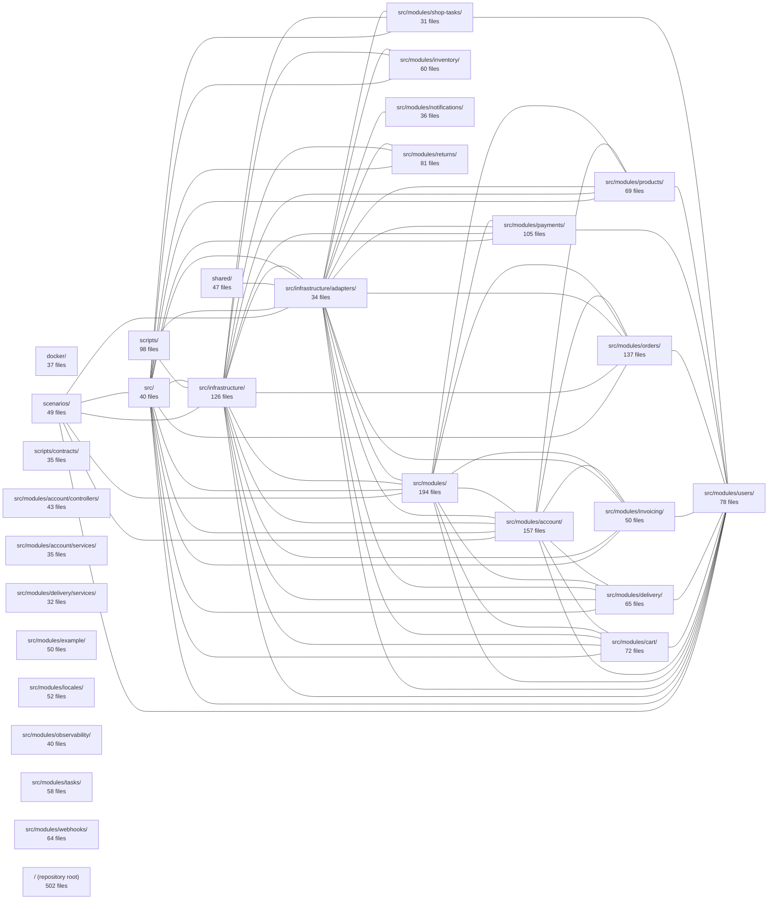

---
tags:
  - 2brain
  - 2brain/index
  - project/boilerplate-node-backend
type: index
modules: 30
updated: 2026-11-08T10:55:01.355501+00:00
---

# boilerplate-node-backend

`boilerplate-node-backend` is a Node.js backend scaffolded around a modular domain architecture. Feature logic lives under `src/modules/`, organized into bounded domains such as orders, payments, cart, inventory, products, users, and webhooks, with many modules further split into `controllers/` and `services/` subdirectories. Cross-cutting concerns are placed in `src/infrastructure/` (including adapters) and `shared/`, while operational tooling—Docker definitions, utility scripts, contract files, and test scenarios—is kept in the top-level `docker/`, `scripts/`, and `scenarios/` directories.

## Module map

_148 lower-traffic connection(s) hidden to keep the diagram readable._

## Modules
- [[boilerplate-node-backend_docker|docker/]] — 37 files, 1 connected module
- [[boilerplate-node-backend_scenarios|scenarios/]] — 49 files, 20 connected modules
- [[boilerplate-node-backend_scripts|scripts/]] — 98 files, 13 connected modules
- [[boilerplate-node-backend_scripts_contracts|scripts/contracts/]] — 35 files, 7 connected modules
- [[boilerplate-node-backend_shared|shared/]] — 47 files, 14 connected modules
- [[boilerplate-node-backend_src|src/]] — 40 files, 26 connected modules
- [[boilerplate-node-backend_src_infrastructure|src/infrastructure/]] — 126 files, 27 connected modules
- [[boilerplate-node-backend_src_infrastructure_adapters|src/infrastructure/adapters/]] — 34 files, 28 connected modules
- [[boilerplate-node-backend_src_modules|src/modules/]] — 194 files, 24 connected modules
- [[boilerplate-node-backend_src_modules_account|src/modules/account/]] — 157 files, 23 connected modules
- [[boilerplate-node-backend_src_modules_account_controllers|src/modules/account/controllers/]] — 43 files, 7 connected modules
- [[boilerplate-node-backend_src_modules_account_services|src/modules/account/services/]] — 35 files, 12 connected modules
- [[boilerplate-node-backend_src_modules_cart|src/modules/cart/]] — 72 files, 18 connected modules
- [[boilerplate-node-backend_src_modules_delivery|src/modules/delivery/]] — 65 files, 18 connected modules
- [[boilerplate-node-backend_src_modules_delivery_services|src/modules/delivery/services/]] — 32 files, 12 connected modules
- [[boilerplate-node-backend_src_modules_example|src/modules/example/]] — 50 files, 11 connected modules
- [[boilerplate-node-backend_src_modules_inventory|src/modules/inventory/]] — 60 files, 15 connected modules
- [[boilerplate-node-backend_src_modules_invoicing|src/modules/invoicing/]] — 50 files, 19 connected modules
- [[boilerplate-node-backend_src_modules_locales|src/modules/locales/]] — 52 files, 12 connected modules
- [[boilerplate-node-backend_src_modules_notifications|src/modules/notifications/]] — 36 files, 13 connected modules
- [[boilerplate-node-backend_src_modules_observability|src/modules/observability/]] — 40 files, 11 connected modules
- [[boilerplate-node-backend_src_modules_orders|src/modules/orders/]] — 137 files, 19 connected modules
- [[boilerplate-node-backend_src_modules_payments|src/modules/payments/]] — 105 files, 17 connected modules
- [[boilerplate-node-backend_src_modules_products|src/modules/products/]] — 69 files, 19 connected modules
- [[boilerplate-node-backend_src_modules_returns|src/modules/returns/]] — 81 files, 15 connected modules
- [[boilerplate-node-backend_src_modules_shop-tasks|src/modules/shop-tasks/]] — 31 files, 16 connected modules
- [[boilerplate-node-backend_src_modules_tasks|src/modules/tasks/]] — 58 files, 11 connected modules
- [[boilerplate-node-backend_src_modules_users|src/modules/users/]] — 78 files, 25 connected modules
- [[boilerplate-node-backend_src_modules_webhooks|src/modules/webhooks/]] — 64 files, 11 connected modules
- [[boilerplate-node-backend_ROOT|/ (repository root)]] — 502 files, 28 connected modules
