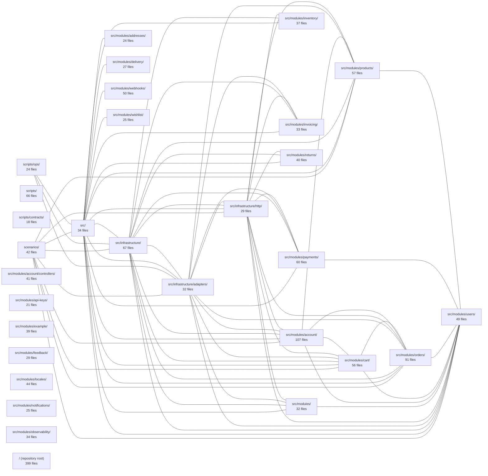

---
tags:
  - 2brain
  - 2brain/index
  - project/boilerplate-node-backend
type: index
modules: 30
updated: 2026-10-08T00:01:44.206048+00:00
---

# boilerplate-node-backend

boilerplate-node-backend is a Node.js backend scaffold built on a ports-and-adapters layout: `src/infrastructure/` centralizes HTTP concerns and external adapters, while `src/modules/` groups self-contained feature domains—account, orders, payments, products, inventory, users, and roughly a dozen others—each exposing its own controllers and supporting logic. Outside the application code, `scenarios/` holds end-to-end test cases and `scripts/` provides operational tooling and API contract definitions.

## Module map

_135 lower-traffic connection(s) hidden to keep the diagram readable._

## Modules
- [[boilerplate-node-backend_scenarios|scenarios/]] — 42 files, 21 connected modules
- [[boilerplate-node-backend_scripts|scripts/]] — 66 files, 10 connected modules
- [[boilerplate-node-backend_scripts_contracts|scripts/contracts/]] — 18 files, 6 connected modules
- [[boilerplate-node-backend_scripts_ops|scripts/ops/]] — 24 files, 14 connected modules
- [[boilerplate-node-backend_src|src/]] — 34 files, 28 connected modules
- [[boilerplate-node-backend_src_infrastructure|src/infrastructure/]] — 67 files, 28 connected modules
- [[boilerplate-node-backend_src_infrastructure_adapters|src/infrastructure/adapters/]] — 32 files, 26 connected modules
- [[boilerplate-node-backend_src_infrastructure_http|src/infrastructure/http/]] — 29 files, 27 connected modules
- [[boilerplate-node-backend_src_modules|src/modules/]] — 32 files, 17 connected modules
- [[boilerplate-node-backend_src_modules_account|src/modules/account/]] — 107 files, 21 connected modules
- [[boilerplate-node-backend_src_modules_account_controllers|src/modules/account/controllers/]] — 41 files, 7 connected modules
- [[boilerplate-node-backend_src_modules_addresses|src/modules/addresses/]] — 24 files, 11 connected modules
- [[boilerplate-node-backend_src_modules_api-keys|src/modules/api-keys/]] — 21 files, 9 connected modules
- [[boilerplate-node-backend_src_modules_cart|src/modules/cart/]] — 56 files, 20 connected modules
- [[boilerplate-node-backend_src_modules_delivery|src/modules/delivery/]] — 27 files, 11 connected modules
- [[boilerplate-node-backend_src_modules_example|src/modules/example/]] — 39 files, 8 connected modules
- [[boilerplate-node-backend_src_modules_feedback|src/modules/feedback/]] — 29 files, 6 connected modules
- [[boilerplate-node-backend_src_modules_inventory|src/modules/inventory/]] — 37 files, 13 connected modules
- [[boilerplate-node-backend_src_modules_invoicing|src/modules/invoicing/]] — 33 files, 14 connected modules
- [[boilerplate-node-backend_src_modules_locales|src/modules/locales/]] — 44 files, 8 connected modules
- [[boilerplate-node-backend_src_modules_notifications|src/modules/notifications/]] — 25 files, 9 connected modules
- [[boilerplate-node-backend_src_modules_observability|src/modules/observability/]] — 34 files, 10 connected modules
- [[boilerplate-node-backend_src_modules_orders|src/modules/orders/]] — 91 files, 20 connected modules
- [[boilerplate-node-backend_src_modules_payments|src/modules/payments/]] — 60 files, 16 connected modules
- [[boilerplate-node-backend_src_modules_products|src/modules/products/]] — 57 files, 19 connected modules
- [[boilerplate-node-backend_src_modules_returns|src/modules/returns/]] — 40 files, 13 connected modules
- [[boilerplate-node-backend_src_modules_users|src/modules/users/]] — 49 files, 24 connected modules
- [[boilerplate-node-backend_src_modules_webhooks|src/modules/webhooks/]] — 50 files, 11 connected modules
- [[boilerplate-node-backend_src_modules_wishlist|src/modules/wishlist/]] — 25 files, 11 connected modules
- [[boilerplate-node-backend_ROOT|/ (repository root)]] — 399 files, 28 connected modules
