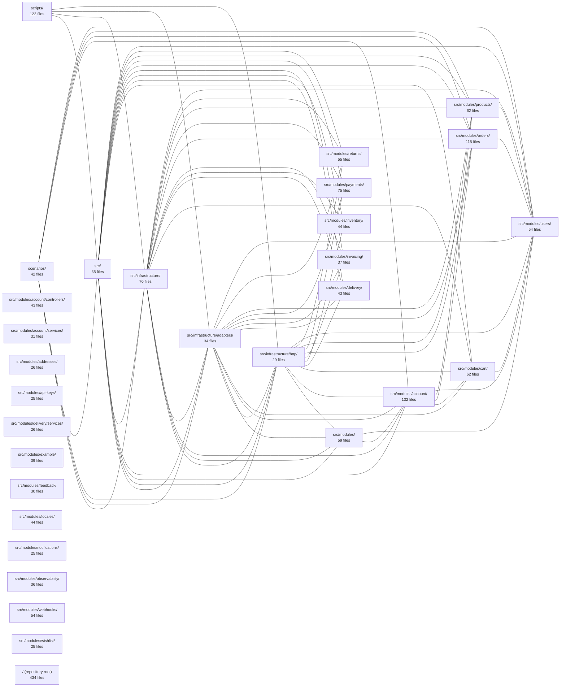

---
tags:
  - 2brain
  - 2brain/index
  - project/boilerplate-node-backend
type: index
modules: 30
updated: 2026-10-15T13:42:50.396007+00:00
---

# boilerplate-node-backend

`boilerplate-node-backend` is a Node.js backend starter built around an e-commerce and platform domain, with business logic split into per-feature modules under `src/modules/` (account, orders, payments, products, cart, inventory, delivery, invoicing, and others) and shared technical concerns isolated in `src/infrastructure/` (HTTP layer and external adapters). Each domain module follows a conventional sub-structure of controllers, services, and supporting files. Supporting material lives in `scenarios/` for integration-level test flows and `scripts/` for build and tooling automation.

## Module map

_153 lower-traffic connection(s) hidden to keep the diagram readable._

## Modules
- [[boilerplate-node-backend_scenarios|scenarios/]] — 42 files, 21 connected modules
- [[boilerplate-node-backend_scripts|scripts/]] — 122 files, 18 connected modules
- [[boilerplate-node-backend_src|src/]] — 35 files, 29 connected modules
- [[boilerplate-node-backend_src_infrastructure|src/infrastructure/]] — 70 files, 29 connected modules
- [[boilerplate-node-backend_src_infrastructure_adapters|src/infrastructure/adapters/]] — 34 files, 26 connected modules
- [[boilerplate-node-backend_src_infrastructure_http|src/infrastructure/http/]] — 29 files, 29 connected modules
- [[boilerplate-node-backend_src_modules|src/modules/]] — 59 files, 20 connected modules
- [[boilerplate-node-backend_src_modules_account|src/modules/account/]] — 132 files, 23 connected modules
- [[boilerplate-node-backend_src_modules_account_controllers|src/modules/account/controllers/]] — 43 files, 8 connected modules
- [[boilerplate-node-backend_src_modules_account_services|src/modules/account/services/]] — 31 files, 10 connected modules
- [[boilerplate-node-backend_src_modules_addresses|src/modules/addresses/]] — 26 files, 10 connected modules
- [[boilerplate-node-backend_src_modules_api-keys|src/modules/api-keys/]] — 25 files, 9 connected modules
- [[boilerplate-node-backend_src_modules_cart|src/modules/cart/]] — 62 files, 20 connected modules
- [[boilerplate-node-backend_src_modules_delivery|src/modules/delivery/]] — 43 files, 18 connected modules
- [[boilerplate-node-backend_src_modules_delivery_services|src/modules/delivery/services/]] — 26 files, 10 connected modules
- [[boilerplate-node-backend_src_modules_example|src/modules/example/]] — 39 files, 8 connected modules
- [[boilerplate-node-backend_src_modules_feedback|src/modules/feedback/]] — 30 files, 6 connected modules
- [[boilerplate-node-backend_src_modules_inventory|src/modules/inventory/]] — 44 files, 15 connected modules
- [[boilerplate-node-backend_src_modules_invoicing|src/modules/invoicing/]] — 37 files, 16 connected modules
- [[boilerplate-node-backend_src_modules_locales|src/modules/locales/]] — 44 files, 8 connected modules
- [[boilerplate-node-backend_src_modules_notifications|src/modules/notifications/]] — 25 files, 10 connected modules
- [[boilerplate-node-backend_src_modules_observability|src/modules/observability/]] — 36 files, 10 connected modules
- [[boilerplate-node-backend_src_modules_orders|src/modules/orders/]] — 115 files, 21 connected modules
- [[boilerplate-node-backend_src_modules_payments|src/modules/payments/]] — 75 files, 17 connected modules
- [[boilerplate-node-backend_src_modules_products|src/modules/products/]] — 62 files, 21 connected modules
- [[boilerplate-node-backend_src_modules_returns|src/modules/returns/]] — 55 files, 17 connected modules
- [[boilerplate-node-backend_src_modules_users|src/modules/users/]] — 54 files, 24 connected modules
- [[boilerplate-node-backend_src_modules_webhooks|src/modules/webhooks/]] — 54 files, 9 connected modules
- [[boilerplate-node-backend_src_modules_wishlist|src/modules/wishlist/]] — 25 files, 12 connected modules
- [[boilerplate-node-backend_ROOT|/ (repository root)]] — 434 files, 28 connected modules
