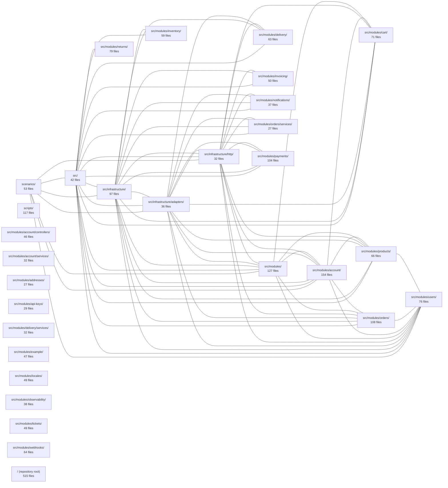

---
tags:
  - 2brain
  - 2brain/index
  - project/boilerplate-node-backend
type: index
modules: 30
updated: 2026-10-29T19:30:08.469979+00:00
---

# boilerplate-node-backend

`boilerplate-node-backend` is a Node.js backend boilerplate built around an e-commerce domain, covering accounts, cart, orders, payments, products, inventory, delivery, returns, invoicing, and related cross-cutting concerns. Domain logic is organized into feature folders under `src/modules/`, each typically containing controllers and services, while shared platform code (adapters, HTTP plumbing) lives in `src/infrastructure/`. The repository root additionally provides `scenarios/` and `scripts/` for test scenarios and operational tooling.

## Module map

_178 lower-traffic connection(s) hidden to keep the diagram readable._

## Modules
- [[boilerplate-node-backend_scenarios|scenarios/]] — 53 files, 22 connected modules
- [[boilerplate-node-backend_scripts|scripts/]] — 117 files, 10 connected modules
- [[boilerplate-node-backend_src|src/]] — 42 files, 29 connected modules
- [[boilerplate-node-backend_src_infrastructure|src/infrastructure/]] — 97 files, 29 connected modules
- [[boilerplate-node-backend_src_infrastructure_adapters|src/infrastructure/adapters/]] — 36 files, 28 connected modules
- [[boilerplate-node-backend_src_infrastructure_http|src/infrastructure/http/]] — 32 files, 29 connected modules
- [[boilerplate-node-backend_src_modules|src/modules/]] — 127 files, 26 connected modules
- [[boilerplate-node-backend_src_modules_account|src/modules/account/]] — 154 files, 26 connected modules
- [[boilerplate-node-backend_src_modules_account_controllers|src/modules/account/controllers/]] — 46 files, 8 connected modules
- [[boilerplate-node-backend_src_modules_account_services|src/modules/account/services/]] — 32 files, 10 connected modules
- [[boilerplate-node-backend_src_modules_addresses|src/modules/addresses/]] — 27 files, 10 connected modules
- [[boilerplate-node-backend_src_modules_api-keys|src/modules/api-keys/]] — 29 files, 9 connected modules
- [[boilerplate-node-backend_src_modules_cart|src/modules/cart/]] — 71 files, 21 connected modules
- [[boilerplate-node-backend_src_modules_delivery|src/modules/delivery/]] — 63 files, 20 connected modules
- [[boilerplate-node-backend_src_modules_delivery_services|src/modules/delivery/services/]] — 32 files, 14 connected modules
- [[boilerplate-node-backend_src_modules_example|src/modules/example/]] — 47 files, 10 connected modules
- [[boilerplate-node-backend_src_modules_inventory|src/modules/inventory/]] — 59 files, 17 connected modules
- [[boilerplate-node-backend_src_modules_invoicing|src/modules/invoicing/]] — 50 files, 18 connected modules
- [[boilerplate-node-backend_src_modules_locales|src/modules/locales/]] — 49 files, 10 connected modules
- [[boilerplate-node-backend_src_modules_notifications|src/modules/notifications/]] — 37 files, 19 connected modules
- [[boilerplate-node-backend_src_modules_observability|src/modules/observability/]] — 38 files, 10 connected modules
- [[boilerplate-node-backend_src_modules_orders|src/modules/orders/]] — 108 files, 22 connected modules
- [[boilerplate-node-backend_src_modules_orders_services|src/modules/orders/services/]] — 27 files, 19 connected modules
- [[boilerplate-node-backend_src_modules_payments|src/modules/payments/]] — 104 files, 20 connected modules
- [[boilerplate-node-backend_src_modules_products|src/modules/products/]] — 66 files, 22 connected modules
- [[boilerplate-node-backend_src_modules_returns|src/modules/returns/]] — 79 files, 17 connected modules
- [[boilerplate-node-backend_src_modules_tickets|src/modules/tickets/]] — 49 files, 14 connected modules
- [[boilerplate-node-backend_src_modules_users|src/modules/users/]] — 76 files, 25 connected modules
- [[boilerplate-node-backend_src_modules_webhooks|src/modules/webhooks/]] — 64 files, 10 connected modules
- [[boilerplate-node-backend_ROOT|/ (repository root)]] — 515 files, 28 connected modules
