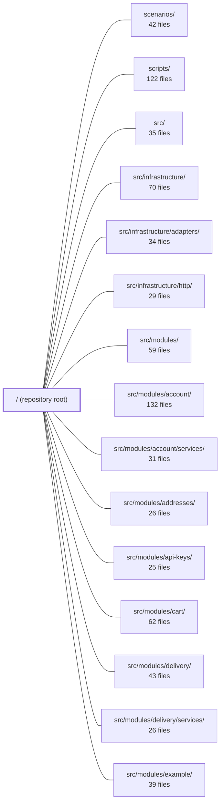

---
tags:
  - 2brain
  - 2brain/module
  - project/boilerplate-node-backend
type: module
module: / (repository root)
files: 434
updated: 2026-10-15T13:34:10.691286+00:00
---

# / (repository root)

## Purpose

The repository root holds everything that surrounds the application: project conventions, generated API/event contracts, the Docker deployment and observability stacks, backup infrastructure, and the documentation site. It is the "shell" that turns the TypeScript source in `src/` into a runnable, observable, contract-first service.

## Key parts

- **Project docs & conventions** — `README.md`, `CLAUDE.md`, `INSTALL.md`, `SECURITY.md`, and the `docs/` directory (VitePress site with per-module pages). `CLAUDE.md` encodes the golden rule: contracts are authored at module leaves and generated outward; `docs/api/` explains the regeneration workflow.
- **Generated event contracts** — `asyncapi.yaml` and `asyncapi.public.yaml`. Both are produced by `npm run contracts:bundle` from per-module fragments; they are the single source of truth for SSE streams, webhook deliveries, and RabbitMQ queue channels. Do not edit by hand.
- **Compose stacks** — `docker-compose.yml` (local dev: app + Mongo + Redis + RabbitMQ + observability), `docker-compose.production.yml` (single-tenant production image), `docker-compose.proxy.yml` (shared Traefik overlay), `docker-compose.test.yml` (wired E2E gate). All runtime knobs are `${VAR:-default}` overrides.
- **Container infrastructure (`docker/`)** —
  - *Backup pipeline*: `backup.sh`, `restore-drill.sh`, `drill.sh`, `maintenance.sh`, `server-maintenance.sh`, `entrypoint.sh`, `common.sh` — a full restic-based backup/restore/dedup/check cycle driven by supercronic.
  - *Observability*: OpenTelemetry Collector, Tempo, Prometheus (+ alert rules), Loki, Promtail, Grafana provisioning, Alertmanager — a complete local tracing/metrics/logs/alerting stack with zero external dependencies.
  - *MongoDB bootstrap*: `mongo-init.js` (least-privilege users), `mongo-rs-init.sh` (replica-set initiation), `mongo-entrypoint.sh` (keyFile/TLS cert provisioning).
  - *Smoke test & tooling*: `boot-check.sh` (fail-closed boot + `/livez` + filesystem-permission check), `install-supercronic.mjs` (cron binary for unprivileged containers).
- **Build & tooling config** — among the 394 additional files: `package.json` scripts (e.g. `contracts:bundle`, `backup:drill`), TypeScript config, lint/format rules, CI workflows, and `.env` templates that every stack above reads.

## How it connects

- **`src/` and its sub-modules** (`src/modules/account/`, `src/modules/orders/`, `src/modules/webhooks/`, etc.) are the application code whose event fragments feed `asyncapi.yaml` and whose HTTP routes are exposed by the Docker stacks. The root never contains business logic; it only packages, deploys, and documents it.
- **`src/infrastructure/`** (adapters, HTTP layer) is the runtime that the Compose files configure via environment variables and the observability stack instruments via OTLP/Prometheus endpoints.
- **`scripts/`** contains the build tooling invoked by `package.json` scripts (contract bundling, codegen, seeding) referenced throughout `CLAUDE.md` and `docs/api/`.
- **`scenarios/`** holds E2E test scenarios that `docker-compose.test.yml` and `docker-compose.yml` spin up to validate the full request→response→event pipeline against real backing services.

## Where to start

1. **`README.md`** — a two-minute orientation: tech stack, the contract-first philosophy, and the canonical `npm run` commands for dev, test, and deploy.
2. **`docker-compose.yml`** — reading the local dev stack top-to-bottom shows you every external service the app expects, the env-var contract, and how the optional observability services plug in. Once you can `docker compose up` and hit the API, you have the full mental model of the runtime environment before touching a single line of `src/`.

## Connected modules

[[boilerplate-node-backend_scenarios|scenarios/]] · [[boilerplate-node-backend_scripts|scripts/]] · [[boilerplate-node-backend_src|src/]] · [[boilerplate-node-backend_src_infrastructure|src/infrastructure/]] · [[boilerplate-node-backend_src_infrastructure_adapters|src/infrastructure/adapters/]] · [[boilerplate-node-backend_src_infrastructure_http|src/infrastructure/http/]] · [[boilerplate-node-backend_src_modules|src/modules/]] · [[boilerplate-node-backend_src_modules_account|src/modules/account/]] · [[boilerplate-node-backend_src_modules_account_services|src/modules/account/services/]] · [[boilerplate-node-backend_src_modules_addresses|src/modules/addresses/]] · [[boilerplate-node-backend_src_modules_api-keys|src/modules/api-keys/]] · [[boilerplate-node-backend_src_modules_cart|src/modules/cart/]] · [[boilerplate-node-backend_src_modules_delivery|src/modules/delivery/]] · [[boilerplate-node-backend_src_modules_delivery_services|src/modules/delivery/services/]] · [[boilerplate-node-backend_src_modules_example|src/modules/example/]] · … and 13 more

## Files
- `CLAUDE.md` — Contracts are edited at the leaves and generated everywhere else. The order is not optional:
- `INSTALL.md` — What this backend needs from outside the code before it is yours: an account, a key, a domain, a
- `README.md` — > Express 5 + TypeScript + Mongoose REST API. Contract-first, modular, observable.
- `SECURITY.md` — Please report security vulnerabilities through GitHub's private
- `asyncapi.public.yaml` — A **generated** AsyncAPI 3.0.0 bundle that consolidates all event-driven contracts (SSE streams and webhook deliveries) into a single public specification. It is produced by `npm run contracts:bundle` from per-module fragments and the root contract, and is intended for external consumers (dashboards, webhook subscribers, type generation) rather than for human editing.
- `asyncapi.yaml` — Auto-generated AsyncAPI 3.0.0 specification that bundles all event-driven contract fragments (SSE streams, outbound webhooks, and RabbitMQ worker queues) into a single canonical document. It exists so that consumers, workers, and tooling have one authoritative reference for every real-time channel the backend exposes. Do not edit manually — regenerate via `npm run contracts:bundle`.
- `docker-compose.production.yml` — Deployment stack for the API, one instance per client organisation. Runs the production image (built by `docker/Dockerfile.production`) with no source mounts, no host-exposed database port, and no demo seeder. Its `setup` service initialises indexes and the shop row exactly once; the database otherwise starts empty and fills with real data.
- `docker-compose.proxy.yml` — A Compose overlay that adds a shared Traefik reverse proxy in front of a client stack. It is layered via a second `-f` on top of `docker-compose.production.yml` so that many client stacks on the same host share one proxy instance (one `traefik` container, one set of ACME certs) while each client keeps its own data, network, and project name. It defines routing, TLS termination, and trust-proxy configuration only — no database, volume seeding, or data-plane changes.
- `docker-compose.test.yml` — Composable gate stack that proves the external-service code path (`NODE_TEST_MONGO_URI` / `NODE_TEST_REDIS_URL`) works end-to-end against services the app container did not start itself. It is the "wired" counterpart to the hermetic CI gate (which builds the image and runs `npm run complete` with no external services). Intended for manual pre-merge verification, not as a second CI job.
- `docker-compose.yml` — Orchestrates the local development stack: a single Node.js `app` service (API + seed data), its backing stores (`database`, `redis`, `limits`, `rabbitmq`), and optional observability/analytics services. All runtime configuration (ports, rate limits, worker count, analytics provider) is surfaced as `${VAR:-default}` overrides so that a live E2E run can tune values from the shell without editing `.env`.
- `docker/backup/backup.sh` — Orchestrates a single scheduled backup run: streams a `mongodump` into restic, records the per-collection counts from the dump log, backs up the uploads and mail-spool directories, then applies retention via `restic forget`. Scheduled by supercronic on `BACKUP_SCHEDULE`; the design and failure contract are documented in `docs/tools/backups.md#one-run`.
- `docker/backup/common.sh` — Shared library sourced (never executed) by the backup scripts in this stack. It centralises the configuration knobs with their defaults, sets up the restic environment, provides a Gatus heartbeat, and supplies a small set of helpers (logging, repository bootstrap, job wrapping, Mongo config-file writing, and a mongodump/mongorestore log parser).
- `docker/backup/drill.sh` — End-to-end integration drill that proves the backup system works as a whole: it spins up a production-shaped replica-set MongoDB on a private `--internal` Docker network, seeds data, runs the backup image's `backup-job` and `backup-restore-drill` scripts, verifies restic deduplication across three runs, restores into a throwaway Mongo and compares row counts, exercises the Gatus heartbeat (green on success, red on failure), and tests the cron scheduler (active and dormant). It is the single command (`npm run backup:drill`) that CI runs to confirm nothing in the backup pipeline is broken.
- `docker/backup/entrypoint.sh` — Entrypoint for the `backup` Docker service. It translates a small set of environment-variable "knobs" into a crontab file, validates that crontab, then `exec`s **supercronic** as PID 1 to run the scheduled backup jobs. An empty `BACKUP_REPOSITORY` yields a dormant (no-op) container that still reports healthy.
- `docker/backup/maintenance.sh` — Weekly restic repository upkeep, scheduled by supercronic via `BACKUP_CHECK_SCHEDULE`. It reclaims space from previously forgotten snapshots and reads a rotating slice of stored data to surface corruption well before a restore would be needed.
- `docker/backup/restore-drill.sh` — Performs a full restore drill against a **throwaway** MongoDB instance and a temp directory to prove the latest backup snapshots are actually restorable and byte-identical, then reports elapsed wall-clock time as the estimated shop-downtime on a bad day. Never touches the live database. Exits 0 only if every step passes.
- `docker/backup/server-maintenance.sh` — Scheduled maintenance script (run by supercronic on `BACKUP_SERVER_SCHEDULE`) that prunes and integrity-checks every client's restic repository stored on the backup server's local disk. It is the **only** code path that deletes old snapshots, because the application side of each client is append-only and never issues `forget`.
- `docker/boot-check.sh` — Integration smoke-test that boots a production Docker image against a real MongoDB container and proves two things unit tests cannot: the image starts with fail-closed config and answers `/livez`, and the runtime `node` user cannot write under `/app/src/`. Used by both CI (`boot` job) and local development so the proof cannot drift between environments.
- `docker/install-supercronic.mjs` — Downloads, verifies, and installs the [supercronic](https://github.com/aptible/supercronic) cron scheduler binary into `/usr/local/bin` during Docker image builds. It exists because busybox `crond` resets supplementary groups before each job (requiring `CAP_SETGID`), which breaks under the unprivileged `node` user; supercronic runs jobs as-is. Written in Node (rather than shell) because Node is the one download tool guaranteed on both Alpine and Debian slim base images.
- `docker/mongo-entrypoint.sh` — Wrapper around the official MongoDB image's `docker-entrypoint.sh` that guarantees the replica-set keyFile and wire-TLS certificates exist (with correct ownership) before mongod starts. It replaces an earlier one-shot Compose service because podman-compose 1.6 / libpod refuses to start containers that transitively depend on an already-exited container; wrapping the entrypoint avoids that dependency chain entirely.
- `docker/mongo-init.js` — One-time MongoDB bootstrap script that runs only against an empty data directory (via `docker-entrypoint-initdb.d`). It creates least-privilege application and backup users so the app never authenticates as the instance root, limiting blast radius if a connection string leaks.
- `docker/mongo-rs-init.sh` — One-shot Compose service that initiates the `rs0` replica set on the `database` container and blocks until that node becomes PRIMARY. It exists because MongoDB's own entrypoint init-scripts run against a temporary standalone mongod (no `--replSet` flag), so `rs.initiate()` is impossible there; this script targets the real, replSet-enabled instance after it has already started.
- `docker/observability/alertmanager-render.sh` — Renders `alertmanager.config.template.yaml` into a final `alertmanager.yml` by substituting environment variables and stripping inactive receiver groups, then optionally `exec`s Alertmanager as the container's main process. Written in POSIX sh (busybox, no bash, no `envsubst`) so it runs inside the Alertmanager container image itself.
- `docker/observability/alertmanager-routes-test.sh` — Integration test that verifies Alertmanager's routing tree and inhibit rules against the rendered production config. It exercises every combination of the "knob" environment variables (email, webhook, heartbeat) to confirm alerts land on the correct receiver, confirms special characters survive template rendering, and boots a live Alertmanager daemon to prove inhibit rules suppress (and do not suppress) the right alerts.
- `docker/observability/grafana.dashboard-providers.yaml` — Grafana provisioning file that tells Grafana where to find dashboard JSON files on the filesystem. It exists so that dashboards stored in the repository are auto-loaded at container startup without any manual import in the Grafana UI.
- `docker/observability/grafana.datasources.yaml` — Grafana datasource provisioning file that auto-wires Grafana to the three backends (Tempo, Prometheus, Loki) on container start, eliminating the need for manual UI configuration on every restart.
- `docker/observability/loki.config.yaml` — Local single-node Loki configuration for the development observability stack. It configures Loki to use filesystem-backed storage with no external dependencies, providing log ingestion (via Promtail), querying (via Grafana), and optional alert-rule evaluation with a one-week retention window.
- `docker/observability/otel-collector.config.yaml` — Pipeline configuration for the OpenTelemetry Collector container: it receives application traces over OTLP, batches them, forwards them to Tempo, and derives inter-service request metrics from those traces for Prometheus to scrape. It exists so the app only needs to speak OTLP to one endpoint while the backend topology (trace storage, metric derivation) is handled outside the application.
- `docker/observability/prometheus.alert-rules.yaml` — Defines the actionable SRE alert rules for the local API stack. While Prometheus dashboards provide visual context, this file encodes the thresholds that actually page someone. It covers availability, error rate, latency, saturation, memory pressure, queue/outbox dead-lettering, webhook delivery, and scheduled-job staleness — all in a single `api.rules` group.
- `docker/observability/prometheus.config.yaml` — Prometheus's main runtime configuration. It declares which targets to scrape, how often to evaluate rules, where to send firing alerts, and which rule files to load. Without it Prometheus starts with no targets, no alert routing, and no rule evaluation.
- `docker/observability/promtail.config.yaml` — Promtail scrape and pipeline configuration that reads Docker `json-file` container logs from a host bind mount, parses both the Docker envelope and the inner Winston/OTel JSON payload, promotes key fields to labels, and pushes structured logs to Loki. It is the default Promtail config selected by the Compose stack.
- `docker/observability/promtail.podman.config.yaml` — Promtail scrape configuration for environments using **rootless Podman** instead of Docker. Podman's `k8s-file` log driver writes CRI-formatted logs to a different path layout than Docker's JSON driver, so a separate Promtail config is required. It is selected at runtime via `PROMTAIL_CONFIG=promtail.podman.config.yaml` in `.env`.
- `docker/observability/tempo.config.yaml` — Tempo server configuration for the local development stack. It pins all non-default settings—listening ports, OTLP ingest endpoints, block lifecycle, and the local-disk storage backend—so Tempo can run as a single container with zero external dependencies while still accepting real OTLP traffic from the collector.
- `docker/observability/umami-init.sh` — One-shot Postgres init script that stamps the admin username/password (and a default website row) from environment variables onto Umami's factory-seeded admin account, so the stack is ready to log in immediately after first boot without manual steps.
- `docs/.vitepress/config.mts` — VitePress configuration that defines the site title, top-level navigation, per-section sidebars, local full-text search, and Mermaid diagram support for the project documentation. It also delegates the `/modules/` sidebar to a generator so adding a new module requires no manual config edit.
- `docs/.vitepress/theme/index.ts` — VitePress custom theme entry that extends the default theme to add a click-to-zoom overlay for Mermaid diagrams. It hooks into the `enhanceApp` lifecycle to attach click handlers to `.mermaid` elements as they render (client-side, post-load) and displays them in a full-screen dialog.
- `docs/api/contract-fragmentation.md` — [OpenAPI Workflow](./openapi-workflow.md) covers **how to change** the contract. This page covers
- `docs/api/regenerating.md` — The cheat sheet for "I edited a fragment — now what?".
- `docs/modules/webhooks.md` — ::: tip At a glance
- `docs/reference/tests.md` — Every file here is a distinct guarantee, which is why this page names them one at a time: knowing
- `docs/theory/strategic-ddd.md` — The part of Domain-Driven Design that pays for itself in a starter kit** — bounded contexts,
- `docs/tools/mutation-testing.md` — Every other layer on this site answers "does the code do the right thing?" This one answers a different question: **do the _tests_ actually notice when it doesn't?** Line coverage can be satisfied by executing a line without asserting anything about its result; mutation testing can't — it edits the source thousands of times (`>` to `>=`, `&&` to `||`, a function body emptied out) and reports every edit the suite failed to catch. A **surviving mutant** is a bug the tests are structurally blind to.
- `eslint.config.ts` — The project's ESLint flat configuration. It assembles the rule set (base JS/TS presets, Unicorn, boundaries, JSDoc, Jest, eslint-comments), defines project-specific AST-level bans (double casts, `process.env` writes in tests, try/catch in production, test-factory imports in production), scopes rule overrides for non-source files (scripts, tool configs, tests), and ends with Prettier's off-switch. It exists to encode the team's conventions as enforceable checks rather than style-guide paragraphs.
- `jest.config.broker.js` — Jest configuration for the broker (RabbitMQ) test suite, invoked via `npm run test:broker`. It exists because the base `jest.config.js` defaults—rate-limit setup, mongod bootstrap, 30 s timeout—are irrelevant or insufficient for queue-adapter tests that manage their own environment and depend on real TTLs.
- `jest.config.cluster.js` — Dedicated Jest configuration for the cluster integration suite (`npm run test:cluster`). It exists as a separate file (not another directory under the main config) because the defaults in `jest.config.js` are each specifically wrong for cluster tests — setup would interfere, shared infrastructure would be unreachable from spawned child processes, and the default timeout is too short for real cluster boot + Redis image pulls.
- `jest.config.js` — Base Jest configuration for the unit-test run. Written as `.js` (not `.json`) so every setting can carry an inline explanation. Acts as the shared foundation that `jest.config.broker.js`, `jest.config.cluster.js`, and `jest.config.mutation.js` extend. Coverage is deliberately not collected here; the project tracks mutation score instead.
- `jest.config.mutation.js` — A Jest configuration dedicated to Stryker mutation testing (`npm run mutation`, `npm run mutation:full`). It exists because the default `jest.config.js` uses ts-jest, whose LanguageService cache grows with every mutant until the worker is OOM-killed. This file swaps ts-jest for the transpile-only `@swc/jest` (type-checking is already covered by `npm run ts-check`) and collapses the worker pool to one to avoid multiplicative resource exhaustion under Stryker's own concurrency.
- `knip.config.ts` — Knip configuration that supplements knip's built-in import-walk discovery. It declares entry points, dependencies, and unresolved imports that knip cannot see from its own plugins (package.json, jest, eslint), so the tool's unused-file/dependency report reflects the project's actual surface rather than flagging legitimate code. The file is consumed by the `code-shape` audit script (`scripts/audit/code-shape/SKILL.md`), never by a gate.
- `openapi.yaml` — The bundled, canonical OpenAPI 3.1.0 contract for the Boilerplate API. It is the single source of truth consumed by code generators (client/server stubs, DTOs, SDKs) and by property-based test suites. The file is **generated** by `npm run contracts:bundle` from `shared/contracts/openapi.root.yaml` plus per-module files under `src/modules/*/openapi.yaml`; it is never edited by hand.
- `orval.config.ts` — Orval build configuration that generates typed TypeScript models and Zod validators from `openapi.yaml`. It produces only the `zod` client flavor (schema/type definitions) because the project consumes generated types and validators but has no in-repo HTTP-client caller.
- `package.json` — Project manifest for `boilerplate-node-api-mongodb-mongoose` (v3.0.0). Defines the full set of npm scripts that drive development, testing, contract validation, code generation, documentation, and operational tooling. It also pins all runtime and dev dependencies. The `postinstall` and `prepare` hooks ensure generated artifacts (API types, contract bundles, permission actions, git hooks) are present immediately after `npm install`.
- `public/favicon/safari-pinned-tab.svg` — Static vector icon displayed by Safari when the user pins a site to their toolbar. It exists so that pinned-tab users see a crisp, resolution-independent glyph rather than a raster favicon. It is referenced from the HTML `<head>` (typically via a `<link rel="mask-icon" …>` tag) and is never loaded by application code.
- `shared/authorization-conformance.yaml` — A conformance fixture that both backend implementations (Node/CASL and PHP/spatie-laravel-permission) must evaluate to identical results. It is committed with identical bytes into `boilerplate-node-backend` and `boilerplate-php-laravel-backend`, and each repo runs every case against its own authorization engine. The file exists to pin the authorization model's observable behavior across two independent implementations, with special emphasis on **deny** cases: each `allow` exists only as a control that proves the adjacent `deny` was earned by the rule, not by an evaluator that simply refuses everything.
- `shared/authorization-keys.yaml` — The generated, canonical registry of every authorization permission key, the action vocabulary, the scope definitions, and per-key metadata (conditions, step-up tier, `shopperOnly` flag) for the platform. It is produced by `npm run authorization:bundle` by splicing one fragment per owning module (`src/modules/<name>/authorization.yaml`) together with the root-level `core` keys. No key may be introduced here directly; the `--check` flag (wired into the `complete` script) fails the build if this bundle drifts from the fragments.
- `shared/authorization-roles.yaml` — Defines the preset tenant-scope roles (who can do what in a shop) as a single canonical YAML document. It is committed byte-identical into both the Node and PHP backend boilerplates and read by both seeders at setup, ensuring two independently-stored permission systems (a `spatie/laravel-permission` table vs. a Node equivalent) produce the same product on day one. It is a starting point for a deployment, not a fixed schema.
- `shared/contracts/asyncapi.root.yaml` — The preamble section of the project's AsyncAPI contract. It holds the service-level facts that every module fragment would otherwise restate — version, identity, `info` prose, tag list, and default content type. It is the AsyncAPI twin of `openapi.root.yaml` and is merged by the bundler with module fragments to produce a complete AsyncAPI document.
- `shared/contracts/asyncapi.workers.yaml` — AsyncAPI 3.0 contract for the application-level worker queues that belong to no domain module — email delivery and image digesting. It exists so these cross-cutting jobs have a typed, lintable schema alongside the domain-owned queues, and so the `rabbitmqLocal` broker stays out of the public API bundle.
- `shared/contracts/openapi.root.yaml` — Root OpenAPI 3.1.0 document that defines the global contract surface shared across all module fragments: the API's identity, the universal error-code catalogue (`x-error-codes`), the app-level responses injected by cross-cutting middlewares (`x-app-level-responses`), common security schemes, and shared parameters. Module-level `openapi.yaml` files are merged into this root by the bundler to produce the single published spec.
- `shared/contracts/spectral.asyncapi.modules.yaml` — Spectral ruleset for linting **individual** AsyncAPI section files (`src/modules/<name>/asyncapi.yaml`, `shared/contracts/asyncapi.workers.yaml`) in isolation via `npm run lint:asyncapi:modules`. It selectively disables rules that check service-wide facts already declared once in the root contract, so each section can be validated as a standalone document without being penalised for not restating the full service identity.
- `shared/contracts/spectral.modules.yaml` — Spectral ruleset for linting a single module's OpenAPI file (`src/modules/<name>/openapi.yaml`) in isolation. It inherits the full rule set from the base config and selectively disables the rules that presuppose a single file is the entire API, since cross-cutting concerns (tags, security schemes, servers, info prose) are declared once in the root contract.
- `shared/contracts/spectral.yaml` — Spectral linter configuration for the project's OpenAPI 3.1 specifications. Extends the base `spectral:oas` preset and layers on project-specific rules that enforce security declarations, correct verb/operationId alignment, naming conventions for operations and schemas, and mandatory `maxLength` on request strings. Every rule is set to `severity: error`, so violations block the CI pipeline.
- `stryker.json` — Stryker mutation-testing configuration for this repository. It defines which source files are mutated, how Jest is invoked during mutation runs, where reports are written, and what thresholds gate the result. It exists so that CI (and local runs) can execute a consistent, incremental mutation-testing pass without hard-coding options elsewhere.
- `tests/broker/queue-broker.test.ts` — Integration test suite for the queue adapter that runs against a **real RabbitMQ** instance (started in a container). The unit suite mocks `amqplib` and only verifies the arguments passed to the broker; this file answers questions only a live broker can: whether topology actually declares on the running version, whether a retry republish carries the `x-retry-attempt` header, and where a message lands once its delivery limit is exhausted.
- `tests/broker/support/rabbitmq.ts` — Provides a ready-to-use RabbitMQ broker for the queue-broker test suite, scoped to a throwaway vhost so each run is isolated from prior topology. It either connects to a pre-existing broker (via `NODE_TEST_RABBITMQ_URL`) or spins one up in a container, then hands back an AMQP URL, a typed management-API handle, and a cleanup function.
- `tests/cluster/rate-limit.test.ts` — Cluster-level integration test that proves the rate limiter enforces **one** shared budget across all worker processes when counters live in Redis, and (as a control) demonstrates the per-worker doubling that occurs with the default in-memory store. It exists because no single-process test can distinguish a shared counter from a per-process one, so a regression to the in-memory store would otherwise pass every test in the repository.
- `tests/cluster/redis-idle.test.ts` — Guards against a specific production bug: node-redis' `socketTimeout` is an *idle* timer, so without a keepalive ping a healthy shared client gets closed after one quiet second and the cache layer reports it as `unavailable` between requests. This test proves the client created by the production adapter survives past that 1 s ceiling and still answers a `PING`.
- `tests/cluster/support/cluster.ts` — Boots the production entrypoint (`src/cluster.ts`) as a real multi-process child, so tests can observe cross-worker state that a single-process (supertest) setup structurally cannot. The classic blind spot: a per-process counter looks perfect in isolation but is wrong once requests are spread across N workers. This harness forks the cluster, waits until every worker has reported ready, and exposes a shared port for TCP-level assertions.
- `tests/cluster/support/redis.ts` — Provides the cluster test suite with a disposable Redis instance. It either points at an already-running Redis (via env var) or spins one up through the repo's existing container engine, so tests that need a real Redis socket don't have to manage lifecycle themselves.
- `tests/contract/authorization-contract.test.ts` — A table-driven authorization sweep that derives expected 401/403 outcomes for **every** mounted HTTP route from the authorization model itself (`shared/authorization-roles.yaml` via `holdsKey`), rather than from hand-maintained per-route expectations. It closes the gap where intermediate tenant roles (manager, warehouse, support, editor, moderator) were never exercised against the HTTP surface individually.
- `tests/contract/cookie-auth.test.ts` — Contract test for the **cookie-auth** alternative. Every other suite authenticates via `transport: 'bearer'`; this file is the only one that exercises the `cookieAuth` path — a browser-like client that carries a session cookie instead of a bearer token. It asserts the two obligations declared for that mode: reads succeed, and unsafe methods (PATCH) from a foreign origin receive the declared `403`.
- `tests/contract/idempotency.test.ts` — Integration (contract) test that drives the `Idempotency-Key` middleware through real HTTP requests against a live database, using `POST /feedback/contact` as the target route. It verifies the three runtime branches of the middleware — replay, key/body mismatch, and in-flight collision — plus two edge cases (malformed key, absent key). The unit test at `tests/unit/infrastructure/http/middlewares/idempotency.test.ts` covers pure fingerprinting logic; this file covers the observable three-way decision against a persisted ledger.
- `tests/contract/password-set-paths.test.ts` — Contract-level test that asserts **every** HTTP route which writes a password rejects a known-breach password with a 422 and leaves no trace (no new user row, no credential change). It also pins the exhaustive set of password-setting routes against the bundled OpenAPI spec so a newly added staff or admin route that sets a password cannot appear without first gaining a breach-check case here.
- `tests/contract/product-write.test.ts` — Contract test suite that exercises the multilingual product write surface — `POST /products`, `PUT /products/{id}`, `PATCH /products/{id}`, and `GET /products/{id}/admin` — over real HTTP. It lives at the top-level `tests/contract/` directory (not under `src/modules/products/tests/`) because driving these routes requires a real `locales` collection row, which the products module may only reach through the `kernel/translation.ts` port, making the suite inherently cross-module.
- `tests/contract/request-contract.test.ts` — Contract-derived **request** tests: for every write endpoint, verifies the API accepts every payload its OpenAPI spec declares legal (expect 2xx) and rejects exactly what the spec declares illegal (expect 422 + `ValidationErrorResponse` shape). It is the mirror image of the response-contract tests in `tests/contract/*` — those check responses against the spec; this file checks spec-generated requests against the live API.
- `tests/contract/request-sources.test.ts` — A static, no-server test that verifies every controller's declared request-input sources (via `readInput`, `requireId`, or a shared factory) are a **subset** of the sources the OpenAPI spec allows for that operation (`in: path` / `in: query` / `requestBody`). It automates the hand-comparison that previously surfaced five contract bugs (documented in `docs/theory/request-input.md`). The assertion is one-directional only: a controller reading a source the spec does not declare is a bug; the reverse (spec declares a source no controller names) is legal because `readInput` merges every key it finds.
- `tests/contract/route-spec-parity.test.ts` — Contract test that asserts a bidirectional parity between the routes the application actually mounts (read from live Express routers) and the operations declared in the bundled `openapi.yaml`. It catches undocumented endpoints, unfulfilled spec promises, and duplicate registrations.
- `tests/contract/system.test.ts` — Contract tests for system-level routes (`/`, `/livez`, `/readyz`, `/.well-known/security.txt`) and the shared error-envelope shape (404 / 422). Each assertion pins the status code, body structure, or header that the typed contract promises, so a spec drift is caught as a test failure.
- `tests/contract/unknown-query-params.test.ts` — Contract test that verifies every list-read route rejects an unknown query parameter with HTTP 422 instead of silently dropping it (which would return unfiltered data as if the filter had been applied). Includes a targeted regression for the `actorUserId` filter that was documented for the audit endpoint but never declared in its schema.
- `tests/contract/write-methods.test.ts` — Cross-module contract tests for the write-method rules documented in `docs/api/write-methods.md`. Unlike module-specific tests, this file pins HTTP-level guarantees that must hold for *every* write endpoint: empty-string rejection, media-type enforcement, idempotency replay, `Location` on 201, and RFC 9110 conditional writes.
- `tests/cross-cutting/alert-rules-metrics.test.ts` — Prevents silent alert failures caused by metric name drift. It statically verifies that every `*_total` counter referenced in `prometheus.alert-rules.yaml` has a matching `name: '<metric>'` registration somewhere under `src/`, catching the "empty vector → alert never fires" case that Prometheus cannot itself distinguish from a healthy zero.
- `tests/cross-cutting/analytics-events.test.ts` — Cross-cutting test that sweeps every `src/modules/<name>/analytics.ts` file to enforce a single, collision-free analytics vocabulary. Because all event names are reported into one shared Umami website, a name claimed by two modules produces indistinguishable rows. This file is the analytics counterpart to `audit-actions.test.ts` and guards both the browser-reported names (declared per module for `POST /analytics/events`) and the server-emitted ones.
- `tests/cross-cutting/api-key-authentication.test.ts` — Proves that the identity guard layer (the "middle link" between credential resolution and permission checking) actually admits `sk_…` API-key credentials onto routes built to accept them, over the real mounted Express chain. No other suite covers this seam: the api-key suite drives `resolveCredential` directly, and the contract suite uses session tokens. This file splits into two halves — behavioral assertions against live routes, and a structural scan ensuring no module accidentally mounts both identity guards.
- `tests/cross-cutting/api-key-security.test.ts` — Cross-cutting test that asserts the OpenAPI contract's `apiKeyAuth` security declarations are in sync with the route guards actually mounted in the server. An operation must list `apiKeyAuth` exactly when its route uses `isAuthOrCredential` without a step-up permission, or when it is one of the hand-listed anonymous-readable product endpoints. A route that gains or loses the guard fails this test until the spec is updated to match.
- `tests/cross-cutting/audit-actions-registered.test.ts` — Verifies at compile time that every auditing module's `declare module` augmentation actually contributes its actions to the app-wide `AuditAction` union. It imports one representative action per module and asserts each equals its expected wire-value string, so a missing or broken augmentation is caught as a type error rather than surfacing later at `emitAuditEvent` call sites.
- `tests/cross-cutting/audit-actions.test.ts` — Cross-cutting test that validates the audit-action vocabulary across every module structurally, without naming any domain. It guards four failure modes that no per-module test can catch: duplicate action strings, naming-convention violations, undiscovered audit files, and unexplained absence of an `audit.ts`.
- `tests/cross-cutting/authenticated-controllers.test.ts` — Cross-cutting invariant test that enforces two auth-middleware guarantees across every module: (1) any controller that non-null-asserts `authContext` must be mounted behind `isAuth` (not merely `isAuthOrCredential`), and (2) every `requirePermission` key behind `isAuthOrCredential` must be tenant-scoped (contain an `.any.` segment). It exists to catch the class of runtime 500s where a handler reads `authContext.id` on a route the auth middleware never populates.
- `tests/cross-cutting/authorization-conformance.test.ts` — Runs a shared set of authorization allow/deny cases (defined in `shared/authorization-conformance.yaml`) against this repository's CASL-based evaluator, verifying that the TypeScript twin and its PHP/Laravel twin agree on the same policy decisions. The file is committed identically in both backends and nothing syncs it; each side simply points at the same committed bytes. It also enforces "floor" minimums so a silently empty or truncated YAML file cannot produce a vacuously green suite.
- `tests/cross-cutting/authorization-keys.test.ts` — Integrity guard for the permission model's source data. It asserts that the two shared artefacts (the declared permission keys and the preset roles) are internally consistent: every key a role grants actually exists, keys follow their naming convention, scopes are respected, and the "unrestricted role" invariant holds exactly where expected. It does not compare backends (a neighbouring conformance suite does that); it catches nonsense in the data itself before anything runs.
- `tests/cross-cutting/browser-events.test.ts` — Cross-cutting test that enforces agreement between a module's browser-event contract fragment (`openapi.browser-events.yaml`) and its manifest declaration (`AppModule.browserEvents`). A mismatch means the contract accepts an event the relay can't emit, or the relay declares an event the contract never admits.
- `tests/cross-cutting/ci-covers-the-gate.test.ts` — Cross-cutting guard that asserts every check invoked by `npm run complete` (the local pre-commit gate) has a corresponding `npm run` reference in a GitHub Actions workflow. It exists to close the known bypass path where `--no-verify`, a missing husky install, or a fork PR lets a contributor skip local checks while CI stays green. The comparison is one-directional: CI is allowed to run *more* than the gate (e.g. nightly `fuzz.yml`, `mutation.yml`).
- `tests/cross-cutting/contract-aliases.test.ts` — Validates the `x-alias-of` OpenAPI extension in `openapi.yaml`, ensuring that every alias operation is a true interchangeable spelling of its canonical counterpart. It exists because the contract deliberately ships multiple operations for the same intent (e.g. `DELETE /users` vs `DELETE /users/{id}` vs `DELETE /users/{id}/hard`), and without enforcement the "switchable" claim would silently rot as responses drift apart.
- `tests/cross-cutting/contract-bundles.test.ts` — Cross-cutting test that validates every contract bundle in the repo against invariants of provenance, internal consistency, and cross-repo sharing. It answers two questions per bundle kind: for **authored** (committed) bundles, that the fragments on disk are non-empty and the output matches the cross-repo shared-file contract; for **generated** bundles (client collections, OpenAPI), that the generator produces a well-formed document covering the full contract. It also cross-checks `MODULE_SECTIONS` against the live module list and asserts that every documented REST path belongs to exactly one module or the application root.
- `tests/cross-cutting/contract-error-declarations.test.ts` — Guards the per-module OpenAPI fragments against a missing `404` response on any operation whose path template carries an id parameter. Because the contract is a shared artifact (bundled, consumed by a generated frontend client, and mirrored in a PHP twin), an undeclared status is a hard integration break, not a documentation gap. The test reads the source fragments directly so a failure names the file a developer actually edits.
- `tests/cross-cutting/contract-refs-follow-depends-on.test.ts` — Guarantees that every cross-module `$ref` in a sibling's `openapi.yaml` is backed by an explicit `dependsOn` entry in the referring module's `module.yaml`. This prevents a "rm -rf deletes a module → dangling reference breaks the bundle" failure mode by making undeclared coupling a test failure instead of a deploy surprise.
- `tests/cross-cutting/contract-scalars.test.ts` — Guarantees that the shared scalar bounds declared in `infrastructure/http` (page-size max, page max, hard-delete default, ID pattern) stay in sync with the per-operation constants orval emits into the generated schemas module. Because orval duplicates each shared `openapi.yaml` component into one constant per operation, `infrastructure` cannot import a single shared value; this test replaces that missing import with a dynamic sweep that fails if the contract and core disagree.
- `tests/cross-cutting/contract-search-parity.test.ts` — Contract test that verifies the two spellings of each resource's search endpoint (`GET /{resource}?…` and `POST /{resource}/search`) declare identical validation constraints in the OpenAPI spec. It exists because query parameters and body properties live in different parts of the document, so a constraint added to one spelling is silently missing from the other — a drift the response-parity test (`contract-aliases.test.ts`) cannot catch.
- `tests/cross-cutting/credential-fields.test.ts` — Cross-cutting serialization guard: constructs every registered Mongoose model with values filled into all credential-shaped paths, calls `toJSON`, and asserts that no credential-shaped key survives in the output. It exists because the `omit` list is the sole defence between a secret field and the response body, and it is easy to add a field to a schema without adding it to `omit`.
- `tests/cross-cutting/frontend-pairing.test.ts` — Cross-repository pairing guard. Verifies that every backend module either names its frontend counterpart as the same name (or supplies a `why` for the mismatch), and—when a paired Vue frontend is checked out—that the names claimed in this repo's descriptors match the actual module folders on the other side, in both directions.
- `tests/cross-cutting/guarded-steps-stay-unpublished.test.ts` — Enforces that any function marked `@internal` (a "step" behind a guarded door) never appears in its module's public barrel (`src/modules/*/index.ts`), including via `export *` chains, renamed re-exports, or object-literal bundling. It exists because no structural rule distinguishes a step from a door; the `@internal` TSDoc tag is the sole marker, and this suite is the automated gate that catches an untagged or over-exposed step.
- `tests/cross-cutting/locale-namespaces.test.ts` — Guards the locale-merge contract: because `infrastructure` deep-merges every module's `locales/en.json` onto the shared dictionary at boot (last-writer-wins), a silent collision or shadow would produce wrong copy with no error. This suite statically verifies that no module shadows a shared key, no two modules claim the same key, and every module's keys live under its own top-level namespace.
- `tests/cross-cutting/locale-parity.test.ts` — Cross-cutting parity test that asserts every supported locale declares **exactly the same set of keys** across the merged dictionaries (shared file + all per-module locale files). It catches the silent failure mode where a key exists in one locale but not another, which would otherwise surface to users as the raw key string in the wrong language. It is deliberately domain-agnostic: it checks a structural property that must hold regardless of how many modules exist.
- `tests/cross-cutting/mail-copy.test.ts` — Cross-cutting static test that guarantees every variable an EJS mail template interpolates is actually supplied by the builder that renders it. It reads templates as plain text and builders as source (no booted framework, no SMTP, no translator), checking the full variable contract between `src/modules/<name>/templates/*.ejs` and the `EmailContent`-returning builders in each module's `emails.ts`. It exists because a missing key in EJS throws only at render/send time, not at review time — silently shipping a broken mail.
- `tests/cross-cutting/metric-names.test.ts` — Validates that metric names declared in each module's `metrics.ts` are consistent with the string literals the observability overview controller reads, and conform to Prometheus naming rules. Because importing the modules would boot Mongoose and trigger collection aggregations, the test reads **source text** with regex instead of exercising the runtime, making it a compile-free consistency check between the declaration sites and the single consumer that references names by string.
- `tests/cross-cutting/module-descriptors.test.ts` — Validates that every module's `module.yaml` is well-formed and self-consistent. It is the hygiene counterpart to `.dependency-cruiser.cjs` (which enforces dependency *rules*): here the goal is to catch a sloppy descriptor itself—missing file, schema violation, self-reference, phantom sibling, duplicate entry, or unsorted edge list—before any other tooling trusts it.
- `tests/cross-cutting/module-subscriptions.test.ts` — Verifies that every module declaring a `subscribe` hook actually registers at least one valid event handler, with no duplicates per event. This exists because `subscribe` is pure side-effect behaviour — unlike `routes`, `locales`, or `seeds` (which are values other tests can read), a silently emptied or malformed subscription produces no visible failure elsewhere in the suite.
- `tests/cross-cutting/modules-are-enabled.test.ts` — A cross-cutting integration test that enforces bidirectional consistency between the `src/modules/` directory tree and the `enabledModules` array in `src/modules.ts`. It exists because a module folder missing from `enabledModules` fails silently (no boot error, no 404 during dev), and a name in `enabledModules` with no corresponding folder is dead config.
- `tests/cross-cutting/money-reconciliation.property.test.ts` — Property-based test that proves the composition of `orders.orderTotal` and `delivery.priceShipping` — the exact pipeline cart checkout, payment-intent freeze, and the confirmation email each perform independently — preserves money invariants as a single shared property. Unlike `totals.property.test.ts` and `money.property.test.ts`, which validate each module in isolation, this file guards the *glue* every caller depends on without calling the other module directly.
- `tests/cross-cutting/outbox-names.test.ts` — Guarantees that every mail-template name published by this backend is well-formed, unique, resolvable to a real template file, and matches the exact agreed-upon set shared with the PHP twin. Because the name is a cross-repository identifier (the frontend e2e specs use it to locate a specific mail), it must be engine-agnostic, literal, and stable. This file enforces those invariants by reading the `emails.ts` source of every deployed module rather than importing the emails themselves.
- `tests/cross-cutting/paginated-sort-is-total.test.ts` — Cross-cutting guard that asserts every `$sort` stage co-located with a `$skip` in the source tree is *total*—its final key is unique (`_id` or `id`). Without a total sort, MongoDB's lack of a guaranteed tie order between the count query and the page query can duplicate or drop documents across pages. The test is purely syntactic (regex over source text) so it also covers pipelines that no test exercises yet.
- `tests/cross-cutting/permission-actions.test.ts` — Guard-test for the permission-action vocabulary chain. The single source of truth is `shared/authorization-keys.yaml`; `api/permission-actions.ts` is generated from it; `kernel/permissions.ts` consumes the generated export. This test pins both ends of that chain together so the list is never re-typed a second time.
- `tests/cross-cutting/personal-data-erasure.test.ts` — Cross-cutting guard that every module whose `model.ts` references a `User` field declares a `personalData.erase` hook in its `module.ts` manifest. Catches the silent omission of an erasure hook (GDPR Art. 17) at the structural level without executing any module code.
- `tests/cross-cutting/process-snapshot.test.ts` — A structural (cross-cutting) test that enforces two invariants on the process-snapshot data: (1) `process.memoryUsage()` and `process.uptime()` may only be read from a small allowlisted set of files, and (2) the memory and uptime fields are declared identically (name, order, type, bounds) in both `openapi.yaml` and `asyncapi.yaml`. It exists to close the gap where three independent readings of the same process state can silently drift apart.
- `tests/cross-cutting/production-topology.test.ts` — Asserts four production-security properties that no other gate (type-check, lint, unit tests) would catch: read-only hardened containers, no data-port publishing, no surviving `--inspect` debugger, and no lifecycle-script execution during image build. It reads `docker-compose.production.yml` and `docker/Dockerfile.production` from disk on every push so that the checks survive refactors that preserve behavior but not the reviewer's one-time attention.
- `tests/cross-cutting/proxy-overlay.test.ts`
- `tests/cross-cutting/rate-limit-budgets.test.ts` — Cross-cutting invariant test that treats **all** rate-limit budgets in the app (module-declared + infrastructure-owned) as a single set and asserts structural uniqueness and coverage: no two budgets share a `name`, `environmentVariable`, or `namespace`; no budget is declared in both a module and infrastructure; and every budget without a `testExemption` is raised in both `setup-environment.ts` and `scenarios/rate-limits.ts`. It also pins the single allowed `onStoreError: 'pass'` budget. The goal is to make any silent collision or omission loud at test time.
- `tests/cross-cutting/raw-body-paths.test.ts` — Validates that every entry in a module's `rawBodyPaths` array matches a route actually mounted on that module's own router. This is a safety net for `app/security.ts`, which string-concatenates `basePath` + each `rawBodyPath` into the `express.json()` raw-body allowlist; a typo there would silently cause the body to be re-encoded before the module's handler runs, breaking signature verification with no visible error.
- `tests/cross-cutting/replace-patch-parity.test.ts` — Guarantees that for every factory-backed resource, the `Replace<Entity>Request` (PUT) and `Update<Entity>Request` (PATCH) schemas declare the **same set of writable property names**. A field added to one schema and forgotten on the other is invisible in either schema alone, so this cross-cutting test sweeps all per-module OpenAPI fragments and flags the drift.
- `tests/cross-cutting/role-hierarchy-routes.test.ts` — Guarantees bidirectional completeness between the mounted HTTP write routes of seven person-owned modules and the role-hierarchy accounting lists (`HIERARCHY_ROWS` + `UNOWNED_WRITES`). A new write route on any covered module fails this suite until someone classifies it, and a stale or duplicated entry in the lists also fails.
- `tests/cross-cutting/role-hierarchy.test.ts` — Parameterized integration test that verifies the **rank rule** (role-hierarchy authorization) against every write route in the app. For each row in `HIERARCHY_ROWS` it drives a real HTTP request through the API as every tenant role that holds the route's key, checks the owner against every level (user / staff / admin), a platform-only operator, and the caller themself, asserting the expected 200/403 outcome. It also verifies that an API key acts at its minter's level. The row list is shared with `role-hierarchy-routes.test.ts` so the 31-route count cannot drift from what is mounted.
- `tests/cross-cutting/scenario-fixtures.test.ts` — Validates two structural invariants of the locale scenario fixtures that no other test in the repo covers: referential integrity (every entry's `locale` is a registered language tag) and non-prefix uniqueness (no key is a dot-prefix of another key within the same `(locale, tenant)` tree). Operates directly on the fixture arrays — no database, no seeding.
- `tests/cross-cutting/scheduled-jobs.test.ts` — Cross-cutting integrity test that verifies `docker/crontab` and the `reap:*`/`sweep:*` scripts in `package.json` reference each other correctly in **both** directions, and that every scheduled script points to a file that still exists on disk. It exists because nothing else in the codebase enforces that the two "source of truth" locations (crontab + package.json) stay in sync, and a silent drift (dangling cron entry or unscheduled cleanup) would otherwise go unnoticed.
- `tests/cross-cutting/search-pagination.test.ts` — Cross-cutting test suite for `normalizePagination`, the single authority on pagination **defaults** applied to every search query. It exists to pin down the contract that callers may pass strings, empty values, or nothing at all—and that this function (and only this function) is responsible for producing a concrete `{ page, pageSize, skip }` triple—while explicitly *not* re-enforcing the 1–100 bounds that the HTTP schema layer already rejects with 422.
- `tests/cross-cutting/search-regex.test.ts` — Cross-cutting tests for the user-text → MongoDB `$regex` pipeline. It verifies that arbitrary client input (unescaped metacharacters, catastrophic backtracking patterns, NUL/control bytes) is safely transformed into a pattern that matches the literal text only, without 500-ing a public endpoint or silently matching every document.
- `tests/cross-cutting/search.property.test.ts` — Property-based (fast-check) tests for the search module's security-critical helpers. Two functions are treated as security controls rather than mere utilities: `escapeRegex` (prevents catastrophic-backtracking DoS via user-supplied `$regex` patterns on public endpoints) and `normalizePagination` (prevents negative/`NaN` skips that surface as 500 errors). Both are asserted as universal properties over arbitrary input, which a table of examples cannot express.
- `tests/cross-cutting/serialize.property.test.ts` — Property-based (fast-check) tests that pin down the universal guarantees of the serialization transform in `applySerialization` — rename `_id`→`id`, delete `__v`, drop every `omit` key — for *any* document shape, not just the handful the models define. These guarantees are load-bearing: 95 of the OpenAPI schemas declare `additionalProperties: false`, so a single leaked internal key is a contract violation. The tests also cover the `.lean()`/`.aggregate()` path, where Mongoose has not pre-processed the document.
- `tests/cross-cutting/side-effects-have-one-layer.test.ts` — Enforces a cross-cutting architectural invariant: four side-effect functions (`enqueueEmail`, `recordAudit`, `emitAnalyticsEvent`, `emitDomainEvent`) must be called from exactly one layer (`service`) across all modules. It exists because this is a *set-level* constraint—no per-file lint rule can see that fourteen call sites collectively violate a layering intent—so it is expressed as a test that scans the whole tree.
- `tests/cross-cutting/step-up-auth-routes.test.ts` — Cross-cutting integration test that pins the **exact** set of routes carrying a step-up authentication guard (`requireFreshAuth` or `requireFreshAuthWhen`) across five money/identity routers. It enforces the `STEP_UP_ROUTES` table in both directions — every listed route must still be mounted, and every mounted step-up guard must appear in the table — so a new or changed guard is immediately visible here rather than silently appearing in a router file.
- `tests/cross-cutting/translatable-targets.test.ts` — Cross-cutting validation that every entry in the `translatables` manifest names a real Mongoose collection and real schema fields on it. Without this test, a typo or renamed field would remain invisible until a user's first translation edit triggers a 500. It exists so registry drift surfaces in CI, not in production.
- `tests/cross-cutting/validation-attributes.test.ts` — Guarantees that the i18n validation-attribute dictionary contains a label for **every** field a request body can carry (and no more). It walks the generated `*Body` Zod schemas rather than a hand-kept list, so adding or removing a field in a contract cannot silently drift the dictionary—missing labels fall back to a generic phrase, orphan labels become dead copy.
- `tests/cross-cutting/webhook-event-producers.test.ts` — Proves, end-to-end via the domain-event bus, that the set of public webhook events actually produced by registered modules exactly matches the set declared in their `asyncapi.webhooks.yaml` fragments. It verifies both directions in one assertion: every declared event has a producer, and no producer fires an undeclared event. It exercises the real `registry` indirection so `webhooks/module.ts`'s `onRegistered` hook resolves domain-event → public-event mappings the same way it would in production.
- `tests/cross-cutting/write-routes-are-guarded.test.ts` — App-wide cross-cutting test that asserts every write route (POST, PUT, PATCH, DELETE) across all routed modules is authenticated and behind a `requirePermission` key by default. It exists so a new module inherits this guarantee automatically—rather than requiring each module to restate the invariant in its own `routes.test.ts`—and so any deliberate exemption is recorded in one central, reasoned list.
- `tests/fuzz/endpoints.fuzz.test.ts` — Spec-driven fuzzing suite (L5) that auto-discovers every operation in `openapi.yaml` via `listOperations()`, then fires generated spec-valid but hostile requests at the real app. It asserts two invariants per response: no 5xx status, and the response matches the documented contract (status code + body shape). It runs in `npm run test` (merge gate) at a small default and nightly at a larger `FUZZ_RUNS_PER_OPERATION`. Each operation is exercised as admin, as a plain customer, and with no credentials.
- `tests/fuzz/ssrf-guard.fuzz.test.ts` — Deterministic table-driven test suite for the SSRF guard's `resolveSafeOutboundTarget`. It verifies that the guard refuses every well-known bypass technique (private ranges, loopback, link-local/cloud-metadata, encoded IPv4 literals, 6to4/Teredo, DNS-to-private, credentials, plain-HTTP) and accepts public addresses, while also exercising the pinned-lookup and origin-exemption paths. It lives under `tests/fuzz/` (not under `webhooks/`) because the guard is infrastructure and its tests must survive deletion of the webhook module.
- `tests/integration/access.test.ts` — Integration test for the cross-module authorization invariant: a role is stored **only** in the membership row (access module) and never mirrored onto the user document (users module). It verifies the demo seed (`seedAccessModel`) places the right roles in the right scopes and that re-seeding is idempotent. It lives at the repo-level integration path rather than inside the access module because it asserts a rule that spans two modules and depends on the demo scenario seeding both.
- `tests/integration/admin-user-grant-atomicity.test.ts` — Integration tests that verify a user create/update and its accompanying role grant behave as a single atomic unit: if the grant is refused (escalation check) or fails at the infrastructure level, no partial user row is left behind, and the refusal is audited. The tests deliberately force the `access` membership write to fail and then inspect the database to confirm the `users` write was rolled back.
- `tests/integration/app-health.test.ts` — Integration tests for the system health endpoints (`/`, `/livez`, `/readyz`) and the `/observability/*` routes. They exercise the **real** application assembled in `src/app.ts` via the shared supertest harness, deliberately avoiding a privately-built Express app so that middleware-stack mismatches cannot mask regressions. A test database is provisioned (the SSE events route requires an admin session); Redis is intentionally not started because none of these routes need it.
- `tests/integration/auth-hardening.test.ts` — Integration suite that exercises the **global Express error handler** (`handleUncaughtError`) over real HTTP via supertest. It verifies that the handler sanitises unexpected 500s, honours body-parser rejections, respects the `expose` flag correctly, and passes through deliberate client-facing errors. It lives at the repo root (not inside any module) because the handler is system-wide — every uncaught throw and body-parser rejection in every module funnels through it.
- `tests/integration/bad-bodies.test.ts` — Integration test that pins the contract for requests whose bodies the parser refuses or never parses: the correct client-error status (413, 400, 415, 422) and—critically—that the response is never a 500. It exists so that a single malformed request can never inflate the 5xx error rate in metrics or alerting. It also covers hostile but well-formed content (excessive nesting depth, bracket-overflow) and verifies that the OpenAPI spec declares every status the app can emit for the operation that answered it.
- `tests/integration/checkout-money-reconciliation.test.ts` — Integration test that drives a basket through three real HTTP endpoints — `GET /cart`, `POST /cart/checkout`, and `POST /payments/intent` — and asserts all three report the same monetary amount, to the last minor unit. It targets the edges pure composition tests cannot reach over HTTP: sub-cent prices, free-shipping boundary crossings, and currencies with no minor unit (JPY). The expected amount is always computed by an independent integer-minor-unit oracle, never by calling the system under test.
- `tests/integration/checkout-stock-divergence.test.ts` — Integration tests pinning the invariant that the `stocklevels` ledger is the source of truth at checkout when it disagrees with the product catalogue's cached stock counters. It covers the "cache over-reports availability" direction (the complementary half — "cache under-reports" — lives in `cart/tests/integration/stock.test.ts`), and verifies that a failed cache sync after a stock write neither blocks checkout nor permanently corrupts the cache.
- `tests/integration/concurrency/auth-races.test.ts` — Integration tests that fire N genuinely concurrent requests (via supertest) at the mounted account app and assert **invariants** — "exactly one user exists", "N session rows exist", "all racers get a working token" — rather than orderings. It guards specific check-then-act and read-modify-write races (R1, R4, R5) and proves the refresh-token rotation grace-window design under real parallelism.
- `tests/integration/concurrency/cart-races.test.ts` — Integration tests that fire N concurrent HTTP requests at the cart and checkout endpoints to verify the concurrency guarantees of two specific invariants: **R2** (exactly one order is created and committed when multiple checkouts race on the same cart, with losers receiving 409) and **R3** (concurrent cart writes — same product, different products, or conflicting quantity updates — never produce duplicate lines, lost increments, or split cart documents). The tests exercise the real HTTP API end-to-end, hitting the `$ne`-in-filter upsert retry and the `clearLinesIfUnchanged` conditional write that close these races.
- `tests/integration/concurrency/checkout-interleavings.test.ts` — Deterministic integration test for the checkout concurrency guard. Unlike `cart-races.test.ts` (which fires N parallel checkouts and hopes the scheduler overlaps them) or `stock.test.ts` (which stubs `clearLinesIfUnchanged` to `null`), this file injects a real cart write at a fixed point—after the version read, during the product join—so every run exercises the same interleaving. It verifies that a lost checkout leaves no residue (no order, no hold, cart untouched) and that a mid-checkout reprice cannot produce a half-applied state.
- `tests/integration/concurrency/order-status-races.test.ts` — Integration test that fires concurrent HTTP requests at the same order's ship and cancel endpoints to prove that revision-claimed transactions and conditional writes prevent double-shipments, duplicate emails, and half-done state. It is the executable spec for the "exactly one winner" invariant under real network contention, not a unit test of a lock.
- `tests/integration/concurrency/payment-races.test.ts` — Integration test that verifies the "settles once" guarantee of the payment subsystem under real HTTP contention against a single in-memory Mongo instance. Five scenarios (P1–P5) exercise double-confirm, webhook redelivery, webhook-vs-confirm interleaving, overselling, and cancel-during-settle, asserting correctness by counting `PAYMENT_SUCCEEDED` domain-event emissions and stock counters rather than trusting status codes.
- `tests/integration/conditional-writes.test.ts` — Integration test for optimistic-concurrency (conditional-write) support per RFC 9110 §13.1.1: every versioned resource must return a quoted `ETag` on read, accept `If-Match` on PATCH/PUT/DELETE, and answer **412 PRECONDITION_FAILED** when the row has moved since the caller read it. The test is driven end-to-end through the real HTTP API because the guarantee spans the controller, the repository fence, and the error interpreter simultaneously — a unit test of any single layer cannot prove a stale write did not land.
- `tests/integration/cookie-json-forgery.test.ts` — Integration test verifying that a `j:`-prefixed cookie (which Express's `cookie-parser` auto-decodes into a JavaScript object) does not cause a 500 on a credential route. Without protection, an object like `{"$ne":null}` would leak into a Mongo filter or a string method call, crashing the handler.
- `tests/integration/cors.test.ts` — Integration tests that pin the app's CORS contract end-to-end through the real middleware stack. The core property under test: a disallowed origin is handled by **omitting** the `Access-Control-Allow-Origin` header, never by throwing into Express's error chain (which would turn a valid request into a 500 and let an attacker drive 5xx rates). Also verifies `Vary` correctness, preflight behavior, and that specific custom headers (`x-antibot-challenge-token`, `x-analytics-consent`, `If-Match`, `ETag`) pass through preflight and exposure as the browser requires.
- `tests/integration/create-app-env.test.ts` — Integration test that verifies `createApp` accepts an `env` object as an injected configuration source. It confirms that injected values are what the app's config slices actually read, that the real `process.env` is never mutated, and that validation (parsing) still runs against injected values.
- `tests/integration/create-app-extension.test.ts` — Integration test verifying that `createApp({ extension })` mounts extension-supplied routes before the 404 catch-all, and that omitting the extension option results in no extra routes being registered. It guards the contract that an app built without an extension carries nothing extra.
- `tests/integration/image-acl.test.ts` — Integration test enforcing a cross-module security rule: a client may never supply a `imageUrl` path in a write body. It drives every route that accepts an image (account, users, products) with a malicious `imageUrl` pointing at another record's file, over both JSON and multipart encodings, and asserts the response is 422 **and** the victim's file still exists on disk. It also pins the positive contract: `imageUrl: null` removes only the record's own image, and omitting the field leaves it untouched.
- `tests/integration/kernel/outbox-bus-failure.test.ts` — Integration test that verifies the outbox relay's failure path: when the event bus rejects an event during `relayOutbox`, the persisted row must retain the rejection reason in `lastError` and the event must remain `pending` (rescheduled) rather than being silently dropped. It exists because `emitDomainEvent` is the one layer where a runtime rejection is possible, and the relay must handle it gracefully.
- `tests/integration/kernel/outbox.test.ts` — Integration test for the transactional outbox against a real MongoDB replica set. Verifies that outbox events commit atomically with the caller's state change, that `relayOutbox` delivers at-least-once in per-aggregate order, that failed consumers are retried with backoff and eventually parked as dead, and that a relay crash mid-dispatch is recovered without losing the event.
- `tests/integration/locale-cache-invalidation.test.ts` — Integration test that proves a locale write actually evicts the cached public dictionary (and manifest) end-to-end. It exists because the cache tag is two free strings separated by a segment — nothing type-checks them against each other — and a mismatch would pass in development (30 s TTL) but serve hour-stale translations in production. Rather than asserting a spy was called, it drives real HTTP requests through the app and checks the `x-cache` header transitions (MISS → HIT → MISS → updated body).
- `tests/integration/locale.test.ts` — Integration tests that verify per-request locale negotiation end-to-end. They drive the real middleware stack (`attachLocale`, routes, Zod validation thunks, error shaping) against `POST /account/signup` and `POST /feedback/contact` — two endpoints that reject before any repository call — to confirm that validation messages, `Content-Language`, and `Vary` headers reflect the negotiated language. The most critical tests guard against locale leaking across concurrent requests and against `AsyncLocalStorage` being lost after a multipart stream is consumed.
- `tests/integration/malformed-ids.test.ts` — Spec-driven integration test that enforces the "malformed ID" contract rule on **every** route the OpenAPI spec declares: a path-segment ID not issued by this backend must return the identical 404 as an unknown ID, while a body or query ID in the same situation must return 422 `VALIDATION_ERROR` naming the offending field. The site list is derived from `openapi.yaml` at runtime, so a route added later is covered on its first run without any manual update here.
- `tests/integration/observability-auth.test.ts` — Integration tests that verify the authentication and authorization gates on the two observability endpoints (`GET /observability/events` and `GET /observability/metrics`). The file exists because neither endpoint should be reachable without valid credentials, and the two use fundamentally different auth mechanisms (session cookie vs. bearer token) that each need their own failure-mode coverage.
- `tests/integration/order-snapshot-locale.test.ts` — Integration test that verifies an order line's snapshot freezes the **buyer's** stored locale (not the caller's or the request's) at the moment the product is embedded. It covers both entry points — `orderService.create` (direct order) and `cartService.orderConfirm` (cart checkout) — and asserts that the snapshot retains the correct translated title/description and the original product `_id`. It lives at the top level under `tests/integration/` (not under any single module) because the behavior crosses `orders`, `cart`, and `locales`; the file header notes this mirrors the placement rationale in `translation-resolution.test.ts`.
- `tests/integration/orphaned-images.test.ts` — Integration test for `reapOrphanedImages` that exercises the full sweep against a real MongoDB connection and a sandboxed public directory. It verifies the core contract: files no document references are deleted, files that are referenced (by URL or by thumbnail) survive, files younger than one hour are spared, and only the explicitly listed collections are scanned.
- `tests/integration/payment-succeeded-outbox.test.ts` — Integration test that exercises the full `payment.succeeded` webhook path through the outbox with the real `payments` and `webhooks` modules registered. It verifies four invariants: exactly one delivery per subscription after settlement, idempotency under duplicate relay, preservation of the outbox row's ID as the webhook event ID, and that a failed fan-out is retried rather than silently dropped.
- `tests/integration/persistence/command-metrics.test.ts` — Integration test that verifies the `databaseOperationDuration` histogram correctly observes commands issued directly through the MongoDB driver (bypassing any repository layer), that each observation is tagged with the issuing collection, and that the `outcome` label distinguishes success from failure.
- `tests/integration/persistence/lease.test.ts` — Integration test for the lease-based mutual-exclusion primitive (`withLease`) and the job-outcome recording helpers (`recordJobOutcome`, `listLeaseSummaries`). It runs against a real MongoDB instance to verify the concurrency safety properties a scaled-up cron container depends on: single-winner acquisition, expired-lease re-acquisition, immediate release on throw, and contention resolution — plus the "never-block a future acquisition" invariant on outcome-only rows.
- `tests/integration/persistence/money-field.test.ts` — Integration test that exercises the `money-field` persistence plugin against a real (MongoDB) database. It verifies concerns a unit mock cannot cover: that values are physically stored as `Decimal128`, that all read paths (hydrated, lean, `findOneAndUpdate`, `toJSON`) return plain numbers, that `$sum` aggregation avoids float drift, that queries match regardless of stored scale, and that validation (`nonNegative`, finiteness) is enforced by the plugin.
- `tests/integration/persistence/query-time-limit.test.ts` — Integration test that verifies `configureMongoose`'s per-query time limit (`maxTimeMS`) actually causes mongod to kill a query past the limit (error 50, `MaxTimeMSExpired`) for both `find` and `aggregate`, and that a query naming its own limit overrides the global setting. Runs against a real database because the kill behavior is server-side and unobservable via mocks.
- `tests/integration/persistence/revision.test.ts` — Integration tests that exercise the `revisionPlugin` edit counter against a real MongoDB instance. The goal is to verify behaviors a mock cannot capture: that the counter increments via a server-side `$inc` (making concurrent writers safe), that it tracks `updatedAt` movements exactly, and that it fires across every Mongoose write form the repositories use. A throwaway `RevisionProbe` model carries the plugin so the property tested belongs to the plugin itself, not to any application schema.
- `tests/integration/persistence/strict-query.test.ts` — Integration test that confirms the `strictQuery: 'throw'` Mongoose option (set by `applyMongooseDefaults`) is active against a real database and actually causes queries filtering on undeclared schema paths to throw `StrictModeError` rather than silently matching all documents.
- `tests/integration/product-multipart-write.test.ts` — Integration test suite that verifies the product create/update endpoints correctly decode string-typed form fields (`price`, `active`, `requiresShipping`) into proper numbers and booleans before Zod validation when the request body is multipart (the only transport that carries an image). It is the sole suite covering this combination: the JSON contract suite already has correct types, the upload-security suite exercises multipart but against a signup endpoint with no numeric field, and the frontend mock coerces values client-side.
- `tests/integration/product-removal-protects-orders.test.ts` — Cross-module integration test that verifies a product removed, soft-deleted, or deactivated **after** an order has been placed does not disrupt that order: it stays `pending`, remains payable by card or offline method, triggers no cancellation email, and (for soft-delete/restore/deactivation) retains its inventory level row. Also asserts that a failed write on the product does **not** emit the `PRODUCT_DELETED` domain event, leaving the buyer's cart intact. Lives in `tests/integration/` (not a single module's `tests/`) because it exercises the real `subscribe()` hooks of `products`, `inventory`, `orders`, `payments`, and `cart` simultaneously.
- `tests/integration/product-write.test.ts` — Integration test for the multilingual product write surface (`writeCreate` / `writeUpdate`). It is the single place where **both** the products module and the locales module run against a real database and a real translation port simultaneously. It is a top-level file (not nested under either module's `tests/`) because the assertion target crosses both modules.
- `tests/integration/refund-retry-webhooks.test.ts` — Integration test verifying that retrying a stuck (previously failed) refund does **not** re-deliver the `order.cancelled` webhook to subscribers. Because `payments` subscribes to its own `ORDER_REFUND_OWED` event rather than the `ORDER_CANCELLED` event that `webhooks` fans out on, the retry path must not create a second delivery row. The test exercises the real `subscribe()` hooks of orders, payments, and webhooks together, which is why it lives in `tests/integration/` rather than any single module's own `tests/`.
- `tests/integration/refund-webhook.test.ts` — Integration test proving that an admin standalone refund (`refundByOrder`) fans out a `payment.refunded` webhook delivery carrying the correct amount and currency. Because the `payments` module never imports `webhooks` directly, this test exercises the real module-registry indirection to verify the wiring end-to-end rather than relying on reading the `publicEvents` map.
- `tests/integration/refusal-request-id.test.ts` — Integration test verifying that a request refused by the global rate limiter (429) still carries the `x-request-id` header. This matters because the id middleware is mounted before the limiter in `createApp`, so the header is the only identifier a refused caller (or a support ticket) can quote. The test drives the real limiter and the real id middleware in a minimal Express app.
- `tests/integration/return-refund-retry.test.ts` — Integration test for the cross-module scenario where a payment provider refuses a refund on a return. It verifies that a failed refund does **not** undo the receipt of goods, that the refund is recorded as `failed` on the payment, and that a subsequent `retryOpenRefunds` sweep completes the refund and transitions the return to `closed`. It lives here (rather than inside `returns` or `payments`) because the behavior is emergent across both modules.
- `tests/integration/scenarios/apply.test.ts` — Integration test suite for the `scenarios/apply.ts` CLI. Verifies the three runtime gates (env refusal, non-empty-database refusal, `--reset` reseed) and the `--describe-to` JSON writer by spawning the real script as a child process against a fresh database on the shared test Mongo server.
- `tests/integration/scenarios/demo-restore.test.ts` — Integration test suite that exercises `restoreScenario('blank')` against a real database. It verifies three properties: the restore seeds only the named accounts/memberships/locales (no shop data), the unique `users_email` index survives a restore, and the process-lifetime deployment-tenant cache is not stranded after a restore. The last two cases drive real HTTP (`/account/signup`, `/account/abilities`) because the defects they close live in the index and the cached tenant id, not in the helper's internals.
- `tests/integration/scenarios/demo-routes.test.ts` — Integration tests for the demo/test-surface routes installed by `installDemo`. Verifies that production has no such surface (404), that each route handler returns correct status codes and bodies for valid and invalid input, and that side-effects (seeding, job execution, clock manipulation, outbox) behave as documented. Uses two throwaway Express apps rather than the real `src/app.ts` for most cases, switching to the full app only where the `shop` scenario must drive real API calls.
- `tests/integration/scenarios/shop.test.ts` — Integration test that builds the full "shop" scenario through the real application (`createApp` + `buildScenario`) and then verifies, against the resulting database rows, that every guarantee each module declares actually holds. It is the only test in the repo that drives the application's own checkout, payment, shipping, refund, and admin endpoints during the build phase, making it the canonical end-to-end proof that the seed is internally consistent.
- `tests/integration/scenarios/webhooks-seed.test.ts` — Integration test that verifies the demo webhook seeder (`seedWebhooksCollection`) writes a subscription whose URL is valid under the system's own contract. Specifically, it guards against the seeder producing a record that the application's edit form and `update` service would reject — a "record its own form cannot save" failure. It also confirms the seeder is a no-op when no sink URL is configured.
- `tests/integration/scripts/db/index-sync.test.ts` — Integration test suite for the `db:sync` index-reconciliation script. It verifies that `applyIndexSync` brings the live database into exact agreement with schema-declared indexes — building missing ones, dropping orphaned ones, and refusing to create a unique index when existing rows already violate uniqueness. It also validates the `--check` (dry-run) path and the pre-flight duplicate scan.
- `tests/integration/security-events.test.ts` — Integration tests that verify the audit-and-metrics behavior when the app refuses a credential. Each test drives a real HTTP request through the running app and asserts either that a `security.*` audit entry was written (forged or revoked credential = attack) or that only a stale-credential counter was incremented (expired session = noise, not an incident). One test per distinct refusal event.
- `tests/integration/security-middleware.test.ts` — Integration test that drives the real, fully-wired application to verify security-middleware properties of `src/app/security.ts` that no other test asserts: helmet headers on API responses, trust-proxy enforcement against `X-Forwarded-For` spoofing, static-file rate-limit exemption and cache policy, and CORS header configuration.
- `tests/integration/signup-grant-atomicity.test.ts` — Verifies that self-service signup and OAuth signup write the `User` row and its starting membership atomically. Each test forces the membership grant to fail and asserts no `User` row is left behind, so the email/identity can retry signup. Pairs of tests additionally break the compensating delete to confirm the transaction itself (not the fallback undo) prevents orthon persistence. Lives in `tests/integration/` rather than either module's own `tests/` because the failure spans `account` (writes the user) and `access` (grants membership).
- `tests/integration/staff-reads.test.ts` — Integration test verifying that the audit logger emits an `admin.<resource>.viewed` entry when a staff member opens **another user's** detail record, and does **not** emit one for self-views or list endpoints. Exercises `GET /users/{id}`, `GET /orders/{id}`, and `GET /returns/{id}` over real HTTP with the test database.
- `tests/integration/translation-cache-invalidation.test.ts` — End-to-end integration test proving that a successful `PATCH /locales/translations/product/:id` invalidates the `products` cache tag so the next anonymous `GET /products/:id` re-renders. It exists because the locales module and the products module each declare their cache tag independently; nothing type-checks the two strings against each other, so a silent typo would let stale products serve indefinitely. The test drives the real app over HTTP and asserts on `x-cache` response headers rather than on mock call counts.
- `tests/integration/translation-resolution.test.ts` — Integration tests verifying that product reads (single fetch, paginated list, and free-text/title search) resolve titles in the caller's negotiated language, fall back to the source title when no translation exists, and batch all translations in one query. Because the assertion spans the product read path *and* the `locales` module's translation row, the file lives at the top level `tests/integration/` rather than under either module's `tests/` directory.
- `tests/integration/trust-proxy-warning.test.ts` — Verifies that when an `X-Forwarded-For` header arrives while `NODE_TRUST_PROXY_HOPS` is `0`, the app logs a single `error`-level warning (emitted by express-rate-limit) that names the offending header. The test guards against a silent proxy misconfiguration where all callers would share one rate-limit bucket.
- `tests/integration/upload-claim.test.ts` — Integration test verifying the upload-claim lifecycle end-to-end: when a request that carries an image upload **succeeds**, the file is retained on disk; when it **fails** (4xx), the upload middleware's close hook deletes the unclaimed file. Covers the four controllers that perform a manual `claimUpload` — create product, update product, create user, and replace an example's cover — asserting against the actual filesystem.
- `tests/integration/upload-security.test.ts` — Integration tests for the `PATCH /account` avatar-upload route and the static-serving of the upload directory. The focus is on what actually reaches the filesystem (not just HTTP status codes), guarding against client-controlled `Content-Type`, filename, and extension being used to store executable content, exceed size limits, or be served with a dangerous MIME type. A final block pins that `POST /account/signup` accepts no file at all.
- `tests/load/browse.js` — A k6 load test that simulates an anonymous visitor browsing the storefront under a ramped VU profile. Unlike the autocannon benchmark (`npm run bench`), this script walks multiple endpoints, exercises realistic request chains (list → detail), and asserts pass/fail thresholds so the shell can act on a verdict rather than just a number.
- `tests/load/checkout.js` — k6 load test that exercises the **write path under concurrency**: login → add item to cart → checkout. It intentionally has every virtual user share a single seeded customer account so that `reserveForOrder` stock-holding logic is the thing under pressure. It complements the two-caller race test in `tests/integration/concurrency/cart-races.test.ts` by asking whether that logic still holds (and stays within latency bounds) at fifty simultaneous checkouts.
- `tests/support/account-export.ts` — Test-support helper that drives the account data-export flow the way a real client would: POST a request, wait for the inline build to settle, then GET the finished export. It exists so contract tests can exercise the full request→build→download cycle in one call without re-implementing the sequence.
- `tests/support/callers.ts` — Test-fixture factories that build `AuthContext`, `Caller`, and `CallerContext` objects by **role name** rather than raw permission flags. It centralises the "who is acting" construction so that every integration and unit test across the codebase can express caller identity in one readable line, and so that a role-name change in the shared role registry surfaces here (at compile/fill time) instead of deep inside a single route's test.
- `tests/support/checkout-as.ts` — Shared test helper that performs a realistic `POST /cart/checkout` call: it first reads the caller's cart via `GET /cart`, extracts the displayed total, and sends that total as the required `expectedTotal` field in the checkout request. This lets specs that are *not* testing price reconciliation avoid re-deriving the total on every call.
- `tests/support/checkout-modules.ts` — Provides a single helper, `registerCheckoutModules`, that registers the fixed set of modules required by every checkout-flow integration test. It exists so that test files don't each repeat the same import-and-register boilerplate and so that the module set stays consistent across suites.
- `tests/support/clock.ts` — Provides a controlled wall-clock helper for Jest tests that also interact with a real MongoDB instance. It fakes **only** `Date` (so `Date.now()` / `new Date()` return a pinned value) while leaving every real timer primitive untouched, because the MongoDB driver relies on its own `setTimeout`/`setImmediate`/`nextTick` for heartbeats, socket timeouts, and server selection — freezing those would hang the round-trip.
- `tests/support/container-engine.ts` — Provides a minimal "start one throwaway container" helper for integration tests that need a real external service (Redis, RabbitMQ) which in-process fakes cannot adequately cover. It drives the repo's configured container engine (podman by default) directly via its CLI rather than using testcontainers, because this repo is podman-first and testcontainers would require exporting a podman socket as `DOCKER_HOST` everywhere.
- `tests/support/contract-data.ts` — Schema-driven payload generator that walks a Zod v4 request-body schema and produces either a payload satisfying it (`validPayload`) or payloads each violating exactly one constraint (`invalidPayloads`). It answers "does the API honour its own contract for *any* legal input?" — a question hand-written per-module factories (`tests/factories.ts`) do not address. It is additive to those factories, which remain the source for deterministic scenario tests.
- `tests/support/contract-routes.ts` — Produces a flat, contract-level inventory of every endpoint mounted by any enabled module (method, absolute path, guard chain, permission key). It lives in its own file rather than in `@tests/routes` because importing `enabledModules` drags in every module's event subscriptions and demo seeding — a cost per-module route unit tests have no reason to pay.
- `tests/support/contract.ts` — Automatic contract-assertion wiring for contract test suites. By monkey-patching `supertest.Test.prototype.then`, it captures every HTTP response a test receives (including incidental setup calls like logins or seed writes) and validates them against the Orval-generated OpenAPI Zod schemas in a single shared `afterEach`. The only required usage is a bare side-effect import: `import '@tests/contract'`.
- `tests/support/cookies.ts` — Test-support utilities for reading `Set-Cookie` responses in supertest-based tests. Superagent types the header bag as a flat `Record<string, string>`, but Node returns `set-cookie` as an array (or a bare string when only one cookie is set). These helpers normalise both shapes so individual tests don't need to cast or branch on the header's runtime type.
- `tests/support/credentials.ts` — Test-support helper that mints a **real** API-key credential through the production `mint` service (not a fixture) and resolves secrets back through the production `resolveCredential`. It exists so integration and cross-cutting tests can drive the full mounted chain—mint → store → resolve—with a secret the runtime will actually recognise.
- `tests/support/database.ts` — Provides per-file database connection helpers for the test suite. Each test file gets its own **database** on a single shared in-memory MongoDB instance (started once in `globalSetup`), avoiding the cost of spawning a `mongod` per file — a problem that previously stranded 88 GB of disk under mutation testing.
- `tests/support/environment.ts` — Test-support utilities that manage environment-variable overrides scoped to individual cases, the remainder of a case, or an entire test file. They write to the config store's override layer (not `process.env`) so that slices re-read configuration through the real parser, and guarantee restoration via `finally` or Jest hooks so one case's setup never leaks into the next.
- `tests/support/eventually.ts` — A test-support utility for waiting on side effects that the code under test deliberately does not await (e.g. detached mail enqueues, fire-and-forget notices). It polls a condition at fixed intervals instead of sleeping a fixed duration, so fast machines return immediately while slow ones still have the full window.
- `tests/support/express.ts` — Provides a chainable Express `Response` stub for unit tests that verify what a middleware, controller, or error responder _attempts_ to write (status code, JSON body) without spinning up a server. It exists so tests can assert on call arguments, order, and count rather than needing a real HTTP round-trip.
- `tests/support/file-sandbox.ts` — Redirects all application file-writing paths (public assets, quarantine, upload staging, mail spool) into a per-test-file sandbox directory so that integration and contract tests never write into the developer's real application directories. Provides helpers to apply the sandbox, clean it, detect and report leftovers, and check file existence.
- `tests/support/global-setup.ts` — Jest `globalSetup` entry point that runs once per jest instance in the main process, before any worker spawns. It starts a single shared in-memory MongoDB server, claims a per-pid file-sandbox root, and publishes both via `process.env` (for workers) and `globalThis` (for `globalTeardown`). It also sweeps stale per-instance directories left behind by SIGKILLed runs (the normal Stryker mutation-testing path) before claiming its own.
- `tests/support/global-teardown.ts` — Jest's per-instance global teardown: stops the shared in-memory Mongo server started by `global-setup.ts` and removes this instance's temp-file roots. Cleanup of the server and temp files is best-effort (never fails an already-finished run), but leftover files in the sandbox are treated as a hard failure to enforce that each test cleans up after itself.
- `tests/support/http.ts` — HTTP-level test harness for the account module's contract and integration suites. It drives the fully mounted Express app (routing, middleware, auth, serialization, error handler) via `supertest` so that responses can be compared against `openapi.yaml`—something impossible when calling services or repositories directly. It exposes a small set of authentication helpers that log in through the real `POST /account/login` route rather than minting tokens by hand, ensuring tests fail if login stops issuing usable credentials.
- `tests/support/https-test-server.ts` — A self-contained local HTTPS listener that integration tests start and tear down themselves. It exists so the webhooks delivery suite can verify a signed HTTP request actually arrived over TLS without depending on the Docker Compose `webhook-tester` service, and without requiring `openssl` on the machine running tests.
- `tests/support/ids.ts` — Provides a single shared test fixture constant representing a syntactically valid but guaranteed-absent MongoDB ObjectId. It exists so that "not found" test cases across all modules use the same obviously-fake ID rather than each inventing their own, avoiding accidental collisions with real documents a sibling test might seed.
- `tests/support/knobs.ts` — Centralises the depth/iteration knobs that generative test suites read from environment variables. By giving every suite a single, floored, documented way to ask "how hard do you want me to work?", the file lets a weak machine trade rigour for runtime (or a developer turn a specific knob up while hunting a bug) without touching suite code. No production code under `src/` reads these values — they only change what a suite *asks*, never what the code *answers*.
- `tests/support/paths.ts` — Provides stable filesystem path constants and a module-existence check for tests that walk the repository tree (contract fragments, generated-file freshness checks, per-module sweeps). Exists so every test resolves paths relative to the repo layout rather than the shell's working directory, and so the critical import chain stays free of Jest module aliases.
- `tests/support/pattern-samples.ts` — Provides a single lookup table of known-good sample strings for OpenAPI `pattern` constraints that value generators cannot synthesize autonomously. Every generator that walks the contract consults this one table, so a tricky regex is registered exactly once; a generator that finds no entry fails loudly instead of emitting a value the contract forbids.
- `tests/support/ports.ts` — Test helper that provides a safe way to observe observability port functions (e.g. `emitAuditEvent`, `emitAnalyticsEvent`) from tests. It exists because `jest.spyOn` on namespace-imported ports throws under `@swc/jest` and Stryker's sandbox (non-configurable getters), so tests instead declare a module-level `jest.fn()` via `jest.mock` and use this helper to get a cleared, properly-typed mock at the assertion point.
- `tests/support/puppeteer-core.stub.ts` — Test-time stub that replaces `puppeteer-core` via Jest's `moduleNameMapper`. It exists because puppeteer-core v25 ships ESM-only (`type: module`), which cannot be parsed under this project's CJS Jest setup. Without the stub, any test that transitively reaches `adapters/pdf.ts` would fail at the parse stage rather than at an assertion.
- `tests/support/race.ts` — Concurrency test harness. While most suites in the repo verify single-operation correctness, the race suites built on this file verify that N simultaneous copies of the same operation produce the correct *distribution* of outcomes (e.g., exactly one wins, the rest get 409). It exists because mutation testing and serial test runners structurally cannot exercise the "what happens when they overlap?" question.
- `tests/support/rate-limit-budgets.ts` — A small test-support helper that lets unit-test suites retrieve a named `RateLimitBudget` from a module's declared budget array. It exists so the three rate-limit relationship tests (account, feedback, payments) can reference budgets by `namespace` without repeating a find-and-check pattern, and so a missing budget fails loudly instead of propagating `undefined`.
- `tests/support/rate-limit-harness.ts` — Provides a minimal Express app and a module-reload helper for driving `express-rate-limit` middleware over real HTTP in isolation. It exists because neither `tests/support/express.ts` (no real middleware runs) nor `tests/support/http.ts` (routing, auth, and serialization are irrelevant to the property under test) fits the need for testing a limiter's behaviour as a property of `express-rate-limit`'s own middleware.
- `tests/support/response-contract.ts` — Validates a captured HTTP response (from `supertest`) against the Zod schemas that `orval` generates from `openapi.yaml`. Each response is checked against the **exact** schema for its own status code, catching both undocumented status codes and body/shape mismatches. It throws a descriptive `Error` on contract violations rather than returning a result object.
- `tests/support/response.ts` — Test helper that narrows a service's `ResponseSuccess<T> | ResponseReject` union at runtime. Each helper asserts the expected arm via `expect` _before_ casting, so a response that took the wrong branch fails on the assertion line itself rather than surfacing later as a confusing `undefined` read.
- `tests/support/role-hierarchy-rows.ts` — Data-driven table of every staff write route the role-hierarchy rank rule covers. Each entry pairs a route name, its permission key, and a `prepare` closure that builds a concrete request targeting a resource owned by a given person. The two cross-cutting suites (`role-hierarchy.test.ts` and `role-hierarchy-routes.test.ts`) consume this single list so they cannot disagree on which routes the rank rule enforces; the route-sweep test additionally validates that the list matches the real `effectiveRouteTable`.
- `tests/support/routed-modules.ts` — Single-purpose re-export of every module that mounts an Express router, keyed by directory name. It reads the list dynamically from the module registry (`src/modules.ts`) so any newly enabled routed module is automatically included without updating a hardcoded list.
- `tests/support/routes.ts` — Provides the test-side machinery for asserting a module's complete Express route table (every method, path, and middleware chain) rather than spot-checking a few routes. It exports `jest.mock` factories that replace middleware *factories* (cache, rate-limit, route-flag, authorizations) with labelled pass-throughs, so arguments captured in anonymous closures—TTLs, cache tags, permission tiers, budget namespaces—become readable strings on the mounted handler. A test then states the full table and any accidental route change forces a visible, reviewable test edit.
- `tests/support/schema.ts` — Introspection helpers that read Mongoose schema declarations—required flags, index names/directions, path types, defaults, enums, sub-schemas, timestamps, `_id`, and validator behaviour—directly off the schema object, with no database or document round-trip. It exists so module-level unit tests can pin the *declaration* of a schema (the things that fail silently as collection scans, missing timestamps, or extra ObjectIds) rather than only the *shape* of a saved document, which integration tests already cover.
- `tests/support/session-epoch.ts` — Test helper that "un-forgets" a session epoch after a 2FA factor change. In production a factor change bumps `tokensValidAfter`, killing the caller's access token; a real client would re-mint via its refresh cookie. Suites that test the *factor* logic (not that swap) call this function to keep their login bearer alive so they don't have to re-authenticate mid-test.
- `tests/support/setup-environment-reset.ts` — Jest `setupFilesAfterEnv` hook that snapshots the current environment-override state at file load time, then resets all overrides (and process-env changes) after every test case. This makes "restore after" structurally guaranteed rather than something each test must remember, preventing an override set in one case from silently leaking into later cases.
- `tests/support/setup-environment.ts` — Jest `setupFiles` entry that runs **before** `setup.ts` and seeds `process.env` with permissive rate-limit budgets, shop identity, VAT rates, and other defaults so that test suites never trip production rate limiters or fail on missing configuration. It exists as a separate file (not inlined into `setup.ts`) because the config store snapshots `process.env` on first read, and `setup.ts`'s own imports (i18n, validation messages) may trigger that read; imports evaluate in order, so this file's writes land first.
- `tests/support/setup-file-sandbox.ts` — Per-test-file Jest bootstrap that redirects all application file writes into a sandbox directory named after the running test file. It exists as a standalone `setupFilesAfterEnv` entry (rather than living in `setup.ts`) because Jest only exposes the current test file path at that lifecycle stage.
- `tests/support/setup-test-db.ts` — Jest lifecycle-hook installer for any test suite that uses the in-memory MongoDB. Call `setupTestDb()` once at the **top level** of a test file (not inside a `describe`) to get a fresh, empty database for every `it()` and to guarantee background event-delivery passes are drained before the next test or teardown runs.
- `tests/support/setup.ts` — Global Jest bootstrap executed via `setupFiles` — once per worker, **before** any test module is imported. It exists because several infrastructure modules (i18n, Zod validation messages, template registry, Mongoose options) capture their configuration at import time, so wiring must happen earlier than any `beforeAll` hook would allow.
- `tests/support/shopper-routes.ts` — Provides a single helper that decides which seeded role (`admin` or `user`) a spec-walking test suite should use when calling an operation. By default the suites act as `admin` so that any refusal originates from the controller itself rather than a permission gate. For the small set of shopper-exclusive routes (basket, wishlist-to-cart, payment card steps) the role flips to `user`, because `admin` has no basket key.
- `tests/support/spec-ids.ts` — Identifies every position in a request (path params, query params, JSON body) where the API contract expects an ID value, by matching the shared `Id` schema's pattern rather than maintaining a hardcoded list. Consumed by `malformed-ids.test.ts` to enumerate every id slot on every route declared in the spec.
- `tests/support/spec-walk.ts` — Enumerates every operation declared in `openapi.yaml` and resolves the schema details the fuzzer needs to call it (path/query parameters, request-body schemas, auth flag, required response headers). The endpoint list is *derived* from the spec, never hardcoded, so adding a route to the YAML automatically extends fuzzer coverage with no bookkeeping. The file is deliberately scoped: it is not a general OpenAPI library and should not grow into one.
- `tests/support/spec-world.ts` — Shared fixture and URL-resolution layer for spec-driven tests (the fuzz suite and the contract walk). It seeds a minimal set of rows so that templated `{id}` path parameters from `openapi.yaml` resolve to resources that actually exist, letting handlers execute past their 404 guards, and it fills in non-ID parameters and required headers with valid values.
- `tests/support/stub.ts` — Provides the single sanctioned type-cast helper (`asStub`) for hand-built test stubs that cannot structurally satisfy their framework type (e.g., Express `Request`/`Response`, Mongoose `CastError`). It exists so that the one unavoidable `as unknown as T` conversion lives in a single named, searchable location instead of being scattered as inline double-casts across every test suite.
- `tests/support/test-environment.ts` — Custom Jest environment (extends `jest-environment-node`) that tracks every `setTimeout`/`setInterval` timer and every `PerformanceObserver` a test file creates, then clears/disconnects them at teardown. It exists because a live callback pins the entire VM context (app, models, all loaded modules) to memory—35–80 MB per file. Jest's worker recycling hides the leak in normal runs, but Stryker's `runInBand` mode has no recycling, so an unmanaged dry run grows until the heap limit kills it.
- `tests/support/totp.ts` — Test-helper that mints a valid RFC 6238 TOTP code for a given secret at an arbitrary 30-second step offset from the current time. It exists so two-factor and OAuth test suites can produce a code the server will accept immediately, without waiting for a real 30-second window to elapse.
- `tests/support/webhook-events.ts` — Test-support helper that discovers webhook events by reading each module's `asyncapi.webhooks.yaml` fragment directly from disk. It exists so tests never hard-code event names: if a module (and its fragment) is removed, its events disappear from the expectation set automatically.
- `tests/unit/app/config.test.ts` — Validates the **contents** of `APP_CONFIG_SLICES` (the app tier's boot-time environment-variable checks) by running them through `assertModuleConfig` exactly the way `src/app.ts` wires them. It does not test the gate mechanism itself (that lives in `tests/unit/kernel/module-config.test.ts`); it asserts *which* variables are required, which are `productionOnly`, which form groups, and which enum values are accepted.
- `tests/unit/app/error-handling.test.ts` — Unit-level tests that drive `handleUncaughtError` and `handleUnhandledRejection` directly (no Express routing layer), verifying the status-resolution branching (`clientErrorStatus` / `resolveStatus`), log-content sanitisation, log-level selection, and the unhandled-rejection counter. The file is deliberately scoped to the handler's own decision logic; the Express integration path (synchronous throw → handler) is covered separately in `tests/integration/auth-hardening.test.ts`.
- `tests/unit/app/process-error-handlers.test.ts` — Verifies the process-level `uncaughtException` and `unhandledRejection` handlers installed by `installErrorHandling`. The critical contract under test is environment-dependent: under a test runner the module installs **nothing** (so Jest's own handler still reports the failure against the offending test), while under `development`/`production` it installs exactly one handler that logs via `auditLogger` — and, for exceptions only, calls `process.exit(1)`.
- `tests/unit/app/security-txt.test.ts`
- `tests/unit/app/server-timeouts.test.ts` — Unit test for `applyServerTimeouts`, guarding the three HTTP server timeout values that defend against Slowloris and slow-POST attacks—denial-of-service vectors the rate limiter cannot detect because it counts completed requests, not in-flight connections. Without these tests, a regression back to Node's defaults (60 s headers, 300 s request) would pass silently through every other suite.
- `tests/unit/app/telemetry.test.ts` — Verifies that `installTelemetry`'s in-flight request gauge is decremented when a client aborts a request (fires `close` without ever firing `finish`). This covers the "walked-away" case that the gauge must handle, preventing a slow leak in the metric.
- `tests/unit/app/trust-proxy.test.ts` — Unit test verifying the exact value `installSecurity` writes into Express's `trust proxy` setting for each value of `NODE_TRUST_PROXY_HOPS`. It exists to pin down a subtle contract: when no proxy is in front the value must be the boolean `false`, not the number `0`, because `express-rate-limit` gates its `X-Forwarded-For` warning on `=== false`.
- `tests/unit/i18n/email-locale.test.ts` — Guards the i18n contract for transactional emails: the producer must resolve all copy into finished strings *before* the job hits the queue, and the worker must render whatever it is handed without consulting any locale context. Every test here exists to prevent a regression where a locale key or lookup sneaks across the queue boundary.
- `tests/unit/infrastructure/adapters/antibot-providers/altcha.test.ts` — Exercises the self-hosted Altcha provider the way a browser widget would: issue a challenge, solve it with `altcha-lib`, and hand the base64 payload back to `verify`. Also pins down the two refusal paths that matter in production — a solution replayed a second time, and a payload signed by a different (or no) secret — plus the single-use store's lifecycle and TTL.
- `tests/unit/infrastructure/adapters/antibot-providers/index.test.ts` — Unit tests for the antibot-providers adapter's provider-selection logic. The file locks in three contract rules: the default is a no-op (`none`) provider, a named provider is selected when the environment configures one, and an unknown name throws rather than silently degrading to the no-op — preventing a typo in a deployment from quietly disabling the challenge rung.
- `tests/unit/infrastructure/adapters/antibot.test.ts` — Unit tests for the `checkEmailPolicy` resolver in `antibot.ts`, verifying all three postures (off-by-default, `disposable`, `mx`) and the allow/deny override lists. The `node:dns/promises` module is fully mocked so the suite stays hermetic — no real DNS lookups occur.
- `tests/unit/infrastructure/adapters/cache.test.ts` — Unit tests for the cache adapter (`@infrastructure/adapters/cache.ts`), covering the two paths the caching middleware depends on: `clearCache` (which must distinguish "nothing to clear" from "could not clear" so `db:cache:clear` can exit non-zero) and the read/write/invalidate trio (`getCacheValue`, `setCacheValue`). The file exists to enforce the adapter's two invariants — fail-open (never reject) and key prefixing (namespace isolation) — without a live Redis.
- `tests/unit/infrastructure/adapters/document-store.test.ts` — Unit tests for the document-store adapter, verifying its three observable guarantees on a real (temporary) directory: that writes are atomic and names are strictly validated, and that the reaper deletes exclusively by modification-time age.
- `tests/unit/infrastructure/adapters/email.worker.test.ts` — Unit tests for `handleEmailJob`, the queue consumer that dispatches templated emails via SMTP. The file verifies the three-outcome contract (ack / permanent reject / requeue-on-failure), guards against malformed broker payloads reaching nodemailer, and pins the spooled-attachment lifecycle (discard on final outcomes, preserve on retryable failure). SMTP and PDF generation are mocked out; the test target is the *decision logic*, not delivery.
- `tests/unit/infrastructure/adapters/export-store.test.ts` — Unit tests for the export-store adapter. They verify the on-disk contract of the store: stream-based read/write round-trips, atomicity (a failed build leaves no file), strict name validation, explicit removal, and age-based reaping.
- `tests/unit/infrastructure/adapters/filesystem.test.ts` — Unit tests for the filesystem adapter (`@infrastructure/adapters/filesystem`), covering the four exported operations that underpin file uploads, path normalisation, and cleanup: `moveFile`, `toPosixPath`, `reapDirectory`, and `pruneUnreferenced`. Each test uses a per-test temp directory so no test depends on the host's actual filesystem layout.
- `tests/unit/infrastructure/adapters/image-signatures.test.ts` — Unit tests for the magic-byte image identification functions (`identifyImage`, `identifyImageFile`). The tests exist to pin down the security contract: identification must be based solely on leading bytes, must reject non-image content regardless of filename or declared MIME, and must read only the header from disk.
- `tests/unit/infrastructure/adapters/image-store.test.ts` — Unit tests for `filesystemImageStore`, verifying that the single module responsible for translating `imageUrl` strings to filesystem paths does so correctly. Tests use a real temp directory (not a mocked `fs`) because the property under test is *which* path string is produced, not merely that a string is produced.
- `tests/unit/infrastructure/adapters/image.test.ts` — Unit tests for the `digestImage` and `thumbnailImage` functions. Unlike typical adapter tests that mock the native `sharp` dependency, this file exercises **real sharp** against **real encoded buffers**, asserting properties that only the output bytes can prove: format identity, exact dimensions after resize, and whether EXIF metadata was actually stripped. The file's own header notes that a mock could only verify sharp was *asked* to do something, not that it happened.
- `tests/unit/infrastructure/adapters/image.worker.test.ts` — Unit tests for the image digest pipeline exported by `image.worker.ts`. All I/O dependencies (image store, sharp encoding, signature identification, queue, cache) are mocked so that the tests exercise only the pipeline's decision logic: which outcomes ack, which dead-letter, which requeue, and when quarantine/promoted files are cleaned up.
- `tests/unit/infrastructure/adapters/limits-redis.test.ts` — Unit tests for the limits Redis adapter, verifying three invariants: (1) it uses only `NODE_RATE_LIMIT_REDIS_URL` and never the cache Redis, (2) a claim is a single `SET NX EX` under the `rate-limit:claim:` namespace, and (3) every claim/lookup function resolves with a safe fallback string or boolean instead of ever rejecting.
- `tests/unit/infrastructure/adapters/logger.test.ts` — Unit and property-based tests for the logger adapter's two security-critical jobs: redacting sensitive credentials from arbitrary log metadata and safely serialising errors. The file exists because a gap in either function means a live password reaches a log aggregator permanently.
- `tests/unit/infrastructure/adapters/mail-spool.test.ts` — Unit tests for the mail-spool adapter (`src/infrastructure/adapters/mail-spool.ts`). The focus is on the security contract of `resolveSpooled` (path-traversal / absolute-path rejection) and the fail-safe behavior of `discardSpooled` (never throws, never escapes the spool root). Also covers key minting, idempotent reaping, and spool-directory auto-creation.
- `tests/unit/infrastructure/adapters/mail-transport-flags.test.ts`
- `tests/unit/infrastructure/adapters/mailer-attachments.test.ts` — Unit test that exercises the attachment-resolving half of `sendTemplatedEmail()`: it drives real spooled files end to end and asserts how `request.attachments` (`{ filename, key }`) get turned into nodemailer's `{ filename, content }` form. It is the dedicated test for this concern; `mailer-dispatch.test.ts` covers queue/inline routing without attachments, and `email.worker.test.ts` covers the callers that delete spooled files after a job finishes.
- `tests/unit/infrastructure/adapters/mailer-dispatch.test.ts` — Unit tests for the `enqueueEmail` dispatch logic in `mailer.ts`. Verifies the two-branch contract (publish-to-queue vs. inline send), their mutual exclusivity, the error path where `publishToQueue` rejects instead of resolving `false`, and attachment-spool cleanup on the inline path. Exists because `enqueueEmail` resolves `void` on every path, so a broken dispatch is silently invisible to callers.
- `tests/unit/infrastructure/adapters/mailer-templates.test.ts` — Guards the email/PDF template collection end-to-end. It replicates exactly how `app.ts` boots the template registry (via each enabled module's own `templates/` manifest), asserts every registered name resolves to a real file, and renders every template in every supported locale to catch missing i18next keys before a customer ever receives a broken email. Because a wrong path or a missing translation key produces no type error and no runtime exception, this suite is the only automated net that catches both.
- `tests/unit/infrastructure/adapters/mailer-transport.test.ts` — Unit tests for the nodemailer transport configuration (options passed to `createTransport`), the `resolveMailTransport` selection logic, and the `mailDelivers` reachability check. The suite verifies security-critical settings (TLS mode, file/URL access lockdown, credential defaults) and transport-name resolution without opening a real socket.
- `tests/unit/infrastructure/adapters/managed-connection.test.ts` — Unit tests for the `manageConnection` adapter's state machine and lifecycle guarantees. The file exists to pin four load-bearing properties—never rejecting to callers, never opening a second connection while one is in flight, warning exactly once per outage, and closing on shutdown even when a handle is mid-open—against a fake handle, so they are verified once without Redis or a broker.
- `tests/unit/infrastructure/adapters/pdf.test.ts` — Unit test suite for the HTML → PDF adapter (`renderHtmlToPdf` and its companions). It validates four externally observable decisions—browser binary resolution timing, sandbox flags, `waitUntil: 'load'`, and guaranteed `finally`-based browser teardown—plus the concurrency cap, request-interception policy, and shutdown settling (`settleRenders`). It does not test rendering quality; `puppeteer-core` is fully mocked so no browser process is ever spawned.
- `tests/unit/infrastructure/adapters/pinned-https.test.ts` — Unit tests for `pinnedHttpsRequest`, verifying that it runs the SSRF guard first, then issues an HTTPS request to the **original** hostname using the guard's pinned DNS lookup. Both `node:https` and the guard module are fully mocked, so no real socket or DNS resolution occurs.
- `tests/unit/infrastructure/adapters/queue.test.ts` — Unit tests for the RabbitMQ queue adapter (`src/infrastructure/adapters/queue.ts`). Verifies connection lifecycle (start/stop/reconnect), the confirm-channel publish path, dead-letter parking, and environment-based enablement. The heavy mocking of `amqplib` (including its recovery protocol) lets the suite exercise adapter logic without a live broker.
- `tests/unit/infrastructure/adapters/redis.test.ts` — Unit tests for the two pure, side-effect-free exports of the Redis adapter module: `isRedisConnectionError` (error classification) and `configuredRedisUrl` (URL assembly from environment variables). Client construction and socket lifecycle are deliberately excluded here because they are exercised indirectly through the cache and rate-limit adapters.
- `tests/unit/infrastructure/adapters/remote-image.test.ts` — Unit tests for `rehostRemoteImage`, the best-effort pipeline that downloads a remote avatar, quarantines the bytes, digests them into a stored image + thumbnail, and cleans up. The critical contract under test is that the function **always resolves** (never rejects) — every refusal or failure yields `undefined` so a signup can never fail over an avatar.
- `tests/unit/infrastructure/adapters/semantic-names.test.ts` — Unit tests for `toSemanticNames` and its integration into the Winston console transport. Verifies that log fields written with application-specific names are correctly renamed to OpenTelemetry semantic-convention keys, that unmapped fields pass through unchanged, and that the full transport pipeline (redaction → rename → serialise) produces the expected shape.
- `tests/unit/infrastructure/adapters/ssrf-guard.test.ts` — Unit tests for `resolveSafeOutboundTarget`, the SSRF guard that validates outbound URL targets before a request is made. The file exercises address-class rules (private ranges, embedded IPv4, deprecated `::/96`), port policy, scheme/credential rejection, name-resolution pinning, origin exemptions, and abort-signal handling — all with DNS fully mocked so no test depends on a live resolver.
- `tests/unit/infrastructure/config/define.test.ts` — Unit tests for the config-definition API (`defineConfig`, its accessor, `readIn`, `assertConfigIn`, and `isRelaxedIn`). They pin down the gate's contract: shape rules apply everywhere, presence rules are waived in dev/test, production-only rules fire outside those, credentials are never echoed in error messages, and all mistakes in a slice are reported in a single grouped message.
- `tests/unit/infrastructure/config/fields.test.ts` — Unit tests for every field builder exported from `@infrastructure/config/fields`. Each builder is exercised on the inputs that previously produced a silent fallback (bad unit suffix, misspelt switch, out-of-set value) to confirm they are now rejected, and on blank/unset input to confirm the default is applied.
- `tests/unit/infrastructure/config/secret-files.test.ts` — Unit tests for `resolveSecretFiles`, the loader that turns `NODE_X_FILE` environment variables into their `NODE_X` counterparts and merges `NODE_X_PASSWORD` values into connection URLs. The suite locks down the loader's contract: file value wins over the inline variable, only a single trailing newline is stripped, the function never mutates its input or `process.env`, and a secret value never leaks into an error message.
- `tests/unit/infrastructure/config/store.test.ts` — Unit tests for the config store contract: a once-read snapshot of `process.env`, an override layer that wins and round-trips exactly, and a monotonically increasing version that moves only when a read's result could change.
- `tests/unit/infrastructure/http/cookies.test.ts` — Unit tests for the `cookieOf` helper, verifying that it correctly extracts a single named cookie from a request object and returns `undefined` when the cookie is absent.
- `tests/unit/infrastructure/http/errors.test.ts` — Unit tests for `databaseErrorInterpreter` and its companions in `src/infrastructure/http/errors.ts`. The interpreter maps driver/Mongoose error objects to a `[httpCode, message]` tuple that determines whether a failure is reported as a client error (4xx) or a server error (500). The tests pin each branch's status code, message, and discrimination strategy, and guard against regressing real production bugs (malformed IDs on public endpoints returning 500, driver prose leaking into response bodies).
- `tests/unit/infrastructure/http/frontend-link.test.ts` — Unit tests for `frontendLink`, the single infrastructure function that assembles a full frontend URL from a path template, a locale, and named parameters. It verifies placeholder substitution, locale-segment placement, token-in-fragment safety, and origin resolution against `NODE_FRONTEND_URL`.
- `tests/unit/infrastructure/http/ids.test.ts` — Unit tests for the HTTP ID-validation layer. Pins the behavioural contract that a malformed ObjectId in a URL path yields the same 404 as an unknown id, while the same value in a request body or query yields a 422 `VALIDATION_ERROR` naming the offending field. Also locks down the schema-walk in `malformedIdIssues` that must discover every id field in a Zod schema so that downstream body/query validation is exhaustive.
- `tests/unit/infrastructure/http/middlewares/cache.test.ts` — Unit tests for the HTTP response-cache middleware (`setCache`, `noStore`, `invalidateCache`, `resolveCacheTtl`). The file verifies key construction, header emission, TTL clamping, size gating, and the stale/fresh envelope lifecycle. Only the Redis round-trip adapter is stubbed; the real TTL clamp and byte-limit logic execute so they are tested against their actual implementations.
- `tests/unit/infrastructure/http/middlewares/content-type.test.ts` — Unit tests for the `requireDeclaredContentType` middleware (the 415 guard). Each test runs the guard against a **real Express request object** so that `request.is`—Express's own media-type matcher—is the code under test rather than a mock, ensuring production and test use the same matching logic.
- `tests/unit/infrastructure/http/middlewares/human-challenge.test.ts` — Unit tests for the `humanChallengeGate` middleware's HTTP contract: which request header it reads, what a refusal returns (401), and the invariant that when the gate is OFF it costs nothing—not even a `header()` call. Provider-selection logic is explicitly out of scope (owned by `antibot-providers/index.test.ts`).
- `tests/unit/infrastructure/http/middlewares/idempotency.test.ts` — Unit-tests the fingerprint logic of `idempotencyKey` (the public entry point of the idempotency middleware). It asserts that logically-equal request bodies produce the same fingerprint and different ones do not, while the idempotency model is fully mocked so no database is required. Real-database outcomes (409, 422 replay, TTL expiry) are delegated to a separate contract test.
- `tests/unit/infrastructure/http/middlewares/json-depth.test.ts` — Unit tests for the JSON depth guard middleware. Verifies that `exceedsDepth` correctly measures nesting (arrays and objects combined), that the walk is iterative (no stack overflow), and that `limitJsonDepth` rejects only non-JSON or over-limit bodies with a structured 400 response while passing valid or non-JSON bodies through.
- `tests/unit/infrastructure/http/middlewares/locale.test.ts` — Unit tests for the `attachLocale` Express middleware. Verifies that locale negotiation, AsyncLocalStorage context propagation, response header setting, and `Vary` header behaviour all work correctly, including edge cases around malformed `Accept-Language` headers and deliberate behavioural differences from a previous hand-rolled parser.
- `tests/unit/infrastructure/http/middlewares/origin.test.ts` — Unit-test suite for the `requireAllowedOrigin` Express middleware. It pins the guard's contract: a foreign `Origin` header is rejected with a 403 before `next` is called, while an allowed origin (or no origin) passes through. It also verifies the audit side-effect on refusal and the origin-length cap applied to logged data.
- `tests/unit/infrastructure/http/middlewares/quarantine-uploaded-images.test.ts` — Unit tests for the `quarantineUploadedImages` middleware. Verifies its three behavioral contracts: (1) committing a staged file to the image store and recording the key when the queue is ready, (2) digesting inline (no pending key left behind) when the broker is `disabled`, `unavailable`, or `connecting`, and (3) deleting an unclaimed upload via a `close` event hook when the response ends with an error status. The store, filesystem, queue, and worker adapters are all mocked; the middleware's own decision logic and error handling is what's under test.
- `tests/unit/infrastructure/http/middlewares/rate-limit-build.test.ts` — Unit tests for `buildRateLimiter` and `chargeBudget`, verifying that a declared `RateLimitBudget` correctly becomes a working Express limiter. Covers limit enforcement, window resolution, `skipSuccessfulRequests`, optional hooks (`keyGenerator`, `requestWasSuccessful`, `skip`, `requestPropertyName`), escalation/lockout doubling, and `chargeBudget`'s allow/refund/retry-after semantics. The refusal body and audit trail are pinned separately in `rate-limit.test.ts`; this file focuses on the build path and budget arithmetic.
- `tests/unit/infrastructure/http/middlewares/rate-limit-escalation.test.ts` — Unit tests for the escalation behavior of `rateLimitStore`: after a key trips the hit cap, each successive lockout doubles (up to a ceiling) and a key that stays quiet long enough is forgotten back to first-offender status. The suite runs against the in-process memory store (Redis URL blanked) on Jest fake timers because the property under test is purely "how long the lockout lasts."
- `tests/unit/infrastructure/http/middlewares/rate-limit-store-clear.test.ts` — Unit test for `clearRateLimitCounters`, the function the e2e test suite calls to wipe spent rate-limit budgets between runs. It locks down three contracts: the scope of deletion (only the limiter's own key prefix, never a global FLUSH), the fail-open return shape when Redis is unreachable, and guaranteed cleanup of the short-lived Redis client.
- `tests/unit/infrastructure/http/middlewares/rate-limit-store-selection.test.ts` — Unit tests for the `rateLimitStore` factory in the HTTP middleware layer. Covers which store (in-memory vs. Redis) is selected, URL-resolution priority, lazy Redis construction, the missing-config alert, and the fail-open behavior when `RedisStore.init` rejects. Deliberately split from `rate-limit-store.test.ts` because this file mocks `RedisStore` itself to control `init`/`increment` directly, while that sibling drives a real `RedisStore` against a fake low-level client to test the `connecting`-promise handshake.
- `tests/unit/infrastructure/http/middlewares/rate-limit-store.test.ts` — Unit test guarding the `rateLimitStore` Redis connection against a specific regression: two back-to-back commands issued before the `connect()` handshake finishes both see `isReady === false`, the second `connect()` throws "Socket already opened", and the resulting `destroy()` tears down the shared client the first command still needs. The limiter then silently passes every request unbudgeted. This test reproduces that race with a fake client—no Redis, no container—and runs in the contributor's default `npm test` gate, complementing the slower cluster suite.
- `tests/unit/infrastructure/http/middlewares/rate-limit.test.ts` — Unit tests for the infrastructure-level (global) rate-limiting middleware. It pins the default budget values and their relative ordering, the IP-block keying logic (`addressBlockOf`), the identity-fallback keying logic (`identityOf`), the health-check `skip` predicate, and the refusal handler's side effects (429 envelope, metrics increment, audit record, warn log). It explicitly does **not** test module-specific budgets, cross-cutting budget relationships, or a full request through `express-rate-limit`—those live in other test files (see header docblock).
- `tests/unit/infrastructure/http/middlewares/request-logger.test.ts` — Unit tests for the `requestLogger` HTTP middleware. Verifies that the middleware is non-blocking, defers logging until the response `finish` event, selects the correct log level by status code, emits only a fixed set of metadata fields (no PII), and guards against duplicate log emissions.
- `tests/unit/infrastructure/http/middlewares/route-flag.test.ts` — Unit tests for the `routeFlag` middleware, which writes a flag value onto `request.params` so that route patterns differing only in how they express a boolean (path segment vs. query param) can share a single controller input declaration. The file pins the middleware's own contract in isolation; the broader "express carries the mutated `params` through the handler chain" behaviour is covered by the products/users integration suites.
- `tests/unit/infrastructure/http/middlewares/store-breaker.test.ts`
- `tests/unit/infrastructure/http/middlewares/upload.test.ts` — Unit tests for the upload security middleware exported from `@infrastructure/http/middlewares/upload`. Each exported callback (`fileFilter`, `resolveUploadDestination`, `resolveUploadFilename`, `maxUploadBytes`, `validateUploadedImages`) is the enforcement point for one aspect of upload safety (field whitelist, server-generated filename, type gate, byte-level content check, size cap). The tests are written against the *guarantees* a reviewer expects, not against implementation lines, so refactors that preserve the guarantees keep the suite green.
- `tests/unit/infrastructure/http/named-handler.test.ts` — Unit tests for `namedHandler`, verifying that it assigns the given operation name to the returned function while remaining a transparent pass-through (arguments and return value are forwarded unmodified).
- `tests/unit/infrastructure/http/preconditions.test.ts` — Unit tests for the `preconditionOf` and `setEtag` helpers in `src/infrastructure/http/preconditions.ts`. Verifies that `If-Match` parsing follows RFC 9110 §13.1.1 (including the "garbled header → empty list → never matches" invariant) and that `ETag` stamping is driven solely by `editRevision`, while also removing `If-None-Match` from the request to suppress spurious 304 responses.
- `tests/unit/infrastructure/http/read-capped-body.test.ts` — Unit tests for `readCappedText` and `readCappedJson`, verifying that HTTP response bodies are read whole when under a byte cap, refused (with stream cancellation) when they exceed it, and that type mismatches (e.g. non-JSON fed to the JSON reader) surface as errors rather than silent empty results.
- `tests/unit/infrastructure/http/request.test.ts` — Unit tests for `readInput` (and the smaller helpers `parseFormBoolean`, `parseFormCsvList`, `callerContextOf`) from the HTTP request-reading layer. Because every controller funnels through `readInput` and the integration/contract suites never probe it directly, this file exists to pin down each rule the declaration encodes—surface precedence, ID resolution, multipart-only type coercion, undefined-key handling, and the express-5 "no body means `undefined`" edge case.
- `tests/unit/infrastructure/http/response.test.ts` — Unit tests for the response-envelope module (`src/infrastructure/http/response.ts`). The file pins the API's public dialect — the exact shape of success and reject payloads, the status→`code` mapping, and the error-normalisation rules — because those contracts are what every client branches on. The tests are deliberately exhaustive over status codes and edge cases so that no "well-meaning simplification" can silently drop a guarantee (e.g. empty `errors` array, missing `data` key, or a 5xx leaking a specific status code).
- `tests/unit/infrastructure/http/router-internals.test.ts` — Pins the shape of undocumented Express router internals (`Router.stack`, `layer.route.methods`, `route.stack[].handle`) that `tests/support/routes.ts` depends on. If Express ever changes these private structures, this single test fails with clear context instead of letting all twelve `routes.test.ts` suites cascade into cryptic `undefined` errors.
- `tests/unit/infrastructure/http/schemas.test.ts` — Unit tests for the shared scalar schemas in `@infrastructure/http/schemas`. Each schema exists to guarantee that the same query-string input yields one consistent answer across every endpoint—preventing divergence where, for example, `?hardDelete=false` could be read as "present → true" on one route and "explicitly false" on another.
- `tests/unit/infrastructure/http/uploads.test.ts` — Unit test suite for the three upload helpers exported by `src/infrastructure/http/uploads.ts` (`getFormFiles`, `readUploadedImage`, `writeWithUploadedImage`). It verifies that filesystem paths never leak into response payloads, that pending (quarantined) and promoted (stored) uploads follow distinct read/undo paths, and that the `uploadClaimed` flag is set only on a successful write.
- `tests/unit/infrastructure/http/validation-messages.test.ts` — Verifies that the Zod global error map (installed by `registerValidationMessages`) produces the correct, translated, label-aware message for every error class the application can emit. It drives each assertion through a real `safeParse` call on a Zod schema—because the mapper lives on the Zod singleton, parsing is the only path a request ever takes through it—and asserts the resulting message against the shipped locale dictionary rather than against a retyped literal. The file exists to catch the silent failure mode where a message regresses to Zod's own English ("Invalid input"), which looks like a working message rather than a bug.
- `tests/unit/infrastructure/i18n/catalog.test.ts` — Unit tests for the i18n catalog module, covering locale discovery, per-locale dictionary loading with module-level merging, the shape handed to `i18next.init()`, the deep-copy cache semantics, and the `localeCandidatesFor` negotiation chain. The file exists to guard against the most consequential failure mode: the supported-locales list drifting from the resources `i18next` actually registered, which would let negotiation offer a language the instance cannot resolve.
- `tests/unit/infrastructure/i18n/context.test.ts` — Unit tests for the request-scoped translation context (AsyncLocalStorage-based `t`). Verifies that a locale scope correctly resolves translations, that code outside any scope falls back to the global instance, that the scope survives across `await` boundaries, and that two concurrent scopes never bleed into each other — the last being the concurrency bug the module exists to prevent.
- `tests/unit/infrastructure/i18n/overrides.test.ts` — Unit tests for the locale override overlay: verifying that externally-sourced translations (via a provider callback) correctly deep-merge over deployed JSON files, that a refresh cycle restores the baseline before re-applying (so deletions take effect), that failed providers keep the last good state, and that the periodic refresh timer behaves correctly (interval, idempotent start, clean stop).
- `tests/unit/infrastructure/object-guards.test.ts` — Unit tests for the `stripUndefined` utility, verifying that it removes only `undefined`-valued keys (so Mongoose `default:` values can apply) while preserving every other value, including other falsy ones.
- `tests/unit/infrastructure/observability/analytics.test.ts` — Unit tests for the analytics provider port and its three implementations (Umami, PostHog, none). Because the contract is fire-and-forget, the tests assert on the wire payload (URL, headers, JSON body) rather than on return values — what a provider sends is the only observable it exposes.
- `tests/unit/infrastructure/observability/audit.test.ts` — Unit tests for the audit-logging module (`@infrastructure/observability/audit`). They verify that `emitAuditEvent` picks the correct log level and forwards all event fields, that `registerAuditSink` stamps entries with a real `Date` and isolates sink failures from the request path, that `buildAuditEvent` resolves the actor role correctly (including the `system`-before-`admin` ordering), and that `extractRequestContext` / `coreAuditActions` expose the expected shapes.
- `tests/unit/infrastructure/observability/metrics-http.test.ts` — Unit tests for the HTTP metrics module (`metrics-http.ts`). Validates that route-label extraction produces bounded cardinality, that request and error counters are recorded correctly, and that in-flight gauges are registered in the Prometheus registry.
- `tests/unit/infrastructure/observability/metrics-registry.test.ts` — Unit tests for `getPrometheusMetrics`, verifying that the scrape output contains the expected standard families, that job timestamp gauges behave correctly across connection states and query failures, and that labelled alert counters are registered at zero from the start.
- `tests/unit/infrastructure/observability/tracer.test.ts` — Unit tests for the OpenTelemetry tracing helpers exported from `@infrastructure/observability/tracer`. Validates span creation, error recording, active-context inspection, and environment-dependent behavior (stack-trace / message inclusion in dev vs. production) using an in-memory span exporter so no real backend is required.
- `tests/unit/infrastructure/persistence/changes.test.ts` — Unit tests for the two helpers in `changes.ts` that turn a change-set into a Mongo `$set`/`$unset` pair before save. They pin down the exact null/undefined semantics every module's `update()` relies on.
- `tests/unit/infrastructure/persistence/create-repository.test.ts` — Unit tests for the `buildWhere` filter-to-Mongo-query compiler and the `withScope` helper exported by `create-repository.ts`. Validates the per-kind compilation rules (id coercion, blank handling, regex escaping, range/date parsing, `$or` composition) without any database connection, using a stub Mongoose model that is never invoked.
- `tests/unit/infrastructure/persistence/factories.test.ts` — Unit tests for the four shared factory helpers (`toObjectId`, `stripUndefined`, `toDate`, `identityOf`) that every module's `factories.ts` composes. The tests exist to pin down the _silent-failure_ contracts of each helper — the cases where a wrong type or a missing key would not throw but would instead produce a record that matches nothing, skips a schema default, or carries a null timestamp.
- `tests/unit/infrastructure/persistence/money-field.test.ts` — Unit tests for the pure (non-DB) side of money-at-rest: verifying that stored `Decimal128` values can be read back as plain numbers, whether they appear at the top level or buried arbitrarily deep inside a nested document. The complementary "database half" lives in an integration test of the same name.
- `tests/unit/infrastructure/persistence/mongo-errors.test.ts` — Unit tests for the two predicate helpers in `mongo-errors.ts` (`isDuplicateKey`, `isConnectionError`). They verify that detection relies on structured error fields (numeric `code`, error `name`) rather than fragile message-string matching, and cover both positive and negative edge cases including near-miss codes and unrelated `mongoose.Error` instances.
- `tests/unit/infrastructure/persistence/normalize-email.test.ts` — Unit tests for the two email-normalization utilities in the persistence layer. They pin down the exact contract of light normalization (`normalizeEmail`) versus aggressive mailbox folding (`canonicalMailbox`), including edge cases around Gmail-specific rules and malformed input.
- `tests/unit/infrastructure/persistence/report.test.ts`
- `tests/unit/infrastructure/persistence/search.test.ts` — Unit tests for the shared `readAll` pager that all `personalData.collect` exports use to fetch paginated data. The suite exists to pin down the loop's stopping rule — a short page is the _only_ signal to stop — so that no module regresses to a per-module page-size cap that silently truncates results.
- `tests/unit/infrastructure/persistence/sort.test.ts` — Unit tests for the repository-side sort-resolution functions (`resolveSort`, `sortOf`) exported by `search.ts`. They pin down how a contract-validated token array is turned into a Mongo sort object via a per-collection whitelist, and what the function returns (or doesn't) in edge cases.
- `tests/unit/infrastructure/persistence/versioning.test.ts` — Unit tests for the optimistic-concurrency helpers in `persistence/versioning`. The tests exercise the pure decision logic — accept, refuse, fence — against hand-built document shapes, deliberately avoiding Mongoose so the module's contract is verified in isolation from the ORM.
- `tests/unit/infrastructure/runtime/cluster-policy.test.ts` — Unit tests for `cluster-policy`, the module that decides how many worker processes the primary fork and how it reacts when a worker crashes. It pins down the arithmetic and policy logic without touching any real process management.
- `tests/unit/infrastructure/runtime/config.test.ts` — Unit tests for the runtime configuration module (`src/infrastructure/runtime/config.ts`). Verifies that every config slice (server, database, cluster, logging) returns correct defaults, parses and validates environment-variable overrides, and rejects malformed values. Also pins down the fail-closed semantics of `isRelaxedEnvironment` and `isTestEnvironment` — an unset or misspelt `NODE_ENV` must never disable safety switches.
- `tests/unit/infrastructure/runtime/database.test.ts` — Unit tests for `src/infrastructure/runtime/database.ts`. They verify which MongoDB connection errors are classified as permanent (no retry) versus transient, how per-query time limits are applied via Mongoose globals, the startup sequence (autoIndex suppression, command-monitoring setup), and that unexpected disconnections produce a warning while an intentional `stopDatabase` shutdown does not.
- `tests/unit/infrastructure/runtime/environment.test.ts` — Exhaustive unit test suite for the three environment-variable coercion helpers in `src/infrastructure/runtime/environment.ts` (`environmentNumber`, `environmentDecimal`, `environmentFlag`). It focuses on the silent failure modes—inputs that a naive `Number()`, `parseInt()`, or string comparison would misread—rather than the happy path, because the helpers exist to prevent those misreads from propagating as `NaN`, truncated integers, or inverted booleans.
- `tests/unit/infrastructure/runtime/otel-sdk.test.ts` — Unit tests for four exported helpers in `otel-sdk.ts` — `buildProcessors`, `redactUrlSecrets`, `publicEndpointPropagator`, and `linkInboundTrace`. The file deliberately skips `startTracing()` because that function monkey-patches express, mongoose, redis, and http globally, making it unsafe inside a shared Jest worker. These tests verify that the SDK wiring, URL-secret masking, propagation security, and inbound-trace linking all behave correctly in isolation.
- `tests/unit/infrastructure/runtime/readiness.test.ts` — Unit tests for the `isServerReady` gate that backs the `GET /readyz` endpoint. The file verifies the four-state readiness contract (booting → listening → draining) against the database connection state, ensuring the readiness phase never regresses once a transition has occurred.
- `tests/unit/infrastructure/runtime/server-lifecycle.test.ts` — Unit tests for the three lifecycle helpers (`listenOn`, `closeServer`, `failBoot`) in `server-lifecycle.ts`. Unlike typical unit tests, these exercise **real** sockets on an ephemeral loopback port because the behavior under test is Node's and Express's own — a stub would only restate the implementation.
- `tests/unit/infrastructure/runtime/shutdown-infra.test.ts` — Unit-test the **ordering guarantees** of `shutdownInfra` (from `server-lifecycle`): that any caller-supplied in-flight work settles before the queue and database adapters are closed, and that the same close sequence holds when no in-flight work exists. Every real adapter is stubbed so the test observes only the sequence, not adapter internals.
- `tests/unit/infrastructure/security/breached-passwords/index.test.ts` — Unit tests for the breached-password security module, verifying both lookup rungs (the bundled list and the HIBP k-anonymity API), their combined orchestration in `checkPasswordBreach`, and the user-facing `assertPasswordNotBreached` validation wrapper. All network I/O is faked via a global `fetch` spy.
- `tests/unit/infrastructure/security/constant-time.test.ts` — Unit tests for `constantTimeEqual`, verifying its behavioural contract: correct boolean results for equal/unequal inputs and no thrown error on length mismatch. The file explicitly notes that the security-critical property (constant-time execution, no timing branch on input length) is **not** observable from a functional test, so these tests cover only the externally visible API.
- `tests/unit/infrastructure/security/password-hash.test.ts` — Unit tests for the argon2id-based password hashing module. Validates the PHC string format, salt uniqueness, round-trip correctness, the absence of bcrypt's 72-byte truncation, multi-byte handling, cost-parameter portability across versions, and graceful rejection of foreign or malformed stored values.
- `tests/unit/infrastructure/security/pseudonymise.test.ts` — Unit tests for the `pseudonymise` function, verifying that it produces a stable, 64-hex HMAC-SHA256 digest that is keyed to both a per-purpose domain separator and a root secret, and that it refuses to operate when the root secret is absent.
- `tests/unit/infrastructure/security/subkey.test.ts` — Unit tests for `deriveSubkey`, the HKDF-SHA256 key-derivation helper. They lock in the algorithm's correctness against a published RFC vector, verify that distinct inputs yield distinct keys, confirm the caching contract, and assert the output shape (32-byte secret key).
- `tests/unit/infrastructure/security/versioned-secret.test.ts` — Unit tests for the AES-256-GCM versioned-secret crypto layer (`src/infrastructure/security/versioned-secret.ts`). This file is the single source of truth for testing the encryption/decryption round-trip, key-ring lookup, version-mismatch rejection, AAD binding enforcement, and key rotation. Downstream consumers (e.g. TOTP, webhooks) test only their thin wrapper on top of this module.
- `tests/unit/infrastructure/surfaces/create-item-controller.test.ts` — Unit tests for `createItemController`, the shared read-one factory used by both `products` and `users` surfaces. The file pins three contracts: the generated operation name (default and `handlerSuffix` override), the found / not-found / malformed-id response round-trip, and ETag stamping from `editRevision`.
- `tests/unit/infrastructure/surfaces/create-search-controller.test.ts` — Unit tests that pin the behavioral contract of the `createSearchController` factory — the shared search/list handler every module uses. The tests lock in how `id` is treated as a batch, how the sort grammar is parsed (query vs. body), how the module overlay (`extendInput`) overrides caller input, and what the success/refusal/failure HTTP responses look like.
- `tests/unit/infrastructure/surfaces/create-update-controller.test.ts` — Unit tests for `createUpdateController`, the shared PUT/PATCH controller factory. The core property under test is the split between PUT (fills every omitted clearable field with `null` before delegating to `update()`) and PATCH (forwards only the fields the caller sent). The file also pins the helpers `clearableFields` and `fillOmittedWithNull` in isolation, because a mutant in either would still pass any route-level test that never omits a field. A final suite covers conditional-write (ETag / `If-Match`) behavior.
- `tests/unit/kernel/access-query.test.ts` — Unit tests that pin down the two invariants a developer would otherwise have to remember by hand: an unrestricted role compiles to `{}` (narrows nothing), and a caller with no applicable rule compiles to a filter that matches nothing (`{ $expr: { $eq: [0, 1] }}`) rather than to a missing filter. Replaces the old hand-written per-collection fragments with assertions against the single `accessibleFilter` compile.
- `tests/unit/kernel/authentication.test.ts` — Exercises the "no auth resolver registered" branch of the authentication kernel — the one path that `authorizations.test.ts` cannot reach because that file calls `registerAuthResolver` at module load. Jest's per-file module registry makes this separation possible: importing `@kernel/authentication` here without registering a resolver leaves the module in its default (no-account) state.
- `tests/unit/kernel/authorizations.test.ts` — Unit tests for the authorization middlewares in `src/kernel/middlewares/authorizations.ts`. The file verifies that the three-tier guard model (`getAuth` → optional, fails open; `isAuth` → required, 401; `requirePermission` → elevation, 401/403) behaves correctly at every branch boundary, using a real response layer so asserted status codes match what a client would receive. Only the audit sink and the JWT/DB resolver boundaries are stubbed.
- `tests/unit/kernel/bearer.test.ts` — Unit tests for the `bearerOf` helper — the single `Authorization: Bearer` header parser shared by the auth guard and the logout flow. The file pins down the accepted and rejected input shapes so the parser's contract stays stable.
- `tests/unit/kernel/events.test.ts` — Unit tests for the domain event bus (`@kernel/events`). The bus exists to break the product↔cart cycle (products must empty deleted items from carts; carts must read the catalogue to price lines). These tests assert the two safety properties that make that substitution correct: handlers are fully awaited before the emitter resolves, and a failing handler does not take down the emitting operation.
- `tests/unit/kernel/module-config.test.ts` — Unit tests for `assertModuleConfig` and `configSlicesOf` (the boot-time config gate). The file verifies the **collecting** contract: that all offending variables from multiple modules and app-tier slices are reported in a single refusal, that comma-separated key rings are validated member-by-member, and that rate-limit budgets become checkable slices. It deliberately does **not** test message wording (covered in `define.test.ts`) or app-owned variables like `NODE_URL` (covered in `app/config.test.ts`).
- `tests/unit/kernel/outbox.test.ts` — Unit tests for the `outboxBackoffMs` retry-schedule function. Ensures the exponential backoff doubles correctly from a 5-second base and never exceeds the one-hour cap.
- `tests/unit/kernel/permissions.test.ts` — Unit tests for the permission model exported by `@kernel/permissions`. Validates that the Zod schemas for the shared `authorization-keys.yaml` and `authorization-roles.yaml` documents reject malformed input with descriptive errors, that the real loaded YAML data satisfies invariants (admin key coverage, shopper-only key isolation, platform/tenant separation), that `permissionModelVersion` behaves as an order-independent content fingerprint, and that the role-level hierarchy and helper functions (`levelOfRole`, `levelOfRoles`, `isBelowLevel`) work as specified.
- `tests/unit/kernel/registry.test.ts` — Unit tests for the boot-time resolution functions exported by `@kernel/registry`. Verifies the contract of each resolver (what it returns, what it throws on) using inline `AppModule` fixtures — no integration with real module definitions or the filesystem.
- `tests/unit/kernel/step-up.test.ts` — Unit tests for the step-up reauthentication path inside `requirePermission`. When a permission key (from `shared/authorization-keys.yaml`) carries a `stepUp` field, the middleware must challenge stale sessions with a 401 carrying both an OAuth `WWW-Authenticate` header and an app-level error envelope, while still returning a flat 403 to callers who lack the key entirely. These tests pin that ordering, the audit trail, and the dynamic tier-window reading.
- `tests/unit/kernel/tenant-caller.test.ts` — Verifies the **one-shop invariant**: every tenant-scope `Caller` (anonymous stranger, `SYSTEM_ACTOR`, and any caller resolved via `callerInScope`) must carry the fixed `DEPLOYMENT_TENANT_ID`, and `null` for `tenantId` is reserved exclusively for platform scope. The file exists to lock this discriminated-union contract against accidental regression.
- `tests/unit/kernel/translation.test.ts` — Unit tests for the translation port façade exported by `@kernel/translation`. Verifies that every public function (`resolveTranslations`, `removeTranslations`, `searchTranslatedEntityIds`, `planTranslations`, `writeTranslations`, `readAllTranslations`, `applyTranslations`, `clearOmittedFields`) behaves as a safe no-op when no port is registered, and faithfully delegates to a registered port when one is. Also pins the 422 validation rules for the plan-payload shape and the ambient-locale resolution chain used by `applyTranslations`.
- `tests/unit/scenarios/accounts.test.ts` — Guards the demo seed identities exported by `@scenarios/accounts`. Verifies that every seeded password satisfies the same Zod policy the signup endpoints enforce, that `NODE_SEED_*_PASSWORD` env-var overrides are honoured independently, and that the `seedCredentials` map is internally consistent (unique emails, all personas present, backup codes attached).
- `tests/unit/scenarios/check.test.ts` — Unit tests for the scenario-guarantee checker (`scenarios/check.ts`). Verifies that `findUnmetGuarantees` and `assertScenarioGuarantees` correctly detect mismatches between the guarantee names a module declares for a scenario key and the subject map a built scenario actually offers. No database is involved; the tests feed hand-crafted subject maps to prove both directions of the comparison.
- `tests/unit/scenarios/demo-clock.test.ts` — Unit tests for the demo clock (`installDemoClock`). Verifies the clock's contract: it advances `Date` on request, rejects backward/invalid jumps, resets to wall time, and leaves real timers (`setTimeout`) untouched.
- `tests/unit/scenarios/ephemeral-mongo.test.ts` — Unit tests for the `startEphemeralMongo` three-way resolver: an external `NODE_TEST_MONGO_URI` wins outright, a pre-installed `mongod` binary short-circuits the download, and only then does the caller's `startInProcess` boot. The in-process path is always a `jest.fn()` mock—no real `mongodb-memory-server` is started here.
- `tests/unit/scenarios/mail-outbox.test.ts` — Unit tests for the demo outbox mail transport (`scenarios/support/doubles/mail-outbox.ts`). They verify the recording/replay semantics that the paired frontend's password-reset and verification suites depend on, particularly token extraction from template link URLs. A regression here surfaces as an "empty inbox" failure in another repo.
- `tests/unit/scenarios/no-human-challenge.test.ts` — Unit tests for the `withoutHumanChallenge` helper: verifies that it temporarily disables the human-challenge (antibot) gate for the duration of a supplied async function and then restores the previous state — including edge cases like a failing callback and an unset provider.
- `tests/unit/scenarios/oauth-providers.test.ts` — Unit tests for the OAuth provider registry — verifying *which providers are visible* based on environment credentials and explicit registration, and exercising the `fake` OAuth provider double through a full PKCE round-trip. It intentionally covers only registry visibility, not per-provider token-exchange parsing (those live in per-provider files).
- `tests/unit/scenarios/payments-fake.test.ts` — Unit tests for the fake payment-service-provider test double (`fakePaymentProvider`). Validates that the fake's prepare → confirm → retrieve lifecycle, refund, cancel, and webhook-parsing behave predictably and safely so that downstream scenario tests can rely on deterministic outcomes without a real PSP, database, or network.
- `tests/unit/scenarios/scenario-images.test.ts` — Guards every `imageUrl` in the scenario seed dataset: asserts each value is a forward-slash URL path rooted at `/images/seed/` that resolves to a file actually shipped under `public/`. Without this check, a Windows-style backslash or a missing file surfaces only as "images are broken" in the browser, with no build or CI signal.
- `tests/unit/scenarios/seed.test.ts` — Unit test for the `insertIfAbsent` policy in `scenarios/seed.ts`. It verifies both return arms (`'created'` and `'skipped'`) so that the idempotent boot path is locked in at the unit level, independent of integration suites that always seed into a fresh (dropped) database.
- `tests/unit/scenarios/waves.test.ts` — Unit tests for the wave-scheduling functions exported by `scenarios/waves.ts`. Verifies that `waveOrder` groups entries into correct execution waves based on their `after` dependencies, and that `runInWaves` executes those waves sequentially and returns flattened results. Uses hand-made entries (no database) to isolate ordering logic.
- `tests/unit/scenarios/webhook-sink-tls.test.ts`
- `tests/unit/scenarios/webhook-sink.test.ts` — Unit tests for `registerWebhookSinkExemption`, verifying that it adds an SSRF-origin exemption and a TLS CA trust scoped to the demo webhook sink's full origin (host + port), and that it behaves safely when no sink is configured, the URL is malformed, or the function is called repeatedly.
- `tests/unit/scripts/audit/shallow-candidates.test.ts` — Unit tests for the `findShallowCandidates` audit. Each case assembles a tiny in-memory TypeScript program (2–4 source files) via the TypeScript Compiler API and asserts that the resulting `ShallowReport` flags exactly the expected candidates. The in-memory approach means every fixture is small enough to verify by eye.
- `tests/unit/scripts/contracts/analytics-browser-events.test.ts` — Unit tests for the `browserEventFragments` and `withBrowserEvents` functions in the analytics-browser-events contract script. Verifies that browser-event YAML fragments are correctly discovered, merged into an OpenAPI bundle as a `oneOf` discriminated union, and that malformed or conflicting declarations are rejected.
- `tests/unit/scripts/contracts/asyncapi-breaking.test.ts` — Unit tests for the `breakingChanges` function in the AsyncAPI contract-diffing script. Verifies which structural changes between two AsyncAPI 3.0.0 documents are classified as breaking for subscribers, and that both version-bump noise and explicitly acknowledged breaks are excluded from the result.
- `tests/unit/scripts/contracts/asyncapi-webhook-events.test.ts` — Unit tests for the `scripts/contracts/asyncapi-webhook-events` module. They verify that webhook event fragments are discovered in a fixed order (shop modules before `example`) and that `withWebhookEvents` merges exactly one fragment per owner into the `webhooks` section while leaving all other sections untouched.
- `tests/unit/scripts/contracts/cookie-auth.test.ts` — Unit tests for the `withCookieAuth` post-bundle step. Verifies that the pure YAML-in/YAML-out transform correctly adds a `cookieAuth` alternative to bearer-secured operations, injects a `403` response on unsafe (non-GET) methods, and leaves public or already-cookie-secured operations untouched.
- `tests/unit/scripts/contracts/no-nullable-rule.test.ts`
- `tests/unit/scripts/contracts/openapi-bundle.test.ts` — Unit tests for the four post-bundle transformation functions in `scripts/contracts/openapi-bundle.ts`. Each suite isolates a single merge/stamp/publish rule (app-level responses, module stamps, error-code catalogue, versioned-resource headers) and drives it with a minimal inline YAML document rather than the full `openapi.yaml`, so the assertion targets the rule itself rather than any particular route's current state.
- `tests/unit/scripts/contracts/permission-actions-render.test.ts` — Unit tests for the `readPermissionActions` and `renderPermissionActions` helpers, verifying that the parser correctly extracts a list of action names from a contract document and that the renderer emits a deterministic TypeScript snippet (const array + derived union type).
- `tests/unit/scripts/contracts/personal-data-assembly.test.ts` — Unit tests for the `personal-data-assembly` contract: verifies that declared personal-data sections are correctly merged into an owner OpenAPI stub, that sections are read from module directories on disk, and that a staged copy of the export schema is written back without touching unrelated files.
- `tests/unit/scripts/contracts/prune-unused.test.ts` — Unit tests for the `pruneUnused` function, verifying that it correctly removes unreachable components (schemas, parameters, responses, security schemes, tags) from an OpenAPI 3.1.0 bundle while preserving everything reachable from at least one path operation.
- `tests/unit/scripts/contracts/root-assembly.test.ts` — Unit tests for the `assembleRoot` and `pathRefFor` helpers in `scripts/contracts/root-assembly.ts`. Verifies that merging module fragments into a root OpenAPI YAML document preserves existing content (paths, tags, comments, order), correctly adds or removes `$ref` entries, and handles edge cases like missing `paths` maps and JSON-pointer escaping.
- `tests/unit/scripts/contracts/section-order.test.ts` — Unit test suite for the `orderSections` function. It verifies that sections are returned in a preferred order, that missing sections are dropped, and that previously unknown sections are appended in alphabetical order.
- `tests/unit/scripts/db/host-scripts.test.ts` — Guards the `npm run host -- <script>` wrapper and the `getDatabaseUri()` resolver it depends on. The wrapper lets a developer run any DB script against a containerised database from the host by blanking the full URI and overriding only the hostname to `127.0.0.1`. This test file locks down the invariants that keep that mechanism correct: no hardcoded URI, no hardcoded database name, empty-string fallthrough to `.env` fragments, and a single point of hostname redirection.
- `tests/unit/scripts/docs/module-catalogue.test.ts` — Unit tests for the two public renderers in `scripts/docs/module-catalogue.ts` — `renderModuleList` (Markdown catalogue page) and `moduleSidebar` (VitePress sidebar config). They pin down grouping order, alphabetical listing, page-link generation, the special "example" module that links to a theory anchor instead of its own page, and the rule that empty groups or empty `items` arrays never appear in output.
- `tests/unit/scripts/docs/module-descriptor.test.ts` — Unit tests for the `moduleDescriptorSchema` validator and the `frontendCounterparts` helper in `scripts/docs/module-descriptor.ts`. Ensures the schema enforces its required fields, rejects invalid or unknown keys, and that `frontendCounterparts` falls back correctly when a module declares no frontend pairing.
- `tests/unit/scripts/docs/repo-references.test.ts` — Unit tests for `scripts/docs/repo-references.ts`. Verifies that `gitEnvironment()` correctly strips hook-inherited git variables so nested `git` calls don't read the wrong repo, and that `trackedTargets()` + `resolves()` only accept citations that point to files actually tracked by the index.
- `tests/unit/scripts/eslint/barrel-allowed-sources.test.ts` — Unit test for the `barrelAllowedSources` ESLint rule. Verifies that barrel files (`index.ts`) never re-export repository or wiring modules in any form, that models may only leave a barrel as types, and that the narrow `tax`-file allowance is scoped to the products module specifically. Each check (star export, named export, model-name heuristic) gets exactly one representative case rather than a table.
- `tests/unit/scripts/eslint/comment-links.test.ts` — A liveness check for the `comment-links` ESLint rule. Rather than an exhaustive case table, it supplies a single known-bad input to prove the rule still fires. The rationale: the rule runs against ~1,000 repo files on every `npm run lint`, so false positives surface naturally; this test guards the opposite failure mode — a rule that has silently stopped matching anything, which would look identical to a clean run.
- `tests/unit/scripts/eslint/controller-chain-must-catch.test.ts` — Minimal regression test for the `controller-chain-must-catch` ESLint rule. It verifies that the rule still fires on its canonical bad pattern (a `.then` without a `.catch` in an exported handler). The comment at the top notes this is one of four rule tests that deliberately carry a single known-bad input instead of a full case table, for the reasons documented in `comment-links.test.ts`.
- `tests/unit/scripts/eslint/no-factories-import-in-production.test.ts` — Verifies that the `no-restricted-imports` rule in `eslint.config.ts` correctly rejects imports of `factories.ts` from production code. Rather than invoking the ESLint Node API, it shells out to the real `eslint` CLI against a temporarily-written probe file, because the Node API's config loader requires `jiti` to parse `eslint.config.ts`, which does not resolve inside a Jest worker.
- `tests/unit/scripts/eslint/no-hardcoded-user-text.test.ts` — Unit test for the `no-hardcoded-user-text` ESLint rule. It is deliberately minimal: zero valid cases and a single invalid case. The header comment explains this is because the rule still fires on some inputs, and this file follows the same "one known-bad input, no case table" pattern as `comment-links.test.ts`.
- `tests/unit/scripts/eslint/no-persistence-imports.test.ts` — Unit test for the `noPersistenceImports` ESLint rule, focused exclusively on the **binding-name** detection path. It exists to verify that a barrel import (e.g. `@modules/users`) is still flagged when the imported identifier matches a configured binding, even though the specifier path itself is non-descriptive.
- `tests/unit/scripts/eslint/self-barrel-import.test.ts` — Liveness probe for the `boundaries/dependencies` ESLint rule's "a module does not import its own barrel" policy. It exists because the bug it guards against (`checkInternals` unset) causes same-module edges to be skipped silently—`npm run lint` exits clean whether or not the rule ever fired. This test proves the rule actually evaluates by forcing a violation and asserting the rule ID appears in the output.
- `tests/unit/scripts/git-base.test.ts` — Unit tests for the `mergeBase` ref-resolver in `scripts/git-base.ts`, covering its resolution order, fallback logic, and error paths. The resolver function is injected rather than calling real git, so the suite runs hermetically.
- `tests/unit/scripts/modules/new-module-needs-nothing.test.ts` — Asserts the "genericity" invariant: adding a new module folder (with its `module.yaml`, `openapi.yaml`, optional `probes.ts`, and docs) requires no hand-edits to any shared table or registry. A throwaway `widgets` module is written into a temp tree, and every function that reads the module tree is checked to confirm it picks the module up automatically.
- `tests/unit/scripts/mutation/baseline.test.ts` — Unit tests for the per-file mutation ratchet gate (`scripts/mutation/baseline.ts`). They pin the core asymmetry — improvements move the baseline up, regressions never move it down — and the partial-run guards, using synthetic Stryker-shaped reports so the suite runs in milliseconds rather than requiring a full mutation run.
- `tests/unit/scripts/mutation/ci/merge.test.ts` — Unit tests for `scripts/mutation/ci/merge.ts`, verifying that the logic which folds multiple Stryker mutation-testing shard reports (produced by a GitHub CI sweep over sliced files) into one coherent report handles deduplication, incomplete-coverage detection, test-ID remapping, HTML injection, and summary formatting correctly.
- `tests/unit/scripts/mutation/ci/slice-ignorer.test.ts` — Unit tests for the Stryker ignorer plugin in `slice-ignorer.ts`. They pin two invariants that a prior full-Stryker-run proof (2026-09-30) relied on: a node that *touches* the slice is kept, and an absent slice is a no-op. They also guard `parseSlice` against accepting malformed input that would silently mutate the whole file.
- `tests/unit/scripts/mutation/ci/waves.test.ts` — Unit tests for the CI mutation-testing wave planner (`scripts/mutation/ci/waves.ts`). Every test enforces one of two invariants: (1) no source line in the scope is ever dropped between waves, or (2) the single rule that maps a shard's outcome (reported / timeout / error) to its next action (remove, split, or retry-then-abandon).
- `tests/unit/scripts/mutation/github-artifacts.test.ts`
- `tests/unit/scripts/mutation/local-policy.test.ts` — Unit tests for `selectShards`, the pure decision function that determines which mutation shards to run in a given evening sweep versus which are already completed. It exists so the logic can be verified without invoking the CLI (`run-shards.ts`), which is intentionally kept as a thin, untested wrapper.
- `tests/unit/scripts/mutation/mutate-scope.test.ts` — Unit tests for the two pure helper functions exported by `scripts/mutation/mutate-scope.ts`: `isMutable` (does a single path fall inside Stryker's `mutate` glob set?) and `changedMutable` (intersection of a diff's changed paths with the mutable set). The tests are deliberately I/O-only so the surrounding CLI wrapper in `run-diff.ts` can remain a thin, untested adapter.
- `tests/unit/scripts/mutation/sharding.test.ts` — Unit tests for the pure packing logic in `scripts/mutation/sharding.ts`. Verifies that `packIntoShards` correctly partitions a list of files into mutation shards by line count, using synthetic fixtures rather than a real directory walk (the walk half lives in `mutate-scope.ts` and has its own test).
- `tests/unit/scripts/pairing/linked-worktree.test.ts` — Unit and integration tests for `isLinkedWorktree`, `writesIntoMainFromWorktree`, and the `sync:frontend` CLI guard that refuses to write into a frontend's main checkout when invoked from a linked worktree. All tests run against real throwaway git repositories rather than stubs, so the behavior under test is git's own worktree detection, not a mock of it.
- `tests/unit/scripts/pairing/paired-frontend-path.test.ts` — Unit tests for `resolveFrontendPath`, verifying the three-tier resolution contract (shell env var → `.env` file → sibling default), empty-value semantics, relative-path handling, and that reading `.env` never mutates `process.env`.
- `tests/unit/scripts/pairing/spec-identity.test.ts` — Unit tests for the cross-repo contract check in `scripts/pairing/spec-identity.ts`. Validates the comparison logic against synthetic temp-directory roots (so it runs on any CI runner or standalone clone) and conditionally asserts that the two real sibling checkouts still agree. Fixes are derived from `SHARED_FILES` so new entries are automatically covered.
- `tests/unit/scripts/run-script.test.ts` — Unit tests for `runScript`, the script entry-point wrapper. Verifies its four contract behaviours that a bare promise chain lacks: setting a non-zero exit code on failure, running caller-supplied cleanup even when the body throws, logging the failure reason, and (D9) recording a job outcome visible to the health endpoint. Also covers the config-gate path where the script must refuse to start.
- `tests/unit/scripts/scaffold/apply.test.ts` — Unit test suite for `applyScaffold` that runs against a temporary scratch root. It verifies that all planned files land on disk, that central files are correctly edited (module registry, authorization roles), and that refusal paths (duplicate name, schema-name collision, changed central file shape) write nothing. It deliberately substitutes a no-op formatter because Prettier cannot load under Jest; real formatting is covered by the slower `npm run measure:scaffold` script.
- `tests/unit/scripts/scaffold/central-edits.test.ts` — Unit tests for `centralEdits()` that validate the four repo-wide edits (outside a module's own folder) both against small inline samples and against the **real** files in the repository. The goal is to catch a missing or moved anchor in a shared file at test time rather than at the first scaffold run.
- `tests/unit/scripts/scaffold/demo-remove-alert-rules.test.ts` — Unit tests for the `readRemovedMetrics` and `stripAlertRules` helpers in `scripts/scaffold/demo-remove-alert-rules.ts`. They verify that, given a repo with multiple modules, the scaffold correctly identifies metrics registered *only* by removed modules and then strips the corresponding Prometheus alert rules, their enclosing groups (when emptied), and their promtool test cases from the on-disk YAML files.
- `tests/unit/scripts/scaffold/demo-remove-authorization.test.ts` — Unit tests for the `demo-remove-authorization` scaffold script. Verifies that, after one or more authorization modules are removed, the shared authorization files (roles and conformance cases) are cleaned up correctly while remaining valid YAML.
- `tests/unit/scripts/scaffold/demo-remove-doubles.test.ts` — Unit tests for the `stripModuleDoubles` scaffold helper, verifying that removing a module's test-doubles folder also unregisters it from the shared `register.ts` entry point — and that the function behaves safely when the module has no doubles or when the register file is unexpected.
- `tests/unit/scripts/scaffold/demo-remove-seed-images.test.ts` — Unit tests for the `removeSeedImages` scaffold step. It verifies that the function cleanly strips every artifact of the seed-image pipeline (image files, manifest, generator script, npm script entry, and avatar-spread syntax in the users file) while leaving unrelated files and code untouched.
- `tests/unit/scripts/scaffold/demo-remove-tests.test.ts` — Unit tests for the `removeResidueTests` scaffolding utility. Verifies that the function correctly identifies and deletes test files that reference a removed module—via alias, relative path, `jest.mock`, dynamic `import()`, the `requires-module` comment annotation, or scenario-fixture imports—while leaving intact tests that merely mention the module name inside a string literal or import a sibling (unremoved) module.
- `tests/unit/scripts/scaffold/demo-remove-validation-labels.test.ts` — Unit tests for the scaffold script `demo-remove-validation-labels`. The file proves that `readRemovedFields` correctly identifies fields that *only* a removed module's OpenAPI contract names (resolving `$ref`s in surviving contracts), and that `stripValidationLabels` removes exactly those fields' labels from every locale dictionary while leaving all other JSON content untouched.
- `tests/unit/scripts/scaffold/names.test.ts` — Unit tests for the scaffold naming module. It verifies that module-name validation, name derivation (all casing/spelling variants), and permission-key generation produce the exact strings that every code template relies on. A silent casing bug here would propagate into every generated file.
- `tests/unit/scripts/scaffold/options.test.ts` — Unit tests for the scaffold CLI argument parser. They pin down the defaults, the full set of flags (including negation flags), and every refusal path so the actual CLI shell entry-point need not be tested separately.
- `tests/unit/scripts/scaffold/plan.test.ts` — Unit tests for the scaffold planner (`planModule`) and its schema-collision helper (`collidingSchemas`). Verifies the exact file list a module scaffold emits, that generated YAML round-trips through the descriptor schema, that the `audit` flag correctly toggles file presence and inline code, and that authorization keys and OpenAPI operations follow the expected naming conventions.
- `tests/unit/scripts/scaffold/registry.test.ts` — Unit tests for the scaffold registry editor, verifying that `registerModule` correctly inserts a new module's entry into all three alphabetical lists (import lines, `enabledModules` array, and `ModuleName` union) in `src/modules.ts`, and that `isRegistered` accurately reports whether a module is already present.
- `tests/unit/scripts/security/corpus-digest.test.ts`
- `tests/unit/scripts/setup/environment-file.test.ts` — Unit tests for the pure text-manipulation functions (`fillPlaceholders`, `generateSecret`, `readEnvironmentValue`) that underpin `npm run setup`. All assertions operate on in-memory strings—no filesystem I/O—so the tests run fast and are deterministic. The end-to-end `.env-example` flow lives in `first-run.test.ts`.
- `tests/unit/scripts/setup/first-run.test.ts` — Verifies that a fresh clone's `.env-example`—after `npm run setup` fills every `fillableKeys` placeholder—actually boots: `assertModuleConfig` must not throw under `NODE_ENV=development`. Guards against drift between the example file, the placeholder-filling logic, and the runtime config validators.
- `tests/unit/scripts/setup/required-keys.test.ts` — Unit tests for the `fillableKeys` function, verifying that the list of placeholder keys `npm run setup` can fill is complete, clean, and consistent. The tests encode invariants (no missing well-known secrets, no non-placeholder entries, no duplicates) so the list stays correct as modules are added or removed without manual test maintenance.
- `tests/unit/scripts/testing/demo-module-names.test.ts` — Unit test for `readDemoModuleNames`. It verifies that the function returns only modules whose `module.yaml` declares a `group` of `shop` or `example`, and excludes `foundation` modules.
- `tests/unit/scripts/testing/machine-budget.test.ts` — Unit tests for the memory-budget and shard-sizing arithmetic in `scripts/testing/machine-budget.ts`. Every assertion guards against the two failure modes the budget exists to prevent: allocating too much (OOM kill mid-run) or too little (a shard that executes zero files and reports green). A final integration-style block verifies the full pipeline produces one shard on a roomy machine and multiple shards on a constrained one.
- `tests/unit/shared-kernel/money-average.test.ts` — Unit tests for `averageMoney`, verifying two contract points: that dividing a total across N orders yields the correct amount rounded half-up to the nearest minor unit, and that dividing by zero orders returns `NO_MONEY` rather than producing an invalid value.
- `tests/unit/shared-kernel/money.property.test.ts` — Property-based tests for the `Money` module that verify—via hostile, non-realistic arbitraries—that no monetary function can ever produce `NaN`, `Infinity`, or a fraction of a minor unit. The file's central subject is the per-currency minor-unit exponent (JPY 0, EUR 2, KWD 3, etc.), since a wrong exponent silently corrupts every downstream calculation. All property assertions are seeded for reproducible counterexamples.
- `tests/unit/spec-walk.test.ts` — Unit tests that pin the two foundational pieces of the fuzz suite: the spec-walk schema resolver (`resolveSchema`, `isNullable`, `unsupportedKeywords`, `securityRequiresAuth`) and the arbitrary builder (`arbitraryFor`). They exist so that a silent regression in schema resolution (e.g. `allOf` silently collapsing, `null` in a type array being dropped) is caught here with a named cause rather than surfacing as a confusing endpoint-level failure later in the fuzz.
- `tests/unit/support/contract-data.test.ts` — Statistical test that guards the email-shape generator inside `validPayload`. It verifies two things: (1) across a batch of draws, the generator actually produces the less-common email shapes (plus-tag, long TLD, subdomain) rather than always emitting one canonical form, and (2) every single value it emits is accepted by the Zod `z.email()` schema it was generated for.
- `tests/unit/support/file-sandbox.test.ts` — Unit tests for the file-sandbox support module (`tests/support/file-sandbox.ts`). Verifies that test-file writes are redirected into per-test sandbox directories under a temp root, that the sandbox can be safely emptied, and that any leftover files are detected and reported with human-readable paths. Uses the **real filesystem** (no mocked `fs`) because the contract under test is what actually lands on disk.
- `tests/unit/support/test-environment.test.ts` — Unit tests for the custom Jest environment (`TestEnvironment`). The central guarantee under test is that nothing a test file registered—timers, observers, coverage records—keeps running or pinning memory after `teardown()` completes. Each case builds a real environment, starts work through it, calls `teardown()`, and asserts the side-effect is gone.
- `tsconfig.jest.json` — Jest-specific TypeScript configuration that overrides the base `tsconfig.json` so that ts-jest can compile the project under CommonJS. It resolves two conflicts between the app's bundler-style module settings and Jest's CJS runtime.
- `tsconfig.json` — Root TypeScript compiler configuration for the project. Defines compilation targets, path aliases, strictness settings, and the set of files included in type-checking. It is consumed by the TypeScript compiler, IDEs, and any tooling that resolves project types.

---
[[boilerplate-node-backend_INDEX|← boilerplate-node-backend index]]
