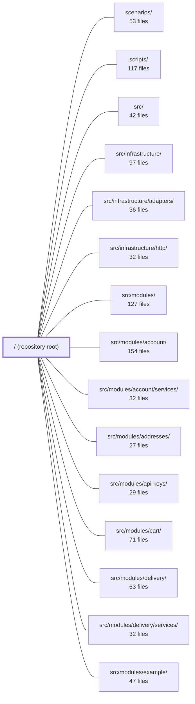

---
tags:
  - 2brain
  - 2brain/module
  - project/boilerplate-node-backend
type: module
module: / (repository root)
files: 515
updated: 2026-10-29T19:18:57.261226+00:00
---

# / (repository root)

## Purpose

The repository root holds the project-level identity, deployment orchestration, observability stack, and generated API contracts for an Express 5 + TypeScript + Mongoose REST API. It is the "shell" that wraps the application code: it defines how the service is built, deployed, observed, backed up, and contracted to external consumers.

## Key parts

- **Identity & onboarding docs** — `README.md`, `CLAUDE.md`, `INSTALL.md`, `SECURITY.md` describe the project's architecture philosophy (contract-first, modular, observable), the external prerequisites (accounts, keys, domains), and the vulnerability-reporting channel.
- **Generated AsyncAPI contracts** — `asyncapi.yaml` and `asyncapi.public.yaml` are the single, versioned source of truth for all SSE streams, webhooks, and RabbitMQ job-queue messages. They are produced by `npm run contracts:bundle` from per-module fragment files and feed the type-generator, Spectral lint rules, and downstream consumers. Never hand-edited.
- **Compose stacks** — `docker-compose.yml` (local/CI dev stack with hot-reload, demo data, optional observability), `docker-compose.production.yml` (the four-service production unit consumed by `docker/deploy.sh`), `docker-compose.proxy.yml` (shared Traefik overlay for multi-client hosts), and `docker-compose.test.yml` (wired gate for external-service code paths).
- **Deployment & ops scripts** (`docker/`) — `deploy.sh` (single-command deploy with auto-rollback), `deploy-drill.sh` (end-to-end rollback verification), `boot-check.sh` (fail-closed image smoke-test), `mongo-entrypoint.sh` / `mongo-init.js` / `mongo-rs-init.sh` (MongoDB bootstrap and replica-set initiation), and `install-supercronic.mjs` (cron binary provisioning).
- **Backup pipeline** (`docker/backup/`) — A complete scheduled-backup system: `entrypoint.sh` (supercronic PID 1), `backup.sh` (mongodump → restic), `restore-drill.sh` (throwaway restore verification), `drill.sh` (CI integration gate), `maintenance.sh` (restic upkeep), and `server-maintenance.sh` (cross-client snapshot pruning).
- **Observability stack** (`docker/observability/`) — Configs and provisioning for Prometheus, Alertmanager, Loki, Tempo, OpenTelemetry Collector, Promtail (Docker and Podman variants), Grafana datasources/dashboards, and Umami analytics, plus `validate-configs.sh` to catch image/config drift.
- **Docs site** (`docs/`) — VitePress-powered documentation with sidebar navigation, Mermaid rendering, and API workflow pages.

## How it connects

- **`src/` and its sub-modules** (`src/modules/*`, `src/infrastructure/*`) are the application code that the Compose stacks deploy and the observability stack instruments. Each module contributes an AsyncAPI fragment that the root-level `contracts:bundle` step aggregates into `asyncapi.yaml`.
- **`scripts/`** houses the `contracts:bundle`, type-generation, and lint tooling referenced by the root's contract files and CI workflow.
- **`scenarios/`** likely contains the end-to-end integration test scenarios that `docker-compose.test.yml` and `boot-check.sh` exercise against a running stack.
- The root's `docker/` infrastructure is the execution environment for all `src/` code in production; the backup and deploy scripts operate on the image that `src/` is built from, without modifying its source.

## Where to start

1. **`README.md`** — gives the one-paragraph architecture summary (Express 5, TypeScript, Mongoose, contract-first, modular, observable) and the top-level `npm run` commands, so you understand the shape before diving in.
2. **`docker-compose.yml`** — reading the dev stack reveals every service the API depends on (Mongo, Redis, RabbitMQ, optional Prometheus/Grafana), the environment variables that wire them together, and the volume/network topology that the rest of `src/` assumes at runtime.

## Connected modules

[[boilerplate-node-backend_scenarios|scenarios/]] · [[boilerplate-node-backend_scripts|scripts/]] · [[boilerplate-node-backend_src|src/]] · [[boilerplate-node-backend_src_infrastructure|src/infrastructure/]] · [[boilerplate-node-backend_src_infrastructure_adapters|src/infrastructure/adapters/]] · [[boilerplate-node-backend_src_infrastructure_http|src/infrastructure/http/]] · [[boilerplate-node-backend_src_modules|src/modules/]] · [[boilerplate-node-backend_src_modules_account|src/modules/account/]] · [[boilerplate-node-backend_src_modules_account_services|src/modules/account/services/]] · [[boilerplate-node-backend_src_modules_addresses|src/modules/addresses/]] · [[boilerplate-node-backend_src_modules_api-keys|src/modules/api-keys/]] · [[boilerplate-node-backend_src_modules_cart|src/modules/cart/]] · [[boilerplate-node-backend_src_modules_delivery|src/modules/delivery/]] · [[boilerplate-node-backend_src_modules_delivery_services|src/modules/delivery/services/]] · [[boilerplate-node-backend_src_modules_example|src/modules/example/]] · … and 13 more

## Files
- `CLAUDE.md` — Contracts are edited at the leaves and generated everywhere else. The order is not optional:
- `INSTALL.md` — What this backend needs from outside the code before it is yours: an account, a key, a domain, a
- `README.md` — > Express 5 + TypeScript + Mongoose REST API. Contract-first, modular, observable.
- `SECURITY.md` — Please report security vulnerabilities through GitHub's private
- `asyncapi.public.yaml` — Auto-generated AsyncAPI 3.0.0 contract that aggregates the real-time/event-driven message definitions from all modules into a single, versioned specification. It is the source of truth for code-generation scripts and the external contract for downstream consumers of SSE streams and webhook subscriptions. It is produced by `npm run contracts:bundle` and must never be edited by hand.
- `asyncapi.yaml` — Machine-readable AsyncAPI 3.0.0 contract for all real-time and event-driven channels in the boilerplate backend (SSE streams, outbound webhooks, and RabbitMQ job queues). It is **generated** by `npm run contracts:bundle` from per-module fragment files; hand-editing it will be overwritten. It serves as the single source of truth consumed by the type-generator script, Spectral lint rules, and any client that needs to know what events the backend emits and on which transport.
- `docker-compose.production.yml` — The production deployment stack for a single client's API instance. Unlike `docker-compose.yml` (development), it runs the built image (`APP_IMAGE`), exposes no database port to the host, omits all dev observability tooling, and provisions only the four services the application requires: `app`, `cron`, `setup`, and (optionally) the bundled data services. It is the unit that `docker/deploy.sh` builds, starts, health-checks, and rolls back per client.
- `docker-compose.proxy.yml` — A Compose overlay that adds a shared Traefik reverse proxy in front of a client stack. It is layered via a second `-f` on top of `docker-compose.production.yml` so that many client stacks on the same host share one proxy instance (one `traefik` container, one set of ACME certs) while each client keeps its own data, network, and project name. It defines routing, TLS termination, and trust-proxy configuration only — no database, volume seeding, or data-plane changes.
- `docker-compose.test.yml` — Composable gate stack that proves the external-service code path (`NODE_TEST_MONGO_URI` / `NODE_TEST_REDIS_URL`) works end-to-end against services the app container did not start itself. It is the "wired" counterpart to the hermetic CI gate (which builds the image and runs `npm run complete` with no external services). Intended for manual pre-merge verification, not as a second CI job.
- `docker-compose.yml` — Defines the local (and CI) container stack for the Node.js API and its backing services. It wires together the app, database, caches, message broker, and optional observability/analytics services into a single `compose up` experience that is hot-reloadable, seeded with demo data, and compatible with both Docker and Podman.
- `docker/backup/backup.sh` — Orchestrates a single scheduled backup run: streams a `mongodump` into restic, records the per-collection counts from the dump log, backs up the uploads and mail-spool directories, then applies retention via `restic forget`. Scheduled by supercronic on `BACKUP_SCHEDULE`; the design and failure contract are documented in `docs/tools/backups.md#one-run`.
- `docker/backup/common.sh` — Shared library sourced (never executed) by the backup scripts in this stack. It centralises the configuration knobs with their defaults, sets up the restic environment, provides a Gatus heartbeat, and supplies a small set of helpers (logging, repository bootstrap, job wrapping, Mongo config-file writing, and a mongodump/mongorestore log parser).
- `docker/backup/drill.sh` — End-to-end integration drill that proves the backup system works as a whole: it spins up a production-shaped replica-set MongoDB on a private `--internal` Docker network, seeds data, runs the backup image's `backup-job` and `backup-restore-drill` scripts, verifies restic deduplication across three runs, restores into a throwaway Mongo and compares row counts, exercises the Gatus heartbeat (green on success, red on failure), and tests the cron scheduler (active and dormant). It is the single command (`npm run backup:drill`) that CI runs to confirm nothing in the backup pipeline is broken.
- `docker/backup/entrypoint.sh` — Entrypoint for the `backup` Docker service. It translates a small set of environment-variable "knobs" into a crontab file, validates that crontab, then `exec`s **supercronic** as PID 1 to run the scheduled backup jobs. An empty `BACKUP_REPOSITORY` yields a dormant (no-op) container that still reports healthy.
- `docker/backup/maintenance.sh` — Weekly restic repository upkeep, scheduled by supercronic via `BACKUP_CHECK_SCHEDULE`. It reclaims space from previously forgotten snapshots and reads a rotating slice of stored data to surface corruption well before a restore would be needed.
- `docker/backup/restore-drill.sh` — Performs a full restore drill against a **throwaway** MongoDB instance and a temp directory to prove the latest backup snapshots are actually restorable and byte-identical, then reports elapsed wall-clock time as the estimated shop-downtime on a bad day. Never touches the live database. Exits 0 only if every step passes.
- `docker/backup/server-maintenance.sh` — Scheduled maintenance script (run by supercronic on `BACKUP_SERVER_SCHEDULE`) that prunes and integrity-checks every client's restic repository stored on the backup server's local disk. It is the **only** code path that deletes old snapshots, because the application side of each client is append-only and never issues `forget`.
- `docker/boot-check.sh` — Integration smoke-test that boots a production Docker image against a real MongoDB container and proves two things unit tests cannot: the image starts with fail-closed config and answers `/livez`, and the runtime `node` user cannot write under `/app/src/`. Used by both CI (`boot` job) and local development so the proof cannot drift between environments.
- `docker/deploy-drill.sh` — End-to-end integration drill that exercises `docker/deploy.sh` against the real production Compose file using a throwaway client (generated secrets, unique project name). It verifies the full deploy → broken-deploy (auto-rollback) → second-deploy → manual `--rollback` lifecycle, asserting container state, log entries, and a live `/livez` endpoint after each step. Invoked via `npm run deploy:drill`.
- `docker/deploy.sh` — Single-command deploy/rollback script for one client's production stack. It brings up (or re-runs) the compose-defined services against a specific image, polls until the stack is provably healthy, and — if it is not — restores the last known-good image. All successful states are appended to a per-client log that doubles as the sole rollback history.
- `docker/install-supercronic.mjs` — Downloads the **supercronic** static binary, verifies it against a pinned SHA-256 digest, and installs it at `/usr/local/bin/supercronic` during Docker image builds. It is written in Node (rather than a shell script) because Node is the single tool guaranteed present in both the Alpine and Debian-slim base images. Supercronic replaces busybox `crond` because `crond` requires `CAP_SETGID` to reset supplementary groups per job, which breaks under the unprivileged `node` user.
- `docker/mongo-entrypoint.sh` — Wrapper around the official MongoDB image's `docker-entrypoint.sh` that guarantees the replica-set keyFile and wire-TLS certificates exist (with correct ownership) before mongod starts. It replaces an earlier one-shot Compose service because podman-compose 1.6 / libpod refuses to start containers that transitively depend on an already-exited container; wrapping the entrypoint avoids that dependency chain entirely.
- `docker/mongo-init.js` — One-time MongoDB bootstrap script that runs only against an empty data directory (via `docker-entrypoint-initdb.d`). It creates least-privilege application and backup users so the app never authenticates as the instance root, limiting blast radius if a connection string leaks.
- `docker/mongo-rs-init.sh` — One-shot Compose service that initiates the `rs0` replica set on the `database` container and blocks until that node becomes PRIMARY. It exists because MongoDB's own entrypoint init-scripts run against a temporary standalone mongod (no `--replSet` flag), so `rs.initiate()` is impossible there; this script targets the real, replSet-enabled instance after it has already started.
- `docker/observability/alertmanager-render.sh` — Renders `alertmanager.config.template.yaml` into a final `alertmanager.yml` by substituting environment variables and stripping inactive receiver groups, then optionally `exec`s Alertmanager as the container's main process. Written in POSIX sh (busybox, no bash, no `envsubst`) so it runs inside the Alertmanager container image itself.
- `docker/observability/alertmanager-routes-test.sh` — End-to-end test that verifies the rendered Alertmanager routing and inhibit rules work as intended for every combination of notification "knobs" (email, webhook, heartbeat). It renders the config template, validates it with `amtool check-config`, asserts receiver routing with `amtool config routes test`, and—because `amtool` has no static inhibit-rule check—spins up a live Alertmanager daemon to confirm which alerts are suppressed. Designed to run inside the `prom/alertmanager` image, which ships `amtool` and `busybox`.
- `docker/observability/grafana.dashboard-providers.yaml` — Grafana provisioning file that tells Grafana where to find dashboard JSON files on the filesystem. It exists so that dashboards stored in the repository are auto-loaded at container startup without any manual import in the Grafana UI.
- `docker/observability/grafana.datasources.yaml` — Grafana datasource provisioning file that auto-wires Grafana to the three backends (Tempo, Prometheus, Loki) on container start, eliminating the need for manual UI configuration on every restart.
- `docker/observability/loki.config.yaml` — Local single-node Loki configuration for the development observability stack. It configures Loki to use filesystem-backed storage with no external dependencies, providing log ingestion (via Promtail), querying (via Grafana), and optional alert-rule evaluation with a one-week retention window.
- `docker/observability/otel-collector.config.yaml` — Configures the OpenTelemetry Collector as the telemetry gateway between the application and backend stores. It defines two pipelines: a trace pipeline that forwards app spans to Tempo, and a metrics pipeline that exposes derived service-graph metrics (request rate, error rate, latency between services) for Prometheus scraping.
- `docker/observability/prometheus.alert-rules.yaml` — Defines the full set of Prometheus alert rules for the local API stack, covering availability, error rate, latency, saturation, memory pressure, queue/outbox failures, webhook delivery, and scheduled-job liveness. These are the actionable SRE thresholds that complement the visual dashboards.
- `docker/observability/prometheus.config.yaml` — Prometheus's main runtime configuration. It declares which targets to scrape, how often to evaluate rules, where to send firing alerts, and which rule files to load. Without it Prometheus starts with no targets, no alert routing, and no rule evaluation.
- `docker/observability/promtail.config.yaml` — Promtail scrape and pipeline configuration that reads Docker `json-file` container logs from a host bind mount, parses both the Docker envelope and the inner Winston/OTel JSON payload, promotes key fields to labels, and pushes structured logs to Loki. It is the default Promtail config selected by the Compose stack.
- `docker/observability/promtail.podman.config.yaml` — Promtail scrape configuration for environments using **rootless Podman** instead of Docker. Podman's `k8s-file` log driver writes CRI-formatted logs to a different path layout than Docker's JSON driver, so a separate Promtail config is required. It is selected at runtime via `PROMTAIL_CONFIG=promtail.podman.config.yaml` in `.env`.
- `docker/observability/tempo.config.yaml` — Tempo server configuration for the local development stack. It pins all non-default settings—listening ports, OTLP ingest endpoints, block lifecycle, and the local-disk storage backend—so Tempo can run as a single container with zero external dependencies while still accepting real OTLP traffic from the collector.
- `docker/observability/umami-init.sh` — One-shot Postgres init script that stamps the admin username/password (and a default website row) from environment variables onto Umami's factory-seeded admin account, so the stack is ready to log in immediately after first boot without manual steps.
- `docker/observability/validate-configs.sh` — Validates every observability tool config (otel-collector, Loki, Alloy, Promtail, Caddy) against the **exact image tag** named in the compose file that mounts it. This prevents a scenario where an image version bump and a config the new version rejects land in separate commits.
- `docs/.vitepress/config.mts` — VitePress site configuration for the project's documentation. It defines the site identity, navigation bar, sidebar structure, and enables local search and Mermaid diagram rendering. All content routing for the docs site flows through this single file.
- `docs/.vitepress/theme/index.ts` — VitePress custom theme entry that extends the default theme to add a click-to-zoom overlay for Mermaid diagrams. It hooks into the `enhanceApp` lifecycle to attach click handlers to `.mermaid` elements as they render (client-side, post-load) and displays them in a full-screen dialog.
- `docs/api/contract-fragmentation.md` — [OpenAPI Workflow](./openapi-workflow.md) covers **how to change** the contract. This page covers
- `docs/api/regenerating.md` — The cheat sheet for "I edited a fragment — now what?".
- `docs/modules/webhooks.md` — ::: tip At a glance
- `docs/reference/tests.md` — Every file here is a distinct guarantee, which is why this page names them one at a time: knowing
- `docs/theory/strategic-ddd.md` — The part of Domain-Driven Design that pays for itself in a starter kit** — bounded contexts,
- `docs/tools/mutation-testing.md` — Every other layer on this site answers "does the code do the right thing?" This one answers a different question: **do the _tests_ actually notice when it doesn't?** Line coverage can be satisfied by executing a line without asserting anything about its result; mutation testing can't — it edits the source thousands of times (`>` to `>=`, `&&` to `||`, a function body emptied out) and reports every edit the suite failed to catch. A **surviving mutant** is a bug the tests are structurally blind to.
- `eslint.config.ts` — The ESLint flat-config entry point for the entire project. It composes presets (ESLint recommended, typescript-eslint strict/stylistic type-checked, Unicorn, Prettier off-switch), defines project-specific banned-syntax rules as reusable arrays, and layers scoped overrides for tests, scripts, and generated files. It exists so that `npm run lint` enforces a single, consistent rule set across all source with no per-directory `.eslintrc` files.
- `jest.config.broker.js` — Jest configuration for the broker (RabbitMQ) test suite, invoked via `npm run test:broker`. It exists because the base `jest.config.js` defaults—rate-limit setup, mongod bootstrap, 30 s timeout—are irrelevant or insufficient for queue-adapter tests that manage their own environment and depend on real TTLs.
- `jest.config.cluster.js` — Dedicated Jest configuration for the cluster integration suite (`npm run test:cluster`). It exists as a separate file (not another directory under the main config) because the defaults in `jest.config.js` are each specifically wrong for cluster tests — setup would interfere, shared infrastructure would be unreachable from spawned child processes, and the default timeout is too short for real cluster boot + Redis image pulls.
- `jest.config.js` — Base Jest configuration for the unit-test run. It exists as a CommonJS `.js` file (rather than `.json`) so each setting can carry an inline explanation, and so it can perform runtime logic (reading `.env`, computing worker counts). It is the parent config that `jest.config.cluster.js`, `jest.config.broker.js`, and `jest.config.mutation.js` extend. Coverage is deliberately not measured here; the project tracks mutation score instead.
- `jest.config.mutation.js` — A Jest configuration dedicated to Stryker mutation testing (`npm run mutation`, `npm run mutation:full`). It exists because the default `jest.config.js` uses ts-jest, whose LanguageService cache grows with every mutant until the worker is OOM-killed. This file swaps ts-jest for the transpile-only `@swc/jest` (type-checking is already covered by `npm run ts-check`) and collapses the worker pool to one to avoid multiplicative resource exhaustion under Stryker's own concurrency.
- `knip.config.ts` — TypeScript configuration for [Knip](https://knip.dev), a tool that walks imports from entry points to surface unused files, exports, and dependencies. This file only declares things Knip's own plugins cannot discover (non-import entry points, runtime-loaded deps, spawned binaries); the results it produces are *candidates* for the `code-shape` audit to judge, not verdicts.
- `openapi.yaml` — A **generated** OpenAPI 3.1.0 document that serves as the single, stable API contract for the Boilerplate API. It is the source for client/server codegen, SDK generation, and contract testing. It does not hand-author endpoint behavior; it is the output of a bundling step that merges a root spec with per-module specs.
- `orval.config.ts` — Orval build configuration that generates typed TypeScript models and Zod validators from `openapi.yaml`. It produces only the `zod` client flavor (schema/type definitions) because the project consumes generated types and validators but has no in-repo HTTP-client caller.
- `package.json` — Root manifest for **boilerplate-node-api-mongodb-mongoose** (v3.0.0). Declares the project's runtime and dev dependencies, and defines the full set of npm scripts that drive development, testing, linting, codegen, CI gates, container orchestration, and benchmarking for an Express 5 / Mongoose 9 REST + AsyncAPI service.
- `public/favicon/safari-pinned-tab.svg` — Static vector icon displayed by Safari when the user pins a site to their toolbar. It exists so that pinned-tab users see a crisp, resolution-independent glyph rather than a raster favicon. It is referenced from the HTML `<head>` (typically via a `<link rel="mask-icon" …>` tag) and is never loaded by application code.
- `shared/authorization-conformance.yaml` — A conformance contract defining authorization decisions that both backend implementations (CASL in Node, spatie/laravel-permission in PHP/Laravel) must answer identically. It is committed byte-for-byte into `boilerplate-node-backend` and `boilerplate-php-laravel-backend`; each repo runs every case against its own evaluator. The file's primary value is its **deny** cases—`allow` entries exist only as controls proving a neighboring deny was earned by a rule, not by an evaluator that refuses everything.
- `shared/authorization-keys.yaml` — Generated bundle of every permission rule and permission set in the system, spliced from per-module fragments (`src/modules/<name>/authorization.yaml`) by `npm run regenerate`. It is the single source of truth for the authorization vocabulary (actions, implies, scopes, step-up tiers) and the concrete rules that guards evaluate. Committed byte-identical in both `boilerplate-node-backend` and `boilerplate-php-laravel-backend`; `--check` (wired into `complete`) fails the build if the bundle drifts from its source fragments.
- `shared/authorization-roles.yaml` — Defines the preset roles (and their permission-set lists) that both the Node and PHP-Laravel boilerplate implementations seed into their stores on first deployment. It exists because the two backends store roles differently (Spatie table vs. no table), so without this shared source-of-truth their independent seeders would produce divergent products that both pass conformance tests. It is a starting point for a deployment, not a schema — roles may be edited after seeding.
- `shared/contracts/asyncapi.root.yaml` — The service-level preamble for the AsyncAPI 3.0.0 contract. It declares facts about the backend as a whole — version, identity, contact, license, tags, and default content type — so that no module fragment has to restate them. It is the async twin of `openapi.root.yaml` and is merged with module sections by the bundler to produce the final AsyncAPI documents.
- `shared/contracts/asyncapi.workers.yaml` — A standalone AsyncAPI 3.0.0 document that declares the application-level worker queues (`worker.email.send`, `worker.image.digest`) which do not belong to any single domain module. It exists so these cross-cutting job contracts live beside the root contract rather than being trapped inside whichever module happens to enqueue the most jobs, and so they can be linted independently via `npm run lint:asyncapi:modules`.
- `shared/contracts/openapi.root.yaml` — Root OpenAPI 3.1.0 document for the "Boilerplate API". It defines the global contract surface that every module fragment inherits: the API's i18n and response-shape conventions, the shared error-code catalogue, app-level error responses that no single module owns, server URLs, and the base security scheme. Module fragments (e.g. `src/modules/*/openapi.yaml`) are merged into this document by the bundler to produce the final published spec.
- `shared/contracts/spectral.asyncapi.modules.yaml` — Spectral ruleset for linting **individual** AsyncAPI section files (`src/modules/<name>/asyncapi.yaml`, `shared/contracts/asyncapi.workers.yaml`) in isolation via `npm run lint:asyncapi:modules`. It selectively disables rules that check service-wide facts already declared once in the root contract, so each section can be validated as a standalone document without being penalised for not restating the full service identity.
- `shared/contracts/spectral.modules.yaml` — Spectral linting configuration for individual module OpenAPI files (`src/modules/<name>/openapi.yaml`). It relaxes the rules that assume a file describes an entire deployed API (global tags, security schemes, servers, `info` prose) because those concerns are declared once in the root contract rather than restated by every module. Used by `npm run lint:openapi:modules`.
- `shared/contracts/spectral.yaml` — Spectral (OpenAPI linter) ruleset that enforces the project's API contract conventions. It extends `spectral:oas` and adds custom rules covering security declaration, naming, error/response shape, and schema hygiene so that contract drift is caught at lint time rather than in review.
- `shared/rules/schemas/audit-actions.schema.json` — JSON Schema (draft 2020-12) that validates the structure of audit-action rule definitions. It enforces that every action entry carries a namespaced `security.*` identifier and a human-readable description, ensuring a consistent vocabulary across audit rules in the shared rules directory.
- `shared/rules/schemas/defaults.schema.json` — JSON Schema (draft 2020-12) that validates a top-level `defaults` configuration object. It enforces the structure, types, and allowed ranges for runtime default values across five subsystems (response cache, idempotency, pagination, images, uploads), ensuring any consumer of these defaults receives a fully-typed, strictly-shaped payload.
- `shared/rules/schemas/frontend-links.schema.json` — A JSON Schema (draft 2020-12) that validates the shape of a frontend-links configuration object. It enforces that every required navigation/action route key is present, non-empty, and that no undocumented keys are added. It also validates an accompanying list of static pages. This exists so that any tooling or validation step can check frontend link configuration files against a single source of truth.
- `shared/rules/schemas/images.schema.json` — JSON Schema (draft 2020-12) that validates a configuration object describing supported image formats and their binary detection rules (magic bytes, MIME types, extensions, re-encodability). It exists to ensure any image-format definition consumed by the system conforms to a strict, self-describing contract before use.
- `shared/rules/schemas/jobs.schema.json` — A JSON Schema (draft 2020-12) that validates the structure of a jobs configuration object. It enforces that every declared job carries a properly namespaced name, a standard five-field cron schedule, and a non-empty summary, while forbidding any unknown keys at every level.
- `shared/rules/schemas/log-redaction.schema.json` — JSON Schema (draft 2020-12) that validates the log-redaction configuration object used by the application logger. It ensures any redaction config supplies all four required field lists and rejects unknown keys, so the logger never runs with a partially specified or malformed redaction rule set.
- `shared/rules/schemas/metrics.schema.json` — JSON Schema (draft 2020-12) that validates a metrics definition file. It enforces the structure, naming conventions, and allowed field set for a collection of Prometheus-style metrics so that metric declarations across the codebase conform to a single canonical shape.
- `shared/rules/schemas/outbox.schema.json` — A JSON Schema (draft 2020-12) that validates the shape of the `outbox` configuration section. It enforces strict, non-nullable integer values for the five outbox tuning knobs (retention, retry, lease, and backoff parameters) and rejects any unexpected keys at both the top level and the `outbox` object level.
- `shared/rules/schemas/rate-limits.schema.json` — JSON Schema (draft 2020-12) that validates the shape of a rate-limit configuration file. It enforces a single top-level `rateLimits` object whose entries each declare a named limiter with a namespace, the env-var that overrides its cap, a default max, a time window, bound type, audit flag, and an optional store-error fallback.
- `shared/rules/schemas/semantic-log-names.schema.json` — A JSON Schema (draft 2020-12) that validates an object exposing a single required `semanticLogNames` map. It enforces the key naming convention and value shape for semantic log name entries, serving as the machine-checkable contract for any configuration or manifest file that declares those names.
- `shared/scenarios/schemas/personas.schema.json` — JSON Schema (draft 2020-12) that defines the shape of test-scenario persona data. It constrains the credential, membership, and account-state fields for each named persona (admin, user, editor, moderator, unverified) so that scenario fixtures are validated before use.
- `stryker.json` — Configuration file for [Stryker Mutator](https://stryker-mutator.io/), a mutation-testing framework. It defines which source files to mutate, which Jest test suite to run against each mutant, how results are reported, and what performance/threshold limits apply. It is consumed by the CI mutation-testing workflow.
- `tests/broker/queue-broker.test.ts` — Integration test for the queue adapter (`src/infrastructure/adapters/queue.ts`) run against a **real** RabbitMQ broker. It covers behaviors only a live broker can confirm: topology declaration of quorum queues, retry republish carrying the `x-retry-attempt` header, dead-letter parking after delivery-limit exhaustion, and the idempotent-declare path. It is the complement to `tests/unit/infrastructure/adapters/queue.test.ts`, which mocks `amqplib` and only verifies the arguments handed to the broker.
- `tests/broker/support/rabbitmq.ts` — Test-support module that provisions a RabbitMQ broker (either an externally-supplied instance or a locally-spawned container) scoped to a unique virtual host per run. It exposes an AMQP URL, a narrow management-API client, and a teardown handle so the broker test suite can exercise the queue adapter against a real broker without polluting state between runs.
- `tests/cluster/rate-limit.test.ts` — Cluster-level integration test that proves the rate limiter enforces **one** shared budget across all worker processes when counters live in Redis, and (as a control) demonstrates the per-worker doubling that occurs with the default in-memory store. It exists because no single-process test can distinguish a shared counter from a per-process one, so a regression to the in-memory store would otherwise pass every test in the repository.
- `tests/cluster/redis-idle.test.ts` — Guards against a specific production bug: node-redis' `socketTimeout` is an *idle* timer, so without a keepalive ping a healthy shared client gets closed after one quiet second and the cache layer reports it as `unavailable` between requests. This test proves the client created by the production adapter survives past that 1 s ceiling and still answers a `PING`.
- `tests/cluster/support/cluster.ts` — Boots the real `src/cluster.ts` as a spawned child process with forked worker processes, a dedicated ephemeral MongoDB, and a dynamically allocated TCP port. It exists because every other test suite in the repo runs the app in a single process (supertest against a mounted Express app) and therefore cannot observe bugs that only manifest across workers—e.g. a per-process counter that looks correct to one worker but is wrong when summed across the cluster.
- `tests/cluster/support/redis.ts` — Provides the cluster test suite with a disposable Redis instance. It either points at a Redis already supplied by the environment (CI service container) or spins one up via the repo's own container-engine abstraction, then waits for readiness before handing back a connection URL and a `stop` handle.
- `tests/contract/authorization-contract.test.ts` — Table-driven authorization sweep that asserts two invariants over every mounted route in one place: (1) any route with an identity guard returns **401** to a callerless request, and (2) any route behind `requirePermission` returns **403** to exactly the tenant personas that lack its permission rule, as derived by `holds`. This replaces 40+ duplicated 401/403 assertions that would otherwise live in each module's own contract file, and makes "should this role reach this route" a fact derived from the role model rather than a hand-maintained expectation.
- `tests/contract/cookie-auth.test.ts` — Contract test for the **cookie-auth** alternative. Every other suite authenticates via `transport: 'bearer'`; this file is the only one that exercises the `cookieAuth` path — a browser-like client that carries a session cookie instead of a bearer token. It asserts the two obligations declared for that mode: reads succeed, and unsafe methods (PATCH) from a foreign origin receive the declared `403`.
- `tests/contract/idempotency.test.ts` — Integration test that exercises the `Idempotency-Key` middleware against a real database through `POST /tickets`. It verifies the three observable branches — successful replay, replayed refusal, and key-mismatch/conflict — plus the edge cases of malformed keys and absent keys. Complements the pure-logic unit test in `tests/unit/…/idempotency.test.ts` by covering the full HTTP + DB round-trip.
- `tests/contract/ownership-contract.test.ts` — Contract test that verifies **ownership (IDOR) protection** on the foundation families (saved addresses, login sessions): a customer who sends another customer's ID in a path or body receives a 404 indistinguishable from a nonexistent ID. It also enforces **completeness** — every ID-typed property the mounted routes and `openapi.yaml` expose to a customer must appear in exactly one `owned-ids.ts` family, and no stale or duplicate entries may exist.
- `tests/contract/ownership-shop.contract.test.ts` — Contract test that verifies the "shop half" of the ownership boundary: when Customer B references Customer A's order, payment, refund, credit note, shipment, fulfillment order, return, or notification—whether in the URL path, the request body, or a list filter—the HTTP response is indistinguishable from a non-existent id (404). It exists as a separate file because the `demo:remove` script deletes every test that imports a shop module, and this file must not be caught by that sweep.
- `tests/contract/password-set-paths.test.ts` — System-scoped contract test that guarantees every code path writing a password performs the same breach-check, exercised over real HTTP routes. It covers the three owner-side entry points (signup, authenticated change, token-based reset/setup) and includes a canary that pins the *exact* set of password-setting routes against the bundled OpenAPI spec, so a new route that writes a password cannot appear without also gaining a breach-check case.
- `tests/contract/product-write.test.ts` — Contract tests for the multilingual product write surface over real HTTP: `POST /products`, `PUT /products/{id}`, and the `translations` map on `GET /products/{id}`. It lives at the top-level `tests/contract/` directory (not under `src/modules/products/tests/`) because driving these routes requires a real `locales` collection row, which the `products` module may only reach through the `kernel/translation.ts` port.
- `tests/contract/request-contract.test.ts` — Contract-derived **request** tests: for every write endpoint, does the API accept every payload its own OpenAPI spec declares legal (expect 2xx) and reject exactly what it declares illegal (expect 422 + `Problem` body)? Also sweeps every `in: query` parameter constrained by `enum` or `pattern` for a 422 on a violating value. This is the mirror image of the response-contract tests — instead of comparing a real response to the spec, it sends spec-derived requests at the real API.
- `tests/contract/request-sources.test.ts` — Statically verifies that every controller's declared request sources (via `readInput` / `surface:`) are a **subset** of the sources the OpenAPI spec declares for the corresponding operation (`in: path` / `in: query` / `requestBody`). It automates the manual comparison that previously uncovered five undocumented-input bugs, and does so entirely by regex-reading source files—no server is booted, no runtime modules are imported.
- `tests/contract/route-spec-parity.test.ts` — Contract-parity test that asserts the set of HTTP operations the app actually mounts (read from live Express routers via the module registry) is identical to the set of operations declared in the bundled `openapi.yaml`. It checks both directions — no undocumented endpoints, no unfulfilled declarations — plus a no-duplicates guard and a vacuous-pass guard.
- `tests/contract/system.test.ts` — Contract tests for system-level routes (`/`, `/livez`, `/readyz`, `/.well-known/security.txt`) and the shared error-document shape. Verifies that each endpoint returns the expected status code, content type, and body structure regardless of internal implementation.
- `tests/contract/unknown-query-params.test.ts` — Contract test verifying that list endpoints reject unknown query parameters with a **422** instead of silently dropping them and returning unfiltered data. Each route is paired with a control request (same path, no stray param → 200) so the 422 is attributable to the parameter, not to a route that rejects everything. Guards against a class of bug where a typo'd or stale filter name is ignored and the caller receives the full table as though the filter had been honoured.
- `tests/contract/write-methods.test.ts` — Cross-module HTTP contract tests for write-method invariants defined in `docs/api/write-methods.md`. It pins rules that hold across every module—empty-string rejection (422), Content-Type enforcement (415), idempotent replay, `Location` on 201, conditional `If-Match`/`ETag` (RFC 9110 §13.1.1), and `If-None-Match` 304 revalidation—by sending real HTTP requests against a live test database. Module-specific write rules live in each module's own tests.
- `tests/cross-cutting/account-protection-routes.test.ts` — Guarantees that the account-protection matrix is **complete and non-overlapping**: every state-changing (write) route mounted on the `users` module must appear as either a `PROTECTION_ROWS` entry or a `UNOWNED_WRITES` exemption, and nothing listed may be stale or duplicated. The rule is only as strong as the route table it is asked against.
- `tests/cross-cutting/account-protection.test.ts` — Integration test that verifies the staff-account protection rule end-to-end: a caller holding a users permission key may modify a plain customer's account, but may modify an account that holds a staff role **only** if that caller also holds `assign:Role` (which, among preset roles, only the administrator does, and no API key can hold). Every row in the shared protection table is exercised against every account kind and every role that holds the row's key, plus a dedicated API-key suite.
- `tests/cross-cutting/alert-rules-metrics.test.ts` — Guards against a silent failure mode: an alert rule that references a misspelled or renamed metric, which Prometheus would evaluate as an empty vector and simply never fire. The test cross-references every `*_total` counter read by alert-rule expressions against the `name:` literals actually registered in `src/`, catching typos before they go unnoticed.
- `tests/cross-cutting/analytics-events.test.ts` — Cross-cutting test that sweeps every `src/modules/<name>/analytics.ts` file to enforce a single, collision-free analytics vocabulary. Because all event names are reported into one shared Umami website, a name claimed by two modules produces indistinguishable rows. This file is the analytics counterpart to `audit-actions.test.ts` and guards both the browser-reported names (declared per module for `POST /analytics/events`) and the server-emitted ones.
- `tests/cross-cutting/api-key-authentication.test.ts` — Proves that an `sk_…` API-key credential actually clears the identity guard (`isAuthOrCredential`) on the real mounted Express chain and reaches the permission check below it — the "middle link" that neither the api-key unit suite nor the session-based contract suite covers. A second half scans each module's `routes.ts` source to assert that exactly one identity guard is mounted per module, preventing the state where some routes admit credentials and others do not with no rule saying which.
- `tests/cross-cutting/api-key-security.test.ts` — Cross-cutting consistency test that verifies the OpenAPI spec's `security` declarations for `apiKeyAuth` match the actual route guards. For every mounted route present in the spec, it asserts that `apiKeyAuth` appears in the operation's security list **if and only if** the route mounts `isAuthOrCredential` and none of its permissions require step-up (which an API key cannot satisfy). This catches drift in either direction: a guard added/removed without updating the spec, or a spec listing `apiKeyAuth` on a route that no longer admits it.
- `tests/cross-cutting/api-standards.test.ts` — Enforces four REST API conventions (lifecycle `actions`, presenter isolation, 409 error codes, paged-list sorting) as automated checks that read directly from source files — module `openapi.yaml` fragments and `.ts` files — so a failing test always names a file a developer edits. It exists to prevent a new module from shipping half-compliant with the API standards documented in `docs/theory/tactical-ddd.md`, `docs/api/write-methods.md`, and `docs/api/sorting.md`.
- `tests/cross-cutting/audit-actions-registered.test.ts` — Verifies that every auditing module's actions are registered in the app-wide `AuditAction` union via their `declare module` augmentation. The check is enforced at **type-check time** (the static imports must resolve against the union) and at **runtime** (each action's string value matches its expected wire format). It exists to catch a missing `declare module` augmentation that would otherwise let the owning module compile in isolation while silently breaking every `emitAuditEvent` call site.
- `tests/cross-cutting/audit-actions.test.ts` — Cross-cutting test that validates the audit-action vocabulary across every module structurally, without naming any domain. It guards four failure modes that no per-module test can catch: duplicate action strings, naming-convention violations, undiscovered audit files, and unexplained absence of an `audit.ts`.
- `tests/cross-cutting/authenticated-controllers.test.ts` — Cross-cutting invariant test that closes a gap TypeScript cannot: a controller asserting `request.authContext!` (non-null) claims its route is behind `isAuth`, but whether the *route* actually carries that guard lives in routing code, not in types. This file verifies that claim by cross-referencing source-level assertions with the resolved Express middleware stack. A second invariant ensures every `requirePermission` behind `isAuthOrCredential` asks for a tenant-scoped, owner-agnostic rule (since credential callers carry no `authContext` at all).
- `tests/cross-cutting/authorization-conformance.test.ts` — Runs a shared set of authorization allow/deny cases (defined in `shared/authorization-conformance.yaml`) against this repository's CASL-based evaluator, verifying that the TypeScript twin and its PHP/Laravel twin agree on the same policy decisions. The file is committed identically in both backends and nothing syncs it; each side simply points at the same committed bytes. It also enforces "floor" minimums so a silently empty or truncated YAML file cannot produce a vacuously green suite.
- `tests/cross-cutting/authorization-keys.test.ts` — Validates the internal consistency of the permission vocabulary that every backend reads. Where the adjacent conformance suite proves two backends *agree*, this suite proves the shared artefacts (`PERMISSION_RULES`, `PERMISSION_SETS`, `PRESET_ROLES`, `AUDIENCE_ROLES`) are not self-contradictory: every ID is well-formed, every rule is reachable, every role references only declared rules, and the runtime guard `assertDeclared` rejects unknown combinations.
- `tests/cross-cutting/browser-events.test.ts` — Cross-cutting test that enforces agreement between a module's browser-event contract fragment (`openapi.browser-events.yaml`) and its manifest declaration (`AppModule.browserEvents`). A mismatch means the contract accepts an event the relay can't emit, or the relay declares an event the contract never admits.
- `tests/cross-cutting/ci-covers-the-gate.test.ts` — Guards against drift between the local pre-commit gate (`npm run complete` chain) and the CI workflow definitions. If a check reaches the gate but has no corresponding CI job, a contributor using `--no-verify`, a machine without husky, or a PR from a fork bypasses it while CI stays green. This test asserts the CI "backstop" is complete.
- `tests/cross-cutting/contract-aliases.test.ts` — Validates the `x-alias-of` extension in `openapi.yaml`. When two operations express the same intent in different spellings (e.g. `DELETE /users/{id}` vs `DELETE /users/{id}/hard`), this test enforces that the annotation is honest: the alias must point at a real, non-alias, non-self operation whose success status code and response schema are identical. It exists so SDK authors can safely treat an alias as interchangeable with its canonical form.
- `tests/cross-cutting/contract-bundles.test.ts` — Cross-cutting test suite that verifies the integrity of every contract bundle in the repo. For compiled bundles (OpenAPI, AsyncAPI) it checks that fragments are non-empty, that the committed AsyncAPI documents resolve all internal `$ref`s, and that the module-section list stays in sync with `enabledModules`. For generated bundles (API client collections) it asserts the generator produces a valid document in memory rather than comparing against a committed file. The goal is to catch a silently drifting contract before it forks the two sides of a shared API.
- `tests/cross-cutting/contract-error-declarations.test.ts` — Guards the per-module OpenAPI fragments against a missing `404` response on any operation whose path template carries an id parameter. Because the contract is a shared artifact (bundled, consumed by a generated frontend client, and mirrored in a PHP twin), an undeclared status is a hard integration break, not a documentation gap. The test reads the source fragments directly so a failure names the file a developer actually edits.
- `tests/cross-cutting/contract-refs-follow-depends-on.test.ts` — Guarantees that every cross-module `$ref` in an `openapi.yaml` contract points only to a sibling that is explicitly declared in the referencing module's `module.yaml` `dependsOn`. This keeps the dependency map truthful so that deleting a module folder never leaves a dangling reference in a still-present contract.
- `tests/cross-cutting/contract-responses-never-null.test.ts` — Guarantees that no response schema in the bundled API contract admits `null` as a valid type. This enforces the read-side of the empty-value rule: a response signals "no value" by omitting the key entirely, while `null` is reserved as a write verb (PUT/PATCH "clear this" semantics).
- `tests/cross-cutting/contract-scalars.test.ts` — Verifies that shared scalar bounds declared in `infrastructure/http/schemas.ts` (page-size max, page max, hard-delete default) and the ID pattern in `infrastructure/http/ids.ts` still match every per-operation constant emitted by orval into the generated Zod module. It exists because orval flattens a single shared component into one constant per operation (~40+ identical numbers), so there is no single importable constant; this test replaces the guarantee an import would otherwise provide for free, and catches contract drift (e.g. a raised `maximum` in `openapi.yaml`) that would otherwise cause silent 422s.
- `tests/cross-cutting/contract-search-parity.test.ts` — Guarantees that the two spellings of a search operation — `GET /{resource}` (query parameters) and `POST /{resource}/search` (JSON body) — declare **identical validation constraints** on every filter. It exists to catch structural drift where a constraint added to one spelling is missing or differs in the other, a class of bug that contract-alias tests (which only verify that both routes *answer* alike) cannot detect.
- `tests/cross-cutting/credential-fields.test.ts` — Cross-cutting test that verifies no credential-shaped field (matched by a name-pattern regex) survives `toJSON` serialization on any registered Mongoose model. It exists because the only defence against publishing a password, token hash, or secret is an `omit` entry in the model's toJSON transform — a one-line omission that nothing else enforces. The test drives the transform directly (not a query) because `select: false` does not remove an already-loaded value, and it operates on a live document rather than a source sweep because the wire shape is produced at runtime by the transform.
- `tests/cross-cutting/crypto-conformance.test.ts` — Cross-cutting conformance test that verifies the TypeScript repo's four crypto primitives (pseudonymisation, HKDF subkey derivation, versioned-secret decryption, and argon2id password verification) produce byte-identical results to the PHP twin. Both repos load the same fixture set (`shared/cases/crypto.cases.yaml`) and must agree on every case.
- `tests/cross-cutting/env-booleans-conformance.test.ts` — Conformance test that verifies the TypeScript `parseBooleanWord` function answers the same set of boolean-word cases as its PHP counterpart. Both implementations are driven by the same shared YAML case file (`shared/cases/env-booleans.cases.yaml`), making this a cross-implementation contract check rather than a unit test of internal logic.
- `tests/cross-cutting/example-template.test.ts` — Guard test that enforces the `example` module's file-header convention: every non-test `.ts` source file must open with an `@module` doc comment whose first line is `In any module:`, body contains a `Here:` clause, and final line is `See: docs/…`. It exists so that any new or modified file in the template module is immediately flagged if it breaks the three-part header shape that scaffolders and humans rely on to copy the module correctly.
- `tests/cross-cutting/frontend-pairing.test.ts` — Cross-repository pairing guard. Verifies that every backend module either names its frontend counterpart as the same name (or supplies a `why` for the mismatch), and—when a paired Vue frontend is checked out—that the names claimed in this repo's descriptors match the actual module folders on the other side, in both directions.
- `tests/cross-cutting/guarded-steps-stay-unpublished.test.ts` — Enforces that any top-level declaration tagged `@internal` (a "step"—a write operation meant to run only behind its module's own guard function) never becomes visible through the module's barrel (`src/modules/<name>/index.ts`). Because no static-analysis rule can distinguish a step from its guarding door by syntax alone, the codebase uses TSDoc `@internal` as the marker, and this suite verifies the marker is sufficient: no barrel, `export *` chain, renamed re-export, object-literal bundle, or single-forward wrapper may publish an `@internal` symbol to a sibling module.
- `tests/cross-cutting/identity-guards-follow-the-spec.test.ts` — Cross-checks that the route table's identity guards and the bundled OpenAPI spec's `security` field agree in **both** directions: a route the spec marks as needing a credential must mount the guard, and a route that mounts a guard must be named in the spec. It also verifies that the non-identity guards (`cookieAuth`, `metricsBearer`) are mounted only when the spec names that scheme and the credential is not optional. Runs in the commit gate and under Stryker with no database dependency.
- `tests/cross-cutting/locale-namespaces.test.ts` — Guards the locale-merge contract: because `infrastructure` deep-merges every module's `locales/` directory onto a shared dictionary at boot, a module can silently shadow a shared key or collide with another module without producing a build error. This file asserts four invariants—discovery, no shadowing of shared keys, no inter-module collisions, and namespace ownership—so that wrong copy (not a crash) is caught at test time.
- `tests/cross-cutting/locale-parity.test.ts` — Cross-cutting test that asserts every supported locale declares an identical set of keys across the **merged** dictionary (shared file + all per-module locale files). It exists because a missing key in one language is otherwise invisible: each JSON file is valid on its own, and the gap only surfaces as a raw key printed to a user in production. The test is deliberately domain-agnostic — it holds no matter how many modules exist.
- `tests/cross-cutting/log-redaction-conformance.test.ts` — Cross-cutting conformance test that verifies the TypeScript `redactSensitiveFields` implementation produces identical results to the PHP twin, using a shared YAML case set (`shared/cases/log-redaction.cases.yaml`). It ensures both language repositories agree on which log keys are sensitive, keeping the redaction policy single-sourced.
- `tests/cross-cutting/metric-names.test.ts` — Cross-checks that metric names agree across the three places that must: module `metrics.ts` declarations, the overview controller's string-literal reads, and (externally) Prometheus/Grafana dashboards. A rename compiles and passes unit tests but silently breaks dashboards, so this test reads **source text** — not runtime exports — to catch mismatches without booting Mongoose or opening a database.
- `tests/cross-cutting/module-descriptors.test.ts` — Validates that every module's `module.yaml` is well-formed and self-consistent. It is the hygiene counterpart to `.dependency-cruiser.cjs` (which enforces dependency *rules*): here the goal is to catch a sloppy descriptor itself—missing file, schema violation, self-reference, phantom sibling, duplicate entry, or unsorted edge list—before any other tooling trusts it.
- `tests/cross-cutting/module-subscriptions.test.ts` — Verifies that every module declaring a `subscribe` hook actually registers at least one valid event handler, with no duplicates per event. This exists because `subscribe` is pure side-effect behaviour — unlike `routes`, `locales`, or `seeds` (which are values other tests can read), a silently emptied or malformed subscription produces no visible failure elsewhere in the suite.
- `tests/cross-cutting/modules-are-enabled.test.ts` — A cross-cutting integration test that enforces bidirectional consistency between the `src/modules/` directory tree and the `enabledModules` array in `src/modules.ts`. It exists because a module folder missing from `enabledModules` fails silently (no boot error, no 404 during dev), and a name in `enabledModules` with no corresponding folder is dead config.
- `tests/cross-cutting/money-conformance.test.ts` — Conformance test suite that verifies the TypeScript money primitives produce results identical to the PHP twin implementation. It loads a shared set of 70 YAML-defined cases (`shared/cases/money.cases.yaml`) and dispatches each to the corresponding function under test, asserting exact output.
- `tests/cross-cutting/normalize-email-conformance.test.ts` — Conformance test that verifies the TypeScript `canonicalMailbox` implementation produces the same results as its PHP twin for a shared set of 16 email-normalization cases. It guards against divergence between the two language implementations.
- `tests/cross-cutting/outbox-backoff-conformance.test.ts` — Conformance test that verifies `outboxBackoffMs` in the TypeScript kernel produces the same delay values as the PHP twin's outbox relay. It runs a fixed set of 7 shared cases (sourced from `shared/cases/outbox-backoff.cases.yaml`) to lock in cross-language parity for the exponential/linear backoff schedule.
- `tests/cross-cutting/outbox-names.test.ts` — Enforces cross-backend naming conventions for the `template:` field every module publishes in its `emails.ts`. Because the paired PHP/Laravel twin uses the same identifier to locate mails in its own outbox, this test guarantees names are extension-free, unique, resolvable to a real template file, and exactly the set both backends have agreed on.
- `tests/cross-cutting/paginated-sort-is-total.test.ts` — Cross-cutting guard that every MongoDB aggregation pipeline using `$skip` (pagination) declares a `$sort` whose last key is unique, so the tie order cannot differ between the count query and the page query. It works syntactically—reading source files and matching `$sort` stages with a regex—rather than driving a database, so it covers all current and future pipelines in the tree.
- `tests/cross-cutting/permission-actions.test.ts` — Cross-cutting consistency test that pins the permission-action vocabulary to its single source of truth (`shared/authorization-keys.yaml`). It verifies both ends of the generation chain: the generated `PERMISSION_ACTIONS` array is an exact match for the YAML, and every action referenced by a declared permission rule exists in that array.
- `tests/cross-cutting/permission-model-version-conformance.test.ts` — Conformance test that verifies `permissionModelVersion` returns the same version number the PHP twin produces for an identical set of rule IDs. Cases are defined in a shared YAML file (`shared/cases/permission-model-version.cases.yaml`) so both implementations stay in lockstep.
- `tests/cross-cutting/personal-data-erasure.test.ts` — Cross-cutting GDPR guard (Art. 17) that statically verifies every module whose model references a user account declares a `personalData.erase` hook in its manifest. It pins the *declaration*—not correctness—so a new module that stores person rows without opting into the erasure cascade fails at test time rather than leaking data silently.
- `tests/cross-cutting/process-snapshot.test.ts` — A structural (cross-cutting) test that enforces two invariants on the process-snapshot data: (1) `process.memoryUsage()` and `process.uptime()` may only be read from a small allowlisted set of files, and (2) the memory and uptime fields are declared identically (name, order, type, bounds) in both `openapi.yaml` and `asyncapi.yaml`. It exists to close the gap where three independent readings of the same process state can silently drift apart.
- `tests/cross-cutting/production-topology.test.ts` — Security-posture guard that reads `docker-compose.production.yml` and `docker/Dockerfile.production` on every push and asserts the invariants that no type check, lint rule, or functional test can catch: container hardening, port bindings, log limits, absence of debuggers, absence of package managers, and TLS boot flags. It exists so a human does not have to re-read two config files on every review.
- `tests/cross-cutting/proxy-overlay.test.ts` — Cross-cutting guard that asserts five security invariants on the shared Traefik overlay (`docker-compose.proxy.yml`). Because that overlay is the single container facing the internet, its mounts, entrypoint configuration, and client-identification strategy are a security property of one file; this test re-checks those decisions on every push rather than relying on review memory.
- `tests/cross-cutting/rate-limit-budgets.test.ts` — Cross-cutting invariant test that treats **all** rate-limit budgets in the app (module-declared + infrastructure-owned) as a single set and asserts structural uniqueness and coverage: no two budgets share a `name`, `environmentVariable`, or `namespace`; no budget is declared in both a module and infrastructure; and every budget without a `testExemption` is raised in both `setup-environment.ts` and `scenarios/rate-limits.ts`. It also pins the single allowed `onStoreError: 'pass'` budget. The goal is to make any silent collision or omission loud at test time.
- `tests/cross-cutting/rate-limit-keys-conformance.test.ts` — Cross-cutting conformance test that verifies the TypeScript rate-limit key generators produce byte-identical output to their PHP twin, using a shared set of cases defined in `shared/cases/rate-limit-keys.cases.yaml`. This guarantees that rate-limiting budgets partition identically across the two service implementations.
- `tests/cross-cutting/raw-body-paths.test.ts` — Cross-cutting invariant test: every module's `rawBodyPaths` entry must correspond to a route actually mounted on that module's own router. This guards against a silent failure mode where `app/security.ts` concatenates these paths into the `express.json()` raw-body allowlist — a typo simply means the path never matches, the body gets re-encoded before the module sees it, and all downstream signature checks fail with no error raised.
- `tests/cross-cutting/replace-patch-parity.test.ts` — Guarantees that every factory-backed resource's `Replace<Entity>Request` and `Update<Entity>Request` schemas declare the **same set of writable property names**. The shared `createUpdateController` factory only works because the two shapes are identical apart from `required`; a field added to one schema and forgotten on the other is invisible in either fragment in isolation. The test reads the per-module `openapi.yaml` fragments directly (not the generated bundle) so a mismatch is reported at the line a developer actually edits.
- `tests/cross-cutting/request-headers-conformance.test.ts` — Cross-cutting conformance test that verifies the TypeScript header readers (`preconditionOf`, `requestIdMiddleware`) produce results identical to their PHP twin. Cases are sourced from a shared YAML file (`shared/cases/request-headers.cases.yaml`) so both services validate against the same fixtures.
- `tests/cross-cutting/scenario-fixtures.test.ts` — Validates two structural invariants of the scenario locale fixtures that no other test or type guard enforces: every entry references a language the dataset actually registers, and no key is a prefix of a sibling key within the same `(locale, app)` tree. It reads fixture constants directly — no database, no seeding — and deliberately excludes assertions already covered by integration tests, the unique index, or TypeScript's type system.
- `tests/cross-cutting/scheduled-jobs.test.ts` — Cross-cutting guard that every scheduled job in the build is declared exactly once, follows the naming/schedule/summary conventions the generators assume, and reaches the production image through a single runner. Replaces the old "two files must agree" checks now that `docker/crontab` and the ops jobs table are generated from the declarations (`npm run regenerate` / `npm run check`).
- `tests/cross-cutting/search-pagination.test.ts` — Cross-cutting test suite for `normalizePagination`, the single authority on pagination **defaults** applied to every search query. It exists to pin down the contract that callers may pass strings, empty values, or nothing at all—and that this function (and only this function) is responsible for producing a concrete `{ page, pageSize, skip }` triple—while explicitly *not* re-enforcing the 1–100 bounds that the HTTP schema layer already rejects with 422.
- `tests/cross-cutting/search-regex.test.ts` — Cross-cutting tests for the user-text → MongoDB `$regex` pipeline. It verifies that arbitrary client input (unescaped metacharacters, catastrophic backtracking patterns, NUL/control bytes) is safely transformed into a pattern that matches the literal text only, without 500-ing a public endpoint or silently matching every document.
- `tests/cross-cutting/search.property.test.ts` — Property-based (fast-check) tests for the search module's security-critical helpers. Two functions are treated as security controls rather than mere utilities: `escapeRegex` (prevents catastrophic-backtracking DoS via user-supplied `$regex` patterns on public endpoints) and `normalizePagination` (prevents negative/`NaN` skips that surface as 500 errors). Both are asserted as universal properties over arbitrary input, which a table of examples cannot express.
- `tests/cross-cutting/security-headers-conformance.test.ts` — Conformance test verifying that the `installSecurity` Express middleware emits the exact set of security headers specified in the shared YAML case file (`shared/cases/security-headers.cases.yaml`). It exists to keep the Node/Express implementation in lockstep with its PHP twin by asserting header presence, absence, and exact values against a common source of truth.
- `tests/cross-cutting/serialize.property.test.ts` — Property-based (fast-check) tests that pin down the universal guarantees of the serialization transform in `applySerialization` — rename `_id`→`id`, delete `__v`, drop every `omit` key — for *any* document shape, not just the handful the models define. These guarantees are load-bearing: 95 of the OpenAPI schemas declare `additionalProperties: false`, so a single leaked internal key is a contract violation. The tests also cover the `.lean()`/`.aggregate()` path, where Mongoose has not pre-processed the document.
- `tests/cross-cutting/side-effects-have-one-layer.test.ts` — Cross-cutting test that enforces a single architectural invariant no per-file lint rule can express: each of the four domain side-effect emissions (`enqueueEmail`, `recordAudit`, `emitAnalyticsEvent`, `emitDomainEvent`) must be called from exactly one layer (the service layer), and every departure from that rule must be explicitly named with a justification. It exists because the violation is a property of the *set* of call sites across the codebase, not of any individual file.
- `tests/cross-cutting/ssrf-conformance.test.ts` — Conformance test that verifies the TypeScript SSRF outbound guard (`resolveSafeOutboundTarget`) answers a shared set of 49 cases identically to the PHP twin. All hosts are literal IPs, so no DNS resolution is exercised. The canonical case list lives in `shared/cases/ssrf.cases.yaml`.
- `tests/cross-cutting/step-up-auth-routes.test.ts` — Verifies that step-up authentication guards (`requireFreshAuth` / `requireFreshAuthWhen`) are applied to exactly the set of money- and identity-sensitive routes documented in `STEP_UP_ROUTES`, at the correct tier, and nowhere else. The check is bidirectional: every table entry must still be a mounted route, and every mounted route carrying the guard must appear in the table. This ensures a future developer adding a money or identity route inherits the guard by failing this test rather than by remembering to add it.
- `tests/cross-cutting/ticket-kinds-are-not-notification-kinds.test.ts` — Guarantees that every ticket kind names a situation **distinct** from every work-notice situation. Because a ticket already alerts staff via `ticket.opened` / `ticket.assigned`, a notice code that names the same situation would produce a duplicate alert. This test enforces that invariant across the two modules.
- `tests/cross-cutting/translatable-targets.test.ts` — Cross-cutting validation that every entry in the `translatables` manifest names a real Mongoose collection and real schema fields on it. Without this test, a typo or renamed field would remain invisible until a user's first translation edit triggers a 500. It exists so registry drift surfaces in CI, not in production.
- `tests/cross-cutting/validation-attributes.test.ts` — Guarantees that the i18n validation-attribute dictionary contains a label for **every** field a request body can carry (and no more). It walks the generated `*Body` Zod schemas rather than a hand-kept list, so adding or removing a field in a contract cannot silently drift the dictionary—missing labels fall back to a generic phrase, orphan labels become dead copy.
- `tests/cross-cutting/webhook-event-producers.test.ts` — Proves a bidirectional invariant in one pass: every public webhook event that the registered modules declare in their `asyncapi.webhooks.yaml` fragments is actually produced by some domain-event emit, **and** no emit produces an event the catalogue does not declare. The test drives the real domain-event bus through the real module registry (no HTTP, no source-text scanning) and asserts set-equality between produced and declared event names.
- `tests/cross-cutting/write-routes-are-guarded.test.ts` — App-wide invariant test: every state-changing route (POST, PUT, PATCH, DELETE) must be behind both an identity guard and a `requirePermission` key, unless explicitly listed in `WRITE_EXCEPTIONS`. It exists so that a new routed module inherits the guarantee automatically instead of relying on each module to restate it in its own `routes.test.ts`.
- `tests/fuzz/endpoints.fuzz.test.ts` — Spec-driven property-based fuzzing (L5): for every operation declared in `openapi.yaml`, it throws generated spec-valid-but-hostile requests at the real app and asserts (1) no 5xx and (2) the response matches the contract. Auto-discovery via `listOperations()` means any new route in the spec is covered on the next run with no manual list to update. Runs in the merge gate at a small `FUZZ_RUNS_PER_OPERATION` default and nightly at a much larger count.
- `tests/fuzz/ssrf-guard.fuzz.test.ts` — Deterministic table-driven test suite for the SSRF guard's `resolveSafeOutboundTarget`. It verifies that the guard refuses every well-known bypass technique (private ranges, loopback, link-local/cloud-metadata, encoded IPv4 literals, 6to4/Teredo, DNS-to-private, credentials, plain-HTTP) and accepts public addresses, while also exercising the pinned-lookup and origin-exemption paths. It lives under `tests/fuzz/` (not under `webhooks/`) because the guard is infrastructure and its tests must survive deletion of the webhook module.
- `tests/integration/access.test.ts` — Verifies the cross-module authorization invariant that a role is stored **only** in the membership row and never mirrored onto the user document. It also asserts the demo seed's concrete role assignments (dual-job root, single-role staff, roleless operator) and that re-seeding is idempotent. Module-scoped writers (`assignRole`, `revokeRole`, audit trail) are intentionally **not** tested here; they live in `src/modules/access/tests/integration/access.test.ts`.
- `tests/integration/app-health.test.ts` — Integration tests for the root `/` endpoint and the `/livez` / `/readyz` liveness/readiness probes. They exercise the real application exported from `src/app.ts` through the shared supertest harness, verifying welcome-payload shape, 404 handling, request-id semantics, and the readiness lifecycle across booting → listening → draining phases.
- `tests/integration/auth-hardening.test.ts` — Integration suite for the **global Express error handler** (`handleUncaughtError`). It verifies, over real HTTP via `supertest`, that unauthenticated callers never see implementation details (connection strings, filesystem paths, upstream status) and that the handler's status-code / `expose`-flag contract holds for every class of throw that can unwind through it. It lives at the root test level because the error handler is system-wide, not module-scoped.
- `tests/integration/bad-bodies.test.ts` — Integration tests that verify every malformed or hostile request body receives a deterministic 4xx status (never a 500). They guard against the Express 5 regression where `request.body` is `undefined` (not `{}`) when no body-parser matched, causing unguarded destructures in controllers to throw synchronously before any `.catch` can intercept. The file also pins the contract declaration for app-level 415 responses and exercises the depth/size limits that prevent recursive walkers from overflowing.
- `tests/integration/checkout-money-reconciliation.test.ts` — Integration test that drives a single basket through three real HTTP doors—`GET /cart`, `POST /cart/checkout`, `POST /payments`—and asserts all three report the same monetary amount to the last minor unit. It complements the pure-composition property test in the delivery module by exercising the HTTP layer where amounts are re-assembled. Covers edge cases the pure suite cannot reach over the wire: sub-cent prices, free-shipping boundary crossings, and a currency with no minor unit (JPY).
- `tests/integration/concurrency/account-deletion-races.test.ts` — Verifies that when a user account's `purgeAt` timestamp falls exactly on the boundary between two nodes' disagreeing clocks, a concurrent `eraseScheduledDeletion` and `restoreOwnAccount` yields exactly one winner — the row is either erased or restored, never both and never an error.
- `tests/integration/concurrency/cart-races.test.ts` — Integration test that exercises race conditions on the cart and checkout endpoints under concurrent HTTP load. It closes two documented bugs: **R2** (parallel `POST /cart/checkout` both reading the same lines and both creating an order, charging the customer twice) and **R3** (the cart upsert retry / `$ne`-in-filter guard was untested). The R3 cases double as the reference the R2 fix (`clearLinesIfUnchanged`) was modelled on.
- `tests/integration/concurrency/payment-races.test.ts` — Integration test that fires genuinely concurrent HTTP requests at a single in-memory Mongo instance to prove the "settles once" invariant across every settlement path (browser confirm, provider webhook, both racing) and that inventory is never oversold under contention. Each scenario is verified by counting `PAYMENT_SUCCEEDED` domain-event emissions and stock counters rather than trusting status codes.
- `tests/integration/conditional-writes.test.ts` — Integration test for the conditional-writes mechanism (RFC 9110 §13.1.1): verifying that GET responses carry an `ETag` derived from the row's `editRevision` counter, that PUT/PATCH/DELETE honour an `If-Match` precondition, and that a 412 is returned (with the row left untouched) when the tag is stale. Because the property spans controller, repository, versioning helper, and error interpreter, the test drives the full HTTP stack rather than unit-testing any single layer.
- `tests/integration/cookie-json-forgery.test.ts` — Integration test that guards against a cookie-parser JSON-injection path: a `j:`-prefixed cookie value is deserialized into a JavaScript object by `cookie-parser`, so a forged `jwt=j:{"$ne":null}` arrives at the `/account/logout` controller as an object rather than a string. The test verifies the logout handler tolerates this and returns `204` instead of crashing with a 500 (e.g., from passing the object into a Mongo filter or calling a string method on it).
- `tests/integration/cors.test.ts` — Integration test that pins the CORS security property: a disallowed origin is rejected by **omitting** the `Access-Control-Allow-Origin` header, never by failing the request (which would turn a valid call into a generic 500 and let anyone drive 5xx rate). Drives the real app through the shared HTTP harness so assertions cover the actual middleware order.
- `tests/integration/create-app-env.test.ts` — Integration test that verifies `createApp` accepts an `env` object as an injected configuration source. It confirms that injected values are what the app's config slices actually read, that the real `process.env` is never mutated, and that validation (parsing) still runs against injected values.
- `tests/integration/create-app-extension.test.ts` — Integration test verifying that `createApp({ extension })` mounts extension-supplied routes before the 404 catch-all, and that omitting the extension option results in no extra routes being registered. It guards the contract that an app built without an extension carries nothing extra.
- `tests/integration/draft-language-never-leaks.test.ts` — Integration test that proves a product's text in a **draft (inactive) language** never reaches a customer-facing surface. It exercises the full module stack (no unit-level isolation) to guard against leaks through the doors the storefront read does not cover: outgoing mail, persisted outbox events, and cross-module name copying.
- `tests/integration/draft-language-preview.test.ts` — Integration suite proving that a staff credential holding `display:Locale` **without** `display:Product` can preview a draft translation of product text, and that the preview bypasses the shared Redis cache in both directions: it neither reads from nor writes into the entry that anonymous visitors share. Every case drives the real HTTP routes against an in-memory cache double, and a canary test confirms the double *would* have shared the entry, so the bypass assertions are not vacuous.
- `tests/integration/erased-staff-attribution.test.ts` — Integration tests that verify the data-integrity guarantee for staff-account erasure: when a manager-level staff member is purged, the business records they authored (webhook subscriptions, translations, purchase holds) remain functional but lose their person-reference field. The tests exercise the real `eraseAsScheduled` cascade against a live test database.
- `tests/integration/erasure.test.ts` — Integration test that executes the real hard-delete (GDPR Art. 17) cascade and a scheduled self-deletion, asserting which data is removed and which is legally retained. Unlike `personal-data-erasure.test.ts` (which only verifies a hook is declared), this file runs the full write path—purchase, refund, return, ticket—then confirms the cascade deletes personal data (address book, tickets, sessions, API keys, carts, etc.) while preserving tax-mandated records (invoices, credit notes, returns, paid orders).
- `tests/integration/idempotency-server-fault.test.ts` — Integration test that verifies the idempotency middleware's behavior when the route handler **faults** (returns 500). It confirms the failed response is stored and replayed for the same key without re-executing the handler, while a new key triggers a fresh execution. The test exercises this through the simplest opted-in route, `POST /tickets`.
- `tests/integration/image-acl.test.ts` — Integration test that enforces a cross-module security rule: a client may never supply a path in the image store via the `imageUrl` body field. It verifies that every write endpoint that accepts an image rejects a body naming *another* record's file (returning 422) while confirming on disk that the victim's file is untouched. It also pins the legitimate behaviours: `imageUrl: null` clears only the record's own image, omitting the field preserves it, and multipart upload still works.
- `tests/integration/journeys/a-receiver-that-stays-down.test.ts` — Integration test verifying the full auto-disable journey for a webhook subscription: after five consecutive failed delivery chains (six attempts each) **and** three days of continuous failure, the subscription disables itself, notifies staff, and writes a system audit row. Re-enabling via the API resets the failure counter and `failingSince` to zero. Asserts only the cross-module chain; the backoff ladder mechanics are tested elsewhere.
- `tests/integration/journeys/an-accounts-whole-security-life.test.ts` — A single, sequential integration journey that walks one account through its entire security life—signup behind a human check, TOTP enrollment, machine-credential minting, password reset (revoking sessions and keys), step-up reauth before an email change, and the two time-limited links (email-change undo, data export)—then verifies the audit trail and outbound mail match the story.
- `tests/integration/journeys/an-integrator-start-to-finish.test.ts` — End-to-end integration test that walks a complete integrator lifecycle: an admin mints a scoped API key, the integrator subscribes a webhook endpoint to all events, a shopper then triggers the full order lifecycle (create, payment decline, payment success, ship, deliver, return, cancel) while a background sweep delivers webhooks after each action. The test asserts every event arrives exactly once, is HMAC-signed, and appears in causal order. A secondary describe block verifies that a minted key's effective permissions follow its minter's role and account status.
- `tests/integration/journeys/bought-returned-refunded.test.ts` — Integration journey test that drives a complete **buy → partial return → full return** cycle through the HTTP API and verifies the end state is consistent across payments, inventory, invoicing (invoices + credit notes), sales stats, audit logs, and outgoing mail. A second journey covers a staff member (moderator) purchasing from and refunding their own shop order, asserting the audit trail attributes it correctly. The file exists to catch cross-module drift that individual unit tests cannot see.
- `tests/integration/journeys/quiet-for-three-years.test.ts` — Integration test for the staged inactivity lifecycle: an account that goes quiet is progressively minimised, warned, deactivated, and finally deleted. It verifies that each stage is reversible until the last, that active staff are never swept, and that a fully deleted user can re-register. It asserts the chain across multiple modules (addresses, orders, wishlist, users, signup) rather than re-testing each stage's own rule.
- `tests/integration/journeys/social-login-with-a-second-factor.test.ts` — End-to-end journey test proving that once a social-sign-in account has a TOTP authenticator armed, the OAuth callback no longer issues a session directly. Instead it returns an MFA challenge cookie, and only a correct TOTP code on `/account/login/2fa` produces the session.
- `tests/integration/journeys/the-hold-that-was-never-paid.test.ts` — Journey test verifying that the reservation sweep correctly expires unpaid orders and returns their stock. Covers two hold-expiry variants: an abandoned 3-D Secure card challenge (15-min hold) and a bank transfer that was never sent (168-h hold). For each, it asserts the order is cancelled, reserved stock is released, the product ledger records the expiry, and the shopper receives the appropriate notification email.
- `tests/integration/journeys/the-provider-disagrees.test.ts` — Integration test covering three failure journeys in which the payment provider misbehaves: reporting a wrong settlement amount, refusing a refund, and settling a 3DS challenge without the server ever seeing a confirm. Each journey asserts that no money or stock ends up out of place.
- `tests/integration/kernel/outbox-bus-failure.test.ts` — Integration test that verifies the outbox relay's failure path: when the event bus rejects an event during `relayOutbox`, the persisted row must retain the rejection reason in `lastError` and the event must remain `pending` (rescheduled) rather than being silently dropped. It exists because `emitDomainEvent` is the one layer where a runtime rejection is possible, and the relay must handle it gracefully.
- `tests/integration/kernel/outbox.test.ts` — Integration tests for the transactional outbox, run against a real MongoDB replica set. Verifies that outbox rows commit or abort atomically with the caller's transaction, that the relay delivers events at-least-once in per-aggregate order, that failing consumers are retried with backoff and eventually parked, and that a relay crashing mid-dispatch is recovered without losing or duplicating the stable event id.
- `tests/integration/kernel/session-failure-fails-closed.test.ts` — Integration test proving that a session-resolver failure (an unexpected rejection) fails **closed** — producing 500 or 503 — rather than failing open as an anonymous guest. It exercises the full HTTP stack (Express → `getAuth` → `isAuth` → global error handler) with only the resolver faked, guarding against regressions where a rejection would fall through to `next()` and yield a misleading 401/"session expired" to the client.
- `tests/integration/language-negotiation.test.ts` — Integration test that verifies the entire stack (frontend-facing API responses, `Content-Language` header, search, API error wording, signup records, and admin toggle) consistently honours whichever language is currently active for a request. It exercises two scenarios: a language that exists **only** as DB rows (Spanish, no deployed dictionary file) and a language that **has** a deployed dictionary file but is deactivated by an admin (Italian). It lives at the top-level `tests/integration/` rather than inside a module directory because it is inherently cross-module (locales × products × account).
- `tests/integration/locale.test.ts` — Integration tests that verify per-request locale negotiation end-to-end through the real Express middleware stack. They assert that validation errors, generated-schema rejections, multipart rejections, and framework-level failures (404/400/413) are all answered in the language the client requested, including under 20-way concurrency. The file exists as a regression guard for the `AsyncLocalStorage`-based i18n design — in particular, the concurrency test prevents someone from "simplifying" it to a single mutable global.
- `tests/integration/malformed-ids.test.ts` — Property-based integration suite that enforces the rule *"a malformed id has one answer per position, on every route the spec declares."* For every operation in `openapi.yaml` that carries an `Id` in a path parameter, body field, or query field, it asserts the correct, spec-documented response: a **404** (indistinguishable from an unknown id) for path sites, and a **422 `VALIDATION_ERROR`** naming the field for body/query sites. Because the sites are derived from the spec rather than hardcoded, any route added later is held to the rule on its first run.
- `tests/integration/method-not-allowed.test.ts` — Integration test verifying that a known route hit with the wrong HTTP method returns **405 + `Allow` header** (RFC 9110 §15.5.6) through the real app, while confirming that 404, CORS preflight, and HEAD behavior remain unchanged.
- `tests/integration/order-snapshot-locale.test.ts` — Integration test verifying that an order-line product snapshot freezes the **buyer's stored locale** (from `user.locale`) at creation time, rather than the caller's or request's locale. Covers both order-creation entry points (`orderService.create` and `cartService.orderConfirm`) and asserts the embedded title/description come from the buyer-locale translation row. Lives at the top level (not under a single module's `tests/`) because the behavior spans `orders`, `cart`, and `locales` simultaneously.
- `tests/integration/orphaned-images.test.ts` — Integration test for `reapOrphanedImages` that exercises the full sweep against a real MongoDB connection and a sandboxed public directory. It verifies the core contract: files no document references are deleted, files that are referenced (by URL or by thumbnail) survive, files younger than one hour are spared, and only the explicitly listed collections are scanned.
- `tests/integration/payment-succeeded-outbox.test.ts` — Integration test that exercises the full lifecycle of a `payment.succeeded` webhook event through the outbox, with the real `payments` and `webhooks` modules registered. It verifies that a settlement produces exactly one delivery per subscription, that idempotency is preserved on re-publish, that the outbox row ID is propagated as the webhook event ID, and that transient fan-out failures are retried rather than lost.
- `tests/integration/persistence/command-metrics.test.ts` — Integration test that verifies the `databaseOperationDuration` histogram correctly observes commands issued directly through the MongoDB driver (bypassing any repository layer), that each observation is tagged with the issuing collection, and that the `outcome` label distinguishes success from failure.
- `tests/integration/persistence/conditional-status.test.ts` — Integration test for `updateStatusIfIn` that exercises the function against a real MongoDB instance. It exists because the core guarantee — that two racing conditional writes can both succeed at the application layer but only one wins at the storage engine — is a property of mongod's write path, which a mocked Mongoose connection cannot reproduce.
- `tests/integration/persistence/lease.test.ts` — Integration tests for the lease persistence layer, run against a **real** MongoDB instance (not a mock). The file verifies the mutual-exclusion semantics that make a scaled-up cron container safe: single-runner guarantee, expiry re-acquisition, crash-time release, and the "someone else has it" (resolve-`undefined`) contract on a lost race. It also exercises the job-health path (`recordJobOutcome`) and the Prometheus-facing summary query (`listLeaseSummaries`).
- `tests/integration/persistence/money-field.test.ts` — Integration tests that verify the `money-field` persistence plugin against a real MongoDB instance. They confirm what unit-level mocks cannot: the on-disk type is `Decimal128`, every read path (hydrated, lean, `toJSON`, `findOneAndUpdate`) returns plain numbers, a database `$sum` produces exact cent arithmetic, and validation (non-negative, non-finite) rejects bad writes while permitting legitimate negatives in nested discount lines.
- `tests/integration/persistence/query-time-limit.test.ts` — Integration test that verifies `configureMongoose`'s per-query time limit (`maxTimeMS`) actually causes mongod to kill a query past the limit (error 50, `MaxTimeMSExpired`) for both `find` and `aggregate`, and that a query naming its own limit overrides the global setting. Runs against a real database because the kill behavior is server-side and unobservable via mocks.
- `tests/integration/persistence/revision.test.ts` — Integration test for the edit-revision counter implemented by the Mongoose `revisionPlugin`. It runs against a real database (not a mock) to verify three things a unit test cannot: that the counter is bumped via a server-side `$inc` (so concurrent writers each get their increment), that it tracks `updatedAt` moves and nothing else, and that it survives every write form the repositories actually use. A throwaway `RevisionProbe` model carries the plugin so the property under test is the plugin's, not any domain module's.
- `tests/integration/persistence/strict-query.test.ts` — Integration test that confirms the `strictQuery: 'throw'` Mongoose option (set by `applyMongooseDefaults`) is active against a real database and actually causes queries filtering on undeclared schema paths to throw `StrictModeError` rather than silently matching all documents.
- `tests/integration/product-multipart-write.test.ts` — Integration tests that verify the product create/patch endpoints correctly decode string-typed form fields (`price`, `active`, `requiresShipping`, `allowBackorder`) when the body arrives as `multipart/form-data`. This is the only suite that exercises the multipart + typed-field combination, because the contract suite uses JSON and the upload-security suite hits an endpoint with no numeric fields. It asserts on the persisted values in the response body, not merely the status code, so that a 201 that silently stores `'101.5'` as a string would still fail.
- `tests/integration/product-write.test.ts` — Integration test for the multilingual product write surface (`productService.create` / `productService.updateById`). It exercises the full path—service → translation port → real database—across **both** the `products` and `locales` modules simultaneously. Because the trigger lives in `products` but the rows and locale validation live in `locales`, the file sits at the top-level `tests/integration/` rather than under either module's own `tests/` directory.
- `tests/integration/refund-retry-webhooks.test.ts` — Integration test suite verifying the cross-module cancel→refund→webhook pipeline: a single `order.cancelled` outbox row drives the refund, redelivery is idempotent (no double-refund, no duplicate webhook), and a provider refusal leaves the refund open for the periodic sweep while the event itself is still considered delivered. It lives under `tests/integration/` because it exercises the real `subscribe()` hooks of orders, payments, and webhooks together.
- `tests/integration/refund-webhook.test.ts` — Integration test that verifies an admin standalone refund (`POST /payments/:id/refunds`) fans out a `payment.refunded` webhook delivery carrying the correct amount and currency. It exercises the real module-registry indirection (payments never imports webhooks directly), proving the wiring end-to-end rather than relying on reading `publicEvents` maps.
- `tests/integration/refusal-request-id.test.ts` — Integration test that verifies a 429 response from the global rate limiter still carries an `x-request-id` header and a `cache-control: no-store` header. It exists to lock in the middleware ordering guarantee: the id middleware is mounted before the limiter in `createApp`, so a refused caller always has a request id to quote in a support ticket.
- `tests/integration/scenarios/apply.test.ts` — Integration test suite for the `scenarios/apply.ts` CLI. Verifies the three runtime gates (env refusal, non-empty-database refusal, `--reset` reseed) and the `--describe-to` JSON writer by spawning the real script as a child process against a fresh database on the shared test Mongo server.
- `tests/integration/scenarios/demo-restore.test.ts` — Integration test suite that exercises `restoreScenario('blank')` against a real database. It verifies three invariants of a restore: (1) it seeds exactly the named accounts, memberships, and locales with no shop data; (2) it preserves unique indexes (duplicate signup still returns 409); and (3) it does not strand the process-lifetime deployment-tenant cache.
- `tests/integration/scenarios/demo-routes.test.ts` — Integration tests for the `/__test/*` lever routes installed by `installDemo`. The file proves two things: (1) the production app exposes none of these routes, and (2) when the routes *are* mounted on a throwaway Express app, their handlers validate bodies, return the correct status codes, and produce the expected side effects (seed data, job execution, payment-refund failures, disputes).
- `tests/integration/scenarios/shop.test.ts` — Integration test that builds the full "shop" scenario through the real application (checkout, payment, shipping, refund, admin endpoints) and then validates four guarantees: bidirectional completeness of every module's declared subjects, existence of each referenced row, correctness of each row's property *where the consumer reads it* (e.g. `available` via `presentProduct`, not raw `onHand`), and schema-validity of produced rows against the API's own response types. It is the only test in the repo that treats the database as the subject under test, building once and reading the result in every case.
- `tests/integration/scenarios/webhooks-seed.test.ts` — Guards that the demo webhook subscription written by the seeder (`seedWebhooksCollection`) is a record the application's own edit contract accepts and the service can save. Without this test, a seeder could write a URL that the edit form rejects or the SSRF guard blocks, producing a subscription the product cannot modify.
- `tests/integration/scripts/db/index-sync.test.ts` — Integration test suite for the `db:sync` index-reconciliation script. It is the only suite that observes a database whose stored indexes disagree with the schemas — the normal state on a real deployment (index declared but deploy not yet run, or index deleted from a schema but still present in the collection). Every other suite runs against a fresh `mongodb-memory-server` where Mongoose `autoIndex` builds indexes unopposed, so they cannot exercise drift, pruning, or replacement paths.
- `tests/integration/security-events.test.ts` — Integration test suite that verifies the application's audit-logging behavior when a credential is refused over real HTTP. It distinguishes between two response classes: **forged/attacker credentials** (recorded as `security.*` audit actions) and **stale/expired credentials** (recorded only as a `staleCredentialsTotal` metric). One test per security event type ensures each audit door is exercised independently.
- `tests/integration/security-middleware.test.ts` — Integration tests that exercise the real, fully-wired app to verify four security-middleware properties that no other test asserts: helmet headers on ordinary API responses, `NODE_TRUST_PROXY_HOPS=0` preventing `X-Forwarded-For` spoofing from minting fresh rate-limit buckets, static-asset cache/billing behavior, and CORS header configuration. The emphasis is on proving `src/app/security.ts` itself applied its configuration, which only the real app (not a synthetic harness) can demonstrate.
- `tests/integration/staff-reads.test.ts` — Integration test verifying that the audit log records an `admin.<resource>.viewed` entry **only** when a staff member opens another user's detail record. It confirms the opposite (no entry) for a customer reading their own record and for list endpoints. Three resources are covered: users, orders, and returns. Requests go over real HTTP against a seeded test database.
- `tests/integration/staff-second-factor.test.ts` — Integration tests for the "staff role requires an authenticator app" gate. Verifies that a staff-role user (manager, operator) receives a distinct `SECOND_FACTOR_ENROLLMENT_REQUIRED` 403 on protected endpoints until a TOTP app is enrolled, that enrollment unlocks access on the very next request, and that disabling the app retroactively revokes API keys minted under that role.
- `tests/integration/translation-cache-invalidation.test.ts` — End-to-end integration test that a translation write (via the `locales` module) correctly invalidates the `products` cache tag so the next anonymous reader sees fresh data. It exists because the two modules share a bare cache-tag string with no type-level link; a typo in either module would pass all unit tests silently. Only driving the real HTTP stack and asserting on the `cache-status` response header can catch that.
- `tests/integration/translation-resolution.test.ts` — Integration tests that verify the product read path resolves titles (and search terms) in the caller's negotiated language, including fallback behavior, region-tag normalization, batched page translation, and locale-aware free-text search. The file lives at the top-level `tests/integration/` directory (not under either module) because it crosses the `products` read path and the `locales` data domain.
- `tests/integration/trust-proxy-warning.test.ts` — Verifies that when an `X-Forwarded-For` header arrives while `NODE_TRUST_PROXY_HOPS` is `0`, the app logs a single `error`-level warning (emitted by express-rate-limit) that names the offending header. The test guards against a silent proxy misconfiguration where all callers would share one rate-limit bucket.
- `tests/integration/upload-claim.test.ts` — Integration test that verifies upload-file ownership semantics end-to-end: the upload middleware deletes a file on disk when the request closes with a 4xx/5xx status and no controller called `claimUpload`, while a successful write keeps the file. It drives this through the three controllers that claim uploads by hand (create/update product, create user, replace an example cover) and asserts directly on the filesystem, since that is where an orphaned upload would be visible.
- `tests/integration/upload-security.test.ts` — End-to-end security tests for the image-upload pipeline. Unlike typical API tests that only check HTTP responses, these tests assert on the **filesystem** — the question is "what is now stored," not "what did the API answer." They cover content validation (rejection of disguised payloads, size limits), the serving layer (correct content types, no XSS via extension, no directory traversal), and pin that the signup endpoint cannot write files to disk at all.
- `tests/load/browse.js` — A k6 load test that simulates an anonymous visitor browsing the storefront (catalogue listing, a product detail page, and facets). Unlike the single-endpoint autocannon benchmark (`npm run bench`), this script ramps concurrency, exercises multiple endpoints in sequence, and enforces pass/fail thresholds so the shell can act on a verdict rather than just reporting numbers.
- `tests/load/checkout.js` — k6 load test that exercises the full write path (login → add to cart → checkout) under concurrency. Its goal is to verify that the stock-reservation logic (`reserveForOrder`) stays correct and within latency bounds when many virtual users race for the same product, complementing the two-caller proof in `tests/integration/concurrency/cart-races.test.ts` with a fifty-user stress scenario.
- `tests/support/account-export.ts` — Test-support helper that drives the account data-export flow the same way a real client would: submit a request, let the build settle, then download the file. It exists so contract tests can exercise the full ask → build → download sequence in one call without duplicating the HTTP choreography.
- `tests/support/account-protection-rows.ts` — Single source of truth for which `users` write routes are covered by staff-account protection. Two cross-cutting suites (`account-protection.test.ts` and `account-protection-routes.test.ts`) both consume this module so they cannot drift: one drives the rows through the real app, the other validates the list against the actual route table. A new write route on `users` must appear here (or in `UNOWNED_WRITES`) or the route sweep fails.
- `tests/support/altcha.ts` — Test helper that enables the ALTCHA anti-bot provider and solves challenges the way a real browser widget would—fetch a challenge, compute the proof, and return the header a guarded API call expects. Exists so integration tests can exercise protected endpoints without a real browser.
- `tests/support/authenticator.ts` — Test-support utility for arming a TOTP authenticator app on a staff test account and answering the resulting second-factor login challenge. A staff role grants no access until an authenticator is armed (`callerInScope`), so every suite that signs in with a staff role needs a consistent, deterministic way to set that up and produce valid codes.
- `tests/support/body-of.ts` — A single test helper that pairs a supertest response with its per-status Zod schema (from `@api/schemas.zod`): it asserts the HTTP status matches the one encoded in the schema's name, parses the body through the schema, and returns the result typed by `zod.infer`. This lets journey tests read response fields with full type safety while catching contract drift at compile time.
- `tests/support/callers.ts` — Test-support factory that builds `AuthContext` objects keyed by **role name** (e.g. `manager`, `warehouse`, `customer`) rather than by arbitrary flags, so that tests read as "a warehouse operator" instead of a bag of booleans. Every factory returns a full `AuthContext` because that is the shape services consume; only `roles` and `tenantId` are ever consulted by authorization logic. The file exists so that 15+ integration and contract tests across `access` and `account` share one canonical definition of each persona.
- `tests/support/cases.ts` — Shared-cases test harness that loads a `shared/cases/<name>.cases.yaml` file, validates its entries against a Zod schema, and registers one Jest `it` block per case. It exists so that identical input→expected-output logic is verified against both backends (this repo and the PHP twin) from a single YAML source of truth.
- `tests/support/checkout-as.ts` — Encapsulates the standard "check out with the cart's displayed total" flow so that test specs don't need to read the cart and construct the `expectedTotal` body manually. Exists because the `POST /cart/checkout` contract mandates the `expectedTotal` field, and most specs care about something else (idempotency, concurrency, journey sequencing) rather than the price check itself.
- `tests/support/checkout-modules.ts` — Provides a single helper, `registerCheckoutModules`, that registers the fixed set of modules required by every checkout-flow integration test. It exists so that test files don't each repeat the same import-and-register boilerplate and so that the module set stays consistent across suites.
- `tests/support/clock.ts` — Provides a controlled wall-clock helper for Jest tests that also interact with a real MongoDB instance. It fakes **only** `Date` (so `Date.now()` / `new Date()` return a pinned value) while leaving every real timer primitive untouched, because the MongoDB driver relies on its own `setTimeout`/`setImmediate`/`nextTick` for heartbeats, socket timeouts, and server selection — freezing those would hang the round-trip.
- `tests/support/container-engine.ts` — Provides a minimal "start one throwaway container" helper for integration tests that need a real external service (Redis, RabbitMQ) which in-process fakes cannot adequately cover. It drives the repo's configured container engine (podman by default) directly via its CLI rather than using testcontainers, because this repo is podman-first and testcontainers would require exporting a podman socket as `DOCKER_HOST` everywhere.
- `tests/support/contract-data.ts` — Schema-driven payload generator that walks a Zod v4 request-body schema and produces either a payload satisfying it (`validPayload`) or payloads each violating exactly one constraint (`invalidPayloads`). It answers "does the API honour its own contract for *any* legal input?" — a question hand-written per-module factories (`tests/factories.ts`) do not address. It is additive to those factories, which remain the source for deterministic scenario tests.
- `tests/support/contract-routes.ts` — Provides a flattened, guard-aware inventory of every HTTP endpoint mounted by any enabled module. It exists as a lightweight contract-layer view of the route table so that authorization, ownership, and security tests can assert against the full endpoint surface without paying the startup cost (event subscriptions, demo seeding) that `enabledModules` carries for the full app.
- `tests/support/contract.ts` — Automatic contract-assertion wiring for contract test suites. By monkey-patching `supertest.Test.prototype.then`, it captures every HTTP response a test receives (including incidental setup calls like logins or seed writes) and validates them against the Orval-generated OpenAPI Zod schemas in a single shared `afterEach`. The only required usage is a bare side-effect import: `import '@tests/contract'`.
- `tests/support/cookies.ts` — Test-support utilities for reading `Set-Cookie` responses in supertest-based tests. Superagent types the header bag as a flat `Record<string, string>`, but Node returns `set-cookie` as an array (or a bare string when only one cookie is set). These helpers normalise both shapes so individual tests don't need to cast or branch on the header's runtime type.
- `tests/support/credentials.ts` — Provides two small helpers for integration and contract tests that need to drive the real API-key authentication chain: minting a genuine `sk_…` secret through the production `mint` service, and resolving a secret back through `resolveCredential`. Exists so tests can assert on caller context and guard behavior without hand-crafting secrets the resolver won't recognise.
- `tests/support/database.ts` — Provides per-file database connection helpers for the test suite. Each test file gets its own **database** on a single shared in-memory MongoDB instance (started once in `globalSetup`), avoiding the cost of spawning a `mongod` per file — a problem that previously stranded 88 GB of disk under mutation testing.
- `tests/support/drain.ts` — Test-support helper that lets the "background half" of a journey step complete before assertions run. In production, outbox rows are delivered to listeners asynchronously and scheduled jobs (sweeps) fire on a timer; in tests neither happens on its own. This module gives integration tests a single call to flush outbox delivery and execute named jobs deterministically, in-process.
- `tests/support/environment.ts` — Test-helper utilities for controlling environment variables during Jest runs. It wraps the config store's override layer (so modules see changed values without touching `process.env`) and also exposes direct `process.env` mutation for tests that exercise scripts or third-party libraries reading the real environment. Every helper is designed to be safe under `setup-environment-reset.ts`, which calls the appropriate reset at the end of each case.
- `tests/support/eventually.ts` — Shared test-support helpers for waiting on side effects that the code under test deliberately does not await (detached mail enqueues, fire-and-forget notices, container readiness). Rather than sleeping a fixed duration, both helpers poll, so a fast machine pays nothing extra while a slow one gets the full window.
- `tests/support/express.ts` — Provides a chainable Express `Response` stub for unit tests that assert on what a middleware, error handler, or controller *attempts to send* (status code, JSON body, headers). It is intentionally scoped to single-function tests and is **not** a substitute for `tests/support/http.ts`, which drives the full app over supertest for endpoint-level assertions.
- `tests/support/file-sandbox.ts` — Redirects every file-writing application setting into a per-test-file directory under a jest-instance sandbox root, so tests that create files never write onto the developer's real `public/`, `uploads/`, etc. It also provides the teardown logic that detects and reports leftover files, and a shared `stat`-based existence check for test assertions.
- `tests/support/global-setup.ts` — Jest `globalSetup` entry point that runs once per jest instance in the main process, before any worker spawns. It starts a single shared in-memory MongoDB server, claims a per-pid file-sandbox root, and publishes both via `process.env` (for workers) and `globalThis` (for `globalTeardown`). It also sweeps stale per-instance directories left behind by SIGKILLed runs (the normal Stryker mutation-testing path) before claiming its own.
- `tests/support/global-teardown.ts` — Jest's per-instance global teardown: stops the shared in-memory Mongo server started by `global-setup.ts` and removes this instance's temp-file roots. Cleanup of the server and temp files is best-effort (never fails an already-finished run), but leftover files in the sandbox are treated as a hard failure to enforce that each test cleans up after itself.
- `tests/support/http.ts` — HTTP-level test harness that drives the Express application through real routing, middleware, auth, serialization, and error handling — the only layer where a response can be compared against `openapi.yaml`. Unit suites call services and repositories directly; this file exists so contract and integration tests exercise the full request/response cycle via Supertest.
- `tests/support/https-test-server.ts` — Provides a self-contained, local HTTPS listener that integration tests can start on demand and stop when done. It exists so the webhook delivery suite can verify a signed HTTPS response end-to-end without depending on the Docker Compose `webhook-tester` service, and without requiring `openssl` on the CI/dev machine (the self-signed cert pair is committed under `fixtures/`).
- `tests/support/ids.ts` — Provides a single shared test fixture constant representing a syntactically valid but guaranteed-absent MongoDB ObjectId. It exists so that "not found" test cases across all modules use the same obviously-fake ID rather than each inventing their own, avoiding accidental collisions with real documents a sibling test might seed.
- `tests/support/images.ts` — Provides small, deterministic image fixtures (a decodable PNG buffer and the public storage directory path) for integration and contract test suites that exercise the real upload pipeline.
- `tests/support/journey-mail.ts` — Provides mail-reading helpers for journey (integration) tests. It reads the in-memory outbox to assert which emails a journey produced, by recipient and template, without clearing between steps so that accidental duplicate sends remain visible.
- `tests/support/journey-orders.ts` — Shared client-side "shop steps" for journey (integration) tests. It encapsulates the common flow a shopper follows—creating an account with a unique address, filling a cart, checking out into an order, and opening/confirming a card payment—so individual journey tests can focus on the scenario-specific assertions and can interject between the two payment calls (open → confirm) when the story requires it.
- `tests/support/knobs.ts` — Centralises the depth/iteration knobs that generative test suites read from environment variables. By giving every suite a single, floored, documented way to ask "how hard do you want me to work?", the file lets a weak machine trade rigour for runtime (or a developer turn a specific knob up while hunting a bug) without touching suite code. No production code under `src/` reads these values — they only change what a suite *asks*, never what the code *answers*.
- `tests/support/owned-ids.ts` — Single source of truth that classifies every customer-facing ID parameter (path, body, query) into ownership families. The ownership sweep tests hold each entry to one behavioral claim (e.g. "another customer's id answers exactly like a missing one"), and a completeness check derived from mounted routes and `openapi.yaml` verifies no id is left unclassified.
- `tests/support/ownership-sweep.ts` — Shared harness for ownership-sweep tests. It drives a "customer B" request at both a foreign customer's ID and a non-existent ID, then asserts the two responses are indistinguishable in shape and match the contract-documented answer. This proves the server refuses foreign IDs without leaking them. Both ownership contract test suites consume this module so they share identical pass/fail logic.
- `tests/support/paths.ts` — Provides stable filesystem path constants and a module-existence check for tests that walk the repository tree (contract fragments, generated-file freshness checks, per-module sweeps). Exists so every test resolves paths relative to the repo layout rather than the shell's working directory, and so the critical import chain stays free of Jest module aliases.
- `tests/support/pattern-samples.ts` — Provides a single lookup table of known-good sample strings for OpenAPI `pattern` constraints that value generators cannot synthesize autonomously. Every generator that walks the contract consults this one table, so a tricky regex is registered exactly once; a generator that finds no entry fails loudly instead of emitting a value the contract forbids.
- `tests/support/ports.ts` — Test helper that works around a portability problem with `jest.spyOn` on namespace-imported port functions (`emitAuditEvent`, `emitAnalyticsEvent`). Under `@swc/jest` and Stryker's instrumented sandbox, the CommonJS namespace object exposes exports as non-configurable getters, so `spyOn` throws `TypeError: Cannot redefine property`. This file provides a module-replacement + call-history-clearing pattern that works identically under every transform.
- `tests/support/problem.ts` — A single-function test helper that normalises problem-details response bodies by stripping the per-request `instance` field, so tests can assert that two distinct requests received structurally identical error responses.
- `tests/support/puppeteer-core.stub.ts` — Test-time stub that replaces `puppeteer-core` via Jest's `moduleNameMapper`. It exists because puppeteer-core v25 ships ESM-only (`type: module`), which cannot be parsed under this project's CJS Jest setup. Without the stub, any test that transitively reaches `adapters/pdf.ts` would fail at the parse stage rather than at an assertion.
- `tests/support/race.ts` — Concurrency test harness. While most suites in the repo verify single-operation correctness, the race suites built on this file verify that N simultaneous copies of the same operation produce the correct *distribution* of outcomes (e.g., exactly one wins, the rest get 409). It exists because mutation testing and serial test runners structurally cannot exercise the "what happens when they overlap?" question.
- `tests/support/rate-limit-budgets.ts` — Test-support helper that retrieves a single `RateLimitBudget` from a module's budget array by its `namespace` string. It exists so the three rate-limit unit suites (account, payments, tickets) can pin the numeric relationship between two named budgets without repeating lookup-and-assert boilerplate.
- `tests/support/rate-limit-harness.ts` — A minimal test harness for driving `express-rate-limit` middleware in isolation over real HTTP (via supertest). It fills the gap between `tests/support/express.ts` (a stub where no real middleware runs) and `tests/support/http.ts` (a fully mounted app carrying routing, auth, and serialization that are irrelevant to a rate-limiter's behaviour). It exists so integration tests can assert limiter budgets, key strategies, and trust-proxy handling without the noise of the full application.
- `tests/support/response-contract.ts` — Judges a single captured HTTP response against the exact Zod schema that `orval.config.ts` generates for that operation's documented status code. Enforces body shape, required headers, RFC 9457 problem-media-type, absence of nulls, and the "no body on 204/304" rule. Exists so both the shared `afterEach` contract runner and the fuzz suite can validate responses against `openapi.yaml` without re-deriving the logic.
- `tests/support/response.ts` — Provides test helpers that narrow a service's `ResponseSuccess<T> | ResponseReject` union into a single arm via an explicit assertion. This replaces inline `as` casts at assertion sites, so a response that took the wrong branch fails loudly on its own line (with "expected `success` to be `false`") rather than silently reading a property as `undefined`.
- `tests/support/routed-modules.ts` — Provides a test-accessible map of every enabled module's Express router(s), derived at runtime from the production registry in `src/modules.ts` rather than hard-coded. This guarantees a newly enabled module is automatically covered by cross-cutting route tests without any test-side update.
- `tests/support/routes.ts` — Reads an Express router's full route table back out — every mounted method/path, in order, with the middleware chain and permission guards each carries — so module tests can assert the *entire* configuration as a snapshot. It exists because route files are "configuration written as code" that fail silently (a dropped `requirePermission`, a typo'd path, a wrong cache tag), and a contract suite alone cannot prove "nothing else is mounted."
- `tests/support/schema.ts` — Introspection helpers that read Mongoose schema declarations—required flags, index names/directions, path types, defaults, enums, sub-schemas, timestamps, `_id`, and validator behaviour—directly off the schema object, with no database or document round-trip. It exists so module-level unit tests can pin the *declaration* of a schema (the things that fail silently as collection scans, missing timestamps, or extra ObjectIds) rather than only the *shape* of a saved document, which integration tests already cover.
- `tests/support/session-epoch.ts` — Test helper that "un-forgets" a session epoch after a 2FA factor change. In production a factor change bumps `tokensValidAfter`, killing the caller's access token; a real client would re-mint via its refresh cookie. Suites that test the *factor* logic (not that swap) call this function to keep their login bearer alive so they don't have to re-authenticate mid-test.
- `tests/support/setup-environment-reset.ts` — Jest `setupFilesAfterEnv` hook that snapshots the current environment-override state at file load time, then resets all overrides (and process-env changes) after every test case. This makes "restore after" structurally guaranteed rather than something each test must remember, preventing an override set in one case from silently leaking into later cases.
- `tests/support/setup-environment.ts` — A side-effect-only module (no exports) that sets Jest-worker environment variables before any application code reads them. It exists to give test suites generous rate-limit budgets, a shop identity, and in-memory-only rate limiting so that contract/fuzz runs don't fail on 429s, missing payment methods, or Redis connectivity issues unrelated to the code under test. It is wired in via Jest `setupFiles` and imported **first** by `setup.ts`, guaranteeing its writes land before any module that snapshots `process.env` at import time.
- `tests/support/setup-file-sandbox.ts` — Per-test-file Jest bootstrap that redirects all application file writes into a sandbox directory named after the running test file. It exists as a standalone `setupFilesAfterEnv` entry (rather than living in `setup.ts`) because Jest only exposes the current test file path at that lifecycle stage.
- `tests/support/setup-test-db.ts` — Jest lifecycle-hook installer for any test suite that uses the in-memory MongoDB. Call `setupTestDb()` once at the **top level** of a test file (not inside a `describe`) to get a fresh, empty database for every `it()` and to guarantee background event-delivery passes are drained before the next test or teardown runs.
- `tests/support/setup.ts` — Global Jest `setupFiles` bootstrap that runs once per worker **before** any test module is imported. It wires up i18n resources, Zod validation messages, email template directories, a DNS stub, and test doubles at import time — because the modules under test capture their defaults during import, and a `beforeAll` would be too late.
- `tests/support/shopper-routes.ts` — Maps each API operation to the HTTP role (`user` or `admin`) under which spec-walking test suites should call it. The default is `admin` so that any refusal is attributable to the controller logic rather than a permission gate; a small set of shopper-specific routes (cart, wishlist→cart, payment steps, 2FA enrolment) are the exception and are sent as `user`.
- `tests/support/spec-ids.ts` — Identifies every position in a request (path params, query params, JSON body) where the API contract expects an ID value, by matching the shared `Id` schema's pattern rather than maintaining a hardcoded list. Consumed by `malformed-ids.test.ts` to enumerate every id slot on every route declared in the spec.
- `tests/support/spec-walk.ts` — Enumerates every operation declared in `openapi.yaml` and resolves the schema details the fuzzer needs to call it (path/query parameters, request-body schemas, auth flag, required response headers). The endpoint list is *derived* from the spec, never hardcoded, so adding a route to the YAML automatically extends fuzzer coverage with no bookkeeping. The file is deliberately scoped: it is not a general OpenAPI library and should not grow into one.
- `tests/support/spec-world.ts` — Shared fixture and URL-resolution layer for spec-driven tests (the fuzz suite and the contract walk). It seeds a minimal set of rows so that templated `{id}` path parameters from `openapi.yaml` resolve to resources that actually exist, letting handlers execute past their 404 guards, and it fills in non-ID parameters and required headers with valid values.
- `tests/support/stub.ts` — Provides the single sanctioned type-cast helper (`asStub`) for hand-built test stubs that cannot structurally satisfy their framework type (e.g., Express `Request`/`Response`, Mongoose `CastError`). It exists so that the one unavoidable `as unknown as T` conversion lives in a single named, searchable location instead of being scattered as inline double-casts across every test suite.
- `tests/support/test-environment.ts` — Custom Jest environment (extends `jest-environment-node`) that tracks every `setTimeout`/`setInterval` timer and every `PerformanceObserver` a test file creates, then clears/disconnects them at teardown. It exists because a live callback pins the entire VM context (app, models, all loaded modules) to memory—35–80 MB per file. Jest's worker recycling hides the leak in normal runs, but Stryker's `runInBand` mode has no recycling, so an unmanaged dry run grows until the heap limit kills it.
- `tests/support/totp.ts` — Test-helper that mints a valid RFC 6238 TOTP code for a given secret at an arbitrary 30-second step offset from the current time. It exists so two-factor and OAuth test suites can produce a code the server will accept immediately, without waiting for a real 30-second window to elapse.
- `tests/support/webhook-events.ts` — Test-support helper that discovers webhook events by reading each module's `asyncapi.webhooks.yaml` fragment directly from disk. It exists so tests never hard-code event names: if a module (and its fragment) is removed, its events disappear from the expectation set automatically.
- `tests/support/webhook-receiver.ts`
- `tests/unit/app/config.test.ts` — Validates the **contents** of `APP_CONFIG_SLICES` (the app tier's boot-time environment-variable checks) by running them through `assertModuleConfig` exactly the way `src/app.ts` wires them. It does not test the gate mechanism itself (that lives in `tests/unit/kernel/module-config.test.ts`); it asserts *which* variables are required, which are `productionOnly`, which form groups, and which enum values are accepted.
- `tests/unit/app/error-handling.test.ts` — Unit-level tests that drive `handleUncaughtError` and `handleUnhandledRejection` directly (no Express routing layer), verifying the status-resolution branching (`clientErrorStatus` / `resolveStatus`), log-content sanitisation, log-level selection, and the unhandled-rejection counter. The file is deliberately scoped to the handler's own decision logic; the Express integration path (synchronous throw → handler) is covered separately in `tests/integration/auth-hardening.test.ts`.
- `tests/unit/app/process-error-handlers.test.ts` — Verifies the process-level `uncaughtException` and `unhandledRejection` handlers installed by `installErrorHandling`. The critical contract under test is environment-dependent: under a test runner the module installs **nothing** (so Jest's own handler still reports the failure against the offending test), while under `development`/`production` it installs exactly one handler that logs via `auditLogger` — and, for exceptions only, calls `process.exit(1)`.
- `tests/unit/app/security-txt.test.ts`
- `tests/unit/app/server-timeouts.test.ts` — Unit test for `applyServerTimeouts`, guarding the three HTTP server timeout values that defend against Slowloris and slow-POST attacks—denial-of-service vectors the rate limiter cannot detect because it counts completed requests, not in-flight connections. Without these tests, a regression back to Node's defaults (60 s headers, 300 s request) would pass silently through every other suite.
- `tests/unit/app/telemetry.test.ts` — Verifies that `installTelemetry`'s in-flight request gauge is decremented when a client aborts a request (fires `close` without ever firing `finish`). This covers the "walked-away" case that the gauge must handle, preventing a slow leak in the metric.
- `tests/unit/app/trust-proxy.test.ts` — Unit test verifying the exact value `installSecurity` writes into Express's `trust proxy` setting for each value of `NODE_TRUST_PROXY_HOPS`. It exists to pin down a subtle contract: when no proxy is in front the value must be the boolean `false`, not the number `0`, because `express-rate-limit` gates its `X-Forwarded-For` warning on `=== false`.
- `tests/unit/domain-primitives/day-in-zone.test.ts`
- `tests/unit/domain-primitives/end-of-utc-day.test.ts`
- `tests/unit/domain-primitives/format-money.test.ts`
- `tests/unit/domain-primitives/lifecycle.test.ts`
- `tests/unit/domain-primitives/money-average.test.ts`
- `tests/unit/domain-primitives/money-min.test.ts`
- `tests/unit/domain-primitives/money.property.test.ts`
- `tests/unit/domain-primitives/one-calendar-month-later.test.ts`
- `tests/unit/domain-primitives/zoned-day.test.ts`
- `tests/unit/i18n/email-locale.test.ts` — Guards the i18n contract for transactional emails: the producer must resolve all copy into finished strings *before* the job hits the queue, and the worker must render whatever it is handed without consulting any locale context. Every test here exists to prevent a regression where a locale key or lookup sneaks across the queue boundary.
- `tests/unit/infrastructure/adapters/antibot-providers/altcha.test.ts` — Exercises the self-hosted Altcha provider the way a browser widget would: issue a challenge, solve it with `altcha-lib`, and hand the base64 payload back to `verify`. Also pins down the two refusal paths that matter in production — a solution replayed a second time, and a payload signed by a different (or no) secret — plus the single-use store's lifecycle and TTL.
- `tests/unit/infrastructure/adapters/antibot-providers/index.test.ts` — Unit tests for the antibot-providers adapter's provider-selection logic. The file locks in three contract rules: the default is a no-op (`none`) provider, a named provider is selected when the environment configures one, and an unknown name throws rather than silently degrading to the no-op — preventing a typo in a deployment from quietly disabling the challenge rung.
- `tests/unit/infrastructure/adapters/antibot.test.ts` — Unit tests for the `checkEmailPolicy` resolver in `antibot.ts`, verifying all three postures (off-by-default, `disposable`, `mx`) and the allow/deny override lists. The `node:dns/promises` module is fully mocked so the suite stays hermetic — no real DNS lookups occur.
- `tests/unit/infrastructure/adapters/cache.test.ts` — Unit tests for the cache adapter (`@infrastructure/adapters/cache.ts`), covering the two paths the caching middleware depends on: `clearCache` (which must distinguish "nothing to clear" from "could not clear" so `db:cache:clear` can exit non-zero) and the read/write/invalidate trio (`getCacheValue`, `setCacheValue`). The file exists to enforce the adapter's two invariants — fail-open (never reject) and key prefixing (namespace isolation) — without a live Redis.
- `tests/unit/infrastructure/adapters/document-store.test.ts` — Unit tests for the document-store adapter, verifying its three observable guarantees on a real (temporary) directory: that writes are atomic and names are strictly validated, and that the reaper deletes exclusively by modification-time age.
- `tests/unit/infrastructure/adapters/email.worker.test.ts` — Unit tests for `handleEmailJob`, the queue consumer that dispatches templated emails via SMTP. The file verifies the three-outcome contract (ack / permanent reject / requeue-on-failure), guards against malformed broker payloads reaching nodemailer, and pins the spooled-attachment lifecycle (discard on final outcomes, preserve on retryable failure). SMTP and PDF generation are mocked out; the test target is the *decision logic*, not delivery.
- `tests/unit/infrastructure/adapters/export-store.test.ts` — Unit tests for the export-store adapter. They verify the on-disk contract of the store: stream-based read/write round-trips, atomicity (a failed build leaves no file), strict name validation, explicit removal, and age-based reaping.
- `tests/unit/infrastructure/adapters/filesystem.test.ts` — Unit tests for the filesystem adapter (`@infrastructure/adapters/filesystem`), covering the four exported operations that underpin file uploads, path normalisation, and cleanup: `moveFile`, `toPosixPath`, `reapDirectory`, and `pruneUnreferenced`. Each test uses a per-test temp directory so no test depends on the host's actual filesystem layout.
- `tests/unit/infrastructure/adapters/image-signatures.test.ts` — Unit tests for the magic-byte image identification functions (`identifyImage`, `identifyImageFile`). The tests exist to pin down the security contract: identification must be based solely on leading bytes, must reject non-image content regardless of filename or declared MIME, and must read only the header from disk.
- `tests/unit/infrastructure/adapters/image-store.test.ts` — Unit tests for `filesystemImageStore`, verifying that the single module responsible for translating `imageUrl` strings to filesystem paths does so correctly. Tests use a real temp directory (not a mocked `fs`) because the property under test is *which* path string is produced, not merely that a string is produced.
- `tests/unit/infrastructure/adapters/image.test.ts` — Unit tests for the `digestImage` and `thumbnailImage` functions. Unlike typical adapter tests that mock the native `sharp` dependency, this file exercises **real sharp** against **real encoded buffers**, asserting properties that only the output bytes can prove: format identity, exact dimensions after resize, and whether EXIF metadata was actually stripped. The file's own header notes that a mock could only verify sharp was *asked* to do something, not that it happened.
- `tests/unit/infrastructure/adapters/image.worker.test.ts` — Unit tests for the image digest pipeline exported by `image.worker.ts`. All I/O dependencies (image store, sharp encoding, signature identification, queue, cache) are mocked so that the tests exercise only the pipeline's decision logic: which outcomes ack, which dead-letter, which requeue, and when quarantine/promoted files are cleaned up.
- `tests/unit/infrastructure/adapters/limits-redis.test.ts` — Unit tests for the limits Redis adapter, verifying three invariants: (1) it uses only `NODE_RATE_LIMIT_REDIS_URL` and never the cache Redis, (2) a claim is a single `SET NX EX` under the `rate-limit:claim:` namespace, and (3) every claim/lookup function resolves with a safe fallback string or boolean instead of ever rejecting.
- `tests/unit/infrastructure/adapters/logger.test.ts` — Unit and property-based tests for the logger adapter's two security-critical jobs: redacting sensitive credentials from arbitrary log metadata and safely serialising errors. The file exists because a gap in either function means a live password reaches a log aggregator permanently.
- `tests/unit/infrastructure/adapters/mail-spool.test.ts` — Unit tests for the mail-spool adapter (`src/infrastructure/adapters/mail-spool.ts`). The focus is on the security contract of `resolveSpooled` (path-traversal / absolute-path rejection) and the fail-safe behavior of `discardSpooled` (never throws, never escapes the spool root). Also covers key minting, idempotent reaping, and spool-directory auto-creation.
- `tests/unit/infrastructure/adapters/mail-transport-flags.test.ts`
- `tests/unit/infrastructure/adapters/mailer-attachments.test.ts` — Unit test that exercises the attachment-resolving half of `sendTemplatedEmail()`: it drives real spooled files end to end and asserts how `request.attachments` (`{ filename, key }`) get turned into nodemailer's `{ filename, content }` form. It is the dedicated test for this concern; `mailer-dispatch.test.ts` covers queue/inline routing without attachments, and `email.worker.test.ts` covers the callers that delete spooled files after a job finishes.
- `tests/unit/infrastructure/adapters/mailer-dispatch.test.ts` — Unit tests for the `enqueueEmail` dispatch logic in `mailer.ts`. Verifies the two-branch contract (publish-to-queue vs. inline send), their mutual exclusivity, the error path where `publishToQueue` rejects instead of resolving `false`, and attachment-spool cleanup on the inline path. Exists because `enqueueEmail` resolves `void` on every path, so a broken dispatch is silently invisible to callers.
- `tests/unit/infrastructure/adapters/mailer-templates.test.ts` — Guards the email/PDF template collection end-to-end. It replicates exactly how `app.ts` boots the template registry (via each enabled module's own `templates/` manifest), asserts every registered name resolves to a real file, and renders every template in every supported locale to catch missing i18next keys before a customer ever receives a broken email. Because a wrong path or a missing translation key produces no type error and no runtime exception, this suite is the only automated net that catches both.
- `tests/unit/infrastructure/adapters/mailer-transport.test.ts` — Unit tests for the nodemailer transport configuration (options passed to `createTransport`), the `resolveMailTransport` selection logic, and the `mailDelivers` reachability check. The suite verifies security-critical settings (TLS mode, file/URL access lockdown, credential defaults) and transport-name resolution without opening a real socket.
- `tests/unit/infrastructure/adapters/managed-connection.test.ts` — Unit tests for the `manageConnection` adapter's state machine and lifecycle guarantees. The file exists to pin four load-bearing properties—never rejecting to callers, never opening a second connection while one is in flight, warning exactly once per outage, and closing on shutdown even when a handle is mid-open—against a fake handle, so they are verified once without Redis or a broker.
- `tests/unit/infrastructure/adapters/pdf.test.ts` — Unit test suite for the HTML → PDF adapter (`renderHtmlToPdf` and its companions). It validates four externally observable decisions—browser binary resolution timing, sandbox flags, `waitUntil: 'load'`, and guaranteed `finally`-based browser teardown—plus the concurrency cap, request-interception policy, and shutdown settling (`settleRenders`). It does not test rendering quality; `puppeteer-core` is fully mocked so no browser process is ever spawned.
- `tests/unit/infrastructure/adapters/pinned-https.test.ts` — Unit tests for `pinnedHttpsRequest`, verifying that it runs the SSRF guard first, then issues an HTTPS request to the **original** hostname using the guard's pinned DNS lookup. Both `node:https` and the guard module are fully mocked, so no real socket or DNS resolution occurs.
- `tests/unit/infrastructure/adapters/queue.test.ts` — Unit tests for the RabbitMQ queue adapter (`src/infrastructure/adapters/queue.ts`). Verifies connection lifecycle (start/stop/reconnect), the confirm-channel publish path, dead-letter parking, and environment-based enablement. The heavy mocking of `amqplib` (including its recovery protocol) lets the suite exercise adapter logic without a live broker.
- `tests/unit/infrastructure/adapters/redis.test.ts` — Unit tests for the two pure, side-effect-free exports of the Redis adapter module: `isRedisConnectionError` (error classification) and `configuredRedisUrl` (URL assembly from environment variables). Client construction and socket lifecycle are deliberately excluded here because they are exercised indirectly through the cache and rate-limit adapters.
- `tests/unit/infrastructure/adapters/remote-image.test.ts` — Unit tests for `rehostRemoteImage`, the best-effort pipeline that downloads a remote avatar, quarantines the bytes, digests them into a stored image + thumbnail, and cleans up. The critical contract under test is that the function **always resolves** (never rejects) — every refusal or failure yields `undefined` so a signup can never fail over an avatar.
- `tests/unit/infrastructure/adapters/semantic-names.test.ts` — Unit tests for `toSemanticNames` and its integration into the Winston console transport. Verifies that log fields written with application-specific names are correctly renamed to OpenTelemetry semantic-convention keys, that unmapped fields pass through unchanged, and that the full transport pipeline (redaction → rename → serialise) produces the expected shape.
- `tests/unit/infrastructure/adapters/ssrf-guard.test.ts` — Unit tests for `resolveSafeOutboundTarget`, the SSRF guard that validates outbound URL targets before a request is made. The file exercises address-class rules (private ranges, embedded IPv4, deprecated `::/96`), port policy, scheme/credential rejection, name-resolution pinning, origin exemptions, and abort-signal handling — all with DNS fully mocked so no test depends on a live resolver.
- `tests/unit/infrastructure/config/boolean-words.test.ts`
- `tests/unit/infrastructure/config/define.test.ts` — Unit tests for the config-definition API (`defineConfig`, its accessor, `readIn`, `assertConfigIn`, and `isRelaxedIn`). They pin down the gate's contract: shape rules apply everywhere, presence rules are waived in dev/test, production-only rules fire outside those, credentials are never echoed in error messages, and all mistakes in a slice are reported in a single grouped message.
- `tests/unit/infrastructure/config/fields.test.ts` — Unit tests for every field builder exported from `@infrastructure/config/fields`. Each builder is exercised on the inputs that previously produced a silent fallback (bad unit suffix, misspelt switch, out-of-set value) to confirm they are now rejected, and on blank/unset input to confirm the default is applied.
- `tests/unit/infrastructure/config/ops-rules-schemas.test.ts`
- `tests/unit/infrastructure/config/rate-limits-schema.test.ts`
- `tests/unit/infrastructure/config/secret-files.test.ts` — Unit tests for `resolveSecretFiles`, the loader that turns `NODE_X_FILE` environment variables into their `NODE_X` counterparts and merges `NODE_X_PASSWORD` values into connection URLs. The suite locks down the loader's contract: file value wins over the inline variable, only a single trailing newline is stripped, the function never mutates its input or `process.env`, and a secret value never leaks into an error message.
- `tests/unit/infrastructure/config/store.test.ts` — Unit tests for the config store contract: a once-read snapshot of `process.env`, an override layer that wins and round-trips exactly, and a monotonically increasing version that moves only when a read's result could change.
- `tests/unit/infrastructure/http/cookies.test.ts` — Unit tests for the `cookieOf` helper, verifying that it correctly extracts a single named cookie from a request object and returns `undefined` when the cookie is absent.
- `tests/unit/infrastructure/http/errors.test.ts` — Unit tests for `databaseErrorInterpreter` and its companions in `src/infrastructure/http/errors.ts`. The interpreter maps driver/Mongoose error objects to a `[httpCode, message]` tuple that determines whether a failure is reported as a client error (4xx) or a server error (500). The tests pin each branch's status code, message, and discrimination strategy, and guard against regressing real production bugs (malformed IDs on public endpoints returning 500, driver prose leaking into response bodies).
- `tests/unit/infrastructure/http/frontend-link.test.ts` — Unit tests for `frontendLink`, the single infrastructure function that assembles a full frontend URL from a path template, a locale, and named parameters. It verifies placeholder substitution, locale-segment placement, token-in-fragment safety, and origin resolution against `NODE_FRONTEND_URL`.
- `tests/unit/infrastructure/http/ids.test.ts` — Unit tests for the HTTP ID-validation layer. Pins the behavioural contract that a malformed ObjectId in a URL path yields the same 404 as an unknown id, while the same value in a request body or query yields a 422 `VALIDATION_ERROR` naming the offending field. Also locks down the schema-walk in `malformedIdIssues` that must discover every id field in a Zod schema so that downstream body/query validation is exhaustive.
- `tests/unit/infrastructure/http/middlewares/cache.test.ts` — Unit tests for the HTTP response-cache middleware (`setCache`, `noStore`, `invalidateCache`, `resolveCacheTtl`). The file verifies key construction, header emission, TTL clamping, size gating, and the stale/fresh envelope lifecycle. Only the Redis round-trip adapter is stubbed; the real TTL clamp and byte-limit logic execute so they are tested against their actual implementations.
- `tests/unit/infrastructure/http/middlewares/content-type.test.ts` — Unit tests for the `requireDeclaredContentType` middleware (the 415 guard). Each test runs the guard against a **real Express request object** so that `request.is`—Express's own media-type matcher—is the code under test rather than a mock, ensuring production and test use the same matching logic.
- `tests/unit/infrastructure/http/middlewares/human-challenge.test.ts` — Unit tests for the `humanChallengeGate` middleware's HTTP contract: which request header it reads, what a refusal returns (401), and the invariant that when the gate is OFF it costs nothing—not even a `header()` call. Provider-selection logic is explicitly out of scope (owned by `antibot-providers/index.test.ts`).
- `tests/unit/infrastructure/http/middlewares/idempotency-retention.test.ts`
- `tests/unit/infrastructure/http/middlewares/idempotency.test.ts` — Unit-tests the fingerprint logic of `idempotencyKey` (the public entry point of the idempotency middleware). It asserts that logically-equal request bodies produce the same fingerprint and different ones do not, while the idempotency model is fully mocked so no database is required. Real-database outcomes (409, 422 replay, TTL expiry) are delegated to a separate contract test.
- `tests/unit/infrastructure/http/middlewares/json-depth.test.ts` — Unit tests for the JSON depth guard middleware. Verifies that `exceedsDepth` correctly measures nesting (arrays and objects combined), that the walk is iterative (no stack overflow), and that `limitJsonDepth` rejects only non-JSON or over-limit bodies with a structured 400 response while passing valid or non-JSON bodies through.
- `tests/unit/infrastructure/http/middlewares/locale.test.ts` — Unit tests for the `attachLocale` Express middleware. Verifies that locale negotiation, AsyncLocalStorage context propagation, response header setting, and `Vary` header behaviour all work correctly, including edge cases around malformed `Accept-Language` headers and deliberate behavioural differences from a previous hand-rolled parser.
- `tests/unit/infrastructure/http/middlewares/method-not-allowed.test.ts`
- `tests/unit/infrastructure/http/middlewares/origin.test.ts` — Unit-test suite for the `requireAllowedOrigin` Express middleware. It pins the guard's contract: a foreign `Origin` header is rejected with a 403 before `next` is called, while an allowed origin (or no origin) passes through. It also verifies the audit side-effect on refusal and the origin-length cap applied to logged data.
- `tests/unit/infrastructure/http/middlewares/quarantine-uploaded-images.test.ts` — Unit tests for the `quarantineUploadedImages` middleware. Verifies its three behavioral contracts: (1) committing a staged file to the image store and recording the key when the queue is ready, (2) digesting inline (no pending key left behind) when the broker is `disabled`, `unavailable`, or `connecting`, and (3) deleting an unclaimed upload via a `close` event hook when the response ends with an error status. The store, filesystem, queue, and worker adapters are all mocked; the middleware's own decision logic and error handling is what's under test.
- `tests/unit/infrastructure/http/middlewares/rate-limit-build.test.ts` — Unit tests for `buildRateLimiter` and `chargeBudget`, verifying that a declared `RateLimitBudget` correctly becomes a working Express limiter. Covers limit enforcement, window resolution, `skipSuccessfulRequests`, optional hooks (`keyGenerator`, `requestWasSuccessful`, `skip`, `requestPropertyName`), escalation/lockout doubling, and `chargeBudget`'s allow/refund/retry-after semantics. The refusal body and audit trail are pinned separately in `rate-limit.test.ts`; this file focuses on the build path and budget arithmetic.
- `tests/unit/infrastructure/http/middlewares/rate-limit-escalation.test.ts` — Unit tests for the escalation behavior of `rateLimitStore`: after a key trips the hit cap, each successive lockout doubles (up to a ceiling) and a key that stays quiet long enough is forgotten back to first-offender status. The suite runs against the in-process memory store (Redis URL blanked) on Jest fake timers because the property under test is purely "how long the lockout lasts."
- `tests/unit/infrastructure/http/middlewares/rate-limit-store-clear.test.ts` — Unit test for `clearRateLimitCounters`, the function the e2e test suite calls to wipe spent rate-limit budgets between runs. It locks down three contracts: the scope of deletion (only the limiter's own key prefix, never a global FLUSH), the fail-open return shape when Redis is unreachable, and guaranteed cleanup of the short-lived Redis client.
- `tests/unit/infrastructure/http/middlewares/rate-limit-store-selection.test.ts` — Unit tests for the `rateLimitStore` factory in the HTTP middleware layer. Covers which store (in-memory vs. Redis) is selected, URL-resolution priority, lazy Redis construction, the missing-config alert, and the fail-open behavior when `RedisStore.init` rejects. Deliberately split from `rate-limit-store.test.ts` because this file mocks `RedisStore` itself to control `init`/`increment` directly, while that sibling drives a real `RedisStore` against a fake low-level client to test the `connecting`-promise handshake.
- `tests/unit/infrastructure/http/middlewares/rate-limit-store.test.ts` — Unit test guarding the `rateLimitStore` Redis connection against a specific regression: two back-to-back commands issued before the `connect()` handshake finishes both see `isReady === false`, the second `connect()` throws "Socket already opened", and the resulting `destroy()` tears down the shared client the first command still needs. The limiter then silently passes every request unbudgeted. This test reproduces that race with a fake client—no Redis, no container—and runs in the contributor's default `npm test` gate, complementing the slower cluster suite.
- `tests/unit/infrastructure/http/middlewares/rate-limit.test.ts` — Unit tests for the infrastructure-level (global) rate-limiting middleware. It pins the default budget values and their relative ordering, the IP-block keying logic (`addressBlockOf`), the identity-fallback keying logic (`identityOf`), the health-check `skip` predicate, and the refusal handler's side effects (429 envelope, metrics increment, audit record, warn log). It explicitly does **not** test module-specific budgets, cross-cutting budget relationships, or a full request through `express-rate-limit`—those live in other test files (see header docblock).
- `tests/unit/infrastructure/http/middlewares/request-logger.test.ts` — Unit tests for the `requestLogger` HTTP middleware. Verifies that the middleware is non-blocking, defers logging until the response `finish` event, selects the correct log level by status code, emits only a fixed set of metadata fields (no PII), and guards against duplicate log emissions.
- `tests/unit/infrastructure/http/middlewares/route-flag.test.ts` — Unit tests for the `routeFlag` middleware, which writes a flag value onto `request.params` so that route patterns differing only in how they express a boolean (path segment vs. query param) can share a single controller input declaration. The file pins the middleware's own contract in isolation; the broader "express carries the mutated `params` through the handler chain" behaviour is covered by the products/users integration suites.
- `tests/unit/infrastructure/http/middlewares/store-breaker.test.ts`
- `tests/unit/infrastructure/http/middlewares/upload.test.ts` — Unit tests for the upload security middleware exported from `@infrastructure/http/middlewares/upload`. Each exported callback (`fileFilter`, `resolveUploadDestination`, `resolveUploadFilename`, `maxUploadBytes`, `validateUploadedImages`) is the enforcement point for one aspect of upload safety (field whitelist, server-generated filename, type gate, byte-level content check, size cap). The tests are written against the *guarantees* a reviewer expects, not against implementation lines, so refactors that preserve the guarantees keep the suite green.
- `tests/unit/infrastructure/http/named-handler.test.ts` — Unit tests for `namedHandler`, verifying that it assigns the given operation name to the returned function while remaining a transparent pass-through (arguments and return value are forwarded unmodified).
- `tests/unit/infrastructure/http/preconditions.test.ts` — Unit tests for the `preconditionOf` and `setEtag` helpers in `src/infrastructure/http/preconditions.ts`. Verifies that `If-Match` parsing follows RFC 9110 §13.1.1 (including the "garbled header → empty list → never matches" invariant) and that `ETag` stamping is driven solely by `editRevision`, while also removing `If-None-Match` from the request to suppress spurious 304 responses.
- `tests/unit/infrastructure/http/read-capped-body.test.ts` — Unit tests for `readCappedText` and `readCappedJson`, verifying that HTTP response bodies are read whole when under a byte cap, refused (with stream cancellation) when they exceed it, and that type mismatches (e.g. non-JSON fed to the JSON reader) surface as errors rather than silent empty results.
- `tests/unit/infrastructure/http/request.test.ts` — Unit tests for `readInput` (and the smaller helpers `parseFormBoolean`, `parseFormCsvList`, `callerContextOf`) from the HTTP request-reading layer. Because every controller funnels through `readInput` and the integration/contract suites never probe it directly, this file exists to pin down each rule the declaration encodes—surface precedence, ID resolution, multipart-only type coercion, undefined-key handling, and the express-5 "no body means `undefined`" edge case.
- `tests/unit/infrastructure/http/response.test.ts` — Unit tests for the response-envelope module (`src/infrastructure/http/response.ts`). The file pins the API's public dialect — the exact shape of success and reject payloads, the status→`code` mapping, and the error-normalisation rules — because those contracts are what every client branches on. The tests are deliberately exhaustive over status codes and edge cases so that no "well-meaning simplification" can silently drop a guarantee (e.g. empty `errors` array, missing `data` key, or a 5xx leaking a specific status code).
- `tests/unit/infrastructure/http/router-internals.test.ts` — Pins the shape of undocumented Express router internals (`Router.stack`, `layer.route.methods`, `route.stack[].handle`) that `tests/support/routes.ts` depends on. If Express ever changes these private structures, this single test fails with clear context instead of letting all twelve `routes.test.ts` suites cascade into cryptic `undefined` errors.
- `tests/unit/infrastructure/http/schemas.test.ts` — Unit tests for the shared scalar schemas in `@infrastructure/http/schemas`. Each schema exists to guarantee that the same query-string input yields one consistent answer across every endpoint—preventing divergence where, for example, `?hardDelete=false` could be read as "present → true" on one route and "explicitly false" on another.
- `tests/unit/infrastructure/http/sse.test.ts`
- `tests/unit/infrastructure/http/uploads.test.ts` — Unit test suite for the three upload helpers exported by `src/infrastructure/http/uploads.ts` (`getFormFiles`, `readUploadedImage`, `writeWithUploadedImage`). It verifies that filesystem paths never leak into response payloads, that pending (quarantined) and promoted (stored) uploads follow distinct read/undo paths, and that the `uploadClaimed` flag is set only on a successful write.
- `tests/unit/infrastructure/http/validation-messages.test.ts` — Verifies that the Zod global error map (installed by `registerValidationMessages`) produces the correct, translated, label-aware message for every error class the application can emit. It drives each assertion through a real `safeParse` call on a Zod schema—because the mapper lives on the Zod singleton, parsing is the only path a request ever takes through it—and asserts the resulting message against the shipped locale dictionary rather than against a retyped literal. The file exists to catch the silent failure mode where a message regresses to Zod's own English ("Invalid input"), which looks like a working message rather than a bug.
- `tests/unit/infrastructure/i18n/catalog.test.ts` — Unit tests for the i18n catalog module, covering locale discovery, per-locale dictionary loading with module-level merging, the shape handed to `i18next.init()`, the deep-copy cache semantics, and the `localeCandidatesFor` negotiation chain. The file exists to guard against the most consequential failure mode: the supported-locales list drifting from the resources `i18next` actually registered, which would let negotiation offer a language the instance cannot resolve.
- `tests/unit/infrastructure/i18n/context.test.ts` — Unit tests for the request-scoped translation context (AsyncLocalStorage-based `t`). Verifies that a locale scope correctly resolves translations, that code outside any scope falls back to the global instance, that the scope survives across `await` boundaries, and that two concurrent scopes never bleed into each other — the last being the concurrency bug the module exists to prevent.
- `tests/unit/infrastructure/i18n/overrides.test.ts` — Unit tests for the locale override overlay: verifying that externally-sourced translations (via a provider callback) correctly deep-merge over deployed JSON files, that a refresh cycle restores the baseline before re-applying (so deletions take effect), that failed providers keep the last good state, and that the periodic refresh timer behaves correctly (interval, idempotent start, clean stop).
- `tests/unit/infrastructure/i18n/served.test.ts`
- `tests/unit/infrastructure/object-guards.test.ts` — Unit tests for the `stripUndefined` utility, verifying that it removes only `undefined`-valued keys (so Mongoose `default:` values can apply) while preserving every other value, including other falsy ones.
- `tests/unit/infrastructure/observability/analytics.test.ts` — Unit tests for the analytics provider port and its three implementations (Umami, PostHog, none). Because the contract is fire-and-forget, the tests assert on the wire payload (URL, headers, JSON body) rather than on return values — what a provider sends is the only observable it exposes.
- `tests/unit/infrastructure/observability/audit-changes.test.ts`
- `tests/unit/infrastructure/observability/audit.test.ts` — Unit tests for the audit-logging module (`@infrastructure/observability/audit`). They verify that `emitAuditEvent` picks the correct log level and forwards all event fields, that `registerAuditSink` stamps entries with a real `Date` and isolates sink failures from the request path, that `buildAuditEvent` resolves the actor role correctly (including the `system`-before-`admin` ordering), and that `extractRequestContext` / `coreAuditActions` expose the expected shapes.
- `tests/unit/infrastructure/observability/forbidden.test.ts`
- `tests/unit/infrastructure/observability/metric-config.test.ts`
- `tests/unit/infrastructure/observability/metrics-http.test.ts` — Unit tests for the HTTP metrics module (`metrics-http.ts`). Validates that route-label extraction produces bounded cardinality, that request and error counters are recorded correctly, and that in-flight gauges are registered in the Prometheus registry.
- `tests/unit/infrastructure/observability/metrics-registry.test.ts` — Unit tests for `getPrometheusMetrics`, verifying that the scrape output contains the expected standard families, that job timestamp gauges behave correctly across connection states and query failures, and that labelled alert counters are registered at zero from the start.
- `tests/unit/infrastructure/observability/tracer.test.ts` — Unit tests for the OpenTelemetry tracing helpers exported from `@infrastructure/observability/tracer`. Validates span creation, error recording, active-context inspection, and environment-dependent behavior (stack-trace / message inclusion in dev vs. production) using an in-memory span exporter so no real backend is required.
- `tests/unit/infrastructure/persistence/changes.test.ts` — Unit tests for the two helpers in `changes.ts` that turn a change-set into a Mongo `$set`/`$unset` pair before save. They pin down the exact null/undefined semantics every module's `update()` relies on.
- `tests/unit/infrastructure/persistence/create-repository.test.ts` — Unit tests for the `buildWhere` filter-to-Mongo-query compiler and the `withScope` helper exported by `create-repository.ts`. Validates the per-kind compilation rules (id coercion, blank handling, regex escaping, range/date parsing, `$or` composition) without any database connection, using a stub Mongoose model that is never invoked.
- `tests/unit/infrastructure/persistence/factories.test.ts` — Unit tests for the four shared factory helpers (`toObjectId`, `stripUndefined`, `toDate`, `identityOf`) that every module's `factories.ts` composes. The tests exist to pin down the _silent-failure_ contracts of each helper — the cases where a wrong type or a missing key would not throw but would instead produce a record that matches nothing, skips a schema default, or carries a null timestamp.
- `tests/unit/infrastructure/persistence/money-field.test.ts` — Unit tests for the pure (non-DB) side of money-at-rest: verifying that stored `Decimal128` values can be read back as plain numbers, whether they appear at the top level or buried arbitrarily deep inside a nested document. The complementary "database half" lives in an integration test of the same name.
- `tests/unit/infrastructure/persistence/mongo-errors.test.ts` — Unit tests for the two predicate helpers in `mongo-errors.ts` (`isDuplicateKey`, `isConnectionError`). They verify that detection relies on structured error fields (numeric `code`, error `name`) rather than fragile message-string matching, and cover both positive and negative edge cases including near-miss codes and unrelated `mongoose.Error` instances.
- `tests/unit/infrastructure/persistence/normalize-email.test.ts` — Unit tests for the two email-normalization utilities in the persistence layer. They pin down the exact contract of light normalization (`normalizeEmail`) versus aggressive mailbox folding (`canonicalMailbox`), including edge cases around Gmail-specific rules and malformed input.
- `tests/unit/infrastructure/persistence/report.test.ts`
- `tests/unit/infrastructure/persistence/search.test.ts` — Unit tests for the shared `readAll` pager that all `personalData.collect` exports use to fetch paginated data. The suite exists to pin down the loop's stopping rule — a short page is the _only_ signal to stop — so that no module regresses to a per-module page-size cap that silently truncates results.
- `tests/unit/infrastructure/persistence/sort.test.ts` — Unit tests for the repository-side sort-resolution functions (`resolveSort`, `sortOf`) exported by `search.ts`. They pin down how a contract-validated token array is turned into a Mongo sort object via a per-collection whitelist, and what the function returns (or doesn't) in edge cases.
- `tests/unit/infrastructure/persistence/versioning.test.ts` — Unit tests for the optimistic-concurrency helpers in `persistence/versioning`. The tests exercise the pure decision logic — accept, refuse, fence — against hand-built document shapes, deliberately avoiding Mongoose so the module's contract is verified in isolation from the ORM.
- `tests/unit/infrastructure/persistence/yearly-counter.test.ts`
- `tests/unit/infrastructure/runtime/cluster-policy.test.ts` — Unit tests for `cluster-policy`, the module that decides how many worker processes the primary fork and how it reacts when a worker crashes. It pins down the arithmetic and policy logic without touching any real process management.
- `tests/unit/infrastructure/runtime/config.test.ts` — Unit tests for the runtime configuration module (`src/infrastructure/runtime/config.ts`). Verifies that every config slice (server, database, cluster, logging) returns correct defaults, parses and validates environment-variable overrides, and rejects malformed values. Also pins down the fail-closed semantics of `isRelaxedEnvironment` and `isTestEnvironment` — an unset or misspelt `NODE_ENV` must never disable safety switches.
- `tests/unit/infrastructure/runtime/database.test.ts` — Unit tests for `src/infrastructure/runtime/database.ts`. They verify which MongoDB connection errors are classified as permanent (no retry) versus transient, how per-query time limits are applied via Mongoose globals, the startup sequence (autoIndex suppression, command-monitoring setup), and that unexpected disconnections produce a warning while an intentional `stopDatabase` shutdown does not.
- `tests/unit/infrastructure/runtime/otel-sdk.test.ts` — Unit tests for four exported helpers in `otel-sdk.ts` — `buildProcessors`, `redactUrlSecrets`, `publicEndpointPropagator`, and `linkInboundTrace`. The file deliberately skips `startTracing()` because that function monkey-patches express, mongoose, redis, and http globally, making it unsafe inside a shared Jest worker. These tests verify that the SDK wiring, URL-secret masking, propagation security, and inbound-trace linking all behave correctly in isolation.
- `tests/unit/infrastructure/runtime/readiness.test.ts` — Unit tests for the `isServerReady` gate that backs the `GET /readyz` endpoint. The file verifies the four-state readiness contract (booting → listening → draining) against the database connection state, ensuring the readiness phase never regresses once a transition has occurred.
- `tests/unit/infrastructure/runtime/server-lifecycle.test.ts` — Unit tests for the three lifecycle helpers (`listenOn`, `closeServer`, `failBoot`) in `server-lifecycle.ts`. Unlike typical unit tests, these exercise **real** sockets on an ephemeral loopback port because the behavior under test is Node's and Express's own — a stub would only restate the implementation.
- `tests/unit/infrastructure/runtime/shutdown-infra.test.ts` — Unit-test the **ordering guarantees** of `shutdownInfra` (from `server-lifecycle`): that any caller-supplied in-flight work settles before the queue and database adapters are closed, and that the same close sequence holds when no in-flight work exists. Every real adapter is stubbed so the test observes only the sequence, not adapter internals.
- `tests/unit/infrastructure/security/breached-passwords/index.test.ts` — Unit tests for the breached-password security module, verifying both lookup rungs (the bundled list and the HIBP k-anonymity API), their combined orchestration in `checkPasswordBreach`, and the user-facing `assertPasswordNotBreached` validation wrapper. All network I/O is faked via a global `fetch` spy.
- `tests/unit/infrastructure/security/constant-time.test.ts` — Unit tests for `constantTimeEqual`, verifying its behavioural contract: correct boolean results for equal/unequal inputs and no thrown error on length mismatch. The file explicitly notes that the security-critical property (constant-time execution, no timing branch on input length) is **not** observable from a functional test, so these tests cover only the externally visible API.
- `tests/unit/infrastructure/security/password-hash.test.ts` — Unit tests for the argon2id-based password hashing module. Validates the PHC string format, salt uniqueness, round-trip correctness, the absence of bcrypt's 72-byte truncation, multi-byte handling, cost-parameter portability across versions, and graceful rejection of foreign or malformed stored values.
- `tests/unit/infrastructure/security/pseudonymise.test.ts` — Unit tests for the `pseudonymise` function, verifying that it produces a stable, 64-hex HMAC-SHA256 digest that is keyed to both a per-purpose domain separator and a root secret, and that it refuses to operate when the root secret is absent.
- `tests/unit/infrastructure/security/subkey.test.ts` — Unit tests for `deriveSubkey`, the HKDF-SHA256 key-derivation helper. They lock in the algorithm's correctness against a published RFC vector, verify that distinct inputs yield distinct keys, confirm the caching contract, and assert the output shape (32-byte secret key).
- `tests/unit/infrastructure/security/versioned-secret.test.ts` — Unit tests for the AES-256-GCM versioned-secret crypto layer (`src/infrastructure/security/versioned-secret.ts`). This file is the single source of truth for testing the encryption/decryption round-trip, key-ring lookup, version-mismatch rejection, AAD binding enforcement, and key rotation. Downstream consumers (e.g. TOTP, webhooks) test only their thin wrapper on top of this module.
- `tests/unit/infrastructure/surfaces/create-item-controller.test.ts` — Unit tests for `createItemController`, the shared read-one factory used by both `products` and `users` surfaces. The file pins three contracts: the generated operation name (default and `handlerSuffix` override), the found / not-found / malformed-id response round-trip, and ETag stamping from `editRevision`.
- `tests/unit/infrastructure/surfaces/create-search-controller.test.ts` — Unit tests that pin the behavioral contract of the `createSearchController` factory — the shared search/list handler every module uses. The tests lock in how `id` is treated as a batch, how the sort grammar is parsed (query vs. body), how the module overlay (`extendInput`) overrides caller input, and what the success/refusal/failure HTTP responses look like.
- `tests/unit/infrastructure/surfaces/create-update-controller.test.ts` — Unit tests for `createUpdateController`, the shared PUT/PATCH controller factory. The core property under test is the split between PUT (fills every omitted clearable field with `null` before delegating to `update()`) and PATCH (forwards only the fields the caller sent). The file also pins the helpers `clearableFields` and `fillOmittedWithNull` in isolation, because a mutant in either would still pass any route-level test that never omits a field. A final suite covers conditional-write (ETag / `If-Match`) behavior.
- `tests/unit/kernel/ability-rows.test.ts`
- `tests/unit/kernel/access-query.test.ts` — Unit tests that pin down the two invariants a developer would otherwise have to remember by hand: an unrestricted role compiles to `{}` (narrows nothing), and a caller with no applicable rule compiles to a filter that matches nothing (`{ $expr: { $eq: [0, 1] }}`) rather than to a missing filter. Replaces the old hand-written per-collection fragments with assertions against the single `accessibleFilter` compile.
- `tests/unit/kernel/authentication.test.ts` — Exercises the "no auth resolver registered" branch of the authentication kernel — the one path that `authorizations.test.ts` cannot reach because that file calls `registerAuthResolver` at module load. Jest's per-file module registry makes this separation possible: importing `@kernel/authentication` here without registering a resolver leaves the module in its default (no-account) state.
- `tests/unit/kernel/authorizations.test.ts` — Unit tests for the authorization middlewares in `src/kernel/middlewares/authorizations.ts`. The file verifies that the three-tier guard model (`getAuth` → optional, fails open; `isAuth` → required, 401; `requirePermission` → elevation, 401/403) behaves correctly at every branch boundary, using a real response layer so asserted status codes match what a client would receive. Only the audit sink and the JWT/DB resolver boundaries are stubbed.
- `tests/unit/kernel/bearer.test.ts` — Unit tests for the `bearerOf` helper — the single `Authorization: Bearer` header parser shared by the auth guard and the logout flow. The file pins down the accepted and rejected input shapes so the parser's contract stays stable.
- `tests/unit/kernel/events.test.ts` — Unit tests for the domain event bus (`@kernel/events`). The bus exists to break the product↔cart cycle (products must empty deleted items from carts; carts must read the catalogue to price lines). These tests assert the two safety properties that make that substitution correct: handlers are fully awaited before the emitter resolves, and a failing handler does not take down the emitting operation.
- `tests/unit/kernel/locale-preview.test.ts`
- `tests/unit/kernel/module-config.test.ts` — Unit tests for `assertModuleConfig` and `configSlicesOf` (the boot-time config gate). The file verifies the **collecting** contract: that all offending variables from multiple modules and app-tier slices are reported in a single refusal, that comma-separated key rings are validated member-by-member, and that rate-limit budgets become checkable slices. It deliberately does **not** test message wording (covered in `define.test.ts`) or app-owned variables like `NODE_URL` (covered in `app/config.test.ts`).
- `tests/unit/kernel/outbox.test.ts` — Unit tests for the `outboxBackoffMs` retry-schedule function. Ensures the exponential backoff doubles correctly from a 5-second base and never exceeds the one-hour cap.
- `tests/unit/kernel/permissions.test.ts` — Unit tests for the permission model exported by `@kernel/permissions`. Validates that the Zod schemas for the shared `authorization-keys.yaml` and `authorization-roles.yaml` documents reject malformed input with descriptive errors, that the real loaded YAML data satisfies invariants (admin key coverage, shopper-only key isolation, platform/tenant separation), that `permissionModelVersion` behaves as an order-independent content fingerprint, and that the role-level hierarchy and helper functions (`levelOfRole`, `levelOfRoles`, `isBelowLevel`) work as specified.
- `tests/unit/kernel/registry.test.ts` — Unit tests for the boot-time resolution functions exported by `@kernel/registry`. Verifies the contract of each resolver (what it returns, what it throws on) using inline `AppModule` fixtures — no integration with real module definitions or the filesystem.
- `tests/unit/kernel/step-up.test.ts` — Unit tests for the step-up reauthentication path inside `requirePermission`. When a permission key (from `shared/authorization-keys.yaml`) carries a `stepUp` field, the middleware must challenge stale sessions with a 401 carrying both an OAuth `WWW-Authenticate` header and an app-level error envelope, while still returning a flat 403 to callers who lack the key entirely. These tests pin that ordering, the audit trail, and the dynamic tier-window reading.
- `tests/unit/kernel/tenant-caller.test.ts` — Verifies the **one-shop invariant**: every tenant-scope `Caller` (anonymous stranger, `SYSTEM_ACTOR`, and any caller resolved via `callerInScope`) must carry the fixed `DEPLOYMENT_TENANT_ID`, and `null` for `tenantId` is reserved exclusively for platform scope. The file exists to lock this discriminated-union contract against accidental regression.
- `tests/unit/kernel/translation.test.ts` — Unit tests for the translation port façade exported by `@kernel/translation`. Verifies that every public function (`resolveTranslations`, `removeTranslations`, `searchTranslatedEntityIds`, `planTranslations`, `writeTranslations`, `readAllTranslations`, `applyTranslations`, `clearOmittedFields`) behaves as a safe no-op when no port is registered, and faithfully delegates to a registered port when one is. Also pins the 422 validation rules for the plan-payload shape and the ambient-locale resolution chain used by `applyTranslations`.
- `tests/unit/payments-retry-delay.test.ts`
- `tests/unit/scenarios/accounts.test.ts` — Guards the demo seed identities exported by `@scenarios/accounts`. Verifies that every seeded password satisfies the same Zod policy the signup endpoints enforce, that `NODE_SEED_*_PASSWORD` env-var overrides are honoured independently, and that the `seedCredentials` map is internally consistent (unique emails, all personas present, backup codes attached).
- `tests/unit/scenarios/check.test.ts` — Unit tests for the scenario-guarantee checker (`scenarios/check.ts`). Verifies that `findUnmetGuarantees` and `assertScenarioGuarantees` correctly detect mismatches between the guarantee names a module declares for a scenario key and the subject map a built scenario actually offers. No database is involved; the tests feed hand-crafted subject maps to prove both directions of the comparison.
- `tests/unit/scenarios/demo-clock.test.ts` — Unit tests for the demo clock (`installDemoClock`). Verifies the clock's contract: it advances `Date` on request, rejects backward/invalid jumps, resets to wall time, and leaves real timers (`setTimeout`) untouched.
- `tests/unit/scenarios/ephemeral-mongo.test.ts` — Unit tests for the `startEphemeralMongo` three-way resolver: an external `NODE_TEST_MONGO_URI` wins outright, a pre-installed `mongod` binary short-circuits the download, and only then does the caller's `startInProcess` boot. The in-process path is always a `jest.fn()` mock—no real `mongodb-memory-server` is started here.
- `tests/unit/scenarios/mail-outbox.test.ts` — Unit tests for the demo outbox mail transport (`scenarios/support/doubles/mail-outbox.ts`). They verify the recording/replay semantics that the paired frontend's password-reset and verification suites depend on, particularly token extraction from template link URLs. A regression here surfaces as an "empty inbox" failure in another repo.
- `tests/unit/scenarios/no-human-challenge.test.ts` — Unit tests for the `withoutHumanChallenge` helper: verifies that it temporarily disables the human-challenge (antibot) gate for the duration of a supplied async function and then restores the previous state — including edge cases like a failing callback and an unset provider.
- `tests/unit/scenarios/oauth-providers.test.ts` — Unit tests for the OAuth provider registry — verifying *which providers are visible* based on environment credentials and explicit registration, and exercising the `fake` OAuth provider double through a full PKCE round-trip. It intentionally covers only registry visibility, not per-provider token-exchange parsing (those live in per-provider files).
- `tests/unit/scenarios/payments-fake.test.ts` — Unit tests for the fake payment-service-provider test double (`fakePaymentProvider`). Validates that the fake's prepare → confirm → retrieve lifecycle, refund, cancel, and webhook-parsing behave predictably and safely so that downstream scenario tests can rely on deterministic outcomes without a real PSP, database, or network.
- `tests/unit/scenarios/personas.test.ts`
- `tests/unit/scenarios/scenario-images.test.ts` — Guards every `imageUrl` in the scenario seed dataset: asserts each value is a forward-slash URL path rooted at `/images/seed/` that resolves to a file actually shipped under `public/`. Without this check, a Windows-style backslash or a missing file surfaces only as "images are broken" in the browser, with no build or CI signal.
- `tests/unit/scenarios/seed.test.ts` — Unit test for the `insertIfAbsent` policy in `scenarios/seed.ts`. It verifies both return arms (`'created'` and `'skipped'`) so that the idempotent boot path is locked in at the unit level, independent of integration suites that always seed into a fresh (dropped) database.
- `tests/unit/scenarios/waves.test.ts` — Unit tests for the wave-scheduling functions exported by `scenarios/waves.ts`. Verifies that `waveOrder` groups entries into correct execution waves based on their `after` dependencies, and that `runInWaves` executes those waves sequentially and returns flattened results. Uses hand-made entries (no database) to isolate ordering logic.
- `tests/unit/scenarios/webhook-sink-tls.test.ts`
- `tests/unit/scenarios/webhook-sink.test.ts` — Unit tests for `registerWebhookSinkExemption`, verifying that it adds an SSRF-origin exemption and a TLS CA trust scoped to the demo webhook sink's full origin (host + port), and that it behaves safely when no sink is configured, the URL is malformed, or the function is called repeatedly.
- `tests/unit/scripts/audit/shallow-candidates.test.ts` — Unit tests for the `findShallowCandidates` audit. Each case assembles a tiny in-memory TypeScript program (2–4 source files) via the TypeScript Compiler API and asserts that the resulting `ShallowReport` flags exactly the expected candidates. The in-memory approach means every fixture is small enough to verify by eye.
- `tests/unit/scripts/cli.test.ts`
- `tests/unit/scripts/contracts/analytics-browser-events.test.ts` — Unit tests for the `browserEventFragments` and `withBrowserEvents` functions in the analytics-browser-events contract script. Verifies that browser-event YAML fragments are correctly discovered, merged into an OpenAPI bundle as a `oneOf` discriminated union, and that malformed or conflicting declarations are rejected.
- `tests/unit/scripts/contracts/asyncapi-breaking.test.ts` — Unit tests for the `breakingChanges` function in the AsyncAPI contract-diffing script. Verifies which structural changes between two AsyncAPI 3.0.0 documents are classified as breaking for subscribers, and that both version-bump noise and explicitly acknowledged breaks are excluded from the result.
- `tests/unit/scripts/contracts/asyncapi-webhook-events.test.ts` — Unit tests for the `scripts/contracts/asyncapi-webhook-events` module. They verify that webhook event fragments are discovered in a fixed order (shop modules before `example`) and that `withWebhookEvents` merges exactly one fragment per owner into the `webhooks` section while leaving all other sections untouched.
- `tests/unit/scripts/contracts/cookie-auth.test.ts` — Unit tests for the `withCookieAuth` post-bundle step. Verifies that the pure YAML-in/YAML-out transform correctly adds a `cookieAuth` alternative to bearer-secured operations, injects a `403` response on unsafe (non-GET) methods, and leaves public or already-cookie-secured operations untouched.
- `tests/unit/scripts/contracts/no-nullable-rule.test.ts`
- `tests/unit/scripts/contracts/openapi-bundle.test.ts` — Unit tests for the four post-bundle transformation functions in `scripts/contracts/openapi-bundle.ts`. Each suite isolates a single merge/stamp/publish rule (app-level responses, module stamps, error-code catalogue, versioned-resource headers) and drives it with a minimal inline YAML document rather than the full `openapi.yaml`, so the assertion targets the rule itself rather than any particular route's current state.
- `tests/unit/scripts/contracts/permission-actions-render.test.ts` — Unit tests for the `readPermissionActions` and `renderPermissionActions` helpers, verifying that the parser correctly extracts a list of action names from a contract document and that the renderer emits a deterministic TypeScript snippet (const array + derived union type).
- `tests/unit/scripts/contracts/personal-data-assembly.test.ts` — Unit tests for the `personal-data-assembly` contract: verifies that declared personal-data sections are correctly merged into an owner OpenAPI stub, that sections are read from module directories on disk, and that a staged copy of the export schema is written back without touching unrelated files.
- `tests/unit/scripts/contracts/prune-unused.test.ts` — Unit tests for the `pruneUnused` function, verifying that it correctly removes unreachable components (schemas, parameters, responses, security schemes, tags) from an OpenAPI 3.1.0 bundle while preserving everything reachable from at least one path operation.
- `tests/unit/scripts/contracts/root-assembly.test.ts` — Unit tests for the `assembleRoot` and `pathRefFor` helpers in `scripts/contracts/root-assembly.ts`. Verifies that merging module fragments into a root OpenAPI YAML document preserves existing content (paths, tags, comments, order), correctly adds or removes `$ref` entries, and handles edge cases like missing `paths` maps and JSON-pointer escaping.
- `tests/unit/scripts/contracts/section-order.test.ts` — Unit test suite for the `orderSections` function. It verifies that sections are returned in a preferred order, that missing sections are dropped, and that previously unknown sections are appended in alphabetical order.
- `tests/unit/scripts/contracts/shared-rules-render.test.ts`
- `tests/unit/scripts/db/host-scripts.test.ts` — Guards the `npm run host -- <script>` wrapper and the `getDatabaseUri()` resolver it depends on. The wrapper lets a developer run any DB script against a containerised database from the host by blanking the full URI and overriding only the hostname to `127.0.0.1`. This test file locks down the invariants that keep that mechanism correct: no hardcoded URI, no hardcoded database name, empty-string fallthrough to `.env` fragments, and a single point of hostname redirection.
- `tests/unit/scripts/docs/jobs-render.test.ts`
- `tests/unit/scripts/docs/module-catalogue.test.ts` — Unit tests for the two public renderers in `scripts/docs/module-catalogue.ts` — `renderModuleList` (Markdown catalogue page) and `moduleSidebar` (VitePress sidebar config). They pin down grouping order, alphabetical listing, page-link generation, the special "example" module that links to a theory anchor instead of its own page, and the rule that empty groups or empty `items` arrays never appear in output.
- `tests/unit/scripts/docs/module-descriptor.test.ts` — Unit tests for the `moduleDescriptorSchema` validator and the `frontendCounterparts` helper in `scripts/docs/module-descriptor.ts`. Ensures the schema enforces its required fields, rejects invalid or unknown keys, and that `frontendCounterparts` falls back correctly when a module declares no frontend pairing.
- `tests/unit/scripts/docs/repo-references.test.ts` — Unit tests for `scripts/docs/repo-references.ts`. Verifies that `gitEnvironment()` correctly strips hook-inherited git variables so nested `git` calls don't read the wrong repo, and that `trackedTargets()` + `resolves()` only accept citations that point to files actually tracked by the index.
- `tests/unit/scripts/eslint/barrel-allowed-sources.test.ts` — Unit test for the `barrelAllowedSources` ESLint rule. Verifies that barrel files (`index.ts`) never re-export repository or wiring modules in any form, that models may only leave a barrel as types, and that the narrow `tax`-file allowance is scoped to the products module specifically. Each check (star export, named export, model-name heuristic) gets exactly one representative case rather than a table.
- `tests/unit/scripts/eslint/comment-links.test.ts` — A liveness check for the `comment-links` ESLint rule. Rather than an exhaustive case table, it supplies a single known-bad input to prove the rule still fires. The rationale: the rule runs against ~1,000 repo files on every `npm run lint`, so false positives surface naturally; this test guards the opposite failure mode — a rule that has silently stopped matching anything, which would look identical to a clean run.
- `tests/unit/scripts/eslint/controller-chain-must-catch.test.ts` — Minimal regression test for the `controller-chain-must-catch` ESLint rule. It verifies that the rule still fires on its canonical bad pattern (a `.then` without a `.catch` in an exported handler). The comment at the top notes this is one of four rule tests that deliberately carry a single known-bad input instead of a full case table, for the reasons documented in `comment-links.test.ts`.
- `tests/unit/scripts/eslint/friend-members.test.ts`
- `tests/unit/scripts/eslint/no-factories-import-in-production.test.ts` — Verifies that the `no-restricted-imports` rule in `eslint.config.ts` correctly rejects imports of `factories.ts` from production code. Rather than invoking the ESLint Node API, it shells out to the real `eslint` CLI against a temporarily-written probe file, because the Node API's config loader requires `jiti` to parse `eslint.config.ts`, which does not resolve inside a Jest worker.
- `tests/unit/scripts/eslint/no-hardcoded-user-text.test.ts` — Unit test for the `no-hardcoded-user-text` ESLint rule. It is deliberately minimal: zero valid cases and a single invalid case. The header comment explains this is because the rule still fires on some inputs, and this file follows the same "one known-bad input, no case table" pattern as `comment-links.test.ts`.
- `tests/unit/scripts/eslint/no-persistence-imports.test.ts` — Unit test for the `noPersistenceImports` ESLint rule, focused exclusively on the **binding-name** detection path. It exists to verify that a barrel import (e.g. `@modules/users`) is still flagged when the imported identifier matches a configured binding, even though the specifier path itself is non-descriptive.
- `tests/unit/scripts/eslint/self-barrel-import.test.ts` — Liveness probe for the `boundaries/dependencies` ESLint rule's "a module does not import its own barrel" policy. It exists because the bug it guards against (`checkInternals` unset) causes same-module edges to be skipped silently—`npm run lint` exits clean whether or not the rule ever fired. This test proves the rule actually evaluates by forcing a violation and asserting the rule ID appears in the output.
- `tests/unit/scripts/git-base.test.ts` — Unit tests for the `mergeBase` ref-resolver in `scripts/git-base.ts`, covering its resolution order, fallback logic, and error paths. The resolver function is injected rather than calling real git, so the suite runs hermetically.
- `tests/unit/scripts/modules/new-module-needs-nothing.test.ts` — Asserts the "genericity" invariant: adding a new module folder (with its `module.yaml`, `openapi.yaml`, optional `probes.ts`, and docs) requires no hand-edits to any shared table or registry. A throwaway `widgets` module is written into a temp tree, and every function that reads the module tree is checked to confirm it picks the module up automatically.
- `tests/unit/scripts/mutation/baseline.test.ts` — Unit tests for the per-file mutation ratchet gate (`scripts/mutation/baseline.ts`). They pin the core asymmetry — improvements move the baseline up, regressions never move it down — and the partial-run guards, using synthetic Stryker-shaped reports so the suite runs in milliseconds rather than requiring a full mutation run.
- `tests/unit/scripts/mutation/ci/merge.test.ts` — Unit tests for `scripts/mutation/ci/merge.ts`, verifying that the logic which folds multiple Stryker mutation-testing shard reports (produced by a GitHub CI sweep over sliced files) into one coherent report handles deduplication, incomplete-coverage detection, test-ID remapping, HTML injection, and summary formatting correctly.
- `tests/unit/scripts/mutation/ci/slice-ignorer.test.ts` — Unit tests for the Stryker ignorer plugin in `slice-ignorer.ts`. They pin two invariants that a prior full-Stryker-run proof (2026-09-30) relied on: a node that *touches* the slice is kept, and an absent slice is a no-op. They also guard `parseSlice` against accepting malformed input that would silently mutate the whole file.
- `tests/unit/scripts/mutation/ci/waves.test.ts` — Unit tests for the CI mutation-testing wave planner (`scripts/mutation/ci/waves.ts`). Every test enforces one of two invariants: (1) no source line in the scope is ever dropped between waves, or (2) the single rule that maps a shard's outcome (reported / timeout / error) to its next action (remove, split, or retry-then-abandon).
- `tests/unit/scripts/mutation/github-artifacts.test.ts`
- `tests/unit/scripts/mutation/local-policy.test.ts` — Unit tests for `selectShards`, the pure decision function that determines which mutation shards to run in a given evening sweep versus which are already completed. It exists so the logic can be verified without invoking the CLI (`run-shards.ts`), which is intentionally kept as a thin, untested wrapper.
- `tests/unit/scripts/mutation/mutate-scope.test.ts` — Unit tests for the two pure helper functions exported by `scripts/mutation/mutate-scope.ts`: `isMutable` (does a single path fall inside Stryker's `mutate` glob set?) and `changedMutable` (intersection of a diff's changed paths with the mutable set). The tests are deliberately I/O-only so the surrounding CLI wrapper in `run-diff.ts` can remain a thin, untested adapter.
- `tests/unit/scripts/mutation/sharding.test.ts` — Unit tests for the pure packing logic in `scripts/mutation/sharding.ts`. Verifies that `packIntoShards` correctly partitions a list of files into mutation shards by line count, using synthetic fixtures rather than a real directory walk (the walk half lives in `mutate-scope.ts` and has its own test).
- `tests/unit/scripts/pairing/linked-worktree.test.ts` — Unit and integration tests for `isLinkedWorktree`, `writesIntoMainFromWorktree`, and the `sync:frontend` CLI guard that refuses to write into a frontend's main checkout when invoked from a linked worktree. All tests run against real throwaway git repositories rather than stubs, so the behavior under test is git's own worktree detection, not a mock of it.
- `tests/unit/scripts/pairing/paired-frontend-path.test.ts` — Unit tests for `resolveFrontendPath`, verifying the three-tier resolution contract (shell env var → `.env` file → sibling default), empty-value semantics, relative-path handling, and that reading `.env` never mutates `process.env`.
- `tests/unit/scripts/pairing/spec-identity.test.ts` — Unit tests for the cross-repo contract check in `scripts/pairing/spec-identity.ts`. Validates the comparison logic against synthetic temp-directory roots (so it runs on any CI runner or standalone clone) and conditionally asserts that the two real sibling checkouts still agree. Fixes are derived from `SHARED_FILES` so new entries are automatically covered.
- `tests/unit/scripts/run-script.test.ts` — Unit tests for `runScript`, the script entry-point wrapper. Verifies its four contract behaviours that a bare promise chain lacks: setting a non-zero exit code on failure, running caller-supplied cleanup even when the body throws, logging the failure reason, and (D9) recording a job outcome visible to the health endpoint. Also covers the config-gate path where the script must refuse to start.
- `tests/unit/scripts/scaffold/apply.test.ts` — Unit test suite for `applyScaffold` that runs against a temporary scratch root. It verifies that all planned files land on disk, that central files are correctly edited (module registry, authorization roles), and that refusal paths (duplicate name, schema-name collision, changed central file shape) write nothing. It deliberately substitutes a no-op formatter because Prettier cannot load under Jest; real formatting is covered by the slower `npm run measure:scaffold` script.
- `tests/unit/scripts/scaffold/central-edits.test.ts` — Unit tests for `centralEdits()` that validate the four repo-wide edits (outside a module's own folder) both against small inline samples and against the **real** files in the repository. The goal is to catch a missing or moved anchor in a shared file at test time rather than at the first scaffold run.
- `tests/unit/scripts/scaffold/demo-remove-alert-rules.test.ts` — Unit tests for the `readRemovedMetrics` and `stripAlertRules` helpers in `scripts/scaffold/demo-remove-alert-rules.ts`. They verify that, given a repo with multiple modules, the scaffold correctly identifies metrics registered *only* by removed modules and then strips the corresponding Prometheus alert rules, their enclosing groups (when emptied), and their promtool test cases from the on-disk YAML files.
- `tests/unit/scripts/scaffold/demo-remove-authorization.test.ts` — Unit tests for the `demo-remove-authorization` scaffold script. Verifies that, after one or more authorization modules are removed, the shared authorization files (roles and conformance cases) are cleaned up correctly while remaining valid YAML.
- `tests/unit/scripts/scaffold/demo-remove-registry.test.ts`
- `tests/unit/scripts/scaffold/demo-remove-scenario-files.test.ts`
- `tests/unit/scripts/scaffold/demo-remove-seed-images.test.ts` — Unit tests for the `removeSeedImages` scaffold step. It verifies that the function cleanly strips every artifact of the seed-image pipeline (image files, manifest, generator script, npm script entry, and avatar-spread syntax in the users file) while leaving unrelated files and code untouched.
- `tests/unit/scripts/scaffold/demo-remove-tests.test.ts` — Unit tests for the `removeResidueTests` scaffolding utility. Verifies that the function correctly identifies and deletes test files that reference a removed module—via alias, relative path, `jest.mock`, dynamic `import()`, the `requires-module` comment annotation, or scenario-fixture imports—while leaving intact tests that merely mention the module name inside a string literal or import a sibling (unremoved) module.
- `tests/unit/scripts/scaffold/demo-remove-validation-labels.test.ts` — Unit tests for the scaffold script `demo-remove-validation-labels`. The file proves that `readRemovedFields` correctly identifies fields that *only* a removed module's OpenAPI contract names (resolving `$ref`s in surviving contracts), and that `stripValidationLabels` removes exactly those fields' labels from every locale dictionary while leaving all other JSON content untouched.
- `tests/unit/scripts/scaffold/names.test.ts` — Unit tests for the scaffold naming module. It verifies that module-name validation, name derivation (all casing/spelling variants), and permission-key generation produce the exact strings that every code template relies on. A silent casing bug here would propagate into every generated file.
- `tests/unit/scripts/scaffold/options.test.ts` — Unit tests for the scaffold CLI argument parser. They pin down the defaults, the full set of flags (including negation flags), and every refusal path so the actual CLI shell entry-point need not be tested separately.
- `tests/unit/scripts/scaffold/plan.test.ts` — Unit tests for the scaffold planner (`planModule`) and its schema-collision helper (`collidingSchemas`). Verifies the exact file list a module scaffold emits, that generated YAML round-trips through the descriptor schema, that the `audit` flag correctly toggles file presence and inline code, and that authorization keys and OpenAPI operations follow the expected naming conventions.
- `tests/unit/scripts/scaffold/registry.test.ts` — Unit tests for the scaffold registry editor, verifying that `registerModule` correctly inserts a new module's entry into all three alphabetical lists (import lines, `enabledModules` array, and `ModuleName` union) in `src/modules.ts`, and that `isRegistered` accurately reports whether a module is already present.
- `tests/unit/scripts/scaffold/scenario-registry.test.ts`
- `tests/unit/scripts/scaffold/twin-headers.test.ts`
- `tests/unit/scripts/security/corpus-digest.test.ts`
- `tests/unit/scripts/setup/environment-file.test.ts` — Unit tests for the pure text-manipulation functions (`fillPlaceholders`, `generateSecret`, `readEnvironmentValue`) that underpin `npm run setup`. All assertions operate on in-memory strings—no filesystem I/O—so the tests run fast and are deterministic. The end-to-end `.env-example` flow lives in `first-run.test.ts`.
- `tests/unit/scripts/setup/first-run.test.ts` — Verifies that a fresh clone's `.env-example`—after `npm run setup` fills every `fillableKeys` placeholder—actually boots: `assertModuleConfig` must not throw under `NODE_ENV=development`. Guards against drift between the example file, the placeholder-filling logic, and the runtime config validators.
- `tests/unit/scripts/setup/required-keys.test.ts` — Unit tests for the `fillableKeys` function, verifying that the list of placeholder keys `npm run setup` can fill is complete, clean, and consistent. The tests encode invariants (no missing well-known secrets, no non-placeholder entries, no duplicates) so the list stays correct as modules are added or removed without manual test maintenance.
- `tests/unit/scripts/testing/demo-module-names.test.ts` — Unit test for `readDemoModuleNames`. It verifies that the function returns only modules whose `module.yaml` declares a `group` of `shop` or `example`, and excludes `foundation` modules.
- `tests/unit/scripts/testing/machine-budget.test.ts` — Unit tests for the memory-budget and shard-sizing arithmetic in `scripts/testing/machine-budget.ts`. Every assertion guards against the two failure modes the budget exists to prevent: allocating too much (OOM kill mid-run) or too little (a shard that executes zero files and reports green). A final integration-style block verifies the full pipeline produces one shard on a roomy machine and multiple shards on a constrained one.
- `tests/unit/support/body-of.test.ts`
- `tests/unit/support/contract-data.test.ts` — Statistical test that guards the email-shape generator inside `validPayload`. It verifies two things: (1) across a batch of draws, the generator actually produces the less-common email shapes (plus-tag, long TLD, subdomain) rather than always emitting one canonical form, and (2) every single value it emits is accepted by the Zod `z.email()` schema it was generated for.
- `tests/unit/support/file-sandbox.test.ts` — Unit tests for the file-sandbox support module (`tests/support/file-sandbox.ts`). Verifies that test-file writes are redirected into per-test sandbox directories under a temp root, that the sandbox can be safely emptied, and that any leftover files are detected and reported with human-readable paths. Uses the **real filesystem** (no mocked `fs`) because the contract under test is what actually lands on disk.
- `tests/unit/support/response-contract.test.ts`
- `tests/unit/support/spec-walk.test.ts`
- `tests/unit/support/test-environment.test.ts` — Unit tests for the custom Jest environment (`TestEnvironment`). The central guarantee under test is that nothing a test file registered—timers, observers, coverage records—keeps running or pinning memory after `teardown()` completes. Each case builds a real environment, starts work through it, calls `teardown()`, and asserts the side-effect is gone.
- `tsconfig.jest.json` — Jest-specific TypeScript configuration that overrides the base `tsconfig.json` so that ts-jest can compile the project under CommonJS. It resolves two conflicts between the app's bundler-style module settings and Jest's CJS runtime.
- `tsconfig.json` — Root TypeScript compiler configuration for the project. Defines compilation targets, path aliases, strictness settings, and the set of files included in type-checking. It is consumed by the TypeScript compiler, IDEs, and any tooling that resolves project types.

---
[[boilerplate-node-backend_INDEX|← boilerplate-node-backend index]]
