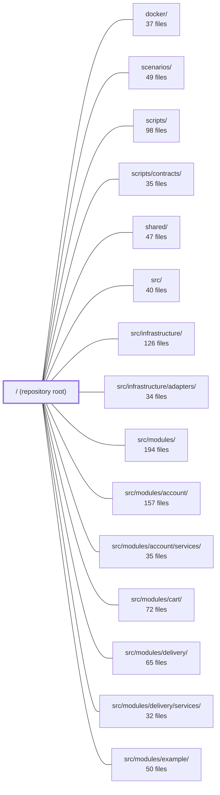

---
tags:
  - 2brain
  - 2brain/module
  - project/boilerplate-node-backend
type: module
module: / (repository root)
files: 502
updated: 2026-11-08T10:45:59.389657+00:00
---

# / (repository root)

## Purpose

The repository root is the control plane for a contract-first, modular Express 5 + TypeScript + Mongoose REST API boilerplate. It defines the project's identity, deployment topology (development, production, multi-client, backup), the quality gates that guard every merge, and the generated OpenAPI contract that drives client/server codegen. Application logic lives in `src/`; this layer governs *how* it is built, tested, deployed, and documented.

## Key parts

- **Project identity & contracts** — `README.md`, `CLAUDE.md`, `INSTALL.md`, `package.json`, `SECURITY.md`. The manifest declares dependencies, the full script surface, and the `postinstall` hook that regenerates API types and the permission vocabulary. `openapi.yaml` is the bundled (read-only) OpenAPI 3.1 spec; `orval.config.ts` turns it into TypeScript models and Zod validators.
- **Deployment stacks (Docker Compose)** — `docker-compose.yml` (single-command dev stack), `docker-compose.production.yml` (per-client production image, no source bind-mounts), `docker-compose.proxy.yml` (Traefik overlay for multi-client TLS/routing on one host), `docker-compose.backup-server.yml` (off-host restic backup receiver with write-only history protection), `docker-compose.test.yml` (hand-run proof of the external-service env-var path).
- **Quality gates** — `eslint.config.ts` (flat-config lint rules), `jest.config.js` + `jest.config.broker.js` / `cluster.js` / `mutation.js` (four distinct test suites), `mutation-baseline.json` (per-file mutation-coverage reference), `commitlint.config.cjs` (Conventional Commits enforcement), `knip.config.ts` (dead-code audit input).
- **Documentation site** — `docs/` rendered by VitePress (config in `docs/.vitepress/`). Covers getting-started, API standards, authorization model, data-protection obligations, ops reference, and tool-by-tool guides (Prometheus, Gatus, idempotency, mutation testing, backups, etc.).
- **Docker images** — `docker/` holds the development and production Dockerfiles consumed by the compose files above.

## How it connects

- **`src/`** is the application entry point (`src/cluster.ts`) and the code the compose stacks run, the Jest configs test, and the ESLint config lints. Root files configure *how* `src/` is built and verified; they contain no runtime application logic.
- **`shared/`** supplies the per-module OpenAPI fragments and the permission vocabulary that `scripts/contracts/` bundles into `openapi.yaml`; `orval.config.ts` then turns that artifact into the `@api/models` and `@api/schemas.zod` imports used throughout `src/`.
- **`scripts/`** (and `scripts/contracts/`) hold the build, audit, and codegen tooling invoked by `package.json` scripts; root configs (ESLint, Jest, Knip, Orval) feed into them.
- **`docker/`** provides the image layers that `docker-compose.production.yml` and `docker-compose.test.yml` pull or build.
- **`src/modules/*`** (account, cart, orders, payments, etc.) are the feature verticals whose routes, services, and per-module `openapi.yaml` fragments collectively form the API surface described in `openapi.yaml` and documented under `docs/`.
- **`scenarios/`** supplies end-to-end test scenarios consumed by the cluster and integration Jest suites defined at the root.

## Where to start

1. **`README.md`** — a two-minute tour of the architecture, the five-command dev workflow, and the contract-first rule ("edit at the leaves, generate everywhere else").
2. **`CLAUDE.md`** — a short, opinionated guide to the project's non-negotiable conventions (contract order, test philosophy, module boundaries) that will shape how you navigate every sub-module.

## Connected modules

[[boilerplate-node-backend_docker|docker/]] · [[boilerplate-node-backend_scenarios|scenarios/]] · [[boilerplate-node-backend_scripts|scripts/]] · [[boilerplate-node-backend_scripts_contracts|scripts/contracts/]] · [[boilerplate-node-backend_shared|shared/]] · [[boilerplate-node-backend_src|src/]] · [[boilerplate-node-backend_src_infrastructure|src/infrastructure/]] · [[boilerplate-node-backend_src_infrastructure_adapters|src/infrastructure/adapters/]] · [[boilerplate-node-backend_src_modules|src/modules/]] · [[boilerplate-node-backend_src_modules_account|src/modules/account/]] · [[boilerplate-node-backend_src_modules_account_services|src/modules/account/services/]] · [[boilerplate-node-backend_src_modules_cart|src/modules/cart/]] · [[boilerplate-node-backend_src_modules_delivery|src/modules/delivery/]] · [[boilerplate-node-backend_src_modules_delivery_services|src/modules/delivery/services/]] · [[boilerplate-node-backend_src_modules_example|src/modules/example/]] · … and 13 more

## Files
- `CLAUDE.md` — Contracts are edited at the leaves and generated everywhere else. The order is not optional:
- `INSTALL.md` — What this backend needs from outside the code before it is yours: an account, a key, a domain, a
- `README.md` — > Express 5 + TypeScript + Mongoose REST API. Contract-first, modular, observable.
- `SECURITY.md` — Please report security vulnerabilities through GitHub's private
- `commitlint.config.cjs` — Commitlint configuration that enforces the [Conventional Commits](https://www.conventionalcommits.org/) specification for all commit messages in the repository. It exists so that a single, shared rule set is available to any tool that validates commit or PR titles.
- `docker-compose.backup-server.yml` — Docker Compose stack for the second machine in the backup architecture: the server that receives every client's restic backups over rclone's REST API and is the sole location where old snapshots are pruned. It exists so that a compromised client (which holds its own restic password) can still write new backups but cannot delete existing history. The stack is dormant until explicitly started on a second host.
- `docker-compose.production.yml` — Production deployment stack for a single-client API. Unlike `docker-compose.yml` (development), it runs a pre-built image (`docker/Dockerfile.production`), bind-mounts no source, exposes no database port to the host, and ships only the services the application requires. It is operated per-client via `COMPOSE_PROJECT_NAME`, which namespaces containers, networks, and volumes.
- `docker-compose.proxy.yml` — A Traefik reverse-proxy overlay layered on `docker-compose.production.yml` (via a second `-f` flag) so that multiple client stacks on the same host share a single Traefik instance for TLS termination and routing. It adds no database, volume, or data concern to the stack it overlays—only proxy routing, certificate management, and a shared external network.
- `docker-compose.test.yml` — A hand-run compose stack that proves the external-service branch (`NODE_TEST_MONGO_URI` / `NODE_TEST_REDIS_URL`) works end-to-end against services the container did not start itself. It is the "WIRED" counterpart to the hermetic CI gate (which builds the image and runs `npm run complete` with no services). It is deliberately **not** a second CI job; you run it by hand before merging changes to the env-var path.
- `docker-compose.yml` — Defines the full local development stack (app, database, caches, queue, scheduler, and optional observability/analytics services) for a single `docker compose up`. It wires the Node.js `app` service to its dependencies, injects every runtime environment variable with sensible defaults, and ensures a fresh boot yields a populated, browsable stack via `db:bootstrap`.
- `docs/.vitepress/config.mts` — VitePress site configuration for the boilerplate's documentation. Defines the site title, navigation bar, per-section sidebars, local search, and Mermaid diagram support. It is the single entry point the `vitepress dev` / `vitepress build` commands read to render the docs.
- `docs/.vitepress/theme/index.ts` — VitePress custom theme entry that extends the default theme to add a click-to-zoom overlay for Mermaid diagrams. Because Mermaid renders SVGs client-side after page load, the theme uses a `MutationObserver` to wire up interaction handlers as diagrams appear in the DOM.
- `docs/api/errors.md` — Every 4xx and 5xx this API sends is an [RFC 9457](https://www.rfc-editor.org/rfc/rfc9457) problem
- `docs/api/responses.md` — A success answers with the thing itself. There is no wrapper around it: the status line says it
- `docs/api/write-methods.md` — Every write route follows the web's own rules for its verb. This page is those rules, in the
- `docs/getting-started-production.md` — The deployment shape of this stack, not the development one. `docker-compose.yml` bind-mounts the
- `docs/getting-started.md` — From a fresh clone to a browsable API with demo data. Five minutes, three commands, no manual
- `docs/reference/ops.md` — Everything that is not application code: the images the app runs in, the observability stack that
- `docs/reference/tests.md` — Every file here is a distinct guarantee, which is why this page names them one at a time: knowing
- `docs/theory/api-standards.md` — This API follows the mature HTTP standards, and writes down where it does not. This page names
- `docs/theory/authorization.md` — Who may act, how strongly they proved it, and which rows they see.** Three separate questions,
- `docs/theory/data-protection.md` — GDPR binds a **controller** — whoever deploys this, decides why data is processed, and answers to
- `docs/tools/backups.md` — The production compose file ships a `backup` service: a small container that dumps the database
- `docs/tools/configuration.md` — Every environment variable is read in **one layer**, checked **once at boot**, and handed to the
- `docs/tools/gatus.md` — Gatus is the **off-host heartbeat service**: a small status-page and health-check server (Apache-2.0) that
- `docs/tools/health-checks.md` — A container health check is a command Docker runs on a timer. Docker records `healthy` or
- `docs/tools/idempotency.md` — HTTP clients retry. A mobile app POSTs `/orders`, the server commits, and the connection drops
- `docs/tools/mutation-testing.md` — Every other layer on this site answers "does the code do the right thing?" This one answers a different question: **do the _tests_ actually notice when it doesn't?** Line coverage can be satisfied by executing a line without asserting anything about its result; mutation testing can't — it edits the source thousands of times (`>` to `>=`, `&&` to `||`, a function body emptied out) and reports every edit the suite failed to catch. A **surviving mutant** is a bug the tests are structurally blind to.
- `docs/tools/prometheus.md` — Prometheus is the **metrics backend** of this boilerplate.
- `docs/tools/security.md` — | Tool                                                                                                 | Why it is here                               |
- `eslint.config.ts` — Flat ESLint configuration for the entire codebase. It assembles the base presets, plugin rule sets, scoped per-directory overrides, and custom `no-restricted-syntax` / `no-restricted-imports` bans into a single array via `tseslint.config()`. It exists so that `npm run lint` enforces one consistent rule set while allowing targeted adjustments for tests, scripts, and tooling.
- `jest.config.broker.js` — Jest configuration for the broker (RabbitMQ) test suite, invoked via `npm run test:broker`. It strips away base-config setup that the queue adapter doesn't need (i18n boot, rate-limit budgets, in-memory MongoDB) and relaxes timeouts to accommodate container pulls and real retry TTLs.
- `jest.config.cluster.js` — Jest configuration for the cluster integration suite (invoked via `npm run test:cluster`). It exists separately from `jest.config.js` because nearly every default in the base config is wrong for tests that spawn real worker processes over TCP and boot their own MongoDB/Redis instances.
- `jest.config.js` — Jest configuration for the **unit** test run and the **base** that the broker, cluster, and mutation configs extend. Written as a `.js` file (rather than `.json`) so settings can carry inline explanations and the file can perform small runtime logic (reading `.env`, resolving worker counts). Coverage is intentionally not measured here; mutation score is the project's test-quality metric.
- `jest.config.mutation.js` — A Jest configuration override used exclusively by Stryker mutation testing (`npm run mutation`, `npm run mutation:full`). It replaces the ts-jest transform with swc (transpile-only, no type-checking) to prevent the LanguageService cache from growing per-mutant until workers are OOM-killed, and collapses the worker pool to one because Stryker already parallelises jest invocations itself.
- `knip.config.ts` — Configuration for [Knip](https://knip.dev), a tool that walks imports from entry points to flag unused files, exports, and dependencies. This file tells Knip about code and dependencies that an import walk cannot discover on its own (runtime-spawned tools, directory-scanned files, container entrypoints, etc.). It is consumed by the `code-shape` audit (`scripts/audit/code-shape/SKILL.md`) as input to a judgment pass — Knip's output here is a candidate list, not a verdict.
- `mutation-baseline.json` — A snapshot of per-file mutation-coverage scores (percentage of mutants killed) recorded at a specific point in time. It serves as the reference baseline that the CI mutation-testing workflow compares subsequent runs against, so regressions in test quality can be detected as diffs rather than absolute thresholds.
- `openapi.yaml` — This is the **bundled** OpenAPI 3.1.0 contract for the Boilerplate API, generated by `npm run contracts:bundle` from `shared/contracts/openapi.root.yaml` plus every `src/modules/*/openapi.yaml`. It exists as the single, stable, codegen-oriented specification consumed by client/server stub generators, DTO extractors, and SDK tooling across languages. It is **not** an editable source file — all modifications go through the per-module sources and the root contract, then re-bundle.
- `orval.config.ts` — Configures Orval to generate TypeScript model types and Zod validators from `openapi.yaml`. The project is a backend that only consumes generated types (`@api/models`) and validators (`@api/schemas.zod`) — it does not use any HTTP-client or data-fetching hooks, so the `zod` client is the sole generation target.
- `package.json` — Root manifest for the `boilerplate-node-api-mongodb-mongoose` project (v3.0.0, AGPL-3.0-or-later). It declares all runtime and dev dependencies, defines the full script surface (dev, test, lint, generate, deploy, benchmark), and wires the `postinstall` hook that regenerates API types, AsyncAPI types, and the permission vocabulary on every install. The entry point is `src/cluster.ts`.
- `public/favicon/safari-pinned-tab.svg` — A vector SVG icon used as the Safari pinned-tab (bookmark bar) favicon. Safari uses a dedicated pinned-tab file (separate from the standard favicon) that is displayed at a larger size in the macOS/iOS dock and tab bar. This file provides that icon as a scalable vector so it renders crisply at any resolution.
- `stryker.json` — Configuration file for [Stryker Mutator](https://stryker-mutator.io/), the mutation-testing framework. It defines which source files are mutated, which tests verify them, how results are reported, and what quality thresholds apply. Running Stryker against this config will mutate the project's core source trees and check whether the Jest test suite detects the injected faults.
- `tests/broker/queue-broker.test.ts` — Integration test suite that exercises the queue adapter (`src/infrastructure/adapters/queue.ts`) against a **real** RabbitMQ broker. Where the unit suite mocks `amqplib` and only proves which arguments are handed over, these cases verify what the broker actually does: whether the quorum-queue topology declares cleanly, whether a retry republish stamps `x-retry-attempt` the way `attemptsOf` expects, and where a message lands once the delivery limit is exhausted. The webhook path and publish-confirm refusal are intentionally excluded (covered by e2e and unit suites respectively).
- `tests/broker/support/rabbitmq.ts` — Provides a fully managed, per-run RabbitMQ broker for the queue-broker integration suite. It either connects to a CI-supplied instance or spins up a `rabbitmq:4-management` container, then creates an isolated virtual host (with full permissions for the built-in `guest` user) so each run gets a clean topology. It also exposes a small typed management-API handle for asserting queue declarations and force-dropping connections.
- `tests/cluster/rate-limit.test.ts` — Verifies that the rate-limit budget is **shared across all cluster workers** when a Redis store is configured, and deliberately reproduces the per-process bug when it is not. A single-process test cannot distinguish a shared counter from a per-process one, so without this suite a regression back to the in-memory store would pass the entire repository's test run.
- `tests/cluster/redis-idle.test.ts` — Integration test that verifies a Redis client created by the production adapter stays connected and responsive after sitting idle longer than node-redis' `socketTimeout` ceiling. It guards against a regression where the absence of a keepalive ping causes a healthy client to self-close and the cache to report `unavailable` between requests.
- `tests/cluster/support/cluster.ts` — Boots the real cluster entry point (`src/cluster.ts`) as a spawned child process with genuine worker forks and a real TCP port, so that tests can observe cross-process state — the class of bug a single-process `supertest` setup structurally cannot reproduce. Every test in the `tests/cluster/` directory talks to a live multi-process cluster over sockets rather than mounting an Express app in-process.
- `tests/cluster/support/redis.ts` — Provides a Redis instance for the cluster test suite. It either connects to an already-listening Redis (via `NODE_TEST_REDIS_URL`, as in CI) or starts a throwaway container using the repo's existing container-engine helper, so cluster tests that depend on Redis can run in both local and CI environments without a hard dependency on a specific orchestrator.
- `tests/contract/authorization-contract.test.ts` — A contract-derived authorization sweep that asserts, over HTTP, two invariants for every mounted route: (1) any route behind an identity guard returns **401** to a callerless request, and (2) any route behind `requirePermission` returns **403** to exactly the tenant personas whose role file does not grant the required permission. Instead of 40+ hand-written 401/403 assertions scattered across per-module contract files, this file derives expected outcomes from the authorization model (`holds` + `PRESET_ROLES`) and tests them in one table-driven pass per route.
- `tests/contract/config.contract.test.ts` — Contract tests for the `GET /config` endpoint. Pins the public response shape (session config, OAuth providers, antibot/human-challenge settings, operator identity, and Terms version) to guarantee all pieces arrive together, require no credential, and carry a short public cache header. Exists to catch regressions where a field silently disappears, changes type, or gains an unintended dependency on request-specific state.
- `tests/contract/cookie-auth.test.ts` — Contract test for the `cookie` session mode. While every other suite authenticates via `transport: 'bearer'`, this file exercises the `cookieAuth` alternative: it verifies that a browser-style request (no bearer token, just a `__Host-session` cookie) can read, can write from the declared CORS origin, and is refused with `403` on a write from a foreign origin. It sets the session mode itself, so it runs in both contract lanes.
- `tests/contract/idempotency.test.ts` — Integration test for the `Idempotency-Key` middleware, exercised against a real database through `POST /tasks` (chosen as the simplest opted-in route: public, single-field, no auth friction). It covers the three-way branch on key collision—replay, mismatch, and in-flight conflict—that the unit test (`tests/unit/…/idempotency.test.ts`, which covers pure fingerprinting logic) cannot reach.
- `tests/contract/ownership-contract.test.ts` — Contract test that enforces two invariants about IDOR defense: **completeness** — every customer-reachable ID in a URL path, request body, or query parameter is classified in exactly one ownership list (derived live from mounted routes + `openapi.yaml`, never hand-written) — and **the sweep** — for the foundation families (saved addresses, login sessions, notifications), a foreign ID in the URL or body returns 404, identical to a missing ID. This is the ownership half; `authorization-contract.test.ts` covers the permission half (role → route reachability).
- `tests/contract/ownership-shop.contract.test.ts` — Contract test for the "shop half" of the ownership sweep. It verifies that Customer B, hitting any shop-module route (orders, payments, delivery, invoicing, returns, cart) with Customer A's ID in a path param, request body, or list filter, receives a 404 indistinguishable from a missing ID. The world is built through the modules' own factories; the attacks go exclusively over HTTP.
- `tests/contract/password-set-paths.test.ts` — Contract test that verifies **every** route which writes a password enforces the same breached-password rejection. Instead of testing the check once per module (and risking a gap when a new entry point is added), it exercises all three owner-facing paths over HTTP with one known-breached fixture, and a second "canary" block reads the bundled OpenAPI spec to assert no *other* route sets a password. Scoped system-wide because the invariant spans the contract, not a single module.
- `tests/contract/product-write.test.ts` — Contract tests for the multilingual product **write** surface (`POST /products`, `PUT /products/{id}`, `PATCH /products/{id}`) exercised over real HTTP. The file lives at top-level `tests/contract/` rather than under `src/modules/products/tests/` because driving these routes requires a real `locales` collection row, which the `products` module may only reach through the `kernel/translation.ts` port — making the suite inherently cross-module.
- `tests/contract/request-contract.test.ts` — Contract-derived **request** tests: for every write endpoint the OpenAPI spec declares, this file verifies the API accepts every payload the spec declares legal (2xx) and rejects every payload the spec declares illegal (422). It is the mirror image of the sibling `tests/contract/*` files, which compare real responses against the spec; here the spec is the source of the *inputs*. It also sweeps every `in: query` parameter constrained by `enum` or `pattern` and asserts a violating value yields 422. Generated test data is used so the suite stays exhaustive as the spec evolves.
- `tests/contract/request-sources.test.ts` — Contract test that statically compares the input sources each controller declares via `readInput` / `requireId` against the `in:` / `requestBody` declarations in `openapi.yaml`. It asserts that a controller's declared sources are a **subset** of what the spec allows, catching undocumented input (e.g. a path-form delete reading an undeclared body). No server is booted; everything is recovered by reading source files and the spec with regex/`yaml.parse`.
- `tests/contract/route-spec-parity.test.ts` — Contract test that asserts the routes the Express app actually mounts are identical, operation-for-operation, to the operations declared in the bundled `openapi.yaml`. It guards against undocumented endpoints (mounted but not declared) and broken promises (declared but not mounted), and also catches duplicate route registrations.
- `tests/contract/system.test.ts` — Contract tests that assert the exact response shape, status code, and content-type of system-level routes (`/`, `/livez`, `/readyz`, `/.well-known/security.txt`) and the shared error envelopes (404, 422). These tests lock down the public API contract for infrastructure endpoints so that implementation changes cannot silently break downstream consumers.
- `tests/contract/unknown-query-params.test.ts` — Contract test that enforces a **422 response** (not a silent no-op) when an undeclared query parameter is sent to any list-read route. It exists because a dropped filter can return the full result set as though the filter were honoured — a data-leak class of bug that is invisible to happy-path tests.
- `tests/contract/upload-types.test.ts` — Contract test that guards the single source of truth for accepted image upload types. It verifies that every multipart operation in the published OpenAPI spec declares the exact same `imageUpload` content-type list as the runtime constant `ACCEPTED_UPLOAD_TYPES`, preventing drift between the documented contract and the code that enforces it.
- `tests/contract/write-methods.test.ts` — Cross-module contract tests for the write-method standard (spec: `docs/api/write-methods.md`). Verifies rules that must hold for every module's mutations over real HTTP: empty-string rejection, content-type enforcement, idempotency-key replay, `Location` on 201, conditional requests (ETag / If-Match / 412), and 304 revalidation. Module-specific write rules belong in each module's own test files.
- `tests/cross-cutting/account-protection-routes.test.ts` — Guarantees that every write route mounted on the `users` module is explicitly accounted for in the account-protection matrix. A new write route added to `users` will fail this test until it is either added to `PROTECTION_ROWS` or documented in `UNOWNED_WRITES` with a reason, making the protection rule only as strong as the list it audits.
- `tests/cross-cutting/account-protection.test.ts` — Integration test that verifies staff-account protection through the real HTTP app and a real database. For every protection row (a user-mutating endpoint), it asserts that any caller can modify a plain customer, but can only modify an account that holds a staff role (staff, admin, platform-only) if that caller also holds `assign:Role`. It also confirms that API keys can never be minted with `assign:Role`, so no key path can reach a staff account.
- `tests/cross-cutting/alert-rules-metrics.test.ts` — Guards against a silent failure mode: an alert rule referencing a metric name that the code never registers. Such a rule evaluates to an empty vector, never fires, and produces no error. This test statically cross-checks every `*_total` counter used in the Prometheus alert-rules YAML against the metric names registered in `src/`, without booting any process.
- `tests/cross-cutting/analytics-events.test.ts` — Cross-cutting sweep that verifies analytics event names declared across all `src/modules/*/analytics.ts` files remain globally unique. Because every event is reported to a single Umami website keyed by name, a name claimed by two modules produces indistinguishable rows. The test guards both the constant *keys* and the event *string values* to catch both kinds of collision.
- `tests/cross-cutting/api-key-authentication.test.ts` — Proves that an `sk_…` credential actually traverses the real Express chain to reach a route whose identity guard is `isAuthOrCredential` — the "middle link" that neither the unit-level `resolveCredential` tests nor the session-token contract tests cover. A second half statically verifies that no module mounts both identity guards (`isAuth` and `isAuthOrCredential`), keeping the credential-eligibility of a route a property of its module rather than of individual lines.
- `tests/cross-cutting/api-key-security.test.ts` — Cross-checks the OpenAPI contract (`openapi.yaml`) against the actual mounted route guards to verify that `apiKeyAuth` appears in an operation's `security` **exactly** when the route mounts `isAuthOrCredential` and carries no step-up permission. Also pins a small hand-maintained list of anonymous-readable product operations that grant API keys a wider view. The test fails in either direction: a route gaining or losing the guard, or the spec drifting from the code.
- `tests/cross-cutting/api-standards.test.ts` — Enforces two REST standards that the docs state in prose but nothing else mechanically checks: (1) every resource whose `status` enum has more than one value must list `actions` as required, and (2) every 409 refusal in source must carry an error code that a contract fragment declares. Both rules read from **source** (module `openapi.yaml` fragments and `.ts` files under `src/`), never from a generated bundle, so a failure points at a file a developer edits.
- `tests/cross-cutting/audit-actions.test.ts` — Cross-cutting test that validates the audit-action vocabulary across every module structurally—uniqueness, dotted-naming convention, discoverability, and explicit opt-out—without hardcoding any action string. This avoids reintroducing the cross-module coupling the domain split was designed to remove, while still catching the silent failures (duplicate actions, malformed names, unguarded modules) that no single module's own tests would see.
- `tests/cross-cutting/authenticated-controllers.test.ts` — Cross-cutting invariant test that enforces two rules across all modules: (1) any controller that non-null-asserts `authContext` must be mounted behind `isAuth` (not merely `isAuthOrCredential`), and (2) any `requirePermission` guard mounted behind `isAuthOrCredential` must ask for a tenant-scoped rule with no owner condition and must not be marked `credential: false`. It exists to catch a class of runtime 500s (reading `undefined.id` from a missing `authContext`) that TypeScript cannot express, because the authentication guarantee lives on the route, not in the type.
- `tests/cross-cutting/authorization-conformance.test.ts` — Runs a shared authorization conformance suite (`shared/authorization-conformance.yaml`) against this repository's CASL-based evaluator. The YAML file is committed with identical bytes in both backends (this one and the PHP twin); each side runs it against its own implementation so that the two stay behaviorally equivalent for the exact cases the file enumerates. The file deliberately includes DENY cases to catch widened scopes that a pure-allow test would miss.
- `tests/cross-cutting/authorization-keys.test.ts` — Conformance test that validates the internal consistency of the shared permission artefacts (rules, sets, preset roles) loaded by `src/kernel/permissions.ts`. It answers "are the files they both read not nonsense?" — ensuring no preset role silently grants nothing, no rule is orphaned, and naming conventions are enforced so that rule IDs stored in credentials remain stable.
- `tests/cross-cutting/browser-events.test.ts` — Cross-cutting consistency test that verifies, for every deployed module, the set of browser-event names declared in its `openapi.browser-events.yaml` fragment exactly matches the keys registered on `AppModule.browserEvents` in its manifest. Exists because the two declarations are independent and a drift in either direction (missing or extra event) would silently break analytics or drop accepted requests.
- `tests/cross-cutting/cache-policy-declared.test.ts` — Cross-cutting consistency test that verifies the OpenAPI contract's `x-cache` annotations on GET operations and the router middleware's mounted cache policies name exactly the same set of routes. Without this check, the bundler (which can only read `x-cache` and emit a `304`) would either document a response the route never produces or omit one it does.
- `tests/cross-cutting/ci-covers-the-gate.test.ts` — Guard test that asserts every check invoked by `npm run complete` (the local pre-commit gate) has a corresponding job in `.github/workflows/`. It exists to prevent the known bypass where a contributor uses `--no-verify`, skips husky, or opens a PR from a fork while CI stays green. The check is one-directional: CI may legitimately run *more* than the gate (e.g. nightly fuzz/mutation workflows).
- `tests/cross-cutting/contract-aliases.test.ts` — Validates the structural and semantic integrity of the `x-alias-of` OpenAPI extension across the API spec. The extension marks operations that are alternate spellings of a canonical operation (e.g. `POST /products/search` aliasing `GET /products`). This test suite enforces that the annotation is well-formed (no dangling refs, no chains, no self-references) and that an alias is truly interchangeable with its canonical target (same success status code, same JSON response schema).
- `tests/cross-cutting/contract-bundles.test.ts` — Validates the structural integrity of every contract bundle in the repo. For authored (compiled) bundles it checks that source fragments are non-empty and that the shared-file guard in `SHARED_FILES` matches exactly what is built here. For the OpenAPI bundle it verifies each module document is standalone and that every documented path belongs to exactly one module or the root. For the AsyncAPI bundles it asserts referential integrity across channels, messages, and operations. It deliberately does **not** compare committed output to a fresh build—that is `npm run check`'s responsibility.
- `tests/cross-cutting/contract-error-declarations.test.ts` — Verifies that every OpenAPI contract fragment declares a `404` response on any operation whose path template carries an id parameter (e.g. `{id}`, `{orderId}`). This is a cross-cutting invariant: a malformed id always yields 404 (same as an unknown id), so the contract must state that on *every* such operation, not just the ones whose service happens to return a miss. The test reads the per-module fragments rather than the generated bundle so failure messages point at an editable file.
- `tests/cross-cutting/contract-responses-never-null.test.ts` — Enforces the read-side half of the empty-value rule: no response schema in the bundled OpenAPI contract may admit `null`. `null` is treated as a write verb (PUT/PATCH "clear this"); a response signals absence by omitting the key. The test recursively walks every operation's response schemas and asserts none allow `null`.
- `tests/cross-cutting/contract-scalars.test.ts` — Verifies that the scalar bounds and patterns declared in `infrastructure` still match every per-operation constant orval emits from `openapi.yaml`. Because orval flattens each shared component into a separate constant per endpoint (dozens of identical numbers), `infrastructure` cannot simply import "the" constant without coupling to a domain name. This test substitutes for that missing import: change `maximum` in the contract, regenerate, and the mismatch fails here instead of silently returning 422 for a legally-sized page.
- `tests/cross-cutting/contract-search-parity.test.ts` — Verifies that for every `x-alias-of` pair where the alias is a `POST …/search`, the query-parameter schema on the `GET` route and the request-body schema on the `POST` route declare identical validation constraints (type, enum, bounds, length, format). Catches the case where one spelling silently diverges—e.g. `status` documented as open on one route and a four-value enum on the other—without needing to execute either endpoint.
- `tests/cross-cutting/cookie-inventory.test.ts` — Cross-cutting consistency test that ensures the generated cookie inventory (`cookieData`) agrees with two downstream consumers: the OpenAPI root contract's `cookieAuth` security scheme and the data-protection documentation page. It catches drift when the cookie rules are updated but one of those artifacts is forgotten.
- `tests/cross-cutting/credential-fields.test.ts` — Cross-cutting security sweep that asserts no credential-shaped field (password, token, secret, salt, API key, OTP, etc.) survives `toJSON` serialization on any Mongoose model in the codebase. It exists because the only defence against leakage is an `omit` list beside the schema field, and nothing structurally links the two — a new field added to a schema but forgotten in `omit` would silently reach a client.
- `tests/cross-cutting/crypto-conformance.test.ts` — Conformance test that verifies this repository's four crypto primitives produce byte-identical output to the PHP twin, driven by a shared case file (`shared/cases/crypto.cases.yaml`). It guarantees cross-language interoperability for pseudonymisation, HKDF subkey derivation, versioned-secret decryption, and argon2id password verification.
- `tests/cross-cutting/env-booleans-conformance.test.ts` — Conformance test that verifies the TypeScript `parseBooleanWord` function produces identical results to its PHP counterpart. It executes a shared set of boolean-word cases (defined in `shared/cases/env-booleans.cases.yaml`) against the TS implementation, ensuring cross-language consistency.
- `tests/cross-cutting/guarded-steps-stay-unpublished.test.ts` — Cross-cutting test that enforces an architectural rule: functions marked `@internal` in TSDoc (the "steps" that perform writes behind guard/door functions) must never be re-exported through a module's barrel (`src/modules/*/index.ts`), regardless of the re-export shape (`export *`, named re-export, renamed property, object-literal bundling, spread). It uses the TypeScript Compiler API to walk the real barrel files and a small in-memory fixture to verify detection across every carrying shape.
- `tests/cross-cutting/identity-guards-follow-the-spec.test.ts` — Bidirectional consistency test: every route the OpenAPI spec marks as requiring a credential must mount the corresponding guard in the route table, and every mounted guard must be justified by the spec. It exists to catch routes that silently lose or gain authorization without a spec change, a failure mode the authorization-contract test (which selects routes *by* guard) cannot detect.
- `tests/cross-cutting/locale-namespaces.test.ts` — Guards against two silent locale-merge failures that the deep, last-writer-wins merge at boot would otherwise hide: a module redefining a shared cross-repo contract key, and two modules colliding on the same key. Also enforces a naming convention (each key lives under its owning module's prefix) so key ownership is derivable from the key string alone.
- `tests/cross-cutting/locale-parity.test.ts` — Cross-cutting test asserting that every supported locale declares the **exact same set of keys** across the merged dictionaries (shared file + all registered module directories). It exists because a missing key in one locale is invisible at build time and surfaces only as a raw key string printed to a user in the wrong language — no per-module test catches that.
- `tests/cross-cutting/log-redaction-conformance.test.ts` — Conformance test that verifies the TypeScript redaction walk answers the same shared YAML case file (`shared/cases/log-redaction.cases.yaml`) identically to the PHP twin. It guards against drift between the two implementations by asserting pass/fail on each key in `shared/rules/log-redaction.yaml`.
- `tests/cross-cutting/metric-names.test.ts` — Cross-cutting test that verifies every metric name the observability overview controller reads by string literal actually corresponds to a metric declared and registered by a module. It works by parsing **source text** (regex over `.ts` files) rather than importing the modules, so it never boots Mongoose or opens a database. The problem it guards: renaming a counter compiles and passes all unit tests, but the overview endpoint silently reports the metric as absent.
- `tests/cross-cutting/module-descriptors.test.ts` — Validates that every module's `module.yaml` descriptor is well-formed: it exists, parses against the strict schema, references only real sibling modules, contains no self-reference, and has no duplicate entries. This is the "catch the sloppy descriptor" half of the rule that `.dependency-cruiser.cjs` enforces at build time.
- `tests/cross-cutting/module-subscriptions.test.ts` — Cross-cutting test that verifies every module's `subscribe()` hook actually registers event handlers and does so correctly. It exists because `subscribe` is the only manifest field that is pure behaviour (a side-effectful function call at boot) rather than a declarative value; an emptied or duplicated subscription is invisible to every other test in the suite.
- `tests/cross-cutting/modules-are-enabled.test.ts` — A guard test that fails if any directory under `src/modules/` is missing from the `enabledModules` registry. It exists because a module that is on disk but not registered fails silently—no boot error, no obvious 404 during development—so the first symptom is a missing endpoint in production.
- `tests/cross-cutting/money-conformance.test.ts` — Cross-language conformance test that verifies `src/domain-primitives/money.ts` produces identical results to its PHP twin for money arithmetic. Cases are defined in a shared YAML file (`shared/cases/money.cases.yaml`) so both implementations are checked against the same expectations.
- `tests/cross-cutting/mongo-version-pin.test.ts` — A cross-cutting consistency guard that asserts every `mongo` image tag declared in the Docker Compose files matches the version pinned in `package.json` (`config.mongodbMemoryServer.version`). It exists because Dependabot cannot see that config key, so a compose-only version bump would otherwise pass CI while leaving tests and production on untested versions. The test goes red until the pin is updated in the same PR as the compose bump.
- `tests/cross-cutting/normalize-email-conformance.test.ts` — Conformance test that verifies `canonicalMailbox` produces the same output as the PHP twin implementation for every case defined in the shared spec (`shared/cases/normalize-email.cases.yaml`). It exists to lock cross-language behavior and catch divergence when either side changes.
- `tests/cross-cutting/outbox-backoff-conformance.test.ts` — Cross-language conformance test that asserts the TypeScript `outboxBackoffMs` function returns the same delay values as the PHP twin. It loads a shared YAML case file (`shared/cases/outbox-backoff.cases.yaml`) and checks each case's expected `delayMs` against the live implementation, ensuring both implementations stay in lockstep.
- `tests/cross-cutting/paginated-sort-is-total.test.ts` — A cross-cutting, syntax-level guard that scans every source file for `$sort` stages co-occurring with `$skip` and asserts the sort is *total* (its last key is unique). It exists because MongoDB gives no ordering guarantee among equal sort keys, and a paged read (separate count + page queries) will duplicate or drop documents when the tie order shifts between them. The check is deliberately regex-based rather than DB-driven so it covers every pipeline in the tree, including future ones.
- `tests/cross-cutting/permission-conditions-stay-null-free.test.ts` — Guards against permission rule conditions that would serialize `null` (other than the sanctioned `deletedAt: null`) or use an `$exists`-style operator onto the wire in session-answer responses. Because the never-null response check exempts exactly one null slot, any rule that introduces another null or an existence-operator would break the contract; this test catches that at rule-definition time rather than at runtime.
- `tests/cross-cutting/permission-model-version-conformance.test.ts` — Cross-cutting conformance test that ensures the TypeScript `permissionModelVersion` function returns the same results as its PHP counterpart. Both implementations are driven by the same shared YAML case file (`shared/cases/permission-model-version.cases.yaml`), so any divergence between languages is caught here.
- `tests/cross-cutting/permission-vocabulary.test.ts` — Cross-cutting integration test that pins the permission-vocabulary chain end-to-end: the single YAML source (`shared/authorization-keys.yaml`), the generated `@api/permission-vocabulary` exports, and the kernel's loaded rules, sets, and tiers must all agree. It also verifies that undeclared action/subject pairs are rejected both at compile time (type-level) and at run time.
- `tests/cross-cutting/personal-data-erasure.test.ts` — Cross-cutting GDPR Art. 17 guard: ensures that every module whose model references an account (via `ref: 'User'` or a `*UserId` field) declares a `personalData.erase` hook in its manifest. Catches the failure mode of a new module silently retaining a person's rows because it forgot the declaration. Does **not** verify erase correctness — that belongs to each module's own tests and `tests/integration/erasure.test.ts`.
- `tests/cross-cutting/process-snapshot.test.ts` — Cross-cutting consistency test that pins the single source of truth for the process-snapshot shape across two documents that cannot cross-reference each other: `openapi.yaml` (REST) and `asyncapi.yaml` (SSE). Without this test, the four memory fields and the uptime type could drift independently in each YAML file with no compile-time or lint-time signal.
- `tests/cross-cutting/production-topology.test.ts` — Guards the security posture of the two production deployment artifacts — `docker-compose.production.yml` and `docker/Dockerfile.production` — by asserting specific, reasoned-about properties (read-only filesystems, dropped capabilities, no exposed data ports, bounded logs, no package-manager binaries, no debugger flags) that no other check in the gate would catch. It exists so the same "human review reading" runs on every push instead of relying on one reviewer's attention.
- `tests/cross-cutting/proxy-overlay.test.ts` — A security-guard test that parses `docker-compose.proxy.yml` on every push and asserts five specific, reasoned decisions about the shared Traefik overlay: no Docker-socket mount, routes via file provider only, port 80 as a pure HTTPS redirect, a default of one trusted proxy hop for the app, and a per-client network alias with no routing labels. It exists because the overlay is the single container facing the internet, making its mount and routing configuration a security property of one file.
- `tests/cross-cutting/rate-limit-budgets.test.ts` — Validates that every rate-limit budget in the application (module-owned and infrastructure-owned) is internally consistent as a set: unique names, unique environment variables, unique Redis namespaces, exclusive ownership between modules and infrastructure, and a controlled list of budgets that fail open during a store outage.
- `tests/cross-cutting/rate-limit-keys-conformance.test.ts` — Conformance test that verifies the TypeScript rate-limit key generators (`addressBlockOf`, `identityOf`, and the `express-rate-limit` default `ipKeyGenerator`) produce byte-identical keys to the PHP twin, using a shared YAML case file (`shared/cases/rate-limit-keys.cases.yaml`). It exists to prevent the two implementations from drifting apart.
- `tests/cross-cutting/raw-body-paths.test.ts` — Cross-cutting test that verifies every module's `rawBodyPaths` entries resolve to a route actually mounted on that module's own router. It exists because a typo in a declared path produces no runtime error—it silently prevents the JSON parser from keeping the raw body, so `express.json()` re-encodes it before the module reads it, and every downstream signature check fails against the wrong bytes.
- `tests/cross-cutting/replace-patch-parity.test.ts` — Guarantees that every `Replace<Entity>Request` and `Update<Entity>Request` schema pair declares an identical set of writable field names. The shared `createUpdateController` factory only works because the two schemas differ solely in `required`-ness; a field present on one but missing from the other is valid in isolation yet breaks the PUT/PATCH parity contract.
- `tests/cross-cutting/request-headers-conformance.test.ts` — Runs a shared set of YAML-defined cases (referenced as `shared/cases/request-headers.cases.yaml`) against the Node HTTP layer's two header readers — `preconditionOf` and `requestIdMiddleware` — to guarantee they produce the same observable results as their PHP twin.
- `tests/cross-cutting/scenario-fixtures.test.ts` — Validates two invariants of the locale scenario fixtures that no other test, index, or type system enforces: every locale entry references a language the dataset also registers, and no key is a dot-prefix of another key within the same `(locale, app)` tree. It reads the static `FIXTURES` directly (no database) and exists solely to close the gap between what other guards cover and what the data actually promises.
- `tests/cross-cutting/scheduled-jobs.test.ts` — Cross-cutting guard that validates every scheduled job in the codebase is well-formed and consistently declared. It enforces naming conventions, schedule shape, lease constraints, and that the production image's job runner is wired correctly—replacing the old "two files must agree" checks now that `docker/crontab` and the ops jobs table are generated from a single set of declarations.
- `tests/cross-cutting/search-pagination.test.ts` — Cross-cutting test suite for `normalizePagination`, the single authority on pagination **defaults** (page, pageSize, derived skip). It verifies that the function coerces types, applies correct fallbacks, floors page at 1, and—critically—distinguishes where defaults are set (here) from where bounds are enforced (the HTTP schema layer, which answers 422). It also guards the one path that bypasses schema validation: the `NODE_SETTINGS_PAGINATION_PAGE_SIZE` environment variable.
- `tests/cross-cutting/search-regex.test.ts` — Cross-cutting test suite that verifies the regex-escaping and MongoDB `$regex` filter helpers in `search.ts` are safe against user-supplied input on public, unauthenticated endpoints (`POST /products/search`, `GET /products?text=`). It guards two failure modes: catastrophic-backtracking DoS via unescaped metacharacters, and 500 errors from control characters (notably NUL) that MongoDB's C-string pattern compiler rejects.
- `tests/cross-cutting/search.property.test.ts` — Property-based tests (fast-check) that verify security-critical invariants of `escapeRegex` and `normalizePagination` for **every** possible input, not just sampled examples. `escapeRegex` is a denial-of-service control against MongoDB `$regex` catastrophic backtracking on public endpoints; `normalizePagination` must never emit a `skip` value that would crash the Mongo driver. These tests exist because a fixed table of examples cannot prove "no input reaches the engine as a live pattern."
- `tests/cross-cutting/security-headers-conformance.test.ts` — Conformance test that asserts the `installSecurity` Express middleware emits the exact set of security headers defined in the shared PHP twin case file (`shared/cases/security-headers.cases.yaml`). It runs each case against a bare Express app with *only* the security middleware installed, so no route logic can add, override, or hide a header.
- `tests/cross-cutting/serialize.property.test.ts` — Property-based tests for `applySerialization`, verifying that its guarantees (`_id`→`id` rename, `__v` deletion, `omit` key removal, in-place mutation, idempotency) hold for *any* input shape—not just the finite set of model schemas. This matters because 95 of the OpenAPI schemas declare `additionalProperties: false`, so a single leaked reserved key is a contract violation.
- `tests/cross-cutting/side-effects-have-one-layer.test.ts` — Enforces a project-wide invariant: four side-effect functions (`enqueueEmail`, `recordAudit`, `emitAnalyticsEvent`, `emitDomainEvent`) must be called from exactly one layer (service), unless a specific file is listed in an allowlist with a one-sentence justification. It exists because this is a *set-level* constraint—no single-file lint rule or type signature can express "the same function should not be called from two different layers across the codebase."
- `tests/cross-cutting/ssrf-conformance.test.ts` — Conformance test that runs the shared SSRF case suite (`shared/cases/ssrf.cases.yaml`) against `resolveSafeOutboundTarget`, verifying that this TypeScript implementation answers every case identically to its PHP twin. All cases use literal IP addresses so no DNS resolution is involved.
- `tests/cross-cutting/stale-bearer-on-open-operations.test.ts` — Guarantees that every operation whose OpenAPI contract declares `security: []` still answers a client holding a stale (unresolvable) bearer token — i.e., the auth middleware must not short-circuit those routes with a 401 `invalid_token` challenge. The exempt set is read dynamically from the bundled spec so new open endpoints are covered automatically.
- `tests/cross-cutting/step-up-auth-routes.test.ts` — Verifies that step-up authentication guards (`requireFreshAuth` / `requireFreshAuthWhen`) are mounted on exactly the set of money, identity, and role routes declared in the `STEP_UP_ROUTES` table — and nowhere else. The check is bidirectional: every table entry must still correspond to a live route (no stale entries), and every route that actually carries the guard must appear in the table (no silent tier changes or undocumented additions). This makes the guard table a single source of truth so a newly added money/identity route inherits the requirement without relying on a developer remembering to add the guard.
- `tests/cross-cutting/translatable-targets.test.ts` — Validates that every entry in the resolved `translatables` manifest references a real Mongoose collection and fields that actually exist on that collection's schema. Catches typos or renamed fields at test time instead of letting them surface as a 500 on a user's first translation write.
- `tests/cross-cutting/validation-attributes.test.ts` — Guarantees that every field a request body can carry has a human-readable label in every supported locale. It walks the generated `*Body` Zod schemas (not a hand-maintained list) so a contract change cannot outrun the i18n dictionary, then asserts each locale's `validation.attributes` covers all discovered fields.
- `tests/cross-cutting/webhook-event-producers.test.ts` — Integration test that proves, by actual execution rather than source inspection, that every public webhook event declared in the registered modules' `asyncapi.webhooks.yaml` fragments has a real producer, and that no producer fires an event the catalogue does not declare. It drives the domain-event bus through the real kernel registry so that `webhooks/module.ts`'s `onRegistered` hook wires subscribers the same way production does.
- `tests/cross-cutting/write-routes-are-guarded.test.ts` — App-wide invariant test that asserts every write route (POST, PUT, PATCH, DELETE) across **all** routed modules is protected by an identity guard and a `requirePermission` key by default. It exists because per-module `routes.test.ts` files only cover their own module—a module without its own test would be unguarded. This file states the property once for every module at once, so new modules inherit the guarantee automatically.
- `tests/fuzz/endpoints.fuzz.test.ts` — Spec-driven fuzzing (L5): for every operation declared in `openapi.yaml`, generates hostile but spec-valid requests via `fast-check` and asserts they never produce a 5xx and always match the response contract (status + body schema). Auto-discovers operations from the spec so newly added routes are covered with no manual list to maintain.
- `tests/fuzz/ssrf-guard.fuzz.test.ts` — Fixed-table test suite that validates `resolveSafeOutboundTarget` against a comprehensive catalogue of hostile URL patterns (private/loopback/link-local ranges, encoded IPv4 literals, IPv6 tunnel encodings, DNS-to-private, credentials, insecure schemes). Despite living under `tests/fuzz/`, it is deliberately deterministic: every case has one correct answer (refuse with a specific reason, or accept), so it uses a hand-written table rather than `fast-check` arbitrary generation.
- `tests/integration/access.test.ts` — Integration test that verifies the seeded demo access model and enforces the cross-module invariant: a role exists **only** in the membership row and is never mirrored onto the user document. It sits outside the access module's own test suite (which covers `assignRole`, `revokeRole`, and audit internals) to pin down the boundary between `@modules/access` and `@modules/users`.
- `tests/integration/app-health.test.ts` — Integration tests that exercise the real application (built from `src/app.ts`) through the shared supertest harness. Covers the welcome endpoint (`GET /`), 404 handling, `x-request-id` semantics (own ID vs. client-supplied, trusted-ingress adoption, malformed-value rejection), and the `/livez` + `/readyz` readiness-lifecycle states. Redis is intentionally **not** started; a database is, because session-cookie auth on `/observability/events` requires a user row.
- `tests/integration/auth-hardening.test.ts` — Integration tests for the global Express error handler (`handleUncaughtError`), verifying over real HTTP (via supertest) that uncaught throws and body-parser rejections produce safe, translated, correctly-coded responses without leaking internals. It lives at the root integration suite (not under a module) because the handler is system-wide: every module's uncaught error unwinds through it.
- `tests/integration/bad-bodies.test.ts` — Integration tests that assert every malformed or unexpected request body receives a sub-500 response with a correct status code (413, 400, 415, or the route's own 422) rather than a server fault. Covers three failure classes: bodies the JSON parser rejects (size, syntax, encoding), bodies Express never parses at all (wrong or missing content-type), and well-formed bodies with hostile content (excessive nesting, `__proto__`). Also pins the OpenAPI contract declaration for 415 on the operations that can return it.
- `tests/integration/checkout-money-reconciliation.test.ts` — Integration test that drives three real HTTP endpoints — `GET /cart`, `POST /cart/checkout`, and `POST /payments` — with the same basket and asserts all three return the **identical** total in integer minor units. It complements the pure-logic property test (`delivery/tests/unit/money-reconciliation.property.test.ts`) by exercising the paths where a number is assembled a second time over the wire. Covers non-whole-cent prices, the free-shipping boundary, and a currency (JPY) whose minor unit is a whole unit rather than a hundredth.
- `tests/integration/concurrency/account-deletion-races.test.ts` — Verifies that when a scheduled purge and a self-restore race at the exact boundary of the grace period (simulated by two disagreeing clocks), each account is handed to exactly one operation — never both, never neither, and never an error. It guards the invariant that the purge claims `purgeAt <= now` while the restore matches only `purgeAt > now`, so with consistent clocks they are mutually exclusive.
- `tests/integration/concurrency/cart-races.test.ts` — Integration tests that fire concurrent HTTP requests at the cart and checkout endpoints to verify two race conditions stay closed: **R2** (parallel checkouts must produce exactly one order, not a double-charge) and **R3** (concurrent cart writes must not create duplicate lines, lost increments, or a second cart document). The file also documents *why* each test exists and which failure mode it isolates, serving as the reference the R2 fix was modelled on.
- `tests/integration/concurrency/payment-races.test.ts` — Validates the "settle once" invariant under real HTTP contention: concurrent confirmations, webhook redeliveries, mixed webhook+confirm races, overselling attempts, and cancel-during-settle windows all produce exactly one settlement, one stock commit, and one `PAYMENT_SUCCEEDED` event. Runs against a single in-memory Mongo with no browser.
- `tests/integration/conditional-writes.test.ts` — End-to-end integration test for optimistic concurrency control (RFC 9110 §13.1.1): verifies that `ETag` is issued on reads, `If-Match` is enforced on PUT/PATCH/DELETE, a stale tag yields **412 Precondition Failed** with the row unchanged, and concurrent writers are correctly fenced. Exercises all four versioned resources (product, user, order, own account) through the real HTTP API so that controller → repository → error-interpreter interactions are covered together.
- `tests/integration/cookie-json-forgery.test.ts` — Integration test that guards against **cookie JSON forgery**: `cookie-parser` automatically parses `j:`-prefixed cookie values into JS objects (e.g. `j:{"$ne":null}` → `{ "$ne": null }`). If downstream code treats the `jwt` cookie as a string, the injected object leaks into a Mongo filter or a string method call and causes a 500. This test ensures the application degrades gracefully to "no session" instead.
- `tests/integration/cors.test.ts` — Integration tests that pin the app's CORS contract end-to-end through the real Express middleware stack. The core property under test: a disallowed origin must be answered **without** the `Access-Control-Allow-Origin` header, never by erroring the request. This catches the plausible regression of calling `callback(new Error(...))` instead of simply omitting the header, which would turn valid cross-origin calls into 500s and let anyone drive the 5xx rate.
- `tests/integration/create-app-env.test.ts` — Integration tests verifying the `createApp({ env })` injection contract: the supplied environment object is what the app's config actually reads, `process.env` is never mutated as a side effect, the real boot-gate validation still applies to injected values, and injecting `undefined` resets a variable back to its default.
- `tests/integration/create-app-extension.test.ts` — Integration test verifying the `extension` option of `createApp`. It confirms two properties: (1) an extension's routes are reachable (mounted ahead of the 404 catch-all), and (2) an app created without an extension exposes no extra routes. The test exercises the public `createApp({ extension })` API end-to-end via HTTP rather than inspecting internal wiring.
- `tests/integration/draft-language-never-leaks.test.ts` — Integration test that verifies product text written in a **draft (inactive) language** is never exposed to customers through any channel that "outlives" the product—emails, outbox events, or serialized payloads—while remaining visible to editors. It closes the gap left by the storefront-translation test by exercising every other door the draft title could leak through, all driven through the real modules.
- `tests/integration/draft-language-preview.test.ts` — Integration tests proving that a staff credential holding only `display:Locale` (without `display:Product`) can preview a draft locale's product text, and that this preview **bypasses the shared Redis cache in both directions** — never reading from it, never writing to it — so visitors are never contaminated. The suite also guards against vacuous passage via an explicit canary test that confirms the cache double *would* have shared the entry.
- `tests/integration/erased-staff-attribution.test.ts` — Integration test verifying that erasing a staff user leaves the domain records they created (webhook subscriptions, translations, buyer purchase holds) intact but with all back-references to the user nulled out. It exercises the real purge cascade rather than mocking it, ensuring the "dangling reference" invariant holds across multiple modules.
- `tests/integration/erasure.test.ts` — Integration test for the GDPR Art. 17 hard-delete cascade. It verifies two things: (1) a hard delete removes personal data (address book, contact tasks) while preserving tax-mandated records (invoices, credit notes, returns), and (2) after a scheduled self-deletion, no MongoDB collection still names the account except those the law permits the shop to retain. Unlike `personal-data-erasure.test.ts` (which only asserts a hook is declared), this test exercises the real cascade end-to-end.
- `tests/integration/idempotency-server-fault.test.ts` — Integration test that verifies what happens to an `Idempotency-Key` after the handler faults (500). It asserts the Stripe v1 replay rule: a retry under the same key re-sends the stored failure without re-executing the handler, while a new key triggers a fresh run. Exercises this through the simplest opted-in route, `POST /tasks`.
- `tests/integration/image-acl.test.ts` — Integration test that proves a client can never set `imageUrl` to a path of its own choosing (i.e., another record's stored file). It drives every write endpoint that accepts an image (`/account`, `/users`, `/products`) in both JSON and multipart encodings, asserts a 422, and—critically—asserts the victim's file still exists on disk. It also guards the inverse: legitimate image management (null-clear, omit-keeps, multipart upload) still works.
- `tests/integration/journeys/a-receiver-that-stays-down.test.ts` — Integration test for the webhook auto-disable journey: a subscription whose receiver endpoint always returns 500 accumulates failed retry chains, and after five dead chains **plus** three days of continuous failure, the system disables the subscription, notifies staff, and writes an audit row. Re-enabling resets the streak to zero.
- `tests/integration/journeys/an-accounts-whole-security-life.test.ts` — A single end-to-end journey test that walks one account through its entire security lifecycle: signup behind a human check, email verification, TOTP enrollment, API-key minting, password reset (which revokes all sessions and keys), step-up re-auth for an email change, the 7-day undo window, and the 7-day data-export retention window. It exists to prove that every security invariant—session invalidation, credential revocation, link expiry, and audit completeness—holds when the clock only moves forward.
- `tests/integration/journeys/an-integrator-start-to-finish.test.ts` — End-to-end integration test that walks a single integrator's full lifecycle: an admin mints an API key, the integrator subscribes a webhook to all events, a customer then performs a series of order/payment/shipping/return/cancel actions, and the test asserts the webhook endpoint received each event exactly once, signed, in causal order. A second block verifies that a minted key inherits its minter's permission changes (403 on demotion, 401 on deactivation).
- `tests/integration/journeys/bought-returned-refunded.test.ts` — End-to-end integration test that walks a shopper through the full buy → partial return → final return → refund cycle and asserts cross-module consistency: money balances to the cent, stock is restored only for returned units, invoice/credit-note numbers are sequential, stats and audit logs reflect every event exactly once, and each customer email is sent exactly once. A second test verifies that a staff member purchasing from their own shop gets a refund whose audit row attributes the order to them.
- `tests/integration/journeys/quiet-for-three-years.test.ts` — End-to-end journey test that verifies the staged inactivity lifecycle of user accounts (minimise → warn → deactivate → delete). It confirms that each stage is reversible until the final hard-delete, that the correct modules (addresses, orders, wishlist, users, signup) react at each stage, and that staff accounts are never swept while they keep signing in.
- `tests/integration/journeys/social-login-with-a-second-factor.test.ts` — End-to-end integration test for the "social login + TOTP second factor" journey. It verifies that a second sign-in through an OAuth provider does **not** yield a session on its own: the callback must leave an MFA challenge cookie, the user must answer it with a valid TOTP code, and only then is a usable session issued. It also confirms the challenge is single-use.
- `tests/integration/journeys/the-hold-that-was-never-paid.test.ts` — Integration test for the **reservation sweep** job: it verifies that when a payment hold lapses without payment, the system releases reserved stock, cancels the order, removes it from the staff "awaiting" list (for bank transfers), and sends the appropriate notification email to the shopper. Two scenarios are covered — an abandoned 3-D Secure card challenge and a bank transfer that was never funded.
- `tests/integration/journeys/the-provider-disagrees.test.ts` — Integration test exercising three failure/divergence scenarios where the payment provider's state disagrees with the server's: wrong settlement amount, a refund the provider refuses, and a payment the provider completes without the server ever seeing a confirm. Each scenario verifies the system converges to a correct, consistent state (no leaked money, no misplaced stock, no duplicate side-effects).
- `tests/integration/kernel/outbox-bus-failure.test.ts` — Verifies that `relayOutbox` correctly records a bus-level rejection in the outbox row's `lastError` field and leaves the event in `pending` state for retry, rather than marking it as a permanent failure. This scenario (the event bus itself rejecting) is outside the normal `emitDomainEvent` contract, so it must be simulated.
- `tests/integration/kernel/outbox.test.ts` — Integration tests for the transactional outbox pattern, run against a real replica-set MongoDB. Verifies that outbox rows commit or abort atomically with the caller's transaction, that the relay delivers at-least-once and in order per aggregate, that failing consumers are retried with backoff and eventually parked dead, and that a relay crashing mid-dispatch is recovered without losing or duplicating events.
- `tests/integration/kernel/session-failure-fails-closed.test.ts` — Verifies, over real HTTP, that a *fault* in session resolution (the bearer resolver throwing) fails closed with a 500 or 503 rather than silently degrading to guest access. A deliberate *refusal* (a `miss` result) still yields 401 `invalid_token`, except on a route whose contract marks `security: []`.
- `tests/integration/language-negotiation.test.ts` — Integration test that drives real HTTP routes with `Accept-Language` headers and asserts every layer (product text, search results, `Content-Language` header, API error messages, signup locale, admin toggling) agrees on the language a request is answered in. It covers two scenarios — a language that exists only as database rows (Spanish, no deployed dictionary file) and a deployed-but-deactivated language (Italian) — to verify negotiation, fallback, and admin on/off behavior end-to-end.
- `tests/integration/locale.test.ts` — Integration tests that exercise the full per-request locale negotiation stack (`attachLocale` middleware → routes → Zod validation thunks → error shaping) against the real Express app. They verify that every response — including pre-route 400/413/404 and multipart paths — is answered in the caller's requested language, and that concurrent requests in different languages never cross-contaminate.
- `tests/integration/malformed-ids.test.ts` — Spec-driven integration test enforcing one rule: an ID that satisfies the OpenAPI `Id` schema but was never issued by this backend gets a deterministic, position-specific answer (path → 404 identical to an unknown ID; body or query → 422 `VALIDATION_ERROR` naming the field). Sites are discovered at runtime from `openapi.yaml` via the shared `Id` schema, so any new route is covered on its first run without editing this file.
- `tests/integration/method-not-allowed.test.ts` — Integration tests that verify the application's 405 Method Not Allowed handling: a known path hit with an unlisted method returns `405` + `Allow` header + a `problem+json` body, while unknown paths, CORS preflight, and HEAD requests are unaffected. Cites RFC 9110 §15.5.6 as the normative reference.
- `tests/integration/ops-task-overdue-job.test.ts` — Integration test that exercises the overdue-task sweep job exactly as the production runner (`npm run job`) would, via `prepareJob`. It verifies that the sweep emits the correct staff notifications (`task-overdue` and `task-due-soon`) and—critically—that nothing is wired up by the test itself; only what the job's own `needs` declaration registers is active. This catches a job that forgets to declare `subscriptions` in its manifest.
- `tests/integration/ops-webhook-retry-job.test.ts` — Integration test that exercises the webhook retry sweep job through the same `prepareJob` path used by `npm run job`, in a no-broker environment where delivery is inline. It verifies that when the sweep auto-disables a subscription (consecutive failures exhausted), a staff notification is emitted.
- `tests/integration/order-snapshot-locale.test.ts` — Integration tests verifying that an order line's product snapshot freezes the **buyer's stored locale** (from `user.locale`) at the moment of order creation — never the caller's locale and never re-resolved at read time. Covers both order-creation entry points (`orderService.create` and `cartService.orderConfirm`) to guard against the caller's locale leaking into the frozen receipt.
- `tests/integration/orphaned-images.test.ts` — Integration test for the orphaned-image reaper (`reapOrphanedImages`). It exercises the full path—real MongoDB, real sandboxed filesystem—to verify that an old file no document references is deleted, a referenced file survives, a file younger than the reaping threshold is spared, and the sweep is scoped to the collections it is explicitly told to scan.
- `tests/integration/payment-succeeded-outbox.test.ts` — Integration test that exercises the full lifecycle of a `payment.succeeded` webhook event as it flows through the outbox: settlement → nudge → relay → delivery. Verifies exactly-once delivery per subscription, idempotency on duplicate relay, stable event-ID mapping between outbox and webhook, and retry-after-failure semantics. Designed to run against the real `payments` and `webhooks` modules (not mocks).
- `tests/integration/persistence/command-metrics.test.ts` — Integration test proving that the `databaseOperationDuration` Prometheus histogram observes raw MongoDB driver commands issued directly on a `Model` (bypassing every repository), attributes them to the correct collection, and distinguishes success from failure via the `outcome` label.
- `tests/integration/persistence/conditional-status.test.ts` — Integration test for `updateStatusIfIn` that runs against a real MongoDB instance. It exists because the critical guarantee—only one of two racing filtered writes can succeed—depends on mongod's atomicity semantics, which a mock cannot exercise.
- `tests/integration/persistence/lease.test.ts` — Integration tests for the Mongo-backed lease and job-outcome primitives in `src/infrastructure/persistence/lease.ts`. They verify the concurrency and durability guarantees a scaled-up cron container relies on (mutual exclusion, expiry, crash-release, contention semantics) against a **real** MongoDB, since the properties under test are defined by MongoDB's `findOneAndUpdate` upsert behavior that a mock cannot exercise.
- `tests/integration/persistence/money-field.test.ts` — Integration test that verifies the money-field persistence plugin against a real MongoDB instance. It confirms that amounts are stored as `Decimal128`, read back as decimal text on every read path (hydrated, lean, `toJSON`, `applySerialization`), padded to the row's currency scale, summed exactly in the database, and validated for negativity and finiteness. A scratch `MoneyProbe` model carries the plugin so the assertions target the plugin's contract, not any single production module.
- `tests/integration/persistence/query-time-limit.test.ts` — Integration test that verifies the global per-query time limit (`maxTimeMS`) set via `configureMongoose` actually causes mongod to kill slow queries with server error 50 (`MaxTimeMSExpired`) for both `find` and `aggregate` paths, and that individual queries can override or lift the limit. It exercises behavior a unit mock cannot: real server-side query cancellation.
- `tests/integration/persistence/revision.test.ts` — Integration test for the edit-revision counter (`revisionPlugin`) run against a real MongoDB instance. It verifies guarantees that unit-level mocks cannot: the counter increments via a server-side `$inc` (no lost updates under concurrency), it moves only when `updatedAt` actually changes, and it behaves correctly across every write form the repositories use. A scratch Mongoose model carries the plugin so the property is exercised generically, not tied to one domain model.
- `tests/integration/persistence/strict-query.test.ts` — Integration test (real database) that verifies `strictQuery: 'throw'` is applied by the suite bootstrap and actually rejects queries or bulk-writes that reference a schema path the model does not declare. It guards against the silent "match everything" failure mode a typo like `{ emial }` would otherwise cause.
- `tests/integration/product-multipart-write.test.ts` — Integration tests that verify product create and update requests sent as **multipart form bodies** correctly decode string-transported fields (`price`, `active`, `requiresShipping`, `allowBackorder`) into proper types before validation. This is the only suite that exercises the combination of a multipart body *and* numeric/boolean fields on the product schema, since the JSON contract suite already has correct types, `upload-security` uses multipart but only on a signup endpoint with no numeric fields, and the frontend mock coerces values before sending.
- `tests/integration/product-write.test.ts` — Top-level integration test that exercises `productService.create` and `productService.updateById` against a real database **and** a real translation port, verifying that product writes correctly create, validate, and modify multilingual translation rows. It lives at the repository `tests/integration/` level (not under either module) because the assertion surface spans both `products` and `locales`.
- `tests/integration/refund-retry-webhooks.test.ts` — Integration test verifying the end-to-end refund path triggered by an order cancellation: the `order.canceled` outbox row is written atomically with the cancel, the payments module opens a refund when the relay delivers it, redelivery is idempotent (no double refund, no duplicate webhook), and a provider refusal leaves the refund open for the sweep while still acknowledging the event. It lives here rather than in any single module's `tests/` because it exercises the real `subscribe()` hooks of orders, payments, and webhooks together.
- `tests/integration/refund-webhook.test.ts` — Integration test that verifies a standalone admin refund (`POST /payments/:id/refunds`) fans out a `payment.refunded` webhook delivery carrying the correct amount and currency. Because the `payments` module never imports `webhooks` directly, this test is the only way to prove the registry wiring end-to-end rather than by reading the `publicEvents` map in `module.ts`.
- `tests/integration/refusal-request-id.test.ts` — Integration test that verifies a request refused by the global rate limiter (HTTP 429) still carries a valid `x-request-id` header and a `Cache-Control: no-store` response header. It exists to lock in the middleware-ordering contract: the ID middleware is mounted *before* the limiter so that even callers who never reach a route can quote a request ID to support.
- `tests/integration/scenarios/apply.test.ts` — Integration test for the `scenarios/apply.ts` CLI. It exercises the three runtime gates (NODE_ENV refusal, non-empty-database refusal, `--reset` re-seeding) plus the `--describe-to` output, by spawning the real script as a child process against a fresh database on the shared test Mongo server.
- `tests/integration/scenarios/demo-restore.test.ts` — Integration suite that exercises `restoreScenario('blank')` against a real database. It verifies three properties of the blank-scenario restore: (1) only the named accounts, memberships, and locales are seeded (no shop data), (2) the `users_email` unique index survives so a duplicate signup still returns 409, and (3) the process-lifetime tenant-ID cache remains consistent across repeated restores.
- `tests/integration/scenarios/demo-routes.test.ts` — Integration tests for the `/__test/*` demo endpoints mounted by `installDemo` (from `scenarios/support/demo.ts`). The file verifies three things: (1) the real production app does **not** expose these routes, (2) each route handler returns the correct status code and body for valid/invalid input, and (3) side-effectful behavior (rate-limit reset, job execution, payment-refund injection) actually takes effect on the database or in-memory stores.
- `tests/integration/scenarios/shop.test.ts` — Integration test that runs the full `buildScenario('shop')` pipeline (the same call used by `npm run demo` and `scenario:apply`) once against a live database, then validates four contract-level claims: (1) the guarantee map is bidirectionally consistent, (2) every subject id resolves to a real row, (3) each row carries the property its name implies *where the consumer reads it*, and (4) a produced row, in wire shape, satisfies the API's own response schema.
- `tests/integration/scenarios/webhooks-seed.test.ts` — Integration test that verifies the demo's seeded webhook subscription is a *valid, editable* record: the URL the seeder writes must pass the Zod `UpdateWebhookSubscriptionBody` schema and the `update` service must accept it. Guards against a regression where the seeder produces a row the application's own edit form cannot save.
- `tests/integration/scripts/db/index-sync.test.ts` — Integration test suite for the `db:sync` index-reconciliation script. It verifies that `applyIndexSync` and `planIndexSync` correctly build, keep, replace, and drop MongoDB indexes so the database matches the schemas' declarations. These scenarios (stored indexes disagreeing with schemas) are invisible to every other suite, which runs against a fresh `mongodb-memory-server` where Mongoose `autoIndex` handles indexing unopposed.
- `tests/integration/security-events.test.ts` — Integration tests that verify the application correctly classifies and records credential-refusal events when driven over real HTTP. It asserts the boundary between **security attacks** (forged, tampered, or revoked credentials → audited via `security.*` actions) and **operational noise** (expired sessions, missing tokens → counted as a Prometheus metric or ignored). One test case per distinct refusal event.
- `tests/integration/security-middleware.test.ts` — Integration tests for security properties configured in `src/app/security.ts` that no other test file asserts: helmet headers on the ordinary API path, resistance to `X-Forwarded-For` spoofing under the repo's `NODE_TRUST_PROXY_HOPS=0` default, static-file exclusion from rate limiting and their cache headers, and CORS exposure of rate-limit/retry headers.
- `tests/integration/staff-reads.test.ts` — Integration test verifying that the audit logger records an `admin.<resource>.viewed` entry **only** when a staff/admin opens another user's detail record. It asserts the entry is *absent* when a user reads their own record, when an admin reads their own record, and on list endpoints. Covers three resources: users, orders, and returns, all over real HTTP.
- `tests/integration/staff-second-factor.test.ts` — Integration test suite that verifies the "staff second-factor gate": a user holding a staff role (manager, editor, operator) cannot access staff-only endpoints until a TOTP authenticator app is enrolled. Once enrolled, the role unlocks on the next request; if the app is later disabled, any API keys minted under that staff identity are revoked. The suite also confirms that a mailed-code 2FA method does *not* satisfy the staff gate—only an authenticator app does.
- `tests/integration/stale-bearer-public-routes.test.ts` — Integration tests verifying that a bearer token whose session has been dropped is refused with **401 `Bearer error="invalid_token"`** (RFC 6750 §3.1) on routes that are also open to unauthenticated guests. The guard ensures the client can detect the stale token and refresh, rather than the server silently answering as a guest and the session never registering activity.
- `tests/integration/translation-cache-invalidation.test.ts` — End-to-end integration test verifying that writing a translation (or activating/deactivating a locale) invalidates the `products` cache tag so the next anonymous `GET /products/:id` re-renders rather than serving a stale cached response. It exists because the `locales` module clears the `products` tag through a stringly-typed registry field—no type system links the two modules—so a typo or missing call would silently serve stale data for an hour.
- `tests/integration/translation-resolution.test.ts` — Integration tests for the **read half** of the translation system: verifying that product endpoints (`GET /products/:id`, `GET /products`, and free-text search) resolve titles in the caller's negotiated language. It lives at the top level rather than under either module's `tests/` because the assertion spans two modules — the `products` read path and the `locales` translation rows it depends on.
- `tests/integration/trust-proxy-warning.test.ts` — Integration test that verifies the app logs a single `logger.error` warning when an `X-Forwarded-For` header arrives while `NODE_TRUST_PROXY_HOPS` is `0` — the specific misconfiguration where a proxy exists but isn't accounted for, causing all callers to share one rate-limit bucket. The warning originates from `express-rate-limit` itself; this test confirms the app surfaces it exactly once and that the message names the header.
- `tests/integration/upload-claim.test.ts` — Integration test that verifies the upload-claim contract on disk: an uploaded image file is retained when the owning write succeeds (claimed) and deleted when the request ends in an error (unclaimed). It exercises the three controllers that perform manual claiming — product create/update, user create, and example cover replace — asserting against the filesystem rather than API responses, since orphans only appear there.
- `tests/integration/upload-security.test.ts` — Integration tests that verify the `PATCH /account` avatar upload and the static-file serving layer actually protect the filesystem. Every test asserts on what ends up on disk (via `uploadedFiles()`), not just on the HTTP status, because the threat model is "what a client can write into the publicly-served directory," not "what the API replies." A final block confirms that `POST /account/signup` cannot be abused as a free disk-write primitive.
- `tests/load/browse.js` — A k6 load test that simulates an anonymous visitor reading the storefront under rising load. Unlike `npm run bench` (flat concurrency, single URL, no assertions), this script ramps traffic, exercises multiple endpoints in a realistic sequence, and asserts pass/fail verdicts via thresholds so a shell script can gate or alert on results.
- `tests/load/checkout.js` — k6 load test for the **write path** under concurrency: log in, add an item to the cart, and check out. Its goal is to stress `reserveForOrder` with 50 simultaneous virtual users contending for the same product's stock, exposing races that the two-caller integration test (`tests/integration/concurrency/cart-races.test.ts`) covers in isolation.
- `tests/support/account-export.ts` — Test-support helper that drives the account data-export flow the way a real client would: POST a request, wait for the inline build to settle, then GET the finished file. It exists so contract tests in multiple modules can share a single, correct sequence without re-implementing the wait-then-download dance.
- `tests/support/account-protection-rows.ts` — Single source of truth for which `users` write routes affect another person's account. It exports the list of covered routes (with permission keys and request builders) that `account-protection.test.ts` drives through the app, and the list of write routes that have no account to protect, so the two test suites and the route-sweep test can never disagree about coverage.
- `tests/support/altcha.ts` — Test helper that lets integration tests exercise ALTCHA human-check (anti-bot) flows. It enables the ALTCHA provider in the test environment and solves a challenge the same way a browser widget would—fetch, compute, return the header a guarded endpoint reads—so tests can call protected routes without a real browser.
- `tests/support/authenticator.ts` — Test-support helper that arms a TOTP authenticator app on a staff test account and answers the resulting login challenge. Because a staff role grants no access until an authenticator is enrolled (`callerInScope`), every suite that signs in a staff-role account needs a pre-armed TOTP method and a way to produce a valid code on the second step.
- `tests/support/body-of.ts` — A test-support helper for integration journeys. `bodyOf` asserts that a supertest response carries the HTTP status encoded in the schema's name, then parses the body through that schema and returns the result typed from it. This lets a journey read a response field with full compile-time safety: if the contract doesn't declare the field, the journey won't compile.
- `tests/support/cached-routes.ts` — Test helper that walks a module's Express router internals and returns the sorted list of GET paths protected by `privateNoCache` or `setCache`, expressed as OpenAPI-style paths. It lives in `tests/` rather than `src/` because it requires the app's modules to already be loaded—placing it in the contract bundler would create a circular boot-order dependency.
- `tests/support/callers.ts` — Provides role-named factories that produce fully-formed `AuthContext`, `Caller`, and `CallerContext` objects for tests. Tests name the *persona* they act as (e.g. `asWarehouse()`) instead of assembling individual permission flags, making authorization tests readable and keeping the role vocabulary aligned with the single source of truth in `shared/authorization-roles.yaml`.
- `tests/support/cases.ts` — Test harness for the "shared cases" contract: it reads a YAML file from `shared/cases/<name>.cases.yaml`, validates each entry with a caller-supplied Zod schema, and registers one `it` per case. The same YAML is executed by the PHP backend's twin harness, ensuring both backends agree on pure-logic behavior defined in `docs/theory/shared-rules.md`.
- `tests/support/checkout-as.ts` — Simulates a real client checkout: reads the caller's cart to obtain its current total, then POSTs that total as `expectedTotal` in the `/cart/checkout` request. It exists so that test specs which are *not* specifically testing price-matching can stop hand-writing the mandatory `expectedTotal` field on every checkout call.
- `tests/support/checkout-modules.ts` — Shared test helper that registers the core set of modules required by every checkout-flow integration test in one call. It exists so each test file does not repeat the same seven-module registration list, and so a test can opt into additional modules (e.g. `paymentsModule`) without forcing unrelated suites to subscribe to events they never assert on.
- `tests/support/clock.ts` — Provides a controlled wall clock for tests that also talk to a real MongoDB instance. It freezes `Date` (via Jest fake timers) while deliberately leaving every real timer primitive untouched, so the Mongo driver's internal timers (heartbeats, socket timeouts, server selection) keep running and the round-trip does not hang.
- `tests/support/container-engine.ts` — Thin wrapper around the repo's container engine (podman by default) for starting and tearing down throwaway containers inside test suites. Exists because the repo is podman-first (`CONTAINER_ENGINE` env, defaulting to `podman`) and using testcontainers would force a Docker-socket workaround on every dev machine and CI runner.
- `tests/support/contract-data.ts` — A Zod v4-schema-driven payload generator that produces **valid** and **invalid** request bodies for contract testing. It answers "does the API honour its own contract for *any* legal input?" — a question the hand-written module factories don't cover. It is additive: deterministic tests continue to use the per-module `tests/factories.ts`; this module is for schema-driven breadth.
- `tests/support/contract-routes.ts` — Provides a flat, contract-level inventory of every endpoint mounted by all enabled modules — method, absolute path, guard chain, and permission asks. It exists as a separate support module so that contract and cross-cutting tests can enumerate the full route surface without paying the cost of module event subscriptions and demo seeding that `@tests/routes` pulls in via `enabledModules`.
- `tests/support/contract.ts` — Automatic contract-assertion wiring for contract test suites. By monkey-patching `supertest.Test.prototype.then`, it captures every HTTP response a test file receives (including setup calls like logins or seed writes) and validates each one against the `openapi.yaml` schemas in a shared `afterEach`. A single `import '@tests/contract';` is all a contract test file needs—no per-call-site assertions required.
- `tests/support/cookies.ts` — Normalises the two shapes Node/supertest return for `set-cookie` (array vs. single string) and provides small helpers so account-module tests can read, extract, and forward cookies without manual casting or header parsing in every test case.
- `tests/support/credentials.ts` — Test-support helpers that mint **real** `sk_…` API-key credentials (via the production `mint` function) and resolve them back, so integration and contract tests can drive the full authentication chain rather than mocking it.
- `tests/support/database.ts` — Provides the per-file database lifecycle (connect, disconnect, clearAll) for test suites. Each test file connects to a single shared in-memory Mongo (started once by `globalSetup`) and gets its own isolated database, avoiding the cost of spawning a `mongod` per file.
- `tests/support/drain.ts` — Test-support helper that flushes the "background half" of a request–response cycle in integration tests: delivers pending outbox rows and runs scheduled jobs (sweeps, reconciliation, etc.) in-process, so journey tests can assert on end states that are written *after* the HTTP response.
- `tests/support/environment.ts` — Test-only helpers that let test files set, unset, and restore configuration variables without polluting `process.env` (or the config store) beyond the scope of a single case or file. It wraps the config store's override layer for the common case and exposes a separate `process.env` path for the few subjects (scripts, native libraries) that read the real environment directly.
- `tests/support/eventually.ts` — A shared polling/retry helper for tests that must wait on side effects the code under test does not await (detached mail enqueues, fire-and-forget notices, containers still starting up). It polls on a short interval rather than sleeping a fixed duration, so fast machines pay nothing and slow ones get the full window.
- `tests/support/expect-warning.ts` — Provides a per-test-case warning watcher that intercepts `console.warn`, `console.error`, and `process` `'warning'` events. Any warning not explicitly declared by the case causes a failure, and any declared warning that never fires also causes a failure. This makes deprecations and stray console output impossible to accidentally ship as "green."
- `tests/support/express.ts` — Provides a chainable Express `Response` stub for unit tests that assert on what a middleware, error responder, or controller wrote to the response. It exists so tests can inspect `status()`, `json()`, and header calls without spinning up a server, while deliberately NOT covering routing, the full middleware chain, or global error handling (that belongs to `tests/support/http.ts`).
- `tests/support/file-sandbox.ts` — Redirects every file-writing path used by the application under test into a per-test-file sandbox directory, so tests never create or delete files in real application directories on the developer's machine. It also provides teardown-time detection and reporting of any files a test failed to clean up.
- `tests/support/global-setup.ts` — Jest `globalSetup` hook that runs once in the main process before any worker starts. It launches a single shared ephemeral MongoDB server (all suites get their own database on it, not their own `mongod`), claims per-instance temp directories for both Mongo data and the file sandbox, and publishes the connection URI / roots to workers via `process.env`. It also sweeps temp directories left by dead Jest instances to prevent unbounded `/tmp` or repo-`tmp/` growth under Stryker's SIGKILL-per-mutant lifecycle.
- `tests/support/global-teardown.ts` — Jest `globalTeardown` hook that runs once per jest instance after the last worker exits. It stops the shared in-memory Mongo started by `global-setup.ts`, removes the instance's temp roots, and—critically—verifies that no test file left files in its sandbox, failing the run if it finds leftovers.
- `tests/support/http.ts` — HTTP-level test harness that drives the fully-mounted Express app through routing, middleware, auth, serialization, and the error handler via `supertest`. It exists because unit tests exercise services and repositories directly, but only the full HTTP surface produces a response comparable to `openapi.yaml`. The shared app instance is built synchronously by `createApp()` with no server, Mongo connection, Redis, or queue running.
- `tests/support/https-test-server.ts` — Provides a self-contained, local HTTPS listener that integration tests can start and stop on demand. It exists so the webhook delivery suite can verify a signed HTTP delivery actually arrived over TLS without depending on the compose `webhook-tester` service or requiring `openssl` on the test machine.
- `tests/support/ids.ts` — Provides a single shared fake `ObjectId` for test suites. It exists so that "not found" scenarios (`findById`, `removeById`, route-param lookups) can reference a syntactically valid but guaranteed-absent ID without risking collision with a real document that a sibling test might create.
- `tests/support/images.ts` — Provides image fixtures and the public-serving directory path for integration and contract test suites that exercise the real upload/digest pipeline. The fixtures are intentionally minimal (a 4×4 PNG) yet fully decodable, because the pipeline calls `sharp` to digest uploads inline.
- `tests/support/journey-mail.ts` — Provides lookup and polling helpers for the in-memory mail outbox used by journey (integration) tests. It lets a test assert *which* emails reached *which* recipient under *which* template, and wait for mail that is sent after the HTTP response (e.g. signup, reset links).
- `tests/support/journey-orders.ts` — Shared helper module for the shop-side journey tests. It packages the repetitive "a shopper acts" sequence—creating a customer with an address, filling a cart, checking out, opening and confirming a card payment, and reading back order/payment/stock state—so individual journey tests can focus on the scenario-specific assertions rather than boilerplate HTTP calls.
- `tests/support/knobs.ts` — Centralised depth knobs for all generative test suites (property, fuzz, race). Each export resolves an environment variable to a concrete count, so a single value can scale a suite up for a bug hunt or down to fit a weaker machine, without touching any test file. Nothing under `src/` reads these variables; they only control *what a suite asks*, never what production code does.
- `tests/support/owned-ids.ts` — Classifies every customer-facing ID that can appear in a request (path parameter, body field, or query filter) into ownership categories. The two ownership contract sweeps consume these lists as their single source of truth: each `OWNED_*` entry is held to one claim — a foreign customer's ID must answer exactly like a nonexistent one.
- `tests/support/ownership-sweep.ts` — Shared harness for ownership-sweep tests. For a given customer-owned resource it sends two requests as customer B—one aimed at another customer's id, one at a non-existent id—and asserts the two answers are indistinguishable (parity), match the contract's documented status/error code, leave watched rows unchanged, and that a positive control (B's own id) still succeeds. A 422 on either attack is treated as an immediate failure because the request never reached the lookup.
- `tests/support/paths.ts` — Provides filesystem paths and a module-existence check for tests that need to inspect the repository tree directly (reading contract fragments, verifying generated files, listing modules). It isolates the "where is the repo?" question so every test file references the same stable root regardless of the working directory from which jest was launched.
- `tests/support/pattern-samples.ts` — Provides a shared lookup table of known-good sample strings for regex `pattern`s declared in the OpenAPI contract that a generator cannot synthesise on its own. One table serves every contract-walking generator, so a tricky pattern is registered once, and a generator that finds no entry fails loudly rather than emitting a value the contract forbids.
- `tests/support/ports.ts` — Provides a portable way to observe (spy on) observability port functions in Jest tests. It exists because `jest.spyOn` on a CommonJS/SWC namespace object fails with `TypeError: Cannot redefine property` under `@swc/jest` and Stryker's instrumented sandbox. Instead of redefining a non-configurable getter, this helper works with a pre-mocked module (via `jest.mock`) and clears its call history at the point of use, restoring the "record from this line" semantics that `spyOn` would have provided.
- `tests/support/problem.ts` — Shared test helper that normalises RFC 7807 problem-details response bodies by stripping the per-request `instance` field. Because `instance` embeds the request UUID, two responses to two different requests will always differ on that one field even when they are semantically identical; this helper lets tests compare the remaining members directly.
- `tests/support/puppeteer-core.stub.ts` — A Jest module-mapping stub that replaces `puppeteer-core` for the entire test suite. It exists because puppeteer-core v25 ships `type: module` with no CommonJS build, making the real package unparseable under this project's CJS Jest configuration. Without this stub, any test that transitively imports `adapters/pdf.ts` (e.g. through a route table) would fail at the **parse** stage rather than at an assertion.
- `tests/support/race.ts` — A concurrency test harness that lets integration suites assert on the *distribution* of outcomes when N identical HTTP requests are fired simultaneously. It exists because mutation testing and serial suites cannot catch logic that is only wrong under parallelism (e.g., a signup race where nine losers must each get a distinct 4xx, not a 500 or a 429).
- `tests/support/rate-limit-budgets.ts` — A small test-support utility for rate-limit unit suites. It provides a typed, fail-fast lookup so that tests can reference a specific budget by name and then assert the *relationship* between two budgets' numeric values, rather than indexing by position or re-declaring expected values inline.
- `tests/support/rate-limit-harness.ts` — A minimal Express app and module-reload utilities for driving `express-rate-limit` middleware in isolation over real HTTP. It fills the gap between the stub in `tests/support/express.ts` (no real middleware runs) and the fully mounted app in `tests/support/http.ts` (routing, auth, and serialization are irrelevant to the limiter's own behaviour).
- `tests/support/response-contract.ts` — Validates a single captured HTTP response against the Zod schemas orval generates from `openapi.yaml`. Given a `supertest` `Response`, it resolves the matching operation, looks up the exact per-status schema, and asserts the body shape, required headers, media type (RFC 9457), and absence of `null` values all conform to the spec.
- `tests/support/response.ts` — Test-support helpers that narrow the `ResponseSuccess<T> | ResponseReject` union returned by services. Instead of a blind `as` cast at each assertion site (which silently reads `undefined` on the wrong arm), these functions assert the branch first so a misdirected response fails on that line with a clear message.
- `tests/support/routed-modules.ts` — Provides a pre-built map of every Express router mounted by an enabled module, so cross-cutting test files can iterate over all routers without hard-coding a list. It reads the module registry (`src/modules.ts`) at import time, meaning a newly enabled module is automatically included.
- `tests/support/routes.ts` — Test-support utility that reads an Express router's mounted route table (method, path, middleware chain, permissions) back out as plain data for assertions. It also exports `jest.mock` factory replacements for middleware modules whose real exports are anonymous closures (cache, rate-limit, route-flag, step-up), so that factory *arguments*—cache tags, TTLs, namespaces—become visible strings on the middleware instead of being captured invisibly inside a closure. The goal: a test states the **entire** route table, and any edit that changes a mounted path, permission, or cache tag forces a deliberate test change in the same commit.
- `tests/support/schema.ts` — Test-support module that reads a Mongoose schema's declarative contract (required fields, indexes, defaults, enums, nested schemas, schema-level options) directly off the schema object—no database needed. It exists so unit tests can assert *what the schema declares* rather than only what a persisted document looks like, catching silent regressions (dropped `required`, lost `_id: false`, renamed indexes, removed `timestamps`) that integration tests through documents would miss.
- `tests/support/session-epoch.ts` — Test-support utility that lets factor-focused integration tests retain their original login bearer token after a 2FA factor change. Changing a factor advances `tokensValidAfter`, which invalidates every session row and kills the caller's access token. Tests that exercise factors (not the re-mint swap) call `forgetSessionEpoch` to undo that invalidation in the database.
- `tests/support/setup-environment-reset.ts` — A Jest `setupFilesAfterEnv` script that guarantees every test case in a file starts with the same environment-override state the file had at load time. Without it, an override left in place by one case silently leaks into all subsequent cases, making failures hard to attribute.
- `tests/support/setup-environment.ts` — Sets default `process.env` values (via `??=`) for the Jest test worker before any test code loads. It exists as a separate file imported *first* (jest `setupFiles`) so that its writes land before the config store snapshots `process.env` during the i18n/validation imports in `setup.ts`. Every value is a default — a real environment variable always wins.
- `tests/support/setup-fail-on-warning.ts` — A Jest `setupFilesAfterEach` entry that turns any undeclared `console.warn`, `console.error`, or `process` `'warning'` event into a test failure. Its goal is to surface deprecations, leaked listeners, and driver warnings on the very run that introduces them rather than letting them scroll past in a green log.
- `tests/support/setup-file-sandbox.ts` — Jest `setupFilesAfterEnv` hook that redirects the application's file writes into a per-test-file sandbox. It exists separately from the shared `setup.ts` because the sandbox must be named after the specific test file that is about to run, and Jest only exposes that path at the `setupFilesAfterEnv` stage.
- `tests/support/setup-test-db.ts` — A single-function helper that wires up the MongoDB lifecycle for any test suite that persists data. It gives each `it()` a dedicated, empty database on the shared in-memory mongod so tests can assert absolute document counts without depending on execution order. It also ensures background outbox event-relay passes finish before the next test starts.
- `tests/support/setup.ts` — Jest `setupFiles` bootstrap that runs once per worker, before any test module is imported. It wires up i18n resources, Zod validation messages, email template directories, a DNS stub, and test doubles at a time when the modules under test have not yet captured their import-time defaults. Doing this later (e.g. in `beforeAll`) would be too late for rate-limiter construction, i18n thunk resolution, and schema-level `strictQuery`.
- `tests/support/shopper-routes.ts` — Determines which seeded role (`user` or `admin`) a spec-walking test suite should authenticate as for a given API path. All routes default to `admin` so that any refusal is attributable to the controller's logic rather than a permission gate; the exception is shopper-owned routes (cart, 2FA enrollment, payment intent/confirm/sync), which are sent as `user` because they operate on the caller's own basket and order.
- `tests/support/spec-ids.ts` — Identifies every `Id`-typed field in an operation's request (path, query, and body) by walking the resolved OpenAPI schema tree and matching the shared `Id` pattern. This lets the malformed-ids integration test exercise the one-answer-per-position rule on every route the spec declares—including routes added after this file was written—without a hand-maintained field list.
- `tests/support/spec-walk.ts` — Enumerates every operation declared in `openapi.yaml` and resolves each one into the flat structure the spec-driven fuzzer needs (path, method, parameters, body schemas, auth flag). It exists so the endpoint list is *derived* from the spec on every run rather than hand-maintained, meaning a new route in the spec is automatically covered by the fuzzer without a separate test-file edit.
- `tests/support/spec-world.ts` — Shared test infrastructure that turns a templated OpenAPI path (e.g. `/orders/{orderId}/items`) into a concrete URL whose `{id}` placeholders resolve to real, freshly-seeded database rows. This lets the fuzz suite and the write-operation contract walk exercise handlers past their 404 guards rather than stopping at "not found."
- `tests/support/stub.ts` — A single, named helper for casting hand-built test stubs to the framework types they stand in for (e.g., `Request`, `Response`, Mongoose `CastError`). It centralises the one unavoidable double-cast (`as unknown as T`) so it lives behind a meaningful name instead of being scattered inline across every test suite.
- `tests/support/test-environment.ts` — Custom Jest test environment (extends `jest-environment-node`) that prevents a finished test file from keeping its entire VM context alive. It tracks and clears leftover `setTimeout`/`setInterval` calls and `PerformanceObserver` instances at teardown, moves Stryker mutation-coverage records out of the file's realm, forwards host-process `warning` events into the file, and optionally triggers `global.gc()` (under `--expose-gc`) so the context is actually collected before the next file starts.
- `tests/support/totp.ts` — Test-support helper that mints RFC 6238 TOTP codes for a given secret at a controllable offset from "now." It exists so tests can produce the exact code a real authenticator app would display at a specific 30-second step, without waiting in real time, and without hard-coding a single "current" step.
- `tests/support/webhook-events.ts` — Test-support utility that reads each module's `asyncapi.webhooks.yaml` fragment directly from disk (never through application code) and returns the set of declared channel names. It exists so webhook-related tests can derive their expectations from the contract files themselves — delete a module, and its events disappear from the test automatically.
- `tests/support/webhook-receiver.ts` — A local HTTPS webhook subscriber for journey tests. It starts a TLS listener on `127.0.0.1` using the demo sink's certificate, registers the SSRF exemption so the real guard and TLS client run unmodified, and records every delivery (headers, body, signature-verification result) for assertions.
- `tests/unit/app/config.test.ts` — Validates the app-tier boot-time environment checks defined in `APP_CONFIG_SLICES`. Each test asserts *which* variables must be present, under which `NODE_ENV`, and with what values — not the mechanism of `assertModuleConfig` itself (covered in `tests/unit/kernel/module-config.test.ts`). The file exists so that a misconfigured slice in `src/app/config.ts` is caught before deployment rather than at the first request.
- `tests/unit/app/error-handling.test.ts` — Unit-tests `handleUncaughtError` and `handleUnhandledRejection` by calling them directly with hand-built error objects, bypassing the Express middleware layer. Covers status-code resolution, response-body error-code mapping, log sanitization (no secrets in logs), log-level selection, and the unhandled-rejection counter.
- `tests/unit/app/process-error-handlers.test.ts` — Verifies that `installErrorHandling` registers process-level `uncaughtException` and `unhandledRejection` listeners correctly per environment: no listener under a test runner (so Jest's own handler reports the failure), and exactly one listener in `development`/`production` that logs via `auditLogger` and, for exceptions only, calls `process.exit(1)`. The file exists because a listener *replaces* Node's default behaviour rather than adding to it—a branch that skipped logging would make fatal defects pass silently in both CI and local dev.
- `tests/unit/app/security-txt.test.ts` — Unit tests for `buildSecurityTxt`, the pure function that renders the `/.well-known/security.txt` body from environment variables. The tests verify correct field ordering, RFC 9116 compliance (required `Expires` field), expiration logic, and optional-field inclusion.
- `tests/unit/app/server-timeouts.test.ts` — Verifies that `applyServerTimeouts` (from `src/app/security.ts`) pins the HTTP server's header, request, and keep-alive timeouts to values that defend against Slowloris and slow-POST attacks—attacks the rate limiter cannot see because they send fewer than one request per connection. Also confirms that environment-variable overrides work and that invalid values are rejected at the gate rather than silently falling back to Node's permissive defaults.
- `tests/unit/app/telemetry.test.ts` — Unit test for `installTelemetry` that verifies the in-flight HTTP request gauge decrements correctly when a request's `close` event fires without a subsequent `finish` event (i.e., the client aborts or walks away mid-stream).
- `tests/unit/app/trust-proxy.test.ts` — Verifies the `trust proxy` value that `installSecurity` assigns to an Express app based on the `NODE_TRUST_PROXY_HOPS` environment variable. The critical assertion is that a hop count of `"0"` yields `false` (not `0`), because `express-rate-limit` distinguishes "trust proxy is off" via strict `=== false` comparison.
- `tests/unit/domain-primitives/day-in-zone.test.ts` — Unit tests for `dayInZone`, verifying that a given instant resolves to the correct calendar day (as a `YYYY-MM-DD` string) in an IANA timezone, specifically at the UTC/zone boundary where the two disagree.
- `tests/unit/domain-primitives/end-of-utc-day.test.ts` — Unit tests for the `endOfUtcDay` primitive, verifying that any UTC instant on a given date maps to that date's final millisecond (`23:59:59.999Z`). The file exists to pin down the boundary semantics: inputs just after midnight, at midday, and at the last tick must all converge to the same closing instant, including across month and year rollovers.
- `tests/unit/domain-primitives/format-money.test.ts` — Unit tests for the `formatMoney` function, verifying that it formats monetary values according to a pinned ISO 4217 decimal-places table and the requested locale's number/positioning conventions, rather than relying on the runtime's CLDR currency data.
- `tests/unit/domain-primitives/lifecycle.test.ts` — Unit tests for the `defineLifecycle` primitive. It verifies that a lifecycle built from a status set and an event table correctly exposes transitions, narrows by actor, and rejects malformed tables—all tested against a small, self-contained status set (`draft → live → gone`) so the primitive is exercised independently of any application module.
- `tests/unit/domain-primitives/money-average.test.ts` — Unit tests for the `averageMoney` function, verifying its two contractual behaviors: correct division with half-up rounding to the minor unit, and safe handling of the zero-orders case (returning `NO_MONEY` rather than dividing by zero).
- `tests/unit/domain-primitives/money-min.test.ts` — Unit tests for the `minMoney` function, verifying it correctly returns the smallest `Money` amount from a variadic set of arguments, including the single-argument edge case.
- `tests/unit/domain-primitives/money.property.test.ts` — Property-based (fast-check) tests for the `Money` domain primitive. The file's core claim is that no monetary operation in the module can produce `NaN`, `Infinity`, or a fraction of a minor unit for *any* input. Arbitraries are deliberately hostile (booleans, strings, `null`, `Number.MAX_VALUE`) rather than realistic, so the tests pin totality. A fixed seed makes counterexamples reproducible; the run count is externalised via a knob.
- `tests/unit/domain-primitives/one-calendar-month-later.test.ts` — Unit test for `oneCalendarMonthLaterUtc`, verifying that the EDPB-style "add one calendar month" calculation (Guidelines 01/2022 v2 ¶160, Ex. 32–33) correctly clamps to shorter months and handles year rollover.
- `tests/unit/domain-primitives/year-in-zone.test.ts` — Unit tests for the `yearInZone` helper, verifying that a given instant is mapped to the correct calendar year when interpreted in a specific IANA timezone. The tests focus on the boundary case: the same UTC instant can fall in different calendar years depending on the observer's zone.
- `tests/unit/domain-primitives/zoned-day.test.ts` — Unit tests for the "zoned day boundary" primitives (`zonedStartOfDay`, `startOfDayInZone`, `dayInZone`). They pin down the exact UTC instant that corresponds to local midnight in an arbitrary IANA zone, including DST edge cases and the pathological case where midnight does not exist (Santiago's September spring-forward).
- `tests/unit/i18n/email-locale.test.ts` — Guards the i18n contract for transactional email: the producer (`enqueueEmail`) must fully resolve all copy into the requested locale *before* the job hits the queue, and the worker (`handleEmailJob`) must render whatever text it is given regardless of any ambient locale context. The tests pin down both halves of that boundary so neither side silently re-introduces a runtime lookup.
- `tests/unit/infrastructure/adapters/antibot-providers/altcha.test.ts` — Unit tests for the self-hosted Altcha anti-bot provider and its single-use store. Simulates the full browser round-trip (issue → solve → verify) plus the critical refusal paths: double-spend, wrong signature, missing signature, missing nonce, and missing secret.
- `tests/unit/infrastructure/adapters/antibot-providers/index.test.ts` — Unit tests for the antibot-provider selection factory and the built-in no-op (`none`) provider. The suite encodes the port's contract: default off, explicit opt-in by name, and a hard throw (not a silent fallback) on an unrecognized provider name.
- `tests/unit/infrastructure/adapters/antibot.test.ts` — Unit tests for `checkEmailPolicy`, the email-anti-bot resolver exposed by the `antibot` adapter. Verifies default-off behavior, the `disposable` blocklist posture (with allow/deny override lists), and the `mx` DNS-verification posture, including its RFC 5321 A/AAAA fallback and fail-open semantics on transient DNS errors.
- `tests/unit/infrastructure/adapters/cache.test.ts` — Unit tests for the Redis cache adapter (`src/infrastructure/adapters/cache.ts`), covering `clearCache`, `getCacheValue`, and `setCacheValue`. The file exists because those three functions previously had **zero** execution coverage (no Redis available in the unit suite), leaving the adapter at 48%. It verifies two invariants the adapter must uphold: **fail open** (every path resolves, never rejects) and **key namespacing** (all keys are prefixed so shared Redis instances stay isolated).
- `tests/unit/infrastructure/adapters/document-store.test.ts` — Unit tests for the document-store adapter that verify its observable disk contract: byte round-trip, atomic writes with no stray temp files, strict name-shape validation (rejecting path traversal, wrong extensions, oversized names), and age-based reaping. Each test runs against a real temp directory so the assertions target actual filesystem state.
- `tests/unit/infrastructure/adapters/email.worker.test.ts` — Unit tests for `handleEmailJob`, the email queue consumer. The file verifies the worker's three-outcome contract (ack, permanent reject, requeue) and its attachment-discarding side effects, while all external I/O (SMTP, spool, logging) is mocked. The decision logic under test is: which payloads are permanently invalid vs. which failures are transient and should be redelivered.
- `tests/unit/infrastructure/adapters/export-store.test.ts` — Unit tests for the export-store adapter, verifying its three core invariants: name validation (only a strict `*.json` shape is accepted), write atomicity (a failed or in-progress build is invisible and leaves no residue), and age-based reaping. Tests run against a real temp directory rather than mocks.
- `tests/unit/infrastructure/adapters/filesystem.test.ts` — Unit tests for the filesystem adapter (`@infrastructure/adapters/filesystem`), covering file moving with cross-device fallback, path normalisation, directory reaping, unreferenced-file pruning, and atomic writes. Each function is tested for its happy path, error contract, and edge cases (missing directories, dangling symlinks, subdirectories).
- `tests/unit/infrastructure/adapters/image-signatures.test.ts` — Unit tests for the magic-byte image identification functions (`identifyImage`, `identifyImageFile`) and the `ACCEPTED_UPLOAD_MIMETYPES` set. The focus is on content-based verification that ignores client-supplied claims (MIME headers, file extensions), covering both valid images and adversarial payloads.
- `tests/unit/infrastructure/adapters/image-store.test.ts` — Unit tests for the filesystem image store adapter, verifying that the `imageUrl` → filesystem-path translation produces the *correct* path for every operation (quarantine, promote, putDerivative, remove). Uses real files in a real `mkdtemp` directory rather than a mocked `fs`, because the property under test is *which* string reaches `unlink`/`readFile`/`writeFile`, not merely that they were called.
- `tests/unit/infrastructure/adapters/image.test.ts` — Unit tests for the sharp-based image adapter, executed against **real** sharp (no mocking) so that assertions verify actual encoded bytes—format, dimensions, and metadata presence—rather than only that the right methods were called. sharp is native and fast enough that this stays within unit-test scope.
- `tests/unit/infrastructure/adapters/image.worker.test.ts` — Unit tests for the image digest pipeline in `image.worker.ts`. Verifies the three-outcome queue contract (ack / dead-letter / requeue) plus a fourth case unique to this pipeline: a writeback that matches no document, which must unlink the just-promoted files. The file tests the pipeline's *decisions* (what it calls, in what order, with what arguments) while all I/O-bound collaborators are mocked.
- `tests/unit/infrastructure/adapters/limits-redis.test.ts` — Unit tests for the limits Redis adapter, asserting three invariants: (1) the adapter uses only `NODE_RATE_LIMIT_REDIS_URL` and never falls back to the cache Redis connection, (2) a claim is exactly one `SET NX EX` namespaced under the limits prefix, and (3) every claim function resolves with a safe fallback string rather than rejecting on failure.
- `tests/unit/infrastructure/adapters/logger.test.ts` — Unit and property-based tests for the logger adapter's redaction and error-serialization logic. The file exists to guarantee that credentials never reach a log aggregator, that error objects are serialised safely, and that two docblock-invariant claims (no input mutation, identity-preserving format) are actually enforced by the test suite rather than asserted only in prose.
- `tests/unit/infrastructure/adapters/mail-spool.test.ts` — Unit tests for the mail-spool adapter, covering the four exported functions (`spoolAttachment`, `resolveSpooled`, `discardSpooled`, `reapSpooled`). The suite places particular emphasis on the path-traversal resistance of `resolveSpooled` and `discardSpooled`, ensuring that a malformed or attacker-supplied key can never resolve to a path outside the spool root.
- `tests/unit/infrastructure/adapters/mail-transport-flags.test.ts` — Verifies that a nodemailer transport configured with `disableFileAccess: true` and `disableUrlAccess: true` (as done in `smtp-transport.ts`) correctly rejects path-based and URL-based attachments while still accepting in-memory (Buffer) attachments. Exists to guard the security property that message data cannot read local files or fetch URLs once those flags are on.
- `tests/unit/infrastructure/adapters/mailer-attachments.test.ts` — Unit tests for the attachment-resolution half of `sendTemplatedEmail()`: verifying that spool-keyed attachment specs are resolved to real file content for nodemailer, that the mail-sending surface cannot be forged with extra envelope fields, and that the function itself never deletes a spooled file (deletion is the caller's job).
- `tests/unit/infrastructure/adapters/mailer-dispatch.test.ts` — Unit tests for the `enqueueEmail` dispatch function in `mailer.ts`, pinning the queue-or-send-inline contract: which branch runs, the payload shape handed to the broker, priority passthrough, logging level, the `Promise<void>` return on every path, and the spooled-attachment lifecycle that differs between the queued and inline paths.
- `tests/unit/infrastructure/adapters/mailer-templates.test.ts` — Smoke-test that guards the email/PDF template collection. It registers the same `templates/` directories that `app.ts` resolves at boot (via `enabledModuleDirectories`), then asserts that a non-empty set of templates is registered, that known names resolve to real files on disk, that invalid or malicious names are rejected, and that every template renders through EJS with both full and minimal fixtures for each supported locale. Because it deliberately does **not** mock the filesystem, it catches broken template paths that neither the type system nor a mocked test would surface.
- `tests/unit/infrastructure/adapters/mailer-transport.test.ts` — Unit tests for the SMTP transport configuration and the `NODE_MAIL_TRANSPORT` selection mechanism. The suite verifies that TLS mode is correct per port (a security decision, not just a setting), that credentials and identity defaults are safe, that the nodemailer transport disables file/URL access from message content, and that `resolveMailTransport` / `mailDelivers` behave correctly for every registered transport and for unrecognised values. The entire `nodemailer` module is mocked so no socket is ever opened.
- `tests/unit/infrastructure/adapters/managed-connection.test.ts` — Unit tests for the `manageConnection` adapter, exercising its full lifecycle — state transitions, handle reuse, failure tolerance, shutdown — against a `FakeHandle` with no real Redis or AMQP dependency. The file exists so that the single set of state-machine rules (never reject, never double-connect, warn once per outage, close on exit) is verified once and shared by every optional dependency that reports through the adapter.
- `tests/unit/infrastructure/adapters/pdf.test.ts` — Unit-test suite for the HTML → PDF adapter. It does not verify rendering (Chromium's job) but locks in four externally observable decisions—browser-binary resolution at call time, the `--no-sandbox` flags, `waitUntil: 'load'`, and `finally`-based browser cleanup—plus the concurrency cap, request-interception policy, and the `settleRenders` shutdown guard. `puppeteer-core` is fully mocked; no browser is launched.
- `tests/unit/infrastructure/adapters/pinned-https.test.ts` — Unit tests for `pinnedHttpsRequest`, verifying that it resolves a URL through the SSRF guard first and then issues an HTTPS request to the **original** hostname using the guard's pinned DNS lookup. Both `node:https` and the guard are mocked (the two I/O seams), so no socket is ever opened.
- `tests/unit/infrastructure/adapters/queue.test.ts` — Unit tests for the RabbitMQ adapter (`src/infrastructure/adapters/queue.ts`). Verifies the queue's public surface — enabling detection, publish semantics (confirm-channel callback vs. return-value), consume/ack/nack, lifecycle (`startQueue`/`stopQueue`), dead-letter wiring, parking-queue depth reporting, and reconnection recovery — by mocking `amqplib` at the connection-model level rather than spinning up a broker.
- `tests/unit/infrastructure/adapters/redis.test.ts` — Unit tests for the two pure, socket-free functions exported by `src/infrastructure/adapters/redis.ts` — `isRedisConnectionError` and `configuredRedisUrl`. These are tested in isolation because the remaining logic in that module (client construction, close) is exercised indirectly through the cache/rate-limit adapters that actually open a socket.
- `tests/unit/infrastructure/adapters/remote-image.test.ts` — Unit tests for `rehostRemoteImage`, verifying that the download-then-digest pipeline for re-hosting a remote avatar image resolves `undefined` (never throws) on any failure, and returns the local `{ imageUrl, thumbnailUrl }` pair on success. Network (`node:https`), the SSRF guard, the image worker, and the image store are all mocked so no real socket or disk I/O occurs.
- `tests/unit/infrastructure/adapters/semantic-names.test.ts` — Unit tests for the `toSemanticNames` mapper (internal field name → OpenTelemetry semantic-convention name) and an integration check that the Winston console transport applies the rename after redaction has already run on the original code names.
- `tests/unit/infrastructure/adapters/ssrf-guard.test.ts` — Unit tests for `resolveSafeOutboundTarget` (the SSRF guard). Exercises address validation, port allow-lists, scheme/credential rejection, embedded-IPv4 forms, DNS resolution (fully mocked), origin exemptions, and abort-signal propagation — without any real network I/O.
- `tests/unit/infrastructure/config/boolean-words.test.ts` — Unit tests for `parseBooleanWord` and the `TRUTHY_WORDS` / `FALSY_WORDS` constants exported from `src/infrastructure/config/fields.ts`. They pin down the exact vocabulary the codebase uses to interpret switch-like strings (env vars, query params, form fields) and guard against silent mis-parsing of out-of-vocabulary input.
- `tests/unit/infrastructure/config/cookies-schema.test.ts` — Contract tests for the `cookiesSchema` Zod schema. It verifies two things: (1) the committed `shared/rules/cookies.yaml` file parses successfully against the schema, and (2) the schema itself accepts valid rows and rejects a catalog of invalid shapes. This keeps the schema and the live config file in lockstep.
- `tests/unit/infrastructure/config/define.test.ts` — Unit tests for the config-slice system in `@infrastructure/config/define`. Covers the four public concerns of the module: the `isRelaxedIn` environment classifier, the typed accessor (defaults, overrides, caching, freezing, error formatting, credential redaction), the non-throwing `readIn` parser, and the boot gate `assertConfigIn` (shape validation, presence rules, production-only rules, cross-field checks, key-ring and byte-length enforcement, and error-message grouping).
- `tests/unit/infrastructure/config/fields.test.ts` — Unit tests for every builder exported by `src/infrastructure/config/fields.ts`. Each test group verifies three invariants for a given field type: valid input is parsed and normalised, a blank or unset input yields the configured default (or `undefined`/`[]`), and malformed or out-of-set input is **refused** (parse failure) rather than silently coerced to a fallback.
- `tests/unit/infrastructure/config/ops-rules-schemas.test.ts` — Validates that the six committed ops-rules YAML files (`jobs`, `metrics`, `images`, `outbox`, `defaults`, `step-up`) pass their respective Zod schemas, and probes each schema's rejection rules with deliberately malformed inputs. It does not pin values — value correctness is asserted at the call sites.
- `tests/unit/infrastructure/config/rate-limits-schema.test.ts` — Unit tests that lock down the shape accepted by `rateLimitsBlockSchema`, ensuring each module's single YAML rate-limit block is validated correctly. Values (e.g. specific max numbers) are pinned elsewhere by per-module budget tests; this file only checks the schema's structural contract.
- `tests/unit/infrastructure/config/secret-files.test.ts` — Unit tests for `resolveSecretFiles`, the loader that maps `NODE_X_FILE` variables to their `NODE_X` counterparts by reading a file, and that merges a resolved password into its sibling connection URL. The file pins down the loader's contract: file content wins over the plain variable, the input object is never mutated, only `NODE_*` names are touched, secrets never leak into error messages, and no value is written back to `process.env`.
- `tests/unit/infrastructure/config/store.test.ts` — Unit tests for the environment store (`src/infrastructure/config/store.ts`). Validates the store's contract: a read-once snapshot of `process.env`, an override layer that wins over the snapshot, a monotonically increasing version counter that moves only when observable reads could change, and the undo / mark / reset semantics that govern the override layer.
- `tests/unit/infrastructure/http/cookies.test.ts` — Unit tests for the `cookieOf` utility, verifying that it extracts a single named cookie value from a request-like object and returns `undefined` when that cookie is absent.
- `tests/unit/infrastructure/http/errors.test.ts` — Unit tests for `databaseErrorInterpreter` and its companion helpers in `src/infrastructure/http/errors.ts`. They pin the mapping from driver/Mongoose errors to `[httpCode, message]` tuples, verifying that client-fault errors (malformed ids, duplicates, validation) return actionable 4xx codes with sanitized messages, while genuine server faults still surface as 500.
- `tests/unit/infrastructure/http/frontend-link.test.ts` — Unit tests for `frontendLink`, the infrastructure-level helper that turns a route template plus a locale and optional params into a fully-resolved URL pointing at the paired frontend. The tests pin down the three concerns this layer owns: origin resolution, the locale path segment, and `{placeholder}` substitution with URL-encoding.
- `tests/unit/infrastructure/http/ids.test.ts` — Unit tests for the HTTP id-validation layer (`src/infrastructure/http/ids.ts`). Pins the contract that a path id which is not a valid 24-hex ObjectId receives the same 404 as an unknown id, while a malformed id in a body or query receives a 422 `VALIDATION_ERROR` naming the offending field. Also exercises the Zod schema walk that discovers id-typed fields, since every body/query validation depends on it finding them all.
- `tests/unit/infrastructure/http/middlewares/cache.test.ts` — Unit tests for the HTTP response-cache middleware (`setCache`, `noStore`, `privateNoCache`, `markDraftPreview`, `invalidateCache`, `resolveCacheTtl`). The middleware is exercised with its **real** TTL-clamp and size-gate logic; only the Redis round-trip (the cache adapter) is stubbed. This ensures the TTL ceiling, byte-limit enforcement, envelope parsing, and key-generation behaviour are validated against production code rather than a mock.
- `tests/unit/infrastructure/http/middlewares/content-type.test.ts` — Unit tests for the `requireDeclaredContentType` middleware (the "415 guard"). Unlike a pure-function test, this file drives the middleware with real Express `Request` prototype objects so that the media-type matching under test is the exact logic Express's `request.is` performs in production.
- `tests/unit/infrastructure/http/middlewares/human-challenge.test.ts` — Unit tests for the `humanChallengeGate` Express middleware (rung 3 of the antibot chain, mounted on `signup`/`reset`/`contact`). This suite owns the HTTP contract around the gate: which header is read, what a refusal looks like, and the invariant that when the gate is off, it costs nothing—not even a header read. Provider selection logic is deliberately excluded (lives in `antibot-providers/index.test.ts`).
- `tests/unit/infrastructure/http/middlewares/idempotency-retention.test.ts` — Unit test that verifies the idempotency ledger retains keys for exactly 24 hours. It exists to lock in the TTL contract that retrying clients depend on: a request retried a day later must still be replayed (idempotent) rather than treated as a fresh write.
- `tests/unit/infrastructure/http/middlewares/idempotency.test.ts` — Unit tests for the `idempotencyKey` middleware's fingerprinting and key-validation logic. The tests assert that the fingerprint is order-independent (including nested objects), path-sensitive, not a bare body hash, and that invalid or hostile inputs are rejected before any ledger write. Real-database outcomes (409/422/replay) are delegated to `tests/contract/idempotency.test.ts`.
- `tests/unit/infrastructure/http/middlewares/json-depth.test.ts` — Unit tests for the JSON depth-guard middleware. They verify that `exceedsDepth` correctly measures nesting depth (iteratively, without stack overflow) and that `limitJsonDepth` enforces the limit by rejecting over-deep JSON bodies with a 400 response while passing shallow or non-JSON bodies through untouched.
- `tests/unit/infrastructure/http/middlewares/locale.test.ts` — Unit tests for the `attachLocale` Express middleware. Verifies locale negotiation from `Accept-Language`, AsyncLocalStorage context propagation around `next()`, response header correctness (`Content-Language`, `Vary`), fallback behaviour for invalid/unserved locales, and the interaction with the served-language registry.
- `tests/unit/infrastructure/http/middlewares/method-not-allowed.test.ts` — Unit-tests the `methodNotAllowed` HTTP middleware guard. It drives the guard with hand-crafted Express `Request`/`Response` objects against a small, in-file route table to verify 405 responses, `Allow` header construction, pass-through behaviour, and the separate "literal-paths-only" phase that runs before the routers.
- `tests/unit/infrastructure/http/middlewares/origin.test.ts` — Unit-test suite for the `requireAllowedOrigin` Express middleware. It pins the middleware's observable contract: which `Origin` values are admitted, which are refused with `403`, what audit trail a refusal leaves behind, and how the middleware behaves when the allowed-origin list is unset.
- `tests/unit/infrastructure/http/middlewares/quarantine-uploaded-images.test.ts` — Unit tests for the `quarantineUploadedImages` middleware. The middleware is the single transition point between multer staging a file and the API having a usable image; these tests verify its contract across broker-ready and broker-unready modes, its failure/cleanup paths, and its response-close hook that reaps unclaimed uploads.
- `tests/unit/infrastructure/http/middlewares/rate-limit-build.test.ts` — Unit tests for `buildRateLimiter` and `chargeBudget` from the rate-limit middleware. Verifies how a declared `RateLimitBudget` translates into a working Express limiter: enforcing limits, emitting draft-11 `RateLimit` headers, handling windows, skipping successful requests, keying strategies, escalation lockouts, and budget charging. Driven through hand-crafted Express request/response stubs and an in-process store (the Redis URL is blanked via the environment helper).
- `tests/unit/infrastructure/http/middlewares/rate-limit-escalation.test.ts` — Unit tests for the **escalation** behaviour of `rateLimitStore`: once a key trips its cap, each consecutive lockout doubles in duration (up to a configured ceiling), and a key that stays quiet long enough is fully forgotten. The suite runs against the in-process memory store (Redis URL blanked) on a fake clock, because the property under test is purely temporal.
- `tests/unit/infrastructure/http/middlewares/rate-limit-store-clear.test.ts` — Unit tests for `clearRateLimitCounters`, verifying that the e2e-reset path deletes only rate-limit keys under the limiter's own prefix, never performs a global flush, always closes the short-lived Redis client it opens, and degrades gracefully (no throw) when Redis is absent or unreachable.
- `tests/unit/infrastructure/http/middlewares/rate-limit-store-selection.test.ts` — Verifies the store-selection logic of the `rateLimitStore` middleware: which store (in-process `MemoryStore` vs. `RedisStore`) gets built, URL-resolution priority, lazy Redis construction, the missing-config alert, and the init-failure fail-open regression. It is deliberately a sibling of `rate-limit-store.test.ts` (which drives a real `RedisStore` against a fake low-level `redis` client for the `connecting`-promise race) because this file mocks `RedisStore` itself to control `init`/`increment` directly. The two cannot coexist in one file due to the one-`jest.mock('rate-limit-redis')`-per-file constraint.
- `tests/unit/infrastructure/http/middlewares/rate-limit-store.test.ts` — Fast, dependency-free guard for two rate-limiter store regressions: (1) a duplicate `connect()` race that corrupts the shared Redis client on the first request, and (2) two same-keyed budgets on one route being misreported as `ERR_ERL_DOUBLE_COUNT`. Exists because the cluster suite that covers the same property is too slow and container-heavy for the contributor's daily `npm test` gate.
- `tests/unit/infrastructure/http/middlewares/rate-limit.test.ts` — Unit tests for the infrastructure-level rate-limiting middleware (`rate-limit.ts`). Covers the three shared budgets (global browsing, API-key, upload), their default ratios, key-generation helpers (`addressBlockOf`, `identityOf`), the skip/exemption logic for health-check probes, and the refusal path (`refuseRateLimited`) including its 429 envelope, metrics increment, audit recording, and logging.
- `tests/unit/infrastructure/http/middlewares/request-logger.test.ts` — Unit test suite for the `requestLogger` Express middleware. Verifies that the middleware defers logging until the response `finish` event, selects the correct log level based on status code, emits only a slim set of metadata fields (no PII), and guards against duplicate log calls when `finish` fires more than once.
- `tests/unit/infrastructure/http/middlewares/route-flag.test.ts` — Unit tests that pin the `routeFlag` middleware's own contract: it writes a string flag onto `request.params` and calls `next`. This exists because the end-to-end flow (two routes reaching one controller) is covered by the products/users integration suites; these cases isolate the middleware so a regression in its write logic is caught without exercising the full handler chain.
- `tests/unit/infrastructure/http/middlewares/store-breaker.test.ts` — Unit tests for the `createBreaker` circuit breaker that guards the limits-Redis store. The breaker is exercised with a manually-advanced clock so no test depends on real elapsed time.
- `tests/unit/infrastructure/http/middlewares/upload.test.ts` — Unit tests for the upload security middleware in `src/infrastructure/http/middlewares/upload.ts`. Covers the four guarantees that form the repo's upload boundary: field-name whitelisting, client-independent filename generation, declared-MIME filtering, and post-write content validation (with cleanup of rejected files). The tests are written against behaviour a reviewer would want guaranteed, so a refactor that preserves the guarantees should keep them green.
- `tests/unit/infrastructure/http/named-handler.test.ts` — Unit tests for the `namedHandler` utility from the HTTP controller module. Verifies that `namedHandler` assigns the given operation name to the returned function while preserving the original handler's behavior (argument forwarding and return value passthrough).
- `tests/unit/infrastructure/http/preconditions.test.ts` — Unit tests for the `preconditions` module, verifying that `If-Match` headers are parsed according to RFC 9110 §13.1.1 and that `ETag` responses are stamped correctly. The tests enforce the invariant that any unparseable header yields an empty tag list (i.e. nothing can match) rather than being silently ignored.
- `tests/unit/infrastructure/http/read-capped-body.test.ts` — Unit tests for the `readCappedText` and `readCappedJson` helpers, verifying that response bodies are read up to a byte cap, refused (with stream cancellation) if they exceed it, and that malformed bodies surface as errors rather than silent empties.
- `tests/unit/infrastructure/http/request.test.ts` — Unit tests for `readInput` and its transport-decoding helpers (`parseFormBoolean`, `parseFormCsvList`, `callerContextOf`) from `@infrastructure/http/request`. They lock down the surface-based source precedence chain, ID fallback semantics, and the multipart-only type coercion rules that every controller depends on, using a minimal hand-built express Request stub rather than a full integration harness.
- `tests/unit/infrastructure/http/response.test.ts` — Unit tests for the API response envelope module. They pin the public contract every endpoint must follow: the shape of success vs. reject responses, the status→code mapping, the i18n behaviour of error messages, and the normalisation rules that guarantee `errors` is never empty on a failure.
- `tests/unit/infrastructure/http/router-internals.test.ts` — A canary test that locks in the shape of three undocumented Express internals — `Router.stack`, `layer.route.methods`, and `route.stack[].handle` — on which `tests/support/routes.ts` depends. If an Express upgrade reshapes any of those, this file fails with a single, clearly-labelled assertion instead of causing all twelve `routes.test.ts` suites to collapse with an opaque `undefined` error.
- `tests/unit/infrastructure/http/schemas.test.ts` — Unit tests for the shared contract scalars (`hardDelete`, `optionalBoolean`, `page`, `pageSize`, `pagination`) exported by `@infrastructure/http/schemas`. They lock down the single, cross-endpoint interpretation of common query parameters so that no endpoint can silently reinterpret the same input (e.g. `?hardDelete=false` must never be read as "present → true", and `pageSize=101` must always be rejected, not clamped).
- `tests/unit/infrastructure/http/sse.test.ts` — Unit tests for `openSseStream`, the shared SSE opener. The tests verify that the function sets the correct `text/event-stream` headers, keeps the stream alive while the caller's recheck resolves truthy, and guarantees a run-once teardown whether the stream is closed by a failed recheck or by a socket disconnect. All timers are faked and the Express `Response` is hand-built so every header value, call count, and interval boundary is exact.
- `tests/unit/infrastructure/http/uploads.test.ts` — Unit tests for the upload-helper functions in `src/infrastructure/http/uploads.ts`. They verify the uniform return shapes of `getFormFiles`, the URL-resolution and cleanup semantics of `readUploadedImage` (including the pending-vs-promoted and body-string edge cases), and the claim/unclaim lifecycle of `writeWithUploadedImage`. The `imageStore` adapter is fully mocked so no filesystem path is ever exercised.
- `tests/unit/infrastructure/http/validation-messages.test.ts` — End-to-end verification of Zod's global error map as installed by `registerValidationMessages`. Rather than unit-testing the mapper in isolation, every assertion drives a real `safeParse` through a one-field schema and compares the rendered English (or Italian) sentence against the shipped i18n dictionary. The file exists to catch the silent regression where a message falls back to Zod's own English, which looks plausible but bypasses the translation pipeline.
- `tests/unit/infrastructure/i18n/catalog.test.ts` — Unit tests for the i18n catalog module, covering locale discovery (listing, caching, env-var override), per-module dictionary merging, the shape handed to `i18next.init()`, the merged-dictionary cache's copy-on-read semantics, and the locale-candidate chain builder. The tests exist to guard against drift between the locale list i18next registered from and what the API advertises, and to ensure cached dictionaries are never shared mutable objects.
- `tests/unit/infrastructure/i18n/context.test.ts` — Unit tests for the request-scoped i18n context (`t`, `runWithLocale`, and the underlying `AsyncLocalStorage`). It verifies that the ambient translator resolves correctly inside a scope, falls back to the global instance outside one, survives async task hops, and stays isolated when two scopes interleave concurrently. The interleaving tests exist specifically because the cross-request language-leak bug only manifests under concurrency.
- `tests/unit/infrastructure/i18n/overrides.test.ts` — Unit tests for the locale-override overlay: the mechanism that lets a runtime API inject or retract per-key translation edits on top of the deployed JSON files. The suite pins three invariants the layer is designed to protect — baseline fallback when no provider exists, non-accumulation of deleted overrides, and silent skipping of undeployed locales — plus the refresh-timer lifecycle that propagates edits across workers.
- `tests/unit/infrastructure/i18n/served.test.ts` — Unit tests for the "served languages" rule: a language is served only when it is switched on in the override provider **and** has a deployed translation file. The tests verify that `listServedLocales`, per-request context creation, out-of-request `translator` binding, and the draft/preview helpers all honour that single rule — including the fallback-to-default-language path for switched-off or file-less languages.
- `tests/unit/infrastructure/object-guards.test.ts` — Unit tests for the two object-normalization helpers in `src/infrastructure/object-guards.ts`. They lock in the contract that only `undefined` means "unspecified" while all other falsy values are deliberate, and that neither helper mutates its input.
- `tests/unit/infrastructure/observability/analytics.test.ts` — Unit tests for the analytics provider port and its implementations (Umami, PostHog). Because the emit contract is fire-and-forget—no return value is observable—every assertion targets the wire payload (URL, headers, JSON body) rather than a resolved value. The file also pins a live-observed Umami behaviour (silent 200 on missing `User-Agent`) that is invisible from the API spec.
- `tests/unit/infrastructure/observability/audit-changes.test.ts` — Unit tests for the `auditChanges` and `fieldChange` helpers that build the audit-trail row describing which fields an update moved. The tests pin down the contractual distinction between *valued* fields (record `from`/`to` values) and *named* fields (record only the field name, never the value).
- `tests/unit/infrastructure/observability/audit.test.ts` — Unit-test suite for the audit observability module. It verifies that audit events are built with the correct actor metadata, emitted at the right log level, handed to a registered sink with a proper `Date` timestamp, and that a broken sink can never crash the calling request path.
- `tests/unit/infrastructure/observability/forbidden.test.ts` — Unit tests for `auditForbidden`, verifying that security-refusal events are emitted correctly through the audit pipeline (sink registration, entry shape, and edge cases like missing target IDs and absent caller context).
- `tests/unit/infrastructure/observability/metric-config.test.ts` — Unit tests for the metric-configuration helpers in `metric-config.ts`. Verifies that the conversion from internal metric data to prom-client constructor options copies only the fields prom-client understands, omits optional fields when absent, and performs defensive copies of array values (so callers can't mutate shared readonly arrays).
- `tests/unit/infrastructure/observability/metrics-http.test.ts` — Unit tests for the HTTP request-metrics module (`metrics-http`). They verify that route labels are bounded to a finite set (cardinality safety), that the Prometheus counters for requests, errors, and in-flight gauges are recorded correctly, and that unmatched or non-string routes collapse into a single `UNMATCHED_ROUTE` label rather than leaking arbitrary paths into the metric namespace.
- `tests/unit/infrastructure/observability/metrics-registry.test.ts` — Unit tests for `getPrometheusMetrics`, verifying that standard prom-client families, job-level gauges (`job_last_success_timestamp_seconds`, `job_last_run_timestamp_seconds`), and module-level labelled counters are emitted correctly — including their behavior when MongoDB is disconnected or the lease query throws.
- `tests/unit/infrastructure/observability/tracer.test.ts` — Unit tests for the OpenTelemetry tracing utilities (`getTracer`, `withSpan`, `getActiveSpanContext`, `recordErrorOnActiveSpan`). Ensures spans are correctly started, ended, error-annotated, and that sensitive data (stack traces, messages) is suppressed in production while preserved in development.
- `tests/unit/infrastructure/persistence/changes.test.ts` — Unit tests for the two helpers in `@infrastructure/persistence/changes` that translate a module's change-set into a MongoDB update document (`$set` / `$unset`). They pin down the exact contract every `update()` implementation relies on when deciding which fields to write and which to clear.
- `tests/unit/infrastructure/persistence/create-repository.test.ts` — Unit tests for `buildWhere` (the filter-bag-to-Mongo-query compiler) and `withScope`, both exported from `create-repository.ts`. The tests are pure and DB-free: the Mongoose model is a stub that is never called, so the suite isolates the id-coercion, empty/blank handling, and per-kind compilation rules that every module's `search()` relies on.
- `tests/unit/infrastructure/persistence/factories.test.ts` — Unit tests for the three shared helpers (`toObjectId`, `toDate`, `identityOf`) that every module's `factories.ts` builds on. They pin down the silent-failure semantics of each helper so that a regression surfaces here rather than as a phantom "no such record" deeper in a pipeline.
- `tests/unit/infrastructure/persistence/money-field.test.ts` — Unit tests for the three helpers in `@infrastructure/persistence/money-field` that read stored Mongoose `Decimal128` values back into plain decimal text, at any nesting depth. The file covers only the pure "read side" of money-at-rest; the write side lives in a separate integration test.
- `tests/unit/infrastructure/persistence/mongo-errors.test.ts` — Unit tests for the two predicate helpers in `mongo-errors.ts` (`isDuplicateKey`, `isConnectionError`). The file locks in the contract that these helpers discriminate on structured fields (`code`, `name`) and a specific Mongoose buffering-timeout message — never on free-form error text or `instanceof` checks.
- `tests/unit/infrastructure/persistence/normalize-email.test.ts` — Unit tests for the two email-normalization helpers exported by `normalize-email.ts`: the simple `normalizeEmail` (trim + lowercase) and the more opinionated `canonicalMailbox` (strip local-part `+tags`, apply Gmail-specific dot/domain folding, preserve everything else). The file pins down the exact boundary between "same mailbox" and "different mailbox" so future changes to the rules are caught immediately.
- `tests/unit/infrastructure/persistence/report.test.ts` — Unit tests for the `bucketOf` helper, verifying that it produces correct MongoDB `$dateTrunc` aggregation expressions. The primary concern is that Monday-first week bucketing is emitted only for `week` intervals and never leaks into day or month buckets.
- `tests/unit/infrastructure/persistence/search.test.ts` — Unit tests for the `readAll` shared pager, verifying its page-by-page loop: when it continues fetching, when it stops, and how it handles boundary cases (empty first page, exact-multiple totals). The file exists to lock in the contract that `personalData.collect` exports rely on when they iterate over paginated data.
- `tests/unit/infrastructure/persistence/sort.test.ts` — Unit tests for the repository-side sort resolution logic exported by `@infrastructure/persistence/search`. Covers `resolveSort`, `sortOf`, and `withTiebreaker`—the path from a contract-validated token array (e.g. `['-price','title']`) to a concrete Mongo sort object, including whitelist enforcement, tiebreaker guarantees, and prototype-safety.
- `tests/unit/infrastructure/persistence/versioning.test.ts` — Unit tests for the row-versioning and write-precondition logic in `@infrastructure/persistence/versioning`. The suite exercises the pure decision logic (accept, refuse, fence) of `fencedSave`, `checkedDelete`, and their helpers without a Mongoose or database dependency — writes are mocked with `jest.fn()`.
- `tests/unit/infrastructure/persistence/yearly-counter.test.ts` — Unit tests for the pure formatting helper `formatYearlySequence`. This file verifies the *printed representation* of a yearly number (year, dash, zero-padded sequence). The actual atomic increment logic is deliberately excluded here and is instead exercised against a real database by the order and invoice numbering integration suites.
- `tests/unit/infrastructure/runtime/cluster-policy.test.ts` — Unit tests for the cluster-policy module, covering two responsibilities: computing how many worker processes the primary should fork (`workerTarget`) and deciding what to do after a worker crashes (`crashVerdict`). It locks in the documented semantics so refactors don't silently change forking or backoff behavior.
- `tests/unit/infrastructure/runtime/config.test.ts` — Unit tests for the runtime configuration module. They verify that each config slice (`serverConfig`, `databaseConfig`, `clusterConfig`, `loggingConfig`) returns correct defaults, parses environment overrides, and rejects invalid values with a descriptive error. A dedicated block ensures `isRelaxedEnvironment` is **strict** for any typo, misspelling, case variation, or unset `NODE_ENV`—the silent failure mode the function exists to prevent.
- `tests/unit/infrastructure/runtime/database.test.ts` — Unit tests for `src/infrastructure/runtime/database.ts`, verifying which Mongo connection failures are retryable vs permanent, how the per-query time limit is configured (default, env override, job mode), the boot/connect lifecycle including `autoIndex` and command-monitoring setup, and that unexpected disconnects are logged while intentional shutdowns are not.
- `tests/unit/infrastructure/runtime/otel-sdk.test.ts` — Unit tests for the pure, individually-testable exports of `@infrastructure/runtime/otel-sdk` — specifically `buildProcessors()`, `redactUrlSecrets`, `publicEndpointPropagator`, `linkInboundTrace`, and `SERVICE_VERSION`. The file deliberately avoids calling `startTracing()`, which monkey-patches `express`, `mongoose`, `redis`, and `http` globally and would poison other Jest workers.
- `tests/unit/infrastructure/runtime/readiness.test.ts` — Unit tests for the `isServerReady` state machine in `readiness.ts`, which backs the `GET /readyz` endpoint. The file verifies the four-phase lifecycle (booting → listening → draining) and that readiness never regresses once draining is entered.
- `tests/unit/infrastructure/runtime/server-lifecycle.test.ts` — Integration-style unit tests for `server-lifecycle.ts`. Verifies that `listenOn`, `closeServer`, and `failBoot` behave correctly against **real** sockets on an ephemeral loopback port (127.0.0.1), because the behaviour under test is Node's and Express's own socket handling, which a stub would only restate.
- `tests/unit/infrastructure/runtime/shutdown-infra.test.ts` — Verifies the **shutdown ordering** of `shutdownInfra` (from `server-lifecycle`). Every adapter is stubbed via `jest.mock`, so the test asserts only the *sequence* in which stores are closed and the caller's in-flight work is allowed to settle — not the internal behavior of any individual adapter.
- `tests/unit/infrastructure/security/breached-passwords/index.test.ts` — Unit tests for the breached-password security module. Covers the two detection rungs (bundled list and HIBP k-anonymity lookup), their composition in `checkPasswordBreach`, and the user-facing `assertPasswordNotBreached` wrapper. `fetch` is faked throughout, mirroring the pattern used by the OAuth provider tests.
- `tests/unit/infrastructure/security/constant-time.test.ts` — Unit tests for `constantTimeEqual`, verifying its behavioural contract (equal inputs → `true`, unequal inputs → `false`, never throws on length mismatch). The tests acknowledge that the actual constant-time property — absence of a timing branch on input length — is not observable from a functional test; they pin down the observable API surface.
- `tests/unit/infrastructure/security/password-hash.test.ts` — Unit tests for the argon2id password-hashing module. Verifies the PHC-string output format, per-hash salting, correct verification semantics, and the specific behaviours that distinguish this implementation from the bcrypt it replaced (no 72-byte truncation, byte-counting for multi-byte passwords, cost read from the stored string, graceful rejection of foreign formats).
- `tests/unit/infrastructure/security/pseudonymise.test.ts` — Unit tests that verify `pseudonymise` produces stable, purpose-separated, 64-hex HMAC-SHA256 digests and refuses to operate when the root secret is absent.
- `tests/unit/infrastructure/security/subkey.test.ts` — Unit tests for `deriveSubkey`, the HKDF-SHA256 key-derivation helper in the security infrastructure layer. The suite validates RFC conformance, key uniqueness across inputs, instance caching, and output shape, so that regressions in argument order, digest choice, or caching logic are caught immediately.
- `tests/unit/infrastructure/security/versioned-secret.test.ts` — Single source of truth for the AES-256-GCM at-rest encryption contract in `versioned-secret.ts`. It verifies round-trip correctness, key-version stamping, tamper/auth-tag rejection, key-rotation semantics, key-ring parsing, and AAD/purpose binding enforcement. Downstream consumers (`account/two-factor/totp.ts`, `webhooks/secrets.ts`) only test their own thin wrappers and rely on this file for the underlying crypto behaviour.
- `tests/unit/infrastructure/surfaces/create-item-controller.test.ts` — Unit tests for the `createItemController` factory (shared by `products` and `users` surfaces). The suite pins three contracts: the generated operation name (`get<Entity>Item`), the found / not-found / malformed-id response round trip, and the ETag header stamped from the row's `editRevision`.
- `tests/unit/infrastructure/surfaces/create-search-controller.test.ts` — Unit tests for the `createSearchController` factory. Pins the shared contract every list-and-search module relies on: `id` as a batch filter, the sort-token grammar, the `extendInput` overlay precedence, and the exact status-code / body shapes for success, refusal (422), and failure (500).
- `tests/unit/infrastructure/surfaces/create-update-controller.test.ts` — Unit tests for the `createUpdateController` factory. Verifies the core pipeline contract — PUT fills omitted clearable fields with `null` before calling `update()`, PATCH passes only caller-supplied fields — plus the supporting behaviors: `clearableFields` enumeration, `keptWhenOmitted`, multipart boolean decoding, `idFrom` vs path-param id resolution, error short-circuits (404/422/service rejection), and conditional-write (ETag / `If-Match`) enforcement. The `clearableFields` helper is pinned in its own block because a route-level test that never omits a field would not catch a mutant in that helper.
- `tests/unit/kernel/ability-rows.test.ts` — Unit tests for `permitsOnRows`, the per-row permission check that answers "may this caller update or delete **this** row?" for the `Example` module. It verifies that row-level authorization (ownership via `userId` match, admin bypass, rule-absence denial, and tenant isolation) behaves as the `authorization.yaml` rules dictate.
- `tests/unit/kernel/access-query.test.ts` — Unit tests for the access-query kernel (`src/kernel/access/query.ts`). The file pins two invariants that replace four previously hand-written filter fragments: an unrestricted role compiles to `{}` (never `undefined`), and a caller with no applicable rule compiles to CASL's empty-result query (never a missing filter). It also verifies the `Caller`-based entry point and the anonymous-read comparison used by the HTTP cache middleware.
- `tests/unit/kernel/authentication.test.ts` — Exercises the "no auth resolver registered" code path in `src/kernel/authentication.ts`. It exists as a separate test file (rather than living in `authorizations.test.ts`) so that the module is imported **without** ever calling `registerAuthResolver`, letting Jest's per-file module registry keep the internal `resolver` unset and reach the "no `account` module in this build" branch.
- `tests/unit/kernel/authorizations.test.ts` — Unit tests for the authorization middlewares in `src/kernel/middlewares/authorizations.ts`. Verifies the three tiers of identification/elevation (`getAuth`, `isAuth`, `requirePermission`) and their cookie/fresh-auth variants, focusing on the distinct failure statuses (401 vs 403), the `{ miss }` vs `{ ok: undefined }` resolver contract, and the audit-trail side effects. The response layer is kept real so asserted status codes reflect what a client actually receives.
- `tests/unit/kernel/bearer.test.ts` — Unit tests for the `bearerOf` helper, verifying that it correctly extracts a token from an `Authorization: Bearer …` header string and returns `undefined` for malformed or unrelated inputs. This ensures both the auth guard and the logout flow rely on a single, well-defined parsing contract.
- `tests/unit/kernel/events.test.ts` — Unit tests for the domain event bus in `@kernel/events`. They pin down the two guarantees the bus must hold for the product-deletion → cart-emptying path and the orders refund-marker path: emissions are awaited before the caller resumes, and a single failing handler cannot propagate as a rejection. Without these tests, a fire-and-forget or single-failure-aborts-all implementation would pass superficial delivery checks while breaking the production flows.
- `tests/unit/kernel/locale-preview.test.ts` — Unit test for the `previewDraftLanguage` middleware. It verifies that the middleware re-binds a request to a draft language **only** when the caller's first `Accept-Language` entry is a switched-off (draft) language *and* the translation port grants that caller draft-read access. Every other path must leave the locale set by the upstream `attachLocale` step untouched.
- `tests/unit/kernel/module-config.test.ts` — Unit tests for the boot-gate functions `assertModuleConfig` and `configSlicesOf` (from `@kernel/module-config`). Verifies that a misconfigured deployment is refused at startup with a single message naming every offender, rather than failing at runtime. Scope is the *collecting* behaviour—what a module and the app tier each contribute to one refusal. Message wording and `assertConfigIn` internals are covered in `tests/unit/infrastructure/config/define.test.ts`; app-tier-owned variables are asserted in `tests/unit/app/config.test.ts`.
- `tests/unit/kernel/outbox.test.ts` — Unit tests for the `outboxBackoffMs` retry-scheduling function, verifying its exponential-doubling sequence (5 s base) and its hard cap at one hour. Exists to lock in the exact millisecond values so that any unintended change to the backoff curve is caught immediately.
- `tests/unit/kernel/permissions.test.ts` — Unit tests for the permission and role system defined in `@kernel/permissions`. The file verifies that the Zod schemas correctly reject malformed authorization documents, that the real `shared/authorization-keys.yaml` and `shared/authorization-roles.yaml` files load with their expected invariants (admin completeness, scope isolation, no audience duplication on staff roles), that the `permissionModelVersion` fingerprint behaves correctly, and that the audience/role boundary is enforced.
- `tests/unit/kernel/registry.test.ts` — Unit tests for every public function exported by `@kernel/registry`. They verify the boot-time flattening and validation contract: each resolver produces a correct lookup or array from an `AppModule[]`, and duplicate-key resolvers throw rather than silently overwrite. The file deliberately omits dependency-graph assertions (cycles, `dependsOn`, unknown modules) because those are enforced by each module's `module.yaml` and `.dependency-cruiser.cjs`, not by the registry at boot.
- `tests/unit/kernel/step-up.test.ts` — Unit tests for the step-up (re-authentication) path of `requirePermission` and `requireFreshAuth`. They verify two non-obvious invariants: (1) a caller who lacks the permission key is refused (403) *before* being challenged to re-authenticate (401), and (2) every step-up challenge is audited so the control can be proven to have fired.
- `tests/unit/kernel/tenant-caller.test.ts` — Unit tests that pin down the "one-shop invariant" of the `Caller` discriminated union: tenant-scope callers (anonymous, system, and scoped) always carry a concrete `tenantId` (never `null`), while `null` is reserved exclusively for platform scope.
- `tests/unit/kernel/translation.test.ts` — Unit tests for the translation kernel port (`TranslationPort`) and its public facade functions. Verifies three core contracts: (1) every facade is a safe no-op (empty Map / empty list / 0) when no port is registered, (2) each facade delegates to the registered port with exactly the arguments the caller supplied (including an optional `ClientSession`), and (3) `applyTranslations` overlays resolved fields onto already-wire-shaped items by id. Mirrors the "unregistered is a safe, ordinary state" convention established by `overrides.test.ts`.
- `tests/unit/payments-retry-delay.test.ts` — Unit tests for `nextRefundAttemptAt`, verifying the refund retry-delay contract: the wait doubles per refusal, is capped at 24 hours, and the function returns `undefined` when the refusal code is terminal (no further retry is warranted).
- `tests/unit/scenarios/accounts.test.ts` — Unit-tests the `@scenarios/accounts` module to guarantee that the demo seed identities used by `npm run demo` (and consumed by the paired frontend's e2e suite via `GET /__test/scenario`) are internally consistent: every account has a unique email, every password satisfies the same zod policy enforced by the signup endpoints, env-var overrides are picked up correctly, and `seedCredentials` publishes exactly the credentials each account was seeded with.
- `tests/unit/scenarios/check.test.ts` — Unit tests for the `scenarios/check` module's two exported functions. It verifies that the pure list-comparison logic correctly reports mismatches between a scenario's declared guarantees and the subject map it actually offers, using hand-crafted fixtures (no database, no built scenario).
- `tests/unit/scenarios/demo-clock.test.ts` — Unit tests for the demo clock (`installDemoClock`), verifying that it advances `Date` forward on demand, rejects backward or non-finite jumps, restores real time on reset, and does not interfere with real wall-clock timers.
- `tests/unit/scenarios/ephemeral-mongo.test.ts` — Unit tests for the `startEphemeralMongo` three-way resolver: external URI (`NODE_TEST_MONGO_URI`) → pre-installed binary (`MONGOMS_SYSTEM_BINARY`) → caller-supplied `startInProcess`. The `startInProcess` argument is always a `jest.fn()` mock; a real `mongodb-memory-server` boot is deliberately left to the integration suites.
- `tests/unit/scenarios/mail-outbox.test.ts` — Unit test suite for the `outbox` mail transport double used by the demo profile. It pins down the recording, ordering, token-extraction, locale, and attachment semantics of the in-memory mail sink so that regressions (especially around `token` lifting from link URLs) are caught here rather than surfacing as opaque "empty inbox" failures in the paired frontend's password-reset and verification specs.
- `tests/unit/scenarios/no-human-challenge.test.ts` — Unit tests for the `withoutHumanChallenge` scenario helper. Verifies that the helper temporarily disables the human-challenge (antibot) gate for the duration of a synchronous or async callback, then restores the original configuration—including edge cases like a failure inside the callback or an originally-unset provider key.
- `tests/unit/scenarios/oauth-providers.test.ts` — Verifies the OAuth provider **registry** (which providers appear based on environment credentials or explicit registration) and the **fake OAuth provider** double used in dev/scenario flows. It answers "which providers show up at all" rather than token-exchange parsing, which is covered by the per-provider test files.
- `tests/unit/scenarios/payments-fake.test.ts` — Unit tests for the fake PSP double (`fakePaymentProvider`), verifying its outcome-mapping logic for every port method: `prepare`, `confirm`, `retrieve`, `refund`, `cancel`, `parseWebhook`, and disputes. The file exists to pin down the behavioral contract the rest of the scenario suite relies on, without mocks or a database.
- `tests/unit/scenarios/personas.test.ts` — Cross-validates the persona account definitions (from the personas schema) against the shared authorization-roles file, ensuring role references are legal, authenticator state is consistent with staff membership, and account identifiers are unique.
- `tests/unit/scenarios/scenario-images.test.ts` — Validates that every `imageUrl` string in the scenario seed dataset is a well-formed URL path that resolves to a file actually shipped under `public/images/seed/`. It exists because nothing else catches a bad image reference: Windows-style backslashes, a missing file, or a path outside the static mount would all surface only as broken images in a browser.
- `tests/unit/scenarios/seed.test.ts` — Unit test for the `insertIfAbsent` policy function. It exercises **both** arms of the if-absent check (created / skipped) in isolation, ensuring the skip path—previously invisible to coverage because integration suites always seed into a fresh, dropped database—is now guaranteed to stay correct.
- `tests/unit/scenarios/waves.test.ts` — Unit tests for the wave-scheduler API exported by `scenarios/waves.ts`. Verifies both the pure ordering logic (`waveOrder`) and the async execution semantics (`runInWaves`) using hand-made entries with no database or external I/O.
- `tests/unit/scenarios/webhook-sink-tls.test.ts` — Verifies the committed TLS fixtures (CA, leaf certificate, private key) used by the demo webhook sink. It asserts chain-of-trust structure, SAN coverage, a 30-day expiry runway, and — via a real HTTPS handshake — that a client which does not trust the test CA is refused. The complement to this file is `webhook-sink.test.ts`, which exercises the trusting path.
- `tests/unit/scenarios/webhook-sink.test.ts` — Unit tests for `registerWebhookSinkExemption` — the function that grants the demo webhook sink an SSRF exemption and injects its test CA into Node's trust store. Verifies the exemption is origin-scoped (host **and** port), idempotent, and that no trust is added when the sink URL is absent or invalid.
- `tests/unit/scripts/audit/shallow-candidates.test.ts` — Unit tests for the `findShallowCandidates` function in the code-shape audit. Each test builds a tiny in-memory TypeScript program (via a custom `CompilerHost`) so that candidate counts and classifications can be verified against code small enough to inspect by eye.
- `tests/unit/scripts/cli.test.ts` — Unit tests for the `hasFlag` and `flagValue` helpers in `scripts/cli.ts`, verifying that the lenient CLI argument parser correctly detects boolean switches and reads valued flags from a simulated `process.argv` without throwing on unknown arguments.
- `tests/unit/scripts/contracts/analytics-browser-events.test.ts` — Unit tests for the `analytics-browser-events` contract module. Verifies that `browserEventFragments` discovers event-schema fragment files on disk and that `withBrowserEvents` correctly assembles those fragments into an OpenAPI document: building a `oneOf` discriminator on the `AnalyticsEventRequest` placeholder, inserting event schemas in the right position, localizing root `$ref`s, and rejecting invalid inputs (duplicate event names, non-enum `event` fields).
- `tests/unit/scripts/contracts/asyncapi-breaking.test.ts` — Unit tests for the `breakingChanges` function that compares two AsyncAPI 3.0.0 documents and reports which structural changes would break existing subscribers. The tests verify that version-string edits are never flagged, that channel removals are flagged, and that an "acknowledged changes" list can suppress individual findings.
- `tests/unit/scripts/contracts/asyncapi-section-fragments.test.ts` — Unit tests for the three exported functions in `scripts/contracts/asyncapi-section-fragments.ts` (`withSectionFragments`, `sectionFragments`, `localiseOpenApiReferences`). They verify the contract that section fragments merge into AsyncAPI section documents correctly, that external OpenAPI schema references are inlined safely, and that malformed or ambiguous fragments are rejected with clear errors.
- `tests/unit/scripts/contracts/asyncapi-webhook-events.test.ts` — Unit tests that lock in the public contract of the AsyncAPI webhook event bundle: fragment ordering (shop modules first), channel-name uniqueness and ordering, and the invariant that all monetary fields in payload schemas reference a shared decimal-string schema rather than a raw number.
- `tests/unit/scripts/contracts/cookie-auth.test.ts` — Unit tests for `withCookieAuth`, the post-bundle step that adds a `cookieAuth` security alternative to every operation using bearer auth and injects an origin `403` response on unsafe HTTP methods. The tests verify the function mutates the parsed OpenAPI document correctly across a matrix of operation shapes.
- `tests/unit/scripts/contracts/extends-map.test.ts` — Unit tests for the `extends-map` contract module, which provides the single shared interpretation of a fragment's `x-extends` property used by both the OpenAPI and AsyncAPI bundlers. The tests verify that the two exported helpers (`parseExtendsMap`, `requireDeclared`) accept well-formed input and reject malformed input with specific, stable error messages.
- `tests/unit/scripts/contracts/fill-enum.test.ts` — Unit tests for `withFilledEnums`, the post-bundle step that resolves `x-enum-from` placeholders by splicing in an external source list. The suite drives the function with a minimal hand-built OpenAPI document so the property under test is the fill rule and its refusal paths, not the webhook-event schemas that happen to use it in production.
- `tests/unit/scripts/contracts/image-upload-encoding.test.ts` — Unit tests for `withImageUploadEncoding`, the post-bundle step that writes the root's `x-image-upload-types` list onto every multipart body carrying an `imageUpload` part and then removes the root key. The tests use a hand-built minimal OpenAPI document (via `asStub`) to verify which bodies get stamped and what the step rejects, without exercising any real operation logic.
- `tests/unit/scripts/contracts/no-nullable-rule.test.ts` — Integration-style test for the `no-nullable-keyword` Spectral rule. Because OpenAPI 3.1 silently ignores a stray `nullable: true` (the 3.1 way is `type: [string, 'null']`), this rule is the only mechanism that turns that mistake into a lint failure. The tests confirm the rule fires on both `nullable: true` and `nullable: false`, while accepting valid 3.1 nullability spellings.
- `tests/unit/scripts/contracts/openapi-bundle.test.ts` — Unit tests for the post-bundle transformation steps exported by `scripts/contracts/openapi-bundle.ts`. Each step mutates an already-assembled `OpenApiDocument` in place; these tests exercise the merge/stamp rules in isolation using minimal hand-written documents rather than the real compiled `openapi.yaml`, so the assertions target the rule itself (e.g. "does not overwrite an existing response") rather than any specific route's current shape.
- `tests/unit/scripts/contracts/openapi-document.test.ts` — Unit tests for the three OpenAPI document helpers (`parseOpenApi`, `operationsOf`, `securityOpenMethods`) that every bundler step relies on. Verifies the parse guard rejects non-object YAML, that the operation walk picks up exactly the HTTP-method keys, and that only methods explicitly declaring `security: []` are flagged as open.
- `tests/unit/scripts/contracts/openapi-extensions.test.ts` — Unit tests for the `openapi-extensions` module, which lets a module extend another module's OpenAPI enums and discriminated unions via an `x-extends` key in a sidecar `openapi.<owner>.yaml` file. The tests drive the merge logic with scratch module trees written to temp directories and a minimal in-memory bundle, focusing on the merge rule and its refusal paths rather than any production module tree.
- `tests/unit/scripts/contracts/permission-vocabulary-render.test.ts` — Unit tests for the `readPermissionVocabulary` and `renderPermissionVocabulary` pair. Verifies that a permission-vocabulary YAML document is parsed into a structured object with correct ordering and validation, and that that object renders to a deterministic TypeScript type-definition string.
- `tests/unit/scripts/contracts/personal-data-assembly.test.ts` — Unit tests for the personal-data assembly contract. Verifies that `assemblePersonalData` correctly merges declared module sections into the owner's `AccountExportResponse` stub, that `readPersonalDataSections` discovers and normalises section declarations from a module tree, and that `stageExportSchema` rewrites the owner file in-place — including edge cases like duplicate keys, missing owners, and absent modules.
- `tests/unit/scripts/contracts/prune-unused.test.ts` — Unit tests for the `pruneUnused` contract step. Verifies that a single-pass sweep over an OpenAPI document removes every unreachable component (schemas, parameters, responses, security schemes, tags, tag groups) while preserving everything reachable from an operation—directly or transitively through other components.
- `tests/unit/scripts/contracts/response-headers.test.ts` — Unit tests for the two post-bundle header-stamping steps (`withAppLevelHeaders` and `withIdempotentReplay`). The property under test is the stamping rule itself—every inline response gets the header, an operation's own header wins, and a `$ref` response is left untouched—so the tests drive the functions with minimal hand-built documents rather than a real generated spec.
- `tests/unit/scripts/contracts/root-assembly.test.ts` — Unit tests for the `assembleRoot` and `pathRefFor` utilities that compose a root OpenAPI document from per-module fragments. The suite verifies that assembly is idempotent, that stale `$ref` entries are removed, that new paths/tags are appended in stable order, and that tag-family (`x-family`) grouping behaves as specified.
- `tests/unit/scripts/contracts/section-order.test.ts` — Unit tests for the `orderSections` contract function. They verify that section ordering follows a preferred sequence, gracefully handles missing or extra modules, and produces a deterministic empty result — guarding the contract that other code relies on for section arrangement.
- `tests/unit/scripts/contracts/shared-rules-render.test.ts` — Unit tests for the shared-rules code-generation pipeline. Verifies that `deriveKey` produces stable UPPER_SNAKE identifiers, that `renderGenerated` emits correct TypeScript source (headers, docblocks, `as const` objects, verbatim dumps, digit grouping, and error cases), and that `keyedListSchema` enforces list constraints via Zod.
- `tests/unit/scripts/contracts/us-english-names-rule.test.ts` — Integration-style tests that verify the `names-in-us-english-*` Spectral rules correctly reject British spellings in machine-read identifiers (operation IDs, schema names, properties, enum values, error-code keys, channels, messages) while leaving free-form prose untouched. Covers both OpenAPI and AsyncAPI rulesets.
- `tests/unit/scripts/db/host-scripts.test.ts` — Unit tests for `getDatabaseUri`, the resolver that powers `npm run host -- <script>`. The suite pins the fall-through contract: an **empty-string** `NODE_DB_URI` must be treated as unset (not merely `undefined`), so the resolver composes a URI from the `NODE_MONGODB_HOST`/`PORT`/`NAME` fragments. This is the behavior most likely to regress silently if someone "simplifies" the check to `!== undefined`.
- `tests/unit/scripts/docs/jobs-render.test.ts` — Unit tests for the four renderer helpers in `scripts/docs/jobs-render.ts`. Verifies that cron expressions are validated, human-readable, and rendered into both a crontab file and a Markdown ops table in the expected format and order.
- `tests/unit/scripts/docs/module-catalog.test.ts` — Unit tests for the two public functions in `scripts/docs/module-catalog.ts` (`renderModuleList` and `moduleSidebar`). They verify that the generated documentation navigation—both the Markdown module list and the sidebar JSON—respects group ordering, alphabetical listing, per-module summaries, nested page links, and the special "example" module that links to a theory section rather than its own page.
- `tests/unit/scripts/docs/module-descriptor.test.ts` — Unit tests for `moduleDescriptorSchema`, verifying that the validation rules for module descriptor objects behave correctly — specifically that required fields are enforced, optional fields are permitted when absent, empty `noAudit` values are rejected, and unknown keys (typos) cause a parse failure rather than being silently dropped.
- `tests/unit/scripts/docs/repo-references.test.ts` — Unit tests for the two public helpers in `scripts/docs/repo-references.ts`: `gitEnvironment` (env-sanitisation for nested `git` calls inside a pre-commit hook) and `trackedTargets`/`resolves` (the tracked-file set against which documentation references are validated). The tests exist to pin down exact boundary behaviour — what gets stripped, what gets left, and which paths are allowed to resolve.
- `tests/unit/scripts/eslint/barrel-allowed-sources.test.ts` — Unit tests for the `barrelAllowedSources` ESLint rule. The rule enforces that barrel files (`index.ts`) do not re-export repository, wiring, or presenter *values*—only types may leave those sources. The tests cover every branch the rule guards (star export, named export, model-name heuristic, source-less re-export, path-scoped allowance) with one valid and one invalid case per branch rather than a shared case table, because each path independently prevents a different leak scenario.
- `tests/unit/scripts/eslint/comment-links.test.ts` — A liveness (smoke) test for the `comment-links` ESLint rule. It verifies that the rule still *matches* at least one known-bad input, so a silently-broken rule is distinguishable from a genuinely clean lint run. Exhaustive case coverage was intentionally removed: the repo lints its own ~1,000 files on every `npm run lint`, which surfaces false positives immediately.
- `tests/unit/scripts/eslint/controller-chain-must-catch.test.ts` — Unit test for the `controller-chain-must-catch` ESLint rule. It verifies that the rule still fires on its primary bug pattern (a promise chain using `.then` without a `.catch` in a controller handler). It deliberately contains a single invalid case and no case table, per the convention documented in `comment-links.test.ts`.
- `tests/unit/scripts/eslint/friend-members.test.ts` — Unit test for the custom ESLint rule `friend-members`, which restricts cross-module access to guarded service members to their declared owner and friend modules. It exercises every acceptance path (owner, friend, unguarded name, different handle, non-module file) and every violation path (wrong module, chained call, destructuring, string-key access) through ESLint's `RuleTester`.
- `tests/unit/scripts/eslint/no-factories-import-in-production.test.ts` — Verifies that the `no-restricted-imports` rule in `eslint.config.ts` correctly rejects any `factories.ts` import from production code (including a module's own `factories.ts`). It does so by writing a temporary probe file into `src/modules/users/`, invoking the **real** `eslint` CLI binary against it, and asserting the rule ID appears in the JSON output.
- `tests/unit/scripts/eslint/no-hardcoded-user-text.test.ts` — Unit test for the `no-hardcoded-user-text` ESLint rule. It verifies that the rule still fires (via its `literal` diagnostic) when a hard-coded user-facing string is passed to `rejectResponse`. The file intentionally contains a single invalid case and no case table, as explained by the header comment and the pattern described in `comment-links.test.ts`.
- `tests/unit/scripts/eslint/no-persistence-imports.test.ts` — Unit test for the `noPersistenceImports` ESLint rule. It verifies that the rule's **binding-name** detection fires when a persistence object (e.g. `userRepository`) is imported through a non-persistence-specific barrel specifier (`@modules/users`). A single invalid case is used instead of a full case table; the header comment points to `comment-links.test.ts` for the reason behind this minimal shape.
- `tests/unit/scripts/eslint/self-barrel-import.test.ts` — Liveness probe for the `boundaries/dependencies` "no self-barrel import" policy in `eslint.config.ts`. It proves the rule actually fires on a real same-module edge, rather than trusting a clean `npm run lint` to mean the policy was evaluated (an unset `checkInternals` would skip same-module edges silently with zero CLI difference).
- `tests/unit/scripts/git-base.test.ts` — Unit tests for the `mergeBase` ref resolver (defined in `scripts/git-base.ts`). This resolver is the shared base-ref lookup that both `check-asyncapi-breaking.ts` and `mutation/run-diff.ts` call before diffing. The tests verify the resolution order, fallback logic, and failure paths without touching a real git repository.
- `tests/unit/scripts/hooks/stale-generated-files.test.ts` — Unit tests for the `staleGeneratedFiles` pre-commit hook check. Each case creates a real, throwaway git repository in a temp directory and runs the check against it so that the underlying `git checkout-index` call is exercised for real rather than mocked.
- `tests/unit/scripts/modules/new-module-needs-nothing.test.ts` — Asserts the "genericity claim": a new module needs only its folder (`module.yaml`, `openapi.yaml`, optional `probes.ts`) and its entry in `src/modules.ts`—no hand-edited tables elsewhere. A throwaway `widgets` module is written into a temp directory, and every read-side consumer is asked whether it picks the module up automatically.
- `tests/unit/scripts/mutation/baseline.test.ts` — Unit tests for the per-file mutation-score ratchet in `scripts/mutation/baseline.ts`. The ratchet is a gate: improvements move the baseline up, regressions never move it down. Tests are driven against synthetic Stryker-shaped reports so the logic is verifiable without a multi-minute mutation run.
- `tests/unit/scripts/mutation/ci/merge.test.ts` — Unit tests for the shard-report merging pipeline in `scripts/mutation/ci/merge.ts`. Verifies that GitHub-sweep shard reports are correctly folded into a single Stryker report, that incomplete files are detected and excluded, that test IDs are disambiguated across shards, and that the final HTML summary is rendered safely.
- `tests/unit/scripts/mutation/ci/slice-ignorer.test.ts` — Unit tests for the Stryker slice-ignorer plugin (`scripts/mutation/ci/slice-ignorer.ts`). They pin the two invariants that the "whole-file result equals merged slices" proof (2026-09-30) rests on: a node that *touches* a slice boundary is kept (not ignored), and an unset `MUTATION_SLICE` causes the plugin to ignore nothing.
- `tests/unit/scripts/mutation/ci/waves.test.ts` — Unit tests for the CI mutation-sweep planner (`scripts/mutation/ci/waves.ts`). Every test either asserts that no line of the mutation scope is dropped when a shard is split, re-packed, or retried, or verifies the single decision rule that maps a shard's exit status to a `ShardOutcome` and drives the next wave.
- `tests/unit/scripts/mutation/github-artifacts.test.ts` — Unit tests for the `newestReport` selector in `scripts/mutation/github-artifacts.ts`. Verifies which uploaded mutation-report artifact `npm run mutation:pull` will pick, using synthetic artifact lists rather than live GitHub calls.
- `tests/unit/scripts/mutation/local-policy.test.ts` — Unit tests for `selectShards`, the pure selection function that decides which shards a sharded mutation sweep should run in the current "evening" versus which are already done. It exists so the selection logic can be verified without spinning up the CLI (`run-shards.ts`) or touching the file system.
- `tests/unit/scripts/mutation/mutate-scope.test.ts` — Unit tests for the `isMutable` and `changedMutable` helpers in `scripts/mutation/mutate-scope.ts`. They verify that file-path filtering against Stryker's `mutate` glob patterns and the diff/scope intersection behave correctly, keeping the CLI wrapper (`run-diff.ts`) a thin, untested passthrough.
- `tests/unit/scripts/mutation/sharding.test.ts` — Unit tests for `packIntoShards` in `scripts/mutation/sharding.ts`. It verifies that the local full-sweep sharding logic distributes synthetic `{file, lines}` lists into balanced, deterministic shards, using only in-memory fixtures and never a real directory walk (that half lives in `mutate-scope.ts` and is tested separately).
- `tests/unit/scripts/pairing/linked-worktree.test.ts` — Unit and integration tests for the linked-worktree guard (`isLinkedWorktree`, `writesIntoMainFromWorktree`) and the `sync:frontend` CLI's refusal wiring. All cases run against real throwaway git repositories in a temp sandbox so that worktree detection is exercised through actual git metadata rather than stubs.
- `tests/unit/scripts/pairing/paired-frontend-path.test.ts` — Unit tests for `resolveFrontendPath` and `DEFAULT_FRONTEND_PATH`, verifying the three-tier resolution order (shell environment → `.env` file → sibling default) and guarding the edge cases that `npm run` itself would never surface (`.env` is read manually, not via shell). Each case runs in a throwaway temp directory so the checkout's own `.env` cannot interfere.
- `tests/unit/scripts/pairing/spec-identity.test.ts` — Unit tests for `scripts/pairing/spec-identity.ts`, the cross-repo contract check that verifies shared specification files (OpenAPI, AsyncAPI, seed identities, TLS certs) remain byte-identical between the backend and frontend checkouts. Tests run against synthetic temp directories so they work on any CI runner or standalone clone, plus one conditional live assertion against the real sibling repo when it is present.
- `tests/unit/scripts/run-script.test.ts` — Unit tests for the `runScript` entry-point wrapper. Verifies the four behaviours a bare promise chain lacks: non-zero `process.exitCode` on failure, guaranteed cleanup even when the body throws, a logged reason for the failure, and a job-outcome record visible to the health endpoint. Also covers edge cases: non-Error rejections, failing cleanup, and the config-gate (refusal) path.
- `tests/unit/scripts/scaffold/apply.test.ts` — Unit tests for `applyScaffold` and `refusalsFor`, run against a temporary scratch directory. They verify that a successful scaffold writes every planned file and registers the module in central files, and that a refusal (duplicate name, shape mismatch, taken schema) leaves the filesystem untouched. Real-repo integration checks (including Prettier formatting) are deferred to `npm run measure:scaffold`.
- `tests/unit/scripts/scaffold/central-edits.test.ts` — Unit tests for the `centralEdits` transforms that edit shared files *outside* a module's own folder (e.g. role YAML, parity canary table). The tests run against both real repo files and small inline samples so that a missing anchor is caught in this suite rather than at the first real scaffold run.
- `tests/unit/scripts/scaffold/demo-remove-alert-rules.test.ts` — Unit tests for the `demo-remove-alert-rules` scaffold script. Verifies that `readRemovedMetrics` correctly identifies metrics registered *only* by the modules being removed, and that `stripAlertRules` surgically removes the matching alert rules, emptied rule groups, and their promtool test cases from the Prometheus YAML files while leaving everything else (including comments) intact.
- `tests/unit/scripts/scaffold/demo-remove-authorization.test.ts` — Unit tests for the `demo-remove-authorization` scaffold script. Verifies that, after a module (e.g. `orders`) is logically removed, its authorization rules, sets, role grants, and conformance cases are correctly identified and stripped from the shared YAML files without corrupting unrelated content.
- `tests/unit/scripts/scaffold/demo-remove-registry.test.ts` — Unit tests for `stripModuleRegistry`, verifying that it surgically removes every trace of a target module from `src/modules.ts` (import line, array entry, union-type member) while leaving other modules intact. The hyphenated-module case is the primary focus because the kebab-case folder name and the camelCase identifier appear as different strings in the file.
- `tests/unit/scripts/scaffold/demo-remove-scenario-files.test.ts` — Unit test for `removeScenarioModuleFiles`, verifying that removing a demo module deletes only that module's scenario artifacts (fixture file, values file, and doubles folder) while leaving other modules' files untouched.
- `tests/unit/scripts/scaffold/demo-remove-seed-images.test.ts` — Unit test for the `removeSeedImages` scaffold step. It verifies that the function strips seed-image assets, the generated avatar manifest, its generator script, the corresponding npm script entry, and all avatar-spread references from `scenarios/users.ts` — while leaving unrelated files untouched.
- `tests/unit/scripts/scaffold/demo-remove-tests.test.ts` — Unit tests for the `removeResidueTests` scaffolding script. Verifies that, after a module is removed, every test file that references it (via alias import, relative import, `jest.mock`, dynamic `import`, or a `requires-module` comment) is deleted, while files that merely mention the name inside a string or import a *different* module are preserved.
- `tests/unit/scripts/scaffold/demo-remove-validation-labels.test.ts` — Unit tests for the `demo-remove-validation-labels` scaffold script. It verifies that, given a repo with one "surviving" and one "removed" OpenAPI module plus locale dictionaries, the script correctly identifies fields that only the removed module uses and strips their validation labels from every dictionary while leaving unrelated content intact.
- `tests/unit/scripts/scaffold/names.test.ts` — Unit tests for the name-derivation and validation helpers in `scripts/scaffold/names.ts`. Because every scaffold template reads the derived spellings, a single casing error here would propagate into every generated file. These tests pin the accepted/rejected name grammars, the shape of the derived object, and the permission-string output.
- `tests/unit/scripts/scaffold/options.test.ts` — Unit tests for the CLI argument-parsing layer (`parseArguments`, `isRefusal`) of the scaffold script. It locks down the default module shape, full flag parsing (including value-bearing flags and negations), and every rejection path, so the higher-level CLI shell can be exercised without re-testing parsing.
- `tests/unit/scripts/scaffold/plan.test.ts` — Unit tests for the scaffold planner (`planModule`) and its schema-collision helper (`collidingSchemas`). Verifies the exact file list a new module produces, that generated YAML (descriptor, authorization, OpenAPI) parses and contains the expected declarations, that the `audit` toggle removes the right artifacts while preserving caller context, and that `regenerate` graph markers are emitted in the docs page.
- `tests/unit/scripts/scaffold/registry.test.ts` — Unit tests for the `registerModule` and `isRegistered` helpers that surgically edit the three alphabetical lists (imports, `enabledModules` array, `ModuleName` union) in `src/modules.ts`. The tests verify correct insertion, sorting, and terminator preservation without ever touching the real source file.
- `tests/unit/scripts/scaffold/scenario-registry.test.ts` — Unit tests for the scenario-registry code generator. Verifies that the four registry files (fixtures, scenarios, doubles, levers) are rendered with correct imports and entries from the scenario files present on disk, that missing exports cause a hard failure, and that the stale/write lifecycle is idempotent.
- `tests/unit/scripts/security/corpus-digest.test.ts` — Unit tests for `assertCorpusDigest`, the security guard that verifies a corpus byte buffer matches a pinned SHA-256 digest before the corpus is accepted. Ensures the function both accepts valid data and rejects tampered or empty data with a descriptive error.
- `tests/unit/scripts/setup/environment-file.test.ts` — Unit tests for the pure, in-memory text-level functions that power `npm run setup`'s environment-file handling. This file exercises string manipulation only (no filesystem I/O); the end-to-end `.env-example` flow is covered separately in `first-run.test.ts`.
- `tests/unit/scripts/setup/first-run.test.ts` — Guarantees that a fresh clone's `.env-example`, after `npm run setup` fills every placeholder `fillableKeys` knows about, actually boots: `assertModuleConfig` must not throw. Also pins the contract that a `minLength: 0` field (e.g. `NODE_METRICS_TOKEN`) may remain unset without being treated as missing.
- `tests/unit/scripts/setup/required-keys.test.ts` — Unit tests for the `fillableKeys` helper, verifying that the list of placeholder keys returned for `npm run setup` is complete (well-known secrets present), correct (non-placeholder variables excluded), and free of duplicates. The test suite exists to lock in the contract that `fillableKeys` derives its answer from module declarations rather than a hand-maintained list.
- `tests/unit/scripts/testing/demo-module-names.test.ts` — Unit test for `readDemoModuleNames`. It builds a throwaway directory tree containing `src/modules/<name>/module.yaml` descriptors and asserts that the function returns only `shop` and `example` group modules, excluding `foundation` group ones.
- `tests/unit/scripts/testing/jest-config.test.ts` — Verifies that the repository's Jest configuration files set `workerIdleMemoryLimit` correctly as a function of the worker count. Because Jest treats an undefined limit as a signal to run a single worker in-band, the tests pin down when that field is present versus absent across `jest.config.js` and `jest.config.mutation.js`.
- `tests/unit/scripts/testing/machine-budget.test.ts` — Unit tests for the memory-budget and shard-sizing arithmetic that `npm run test:*` relies on. Every function under test decides how much RAM a test suite may consume, so the suite asserts both failure modes: a budget too high lets the OOM killer kill a worker mid-file, and a budget too low makes a strong machine pay unnecessary sharding overhead. A final "two machines" describe block exercises the full pipeline end-to-end against the integration layer's known file count.
- `tests/unit/scripts/testing/suites.test.ts` — Unit tests for `isOutsideLightGate`, the helper the pre-commit hook uses to decide which staged test files it must run *on top of* the `complete:light` suite. The tests pin both directions of the gate: paths light skips must return `true`, and paths light already covers (or that aren't jest tests at all) must return `false`.
- `tests/unit/support/body-of.test.ts` — Unit tests for the `bodyOf` helper, verifying that it extracts a response body when the HTTP status matches the schema it stands for, and that it rejects mismatches (wrong status, non-conforming body, or a schema that is not a per-status response schema).
- `tests/unit/support/contract-data.test.ts` — Unit test for the **email-format** branch of the `validPayload` generator in `tests/support/contract-data.ts`. It exists to catch regressions where a stricter-than-intended email regex (e.g. one that rejects plus-tags or 8+ character TLDs) would silently filter out valid generated emails, and to guarantee every generated value passes its own `z.email()` schema.
- `tests/unit/support/expect-warning.test.ts` — Unit tests for the warning-watcher module (`tests/support/expect-warning.ts`). Verifies that `createWarningWatcher` correctly detects undeclared warnings, honors declared ones, cleans up after itself, and that the `expectWarning` helper integrates with both the real process emitter and the setup file's shared watcher.
- `tests/unit/support/file-sandbox.test.ts` — Unit tests for the file-sandbox module (`tests/support/file-sandbox.ts`). They verify that the sandbox correctly redirects file-writing paths into a per-test temp directory, safely cleans up files a test wrote, detects and reports leftover files, and refuses to operate when preconditions are missing. Tests use real filesystem operations under a `tmpdir` root rather than mocking `fs`, since the behavior under test *is* what lands on disk.
- `tests/unit/support/response-contract.test.ts` — Unit tests for the two utility helpers exported by the response-contract support module: `nullPathsIn` (enumerate dot-paths where a value is `null` in an arbitrary JSON body) and `isPackedRuleOperand` (gate whether a `null` at a given path is legal for a particular API operation's ability rules).
- `tests/unit/support/spec-walk.test.ts` — Unit tests that pin the two foundational pieces of the fuzz suite — `resolveSchema` (spec-walk) and `arbitraryFor` (arbitrary builder) — against purpose-built schemas. If `allOf` merging or `null`-in-type-array handling silently regressed, the fuzz suite would stay green while generating no useful traffic; these tests name the cause at the unit level instead of at an endpoint.
- `tests/unit/support/test-environment.test.ts` — Unit tests for the custom Jest environment (`TestEnvironment`). Each case builds a real environment, registers a timer/observer/record through it, calls `teardown()`, and asserts the registration is gone—verifying that nothing a test file left behind keeps running or pinning the VM context in memory. Additional cases cover Stryker coverage-record realm migration and optional GC collection.
- `traefik/client.example.yml` — A ready-to-copy template that defines a single client's route on the shared Traefik proxy. You duplicate it into `traefik/dynamic/<COMPOSE_PROJECT_NAME>.yml`, replace the placeholder host, service name, and port, and Traefik hot-reloads the new route via `--providers.file.watch=true`—no restart, no changes to other clients. Deleting the file removes the client from the proxy.
- `tsconfig.jest.json` — Jest-specific TypeScript config that extends the project `tsconfig.json` with overrides required for ts-jest's per-file transpilation model. It exists because the app's resolution strategy (bundler-style, subpath exports) and module syntax guarantees are incompatible with ts-jest's CJS VM without explicit adjustments.
- `tsconfig.json` — Root TypeScript compiler configuration for the project. It defines compilation targets, module resolution strategy, strictness rules, and path aliases that let imports use short `@-prefixed` names instead of relative paths. It also scopes which files the compiler considers part of the project.

---
[[boilerplate-node-backend_INDEX|← boilerplate-node-backend index]]
