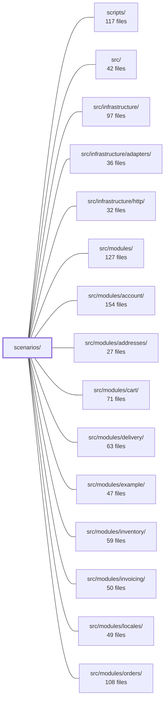

---
tags:
  - 2brain
  - 2brain/module
  - project/boilerplate-node-backend
type: module
module: scenarios/
files: 53
updated: 2026-10-29T19:19:21.065807+00:00
---

# scenarios/

## Purpose

`scenarios/` is the demo and seed-infrastructure layer of the repository. It defines named, whole-database states (`blank`, `shop`, `example`) that can be applied to a local MongoDB, drives realistic order histories through real HTTP endpoints, and provides the demo server, test doubles, and `/__test/*` control surface that the paired frontend dev server and e2e suite depend on. It is intentionally kept outside `src/` so the entire folder can be stripped from a production image without any application code noticing.

## Key parts

- **Registry & entry points** — `index.ts` (the `SCENARIOS` table and `buildScenario` entry point), `apply.ts` (CLI runner for `scenario:apply`), `run-server.ts` (boots the demo server via `npm run demo`), `shop.scenario.ts` (the concrete `shop` scenario: seed + drive + subjects), and `blank.ts` (minimal harness-only seed used as the e2e restore target).
- **Persona & account data** — `accounts.ts` (fixed ObjectId constants, credentials, `seedAccessModel`), `subjects.ts` (flat ID/credential object for generated client collections), `personas-schema.ts` (Zod parse of `personas.yaml` defining the 13 demo login accounts).
- **Catalogue & fixture seeds** — `products.ts` (named branch-covering rows + filler wiring), `products-filler.ts` (deterministic bilingual combinatorial catalogue), `product-ids.ts` (pinned product IDs for generated collections), `addresses.ts`, `locales.ts`, `example.ts` (per-module seed documents).
- **History flows** — `flows/shop-history.ts` (drives checkout → payment → shipment → refund through real HTTP to build the order book), `flows/actions.ts` (verb-level API wrappers), `flows/client.ts` (HTTP client with TOTP login), `flows/loopback.ts` (ephemeral-port helper), `flows/backdate.ts` (ages produced records for realistic date spread).
- **Demo support & test doubles** — `support/demo.ts` (`/__test/*` control routes), `support/demo-clock.ts` (fake `Date` for aging), `support/database-snapshot.ts` (BSON capture/restore), `support/development-doubles.ts` (Node preload wiring), `support/doubles/` (fake PSP, mail transports, OAuth fake, per-module levers and their auto-generated registries).
- **Configuration & utilities** — `config.ts` (seeder env-var slices with public fallbacks), `seed.ts` (idempotent insert-if-absent primitive), `check.ts` (guarantee-vs-subject invariant validator), `rate-limits.ts` (raised budgets for scripted drivers), `collection-values.ts` (contract for per-module `values/` files consumed by the client bundler).
- **Generated aggregates** — `scenarios.generated.ts`, `shop-modules.generated.ts`, `support/doubles/modules.generated.ts`, `support/doubles/levers.generated.ts` (all regenerated via `npm run regenerate`; do not edit by hand).

## How it connects

- **`src/` (application code):** `scenarios/` boots the app via `createApp()` from `src/` and seeds data into the collections those modules own. The dependency is strictly one-way — infrastructure and module code under `src/` are forbidden from importing anything in `scenarios/`.
- **`src/modules/*`:** Each module declares a `scenario` guarantee (rows it promises to seed) and optionally contributes a `scenarios/values/<module>.ts` file read by the client bundler. `shop-modules.ts` / `shop-modules.generated.ts` collect those per-module fixture exports into the single `shopModules` table the `shop` scenario seeds.
- **`src/infrastructure/`:** Scenarios read the same config layer and database adapter the app uses, but add their own `config.ts` slice for seeder-specific variables. `support/database-snapshot.ts` was extracted from `infrastructure/runtime/database.ts` to keep the snapshot concern out of production boot.
- **`scripts/`:** The `client-collections-bundle.ts` script scans `collection-values.ts` contracts; `npm run regenerate` rewrites all `*.generated.ts` barrels. Adding or removing a scenario file is the only manual step; the scripts handle the rest.
- **Repository root:** npm scripts (`scenario:apply`, `demo`, `regenerate`, `demo:remove`) invoke files in this module directly; no `src/` code is involved in the demo lifecycle.

## Where to start

1. **`scenarios/index.ts`** — the single registry that maps scenario names to builders and exposes `buildScenario`. Reading it shows the full surface area and where each named scenario is registered.
2. **`scenarios/shop.scenario.ts`** — the most fleshed-out scenario object (seed → drive → subjects). It makes concrete how a scenario declares its guarantees, seeds fixture rows, and replays order history, which is the pattern every other scenario follows.

## Connected modules

[[boilerplate-node-backend_ROOT|/ (repository root)]] · [[boilerplate-node-backend_scripts|scripts/]] · [[boilerplate-node-backend_src|src/]] · [[boilerplate-node-backend_src_infrastructure|src/infrastructure/]] · [[boilerplate-node-backend_src_infrastructure_adapters|src/infrastructure/adapters/]] · [[boilerplate-node-backend_src_infrastructure_http|src/infrastructure/http/]] · [[boilerplate-node-backend_src_modules|src/modules/]] · [[boilerplate-node-backend_src_modules_account|src/modules/account/]] · [[boilerplate-node-backend_src_modules_addresses|src/modules/addresses/]] · [[boilerplate-node-backend_src_modules_cart|src/modules/cart/]] · [[boilerplate-node-backend_src_modules_delivery|src/modules/delivery/]] · [[boilerplate-node-backend_src_modules_example|src/modules/example/]] · [[boilerplate-node-backend_src_modules_inventory|src/modules/inventory/]] · [[boilerplate-node-backend_src_modules_invoicing|src/modules/invoicing/]] · [[boilerplate-node-backend_src_modules_locales|src/modules/locales/]] · … and 7 more

## Files
- `scenarios/accounts.ts` — Central registry of the demo persona accounts: their fixed MongoDB ObjectId constants, their login credentials (email + plaintext password + optional TOTP/backup-code extras), and the `seedAccessModel` function that places them into the access-control system. Other scenario files import the IDs here so they can seed related rows (addresses, orders, etc.) that belong to a known person, without re-deriving the id.
- `scenarios/addresses.ts` — Seeds the address-book collection for the demo dataset. Defines three books (admin × 2 entries, ordinary customer × 1, second shopper × 1) and exports a `shopModule` whose `seed` function inserts them idempotently. It exists so scenario flows have concrete, persona-keyed addresses to read, mutate, and freeze onto orders.
- `scenarios/apply.ts` — CLI runner for `npm run scenario:apply`. Validates safety gates (non-production, non-public-password, non-empty-DB unless `--reset`), boots the app **in-process** via `createApp().boot()` (never `start()`), then delegates all seeding logic to `buildScenario` from the registry. It owns DATA; `db:sync` owns SCHEMA.
- `scenarios/blank.ts` — Defines the **blank** scenario: a minimal seed that establishes only harness infrastructure (access model, named accounts, baseline shop modules such as locales) with no catalogue, orders, or carts. It is the restore target for behaviour e2e specs that create and assert their own data, as opposed to the full `shop` scenario.
- `scenarios/check.ts` — Validates that a scenario's declared guarantees (each module's `AppModule.scenario` entries) exactly match the subjects the scenario actually builds. Catches both orphaned guarantees (declared but no row seeded) and orphaned subjects (row seeded but no module declares it). It is the only guard for this invariant.
- `scenarios/collection-values.ts` — Defines the `CollectionValues` interface — the single contract that each module's `scenarios/values/<module>.ts` file implements when contributing example values to the generated API client. The bundler (`scripts/contracts/client-collections-bundle.ts`) scans those per-module value files and merges whatever they export as `collectionValues`, so no central registry names individual modules.
- `scenarios/config.ts` — Defines the seeder and demo webhook sink's environment variables as config slices. It wraps the 13 `NODE_SEED_*` password/secret variables and the `NODE_WEBHOOK_DEMO_SINK_URL` with committed, public fallbacks so that a blank value consistently means "unset." It reads through the same infrastructure config layer as the app but is **not** part of the app's boot gate—the seeder is a script, and production has none of these variables.
- `scenarios/example.ts` — Seed dataset for the `example` module: four documents spread across all three statuses (and two user roles) so the module's list, detail, and public screens open on real content. Lives in the demo profile (`group: example`); `demo:remove` deletes these rows alongside the module.
- `scenarios/flows/actions.ts` — Provides the verb-level API for shop-history test scenarios. Each exported function is a thin wrapper over the HTTP endpoint a real browser would call (via `Caller`), ensuring that the full middleware stack—authentication, caller context, rate limiters, audit entries, and domain events—executes. This file is the "what a person does" layer; `shop-history.ts` composes these actions into narrative test flows.
- `scenarios/flows/backdate.ts` — Ages flow-produced orders (and every record they touched) into the past so the demo shop presents real date spread rather than a single boot-time stamp. Runs per-order to keep the order, its payment, shipment, reservation, stock movements, and audit rows mutually consistent about when events occurred.
- `scenarios/flows/client.ts` — A minimal HTTP client that scenario flows use to drive the running application over HTTP during container bootstrap (`scenario:apply`). It wraps `fetch` (not `supertest`, which may be absent when `devDependencies` are not installed), handles TOTP two-factor login, and presents two call styles — `call` (throws on non-2xx) and `attempt` (returns the raw outcome) — so flows can assert both success and expected refusals.
- `scenarios/flows/loopback.ts` — Provides a helper for driving the Express app over real HTTP on an ephemeral loopback port without publishing a stable port. It exists so callers (the demo-profile flow runner and `scenarios/apply.ts`) can exercise the app via unauthenticated `/__test/*` routes before or without the production server binding `NODE_PORT`, avoiding a half-built shop being visible to the frontend's readiness probe.
- `scenarios/flows/shop-history.ts` — Builds the `shop` scenario's order book by driving real API endpoints (checkout, payment, shipping, cancellation, refund, deletion) rather than inserting rows directly. Every payment, stock movement, reservation, shipment, and audit entry in the resulting dataset was produced by application code, so it stays coherent when that code changes. Runs **once per process**; `scenarios/support/demo.ts` caches the result and replays it on every subsequent restore.
- `scenarios/index.ts` — The scenario registry. It collects every named, whole-database state the repo can seed (`blank` plus the generated scenario fixtures) into a single `SCENARIOS` table and exposes `buildScenario` as the one entry point that seeds a scenario and optionally drives its history flows. It exists so that adding a new scenario touches exactly this file (plus its generated fixture), and so the entire `scenarios/` folder can be stripped from a production image without anything under `src/` noticing.
- `scenarios/locales.ts` — Seed data for the dynamic-locale tier of the shop demo dataset. Defines five languages (each chosen to exercise a distinct state in the locale model) and sixteen translated entries across two apps, then exposes a seeding routine and a single history-edit step that plug into the `shopModules` fixture table.
- `scenarios/personas-schema.ts` — Defines the Zod schema and a single parse of `shared/scenarios/personas.yaml`, the file that seeds 13 demo login accounts keyed by the persona names the paired frontend's journeys reference. It lives in `scenarios/` (not `src/infrastructure/`) because infrastructure code is forbidden from importing anything under `scenarios/`.
- `scenarios/product-ids.ts` — A single, dependency-free export of pinned catalogue product IDs for the `products` scenario strip. It exists as a separate module (rather than living in `./subjects.ts`) so that generated API collections can read the IDs without importing a module that has its own imports. All consumers reference it by product name + the branch it exercises instead of repeating raw hex strings.
- `scenarios/products-filler.ts` — Generates a deterministic, bilingual (EN/IT) pet-supply product catalogue by combinatorially crossing a fixed set of animals, product types, and quality tiers via nested loops. It exists to supply a large, repeatable filler catalogue for demo/seed scenarios without introducing randomness (the repo avoids `@faker-js/faker` due to its ESM-only packaging breaking ts-jest). It produces rows of "words only"; `scenarios/products.ts` later attaches IDs and images.
- `scenarios/products.ts` — The catalogue slice of the demo seed dataset. It defines the named (branch-covering) product rows and wires in the combinatorial filler rows so the seeded catalogue resembles a real pet-supply shop. `scenarios/apply.ts` calls this module to seed a live database; `tests/integration/scenarios/shop.test.ts` seeds a throwaway one and validates API responses against the generated schema.
- `scenarios/rate-limits.ts` — Defines the rate-limit budget overrides needed when a **scripted driver** (not a human) hammers the API from a single address. Without these, the app's multi-rung anti-automation ladder 429s the script mid-flight, and the failure surfaces on an unrelated request. The file exists so the two scripted callers can apply one consistent set of raised limits and in-memory counters without duplicating the list.
- `scenarios/run-server.ts` — Entry point for the demo profile (`npm run demo`). Boots the real application against an in-memory MongoDB (or an externally supplied one), seeds the `shop` scenario, and serves on `NODE_PORT`. Eliminates Docker, Redis, and broker dependencies by forcing them off. Serves as the backing server for the paired frontend's dev server and e2e suite.
- `scenarios/scenarios.generated.ts` — Auto-generated barrel file that aggregates all `*.scenario.ts` modules into a single `scenarioFixtures` export. It exists so that `scenarios/index.ts` can register every scenario in one place without manually importing each file. Regenerated via `npm run regenerate`; adding or deleting a `.scenario.ts` file is the only way to change its contents.
- `scenarios/seed.ts` — Domain-agnostic seeding primitive that every scenario module uses to write test fixtures into the database. It provides "insert-if-absent" semantics so fixtures are idempotent across runs without any coupling to a specific entity type.
- `scenarios/shop-modules.generated.ts` — Aggregates the `shopModule` fixture objects exported by each individual scenario file into a single named map. It is generated by `npm run regenerate` so that adding or removing a scenario file automatically updates this collection without manual edits.
- `scenarios/shop-modules.ts` — Per-module fixture table for the `shop` scenario. It defines the `ShopModuleEntry` shape and the `shopModules` constant (assembled from auto-generated per-module exports), plus helpers that reshape or filter the table. It lives in its own file rather than in `scenarios/index.ts` so that `scenarios/blank.ts` can also consume the baseline subset without creating a circular import between the two scenario builders.
- `scenarios/shop.scenario.ts` — Defines the `shop` scenario as a single registered object (`scenario`) with three parts: a `seed` function that loads the access model and all `shopModules` fixture rows, a `drive` function that replays the order-book history, and a `subjects` map that pins row IDs to product guarantees. It is the concrete scenario that `scenarios/index.ts` exposes under the name `shop`.
- `scenarios/subjects.ts` — Exports a single `SUBJECTS` constant holding the two foundation seed accounts (admin and user) as a flat, self-contained object of IDs and credentials. It exists so that consumers that **cannot** import application module code—specifically generated API client collections—can still point at a concrete seeded row without pulling in `api/`-side dependencies.
- `scenarios/support/database-snapshot.ts` — Provides the demo profile's database snapshot machinery — emptying, capturing, and restoring the full database as raw BSON documents. Split out of `src/infrastructure/runtime/database.ts` because connection lifecycle and snapshot/replay are separate concerns, and only `./demo` and `scenarios/apply.ts` need this half.
- `scenarios/support/demo-clock.ts` — Provides a `Date`-only fake clock for the demo profile. It replaces the global `Date` with a controllable one (via `@sinonjs/fake-timers`) so scenario specs can "age" time-dependent logic, while leaving every other timer (`setTimeout`, sockets, Mongo heartbeats) on the real clock. Installed exclusively by the scenario runner—never by a deployment.
- `scenarios/support/demo.ts` — The demo profile's control surface: a set of unauthenticated `/__test/*` Express routes that give the paired e2e frontend the ability to restore named scenarios, inspect state, advance the demo clock, and trigger declared background jobs. It is mounted exclusively by `scenarios/run-server.ts` (via `npm run demo`); nothing under `src/` imports or knows about it.
- `scenarios/support/development-doubles.ts` — A Node preload script (invoked via `tsx --import <this file> …`) that wires development/e2e doubles—fake payment provider, log mail transport, and fake OAuth provider—into the application's registries. It exists so that local dev servers, scenario scripts, and demo commands get working stand-ins without any manual environment setup, while production builds never import it.
- `scenarios/support/doubles/levers.generated.ts` — Auto-generated registry that collects the `installLever` function from each sub-folder under `scenarios/support/doubles/` and exposes a single `installModuleLevers` entry point so `demo.ts` can mount all module-level demo levers in one call. Regenerated by `npm run regenerate`; adding or removing a sibling folder adds or drops its entry automatically.
- `scenarios/support/doubles/mail-log.ts` — A test-double mail transport used in scenario (integration) tests. It exercises the real message-rendering path (so a broken template still throws) but replaces network delivery with nodemailer's `jsonTransport`, so no socket is opened and no mail is actually sent. It exists so tests can verify the *sending* logic without depending on a live mail server.
- `scenarios/support/doubles/mail-outbox.ts` — In-memory test double for the mail transport. Instead of dispatching emails, it records every send into a module-level array so that demo-mode users (via `GET /__test/emails`) and test suites can inspect what "would have been" sent. It is never shipped to production.
- `scenarios/support/doubles/modules.generated.ts` — Auto-generated registry that collects the `registerDouble` function from every module folder under `scenarios/support/doubles/` and exposes a single `registerModuleDoubles` call. It exists so that adding or removing a double module only requires creating/deleting the module folder and re-running `npm run regenerate`.
- `scenarios/support/doubles/oauth-fake.ts` — A test double that implements the `OAuthProvider` port with zero network calls. It lets specs drive the full authorize → callback → exchange flow inside the app itself: `authorizeUrl` lands straight on the callback route with a fixed code, and `exchangeCode` validates PKCE before returning a single hardcoded identity. Exists so OAuth code paths (CSRF state round-trip, PKCE challenge verification) can be exercised without a real provider or consent screen.
- `scenarios/support/doubles/payments/fake.ts` — A fake Payment Service Provider (PSP) test double that implements the `PaymentProvider` interface entirely in memory. It exists so that demos, e2e flows, and integration tests can exercise 3-D Secure, webhook delivery, refunds, disputes, and decline paths without a real PSP account. It never performs I/O; all state lives in process-local `Map`s and `Set`s.
- `scenarios/support/doubles/payments/levers.ts` — Test levers (HTTP endpoints under `/__test/payments/…`) that let integration tests drive the fake payment service provider: force refunds to fail with a specific reason, or simulate a buyer's bank opening and progressing a dispute. The file lives beside `./fake` in the `payments/` subfolder because `payments` is a `group: shop` module that `demo:remove` deletes wholesale; `levers.generated.ts` is then rebuilt from the folders that remain so the demo's control surface never hard-codes a module name.
- `scenarios/support/doubles/payments/register.ts` — Registers a lazy stand-in for the fake Payment Provider (PSP) in the payments registry. Because it uses a dynamic import, registering costs nothing at startup; the real fake (`./fake`) is only read once a method is actually invoked. The file lives in its own `payments/` subfolder so that the `demo:remove` command can delete the entire `payments` group folder without breaking unrelated doubles.
- `scenarios/support/doubles/register.ts` — Central registration point that installs all test doubles into the application's resolver registries. It exists as a single, idempotent entry point so that both the dev preload script and the Jest setup can wire up fakes in one call, while staying outside `src/` so production code can never accidentally import it.
- `scenarios/support/doubles/webhook-sink.ts` — Test-double helper that registers the demo webhook sink's origin as an SSRF exemption and adds its test CA to the process's trusted TLS roots. It exists so the sink (a `webhook-tester` instance behind a TLS proxy, or the frontend's Cypress listener) can be reached over loopback/private compose addresses without modifying production SSRF-guard logic. No-op unless `NODE_WEBHOOK_DEMO_SINK_URL` is set to a parseable URL.
- `scenarios/support/ephemeral-mongo.ts` — Resolves which MongoDB instance a test suite or demo should talk to. It is a pure branching/resolver module: if `NODE_TEST_MONGO_URI` is set it uses that external database; otherwise it delegates to an in-process `mongod` (via `mongodb-memory-server`). It does **not** start the server itself — that responsibility is injected by the caller, keeping the resolver's import graph free of the database driver.
- `scenarios/support/ephemeral-mongod.ts` — Provides the concrete implementation for starting an in-process `mongod` replica set via `mongodb-memory-server`. It lives in `scenarios/support/` (rather than `src/`) because `mongodb-memory-server` is a devDependency and the `not-to-dev-dep` rule forbids `src/` from importing one. Placing it under `scenarios/` lets both `scenarios/` and `tests/` share a single copy, since `tests/` may import `scenarios/`.
- `scenarios/support/no-human-challenge.ts` — Provides a scoped context manager that disables the antibot (human-challenge) provider for the duration of a shop build, so the flow runner can complete a real-HTTP login and payment without being refused on the first challenge. The provider is restored to its original state (including an unset value) when the build finishes.
- `scenarios/tools/generate-seed-images.ts` — One-off CLI script (`npm run scenario:images`) that downloads a fixed-size photo per catalogue role from Lorem Picsum, runs it through the same `digestImage`/`thumbnailImage` pipeline a real upload uses, and writes the results into `public/images/seed/` along with two generated JSON manifests. It exists so the demo catalogue holds locally-committed, production-identical image bytes rather than hand-placed files or hot-linked URLs.
- `scenarios/tools/generate-webhook-sink-tls.ts` — One-shot authoring script that regenerates the TLS fixtures for the demo webhook sink (CA cert, leaf cert, leaf key) into `scenarios/support/tls/`. It exists because Node's `node:crypto` cannot build X.509 certificates, so it shells out to `openssl` at author time; the resulting PEM files are committed, so no runtime dependency on `openssl` remains.
- `scenarios/users.ts` — Builds and seeds the full user directory for the demo dataset: 13 named accounts (one per persona in `personas.yaml`, covering every tenant role) and 10 filler customers used to vary order history in the shop flow runner. Accounts carry varied states (verified, 2FA-armed, consented, inactive) so that e2e suites and integration tests can log in as each one rather than only reading about the role.
- `scenarios/values/cart.ts` — Provides the canonical example values for the `cart` entity used by the generated API client's collection types. It exists so that the generated client code has a single, typed source for default/sample cart data.
- `scenarios/values/orders.ts` — Provides example (placeholder) values for the `orderId` field in generated API-client collections (Bruno, Insomnia, Postman). Because demo-shop order IDs are minted dynamically at shop build time and cannot be hard-coded, this file substitutes `{{name}}` collection variables that the HTTP clients resolve at send time. The orders section's first probe request is expected to populate these variables.
- `scenarios/values/products.ts` — Provides the product-related example values consumed by a generated API client's collection helpers. It pins concrete seed product IDs so that generated requests always reference a product that exists in the test environment.
- `scenarios/waves.ts` — Provides a generic dependency-wave scheduler that groups a named set of async steps into the fewest sequential "waves" (waves run in order; steps within a wave run concurrently). It exists so scenario seed scripts can declare *what* each step depends on by name rather than hard-coding a fixed execution order, allowing steps to be added or removed without editing their dependents.
- `scenarios/webhooks.ts` — Seeds a single demo webhook subscription (pointing at a `webhook-tester` sink) as part of the shop's fixture dataset. It is inert by default: when `NODE_WEBHOOK_DEMO_SINK_URL` is unset (the default), it seeds nothing, avoiding a dead subscription that would auto-disable and clutter logs.
- `scenarios/wishlist.ts` — Defines the seeded wishlist fixtures for the two demo accounts and provides the `seedWishlistsCollection` function that inserts them. It ensures only publicly visible products are saved, so the storefront's wishlist page never renders a hole caused by a soft-deleted or inactive product.

---
[[boilerplate-node-backend_INDEX|← boilerplate-node-backend index]]
