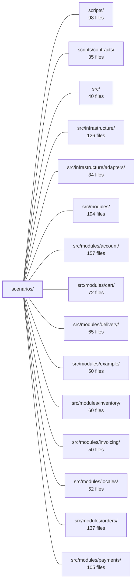

---
tags:
  - 2brain
  - 2brain/module
  - project/boilerplate-node-backend
type: module
module: scenarios/
files: 49
updated: 2026-11-08T10:46:33.462325+00:00
---

# scenarios/

## Purpose

The `scenarios/` module is the demo and seed-data layer of the application. It defines named, whole-database states (the `shop` pet-supply store, a minimal `blank` slate, and a small `example` fixture set), provides the CLI and server entry points to seed and serve them, and supplies the test doubles and HTTP-driven "flows" that make the resulting data realistic. It lives entirely outside `src/` so it can import devDependencies and be excluded from the production image.

## Key parts

- **Registry & entry points** — `index.ts` is the single place every scenario is registered; `apply.ts` is the CLI seeder (`npm run scenario:apply`); `run-server.ts` boots the full demo server (`npm run demo`); `blank.ts` and `shop.scenario.ts` are the two main scenario definitions; `shop-modules.ts` lists which per-module fixtures participate and in what order.
- **Seed fixtures (domain data)** — `accounts.ts` (13 fixed identities + access model), `products.ts` + `products-filler.ts` (named edge-case products + 126-row combinatorial catalogue), `addresses.ts` (address-book fixtures), `locales.ts` (five language states), `example.ts` (one record per status). All write through the generic upsert primitive in `seed.ts`.
- **HTTP-driven flows** — `flows/shop-history.ts` drives checkout → payment → shipping → refund → cancellation through the real middleware stack; `flows/actions.ts` provides the thin per-action wrappers; `flows/client.ts` and `flows/loopback.ts` supply the transport; `flows/backdate.ts` rewrites timestamps for realistic analytics.
- **Test doubles & demo support** — `support/doubles/` contains fakes for payments (PSP state machine + webhooks), mail (outbox + log), OAuth, and the webhook sink; `support/demo.ts` mounts `/__test/*` control routes; `support/development-doubles.ts` is the Node preload that injects all fakes; `support/demo-clock.ts` fakes `Date` only.
- **Configuration & shared types** — `config.ts` (seed credentials + webhook URL), `personas-schema.ts` (Zod loader for `personas.yaml`), `collection-values.ts` (interface for generated API client fixtures), `subjects.ts` / `product-ids.ts` (literal id/credential constants for code that cannot import app modules).
- **Database plumbing** — `support/ephemeral-mongo.ts` + `support/ephemeral-mongod.ts` (in-process Mongo via devDependency), `support/database-snapshot.ts` (capture/restore), `support/no-human-challenge.ts` (temporarily disables antibot for flow runs).

## How it connects

- **`src/` (modules & infrastructure)** — Every seed file and flow imports the application's repositories, services, and `createApp().boot()`. The flows call the same HTTP endpoints the browser would, exercising `src/modules/*` controllers, middleware, and event emitters end-to-end. `shop-modules.ts` references module names that map to `src/modules/account`, `cart`, `delivery`, `inventory`, `invoicing`, `locales`, `orders`, `payments`, `products`, `returns`, `users`, `webhooks`, and `example`.
- **`src/infrastructure/` & adapters** — Test doubles in `support/doubles/` implement the adapter interfaces (e.g. `PaymentProvider`, mail transport) defined under `src/infrastructure/adapters/`, allowing the app to swap real I/O for fakes without production code knowing about them. `personas-schema.ts` lives here (rather than in `src/infrastructure/`) to respect the rule that infrastructure must not import from `scenarios/`.
- **`scripts/` & `scripts/contracts/`** — The `npm run regenerate` script auto-discovers `*.scenario.ts` files and generates `scenarios.generated.ts`; the ESLint boundary rules enforced by the scripts prevent `src/` from importing into `scenarios/` and vice-versa (except the allowed direction).
- **Repository root** — Package-level scripts (`scenario:apply`, `demo`, `db:bootstrap`) wire the CLI and server entry points; `NODE_SEED_*` environment variables (documented in `config.ts`) are read at seed time.

## Where to start

1. **`scenarios/index.ts`** — Read this first. It is a short file that lists every scenario name, its `buildScenario` function, and the one-line comment tying it to the seed pipeline. It tells you the full surface area in under thirty lines.
2. **`scenarios/apply.ts`** — This is the actual command you run (`npm run scenario:apply shop`). Reading it shows how the app is booted, the scenario is built, the cache is cleared, and the process exits — the exact lifecycle a seed run goes through.

Together they answer "what states exist?" and "how do I get one into a database?" without needing to open any fixture file.

## Connected modules

[[boilerplate-node-backend_ROOT|/ (repository root)]] · [[boilerplate-node-backend_scripts|scripts/]] · [[boilerplate-node-backend_scripts_contracts|scripts/contracts/]] · [[boilerplate-node-backend_src|src/]] · [[boilerplate-node-backend_src_infrastructure|src/infrastructure/]] · [[boilerplate-node-backend_src_infrastructure_adapters|src/infrastructure/adapters/]] · [[boilerplate-node-backend_src_modules|src/modules/]] · [[boilerplate-node-backend_src_modules_account|src/modules/account/]] · [[boilerplate-node-backend_src_modules_cart|src/modules/cart/]] · [[boilerplate-node-backend_src_modules_delivery|src/modules/delivery/]] · [[boilerplate-node-backend_src_modules_example|src/modules/example/]] · [[boilerplate-node-backend_src_modules_inventory|src/modules/inventory/]] · [[boilerplate-node-backend_src_modules_invoicing|src/modules/invoicing/]] · [[boilerplate-node-backend_src_modules_locales|src/modules/locales/]] · [[boilerplate-node-backend_src_modules_orders|src/modules/orders/]] · … and 5 more

## Files
- `scenarios/accounts.ts` — Central registry of the 13 demo/seed accounts: their fixed ObjectIds, plaintext login credentials (email, password, TOTP secret, backup codes), and the single function that seeds the full access model (tenant + role memberships) from `personas.yaml`. Other scenario files import the id constants here instead of hard-coding them, keeping a single source of truth for "who these people are."
- `scenarios/addresses.ts` — Seeds the address-book collection for the demo dataset. It defines three fixture books (admin with two entries, ordinary customer with one, second shopper with one) so that order-snapshot behaviour, "exactly one default" logic, and two-shopper journeys are all observable against live data. Exposed as a `shopModule` entry that `seedShop` calls.
- `scenarios/apply.ts` — CLI seeder invoked as `npm run scenario:apply [scenario]`. It owns **data** (as opposed to `db:sync`, which owns schema). It boots the app in-process via `createApp().boot()`, runs the named scenario's `buildScenario` against that instance, clears the cache, optionally writes a JSON description file, and shuts down. It exists so a fresh or reset database gets a coherent, flow-driven dataset without needing a live server.
- `scenarios/blank.ts` — Seeds the minimal harness infrastructure (access model, named accounts, baseline shop modules such as `locales`) with no shop-specific data — no catalogue, orders, or carts. It exists as the restore target for behaviour e2e specs that create their own fixtures, giving them a clean slate that is lighter than restoring into `shop`.
- `scenarios/check.ts` — Guarantees that a scenario's **declared** guarantees (each `AppModule.scenario` entry) and the **subjects** it actually seeds (the id map from `buildScenario`) are two views of the same set. It enforces this in both directions—no dangling declaration, no orphan subject—and exposes the result as either a list of problem strings or a thrown error.
- `scenarios/collection-values.ts` — Defines the `CollectionValues` interface — the contract each module's fixture file uses to contribute example values to the generated API client's collections. The bundler scans `scenarios/values/<module>.ts`, reads whatever each file exports as `collectionValues`, and merges them; this file is the shared type that makes that merge well-typed without any central registry naming individual modules.
- `scenarios/config.ts` — Defines two configuration slices consumed exclusively by the demo seeder and dev preload: the `NODE_SEED_*` credential variables (13 persona passwords + one shared TOTP secret) and the demo webhook-sink URL. Each variable has a committed, public fallback so the seeder works out-of-the-box in development; production never reads these slices.
- `scenarios/example.ts` — Provides the demo/seed dataset for the `example` module: a small set of fixed-example records (one per status for the editor, one published for the admin) so that UI screens and journey tests open on realistic content. The file is collected into a generated `shop-modules` registry and cleaned up by `demo:remove`.
- `scenarios/flows/actions.ts` — Thin HTTP wrappers — one function per action a person takes in the shop (stock, cart, checkout, payment, fulfillment). Each calls the same endpoint a browser would, through the full middleware stack, so the resulting rows carry the audit entry, actor scope, and domain event that a direct service call would omit.
- `scenarios/flows/backdate.ts` — Backdates flow-produced orders (and every record the application wrote on the order's behalf) into the past so the demo shop has realistic date distributions. Without it, every order is stamped with the container boot time, making analytics charts flat and time-range filters meaningless. Runs after `shop-history` has created and dated the orders.
- `scenarios/flows/client.ts` — A minimal HTTP client that lets scenario flows drive the application through its real endpoints during container boot (`npm run db:bootstrap` → `scenario:apply`). It wraps a single bearer-token session in a `Caller` object, parses every response into a uniform `Attempt` shape, and throws a descriptive error on unexpected failures. It deliberately uses the runtime's `fetch` instead of supertest because it must work in environments where devDependencies are not installed.
- `scenarios/flows/loopback.ts` — Provides a single helper that binds an Express app to an **ephemeral loopback port**, hands the resolved `baseUrl` to a caller-supplied async function, and tears the server down afterwards. It exists so the demo profile and `scenarios/apply.ts` can exercise the app over real HTTP at moments when no production server is listening, without publishing a port to any other interface.
- `scenarios/flows/shop-history.ts` — The order book for the `shop` demo scenario. Rather than inserting rows directly, it drives the application through its own HTTP endpoints (checkout, payment, shipping, cancellation, refund, deletion) so that the payments, stock movements, reservations, shipments, audit entries, and analytics events are all produced by real application code. It runs once per process; `scenarios/support/demo.ts` caches the result in memory and replays it on every restore.
- `scenarios/index.ts` — Central registry of every named, whole-database state the repo can seed (`blank` plus each generated scenario). It bundles seeding and optional flow-driving into a single `buildScenario` entry point so that adding a new scenario requires editing exactly one place. Lives at the bottom of the dependency tree: production code under `src/` never imports it (enforced by ESLint boundaries), allowing the entire `scenarios/` folder to be omitted from a production image.
- `scenarios/locales.ts` — Seed fixture module for the dynamic-locale tier of the demo dataset. Defines five languages (each exercising a distinct state: source/fallback, downloadable-only, deployed-and-overridable, inactive draft, and registered-but-empty) plus sixteen translated string entries, then wires them into the shop seed pipeline and the demo-history flow.
- `scenarios/personas-schema.ts` — Defines the Zod schema for `shared/scenarios/personas.yaml` and is the single place that loads it. The YAML holds 13 fixed demo login accounts (by the names the paired frontend's journeys expect). The file lives under `scenarios/` rather than `src/infrastructure/` because the infrastructure layer must not import from `scenarios/`.
- `scenarios/product-ids.ts` — A zero-import, single-export module that centralises the MongoDB ObjectIds used by product-related test scenarios. It exists so that generated API collections can read the ids without pulling in any runtime module, and so that every consumer names the id by intent (product + branch under test) rather than repeating a raw hex string.
- `scenarios/products-filler.ts` — Produces the deterministic, combinatorial portion of the demo pet-supply catalogue: a fixed 6-animal × 7-product-type × 3-tier grid (126 rows) plus two digital PDF guides, all with bilingual (EN/IT) copy. It exists so `scenarios/products.ts` can attach stable ids and image URLs without this file needing to know about either, and so every boot and every restore yields byte-identical rows (no randomness, no `@faker-js/faker`).
- `scenarios/products.ts` — Seeds the product catalogue for demo and integration-test environments. It defines a small set of **named** products that each exercise a specific branch in the storefront/repositories (soft-deleted, out-of-stock, inactive, minimal, digital-only, no-withdrawal, heavy, off-sale, low-stock) and pairs them with combinatorially generated **filler** products so the catalogue reads like a real pet-supply store rather than a list of edge cases. It also writes per-locale translations (`en` required, `it` optional) and ensures every product's `title`/`description` is persisted both as the document's derived index column and as translation rows.
- `scenarios/rate-limits.ts` — Provides the environment-variable overrides that let scripted callers (e2e suite server, shop-history seeder) bypass the app's per-rung anti-automation rate limits. Without these, a single address firing hundreds of requests in seconds gets a 429 on an unrelated request, making failures look like broken functionality rather than exhausted allowance.
- `scenarios/run-server.ts` — Entry point for the demo profile (`npm run demo`). Boots the real application server against a disposable in-memory MongoDB (or an external Mongo via `NODE_TEST_MONGO_URI`), seeds the `shop` scenario, and listens on `NODE_PORT`. Exists so the paired frontend dev server and e2e suite can run against the actual API without Docker, Redis, or a message broker.
- `scenarios/seed.ts` — Provides the generic "insert one fixture if it isn't already there" primitive that every scenario module uses to write seed data. It is domain-agnostic: it only knows a repository shape and a fixture with a stable key, so any module's repository satisfies it without importing domain code.
- `scenarios/shop-modules.ts` — Defines the per-module fixture table for the `shop` scenario — which modules are seeded, in what order, and which ones `blank` also needs. It lives in its own file (rather than inside `scenarios/index.ts`) so that `blank.ts` can read the same entries without `index.ts` and `blank.ts` importing each other.
- `scenarios/shop.scenario.ts` — Defines the `shop` scenario object — its seed sequence, drive function, and pinned subject rows — that `scenarios/index.ts` registers under the name `shop`. It is auto-discovered by `npm run regenerate` (via `scenarios/scenarios.generated.ts`); the regeneration strip deletes this file rather than editing the registry.
- `scenarios/subjects.ts` — Provides a single, fixed `SUBJECTS` constant (admin + user id, email, password) for consumers that cannot import application module code — specifically, generated API client collections loaded on demand. It exists so those consumers have a stable, literal credential pair without pulling in generated artifacts, while keeping the credential source-of-truth in one place.
- `scenarios/support/database-snapshot.ts` — Provides the demo profile's database snapshot machinery: empty, capture, and restore. Split from `src/infrastructure/runtime/database.ts` because taking and replaying a snapshot is a distinct concern from connection lifecycle, and only two call sites (`scenarios/support/demo.ts` and `scenarios/apply.ts`) need this half.
- `scenarios/support/demo-clock.ts` — A `Date`-only fake clock for the demo profile. It lets scenario specs move time forward (to age TTLs, cooldowns, etc.) without freezing the Node event loop or the Mongo driver's own timers. Only `Date` is faked; everything else (sockets, heartbeats, `setTimeout`) keeps running on the real clock. The module also provides a register/get slot so the demo control surface can reach the clock when one is installed, and get `undefined` otherwise.
- `scenarios/support/demo.ts` — Mounts the demo profile's control surface — a set of test-only HTTP routes under `/__test/*` that let a paired e2e frontend restore scenarios, inspect state, advance a fake clock, and trigger background jobs. It is installed exclusively by `scenarios/run-server.ts` via `npm run demo`; nothing under `src/` references it, and production has no such routes.
- `scenarios/support/development-doubles.ts` — A Node preload script (loaded via `tsx --import`) that injects development-only doubles—fake payment provider, log-based mail transport, and a stand-in OAuth provider—into the application's registries. It exists so that local dev, e2e, demo, debug, and `scenario:apply` processes get working infrastructure without any of the fakes living in `src/` or the production Docker image.
- `scenarios/support/doubles/mail-log.ts` — Test double for the mail transport adapter. It renders a message (so template errors surface at send-time) but opens no socket — nodemailer's `jsonTransport` serialises the message to a JSON string and returns it. It exists so integration/e2e tests can exercise the mail-sending code path without a real SMTP server.
- `scenarios/support/doubles/mail-outbox.ts` — A test-double mail transport that records every email in a module-level in-memory array instead of sending it. It exists so that demo mode (`GET /__test/emails`) and test suites can inspect what would have been mailed (recipient, template name, token, locale, attachments) without requiring a real SMTP or API backend.
- `scenarios/support/doubles/oauth-fake.ts` — A fake OAuth identity provider (test double) that implements the real `OAuthProvider` port with zero network calls. It lets tests and the dev preload exercise the full authorize → callback → exchange flow — including CSRF `state` round-trip and PKCE verifier/challenge matching — without ever leaving the app or rendering a consent screen.
- `scenarios/support/doubles/payments/fake.ts` — A fake Payment Service Provider (PSP) that implements the `PaymentProvider` interface for local development and test suites. It mimics the async state machine a real PSP exposes (`requires_action`, `processing`, terminal states), signs its own webhooks with HMAC, and holds all state in in-memory `Map`/`Set` structures. It is never shipped to production; it is registered only via the dev preload and the Jest setup.
- `scenarios/support/doubles/payments/levers.ts` — Demo-profile test levers for the payments module. Exposes two `POST /__test/payments/…` endpoints that let the demo UI and integration tests drive the fake PSP: one simulates refund rejections for a given order, the other injects (or advances) a dispute/chargeback. Kept in its own file beside `./fake` so that `demo:remove` can delete the whole `payments` folder without touching the shared demo surface.
- `scenarios/support/doubles/payments/register.ts` — Registers a lazy "fake" payment provider into the payments registry so that scenario tests can exercise the payments flow without a real PSP. Registration itself is a no-op cost: the fake implementation is only loaded (dynamic `import('./fake')`) the first time a method is actually called.
- `scenarios/support/doubles/register.ts` — Single registration point that populates the application's runtime registries with test doubles (fake mail transports, module fakes, webhook-sink exemptions). It exists so that dev, demo, and test processes can swap real I/O for fakes through one function call. Production never imports this file — it lives outside `src/` by design.
- `scenarios/support/doubles/webhook-sink.ts` — Test double that registers an SSRF exemption and TLS trust for the demo webhook sink (a local `webhook-tester` proxy or a Cypress listener). Because the sink lives on loopback or a private compose address, the production SSRF guard would reject it; this file lets the dev preload script opt in without baking an exemption into production code. Never shipped.
- `scenarios/support/ephemeral-mongo.ts` — Resolves which Mongo instance a test suite or demo profile should connect to. It is a pure branching/decision module: check the `NODE_TEST_MONGO_URI` env var for an already-running database, and if absent, delegate to a caller-supplied `startInProcess` function. It deliberately does not import or start `mongodb-memory-server` itself.
- `scenarios/support/ephemeral-mongod.ts` — Starts a real, single-member `mongod` replica set in-process via `mongodb-memory-server` and adapts it to the `EphemeralMongo` interface. Lives in `scenarios/support/` (not `src/`) because `mongodb-memory-server` is a devDependency and the `not-to-dev-dep` rule forbids `src/` from importing one.
- `scenarios/support/no-human-challenge.ts` — A small async wrapper that temporarily sets the antibot/human-challenge provider to `none` for the duration of a build, then restores the previous value. It exists so the paired scenario (flow runner signing in and paying over real HTTP) can proceed without a challenge provider refusing the first login and preventing the shop from being built.
- `scenarios/tools/generate-seed-images.ts` — One-off CLI script (`npm run scenario:images`) that downloads a pinned photo per catalogue role from Lorem Picsum, runs it through the same digest/thumbnail pipeline a real upload uses, and writes the resulting files to `public/images/seed/` along with two `*-images.generated.json` manifests. It exists so the demo catalogue's images are pipeline-processed bytes rather than hand-placed files or hot-linked URLs, while remaining reproducible and cheap to regenerate.
- `scenarios/tools/generate-webhook-sink-tls.ts` — One-shot authoring script (run via `npm run scenario:tls`) that regenerates the demo webhook sink's TLS fixture pair — a test CA and a leaf certificate — and commits them to `scenarios/support/tls/`. It exists so the fixtures can be rebuilt when the ten-year validity expires without needing a human to run raw `openssl` commands.
- `scenarios/users.ts` — Seeds the `users` collection for the demo dataset: the 13 named persona accounts (owner, customer, staff, and one per tenant role) plus 10 filler customers that give the flow runner a varied order history. It exists so other scenario files can seed rows *belonging* to these people and so the e2e suite has accounts to log in against.
- `scenarios/values/cart.ts` — Provides the example/test values for the **cart** collection in the generated API client. It exists so that integration or scenario tests have a consistent, typed payload to exercise the cart endpoint.
- `scenarios/values/orders.ts` — Supplies the example values (template-variable placeholders) that the generated API-client collections use wherever an order ID appears. Because order IDs are minted at runtime during shop setup and differ every session, this module hands request builders a `{{…}}` slot to fill rather than a literal ID that would 404.
- `scenarios/values/products.ts` — Provides the product-specific example values that the generated API client collections use to construct realistic requests. It pins every product reference to a known seed id so that generated test scenarios always target a product that exists in the catalogue.
- `scenarios/waves.ts` — Provides a generic topological-sort-and-execute utility for a named set of async steps. It lets callers (e.g. `scenarios/shop-modules.ts`) declare "step B runs after step A" as data rather than hard-coding sequential awaits, so adding or removing a dependency is a one-line change to the entry list—no cascading edits.
- `scenarios/webhooks.ts` — Seeds a single demo webhook subscription (pointing at a `webhook-tester` sink) as part of the `shopModules` fixture table. It is inert by default: when `NODE_WEBHOOK_DEMO_SINK_URL` is unset (the common case), it seeds nothing and produces no log noise. When the sink URL is set (via the `integrations` Docker profile or the frontend's Cypress listener), it upserts one subscription so a developer can watch deliveries in `webhook-tester` without manually creating a session first.
- `scenarios/wishlist.ts` — Seeds demo wishlist documents for the two demo accounts (admin and customer). It deliberately selects only publicly visible product IDs so that the storefront's wishlist page never renders a hole (a product the scoping rules would refuse to return). The file is one entry in the `shop` fixture table that `seedShop` iterates over.

---
[[boilerplate-node-backend_INDEX|← boilerplate-node-backend index]]
