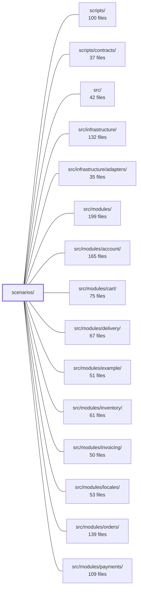

---
tags:
  - 2brain
  - 2brain/module
  - project/boilerplate-node-backend
type: module
module: scenarios/
files: 49
updated: 2026-11-15T00:27:50.734447+00:00
---

# scenarios/

## Purpose

`scenarios/` owns all **data** seeding and demo-profile infrastructure for the project: it builds coherent, flow-driven datasets for a fresh or reset database, drives the running application over real HTTP to produce orders/payments/audit trails, and exposes a disposable demo server (`npm run demo`). It is strictly one-directional—modules under `src/` never import from here (enforced by ESLint boundaries), so the entire folder can be omitted from a production image.

## Key parts

- **Scenario registry & entry points** — `index.ts` (maps scenario names to `buildScenario`), `apply.ts` (CLI: boots the app, seeds, shuts down), `run-server.ts` (boots a full demo server on an ephemeral port), `shop.scenario.ts` + `shop-modules.ts` (define the `shop` seed sequence and per-module fixture table), `blank.ts` (minimal clean-slate target for e2e specs).
- **Fixture & seed data** — `accounts.ts` (13 fixed demo identities + the access-model seeder), `products.ts` + `products-filler.ts` (named edge-case products plus a 126-row combinatorial catalogue), `addresses.ts`, `example.ts`, `locales.ts`, `product-ids.ts`, `subjects.ts` (stable literals for generated API clients), `personas-schema.ts` (Zod schema + loader for `shared/scenarios/personas.yaml`).
- **Flow drivers (HTTP-based)** — `flows/client.ts` (typed caller wrapping bearer auth + two-step login), `flows/actions.ts` (one function per user action: checkout, pay, ship, etc.), `flows/shop-history.ts` (drives the full order lifecycle through real endpoints), `flows/backdate.ts` (rewrites timestamps for multi-month history), `flows/loopback.ts` (binds the app to an ephemeral port for a single call).
- **Support & doubles** — `support/demo.ts` (unauthenticated `/__test/*` control routes), `support/database-snapshot.ts` (capture/restore), `support/demo-clock.ts` (Date-only fake), `support/ephemeral-mongo.ts` + `ephemeral-mongod.ts` (in-process replica set), `support/development-doubles.ts` (preload script injecting all fakes), and the `support/doubles/` subtree (fake PSP, mail outbox/log, OAuth fake, webhook-sink exemption).
- **Contracts & utilities** — `seed.ts` (generic "insert-if-absent" primitive), `check.ts` (declaration-vs-subject consistency guard), `collection-values.ts` (shared `CollectionValues` type for generated API clients), `config.ts` (seed-only credential/webhook vars), `rate-limits.ts` (budget overrides for scripted callers).

## How it connects

- **`src/` / `src/modules/*`** — `scenarios/` imports the application (via `createApp().boot()`), uses each module's repository to write fixtures, and drives flows through the modules' HTTP endpoints. The reverse import is forbidden: `src/` never reaches into `scenarios/`.
- **`src/infrastructure/` / `src/infrastructure/adapters/`** — The demo doubles in `support/doubles/` implement the same adapter ports (mail transport, payments, OAuth) that `src/infrastructure/adapters/` provides in production, but are registered only by the dev preload, keeping fakes out of the runtime image.
- **`scripts/` / `scripts/contracts/`** — `npm run regenerate` auto-discovers `*.scenario.ts` files, rebuilds `scenarios.generated.ts`, and generates API-client collections that read `collection-values.ts` and `product-ids.ts`. The root-level `package.json` wires `npm run demo`, `scenario:apply`, and `demo:remove` to entry points here.
- **Repository root** — `scenarios/` reads `shared/scenarios/personas.yaml` (via `personas-schema.ts`) and writes the seeded state into the same MongoDB instance the rest of the app uses.

## Where to start

1. **`scenarios/index.ts`** — the single registry showing every named scenario, its `buildScenario` signature, and the one place you edit to add a new scenario.
2. **`scenarios/apply.ts`** — the CLI entry point that boots the app, calls `buildScenario`, clears the cache, and shuts down; reading it end-to-end shows how seeding, flow-driving, and the demo server all compose from the same `createApp()` instance.

## Connected modules

[[boilerplate-node-backend_ROOT|/ (repository root)]] · [[boilerplate-node-backend_scripts|scripts/]] · [[boilerplate-node-backend_scripts_contracts|scripts/contracts/]] · [[boilerplate-node-backend_src|src/]] · [[boilerplate-node-backend_src_infrastructure|src/infrastructure/]] · [[boilerplate-node-backend_src_infrastructure_adapters|src/infrastructure/adapters/]] · [[boilerplate-node-backend_src_modules|src/modules/]] · [[boilerplate-node-backend_src_modules_account|src/modules/account/]] · [[boilerplate-node-backend_src_modules_cart|src/modules/cart/]] · [[boilerplate-node-backend_src_modules_delivery|src/modules/delivery/]] · [[boilerplate-node-backend_src_modules_example|src/modules/example/]] · [[boilerplate-node-backend_src_modules_inventory|src/modules/inventory/]] · [[boilerplate-node-backend_src_modules_invoicing|src/modules/invoicing/]] · [[boilerplate-node-backend_src_modules_locales|src/modules/locales/]] · [[boilerplate-node-backend_src_modules_orders|src/modules/orders/]] · … and 5 more

## Files
- `scenarios/accounts.ts` — Central registry of the 13 demo/seed accounts: their fixed ObjectIds, plaintext login credentials (email, password, TOTP secret, backup codes), and the single function that seeds the full access model (tenant + role memberships) from `personas.yaml`. Other scenario files import the id constants here instead of hard-coding them, keeping a single source of truth for "who these people are."
- `scenarios/addresses.ts` — Seeds the address-book collection for the demo dataset. It defines three fixture books (admin with two entries, ordinary customer with one, second shopper with one) so that order-snapshot behaviour, "exactly one default" logic, and two-shopper journeys are all observable against live data. Exposed as a `shopModule` entry that `seedShop` calls.
- `scenarios/apply.ts` — CLI seeder invoked as `npm run scenario:apply [scenario]`. It owns **data** (as opposed to `db:sync`, which owns schema). It boots the app in-process via `createApp().boot()`, runs the named scenario's `buildScenario` against that instance, clears the cache, optionally writes a JSON description file, and shuts down. It exists so a fresh or reset database gets a coherent, flow-driven dataset without needing a live server.
- `scenarios/blank.ts` — Seeds the minimal harness infrastructure (access model, named accounts, baseline shop modules such as `locales`) with no shop-specific data — no catalogue, orders, or carts. It exists as the restore target for behaviour e2e specs that create their own fixtures, giving them a clean slate that is lighter than restoring into `shop`.
- `scenarios/check.ts` — Guarantees that a scenario's **declared** guarantees (each `AppModule.scenario` entry) and the **subjects** it actually seeds (the id map from `buildScenario`) are two views of the same set. It enforces this in both directions—no dangling declaration, no orphan subject—and exposes the result as either a list of problem strings or a thrown error.
- `scenarios/collection-values.ts` — Defines the `CollectionValues` interface — the contract each module's fixture file uses to contribute example values to the generated API client's collections. The bundler scans `scenarios/values/<module>.ts`, reads whatever each file exports as `collectionValues`, and merges them; this file is the shared type that makes that merge well-typed without any central registry naming individual modules.
- `scenarios/config.ts` — Defines two configuration slices consumed exclusively by the demo seeder and dev preload: the `NODE_SEED_*` credential variables (13 persona passwords + one shared TOTP secret) and the demo webhook-sink URL. Each variable has a committed, public fallback so the seeder works out-of-the-box in development; production never reads these slices.
- `scenarios/example.ts` — Provides the demo/seed dataset for the `example` module: a small set of fixed-example records (one per status for the editor, one published for the admin) so that UI screens and journey tests open on realistic content. The file is collected into a generated `shop-modules` registry and cleaned up by `demo:remove`.
- `scenarios/flows/actions.ts` — Provides one function per "thing a person does" (check out, pay, ship, deliver, etc.), each a thin HTTP wrapper over the endpoint a browser would call. They deliberately go through the full middleware stack (auth, caller context, rate limiters) rather than invoking a service directly, because only that path emits the audit entry, actor scope, and domain event that a bare service call would skip.
- `scenarios/flows/backdate.ts` — Rewrites the timestamps on a flow-produced order and every document it touched so the demo shop appears to have multi-month history instead of all data dated to container boot. Without this, analytics charts, "last 30 days" filters, and dashboards would show identical results regardless of the requested period.
- `scenarios/flows/client.ts` — HTTP client that scenario flow runners use to drive the running application. It wraps a single base URL and bearer token behind a `Caller` object, normalises every response into an `Attempt`, and handles the two-step (password + TOTP) login path. It exists so that every flow file can issue requests and interpret refusals without re-implementing status/body parsing, and so that seeds are produced through the same endpoints a real browser hits.
- `scenarios/flows/loopback.ts` — Provides a single helper that binds an Express app to an **ephemeral loopback port**, hands the resolved `baseUrl` to a caller-supplied async function, and tears the server down afterwards. It exists so the demo profile and `scenarios/apply.ts` can exercise the app over real HTTP at moments when no production server is listening, without publishing a port to any other interface.
- `scenarios/flows/shop-history.ts` — The order book for the `shop` demo scenario. Rather than inserting rows directly, it drives the application through its real endpoints (checkout, payment, shipping, cancellation, refund) so that every payment, stock movement, reservation, shipment, audit entry, and analytics event is produced by the actual code paths. The result is built once per process; `scenarios/support/demo.ts` caches it in memory and replays on every subsequent restore.
- `scenarios/index.ts` — Central registry of every named, whole-database state the repo can seed (`blank` plus each generated scenario). It bundles seeding and optional flow-driving into a single `buildScenario` entry point so that adding a new scenario requires editing exactly one place. Lives at the bottom of the dependency tree: production code under `src/` never imports it (enforced by ESLint boundaries), allowing the entire `scenarios/` folder to be omitted from a production image.
- `scenarios/locales.ts` — Seed fixture module for the dynamic-locale tier of the demo dataset. Defines five languages (each exercising a distinct state: source/fallback, downloadable-only, deployed-and-overridable, inactive draft, and registered-but-empty) plus sixteen translated string entries, then wires them into the shop seed pipeline and the demo-history flow.
- `scenarios/personas-schema.ts` — Defines the Zod schema for `shared/scenarios/personas.yaml` and is the single place that loads it. The YAML holds 13 fixed demo login accounts (by the names the paired frontend's journeys expect). The file lives under `scenarios/` rather than `src/infrastructure/` because the infrastructure layer must not import from `scenarios/`.
- `scenarios/product-ids.ts` — A zero-import, single-export module that centralises the MongoDB ObjectIds used by product-related test scenarios. It exists so that generated API collections can read the ids without pulling in any runtime module, and so that every consumer names the id by intent (product + branch under test) rather than repeating a raw hex string.
- `scenarios/products-filler.ts` — Produces the deterministic, combinatorial portion of the demo pet-supply catalogue: a fixed 6-animal × 7-product-type × 3-tier grid (126 rows) plus two digital PDF guides, all with bilingual (EN/IT) copy. It exists so `scenarios/products.ts` can attach stable ids and image URLs without this file needing to know about either, and so every boot and every restore yields byte-identical rows (no randomness, no `@faker-js/faker`).
- `scenarios/products.ts` — Seeds the product catalogue for demo and integration-test environments. It defines a small set of **named** products that each exercise a specific branch in the storefront/repositories (soft-deleted, out-of-stock, inactive, minimal, digital-only, no-withdrawal, heavy, off-sale, low-stock) and pairs them with combinatorially generated **filler** products so the catalogue reads like a real pet-supply store rather than a list of edge cases. It also writes per-locale translations (`en` required, `it` optional) and ensures every product's `title`/`description` is persisted both as the document's derived index column and as translation rows.
- `scenarios/rate-limits.ts` — Defines the rate-limit budget overrides and demo bank-transfer values that scripted callers (the e2e server and the shop-history seeder) need when driving the API from a single address at high volume. Without these, anti-automation rungs throttle the script and failures surface as unrelated errors (e.g. "login is broken"). The module is explicitly for local/test use only — both callers refuse to run in a deployment.
- `scenarios/run-server.ts` — Boots the real application as a self-contained, disposable demo server (`npm run demo`). It starts an in-memory (or externally supplied) MongoDB, seeds it from the `shop` scenario, installs a fixed environment, and serves the API on `NODE_PORT` with cache and queue disabled. No Docker, Redis, or broker required. Multiple instances can run side by side on different ports.
- `scenarios/seed.ts` — Provides the generic "insert one fixture if it isn't already there" primitive that every scenario module uses to write seed data. It is domain-agnostic: it only knows a repository shape and a fixture with a stable key, so any module's repository satisfies it without importing domain code.
- `scenarios/shop-modules.ts` — Defines the per-module fixture table for the `shop` scenario — which modules are seeded, in what order, and which ones `blank` also needs. It lives in its own file (rather than inside `scenarios/index.ts`) so that `blank.ts` can read the same entries without `index.ts` and `blank.ts` importing each other.
- `scenarios/shop.scenario.ts` — Defines the `shop` scenario object — its seed sequence, drive function, and pinned subject rows — that `scenarios/index.ts` registers under the name `shop`. It is auto-discovered by `npm run regenerate` (via `scenarios/scenarios.generated.ts`); the regeneration strip deletes this file rather than editing the registry.
- `scenarios/subjects.ts` — Provides a single, fixed `SUBJECTS` constant (admin + user id, email, password) for consumers that cannot import application module code — specifically, generated API client collections loaded on demand. It exists so those consumers have a stable, literal credential pair without pulling in generated artifacts, while keeping the credential source-of-truth in one place.
- `scenarios/support/database-snapshot.ts` — Provides the demo profile's database snapshot machinery: empty, capture, and restore. Split from `src/infrastructure/runtime/database.ts` because taking and replaying a snapshot is a distinct concern from connection lifecycle, and only two call sites (`scenarios/support/demo.ts` and `scenarios/apply.ts`) need this half.
- `scenarios/support/demo-clock.ts` — A `Date`-only fake clock for the demo profile. It lets scenario specs move time forward (to age TTLs, cooldowns, etc.) without freezing the Node event loop or the Mongo driver's own timers. Only `Date` is faked; everything else (sockets, heartbeats, `setTimeout`) keeps running on the real clock. The module also provides a register/get slot so the demo control surface can reach the clock when one is installed, and get `undefined` otherwise.
- `scenarios/support/demo.ts` — Control surface for the demo profile (`npm run demo`). Mounted exclusively by `scenarios/run-server.ts`, it exposes a set of unauthenticated `/__test/*` routes that the paired frontend's e2e suite uses to restore scenarios, inspect loaded state, manipulate the demo clock, and trigger declared background jobs. Nothing under `src/` references these routes; production builds never mount them.
- `scenarios/support/development-doubles.ts` — A Node preload script (loaded via `tsx --import`) that injects development-only doubles—fake payment provider, log-based mail transport, and a stand-in OAuth provider—into the application's registries. It exists so that local dev, e2e, demo, debug, and `scenario:apply` processes get working infrastructure without any of the fakes living in `src/` or the production Docker image.
- `scenarios/support/doubles/mail-log.ts` — Test double for the mail transport adapter. It renders a message (so template errors surface at send-time) but opens no socket — nodemailer's `jsonTransport` serialises the message to a JSON string and returns it. It exists so integration/e2e tests can exercise the mail-sending code path without a real SMTP server.
- `scenarios/support/doubles/mail-outbox.ts` — A test double that replaces real email delivery in demo and test contexts. Instead of dispatching a message, it records every send in a module-level in-memory array so that the demo's `GET /__test/emails` endpoint or a test spec can inspect what "would have" been sent. It implements the `MailTransportAdapter` contract and is registered via `./register`.
- `scenarios/support/doubles/oauth-fake.ts` — A fake OAuth identity provider (test double) that implements the real `OAuthProvider` port with zero network calls. It lets tests and the dev preload exercise the full authorize → callback → exchange flow — including CSRF `state` round-trip and PKCE verifier/challenge matching — without ever leaving the app or rendering a consent screen.
- `scenarios/support/doubles/payments/fake.ts` — A fake payment service provider (PSP) that lives outside `src/` and is registered only by the dev preload and Jest setup. It mimics the shape a real provider (e.g. Stripe) presents to the application — intent references, asynchronous states (`requires_action`, `processing`), terminal states, and HMAC-signed webhooks — so that demos and every e2e/contract/integration test can walk 3-D Secure, webhook, refund, and dispute paths without a real provider account. It never makes external network calls.
- `scenarios/support/doubles/payments/levers.ts` — Defines the demo profile's HTTP "levers" for the payments double: two `POST /__test/payments/*` endpoints that let an operator script refund failures and buyer disputes against the fake PSP. The file lives beside (not inside) the payments module folder so that `demo:remove` deletes the module without orphaning the lever; `levers.generated.ts` is rebuilt from whatever folders remain, keeping `demo.ts` free of module names.
- `scenarios/support/doubles/payments/register.ts` — Registers a lazy "fake" payment provider into the payments registry so that scenario tests can exercise the payments flow without a real PSP. Registration itself is a no-op cost: the fake implementation is only loaded (dynamic `import('./fake')`) the first time a method is actually called.
- `scenarios/support/doubles/register.ts` — Single registration point that populates the application's runtime registries with test doubles (fake mail transports, module fakes, webhook-sink exemptions). It exists so that dev, demo, and test processes can swap real I/O for fakes through one function call. Production never imports this file — it lives outside `src/` by design.
- `scenarios/support/doubles/webhook-sink.ts` — Test double that registers an SSRF exemption and TLS trust for the demo webhook sink (a local `webhook-tester` proxy or a Cypress listener). Because the sink lives on loopback or a private compose address, the production SSRF guard would reject it; this file lets the dev preload script opt in without baking an exemption into production code. Never shipped.
- `scenarios/support/ephemeral-mongo.ts` — Resolves which Mongo instance a test suite or demo profile should connect to. It is a pure branching/decision module: check the `NODE_TEST_MONGO_URI` env var for an already-running database, and if absent, delegate to a caller-supplied `startInProcess` function. It deliberately does not import or start `mongodb-memory-server` itself.
- `scenarios/support/ephemeral-mongod.ts` — Starts a real, single-member `mongod` replica set in-process via `mongodb-memory-server` and adapts it to the `EphemeralMongo` interface. Lives in `scenarios/support/` (not `src/`) because `mongodb-memory-server` is a devDependency and the `not-to-dev-dep` rule forbids `src/` from importing one.
- `scenarios/support/no-human-challenge.ts` — A small async wrapper that temporarily sets the antibot/human-challenge provider to `none` for the duration of a build, then restores the previous value. It exists so the paired scenario (flow runner signing in and paying over real HTTP) can proceed without a challenge provider refusing the first login and preventing the shop from being built.
- `scenarios/tools/generate-seed-images.ts` — One-off CLI script (`npm run scenario:images`) that downloads a pinned photo per catalogue role from Lorem Picsum, runs it through the same digest/thumbnail pipeline a real upload uses, and writes the resulting files to `public/images/seed/` along with two `*-images.generated.json` manifests. It exists so the demo catalogue's images are pipeline-processed bytes rather than hand-placed files or hot-linked URLs, while remaining reproducible and cheap to regenerate.
- `scenarios/tools/generate-webhook-sink-tls.ts` — One-shot authoring script (run via `npm run scenario:tls`) that regenerates the demo webhook sink's TLS fixture pair — a test CA and a leaf certificate — and commits them to `scenarios/support/tls/`. It exists so the fixtures can be rebuilt when the ten-year validity expires without needing a human to run raw `openssl` commands.
- `scenarios/users.ts` — Seeds the `users` collection for the demo dataset: 13 named persona accounts (one per tenant role in `personas.yaml`) plus 10 filler customers used by the shop-history flow. Exposes the seed entry points that the `blank` and `shop` scenario runners call, and publishes the filler customers' ids and emails so other scenario files can reference them by name.
- `scenarios/values/cart.ts` — Provides the example/test values for the **cart** collection in the generated API client. It exists so that integration or scenario tests have a consistent, typed payload to exercise the cart endpoint.
- `scenarios/values/orders.ts` — Provides example placeholder values for order-related IDs in the generated API client collections. Because the demo shop mints order IDs at runtime (they differ on every build), literal IDs would 404; instead, this file hands Bruno `{{variable}}` slots that the orders collection's own first probe resolves before subsequent requests fire.
- `scenarios/values/products.ts` — Provides the product-specific example values that the generated API client collections use to construct realistic requests. It pins every product reference to a known seed id so that generated test scenarios always target a product that exists in the catalogue.
- `scenarios/waves.ts` — Provides a generic topological-sort-and-execute utility for a named set of async steps. It lets callers (e.g. `scenarios/shop-modules.ts`) declare "step B runs after step A" as data rather than hard-coding sequential awaits, so adding or removing a dependency is a one-line change to the entry list—no cascading edits.
- `scenarios/webhooks.ts` — Seeds a single demo webhook subscription (pointing at the `webhook-tester` sink) as part of the `shop` fixture dataset. It is intentionally inert by default: when `NODE_WEBHOOK_DEMO_SINK_URL` is unset it seeds nothing, so developers who never enable the `integrations` docker profile are never left with a dead subscription auto-disabling in their logs.
- `scenarios/wishlist.ts` — Seeds demo wishlist documents for the two demo accounts (admin and customer). It deliberately selects only publicly visible product IDs so that the storefront's wishlist page never renders a hole (a product the scoping rules would refuse to return). The file is one entry in the `shop` fixture table that `seedShop` iterates over.

---
[[boilerplate-node-backend_INDEX|← boilerplate-node-backend index]]
