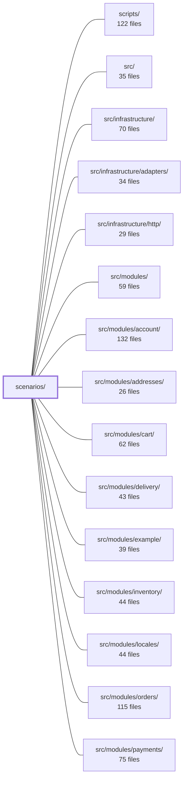

---
tags:
  - 2brain
  - 2brain/module
  - project/boilerplate-node-backend
type: module
module: scenarios/
files: 42
updated: 2026-10-15T13:34:28.006811+00:00
---

# scenarios/

## Purpose

`scenarios/` is the demo-data and end-to-end test infrastructure layer. It defines named whole-database scenarios (`blank`, `shop`, etc.), seeds deterministic fixtures, drives the running application over real HTTP to produce full audit trails and domain events, and supplies test doubles for external services (payments, mail, OAuth, webhooks). It sits entirely outside `src/` so a production image can exclude it with zero code changes.

## Key parts

- **Scenario registry & shape** — `index.ts` defines the `Scenario` type (seed → drive → subjects) and the single `buildScenario` entry point; `blank.ts` is the minimal restore target for behaviour specs; `shop-modules.ts` is the central fixture table for the full `shop` scenario (order, baseline subset, demo-history entries).
- **Seed data** — `seed.ts` (idempotent insert primitive), `users.ts` / `accounts.ts` (every named account, role, and credential bundle), `products.ts` + `products-filler.ts` (11 named + 128 combinatorial catalogue rows), `addresses.ts`, `locales.ts`, `example.ts`, and `subjects.ts` (pinned IDs for external consumers).
- **Flow driving** — `flows/` contains the HTTP client (`client.ts`, `loopback.ts`), action wrappers that traverse the real middleware stack (`actions.ts`), the full order-book journey (`shop-history.ts`), time backdating (`backdate.ts`), and the generic wave scheduler (`waves.ts`).
- **Entry points** — `apply.ts` (`npm run scenario:apply`; in-process boot + data seeding) and `run-server.ts` (`npm run demo`; serves the API on `NODE_PORT` against an in-memory Mongo).
- **Support & doubles** — `support/demo.ts` (six `/__test/*` routes for the paired frontend), `support/database-snapshot.ts`, `support/demo-clock.ts`, `support/ephemeral-mongo.ts` + `ephemeral-mongod.ts` (devDependency isolation), and `support/doubles/` (fake PSP, mail transports, OAuth fake, webhook-sink TLS helper, single `register.ts` entry).
- **Validation & config** — `check.ts` (guarantee-vs-subject invariant), `config.ts` (seeder/webhook env vars in the shared config layer), `rate-limits.ts` (elevated limits for scripted bursts).
- **Authoring tools** — `tools/generate-seed-images.ts` and `tools/generate-webhook-sink-tls.ts` (one-off CLI scripts for committed assets).

## How it connects

- **`src/` (application)** — `scenarios/` boots the app via `src/infrastructure/http` (`createApp`) and reads module scenario declarations from each `src/modules/*` package. The dependency is strictly one-way: nothing under `src/` imports from `scenarios/`, and the `not-to-dev-dep` lint rule enforces that dev-only packages (e.g. `mongodb-memory-server`) live here rather than in `src/infrastructure/`.
- **`src/modules/*`** — Each domain module (`orders`, `payments`, `products`, `accounts`, `addresses`, `cart`, `delivery`, `returns`, `webhooks`, `wishlist`, `locales`, `inventory`, `users`, `example`) declares its `AppModule.scenario` guarantee; `scenarios/check.ts` verifies those guarantees against the rows actually seeded, and `scenarios/subjects.ts` pins the expected IDs.
- **`src/infrastructure/`** — Provides the HTTP server, database connection, and adapter registries that the doubles in `support/doubles/` plug into at boot time.
- **`scripts/`** — The root `package.json` scripts (`scenario:apply`, `demo`, `scenario:images`) invoke the entry points in this module; `scripts/` does not contain scenario logic itself.
- **`/` (repository root)** — Owns the npm script definitions, lint rules (e.g. `not-to-dev-dep`), and workspace layout that make the `scenarios/` separation enforceable.

## Where to start

1. **`scenarios/index.ts`** — Defines the `Scenario` shape, the module table, and `buildScenario`. Reading this first gives you the vocabulary (seed, drive, subjects) and the single call site both `apply.ts` and `support/demo.ts` use.
2. **`scenarios/accounts.ts`** — The fixed set of ObjectIds, credentials, and role assignments every other file imports. Understanding *who* the scenarios log in as makes the flow files and test specs far easier to follow.

## Connected modules

[[boilerplate-node-backend_ROOT|/ (repository root)]] · [[boilerplate-node-backend_scripts|scripts/]] · [[boilerplate-node-backend_src|src/]] · [[boilerplate-node-backend_src_infrastructure|src/infrastructure/]] · [[boilerplate-node-backend_src_infrastructure_adapters|src/infrastructure/adapters/]] · [[boilerplate-node-backend_src_infrastructure_http|src/infrastructure/http/]] · [[boilerplate-node-backend_src_modules|src/modules/]] · [[boilerplate-node-backend_src_modules_account|src/modules/account/]] · [[boilerplate-node-backend_src_modules_addresses|src/modules/addresses/]] · [[boilerplate-node-backend_src_modules_cart|src/modules/cart/]] · [[boilerplate-node-backend_src_modules_delivery|src/modules/delivery/]] · [[boilerplate-node-backend_src_modules_example|src/modules/example/]] · [[boilerplate-node-backend_src_modules_inventory|src/modules/inventory/]] · [[boilerplate-node-backend_src_modules_locales|src/modules/locales/]] · [[boilerplate-node-backend_src_modules_orders|src/modules/orders/]] · … and 6 more

## Files
- `scenarios/accounts.ts` — Central registry of every seed account used across the demo scenario suite: fixed ObjectIds, login credentials, two-factor backup codes, and the role assignments that place each account into the tenant/platform access model. Every other scenario file imports one of these IDs or credential bundles from here so that all e2e journeys agree on *who* they are logging in as.
- `scenarios/addresses.ts` — Defines the seed fixtures for the address-book collection and the function that inserts them. Three persona-specific books are provided so that demo flows (default-address selection, order snapshotting, two-shopper journeys) have realistic, non-uniform data to operate against.
- `scenarios/apply.ts` — CLI runner for `npm run scenario:apply`. It boots the full app in-process (calling `createApp().boot()`, never `start()`), drives real HTTP endpoints to generate realistic data, and manages the lifecycle: environment guards, optional DB reset, scenario build, cache cleanup, and forced process exit. It owns **data** seeding; `db:sync` owns schema.
- `scenarios/blank.ts` — Defines the **blank** scenario: a minimal seed that establishes only harness infrastructure (access model, named accounts, baseline shop modules such as locales) with no catalogue, orders, or carts. It is the restore target for behaviour e2e specs that create and assert their own data, as opposed to the full `shop` scenario.
- `scenarios/check.ts` — Validates that a scenario's declared guarantees (each module's `AppModule.scenario` entries) exactly match the subjects the scenario actually builds. Catches both orphaned guarantees (declared but no row seeded) and orphaned subjects (row seeded but no module declares it). It is the only guard for this invariant.
- `scenarios/config.ts` — Declares the seeder and demo webhook sink as config slices (via the shared `defineConfig` layer) so that the `NODE_SEED_*_PASSWORD` variables and `NODE_WEBHOOK_DEMO_SINK_URL` appear in the same variable inventory as app-level config. It is **not** part of the app's boot gate — the seeder is a script, not the application — but it is read through the same infrastructure so documentation and "blank means unset" semantics stay uniform.
- `scenarios/example.ts` — Provides the demo dataset for the `example` module: a small set of fixed examples (one per status for the customer, one published for the admin) so that module screens render something on first open. Belongs to the `example` demo group, which `demo:remove` deletes wholesale.
- `scenarios/flows/actions.ts` — Thin HTTP wrappers over the shop's REST endpoints that scenario flows call to perform buyer and staff actions (stock intake, checkout, payment, fulfillment). Every call travels the real middleware stack—authentication, caller context, rate limiters—so each operation produces its full audit trail, actor scope, and domain events. They deliberately avoid direct `service` calls, which would create the resource but none of that trail.
- `scenarios/flows/backdate.ts` — Shifts every order (and all rows the application wrote on its behalf) back into the past so that the demo shop has a believable time span. Without this, all records carry the container-start timestamp, making analytics charts flat and time-range filters meaningless.
- `scenarios/flows/client.ts` — A thin HTTP client that the scenario flow runner uses to drive the running application over a single base URL and bearer token. It exists so every flow file can make authenticated requests without repeating envelope-unwrap logic, and it deliberately uses the runtime's native `fetch` (not supertest) because it executes at container boot where devDependencies may be absent.
- `scenarios/flows/loopback.ts` — Provides a helper for driving the Express app over real HTTP on an ephemeral loopback port without publishing a stable port. It exists so callers (the demo-profile flow runner and `scenarios/apply.ts`) can exercise the app via unauthenticated `/__test/*` routes before or without the production server binding `NODE_PORT`, avoiding a half-built shop being visible to the frontend's readiness probe.
- `scenarios/flows/shop-history.ts` — Drives the "shop" scenario's full order book end-to-end through real HTTP calls (checkout → payment → ship → decline/refund/cancel/delete) so that every payment, stock movement, reservation, shipment, audit entry, and analytics event is produced by application code rather than hand-inserted rows. Runs **once per process**; the result is held in memory and replayed on every subsequent restore by `scenarios/support/demo.ts`.
- `scenarios/index.ts` — Central registry of all named, whole-database scenarios this repo can seed. It defines the `Scenario` shape (seed → drive → subjects), exposes a single `buildScenario` entry point, and lets callers (`apply.ts`, `support/demo.ts`) index one table instead of hand-rolling per-scenario conditionals. Every file in the `scenarios/` folder imports its own dependencies directly so a production image can drop the entire folder without anything under `src/` noticing.
- `scenarios/jobs.ts` — Defines the on-demand background jobs available to the demo test profile. A time journey first advances the test clock, then invokes the job whose trigger condition became true. Each job delegates to the same `orderService` function used by production ops scripts, so the test exercises the real sweep logic.
- `scenarios/locales.ts` — Seeds the dynamic-locale tier of the demo dataset with five languages (English, Spanish, Italian, French, Japanese) chosen to cover every state a locale and its entries can occupy — active/inactive, with/without entries, with/without a deployed file. It also contributes one audit-trail step (a wording override on Italian) to the shop-history flow.
- `scenarios/products-filler.ts` — Deterministic, combinatorial product filler for a pet-supply demo catalogue. It produces every Animal × ProductType × Tier combination (6 × 7 × 3 = 126 grid rows) plus two digital-guide rows, all with bilingual (EN/IT) copy, prices, weights, and tax classes. It intentionally avoids randomness so the catalogue is identical on every boot and restore, sidestepping the `@faker-js/faker` EM-only dependency that breaks `ts-jest`.
- `scenarios/products.ts` — Defines the catalogue's named seed rows (11 products) and their per-locale copy, then delegates to `./products-filler` for 128 combinatorial filler rows so the dataset reads like a real pet-supply shop. Consumed by `scenarios/apply.ts` (live dev DB) and `tests/integration/scenarios/shop.test.ts` (throwaway DB).
- `scenarios/rate-limits.ts` — Provides elevated rate-limit environment variables and in-memory counter settings for scripted drivers (the e2e test server and the apply seeder). Without these, a burst of hundreds of requests from a single address trips every rung of the anti-automation ladder, and the resulting 429 lands on an unrelated next request, masquerading as a functional bug.
- `scenarios/run-server.ts` — Entry point for the **demo profile** (`npm run demo`): boots the real application against an ephemeral in-memory MongoDB, seeds it from the `shop` scenario, and serves the API on `NODE_PORT`. It exists so the paired frontend dev server and e2e suite can run against a live, self-contained instance without Docker, Redis, or a message broker.
- `scenarios/seed.ts` — Domain-agnostic seeding primitive that every scenario module uses to write test fixtures into the database. It provides "insert-if-absent" semantics so fixtures are idempotent across runs without any coupling to a specific entity type.
- `scenarios/shop-modules.ts` — Central fixture table for the `shop` scenario's per-module seed data. Extracted from `scenarios/index.ts` so that `blank.ts` can read a subset of the same entries without the two files importing each other. Defines *what* gets seeded, *what order* (via `after`), *which entries* `blank` shares (`baseline`), and *which entries* contribute a demo-history step.
- `scenarios/subjects.ts` — Provides the pinned (statically known) row IDs and credentials that consumers unable to import app code — e.g. generated API-client collections — still need to target a specific seeded row. It also serves as the declarative "answer" to the scenario manifest: exactly one product ID per guarantee a `shop` module declares in its `module.ts`, verified in both directions by the integration suite.
- `scenarios/support/database-snapshot.ts` — Provides the demo profile's database snapshot machinery — emptying, capturing, and restoring the full database as raw BSON documents. Split out of `src/infrastructure/runtime/database.ts` because connection lifecycle and snapshot/replay are separate concerns, and only `./demo` and `scenarios/apply.ts` need this half.
- `scenarios/support/demo-clock.ts` — Provides a `Date`-only fake clock for the demo profile. It replaces the global `Date` with a controllable one (via `@sinonjs/fake-timers`) so scenario specs can "age" time-dependent logic, while leaving every other timer (`setTimeout`, sockets, Mongo heartbeats) on the real clock. Installed exclusively by the scenario runner—never by a deployment.
- `scenarios/support/demo.ts` — Control surface for the demo profile, mounted exclusively by `scenarios/run-server.ts` (via `npm run demo`). Exposes six `/__test/*` routes consumed by a paired frontend's e2e suite to restore scenarios, inspect state, manipulate a fake clock, and trigger background jobs. Nothing under `src/` is aware of these routes; production has no such extension point.
- `scenarios/support/development-doubles.ts` — A Node preload script (invoked via `tsx --import <this file> …`) that wires development/e2e doubles—fake payment provider, log mail transport, and fake OAuth provider—into the application's registries. It exists so that local dev servers, scenario scripts, and demo commands get working stand-ins without any manual environment setup, while production builds never import it.
- `scenarios/support/doubles/mail-log.ts` — A test-double mail transport used in scenario (integration) tests. It exercises the real message-rendering path (so a broken template still throws) but replaces network delivery with nodemailer's `jsonTransport`, so no socket is opened and no mail is actually sent. It exists so tests can verify the *sending* logic without depending on a live mail server.
- `scenarios/support/doubles/mail-outbox.ts` — An in-memory mail transport used as a test double in demo and e2e scenarios. Instead of dispatching real email, it appends each send to a module-level array that a `GET /__test/emails` endpoint (or a test spec) can read back. It exists so that flows relying on a mailed token (password reset, second-factor code) remain completable without a live SMTP backend.
- `scenarios/support/doubles/oauth-fake.ts` — A test double that implements the `OAuthProvider` port with zero network calls. It lets specs drive the full authorize → callback → exchange flow inside the app itself: `authorizeUrl` lands straight on the callback route with a fixed code, and `exchangeCode` validates PKCE before returning a single hardcoded identity. Exists so OAuth code paths (CSRF state round-trip, PKCE challenge verification) can be exercised without a real provider or consent screen.
- `scenarios/support/doubles/payments/fake.ts` — A fake Payment Service Provider (PSP) used exclusively in tests and the dev demo. It implements the `PaymentProvider` port without any network I/O, letting the full 3-D Secure flow, webhook delivery, refund, and cancellation paths run end-to-end without a real PSP account. It lives outside `src/` and is wired in only by the dev preload and the Jest setup via `register.ts`.
- `scenarios/support/doubles/payments/register.ts` — Registers a **lazy** fake payment provider (PSP) into the payments registry for scenario tests. The fake implementation is never loaded at registration time; it is dynamically imported only when a provider method is actually invoked. This keeps the `payments` module out of the bundle unless a test opens a real intent.
- `scenarios/support/doubles/register.ts` — Single entry point that populates the application's registries with test/dev doubles (mail, payments, webhooks). It exists so that both the dev preload script and the Jest test harness can install every fake with one call, and so that production code (inside `src/`) never accidentally pulls these doubles in.
- `scenarios/support/doubles/webhook-sink.ts` — Test-double helper that registers the demo webhook sink's origin as an SSRF exemption and adds its test CA to the process's trusted TLS roots. It exists so the sink (a `webhook-tester` instance behind a TLS proxy, or the frontend's Cypress listener) can be reached over loopback/private compose addresses without modifying production SSRF-guard logic. No-op unless `NODE_WEBHOOK_DEMO_SINK_URL` is set to a parseable URL.
- `scenarios/support/ephemeral-mongo.ts` — Resolves which MongoDB instance a test suite or demo should talk to. It is a pure branching/resolver module: if `NODE_TEST_MONGO_URI` is set it uses that external database; otherwise it delegates to an in-process `mongod` (via `mongodb-memory-server`). It does **not** start the server itself — that responsibility is injected by the caller, keeping the resolver's import graph free of the database driver.
- `scenarios/support/ephemeral-mongod.ts` — Provides the concrete implementation for starting an in-process `mongod` replica set via `mongodb-memory-server`. It lives in `scenarios/support/` (rather than `src/`) because `mongodb-memory-server` is a devDependency and the `not-to-dev-dep` rule forbids `src/` from importing one. Placing it under `scenarios/` lets both `scenarios/` and `tests/` share a single copy, since `tests/` may import `scenarios/`.
- `scenarios/support/no-human-challenge.ts` — Provides a scoped context manager that disables the antibot (human-challenge) provider for the duration of a shop build, so the flow runner can complete a real-HTTP login and payment without being refused on the first challenge. The provider is restored to its original state (including an unset value) when the build finishes.
- `scenarios/tools/generate-seed-images.ts` — One-off CLI script (`npm run scenario:images`) that downloads a fixed-size photo per catalogue role from Lorem Picsum, runs it through the same `digestImage`/`thumbnailImage` pipeline a real upload uses, and writes the results into `public/images/seed/` along with two generated JSON manifests. It exists so the demo catalogue holds locally-committed, production-identical image bytes rather than hand-placed files or hot-linked URLs.
- `scenarios/tools/generate-webhook-sink-tls.ts` — One-shot authoring script that regenerates the TLS fixtures for the demo webhook sink (CA cert, leaf cert, leaf key) into `scenarios/support/tls/`. It exists because Node's `node:crypto` cannot build X.509 certificates, so it shells out to `openssl` at author time; the resulting PEM files are committed, so no runtime dependency on `openssl` remains.
- `scenarios/users.ts` — Seeds the user collection for the demo and blank scenarios. It builds every account the demo needs — the four named login accounts (root, customer, editor, moderator), five persona accounts in specific email/2FA/ban states, four staff accounts, and ten filler customers that give the flow runner a varied order history — then exposes two seed functions: one for the full set and one for the named subset used by the `blank` scenario.
- `scenarios/waves.ts` — Provides a generic dependency-wave scheduler that groups a named set of async steps into the fewest sequential "waves" (waves run in order; steps within a wave run concurrently). It exists so scenario seed scripts can declare *what* each step depends on by name rather than hard-coding a fixed execution order, allowing steps to be added or removed without editing their dependents.
- `scenarios/webhooks.ts` — The webhooks module's slice of the demo dataset. It conditionally seeds a single webhook subscription pointing at a `webhook-tester` sink, but only when `NODE_WEBHOOK_DEMO_SINK_URL` is configured—otherwise it seeds nothing, keeping the demo inert by default.
- `scenarios/wishlist.ts` — Defines the wishlist slice of the demo seed dataset. It produces one wishlist per demo account, deliberately containing only publicly visible products, and exposes the seeding routine that `seedShop` walks to populate the wishlist collection.

---
[[boilerplate-node-backend_INDEX|← boilerplate-node-backend index]]
