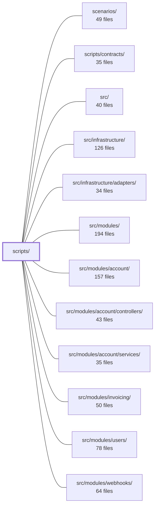

---
tags:
  - 2brain
  - 2brain/module
  - project/boilerplate-node-backend
type: module
module: scripts/
files: 98
updated: 2026-11-08T10:46:53.419561+00:00
---

# scripts/

## Purpose

`scripts/` is the repo's operational tooling layer: the code that audits, lints, generates documentation, maintains the database schema, gates CI, and builds Docker images. It contains no application logic—every file here either inspects `src/`, `docs/`, or the repo root and produces a report, a generated artifact, or a non-zero exit code.

## Key parts

- **Audit suite** (`scripts/audit/`) — Declarative rule registries (`api-standards.yaml`, `compliance-rules.yaml`) paired with TypeScript analysis scripts (`code-shape/`) that count structural facts (shallow bodies, unused optional params) via the TypeScript compiler API. AI-driven prompts in `SKILL.md` files consume the YAML to evaluate conformance.
- **Custom ESLint rules** (`scripts/eslint/`) — Seven repo-specific rules enforcing DDD boundaries (barrel exports, friend-member access, persistence isolation, i18n text, controller `.catch` discipline, comment-link validity). `index.ts` assembles them into one rule table consumed by `eslint.config.ts`.
- **Documentation generators** (`scripts/docs/`) — A family of `generate-*.ts` scripts that (re)write or `--check` embedded Markdown tables (rate limits, roles, cookies, dependencies, jobs, personas, audit actions, module graphs). Shared plumbing: `marker-block.ts` (write-or-report between HTML-comment markers), `module-descriptor.ts` (typed `module.yaml` reader), `module-catalog.ts`, `repo-references.ts` (path resolution), `jobs-render.ts` (pure rendering), `dependency-groups.ts` (hand-maintained package families).
- **Database maintenance** (`scripts/db/`) — `sync-indexes.ts` / `index-sync.ts` reconcile live MongoDB indexes with Mongoose declarations on every deploy; `bootstrap-access.ts` upserts the fixed tenant; `cache-clear.ts` flushes Redis after out-of-band writes.
- **CI & gate helpers** (`scripts/hooks/`, `scripts/mutation/`) — Pre-commit freshness check (`check-generated-fresh.ts`, `stale-generated-files.ts`) and a per-file mutation-score ratchet (`baseline.ts`, `check-baseline.ts`) that prevents any file's score from regressing.
- **Shared utilities** — `cli.ts` (flag parsing wrapper), `fail-script.ts` (zero-dep error handler), `git-base.ts` (sanitized git env + merge-base resolution), `modules-on-disk.ts` (canonical module enumeration), `docker/generate-dockerfile-dockerignore.ts` (derives the per-Dockerfile ignore file).

## How it connects

- **`src/modules/`** — The primary input. Audit scripts walk module source; ESLint rules inspect module boundaries (barrel, friend-members, persistence); docs generators read each module's `module.yaml`, manifests, and rate-limit budgets; `modules-on-disk.ts` enumerates them.
- **`src/infrastructure/`** & **`src/infrastructure/adapters/`** — DB sync scripts read Mongoose model index declarations; the barrel rule and persistence rule flag adapter imports leaking into module public surfaces.
- **`scenarios/`** — Persona and scenario YAML files feed `generate-persona-tables.ts` and `generate-scenario-registries.ts`.
- **`scripts/contracts/`** — Contract fragments are enumerated alongside modules for audit and docs generation.
- **`/` (repository root)** — Scripts read `tsconfig.json` (code-shape analysis), `package.json` (dependency maps), `.dockerignore` (Docker ignore generation), and the committed `mutation-baseline.json`.
- Specific modules (`account`, `invoicing`, `users`, `webhooks`) appear as targets of the friend-members and barrel rules, and as sources for the role-matrix and audit-action generators.

## Where to start

1. **`scripts/modules-on-disk.ts`** — ~40 lines that answer "where do the modules live and what do they carry." Understanding this tells you where to look next for any audit, doc, or lint concern.
2. **`scripts/eslint/index.ts`** + one rule file (e.g., `barrel-allowed-sources.ts`) — Shows the architectural contracts the repo enforces mechanically. Reading one rule makes the DDD boundaries in `docs/theory/strategic-ddd.md` concrete.

## Connected modules

[[boilerplate-node-backend_ROOT|/ (repository root)]] · [[boilerplate-node-backend_scenarios|scenarios/]] · [[boilerplate-node-backend_scripts_contracts|scripts/contracts/]] · [[boilerplate-node-backend_src|src/]] · [[boilerplate-node-backend_src_infrastructure|src/infrastructure/]] · [[boilerplate-node-backend_src_infrastructure_adapters|src/infrastructure/adapters/]] · [[boilerplate-node-backend_src_modules|src/modules/]] · [[boilerplate-node-backend_src_modules_account|src/modules/account/]] · [[boilerplate-node-backend_src_modules_account_controllers|src/modules/account/controllers/]] · [[boilerplate-node-backend_src_modules_account_services|src/modules/account/services/]] · [[boilerplate-node-backend_src_modules_invoicing|src/modules/invoicing/]] · [[boilerplate-node-backend_src_modules_users|src/modules/users/]] · [[boilerplate-node-backend_src_modules_webhooks|src/modules/webhooks/]]

## Files
- `scripts/audit/api-standards.yaml` — A rule registry that defines the set of testable API-conformance statements the audit suite evaluates. Each of the ten `scripts/audit/api-<standard>/SKILL.md` scripts reads this file and evaluates only the rules whose `standard` matches its own. It exists to keep audit criteria in one declarative place, separate from the mechanical linting (Spectral) and the compliance-rules registry.
- `scripts/audit/code-shape/scripts/generate-shallow-candidates.ts` — CLI entry point (`npm run audit:shallow -- [path...]`) that builds a full TypeScript program from the repo's `tsconfig.json`, runs the shallow-candidate analysis over a given scope, and writes the resulting JSON report to `tmp/reports/audit/code-shape/shallow.json`. It is deliberately split from `./shallow-candidates.ts` so that the latter's unit tests can import the counting logic without triggering this script's top-level side effects.
- `scripts/audit/code-shape/scripts/shallow-candidates.ts` — Counts structural facts that the `code-shape` audit uses to judge shallow code: small bodies with few users, pure forwarders, optional parameters no caller passes, and files with few exports/importers. It performs counting only — every verdict belongs to the audit agent. Built on the TypeScript type-checker (not text search) so import aliases, re-exports, and shorthand properties resolve to the single function they name.
- `scripts/audit/compliance-rules.yaml` — Shared compliance rule registry consumed by the AI-driven audit prompts in `scripts/audit/compliance-backend/SKILL.md` and `scripts/audit/compliance-frontend/SKILL.md`. Each prompt filters rules by `responsibility` (backend / frontend / both) and evaluates only its own `evidence.<side>` hints. The file exists once so both audits share a single source of truth for what to check, rather than duplicating rule text across two prompt files.
- `scripts/cli.ts` — Shared CLI-argument parsing helper for standalone scripts. Wraps `node:util`'s `parseArgs` with a minimal API (`flagValue`, `hasFlag`, `requiredPath`) so individual scripts don't hand-roll `indexOf`/`startsWith` logic for each `--flag` they accept.
- `scripts/db/bootstrap-access.ts` — Deploy-time setup script (`npm run access:bootstrap`) that upserts the fixed "Shop" tenant into a fresh production database. Because the write is an idempotent upsert keyed on `DEPLOYMENT_TENANT_ID`, it is safe to re-run at any time — no `NODE_ENV` guard required. Runs before `app`/`cron` start via the `setup` service in `docker-compose.production.yml`.
- `scripts/db/cache-clear.ts` — Clears every cached response for this app from Redis. It exists because writes that bypass the API (manual DB surgery, `mongosh` sessions, one-off scripts) skip the API's automatic `invalidateCache` middleware, leaving stale responses served until TTL expiry. `scenario:apply` invokes it automatically; run by hand after any manual database change.
- `scripts/db/index-sync.ts` — Reconciles MongoDB indexes against the schemas that declare them: it creates missing indexes, replaces indexes whose options changed, drops retired indexes, and (optionally) prunes undeclared ones. This file *is* the repo's entire schema-migration mechanism — a desired state re-applied on every deploy rather than a sequenced changelog. It was split from `sync-indexes.ts` so tests can drive reconciliation per case without a live connection.
- `scripts/db/sync-indexes.ts` — Entry-point script (`npm run db:sync`) that reconciles the database's live indexes with the indexes declared across all Mongoose models. Idempotent and add-only by default: it creates missing indexes and replaces changed ones, but keeps undeclared indexes unless explicitly told to prune. Serves as the "schema half" of schema management, run on every boot and deploy rather than as a one-time migration.
- `scripts/docker/generate-dockerfile-dockerignore.ts` — Generates `docker/Dockerfile.dockerignore` from the root `.dockerignore`. Docker and Buildah use a per-Dockerfile `.dockerignore` *instead of* (not merged with) the root file, so a second copy is required. Hand-maintaining that copy caused drift before; deriving it eliminates that risk. The one deliberate modification is keeping `.git` in the image, because `npm run complete` (run inside this image by the `gate` service and `container-gate` CI job) invokes an ESLint rule that shells out to `git ls-files`.
- `scripts/docs/check-references.ts` — CLI sweep (wired to `npm run check`) that verifies every file path cited in an inline code span across `docs/**/*.md` pages actually resolves to a tracked file in this repo or the paired frontend repo, and—when an `#anchor` is included—that the target page carries a matching heading. It is the "dead fact" counterpart to `docs:build`'s "dead link" check.
- `scripts/docs/dependency-groups.ts` — The hand-maintained half of `docs/tools/package-dependencies.md`. It classifies npm packages into named families (with a purpose blurb and a "read more" link) so the generated dependency map can render grouped tables. The other half of that page—which packages exist and who imports them—is computed by the generator, not stored here.
- `scripts/docs/generate-audit-actions.ts` — Generates (or in `--check` mode, validates) the audit-action reference table embedded in `docs/tools/winston.md`. The table is the single source of truth for the audit vocabulary—every action's owner, wire value, and observed target type—so that a rename or addition surfaces as a visible diff in a reviewed doc page rather than requiring a hand-maintained per-module test.
- `scripts/docs/generate-cookie-table.ts` — Generates (or checks) the "Cookies the backend sets" Markdown table inside `docs/theory/data-protection.md`, sourcing rows from `shared/rules/cookies.yaml`. It exists so the GDPR disclosure page stays in sync with the canonical cookie config, and a `--check` mode lets CI (`complete`) report drift without rewriting the file.
- `scripts/docs/generate-dependency-map.ts` — Generates (or validates) the two dependency tables in `docs/tools/package-dependencies.md`: every `package.json` dependency grouped by purpose, with derived ownership (which module imports it) for packages no hand-kept group claims. Runs in `--check` mode to report drift or in write mode to rewrite the page. Exists to replace a hand-written page that had missed 32 of 99 packages and listed 3 that no longer existed.
- `scripts/docs/generate-jobs.ts` — Generates two derived artifacts from job declarations — the `docker/crontab` file and the jobs table inside `docs/reference/ops.md` — as a step of `npm run regenerate`. In `--check` mode it reports drift instead of writing, which is what `npm run check` invokes. It exists so that a schedule declared once in code is never left stale in the files that actually schedule it.
- `scripts/docs/generate-module-graph.ts` — Generates Mermaid dependency diagrams and a grouped module list for the `docs/modules/` markdown pages. The whole-repo graph (index page) shows import edges only; each module page gets a neighbourhood diagram that adds domain-event edges on top. All content is derived at runtime from `dependency-cruiser` output and source-file scanning, so the diagrams stay correct as imports and subscriptions change. A `--check` flag turns the script into a CI gate that fails when the committed markdown has diverged.
- `scripts/docs/generate-persona-tables.ts` — Generates three Markdown account tables (named, persona, staff) inside `docs/tools/demo-profile.md` from the persona data in `shared/scenarios/personas.yaml`. It exists so that login addresses and roles in the doc page stay in sync with the source-of-truth YAML, avoiding silent staleness when an email or role changes.
- `scripts/docs/generate-rate-limit-budgets.ts` — Generates the rate-limit budget table embedded in `docs/tools/security.md` by reading `RateLimitBudget` entries from every enabled module's manifest and from `INFRASTRUCTURE_RATE_LIMITS`, then writing (or checking) the Markdown table between marker comments. Exists to keep the doc in lockstep with code without a human remembering to edit both.
- `scripts/docs/generate-role-matrix.ts` — Generates and maintains role-permission matrix tables in the docs. For `docs/demo-ecommerce/index.md` it writes the full "effective role matrix" (which action codes each role/audience holds, per module), and for each module's page under `docs/modules/` it writes a per-rule "who can do what" table. The effective matrix is computed by asking the kernel's `heldRules` evaluator rather than re-expanding permission sets locally, because the result (set expansion, audience folding, implied actions, conditions) is too complex to derive by hand.
- `scripts/docs/generate-scenario-registries.ts` — CLI entry point (run via `npm run regenerate`) that rebuilds the two scenario registries from the on-disk file tree. Supports a `--check` mode that reports drift without writing, which is the mode `complete` invokes to verify registries are in sync.
- `scripts/docs/jobs-render.ts` — Pure rendering helpers that turn an array of `JobDeclaration` objects into two text artifacts: the `docker/crontab` file and the Markdown table shown on the ops page. Kept free of I/O so tests can assert on the rendered string in isolation; the sibling `generate-jobs.ts` handles the actual file writes.
- `scripts/docs/marker-block.ts` — Shared write-or-report utility for every doc generator that embeds a generated section between `<!-- name:start -->` / `<!-- name:end -->` HTML-comment markers inside an otherwise hand-written Markdown page. It lets each generator replace only its own block (leaving all other hand-written text intact), format the result with the page's Prettier config, and either write the file or report drift — so the `complete` gate's `prettier --check` and the generator never disagree on the expected bytes.
- `scripts/docs/module-catalog.ts` — Derives a module catalogue—grouped list of modules with their deeper pages—from the `module.yaml` descriptors and the Markdown files beside them. Produces two outputs that would otherwise be hand-maintained: the "Every module" Markdown block for `docs/modules/index.md` and the `/modules/` sidebar structure for VitePress. A new module appears in the correct group and position simply by declaring its `group` and `summary` in its descriptor.
- `scripts/docs/module-descriptor.ts` — Single typed reader for every module's `module.yaml`. It exists so that the docs generator, cross-cutting tests, and any other consumer share one Zod-validated parse path rather than each hand-rolling their own YAML reading—eliminating drift when a new field is added.
- `scripts/docs/repo-references.ts` — Shared path-resolution machinery that answers one question — "does a path cited in a comment or docs page actually exist in this repo?" — so that the two callers (`check-references.ts` for Markdown pages and `scripts/eslint/comment-links.ts` for source comments) agree on what counts as a real path instead of each maintaining its own allowlist and resolution logic. The callers keep their own token-extraction and repo-specific policies (VitePress routing, paired-repo tokens) on top of the primitives here.
- `scripts/eslint/barrel-allowed-sources.ts` — Custom ESLint rule that enforces the DDD barrel-publishing contract (`docs/theory/strategic-ddd.md §5`): a module's `index.ts` may only re-export services, domain rules, events, and emails **as values**, and model + presenter(s) **as types only**. It blocks leaking repositories, wiring files, mongoose runtime values, and presenter functions in any export form (`export *`, `export { x } from`, or `import…export` relay).
- `scripts/eslint/comment-links.ts` — An ESLint rule (`commentLinks`) that scans every comment in a source file for `.ts`/`.tsx` path references and reports any that do not resolve to a tracked file. It enforces that comments never point at renamed or deleted source files, sharing its resolution machinery with the docs-reference checker.
- `scripts/eslint/controller-chain-must-catch.ts` — A custom ESLint rule that flags promise chains in exported controller functions which call `.then()` but never terminate with `.catch()`. It exists because the global error handler in `app.ts` converts unhandled rejections into generic 500s, masking client errors as server faults, and because that net cannot perform per-domain cleanup (orphaned uploads) or record domain-specific metrics (failed checkouts).
- `scripts/eslint/friend-members.ts` — A custom ESLint rule that enforces a "friend member" boundary on service handles: certain methods (the *friends-only* members) may be called only by the owning module and a declared list of friend modules. It exists because those methods carry no internal validation—the caller is expected to have already validated—so they must not be reachable from arbitrary modules. The rule reports a `notAFriend` diagnostic when an unlisted module invokes a guarded member.
- `scripts/eslint/index.ts` — Barrel file that assembles the project's custom ESLint rules into a single rule table (rule name → implementation). It exists so `eslint.config.ts` can register all repo-specific rules in one place without importing each rule file individually.
- `scripts/eslint/no-hardcoded-user-text.ts` — A custom ESLint rule that enforces all user-facing error text in `rejectResponse` and `generateReject` calls comes from an i18n dictionary lookup (`t(…)`) rather than a hardcoded string literal. It exists so that copy added at a call site cannot slip past translation and localization.
- `scripts/eslint/no-persistence-imports.ts` — Custom ESLint rule that enforces the architectural rule "persistence stays behind the repository." It flags imports of persistence handles (by binding-name suffix) or direct imports from `model`/`repository` files (by path), ensuring each collection has exactly one entry point for storage access.
- `scripts/fail-script.ts` — A zero-dependency error handler that reports a script's uncaught failure and sets a non-zero exit code. It exists as a lightweight alternative to `runScript` for scripts (especially docs generators) that must not pull in the logger, config, or Mongoose at module load time.
- `scripts/git-base.ts` — Provides shared git helpers for CI and local verification scripts: a sanitized environment for nested `git` calls, and a resilient merge-base resolution strategy that gracefully handles fresh clones or non-standard default-branch names.
- `scripts/hooks/check-generated-fresh.ts` — Pre-commit gate (invoked via `.husky/pre-commit` as `npm run check:generated`) that refuses a commit when any committed generated file is stale. It is check-only: it never stages files or mutates the working tree.
- `scripts/hooks/stale-generated-files.ts` — Identifies which files a full regeneration would modify, starting exclusively from the **staged index** (not the working tree). The pre-commit hook uses this to refuse commits that contain stale generated artifacts. The approach mirrors Kubernetes' `verify-generated.sh`: export the index to a scratch directory, regenerate in that copy, and diff.
- `scripts/modules-on-disk.ts` — Single source of truth for "where are the repo's modules on disk." Any build step that needs to enumerate modules carrying a particular artifact (a contract fragment, a probe list, a descriptor) imports from here instead of re-walking `src/modules` with its own logic.
- `scripts/mutation/baseline.ts` — Implements the per-file mutation-score ratchet: it reads Stryker JSON reports, computes per-file kill percentages, compares them against a committed `mutation-baseline.json`, and enforces the rule that a file's recorded score can only ever go up. This exists because Stryker's built-in thresholds are global — a single weak file can be masked by strong ones — so this module tracks each file independently and fails the gate when any file drops below its own history.
- `scripts/mutation/check-baseline.ts` — CLI entry point for the per-file mutation ratchet. It reads a mutation report (or a directory of sharded reports), compares file-level scores against `mutation-baseline.json`, and either gates the run (exit 1 on regression) or records new scores (`--update`) / folds in shard results (`--merge`). It deliberately never invokes Stryker itself, keeping the check cheap enough to run in a separate CI step from the sweep.
- `scripts/mutation/ci/cli.ts` — The command-line entry point for the CI mutation sweep. Each step in `mutation.yml` and `mutation-wave.yml` invokes one subcommand here; the actual planning, slicing, and reporting logic lives in the sibling modules (`waves.ts`, `merge.ts`). This file is CI-only — the local `npm run mutation:full` path does not use it.
- `scripts/mutation/ci/merge.ts` — Folds the Stryker reports from every finished shard of a GitHub mutation sweep into a single unified report (one HTML page, one `mutation.json`, one summary), and also provides a utility to overlay a local partial diff-run onto a pre-existing whole report. It handles the cross-shard bookkeeping that Stryker cannot do on its own: deduplicating edge-node mutants, re-keying per-report test IDs, and excluding files that no shard fully covered.
- `scripts/mutation/ci/slice-ignorer.ts` — A Stryker ignore-plugin that restricts a single CI run to a line **slice** of a file (e.g. lines 120–240), letting the GitHub mutation sweep split a slow file across parallel 6-hour jobs without losing or duplicating mutants. Unlike Stryker's native `--mutate file:10-50`, which only mutates nodes *wholly inside* the range, this plugin ignores any subtree that does not *touch* the slice — so a node crossing a slice edge is tested by both neighbouring jobs and deduplicated by `merge.ts`.
- `scripts/mutation/ci/waves.ts` — The planner for the GitHub mutation-testing sweep. It decides how the mutate scope is split into shards for each wave's matrix, what a failed shard becomes in the next wave (split into smaller slices, retried, or abandoned), and caps each wave at GitHub's matrix limit. It is pure — the CLI handles all I/O.
- `scripts/mutation/github-artifacts.ts` — Pure module that defines *which* `mutation-report` GitHub artifact the sweep's merge job uploads and provides the selection logic for picking the newest downloadable one. It contains no I/O or network calls—`pull-report.ts` performs the actual GitHub API requests and file writes using the exports from this file.
- `scripts/mutation/local-policy.ts` — Pure selection logic that decides which mutation-testing shards a local evening sweep will actually run. Extracted from `run-shards.ts` so the resumability rule (skip already-reported shards, narrow by `--only`, cap by `--limit`) is unit-testable without invoking a CLI.
- `scripts/mutation/mutate-scope.ts` — Resolves the mutation-testing scope by reading `stryker.json`'s own `mutate` globs at call time, then exposes the resulting file list, per-file line counts, and a membership predicate. It exists so that shard sizing, diff filtering, and CI wave planning all agree on *which* files Stryker will actually touch, without hand-mirroring a module list that drifts the moment a new module lands.
- `scripts/mutation/pull-report.ts` — CLI entry point (`npm run mutation:pull`) that retrieves the most recent mutation-test report artifact from GitHub Actions, copies `mutation.json` and `index.html` into the local report directory, and then folds that report into `mutation-baseline.json` using the same `--merge` command the CI sweep uses. It ensures the local baseline and the CI report can never diverge.
- `scripts/mutation/run-diff.ts` — Runs a Stryker mutation pass scoped to the whole files a branch changed relative to a base ref (default `origin/main`), grades that partial run against the per-file ratchet, then overlays the result onto the full report already on disk so the stored report stays whole. It exists so a branch's mutation coverage can be checked in CI or locally without re-running the entire codebase's sweep.
- `scripts/mutation/run-shards.ts` — Executes the full mutation scope in bin-packed shards, running them sequentially and banking each shard's Stryker report to disk. It exists because Stryker writes no report when killed mid-run, so a single unsharded pass would lose all progress on interruption; this script ensures each completed shard's result is durable, and only merges into the baseline once every shard in the scope has a report. Invoked as `npm run mutation:full`.
- `scripts/mutation/sharding.ts` — Defines the sharding strategy for the local full mutation sweep (`npm run mutation:full`). Instead of hard-coding a module list (which drifted and left modules unmeasured), it derives shards from the actual mutate scope by line count, using a greedy bin-packing heuristic. The result is a set of `Shard` objects that downstream tooling can execute in parallel.
- `scripts/mutation/stryker-run.ts` — Shared Stryker invocation layer that every mutation entry point funnels through. It sizes worker concurrency and per-worker heap to the *current* machine (rather than trusting `stryker.json`'s committed values), sweeps the scratch directory before the run, and aborts the process if an OOM-restart loop shows the run will not converge.
- `scripts/ops/check-config.ts` — A minimal entry-point invoked by `npm run config:check` (or before supercronic starts). Its sole job is to load the `.env` file so that a malformed or missing configuration causes the container to **fail to start** rather than appear healthy while every cron job independently fails. It opens no connection and performs no business logic.
- `scripts/ops/prepare-job.ts` — Installs the runtime prerequisites a scheduled job declares it needs—event subscriptions and/or i18n translations—before the job executes. It exists as the single shared bootstrap step used by both `run-job.ts` and the integration tests that exercise a job through the runner's real path.
- `scripts/ops/reapply-erasures.ts` — Operational script that replays the erasure ledger after a database restore. Restoring an older snapshot resurrects accounts that were erased after that snapshot; this script re-erases them using the ledger (which outlives the oldest backup). It is run manually by an operator—never on a schedule—with the app and cron stopped.
- `scripts/ops/reencrypt.ts` — One-shot CLI script (`npm run reencrypt`) that re-encrypts every stored secret onto the newest key in its key ring after a rotation deploy. Without it, old key entries can never be dropped because nothing else migrates the rows that still reference them.
- `scripts/ops/run-job.ts` — The single CLI entry point for every scheduled job (`npm run job <name>`). It resolves a job declaration from the module or app manifest, optionally connects to the database, prepares and runs the job (under a distributed lease when applicable), and delegates outcome recording and cleanup to `runScript`. Designed to be invoked from cron only; every job it runs is expected to be idempotent.
- `scripts/pairing/check-spec-identity.ts` — CLI entry point for the cross-repo contract check (`npm run check`). It compares a set of shared specification files between this (backend) repo and its paired frontend checkout, exiting non-zero if the contracts have drifted. The frontend repo runs the mirror image of this script against `BACKEND_PATH`.
- `scripts/pairing/linked-worktree.ts` — Detects whether a given directory is a **linked `git worktree** (as opposed to the repository's main working tree) and exposes a guard predicate for the "worktree → main" write direction that `sync:frontend` must refuse. It exists so pairing/sync scripts can distinguish between two checkouts that share a repository but differ in which one is the canonical main.
- `scripts/pairing/paired-frontend-path.ts` — Centralizes resolution of the paired frontend checkout's absolute file-system path. Every script that needs to read or write the sibling frontend (sync, identity checks, doc reference checks) calls into this module so they all agree on *which* checkout they target, regardless of whether the path came from a one-off env var, a per-lane `.env`, or the default sibling layout.
- `scripts/pairing/spec-identity.ts` — Defines the cross-repo byte-identity contract: a fixed list of files that must exist in both this (backend) repo and the paired frontend, and the logic to detect when they have drifted. Because codegen on both sides reads these specs, a silent fork would break both checkouts without either CI flagging it (a forked spec is still a *valid* spec). This module is deliberately dumber than a semantic diff — identity, not equivalence.
- `scripts/pairing/sync-to-frontend.ts` — Copies every backend-owned shared file (as declared in `SHARED_FILES`) into the paired frontend checkout, verifying byte-identity before and after, then triggers the frontend's `npm run regenerate`. Exists so the two repos stay contractually in sync without manual file management; the backend is the single source of truth for these files.
- `scripts/regenerate-artifacts.ts` — Entry-point script for `npm run regenerate` that rebuilds every generated artifact in the repo in a fixed, dependency-ordered sequence. It exists because the regeneration steps have non-obvious ordering constraints (e.g. `api/` must exist before any step that boots the app) and need a single place to encode that order. Also wired into `.husky/pre-commit` (with `--no-sync`) and used in verify mode via `--check` as the first half of `npm run check`.
- `scripts/run-script.ts` — Entry-point wrapper for the one-shot scripts under `scripts/db/` and `scripts/ops/`. It centralises four concerns a bare promise chain does not handle: a non-zero exit code on failure, guaranteed cleanup (connection close) on both success and failure paths, a readable logged error, and a job-outcome record that `GET /observability/health` and `job_last_success_timestamp_seconds` can read.
- `scripts/scaffold/apply.ts` — The I/O half of the module scaffolder. Given a fully computed plan (produced by the pure sibling files), it either refuses to proceed—returning every reason the scaffold would collide with existing state—or writes the planned files and central edits to disk. It exists to keep all disk-touching logic isolated so that tests can point it at a scratch directory and the pure planning logic stays unit-testable without filesystem access.
- `scripts/scaffold/central-edits.ts` — Defines the set of text edits a new module must make in files **outside** its own folder. Each edit is a pure `(source: string) => string` transform anchored to a known line; if the anchor is missing the transform throws, so a restructured target file blocks the scaffold rather than being silently skipped.
- `scripts/scaffold/demo-remove-alert-rules.ts` — Removes Prometheus alert rules (and their `promtool` test cases) that monitor metrics owned exclusively by modules being deleted. It identifies "orphan" metrics by diffing what the removed folders register versus what the surviving codebase registers, then performs surgical text edits on the two YAML files under `docker/observability/`. It is a step in the scaffold module-removal pipeline.
- `scripts/scaffold/demo-remove-authorization.ts` — Performs text-level edits to the two shared authorization files (`authorization-roles.yaml` and `authorization-conformance.yaml`) when modules are removed. Because these files are hand-maintained from per-module fragments, they must be pruned *before* the module folders are deleted; the bundle (`authorization-keys.yaml`) self-heals via fragment deletion. Edits are line-by-line string operations, not YAML round-trips, to preserve byte-for-byte parity with the PHP twin.
- `scripts/scaffold/demo-remove-modules.ts` — Orchestrates the module-agnostic half of removing modules from a checkout: deleting their folders, stripping their registry entries, removing shared authorization grants, alert rules, validation labels, scenario files, and residue tests. It exists so the shop-specific removal script (`demo-remove.ts`) can delegate the "which files to touch" logic and focus on the shop-only catalogue and scenario work.
- `scripts/scaffold/demo-remove-registry.ts` — Handles the "central lists" half of the shop-module strip: it deletes each module's folder under `src/modules/` and surgically removes that module's import line, `enabledModules` array entry, and `ModuleName` union member from `src/modules.ts`. It exists so that removal is driven by the module's *name* and the file's known shape (via `registry` helpers) rather than a separate hand-maintained list of lines to delete.
- `scripts/scaffold/demo-remove-scenarios.ts` — The "scenario data" half of the demo-removal strip. It deletes the files under `scenarios/` (product fixtures, seed images, per-module values and doubles) that exist solely to give the shop's own modules something to display. It only performs deletions and a small set of targeted content edits; the registries that list these files are regenerated separately by `npm run regenerate`.
- `scripts/scaffold/demo-remove-tests.ts` — The test-cleanup step of the `demo-remove` scaffold pipeline. Given a set of already-deleted module names, it finds and deletes every test file that (transitively) imports a removed module or declares it via a `// requires-module:` comment, cascading until no new orphans remain.
- `scripts/scaffold/demo-remove-validation-labels.ts` — Identifies and removes shared validation-attribute labels (in `shared/locales/<locale>.json`) that are referenced only by a removed module's request fields. This keeps `tests/cross-cutting/validation-attributes.test.ts` green after a module's contract disappears, since that test rejects any label no surviving request uses. Must run **before** the module folders are physically deleted.
- `scripts/scaffold/demo-remove.ts` — Entry-point script for `npm run demo:remove`. In a single run it deletes every module folder tagged `group: shop` or `group: example` (including their scheduled jobs and owned tests), removes seed images and shop-only scenario files, and regenerates the scenario registries so the repo still compiles. It operates directly on the current checkout.
- `scripts/scaffold/format-text.ts` — Provides a single formatting seam (`FormatText`) so scaffold scripts can produce Prettier-conformant output without importing Prettier directly. The real implementation lives in this file; tests substitute an identity formatter to sidestep Prettier's dynamic-import requirements that Jest cannot satisfy.
- `scripts/scaffold/names.ts` — Derives every casing variant of a module's name (kebab, PascalCase, camelCase, snake_case, etc.) from a single validated folder name, so that downstream scaffold templates and plan steps consume one canonical `ModuleNames` object instead of each re-deriving its own spelling. Also produces the permission rule identifiers and set name that a scaffolded module introduces.
- `scripts/scaffold/options.ts` — Parses the raw `argv` array for the `scaffold:module` CLI command into a fully typed `ScaffoldOptions` object (or a structured refusal). The file is deliberately pure—no I/O, no side effects—so that the shell entry point (`scaffold-module.ts`) only handles printing and process-exit, while all validation logic lives here and is directly unit-testable.
- `scripts/scaffold/plan.ts` — Pure planning layer for the module scaffolder. Given parsed `ScaffoldOptions`, it computes the complete list of files (path + unformatted content) a new module needs, without performing any I/O. This separation lets unit tests assert the full plan against fixtures and keeps the CLI (`apply.ts`) responsible only for collision checks, Prettier formatting, and disk writes.
- `scripts/scaffold/registry.ts` — Performs the single central edit a new module requires in `src/modules.ts`: inserting the import line, the `enabledModules` array entry, and the `ModuleName` union member, each in alphabetical order. Designed as pure text-in / text-out so it can be tested without a repository checkout.
- `scripts/scaffold/scaffold-module.ts` — CLI entry point for `npm run scaffold:module -- <name> [options]`. It parses arguments, delegates the actual file generation to the apply step, optionally triggers type regeneration, and prints a fixed list of decisions the author must still make. It deliberately does **not** choose personal-data flags, role grants, or rate limits for the new module.
- `scripts/scaffold/scenario-registry.ts` — Generates four "registry" files (`*.generated.ts`) by scanning the `scenarios/` file tree, so that adding or removing a module/scenario is just adding or deleting a file—no hand-maintained import list to keep in sync. The registries collect one named export per file (`shopModule`, `scenario`, `registerDouble`, `installLever`) into a single object or function call per category.
- `scripts/scaffold/templates-code.ts` — Provides the runtime code templates for a scaffolded admin-collection module. Each exported function returns the full source text of one generated file (manifest, model, repository, services barrel, audit wiring, YAML configs, etc.), parameterized by the module's names and scaffold options. The collection mirrors the `example` module's core shape, cut to a single keyed collection with CRUD behind one permission gate.
- `scripts/scaffold/templates-contract.ts` — Generates the per-module `openapi.yaml` fragment that the scaffold produces for a new API resource. It emits a self-contained OpenAPI 3.1.0 document (paths, tags, schemas) whose shared components (`$ref`s to pagination, errors, auth, etc.) are resolved by the root assembler at build time. The template bakes in the project's REST conventions so every scaffolded module ships with a consistent contract without hand-authoring YAML.
- `scripts/scaffold/templates-documentation-tests.ts` — Provides the documentation-page skeleton and the full set of smoke/integration test templates that the scaffold generator writes out when creating a new module. Each export is a plain template-literal function that, given a module's naming info and scaffold options, returns the final Markdown or TypeScript source to be placed in the new module's directory.
- `scripts/security/corpus-digest.ts` — Provides a SHA-256 integrity gate for a downloaded corpus. Before the corpus bytes are fed into the breached-password refresh pipeline, this function verifies the digest matches a pinned value; any mismatch aborts processing. It is extracted into its own module so it can be imported (and unit-tested) without triggering the side-effectful import of `refresh-breached-passwords.ts`.
- `scripts/security/refresh-breached-passwords.ts` — Manual, by-hand script (`npm run refresh:breached-passwords`) that rebuilds the committed breached-password denylist (`shared/rules/breached-passwords.txt`). It downloads SecLists' 10 M-password corpus, filters it through the `PasswordNew` regex pattern read directly from the root `openapi.yaml` contract, and writes the sorted survivors (~20 k entries, ~226 KB) to the repo. It exists so the committed list stays in sync with the contract's pattern without duplicating the rule.
- `scripts/setup/environment-file.ts` — Pure text-level operations on a dotenv file's contents: filling placeholder values and reading back a single key. It deliberately performs no filesystem I/O — all reading, writing (temp file + rename, `0600`), and first-run `.env-example` copying is owned by `scripts/setup/index.ts`.
- `scripts/setup/index.ts` — Entry point for `npm run setup`. On a fresh clone it creates `.env` from `.env-example`, replaces every still-placeholder secret (as identified by the enabled modules' requirements) with a fresh `randomBytes(32)` value, and writes the Prometheus metrics token to a standalone file that the observability stack reads via bind mount.
- `scripts/setup/required-keys.ts` — Derives the authoritative list of environment variables that `npm run setup` is allowed to fill, by reading the same config-slice declarations the runtime uses. This eliminates a hand-maintained list: any new module field that declares a `placeholder` is automatically included.
- `scripts/testing/demo-module-names.ts` — Provides a single discovery function that tells `demo:remove` *which* module folders to delete (those whose `module.yaml` says `group: shop` or `group: example`). Reading from each module's own descriptor means a relabelled module changes the removal set without editing this file.
- `scripts/testing/machine-budget.ts` — Single source of truth for how much memory and CPU the test runners may consume on the current machine. It derives worker counts, per-process heap caps, and jest shard counts from `MemAvailable` (not `os.freemem()`) and a set of measured per-file retention constants, so that test execution is sized to what is actually free right now rather than what the machine nominally has. Every value it produces can be overridden by an explicit environment variable.
- `scripts/testing/measure-scaffold.ts` — End-to-end verification script (invoked via `npm run measure:scaffold`) that confirms a freshly scaffolded module passes the repo's own quality gates. It copies the checkout to a scratch directory, scaffolds two probe modules there, then runs the same checks a developer would run immediately after scaffolding (type-check, lint, format, unit tests, docs build, idempotency refusal). Report-only by design — it takes minutes and is not wired into the commit gate. Run it after changing anything under `scripts/scaffold/` or a shared file the scaffolder edits.
- `scripts/testing/report-results.ts` — A CLI script (run via `npm run test:report`) that reads a Jest `--json` report and produces a human-readable summary: a per-module table of suites/tests/failures/time, the slowest suites and tests, and a failure list grouped by owning module. It exists because the raw test log does not make it obvious *which module* a failure belongs to or *where the wall time went*.
- `scripts/testing/run-prism-smoke-test.ts` — Smoke test that boots the Prism mock server against `openapi.yaml` and asserts it returns a 2xx response. It proves the OpenAPI spec is complete enough to be mocked (contract validity), not that the application logic is correct. Invoked via `npm run test:prism`; excluded from the pre-commit gate because it binds a real port.
- `scripts/testing/run-staged-tests.ts` — Pre-commit gate (last step of `.husky/pre-commit`, invoked as `npm run test:staged`) that runs any staged integration, contract, or fuzz test file not already covered by the lighter `complete:light` suite. Exists because `complete:light` skips all suites that require a `mongod` instance; without this, a newly added or changed integration test would first execute only at merge time.
- `scripts/testing/run-suite.ts` — CLI entry point that runs a named test layer as a series of **sequential** jest processes, bounding per-process memory on machines with limited RAM. It exists because a single jest process retains ~70 MB per test file in its heap, and `--max-old-space-size` only raises the ceiling without stopping the climb. Sharding (a process that exits every N files) is the fix, and this script owns the shard-count math, worker-count math, and heap-cap assignment.
- `scripts/testing/scratch-copy.ts` — Provides utilities to build a disposable scratch copy of the repository checkout so that `measure:*` scripts can destructively modify it (strip a shop, scaffold a module) and run the repo's own checks against the result without touching the real tree.
- `scripts/testing/suites.ts` — Single source of truth for the test-layer table: which jest path patterns each `npm run test:*` layer owns, whether its files must run serialized (shared in-memory mongod), and the peak worker memory for parallel layers. It exists as a standalone module so that both the layer runner and the staged-tests step can read one list without importing `run-suite.ts`, which executes on import.

---
[[boilerplate-node-backend_INDEX|← boilerplate-node-backend index]]
