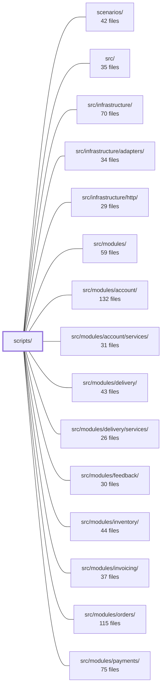

---
tags:
  - 2brain
  - 2brain/module
  - project/boilerplate-node-backend
type: module
module: scripts/
files: 122
updated: 2026-10-15T13:34:44.440235+00:00
---

# scripts/

## Purpose

`scripts/` holds every standalone, one-off (or CI-gate) script that operates on the repository as a whole rather than running as part of the application server. Its three main jobs are building and validating the API contract bundles (OpenAPI, AsyncAPI, authorization keys), maintaining the database's desired state (indexes, bootstrap data, cache), and keeping generated documentation and code in sync with source. Each script is individually runnable via an `npm run` alias and is written so that its pure logic can be unit-tested without filesystem or process side effects.

## Key parts

- **Contract pipeline** (`scripts/contracts/`) — the largest area. `build-bundles.ts` is the CLI entry that orchestrates the full build; `openapi-bundle.ts` and `asyncapi-bundles.ts` perform the actual compilation from per-module fragments. Supporting steps include `cookie-auth.ts`, `prune-unused.ts`, `root-assembly.ts`, `personal-data-assembly.ts`, and `authorization-bundle.ts` (post-bundle transformations), `generate-asyncapi-types.ts` / `generate-error-codes.ts` / `generate-permission-actions.ts` / `generate-request-content-types.ts` (downstream code generation), and `check-asyncapi-breaking.ts` / `validate-asyncapi.ts` (CI gates). Shared plumbing lives in `bundle-registry.ts`, `bundle-kinds.ts`, `fragments.ts`, `section-order.ts`, `generated-file.ts`, and `client-collections-bundle.ts`.
- **Code-shape audit** (`scripts/audit/code-shape/`) — `shallow-candidates.ts` contains the TypeScript-checker-based counting logic; `generate-shallow-candidates.ts` is the thin CLI wrapper that writes the JSON report.
- **Database maintenance** (`scripts/db/`) — `sync-indexes.ts` / `index-sync.ts` reconcile MongoDB indexes declaratively; `bootstrap-access.ts` upserts the fixed tenant; `cache-clear.ts` flushes app-owned Redis keys.
- **Docs generation** (`scripts/docs/`) — a family of generators (dependency map, module graph, audit actions, rate-limit budgets, role matrix) that write machine-derived tables into hand-written Markdown pages via the shared `marker-block.ts` helper. `check-references.ts` sweeps for dead file paths.
- **Docker & shared utilities** — `docker/generate-dockerfile-dockerignore.ts` eliminates `.dockerignore` drift; `cli.ts` provides a single `parseArgs`-based helper used by every script.

## How it connects

- **`src/modules/*`** — Nearly every contract and docs script reads per-module artifacts (`openapi.yaml`, `authorization.yaml`, `audit.ts`, rate-limit constants, `heldKeys`) directly from each module's directory. Adding or removing a module changes what the scripts pick up with no central registry edit.
- **`src/` and `src/infrastructure/`** — The audit and docs generators scan application source for call sites, import graphs, and middleware declarations. Generated output (e.g. `REQUEST_CONTENT_TYPES`) is consumed by `src/infrastructure/http/` middleware at runtime.
- **`scenarios/`** — `scenarios/apply.ts` invokes `scripts/db/cache-clear.ts` automatically after writing data outside the API.
- **`/` (repository root)** — Bundled contracts (`openapi.yaml`, `asyncapi.yaml`, `asyncapi.public.yaml`), generated TypeScript type files, and Docker config are written to the repo root or `api/` for downstream tooling (Spectral, Orval, Prism, Spectral CI).

## Where to start

1. **`scripts/contracts/build-bundles.ts`** — reading this CLI entry shows the full contract pipeline (load fragments → bundle → transform → write/verify) in one short file, and every other contracts script is a step it calls.
2. **`scripts/cli.ts`** — a two-dozen-line file that reveals the shared argument-parsing convention used by every script in the directory, so you understand the `--check` / `--flag` contract before diving into any individual script.

## Connected modules

[[boilerplate-node-backend_ROOT|/ (repository root)]] · [[boilerplate-node-backend_scenarios|scenarios/]] · [[boilerplate-node-backend_src|src/]] · [[boilerplate-node-backend_src_infrastructure|src/infrastructure/]] · [[boilerplate-node-backend_src_infrastructure_adapters|src/infrastructure/adapters/]] · [[boilerplate-node-backend_src_infrastructure_http|src/infrastructure/http/]] · [[boilerplate-node-backend_src_modules|src/modules/]] · [[boilerplate-node-backend_src_modules_account|src/modules/account/]] · [[boilerplate-node-backend_src_modules_account_services|src/modules/account/services/]] · [[boilerplate-node-backend_src_modules_delivery|src/modules/delivery/]] · [[boilerplate-node-backend_src_modules_delivery_services|src/modules/delivery/services/]] · [[boilerplate-node-backend_src_modules_feedback|src/modules/feedback/]] · [[boilerplate-node-backend_src_modules_inventory|src/modules/inventory/]] · [[boilerplate-node-backend_src_modules_invoicing|src/modules/invoicing/]] · [[boilerplate-node-backend_src_modules_orders|src/modules/orders/]] · … and 3 more

## Files
- `scripts/audit/code-shape/scripts/generate-shallow-candidates.ts` — CLI entry point that runs the `code-shape` shallow-candidates audit and writes the resulting JSON report to `tmp/reports/audit/code-shape/shallow.json`. It is deliberately split out from the pure counting logic so that the sibling module's unit tests can import `findShallowCandidates` without triggering filesystem writes or `process.argv` side effects.
- `scripts/audit/code-shape/scripts/shallow-candidates.ts` — Provides the counting logic for the `code-shape` audit: it walks a TypeScript program and produces per-function and per-file "facts" (body size, reference counts, forwarding bodies, unused optional parameters, import counts) that the audit then classifies into shallow-code smells. The file deliberately contains only counting; all verdicts live in `scripts/audit/code-shape/SKILL.md`. Resolution uses the TypeScript checker so import aliases, re-exports, and shorthand properties all resolve to the one named function.
- `scripts/cli.ts` — Shared CLI-argument helpers for the repo's standalone scripts. Replaces per-script hand-rolled `indexOf`/`startsWith` parsing with a single, lenient wrapper around `node:util`'s `parseArgs`, so every script gets consistent `--flag value` / `--flag=value` handling.
- `scripts/contracts/analytics-browser-events.ts` — Folds module-owned browser-event YAML fragments into the bundled OpenAPI document. Each module that reports browser events ships a `components`-only fragment (`openapi.browser-events.yaml`); this step merges those schemas into the bundle and replaces the `AnalyticsEventRequest` placeholder with a `oneOf` discriminated on the `event` property. It exists as a separate file so the OpenAPI bundler can call it in a single step.
- `scripts/contracts/asyncapi-breaking.ts` — Pure classification logic for detecting breaking changes between two AsyncAPI documents, extracted from the CLI script so unit tests can call it directly without triggering git or process-exit side effects.
- `scripts/contracts/asyncapi-bundles.ts` — Builds two committed AsyncAPI bundles from per-section source documents: `asyncapi.yaml` (every channel the service owns) and `asyncapi.public.yaml` (only the channels an API client can reach). It merges by copying five YAML map nodes (servers, channels, operations, messages, schemas) rather than dereferencing `$ref`s, preserving those references for downstream type generation while keeping the output compact.
- `scripts/contracts/asyncapi-webhook-events.ts` — Discovers per-module AsyncAPI webhook-event fragments from disk and merges them into the `webhooks` section of the bundled AsyncAPI document. Exists as its own module so the bundler interacts with it through a single call (`withWebhookEvents`) and the discovery logic stays independently testable.
- `scripts/contracts/authorization-bundle.ts` — Assembles `shared/authorization-keys.yaml` by text-splicing one fragment per module plus a root residual file. Keys live in their owning module's `authorization.yaml`, so deleting a module automatically removes its keys from the bundle — no hand-maintained registry to reconcile.
- `scripts/contracts/build-bundles.ts` — CLI entry point (`npm run contracts:bundle`) that rebuilds the repo's contract bundles (OpenAPI, AsyncAPI, public AsyncAPI) from their source fragments, or verifies they are current with `--check`. Fragments are the source of truth; the bundled files are what Spectral, Orval, Prism, and `check:spec-identity` consume. Client collections (Orval, Prism, Bruno, etc.) are opt-in and generated from the committed `openapi.yaml` rather than from fragments.
- `scripts/contracts/bundle-kinds.ts` — Defines the type system for contract bundles and provides four thin utility functions that operate over a `ContractBundle` without performing any bundling. It exists so that `bundle-registry.ts`, `build-bundles.ts`, and the cross-cutting test can all share one vocabulary for "compiled vs. generated" and a uniform way to produce, read, and compare a bundle's output.
- `scripts/contracts/bundle-registry.ts` — Central registry of every contract bundle this repo produces. It assembles a single `readonly` list (`CONTRACT_BUNDLES`) that the CLI, the staleness guard, and the cross-cutting test all iterate, so adding a new bundle is one entry plus its spec file. It also exposes a name-based lookup (`findBundle`) for CLI dispatch.
- `scripts/contracts/check-asyncapi-breaking.ts` — A CI gate (`npm run check:asyncapi-breaking`) that fails a commit when `asyncapi.public.yaml` — the partner-facing webhook event catalogue — drops or narrows a shape an existing subscriber depends on. It diffs the working-tree bundle against the bundle at the merge-base of the current branch and `origin/main`, so the comparison reflects what would actually ship rather than a possibly-stale local `main`.
- `scripts/contracts/client-collections-bundle.ts` — Configuration file that drives on-demand generation of four API client collections (Bruno, Insomnia, Mockoon, Postman) from the root `openapi.yaml`. It supplies the three repo-specific inputs the `@guebbit/openapi-runnable-collections` generator cannot derive on its own: which module owns which paths, which seeded values fill request bodies, and which authored probes demonstrate rejection. The generated files are `.gitignore`d; this file is the only committed artifact.
- `scripts/contracts/cookie-auth.ts` — Post-bundle OpenAPI transformation step that derives a `cookieAuth` security alternative from every operation already declaring `bearerAuth`, and adds a `403` origin-refusal response to unsafe methods that lack one. Exists so the cookie-auth claim and its 403 are generated mechanically rather than hand-declared per operation.
- `scripts/contracts/fragments.ts` — Single read-only access point for the build steps to load a module's on-disk contract files (`openapi.yaml` and `authorization.yaml`). Exists so that every build step shares one typed shape for those files instead of each redeclaring a partial interface.
- `scripts/contracts/generate-asyncapi-types.ts` — Generates the backend repo's TypeScript realtime contract types (payload interfaces, message aliases, per-namespace channel constants, SSE event maps, and queue-payload Zod validators) from the bundled `asyncapi.yaml`. It exists so that a contract change forces a regeneration rather than letting stale hand-written types ship. The `--check` flag turns it into a CI gate: writes nothing, exits 1 if the on-disk file would differ.
- `scripts/contracts/generate-error-codes.ts` — Generates a TypeScript `ERROR_CODES` constants object and an `ErrorCode` union type from the `x-error-codes` extension in `openapi.yaml`. It exists so call sites can reference error codes as typed constants (catching typos and removed codes at compile time) while the contract itself keeps `errors[].code` as an open `string` — a new code is additive, never a breaking response change (Zalando API guideline #112).
- `scripts/contracts/generate-permission-actions.ts` — Code-generation script that reads the `actions:` block from an `authorization-keys.yaml` document and emits a TypeScript module containing a runtime string array plus the corresponding union type. It exists so both repos in the pair (backend and frontend) can share the same permission-action vocabulary without hand-maintaining the list.
- `scripts/contracts/generate-request-content-types.ts` — Generates a request media-type lookup table (`REQUEST_CONTENT_TYPES`) from `openapi.yaml`. For every operation that declares a `requestBody`, it records the accepted content types alongside a pre-compiled regex path matcher. The output is consumed by the 415 content-type guard (`src/infrastructure/http/middlewares/content-type.ts`), which rejects bodies in undeclared types. The script is part of the `npm run gen:api` pipeline and writes a committed file under `api/`.
- `scripts/contracts/generated-file.ts` — Shared write-or-verify utility that every contract generator calls as its final step. It encapsulates the "write the generated file, or under `--check` validate it matches what's on disk" pattern so generators don't each re-implement it. The file is kept byte-identical across both repos in the pair.
- `scripts/contracts/openapi-bundle.ts` — Compiles the monolithic `openapi.yaml` from per-module standalone OpenAPI documents (via `redocly bundle`) and then applies five post-bundle transformations to produce the final published REST contract. It exists so that each module owns a self-contained `openapi.yaml`, adding a module is just dropping a file on disk, and removing one is `rm -rf`.
- `scripts/contracts/permission-actions-render.ts` — Pure (filesystem-free) half of the permission-action generator. It validates the `actions:` list out of the shared authorization YAML document and renders the TypeScript source (a const array plus a derived union type) that carries those actions into consuming code. Keeping I/O out of this file lets unit tests exercise the logic without touching disk.
- `scripts/contracts/personal-data-assembly.ts` — Assembles the `POST /account/export` response schema by collecting `x-personal-data` declarations from each module's `openapi.yaml` and injecting them as properties into the `AccountExportResponse` stub in the `account` module. Adding or removing a module automatically adds or removes its export section—no central list to maintain.
- `scripts/contracts/prune-unused.ts` — Removes every component in a bundled OpenAPI document that nothing reaches (via `$ref` or security requirements) and every tag no operation references. It exists as the **last** step in the contract pipeline so that orphaned components left behind by deleted modules—security schemes, responses, parameters—are stripped before the document is published, while preserving components that earlier pipeline steps have just added.
- `scripts/contracts/root-assembly.ts` — Reconciles the root OpenAPI document (`shared/contracts/openapi.root.yaml`) with the set of module fragments present on disk. It prunes `$ref` entries whose module or path no longer exists, appends `$ref` entries for newly declared paths, and extends the root `tags` list with any tag a fragment uses or declares. This is the mechanism that makes "adding a module edits nothing outside its folder" true at the contract level.
- `scripts/contracts/section-order.ts` — Provides a single pure function that resolves the display order of per-module sections within a bundle. It exists so that diffs stay small over time: sections keep their historical positions, while new or previously-unknown sections are appended alphabetically. No side effects, no I/O.
- `scripts/contracts/validate-asyncapi.ts` — A lightweight CLI script that validates AsyncAPI documents using the `@asyncapi/parser` package and its default `spectral:asyncapi/recommended` ruleset. It exists as a drop-in replacement for the retired `asyncapi validate` command (from `@asyncapi/cli`), providing identical diagnostics without the ~446 MB dependency and its telemetry.
- `scripts/db/bootstrap-access.ts` — Production-safe, idempotent bootstrap script (`npm run access:bootstrap`) that upserts the fixed "Shop" tenant into a fresh database. It exists as the safe counterpart to `scenarios/apply.ts`: because the write is keyed on `DEPLOYMENT_TENANT_ID`, re-running it is a no-op, so no `NODE_ENV` guard is required. Intended to run once before the app or cron services start (see `docker-compose.production.yml` → `setup` service).
- `scripts/db/cache-clear.ts` — A one-shot CLI script that deletes every cache key owned by this app from Redis. It exists because the API's write-path invalidation (see `invalidateCache` in the HTTP middleware) does not cover writes made outside the API — `scenario:apply`, ad-hoc `ops/` scripts, or a raw `mongosh` session — so stale responses would otherwise linger until their TTL expires. `scenario:apply` invokes this automatically; run it by hand after any manual database surgery.
- `scripts/db/index-sync.ts` — Declarative index reconciliation for MongoDB: compares what the database currently stores against what registered Mongoose schemas declare, then creates missing indexes and drops undeclared ones. This is the repo's entire "schema migration" mechanism — a desired state re-applied on every deploy rather than a sequenced changelog. Split out of `sync-indexes.ts` so the reconciliation logic can be driven per-case by tests without opening a live connection.
- `scripts/db/sync-indexes.ts` — CLI script (`npm run db:sync`) that reconciles the database's actual indexes with those declared on Mongoose models. It is idempotent, drops any index no schema declares, and supports a `--check` mode that prints the plan without writing—intended as a deploy gate. Serves as the "schema half" of what a migration tool would do.
- `scripts/docker/generate-dockerfile-dockerignore.ts` — Generates `docker/Dockerfile.dockerignore` from the root `.dockerignore` to eliminate manual drift. Docker and Buildah use a `<dockerfile-name>.dockerignore` file **instead of** (not merged with) the root `.dockerignore`, so a hand-maintained copy will inevitably fall out of sync. The script derives the override automatically, applying one deliberate edit: keeping `.git` included.
- `scripts/docs/check-references.ts` — A CLI sweep (`npm run check:docs-references`) that extracts every file path cited in inline code spans across `docs/**/*.md` and verifies it resolves to a real file or directory in the repository (or the paired frontend repo). It catches the class of documentation rot where a page names a path that no longer exists — something `docs:build` (link checker) and `lint:openapi` (route checker) do not cover.
- `scripts/docs/dependency-groups.ts` — The hand-kept half of `docs/tools/package-dependencies.md`. It declares which family (group) each npm package belongs to and *why* it exists in the project. The rest of that page — which packages are actually installed and who imports them — is derived at generation time by `generate-dependency-map.ts`; keeping it out of this file avoids drift.
- `scripts/docs/generate-audit-actions.ts` — Generates (or validates, with `--check`) the audit-action reference table embedded in `docs/tools/winston.md`. It imports every module's own `audit.ts` for real, scans all of `src/` for call sites to recover each action's `targetType`, and writes a sorted Markdown table between marker comments. The committed page itself acts as the regression guard for the audit vocabulary.
- `scripts/docs/generate-dependency-map.ts` — Generates (or verifies) the two dependency tables in `docs/tools/package-dependencies.md`. It reads the package list from `package.json`, scans production source to determine which module or shared area imports each package, and writes the results between HTML-comment marker blocks in the page. In `--check` mode (used by `complete`) it reports drift without writing. The script exists so that ownership and the package list are always derived from source rather than hand-maintained.
- `scripts/docs/generate-module-graph.ts` — Generates the whole-repo dependency graph and the grouped module list in `docs/modules/index.md`, plus a per-module neighbourhood diagram on each module page. Rather than hand-drawing a static diagram, it shells out to `dependency-cruiser` for the real import graph and scans source files for `onDomainEvent` subscriptions to add event edges. The generated blocks are written between HTML-comment markers in the Markdown pages; `--check` mode fails when the on-disk content has diverged from what the script would produce.
- `scripts/docs/generate-rate-limit-budgets.ts` — Generates (or checks) the rate-limit budget table inside `docs/tools/security.md`. The table is derived directly from module manifests and the infrastructure rate-limit constants, so it stays in sync with code. In `--check` mode (used by `complete`) it reports drift instead of rewriting.
- `scripts/docs/generate-role-matrix.ts` — Generates the **effective role matrix** table in `docs/demo-ecommerce/index.md` — a per-role, per-module view of exactly which permission keys each role holds after the evaluator resolves them. The answer cannot be written by hand (anonymous-baseline union, `any` vs `self` breadth, unrestricted expansion), so the script derives it from `heldKeys` and writes the result between HTML-comment markers, leaving surrounding prose untouched.
- `scripts/docs/marker-block.ts` — Shared utility that replaces the content between `<!-- name:start -->` / `<!-- name:end -->` HTML-comment markers inside a Markdown docs page. Every doc generator that keeps a machine-generated section within an otherwise hand-written page uses this module so that only the block between the pair is rewritten while all surrounding prose stays intact.
- `scripts/docs/module-catalogue.ts` — Derives every module's documentation placement from its `module.yaml` descriptor and the Markdown pages beside it, then renders two outputs that would otherwise be hand-maintained lists: the "Every module" section of `docs/modules/index.md` and the `/modules/` sidebar in the VitePress config. A new module appears in the correct group simply by declaring its `group` and `summary`—no other registration step.
- `scripts/docs/module-descriptor.ts` — Single typed reader for each module's `module.yaml` file. It defines the Zod schema that every descriptor must satisfy and exposes helpers to load one or all descriptors from disk. Both the docs generator (module graph, catalogue) and the cross-cutting test suite import from here so there is exactly one parse path — adding a field is a one-file edit, not a silent divergence between two hand-rolled parsers.
- `scripts/docs/repo-references.ts` — Shared path-existence primitives that answer one question: *does the path a comment or doc page cites still exist in this repo?* It sits between `check-references.ts` (markdown pages) and `comment-links.ts` (source comments) so the two checkers agree on what counts as a real path instead of each growing its own opinion. The higher-level resolution policies (VitePress-relative tokens, paired-repo tokens) intentionally stay in the callers; this file provides the lower-level "is it a path?", "does it resolve?", and "rewrite the alias" machinery.
- `scripts/eslint/barrel-allowed-sources.ts` — A custom ESLint rule that enforces which files a module's barrel (`src/modules/<name>/index.ts`) is permitted to re-export, codifying the public-surface contract from `docs/theory/strategic-ddd.md` §5. It restricts barrels to publishing services, domain, events, and emails as values; model and presenter(s) as types only; and rejects repositories, wiring files, and runtime model/presenter exports in any form.
- `scripts/eslint/comment-links.ts` — An ESLint rule that flags stale file references in code comments. Every comment in a linted file is scanned for `.ts`/`.tsx` path mentions; if the referenced file does not exist in the repo (per `git ls-files`), the rule reports a `stale` error. It exists so that renamed or deleted files do not silently leave dangling citations in comments, mirroring the check `scripts/docs/check-references.ts` performs for `docs/*.md` pages.
- `scripts/eslint/controller-chain-must-catch.ts` — A custom ESLint rule that enforces promise chains in controller functions must terminate with `.catch()`. It exists because the global error handler in `app.ts` returns a client-shaped 500 for unhandled rejections, masking what should be a 400 (or a domain-specific response), and preventing cleanup (e.g., deleting an orphaned upload) and domain metrics (e.g., a failed-checkout counter).
- `scripts/eslint/index.ts` — The default export of a local ESLint plugin: a flat map of rule-name strings to their rule implementations. It exists so that `eslint.config.ts` can register five project-specific rules (one per repo convention) as a single plugin object, keeping each rule in its own file for isolated `RuleTester` unit tests.
- `scripts/eslint/no-hardcoded-user-text.ts` — Custom ESLint rule that enforces user-facing error copy must originate from an i18n dictionary rather than being hardcoded at the call site. It specifically targets the `errors` argument of `rejectResponse` and `generateReject`, flagging string literals (and expression-free template literals) where a `t(…)` lookup is expected.
- `scripts/eslint/no-persistence-imports.ts` — A custom ESLint rule that enforces the "single door" boundary for persistence: only `repository.ts` may touch a collection's model or repository. It flags any `ImportDeclaration` in other files that reaches a persistence handle by name suffix (e.g. `userModel`, `userRepository`) or by module path (e.g. `../model`, `@modules/users/repository`), preventing schema coupling from leaking into services, controllers, or utilities.
- `scripts/git-base.ts` — Utility module that provides two git helpers for other scripts in this repo: a safe environment object for spawning nested `git` commands from within hook contexts, and a merge-base resolver with fallback logic for comparing against `origin/main`. It exists so every script that shells out to `git` targeting a different checkout shares one correct, hook-safe pattern instead of re-implementing it.
- `scripts/modules-on-disk.ts` — Single source of truth for where the repo root and its `src/modules` directory live on disk, plus a helper that lists which module folders carry a given artifact. Every build, contract, docs, or audit script that needs "each module that ships X" reads from here instead of re-walking the directory tree independently.
- `scripts/mutation/baseline.ts` — Implements the **per-file mutation ratchet**: it turns a Stryker JSON report into per-file mutation scores, compares them against a committed baseline (`mutation-baseline.json`), and enforces that scores only ever move up. Stryker's own thresholds are global, so this file exists to prevent one strong file from masking a weak one and to give each file an individually actionable regression gate.
- `scripts/mutation/check-baseline.ts` — CLI entry point for the per-file mutation ratchet. It compares the scores from the last Stryker run (read from `tmp/reports/mutation/mutation.json` or a sharded directory) against `mutation-baseline.json`, optionally recording new or improved scores. It deliberately does **not** run Stryker itself, so the check is cheap enough to run in a separate CI step from the actual mutation pass.
- `scripts/mutation/ci/cli.ts` — Command-line entry point for the GitHub Actions mutation workflow (`mutation.yml`, `mutation-wave.yml`). Each workflow step invokes exactly one subcommand (`config`, `wave`, `shard`, `outcome`, `merge`); the file handles argument parsing, file I/O, and orchestration while delegating all planning/merging/scoring logic to the pure modules that live alongside it. CI-only — not used by `npm run mutation:full`.
- `scripts/mutation/ci/merge.ts` — Folds Stryker mutation-test reports from multiple CI shards into a single unified report — one HTML page, one `mutation.json` for the ratchet baseline, and one GitHub-flavoured Markdown summary. It resolves slice-ignored mutants, re-keys per-report test IDs, detects files no finished shard covered, and renders the final artifacts.
- `scripts/mutation/ci/slice-ignorer.ts` — A Stryker ignore-plugin that constrains a single mutation run to a line range (slice) of a file. It exists so the GitHub CI sweep can split a file that would exceed one 6-hour job into smaller runs without losing or double-counting mutants at slice boundaries. Instead of Stryker's built-in `--mutate file:10-50` (which skips nodes *crossing* a boundary), this plugin keeps any node that *touches* the range, leaving deduplication to `merge.ts`.
- `scripts/mutation/ci/waves.ts` — Pure planner for the GitHub mutation-testing sweep. Given a scope of mutable files, it decides how to slice work into shards (matrix jobs) across successive waves, how timed-out shards are split and requeued, and how errors are retried or abandoned. It contains no I/O — `cli.ts` performs all file reading/writing.
- `scripts/mutation/github-artifacts.ts`
- `scripts/mutation/local-policy.ts` — Pure decision logic that decides which mutation-testing shards a local evening should run, given which shards already have reports on disk. It is extracted from `run-shards.ts` so the resumability rule can be unit-tested in isolation from CLI wiring.
- `scripts/mutation/mutate-scope.ts` — Defines the mutation-testing scope by reading Stryker's own `mutate` globs from `stryker.json`, then exposes the resulting file list, per-file line counts, and a membership check. It exists as a single source of truth so that sharding, diff filtering, and CI wave logic all agree on *which* files Stryker will actually touch, without any hand-maintained module list that drifts when a module is added.
- `scripts/mutation/pull-baseline.ts` — Downloads the most recent mutation-testing baseline that the GitHub sweep uploaded as a run artifact, then overwrites the local `mutation-baseline.json`. It exists because the sweep runs without write access to the repository, so it cannot commit the baseline directly — this script "brings it home" for a human (or CI) to review and commit.
- `scripts/mutation/run-diff.ts` — Runs Stryker mutation testing scoped to the files changed in the current branch (diffed against `origin/main` or a `--base` ref), then grades the result against the per-file baseline ratchet. It exists to give reviewers a fast, actionable mutation score in minutes rather than waiting for the weekly full sweep.
- `scripts/mutation/run-shards.ts` — CLI entry point for `npm run mutation:full`. Splits the full mutation scope into bin-packed shards (by line count) and runs them sequentially, copying each completed shard's Stryker report to a persistent directory before starting the next. Exists because Stryker writes no report when killed mid-run; sharding guarantees partial progress is preserved on disk. When every shard has a report, the scope is "closed" and all shard reports are merged into the per-file baseline ratchet.
- `scripts/mutation/sharding.ts` — Defines how the local full mutation sweep (`npm run mutation:full`) partitions its mutate scope into shards of roughly equal size, using line count as the balancing metric. The design avoids a hand-maintained module list (which drifted and left five modules unmeasured for a month) by deriving shards from whatever scope `mutate-scope.ts` resolves at run time.
- `scripts/mutation/stryker-run.ts` — Shared "half" of every Stryker mutation invocation: resolves concurrency and heap settings from the local machine, cleans the scratch directory, spawns Stryker, and aborts the run if workers OOM-loop. Both entry points (`run-diff`, `run-shards`) call into this file rather than invoking `npx stryker` directly, because a bare invocation would skip the heap cap that a memory-constrained machine cannot afford.
- `scripts/ops/reap-account-exports.ts` — Cron-driven ops script that deletes account data exports once they pass their retention window (`NODE_ACCOUNT_EXPORT_TTL_DAYS`, default 7) and sweeps orphaned export files. It exists so stale, regenerable export copies don't accumulate on disk or in Mongo. Invoked via `npm run reap:account-exports`.
- `scripts/ops/reap-delivery.ts` — Operational cron script (`npm run reap:delivery`) that wipes the `holdNote` free-text field on fulfillment orders that have not changed for `NODE_HOLD_NOTE_RETENTION_DAYS` (default 365). Structured data (lines, status, dates) is preserved; only the unbounded staff-typed hold note is removed. Exists to satisfy data-retention policy on PII-adjacent free text without deleting the fulfillment order itself.
- `scripts/ops/reap-inactive-accounts.ts` — CLI entry point for the inactivity reaper (`npm run reap:inactive-accounts`). It runs a periodic, lease-guarded job that (a) always minimises personal data on accounts idle beyond `NODE_INACTIVE_MINIMIS_DAYS` (default 1095 d) and (b) optionally — only when `NODE_INACTIVE_ACCOUNT_DAYS > 0` — warns, soft-deletes, and hard-deletes accounts through a fixed grace chain. Deletion ships disabled by default; minimising ships enabled.
- `scripts/ops/reap-invoice-pdfs.ts` — Ops script (`npm run reap:invoice-pdfs`) that deletes stored invoice and credit-note PDF files older than the configured retention window. The PDFs are regenerable copies; the frozen invoice data in Mongo is the legal record, so deleting a file only costs a re-render on the next download. The job is filesystem-only and idempotent, but briefly opens a Mongo connection solely so `runScript` can record the outcome in `leases` for health observability.
- `scripts/ops/reap-mail-spool.ts` — Periodic cleanup (cron / scheduled task) that deletes abandoned spooled mail attachments. A spooled file only outlives its job when the mail job died between `spoolAttachment()` and the actual send. This is the filesystem backstop for anything that slipped through, intended to run on a schedule rather than by hand.
- `scripts/ops/reap-orders.ts` — Periodic cron script (`npm run reap:orders`) that scrubs PII from order documents once they pass their retention window. It never deletes an order row — the order survives as a revenue record — but replaces the customer email, unsets addresses and notes, and separately scrubs staff-written timeline text that has aged past its own clock.
- `scripts/ops/reap-orphaned-images.ts` — CLI script that deletes stored images (and their thumbnails) no longer referenced by any current document. Exists to reclaim disk space from stale uploads after deletions, demos, or e2e cycles. Scheduled nightly via `docker/crontab`; also invocable manually with `npm run reap:orphaned-images`.
- `scripts/ops/reap-payments.ts` — Periodic cleanup script that hard-deletes payment attempts that never reached `succeeded` and are past the `NODE_PAYMENT_ABANDONED_RETENTION_DAYS` window (default 30 days). Unlike `reap-orders.ts`, it deletes rather than marks, because a payment that never settled never produced an invoice to retain. Intended to run on a cron schedule alongside the other `reap:*` scripts, never on application boot.
- `scripts/ops/reap-previous-emails.ts` — Nightly batch job (`npm run reap:previous-emails`) that clears the `previousEmail` field on every account whose 7-day undo link has lapsed (expired, spent, or revoked). It lives here rather than inline because the cleanup is a single unindexed `updateMany` scan over all accounts holding a `previousEmail`—too expensive to run per-request.
- `scripts/ops/reap-quarantine.ts` — Nightly cleanup job (scheduled via `docker/crontab`) that deletes quarantined upload files in `NODE_QUARANTINE_PATH` older than the configured retention window. It exists to remove orphaned quarantine files left behind by crashes after `imageStore.quarantine()` or lost deliveries—every normal pipeline run cleans up its own file, so a lingering one signals a failure.
- `scripts/ops/reap-returns.ts` — Periodic ops script (`npm run reap:returns`) that clears the unbounded free-text fields (`note`, `declineReason`) on returns whose `updatedAt` is older than `NODE_RETURN_TEXT_RETENTION_DAYS` (default 1095). Returns themselves are never deleted; structured fields (status, lines, amounts, dates) are preserved.
- `scripts/ops/reencrypt.ts` — One-shot ops script (`npm run run reencrypt`) that re-encrypts every stored secret onto the newest key of its encryption key ring. Exists so that, after a key rotation prepends a new key, the old key can eventually be dropped. Not scheduled; run manually after the rotation deploy.
- `scripts/ops/sweep-order-effects.ts` — Operational sweep script (`npm run sweep:order-effects`) that re-emits `ORDER_REFUND_OWED` for cancelled orders whose refund was never processed. The domain event bus has no built-in retry, so if the `payments` provider was unreachable during the original cancel, the refund is silently lost. This script retries only the money half; it does **not** retry stock/release effects. Intended to run every 5 minutes via cron, matching the `NODE_ORDER_EFFECT_RETRY_MINUTES` grace window.
- `scripts/ops/sweep-outbox.ts` — Scheduled cron job (runs every minute) that publishes every transactional-outbox event whose due time has arrived. It is the **backstop**, not the fast path: it recovers events left behind by crashed/unreachable processes and retries that have waited out their backoff. Lease-based claiming in `relayOutbox` makes it safe to overlap with the nudge or a previous run.
- `scripts/ops/sweep-payment-effects.ts` — Scheduled operational sweep (intended every 5 minutes) that finishes work the settlement transaction left on the provider's side: it retries every refund the provider refused (`failed`/`pending`) using the same idempotency key, and reconciles payments whose webhook never arrived by asking the provider and settling its answer. It exists because a settlement crash cannot leave the local DB half-done, but the provider-side side effects (refund acknowledgement, payment webhook) can still be outstanding.
- `scripts/ops/sweep-preorders.ts` — Daily scheduled job (`npm run sweep:preorders`) that fulfills the buyer-notice and 30-day-silence obligations that attach to every active preorder. It asks buyers whose expected delivery date has passed whether they still want to wait, and flags 30-day silent waits so the `returns` module can cancel and refund. It is a job rather than an admin task because both actions are legal duties (FTC 16 CFR 435.2, CRD Art. 18).
- `scripts/ops/sweep-reservations.ts` — Scheduled job (every 5 min, via `npm run sweep:reservations` and a crontab entry) that expires stale reservation holds so abandoned checkouts release their inventory units. It delegates the actual sweep to the inventory module, then settles the outbox so the `orders` module hears each `RESERVATION_EXPIRED` announcement before the process exits.
- `scripts/ops/sweep-webhook-retries.ts` — Cron entry-point (npm script `sweep:webhook-retries`) that runs every minute to find webhook delivery rows whose `nextAttemptAt` has passed and re-dispatches them—either by publishing to a broker or by sending the HTTP attempt inline when no broker is configured. It exists because the delayed-retry strategy (decision c in the webhooks module docs) parks failed attempts back in `pending` with a future timestamp rather than using a broker delay queue, so something must periodically pull due rows back into the delivery path.
- `scripts/pairing/check-spec-identity.ts` — CLI entry point (`npm run check:spec-identity`) that verifies the shared contract files in this repo are byte-identical to their counterparts in the paired frontend checkout. It exists so CI can detect contract drift between the two repositories before it becomes a runtime bug.
- `scripts/pairing/linked-worktree.ts` — Detects whether a given directory is a linked `git worktree` as opposed to the repository's main working tree, and exposes a guard that prevents a linked worktree from writing into a main checkout. This exists so the pairing/sync pipeline can distinguish legitimate main-to-main contract transfers from accidental worktree-to-main writes.
- `scripts/pairing/paired-frontend-path.ts` — Resolves the absolute path to the paired Vue frontend checkout so that every script in this repo that needs to read or write the frontend does so against the same directory. Centralises the lookup logic (environment variable → `.env` → sibling-default) so callers don't each reimplement the fallback chain and risk pointing at different checkouts.
- `scripts/pairing/spec-identity.ts` — Defines and performs the cross-repo byte-identity check between this backend and its paired frontend. A small set of spec files (OpenAPI, async contract, authorization keys, TLS certs) must be byte-for-byte identical in both checkouts; a one-line edit in either side silently forks what both codebases believe they share, and neither CI detects it because a forked spec is still a *valid* spec. This module provides the file list, the comparison logic, and the human-readable failure message.
- `scripts/pairing/sync-to-frontend.ts` — Covers the `npm run sync:frontend` entry point. It copies every backend-owned shared file (as declared in `SHARED_FILES`) into the paired frontend checkout, after verifying the files are freshly built, and then triggers the frontend's own `npm run regenerate`. It exists so a single command leaves both repos consistent rather than relying on a developer to remember each side's follow-up step.
- `scripts/regenerate-artifacts.ts` — Entry point for `npm run regenerate`. Rebuilds every generated artifact (typed API client, zod schemas, AsyncAPI bundles, OpenAPI bundle, docs pages, dockerignore) in the one order that satisfies inter-step imports, then optionally hands the rebuilt specs to a paired frontend repo. Exists as a single script rather than a shell `&&` chain because the dependency ordering is non-obvious and needs a home.
- `scripts/run-script.ts` — Entry-point wrapper for all one-shot scripts under `scripts/db/` and `scripts/ops/`. It adds four things a bare promise chain does not provide: a non-zero exit code on failure, guaranteed cleanup of open handles (Mongo, Redis) on the error path, a readable log line through the shared logger, and a job-outcome record that `GET /observability/health` and `job_last_success_timestamp_seconds` can read.
- `scripts/scaffold/apply.ts` — The I/O half of the module scaffolder. Given a repo root and parsed options, it checks for conflicts (existing directory, doc file, registry entry, schema-name collision) and, if clear, writes the planned files and central-edit results to disk. All decisions about *what* to write live in the pure siblings (`plan.ts`, `central-edits.ts`); this file only performs the reads and writes.
- `scripts/scaffold/central-edits.ts` — Defines the set of pure text-transform edits a newly scaffolded module must apply to four files **outside** its own folder (the module registry, two authorization YAML files, and a cross-cutting parity test). Each transform locates a known anchor in the target file and inserts the module's entries, throwing immediately if the anchor is missing so the scaffold aborts before any write.
- `scripts/scaffold/demo-remove-alert-rules.ts` — Removes Prometheus alert rules (and their `promtool` test cases) that reference metrics registered **exclusively** by modules being deleted. It is a text-level editor for `docker/observability/prometheus.alert-rules.yaml` and its companion `.test.yaml`, invoked as part of the scaffold/demo module-removal pipeline.
- `scripts/scaffold/demo-remove-authorization.ts` — Removes a deleted module's authorization traces from the two shared YAML files that reference permission keys by hand: `shared/authorization-roles.yaml` and `shared/authorization-conformance.yaml`. It performs targeted text edits (not a YAML parse/stringify round-trip) to keep the files byte-identical to their PHP twins.
- `scripts/scaffold/demo-remove-modules.ts` — Single orchestration point for removing a set of modules from the repo tree. It coordinates the cross-cutting removal steps (folders, registry, authorization, alert rules, validation labels, test doubles, residue tests) so that callers (`demo-remove.ts`, `measure-demo-strip.ts`) share one implementation and cannot drift apart.
- `scripts/scaffold/demo-remove-registry.ts` — Handles the "central lists" half of module removal: every shared file that names a module outside its own folder is edited generically off the module name. It strips module entries from `src/modules.ts`, deletes the module's owned `scripts/ops/*.ts` files along with their `package.json` script lines and `docker/crontab` entries, and returns structured removal notes for the orchestrator's final report.
- `scripts/scaffold/demo-remove-scenarios.ts` — The "demo scenario data" half of the demo-strip operation. It deletes the files under `scenarios/` and `public/images/seed/` that exist solely to give shop-specific modules (products, wishlist, shop-history) something to display, and edits shared files (`shop-modules.ts`, `index.ts`, `users.ts`, `package.json`) to remove references to those deleted pieces. It is called by `demo-remove.ts` as part of a full or single-module removal, not run standalone.
- `scripts/scaffold/demo-remove-tests.ts` — The test-deletion step of the `demo-remove.ts` scaffold workflow. After a module's source folders have already been removed, this file walks every surviving test file, detects which ones import (or declare `requires-module:`) a removed module — directly or transitively through other already-deleted tests — and deletes them. It returns one `RemovalNote` per deleted file so the caller can report what was cleaned up.
- `scripts/scaffold/demo-remove-validation-labels.ts` — Identifies shared validation-attribute labels (in `src/locales/*.json`) that are named only by a removed module's request contracts and no longer used by any surviving request, then strips those labels from the dictionaries. This keeps the cross-cutting test `tests/cross-cutting/validation-attributes.test.ts` satisfied, which refuses labels that no generated `*Body` schema references.
- `scripts/scaffold/demo-remove.ts` — CLI entry point for `npm run demo:remove`. Strips every module labelled `group: shop` or `group: example` from the current checkout—folders, seed images, scenario data, and the central source files that reference them—so the repo compiles cleanly without demo content. It is the destructive counterpart to the `measure:demo-strip` twin that runs against a scratch copy.
- `scripts/scaffold/format-text.ts` — Provides the single formatting step used when scaffolding code into the repo. It wraps the Prettier API to replicate CLI behavior (`.editorconfig`, `.prettierignore`) so scaffolded output passes `prettier:check` without a second pass. The module is designed as a seam: unit tests can substitute an identity formatter instead of loading Prettier.
- `scripts/scaffold/names.ts` — Centralises the derivation of every name spelling a scaffolded module needs (kebab-case, camelCase, PascalCase, snake_case, etc.) from a single validated folder name, so that no template re-derives—and potentially mis-derives—its own casing.
- `scripts/scaffold/options.ts` — Parses the CLI arguments for `scaffold:module` into a typed `ScaffoldOptions` object (or a `ParseRefusal` explaining why the arguments are invalid). Kept as a pure module so the CLI entry point remains a thin I/O wrapper around it.
- `scripts/scaffold/plan.ts` — Computes, as pure data, the complete list of files (path + content) that scaffolding a module will create. Being pure means unit tests can assert the plan without touching the filesystem, and the CLI layer is reduced to the collision check, the actual writes, and any follow-up process calls.
- `scripts/scaffold/registry.ts` — Provides a single pure text-transformation (`registerModule`) that inserts the three required lines for a new module into `src/modules.ts` — the import, the `enabledModules` array entry, and the `ModuleName` union member — each kept in alphabetical order. Because it operates on raw source text rather than the filesystem, it is unit-testable without a repository checkout.
- `scripts/scaffold/scaffold-module.ts` — CLI entry point (`npm run scaffold:module -- <name> [options]`) that generates a new module folder, its docs page, and registry entries from a template, optionally triggers a type/schema regeneration, and then prints a fixed list of decisions the author must still make. It is the thin orchestration layer around the actual file-writing logic in `apply.ts`.
- `scripts/scaffold/templates-code.ts` — Provides the template functions that produce the **source-code file contents** (as plain strings) for a newly scaffolded module. Each exported function corresponds to one file in the generated module (yaml, manifest, barrel, audit, model, repository, service, etc.) and interpolates the module's names and options into the template literal. Prettier formats the output later, so the templates are written for human readability of the *template itself*, not for final code layout.
- `scripts/scaffold/templates-contract.ts` — Generates the per-module `openapi.yaml` fragment for a scaffolded entity module. It produces a self-contained OpenAPI 3.1.0 document (paths + local component schemas) that a root assembler can merge into the top-level bundle without further modification. The file exists so that each generated module ships a valid, spec-complete contract out of the box.
- `scripts/scaffold/templates-documentation-tests.ts` — Provides four string-template functions that generate the documentation page and the initial test files for a newly scaffolded module. Called by the scaffold pipeline to emit ready-to-edit Markdown and TypeScript test scaffolds that follow the project's conventions (plain template literals, no backticks in generated comments).
- `scripts/security/corpus-digest.ts` — Provides a pure SHA-256 integrity check for a downloaded corpus. It exists as a separate module so that test suites can import and exercise the verification logic without triggering the side effects (network calls, database writes) that `refresh-breached-passwords.ts` performs on import.
- `scripts/security/refresh-breached-passwords.ts` — Manual, run-by-hand script (`npm run refresh:breached-passwords`) that rebuilds the committed breached-password list. It downloads SecLists' `Pwdb_top-10000000` corpus (10 M entries), verifies its integrity, filters it against the `PasswordNew` pattern read directly from the root `openapi.yaml`, and writes the small survivor set (~20 k entries, ~226 KB) into the path that `PasswordNew` loads at boot. It exists so the shipped blocklist always reflects the current composition rule without duplicating that rule.
- `scripts/setup/environment-file.ts` — Pure text-level helpers for manipulating a dotenv file's string content: replacing placeholder values with generated secrets and reading a key's current value back. It deliberately performs **no** filesystem I/O — that responsibility belongs to `scripts/setup/index.ts`. Separating text logic from disk I/O keeps these operations trivially testable and reusable.
- `scripts/setup/index.ts` — Entry point for `npm run setup`. Bootstraps a fresh clone into a working local environment in one shot: creates `.env` from the committed template (if absent), replaces every still-placeholder secret with a fresh random value, and writes the Prometheus scrape-credential file so the local observability stack can start.
- `scripts/setup/required-keys.ts` — Derives the authoritative list of environment variables that `npm run setup` may populate, by reading each enabled module's and the app's config field declarations. Because the list is computed from the config schema rather than hard-coded, a newly added module secret is automatically included without touching this file.
- `scripts/testing/demo-module-names.ts` — Shared reader that answers "which module folders does `demo:remove` target today?" by reading each module's own `module.yaml` descriptor and filtering on the `group` field, rather than maintaining a hand-kept list. Both the scratch measurement script and the production strip script consume this single source so a module relabel is picked up automatically.
- `scripts/testing/machine-budget.ts` — Single decision point for how hard the test runners may push the local machine. Computes worker counts, per-process heap caps, and shard counts from *available* memory (not total RAM), so that suites scale down gracefully on constrained hardware. An explicit environment variable always overrides every heuristic in this file.
- `scripts/testing/measure-demo-strip.ts` — Diagnostic script that measures how far "a module is removable" actually is. It applies a removal **recipe** (`shop` or `locales`) to a scratch copy of the checkout, regenerates, then runs `ts-check`, the cross-cutting test suite, and `docs:build` against what remains. Every failure is a finding (new coupling); the script itself is not the removal command. CI runs it as the `demo-strip-measure` job.
- `scripts/testing/measure-scaffold.ts` — Report-only integration check (invoked via `npm run measure:scaffold`) that confirms a freshly scaffolded module passes the repo's full quality gate. It copies the checkout to a scratch directory, runs the scaffolder on two probe modules, then executes the same commands a developer would run next (type-check, lint, prettier, unit tests, docs build, cross-cutting rules) inside that copy. Because it takes minutes, it is excluded from the commit gate; run it after touching `scripts/scaffold/` or any shared file the scaffolder edits.
- `scripts/testing/report-results.ts` — CLI script (invoked via `npm run test:report`) that reads a Jest `--json` or Vitest `json` reporter artefact and prints a module-organised summary: per-module test counts and timing, the slowest suites/tests, and failures named by owning module. It exists because neither the raw log nor the flat file list tells you *which module* a failure belongs to or *where the time went*.
- `scripts/testing/run-prism-smoke-test.ts` — A standalone smoke test (`npm run test:prism`) that boots the Prism mock server against `openapi.yaml` and issues a single HTTP request to prove the spec is complete enough for Prism to parse and serve. It validates the *contract document*, not application logic, and is excluded from the pre-commit gate because it binds a real port.
- `scripts/testing/run-suite.ts` — Wraps `jest` with a memory-budget layer for machines that cannot hold an entire test layer's accumulated per-file allocations in one process. Instead of raising Node's heap ceiling (which only delays the OOM), it splits a serialized layer's files into a small number of sequential jest processes (`--shard`), each capped at a computed `--max-old-space-size`. It also exposes a `--unsharded` escape hatch for callers (coverage, JSON report, randomized order) that deliberately want every pattern in a single process.
- `scripts/testing/scratch-copy.ts` — Builds a disposable copy of the checkout into a scratch directory so that `measure:*` scripts can destructively mutate it (strip the shop, scaffold a module) and then run the repo's own checks against the result—without touching the real working tree.

---
[[boilerplate-node-backend_INDEX|← boilerplate-node-backend index]]
