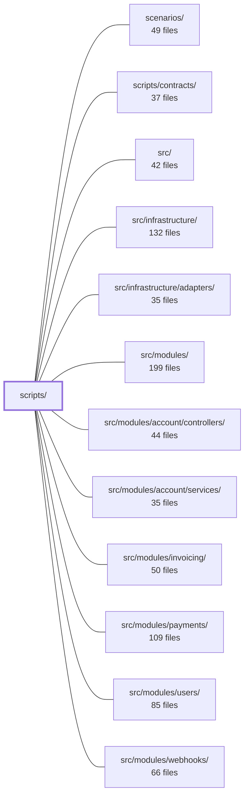

---
tags:
  - 2brain
  - 2brain/module
  - project/boilerplate-node-backend
type: module
module: scripts/
files: 100
updated: 2026-11-15T00:28:08.954129+00:00
---

# scripts/

## Purpose

`scripts/` is the repository's tooling layer: custom ESLint rules that enforce architectural boundaries, documentation generators that keep derived artifacts in lock-step with source code, audit tooling for AI-assisted review, one-shot database operations, and shared CLI/utility helpers. Nothing here is part of the running application; every file is invoked via `npm run`, a git hook, or a CI job.

## Key parts

- **`audit/`** — AI-assist audit infrastructure: an API-standards rule registry, a code-shape shallow-candidate counter (built on the TS checker API), a test-honesty ESLint candidate list, a compliance-rule YAML, and a git-diff tripwire (`check-clean.ts` + `run-check-clean.ts`) that verifies an audit run wrote nothing outside its report folder.
- **`docs/`** — The largest sub-group. Generators for the module graph (Mermaid), dependency tables, role matrix, rate-limit budgets, jobs/crontab, scenario registries, and audit-action tables. Each writes between HTML-comment markers via the shared `marker-block.ts` utility. Companion checkers (`check-references.ts`, `code-citations.ts`, `document-facts.ts`) validate that cited paths, anchors, and `npm run` targets still exist. `module-descriptor.ts` and `module-catalog.ts` read `module.yaml` files to drive the VitePress sidebar and module index.
- **`eslint/`** — Seven project-local ESLint rules (barrel-publishing contract, controller must-catch, no-persistence-imports, no-hardcoded-user-text, comment-links, and the aggregator `index.ts`) that encode the repo's DDD and i18n invariants as lint errors.
- **`db/`** — One-shot and idempotent database scripts: `bootstrap-access.ts` (initial tenant), `cache-clear.ts` (flush stale Redis responses), `index-sync.ts` / `sync-indexes.ts` (desired-state index reconciliation, the repo's only schema-migration mechanism).
- **`hooks/`** — Pre-commit gate (`check-generated-fresh.ts` + `stale-generated-files.ts`) that refuses a commit if any staged generated file is stale, using a Kubernetes-style "export index → regenerate → diff" approach.
- **`docker/`** — `generate-dockerfile-dockerignore.ts` derives `Dockerfile.dockerignore` from the root `.dockerignore` to prevent drift.
- **Shared utilities** — `cli.ts` (argv parsing wrapper), `fail-script.ts` (zero-dep error handler), `git-base.ts` (sanitised git env + merge-base fallback), `modules-on-disk.ts` (canonical module enumeration).

## How it connects

- **`src/` and `src/modules/`** — Doc generators and the code-shape auditor scan production source to discover imports, domain-event subscriptions, rate-limit budgets, and role definitions. ESLint rules enforce boundaries *on* module code (e.g. barrel exports, persistence isolation).
- **`src/infrastructure/` / `src/infrastructure/adapters/`** — The `no-persistence-imports` rule hard-codes the adapter boundary; the `barrel-allowed-sources` rule checks what modules may re-export from infrastructure layers.
- **`scripts/contracts/`** — Contract fragments are one of the artifacts `modules-on-disk.ts` enumerates; audit and contract tooling share the module-discovery path.
- **`scenarios/`** — `scenario:apply` invokes `db/cache-clear.ts` automatically; `generate-scenario-registries.ts` rebuilds the scenario index from the `scenarios/` file tree.
- **Repository root** — Doc generators read the root `package.json`, `.dockerignore`, `tsconfig.json`, and `eslint.config.ts`; the `check-generated-fresh` hook and `complete` gate run from the root and treat `scripts/` output as the set of files that must stay fresh.

## Where to start

1. **`scripts/eslint/index.ts`** (≈10 lines) — Shows how all custom rules are registered; from there, read one rule (e.g. `no-persistence-imports.ts`) to see how the repo encodes an architectural invariant as a lint check.
2. **`scripts/docs/marker-block.ts`** — The 40-line shared utility behind every doc generator. Understanding the "write-between-markers" pattern makes the rest of the `docs/` sub-group self-explanatory and shows how generated content coexists with hand-written prose.

## Connected modules

[[boilerplate-node-backend_ROOT|/ (repository root)]] · [[boilerplate-node-backend_scenarios|scenarios/]] · [[boilerplate-node-backend_scripts_contracts|scripts/contracts/]] · [[boilerplate-node-backend_src|src/]] · [[boilerplate-node-backend_src_infrastructure|src/infrastructure/]] · [[boilerplate-node-backend_src_infrastructure_adapters|src/infrastructure/adapters/]] · [[boilerplate-node-backend_src_modules|src/modules/]] · [[boilerplate-node-backend_src_modules_account_controllers|src/modules/account/controllers/]] · [[boilerplate-node-backend_src_modules_account_services|src/modules/account/services/]] · [[boilerplate-node-backend_src_modules_invoicing|src/modules/invoicing/]] · [[boilerplate-node-backend_src_modules_payments|src/modules/payments/]] · [[boilerplate-node-backend_src_modules_users|src/modules/users/]] · [[boilerplate-node-backend_src_modules_webhooks|src/modules/webhooks/]]

## Files
- `scripts/audit/api-standards.yaml` — Registry of API-standards rules consumed by two audit skills (`api-http/SKILL.md` for eight HTTP web standards and `api-style/SKILL.md` for one style guide). It declares, per rule, what the standard mandates, any house promise that goes beyond the standard, where to find evidence in the repo, and how to classify a known deviation. It is a human-authored judgement list, not a machine-lint config.
- `scripts/audit/check-clean.ts` — Implements the audit tripwire (rule 6 in `scripts/audit/RULES.md`): verifies that an audit run wrote nothing outside its own report folder. It does this by capturing a git-state snapshot before and after the run, then diffing the two while ignoring changes inside the run folder. Exits 0 when clean, 1 when changes are detected, 2 on bad usage.
- `scripts/audit/code-shape/scripts/generate-shallow-candidates.ts` — CLI entry point for the `code-shape` audit's shallow-candidate pass. It builds a TypeScript program from the repo's `tsconfig.json`, runs the `findShallowCandidates` counting logic over the requested scope, and writes the resulting report to `<out>/shallow.json`. It exists as a separate file from the pure counting module so that unit tests can import `findShallowCandidates` without triggering this script's side effects (arg parsing, FS writes, console output).
- `scripts/audit/code-shape/scripts/shallow-candidates.ts` — Counts structural facts about functions and files that the `code-shape` audit uses to flag shallow code: small bodies with few callers, pure forwarders, optional parameters no caller supplies, and files with few importers. It performs counting only — all verdicts live in the audit skill (`SKILL.md`). Resolution is built on the TypeScript checker API rather than text search, so import aliases, re-exports, shorthand properties (`{ fn }`), and destructured bindings all resolve to the single function they name.
- `scripts/audit/compliance-rules.yaml` — Shared compliance-rule registry consumed by the AI audit prompts that filter by `responsibility` and evaluate only the evidence hints for their own side. The file lives here once so both backend and frontend audits read the same single source of truth (see `docs/tools/ai-auditing.md`).
- `scripts/audit/run-check-clean.ts` — Thin CLI entry point for the audit tripwire (rule 6 in `scripts/audit/RULES.md`). It parses argv, delegates to `main` in `check-clean.ts`, and maps the returned code onto `process.exitCode` (0 clean, 1 changes listed, 2 bad usage). It exists so `npm run audit:check-clean` has a concrete script target with the correct shebang and argument-slicing boilerplate.
- `scripts/audit/test-honesty/eslint.candidates.config.ts` — Report-only ESLint configuration that flags every test whose assertions are **all** weak (e.g. `toBeDefined`, `toBeNull`, `toThrow` with no argument). It exists to surface low-value tests as a candidate list for human review, but it is explicitly **not** part of the lint gate because it produces roughly 113 hits for only about 6 real findings. It is invoked exclusively via `npm run audit:test-candidates`.
- `scripts/cli.ts` — Shared CLI-argument parsing helper for standalone scripts. Wraps `node:util`'s `parseArgs` with a minimal API (`flagValue`, `hasFlag`, `requiredPath`) so individual scripts don't hand-roll `indexOf`/`startsWith` logic for each `--flag` they accept.
- `scripts/db/bootstrap-access.ts` — One-shot production bootstrap script (`npm run access:bootstrap`) that creates the initial "Shop" tenant via an idempotent upsert. Intended to run as the `setup` service in `docker-compose.production.yml` before the `app` and `cron` containers start. Unlike `scenarios/apply.ts`, it is safe to re-run against an already-seeded database because the write is keyed on the fixed `DEPLOYMENT_TENANT_ID`.
- `scripts/db/cache-clear.ts` — Clears every cached response for this app from Redis. It exists because writes that bypass the API (manual DB surgery, `mongosh` sessions, one-off scripts) skip the API's automatic `invalidateCache` middleware, leaving stale responses served until TTL expiry. `scenario:apply` invokes it automatically; run by hand after any manual database change.
- `scripts/db/index-sync.ts` — Reconciles MongoDB indexes against the schemas that declare them: it creates missing indexes, replaces indexes whose options changed, drops retired indexes, and (optionally) prunes undeclared ones. This file *is* the repo's entire schema-migration mechanism — a desired state re-applied on every deploy rather than a sequenced changelog. It was split from `sync-indexes.ts` so tests can drive reconciliation per case without a live connection.
- `scripts/db/sync-indexes.ts` — Entry-point script (`npm run db:sync`) that reconciles the database's live indexes with the indexes declared across all Mongoose models. Idempotent and add-only by default: it creates missing indexes and replaces changed ones, but keeps undeclared indexes unless explicitly told to prune. Serves as the "schema half" of schema management, run on every boot and deploy rather than as a one-time migration.
- `scripts/docker/generate-dockerfile-dockerignore.ts` — Generates `docker/Dockerfile.dockerignore` from the root `.dockerignore`. Docker and Buildah use a per-Dockerfile `.dockerignore` *instead of* (not merged with) the root file, so a second copy is required. Hand-maintaining that copy caused drift before; deriving it eliminates that risk. The one deliberate modification is keeping `.git` in the image, because `npm run complete` (run inside this image by the `gate` service and `container-gate` CI job) invokes an ESLint rule that shells out to `git ls-files`.
- `scripts/docs/check-references.ts` — Validates that every file path and heading anchor claimed in inline code spans, markdown links, and script references across `docs/**/*.md` actually exists in the repository (or the paired frontend). Complements `docs:build`, which catches dead links, by catching dead *facts*—paths that were renamed, deleted, or never existed. Run via `npm run check`.
- `scripts/docs/code-citations.ts` — Detects dead `docs/….md` references that appear **outside** the `docs/` directory (in `src/`, `scripts/`, YAML contracts, and `.env-example`). For each citation it verifies the page is git-tracked and, if a `#anchor` is given, that the anchor corresponds to a real heading slug. It mirrors the resolution logic in `check-references.ts` but targets citations embedded in non-docs files.
- `scripts/docs/dependency-groups.ts` — The hand-curated half of `docs/tools/package-dependencies.md`. It defines *which family* each npm package belongs to, *why* it exists in that family, and where to read more — while leaving the mechanical parts (which packages are actually installed, who imports them) to the auto-generated companion. Without this file, the dependency docs would be a flat, unexplained list.
- `scripts/docs/document-facts.ts` — Pure text-checking module that extracts `npm run <script>` citations from docs markdown and reports which cited scripts do not exist. It exists so that `check-references.ts` can delegate the "what does this page claim?" logic to a unit-testable, side-effect-free set of functions.
- `scripts/docs/generate-audit-actions.ts` — Generates (or `--check`s) the audit-action reference table inside a committed docs page. It imports every module's `audit.ts` plus infrastructure's `coreAuditActions`, scans all of `src/` for the literal target type each action is fired against, and writes the resulting Markdown table between HTML-comment markers. The committed page doubles as a regression guard: a renamed or added action surfaces as a doc diff rather than requiring a per-module test to restate the vocabulary.
- `scripts/docs/generate-dependency-map.ts` — Generates the two dependency tables (runtime and dev) embedded in `docs/tools/package-dependencies.md`. It reads every `package.json` dependency, scans production source to determine who imports each package, groups them by the hand-kept categories in `dependency-groups.ts`, and auto-assigns ungrouped packages that have a single module owner. Runs in write mode or `--check` mode (for CI drift detection) and inserts its output between HTML-comment markers in the page, leaving surrounding prose untouched.
- `scripts/docs/generate-jobs.ts` — Generates two derived artifacts from job declarations — the `docker/crontab` file and the jobs table inside `docs/reference/ops.md` — as a step of `npm run regenerate`. In `--check` mode it reports drift instead of writing, which is what `npm run check` invokes. It exists so that a schedule declared once in code is never left stale in the files that actually schedule it.
- `scripts/docs/generate-module-graph.ts` — Generates Mermaid diagrams (a whole-repo import graph and one per-module neighbourhood diagram) plus a grouped module list into `docs/modules/index.md` and individual module pages. Import edges come from a `dependency-cruiser` run; event edges are discovered by scanning each module's source for `onDomainEvent` subscriptions. Generated blocks are written between HTML-comment markers so surrounding hand-written prose is never modified. A `--check` flag lets CI fail when the generated content has drifted.
- `scripts/docs/generate-rate-limit-budgets.ts` — Generates (or validates, in `--check` mode) the rate-limit budget table inside `docs/tools/security.md`. It collects every `RateLimitBudget` from each enabled module's manifest plus the infrastructure-level list, renders them as a single Markdown table between HTML-comment markers, and writes it back to the page — keeping the doc in lock-step with what the code actually enforces.
- `scripts/docs/generate-role-matrix.ts` — Generates and maintains the **effective role matrix** tables in documentation: one role × module summary table on `docs/demo-ecommerce/index.md` and one "who can do what" per-rule table on each module's docs page. All tables live inside HTML-comment markers so surrounding prose stays hand-written. In `--check` mode it reports drift without rewriting (used by `complete`). The matrix is produced by asking the real evaluator (`heldRules`) rather than re-expanding permission sets, keeping a single source of truth for "what may this role do."
- `scripts/docs/generate-scenario-registries.ts` — CLI entry point (run via `npm run regenerate`) that rebuilds the two scenario registries from the on-disk file tree. Supports a `--check` mode that reports drift without writing, which is the mode `complete` invokes to verify registries are in sync.
- `scripts/docs/jobs-render.ts` — Pure rendering functions that turn `JobDeclaration` objects into their two textual outputs: the `docker/crontab` entries consumed by supercronic and the Markdown jobs table on the ops page. Exists as a separate module from `generate-jobs.ts` so the string-shaping logic can be tested without disk I/O.
- `scripts/docs/marker-block.ts` — Shared write-or-report utility for every doc generator that embeds a generated section between `<!-- name:start -->` / `<!-- name:end -->` HTML-comment markers inside an otherwise hand-written Markdown page. It lets each generator replace only its own block (leaving all other hand-written text intact), format the result with the page's Prettier config, and either write the file or report drift — so the `complete` gate's `prettier --check` and the generator never disagree on the expected bytes.
- `scripts/docs/module-catalog.ts` — Derives a module catalogue—grouped list of modules with their deeper pages—from the `module.yaml` descriptors and the Markdown files beside them. Produces two outputs that would otherwise be hand-maintained: the "Every module" Markdown block for `docs/modules/index.md` and the `/modules/` sidebar structure for VitePress. A new module appears in the correct group and position simply by declaring its `group` and `summary` in its descriptor.
- `scripts/docs/module-descriptor.ts` — Single typed reader for a module's `module.yaml` file. It defines one strict Zod schema and two read functions so that every consumer (the module-graph docs generator, cross-cutting well-formedness tests, `npm run regenerate` codegen) shares the same parse-and-validate path instead of each hand-rolling its own YAML interpretation.
- `scripts/docs/repo-references.ts` — Shared path-resolution primitives that answer one question: *does a path cited in a doc page or source comment still exist in this repo?* Extracted so that `check-references.ts` (markdown docs) and `comment-links.ts` (TypeScript comments) agree on what counts as a real path, while each caller keeps its own policy for relative-URL and bare-token resolution.
- `scripts/eslint/barrel-allowed-sources.ts` — Custom ESLint rule that enforces the DDD barrel-publishing contract (`docs/theory/strategic-ddd.md §5`): a module's `index.ts` may only re-export services, domain rules, events, and emails **as values**, and model + presenter(s) **as types only**. It blocks leaking repositories, wiring files, mongoose runtime values, and presenter functions in any export form (`export *`, `export { x } from`, or `import…export` relay).
- `scripts/eslint/comment-links.ts` — An ESLint rule (`commentLinks`) that scans every comment in a source file for `.ts`/`.tsx` path references and reports any that do not resolve to a tracked file. It enforces that comments never point at renamed or deleted source files, sharing its resolution machinery with the docs-reference checker.
- `scripts/eslint/controller-chain-must-catch.ts` — A custom ESLint rule that flags promise chains in exported controller functions which call `.then()` but never terminate with `.catch()`. It exists because the global error handler in `app.ts` converts unhandled rejections into generic 500s, masking client errors as server faults, and because that net cannot perform per-domain cleanup (orphaned uploads) or record domain-specific metrics (failed checkouts).
- `scripts/eslint/index.ts` — Aggregates all project-local ESLint rule implementations into a single default export (a rule-name-to-rule object) so that `eslint.config.ts` can register the whole set with one plugin import. It is the entry point for this repo's custom lint rules.
- `scripts/eslint/no-hardcoded-user-text.ts` — A custom ESLint rule that enforces all user-facing error text in `rejectResponse` and `generateReject` calls comes from an i18n dictionary lookup (`t(…)`) rather than a hardcoded string literal. It exists so that copy added at a call site cannot slip past translation and localization.
- `scripts/eslint/no-persistence-imports.ts` — A custom ESLint rule that enforces the "persistence behind the repository" boundary: a collection's `model` or `repository` module may only be imported from that collection's own `repository.ts`. Any other import—whether by binding-name suffix or by module path—is reported as a problem. This keeps a single choke-point for query shape so schema changes don't ripple across the codebase.
- `scripts/fail-script.ts` — A zero-dependency error handler that reports a script's uncaught failure and sets a non-zero exit code. It exists as a lightweight alternative to `runScript` for scripts (especially docs generators) that must not pull in the logger, config, or Mongoose at module load time.
- `scripts/git-base.ts` — Provides two shared helpers for scripts that shell out to `git`: a sanitized environment (stripping `GIT_*` variables that could silently redirect a nested invocation) and a merge-base resolver that tolerates a missing `origin/main` on fresh clones. Exists so every caller gets the same env-safety and fallback semantics without duplicating the logic.
- `scripts/hooks/check-generated-fresh.ts` — A pre-commit gate (invoked via `.husky/pre-commit` → `npm run check:generated`) that refuses a commit if any committed generated files are stale. It only *checks* — it never stages files or mutates the working tree.
- `scripts/hooks/stale-generated-files.ts` — Identifies which files a full regeneration would modify, starting exclusively from the **staged index** (not the working tree). The pre-commit hook uses this to refuse commits that contain stale generated artifacts. The approach mirrors Kubernetes' `verify-generated.sh`: export the index to a scratch directory, regenerate in that copy, and diff.
- `scripts/modules-on-disk.ts` — Single source of truth for "where are the repo's modules on disk." Any build step that needs to enumerate modules carrying a particular artifact (a contract fragment, a probe list, a descriptor) imports from here instead of re-walking `src/modules` with its own logic.
- `scripts/mutation/baseline.ts` — Implements a **per-file mutation-score ratchet** to replace Stryker's global threshold. It records each file's score from a real run, then enforces that a file may never drop below its recorded score (within a small tolerance) while allowing it to ratchet upward. This prevents one strong file from masking a weak one in an averaged global number, and makes the "only a human can lower a baseline" policy explicit in code.
- `scripts/mutation/check-baseline.ts` — CLI entry point for the per-file mutation ratchet. It reads a Stryker mutation report (produced by a prior `npm run mutation:full` run), compares each file's survival score against the stored `mutation-baseline.json`, and fails (exit 1) if any file regressed. It never runs Stryker itself, keeping the gate cheap enough for CI to split run and check into separate steps.
- `scripts/mutation/ci/cli.ts` — CLI entry point for the GitHub Actions mutation-testing sweep. Each step in `mutation.yml` and `mutation-wave.yml` invokes exactly one subcommand (`config`, `wave`, `shard`, `outcome`, `merge`); the planning, slicing, and merging logic lives in the sibling pure modules (`waves.ts`, `merge.ts`). This file handles argument parsing, file I/O, and GitHub Actions output plumbing only.
- `scripts/mutation/ci/merge.ts` — Merges Stryker mutation-testing reports from multiple CI shards (a "GitHub sweep") into a single unified report, and provides the supporting utilities to render that report as HTML and as a GitHub Markdown summary. Also exposes `overlayReport` for layering a local partial run over an existing whole report so the on-disk artifact stays complete.
- `scripts/mutation/ci/slice-ignorer.ts` — A Stryker ignore-plugin that restricts a single CI run to a line **slice** of a file (e.g. lines 120–240), letting the GitHub mutation sweep split a slow file across parallel 6-hour jobs without losing or duplicating mutants. Unlike Stryker's native `--mutate file:10-50`, which only mutates nodes *wholly inside* the range, this plugin ignores any subtree that does not *touch* the slice — so a node crossing a slice edge is tested by both neighbouring jobs and deduplicated by `merge.ts`.
- `scripts/mutation/ci/waves.ts` — The planner for the GitHub mutation-testing sweep. It decides how the mutate scope is split into shards for each wave's matrix, what a failed shard becomes in the next wave (split into smaller slices, retried, or abandoned), and caps each wave at GitHub's matrix limit. It is pure — the CLI handles all I/O.
- `scripts/mutation/github-artifacts.ts` — Pure data-selection module for the mutation-testing GitHub sweep. It defines the artifact name to look for and the filtering/sorting logic that picks the newest downloadable `mutation-report` artifact from `main`, delegating all I/O (GitHub API calls, file writes) to `pull-report.ts`.
- `scripts/mutation/local-policy.ts` — Pure selection logic that decides which mutation-testing shards a local evening sweep will actually run. Extracted from `run-shards.ts` so the resumability rule (skip already-reported shards, narrow by `--only`, cap by `--limit`) is unit-testable without invoking a CLI.
- `scripts/mutation/mutate-scope.ts` — Resolves which source files fall inside Stryker's mutation-testing scope by reading `stryker.json`'s own `mutate` glob patterns at call time, then exposes that scope (as a file list, with per-file line counts, or as a filtered intersection against a diff) to the CI sharding and diff pipelines. Reading the globs fresh from the config file avoids the drift that occurs when a module is added to `stryker.json` but not to a hand-maintained list.
- `scripts/mutation/pull-report.ts` — CLI entry point for `npm run mutation:pull`. It fetches the newest mutation-sweep report artifact from GitHub Actions, writes `mutation.json` and `index.html` to the same local directory a local run would use, and then re-derives `mutation-baseline.json` from that report so the local baseline and CI baseline cannot diverge.
- `scripts/mutation/run-diff.ts` — Runs a Stryker mutation pass scoped to the whole files a branch changed relative to a base ref (default `origin/main`), grades that partial run against the per-file ratchet, then overlays the result onto the full report already on disk so the stored report stays whole. It exists so a branch's mutation coverage can be checked in CI or locally without re-running the entire codebase's sweep.
- `scripts/mutation/run-shards.ts` — Executes the full mutation scope in bin-packed shards, running them sequentially and banking each shard's Stryker report to disk. It exists because Stryker writes no report when killed mid-run, so a single unsharded pass would lose all progress on interruption; this script ensures each completed shard's result is durable, and only merges into the baseline once every shard in the scope has a report. Invoked as `npm run mutation:full`.
- `scripts/mutation/sharding.ts` — Defines the sharding strategy for the local full mutation sweep (`npm run mutation:full`). Instead of hard-coding a module list (which drifted and left modules unmeasured), it derives shards from the actual mutate scope by line count, using a greedy bin-packing heuristic. The result is a set of `Shard` objects that downstream tooling can execute in parallel.
- `scripts/mutation/stryker-run.ts` — Shared Stryker invocation layer that every mutation entry point funnels through. It sizes worker concurrency and per-worker heap to the *current* machine (rather than trusting `stryker.json`'s committed values), sweeps the scratch directory before the run, and aborts the process if an OOM-restart loop shows the run will not converge.
- `scripts/ops/check-config.ts` — A minimal entry-point invoked by `npm run config:check` (or before supercronic starts). Its sole job is to load the `.env` file so that a malformed or missing configuration causes the container to **fail to start** rather than appear healthy while every cron job independently fails. It opens no connection and performs no business logic.
- `scripts/ops/prepare-job.ts` — Shared boot and execution helpers for scheduled jobs. It ensures every job installs the same module subscriptions, rendering assets, and outbox settlement that the web process gets, so a job's output (e.g. a mailed notification) is indistinguishable from one built in the app. `run-job.ts` and the integration tests both call into here to avoid duplicating that setup.
- `scripts/ops/reapply-erasures.ts` — Operational script that replays the erasure ledger after a database restore. Restoring an older snapshot resurrects accounts that were erased after that snapshot; this script re-erases them using the ledger (which outlives the oldest backup). It is run manually by an operator—never on a schedule—with the app and cron stopped.
- `scripts/ops/reencrypt.ts` — One-shot CLI script (`npm run reencrypt`) that re-encrypts every stored secret onto the newest key in its key ring after a rotation deploy. Without it, old key entries can never be dropped because nothing else migrates the rows that still reference them.
- `scripts/ops/run-job.ts` — Single entry point for every scheduled job (`npm run job <name>`). It resolves the named job from the declaration registry, connects to infrastructure, boots like the app, executes the work, and records the outcome — all without ever being invoked at boot. Designed to be triggered exclusively from cron.
- `scripts/pairing/check-spec-identity.ts` — CLI entry point for the cross-repo contract check (`npm run check`). It compares a set of shared specification files between this (backend) repo and its paired frontend checkout, exiting non-zero if the contracts have drifted. The frontend repo runs the mirror image of this script against `BACKEND_PATH`.
- `scripts/pairing/linked-worktree.ts` — Detects whether a given directory is a **linked `git worktree** (as opposed to the repository's main working tree) and exposes a guard predicate for the "worktree → main" write direction that `sync:frontend` must refuse. It exists so pairing/sync scripts can distinguish between two checkouts that share a repository but differ in which one is the canonical main.
- `scripts/pairing/paired-frontend-path.ts` — Centralizes resolution of the paired frontend checkout's absolute file-system path. Every script that needs to read or write the sibling frontend (sync, identity checks, doc reference checks) calls into this module so they all agree on *which* checkout they target, regardless of whether the path came from a one-off env var, a per-lane `.env`, or the default sibling layout.
- `scripts/pairing/spec-identity.ts` — Defines the cross-repo byte-identity contract: a canonical list of spec files that must be **byte-for-byte identical** in both the backend and frontend checkouts, plus the logic to compare them and report drift. It exists because a one-line edit in one checkout silently forks what both sides believe they share, and a forked spec is still a *valid* spec, so no CI check would otherwise catch it.
- `scripts/pairing/sync-to-frontend.ts` — Copies every backend-owned shared file (as declared in `SHARED_FILES`) into the paired frontend checkout, verifying byte-identity before and after, then triggers the frontend's `npm run regenerate`. Exists so the two repos stay contractually in sync without manual file management; the backend is the single source of truth for these files.
- `scripts/regenerate-artifacts.ts` — The single entry point for `npm run regenerate`. It rebuilds every generated artifact (API client, zod schemas, authorization bundle, docs tables, crontab, Dockerfile.dockerignore, etc.) in the one order that satisfies their cross-dependencies. In `--check` mode it verifies artifacts against their sources without writing, serving as the first half of `npm run check`.
- `scripts/run-script.ts` — Entry-point wrapper for the one-shot scripts under `scripts/db/` and `scripts/ops/`. It centralises four concerns a bare promise chain does not handle: a non-zero exit code on failure, guaranteed cleanup (connection close) on both success and failure paths, a readable logged error, and a job-outcome record that `GET /observability/health` and `job_last_success_timestamp_seconds` can read.
- `scripts/scaffold/apply.ts` — The I/O half of the module scaffolder. Given a fully computed plan (produced by the pure sibling files), it either refuses to proceed—returning every reason the scaffold would collide with existing state—or writes the planned files and central edits to disk. It exists to keep all disk-touching logic isolated so that tests can point it at a scratch directory and the pure planning logic stays unit-testable without filesystem access.
- `scripts/scaffold/central-edits.ts` — Defines the set of pure text-transform edits a newly scaffolded module must apply to files *outside* its own folder (the "central" files: the module registry, the admin authorization-rules YAML, and the Replace/PATCH parity test). Each transform is a `(source) => string` function that throws if its expected anchor is missing, so a drift in file shape is caught before anything is written.
- `scripts/scaffold/demo-remove-alert-rules.ts` — Removes Prometheus alert rules (and their `promtool` test cases) that monitor metrics owned exclusively by modules being deleted. It identifies "orphan" metrics by diffing what the removed folders register versus what the surviving codebase registers, then performs surgical text edits on the two YAML files under `docker/observability/`. It is a step in the scaffold module-removal pipeline.
- `scripts/scaffold/demo-remove-authorization.ts` — Handles the authorization-cleanup step of the scaffold-removal pipeline. Before module folders are deleted, it reads each removed module's authorization fragment to collect the rules, permission sets, and CASL subjects they declared. It then performs surgical **text edits** (line filtering and regex replacement, not a YAML round-trip) on two shared files that reference those permissions by name: `shared/rules/authorization-roles.yaml` and `shared/cases/authorization.cases.yaml`. The text-edit approach is deliberate—these files are committed byte-for-byte to a PHP twin, and re-stringifying would re-wrap every description.
- `scripts/scaffold/demo-remove-modules.ts` — Orchestrates the module-agnostic half of removing modules from a checkout: deleting their folders, stripping their registry entries, removing shared authorization grants, alert rules, validation labels, scenario files, and residue tests. It exists so the shop-specific removal script (`demo-remove.ts`) can delegate the "which files to touch" logic and focus on the shop-only catalogue and scenario work.
- `scripts/scaffold/demo-remove-registry.ts` — Handles the "central lists" half of the shop-module strip: it deletes each module's folder under `src/modules/` and surgically removes that module's import line, `enabledModules` array entry, and `ModuleName` union member from `src/modules.ts`. It exists so that removal is driven by the module's *name* and the file's known shape (via `registry` helpers) rather than a separate hand-maintained list of lines to delete.
- `scripts/scaffold/demo-remove-scenarios.ts` — The "scenario data" half of the demo-removal strip. It deletes the files under `scenarios/` (product fixtures, seed images, per-module values and doubles) that exist solely to give the shop's own modules something to display. It only performs deletions and a small set of targeted content edits; the registries that list these files are regenerated separately by `npm run regenerate`.
- `scripts/scaffold/demo-remove-tests.ts` — The test-removal step of the `demo-remove` scaffold. Given a set of module names whose folders have already been deleted, it finds every test file that imports (directly or transitively) one of those modules—or declares a `// requires-module:` dependency on one—and deletes the file. It runs iteratively so that tests importing a now-deleted test file are also caught, and it returns one `RemovalNote` per deleted file.
- `scripts/scaffold/demo-remove-validation-labels.ts` — Cleans up the shared locale dictionaries (`shared/locales/<locale>.json`) after a module is removed. The cross-cutting test `tests/cross-cutting/validation-attributes.test.ts` rejects any `validation.attributes` label that no surviving request field uses, so this module identifies which labels belong *only* to the removed module and strips them from every locale file before the module folders are deleted.
- `scripts/scaffold/demo-remove.ts` — Entry-point script for `npm run demo:remove`. In a single run it deletes every module folder tagged `group: shop` or `group: example` (including their scheduled jobs and owned tests), removes seed images and shop-only scenario files, and regenerates the scenario registries so the repo still compiles. It operates directly on the current checkout.
- `scripts/scaffold/format-text.ts` — Provides a single formatting seam (`FormatText`) so scaffold scripts can produce Prettier-conformant output without importing Prettier directly. The real implementation lives in this file; tests substitute an identity formatter to sidestep Prettier's dynamic-import requirements that Jest cannot satisfy.
- `scripts/scaffold/names.ts` — Single source of truth for every case-spelling of a new module's name. Derives all variants (kebab, PascalCase, camelCase, snake_case, etc.) once from the folder name so that no downstream template or generator re-derives—and risks mis-deriving—its own casing.
- `scripts/scaffold/options.ts` — Parses the raw CLI arguments passed to `scaffold:module` into a typed `ScaffoldOptions` object (or a `ParseRefusal` on bad input). The file is deliberately pure—`argv` in, options or refusal out—so the shell script or runner that invokes it can stay a thin I/O layer without any parsing logic of its own.
- `scripts/scaffold/plan.ts` — Pure planning layer for the module scaffolder. Given parsed `ScaffoldOptions`, it computes the complete list of files (path + unformatted content) a new module needs, without performing any I/O. This separation lets unit tests assert the full plan against fixtures and keeps the CLI (`apply.ts`) responsible only for collision checks, Prettier formatting, and disk writes.
- `scripts/scaffold/registry.ts` — Generates the three text edits a new module requires in `src/modules.ts` — the import statement, the `enabledModules` array entry, and the `ModuleName` union member — as a pure string-in/string-out transform. This keeps the logic unit-testable without a working checkout.
- `scripts/scaffold/scaffold-module.ts` — CLI entry point for `npm run scaffold:module -- <name> [options]`. It orchestrates the full "create a new module" flow: parses arguments, delegates file-writing to the scaffold applier, optionally triggers type regeneration, and prints the list of decisions the tool intentionally leaves to the developer.
- `scripts/scaffold/scenario-registry.ts` — Generates four registry files (`shop-modules.generated.ts`, `scenarios.generated.ts`, `modules.generated.ts`, `levers.generated.ts`) by scanning the `scenarios/` file tree for files that follow naming and export conventions. This eliminates hand-maintained lists: adding or deleting a module is just adding or deleting files, and the next regeneration reflects the change.
- `scripts/scaffold/templates-code.ts` — Provides the template-literal functions that produce the runtime source files of a scaffolded module (manifest, barrel, model, repository, services, audit, rules, authorization, and `module.yaml`). The shape mirrors the `example` module's core cut to an admin CRUD collection. It exists so the scaffold script can emit a coherent, documented set of files without duplicating string-building logic across the plan or CLI.
- `scripts/scaffold/templates-contract.ts` — Generates the per-module `openapi.yaml` fragment that the scaffold produces for a new API resource. It emits a self-contained OpenAPI 3.1.0 document (paths, tags, schemas) whose shared components (`$ref`s to pagination, errors, auth, etc.) are resolved by the root assembler at build time. The template bakes in the project's REST conventions so every scaffolded module ships with a consistent contract without hand-authoring YAML.
- `scripts/scaffold/templates-documentation-tests.ts` — Provides the documentation-page skeleton and the full set of smoke/integration test templates that the scaffold generator writes out when creating a new module. Each export is a plain template-literal function that, given a module's naming info and scaffold options, returns the final Markdown or TypeScript source to be placed in the new module's directory.
- `scripts/security/corpus-digest.ts` — Provides a SHA-256 integrity gate for a downloaded corpus. Before the corpus bytes are fed into the breached-password refresh pipeline, this function verifies the digest matches a pinned value; any mismatch aborts processing. It is extracted into its own module so it can be imported (and unit-tested) without triggering the side-effectful import of `refresh-breached-passwords.ts`.
- `scripts/security/refresh-breached-passwords.ts` — Manual, by-hand script (`npm run refresh:breached-passwords`) that rebuilds the committed breached-password denylist (`shared/rules/breached-passwords.txt`). It downloads SecLists' 10 M-password corpus, filters it through the `PasswordNew` regex pattern read directly from the root `openapi.yaml` contract, and writes the sorted survivors (~20 k entries, ~226 KB) to the repo. It exists so the committed list stays in sync with the contract's pattern without duplicating the rule.
- `scripts/setup/environment-file.ts` — Pure text-level operations on a dotenv file's contents: filling placeholder values and reading back a single key. It deliberately performs no filesystem I/O — all reading, writing (temp file + rename, `0600`), and first-run `.env-example` copying is owned by `scripts/setup/index.ts`.
- `scripts/setup/index.ts` — Entry point for `npm run setup`. On a fresh clone it creates `.env` from `.env-example`, replaces every still-placeholder secret (as identified by the enabled modules' requirements) with a fresh `randomBytes(32)` value, and writes the Prometheus metrics token to a standalone file that the observability stack reads via bind mount.
- `scripts/setup/required-keys.ts` — Derives the authoritative list of environment variables that `npm run setup` is allowed to fill, by reading the same config-slice declarations the runtime uses. This eliminates a hand-maintained list: any new module field that declares a `placeholder` is automatically included.
- `scripts/testing/demo-module-names.ts` — Provides a single discovery function that tells `demo:remove` *which* module folders to delete (those whose `module.yaml` says `group: shop` or `group: example`). Reading from each module's own descriptor means a relabelled module changes the removal set without editing this file.
- `scripts/testing/machine-budget.ts` — Single source of truth for how much memory and CPU the test runners may consume on the current machine. It derives worker counts, per-process heap caps, and jest shard counts from `MemAvailable` (not `os.freemem()`) and a set of measured per-file retention constants, so that test execution is sized to what is actually free right now rather than what the machine nominally has. Every value it produces can be overridden by an explicit environment variable.
- `scripts/testing/measure-scaffold.ts` — End-to-end verification script (invoked via `npm run measure:scaffold`) that confirms a freshly scaffolded module passes the repo's own quality gates. It copies the checkout to a scratch directory, scaffolds two probe modules there, then runs the same checks a developer would run immediately after scaffolding (type-check, lint, format, unit tests, docs build, idempotency refusal). Report-only by design — it takes minutes and is not wired into the commit gate. Run it after changing anything under `scripts/scaffold/` or a shared file the scaffolder edits.
- `scripts/testing/report-results.ts` — A standalone CLI script (`npm run test:report`) that reads a Jest `--json` report and prints a human-readable summary answering two questions a raw log cannot: *which module a failure belongs to* and *where the time went*. It is intentionally a read-only reporter; it never sets a non-zero exit code.
- `scripts/testing/run-prism-smoke-test.ts` — A one-shot contract smoke test (run via `npm run test:prism`) that spawns a Prism mock server against the repo's `openapi.yaml`, polls until it accepts connections, and issues a single GET to prove the spec is complete enough for Prism to generate a 2xx response. It verifies the *document*, not application logic. It deliberately owns the child process it starts so a failed run never leaves a stray server listening.
- `scripts/testing/run-staged-tests.ts` — Pre-commit gate (last step of `.husky/pre-commit`, invoked as `npm run test:staged`) that runs any staged integration, contract, or fuzz test file not already covered by the lighter `complete:light` suite. Exists because `complete:light` skips all suites that require a `mongod` instance; without this, a newly added or changed integration test would first execute only at merge time.
- `scripts/testing/run-suite.ts` — CLI entry point that runs a named test layer as a series of **sequential** jest processes, bounding per-process memory on machines with limited RAM. It exists because a single jest process retains ~70 MB per test file in its heap, and `--max-old-space-size` only raises the ceiling without stopping the climb. Sharding (a process that exits every N files) is the fix, and this script owns the shard-count math, worker-count math, and heap-cap assignment.
- `scripts/testing/scratch-copy.ts` — Provides a disposable copy of the repo checkout that the `measure:*` scripts can mutate (strip a shop, scaffold a module) and then run the repo's own checks against. The copy isolates destructive experiments from the real working tree so the measurement reflects the source change, not an environment failure.
- `scripts/testing/suites.ts` — Single source of truth for the project's test layers: which jest path patterns belong to each layer and whether that layer must run files serially. Extracted into its own file so both the layer runner and the staged-tests step read the same table, because `run-suite.ts` executes on import and therefore cannot be imported for its data.

---
[[boilerplate-node-backend_INDEX|← boilerplate-node-backend index]]
