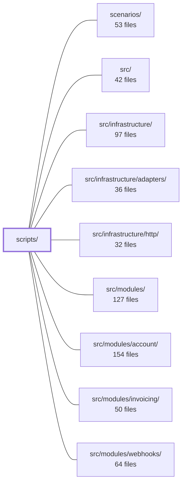

---
tags:
  - 2brain
  - 2brain/module
  - project/boilerplate-node-backend
type: module
module: scripts/
files: 117
updated: 2026-10-29T19:19:46.061215+00:00
---

# scripts/

## Purpose

`scripts/` is the repository's build, code-generation, and operational tooling layer. It bundles OpenAPI and AsyncAPI contracts from per-module fragments into publishable documents, generates typed TypeScript from those contracts, performs database index reconciliation and cache clearing at deploy time, produces Docker artefacts, maintains generated documentation, and provides small shared CLI utilities used by other scripts.

## Key parts

- **Contract bundling & transforms** – `contracts/openapi-bundle.ts` compiles per-module OpenAPI documents into one bundle; `contracts/asyncapi-bundles.ts` assembles the two AsyncAPI outputs. Post-bundle passes (`cookie-auth.ts`, `personal-data-assembly.ts`, `analytics-browser-events.ts`, `asyncapi-webhook-events.ts`, `prune-unused.ts`, `root-assembly.ts`) mutate the bundle before publication.
- **Code generators** – `generate-asyncapi-types.ts`, `generate-error-codes.ts`, `generate-permission-actions.ts`, `generate-request-content-types.ts`, and `generate-shared-rules-schemas.ts` each emit a TypeScript (or JSON Schema) file from a contract fragment. Their pure rendering halves (`permission-actions-render.ts`, `shared-rules-render.ts`) and the shared write-or-verify tail (`generated-file.ts`) keep I/O out of testable logic.
- **Bundle registry & type system** – `bundle-registry.ts` is the single `readonly` list every consumer iterates; `bundle-kinds.ts` defines the `ContractBundle` type and four helpers; `fragments.ts` is the typed reader for module fragment files. `build-bundles.ts` is the CLI entry (`npm run contracts:bundle`) with `--check` staleness mode.
- **Breaking-change gate** – `check-asyncapi-breaking.ts` diffs the working-tree public bundle against the merge-base of `origin/main`; `asyncapi-breaking.ts` holds the pure classification logic so it can be unit-tested.
- **Database & deploy scripts** – `db/index-sync.ts` / `db/sync-indexes.ts` reconcile MongoDB indexes to schema declarations; `db/cache-clear.ts` flushes app-scoped Redis keys; `db/bootstrap-access.ts` seeds the production tenant.
- **Docs generators** – `docs/generate-jobs.ts` emits the Docker crontab and the ops jobs table; `docs/generate-dependency-map.ts` builds the package-import tables; `docs/generate-audit-actions.ts` renders the audit-action reference; `docs/check-references.ts` validates cited file paths in Markdown.
- **Audit / code-shape** – `audit/code-shape/scripts/shallow-candidates.ts` walks the TS AST to flag candidate refactors; `generate-shallow-candidates.ts` is the thin CLI wrapper that writes the JSON report.
- **Miscellaneous** – `docker/generate-dockerfile-dockerignore.ts` derives the Dockerfile-specific ignore file; `contracts/validate-asyncapi.ts` replaces the retired `asyncapi validate` CLI; `contracts/client-collections-bundle.ts` configures the runnable-collections generator for Bruno/Insomnia/Mockoon/Postman; `cli.ts` provides a shared `parseArgs` wrapper.

## How it connects

- **`src/`** – Most generators read from `src/modules/*/` fragments (`openapi.yaml`, `authorization.yaml`) and emit TypeScript files that `src/` imports at compile time. `db/index-sync.ts` reconciles indexes declared in Mongoose schemas under `src/`.
- **`src/modules/`** – Contract bundling treats each module's folder as a self-contained fragment provider; `root-assembly.ts` auto-discovers new modules without hand-editing the root spec. `docs/generate-dependency-map.ts` scans `src/modules/*/` imports to build the per-module package tables.
- **`src/modules/account/`** – `personal-data-assembly.ts` specifically merges every module's `x-personal-data` section into the account module's `AccountExportResponse` schema.
- **`src/modules/webhooks/`** – `asyncapi-webhook-events.ts` discovers per-module webhook-event fragments (including the webhooks module's) and merges them into the bundled AsyncAPI document.
- **`src/infrastructure/`** – `docs/generate-audit-actions.ts` reads the audit action declarations from infrastructure and each module's `audit.ts` to render the reference table.
- **`src/infrastructure/http/`** – `generate-request-content-types.ts` emits the content-type and method-route tables consumed by the 415/405 middleware in the HTTP layer.
- **`scenarios/`** – `db/cache-clear.ts` exists partly because scenario-apply and other scripts that bypass the API skip the normal cache-invalidation path.
- **`/` (repository root)** – Scripts read and write root-level artefacts: `package.json` (dependency-map hard-fail), `.dockerignore` (Docker generation), `docker/crontab`, and the committed contract bundles under `shared/`.

## Where to start

1. **`scripts/contracts/bundle-registry.ts`** – A newcomer reading this file learns the full list of bundles, their kinds (compiled vs. generated), and the single vocabulary (`ContractBundle`) every other script in the module shares. It is short, has no I/O, and orients you before diving into any individual generator.
2. **`scripts/contracts/build-bundles.ts`** – The CLI entry point (`npm run contracts:bundle`) shows how the registry is dispatched, how `--check` mode works, and how authored vs. generated bundles are handled differently. Reading it after the registry gives you the "how is all this actually run?" picture.

## Connected modules

[[boilerplate-node-backend_ROOT|/ (repository root)]] · [[boilerplate-node-backend_scenarios|scenarios/]] · [[boilerplate-node-backend_src|src/]] · [[boilerplate-node-backend_src_infrastructure|src/infrastructure/]] · [[boilerplate-node-backend_src_infrastructure_adapters|src/infrastructure/adapters/]] · [[boilerplate-node-backend_src_infrastructure_http|src/infrastructure/http/]] · [[boilerplate-node-backend_src_modules|src/modules/]] · [[boilerplate-node-backend_src_modules_account|src/modules/account/]] · [[boilerplate-node-backend_src_modules_invoicing|src/modules/invoicing/]] · [[boilerplate-node-backend_src_modules_webhooks|src/modules/webhooks/]]

## Files
- `scripts/audit/code-shape/scripts/generate-shallow-candidates.ts` — CLI entry point that runs the `code-shape` shallow-candidates audit and writes the resulting JSON report to `tmp/reports/audit/code-shape/shallow.json`. It is deliberately split out from the pure counting logic so that the sibling module's unit tests can import `findShallowCandidates` without triggering filesystem writes or `process.argv` side effects.
- `scripts/audit/code-shape/scripts/shallow-candidates.ts` — Counting module for the `code-shape` audit. It walks the TypeScript AST of the project and produces four candidate lists (small-and-rare functions, pass-throughs, optional-never-passed functions, lazy files) using the TS type checker rather than text search, so import aliases, re-exports, and shorthand properties all resolve to the single declaration they name. It reports facts only; every pass/fail verdict is made downstream in `SKILL.md`.
- `scripts/cli.ts` — Small shared utility that standardises how project scripts read their command-line flags (`--flag value`, `--flag=value`, `--flag`). It wraps `node:util`'s `parseArgs` so individual scripts don't each hand-roll argument parsing, and it is deliberately lenient (`strict: false`) so unknown flags and positionals pass through without throwing.
- `scripts/contracts/analytics-browser-events.ts` — Folds module-owned browser-event YAML fragments into the bundled OpenAPI document. Each module that reports browser events ships a `components`-only fragment (`openapi.browser-events.yaml`); this step merges those schemas into the bundle and replaces the `AnalyticsEventRequest` placeholder with a `oneOf` discriminated on the `event` property. It exists as a separate file so the OpenAPI bundler can call it in a single step.
- `scripts/contracts/asyncapi-breaking.ts` — Extracts the pure classification logic for detecting breaking changes between two AsyncAPI documents so it can be unit-tested in isolation, without triggering the CLI's git commands or `process.exit` flow that live in `check-asyncapi-breaking.ts`.
- `scripts/contracts/asyncapi-bundles.ts` — Builds two AsyncAPI bundle files — the full backend contract (`asyncapi.yaml`) and the public/shared contract (`asyncapi.public.yaml`) — by shallow-merging section-level AsyncAPI documents into a single output. It deliberately avoids the `asyncapi bundle` CLI (which dereferences every `$ref`, tripling the document and breaking the type generator that walks those refs) and instead copies five known maps, throwing on any key collision so no channel or schema can be silently dropped.
- `scripts/contracts/asyncapi-webhook-events.ts` — Discovers per-module AsyncAPI webhook-event fragments from disk and merges them into the `webhooks` section of the bundled AsyncAPI document. Exists as its own module so the bundler interacts with it through a single call (`withWebhookEvents`) and the discovery logic stays independently testable.
- `scripts/contracts/authorization-bundle.ts` — Assembles `shared/authorization-keys.yaml` by splicing per-module `authorization.yaml` fragments (discovered on disk) into a root residual file. It uses raw text concatenation rather than a YAML-AST merge so that every authored byte is preserved — critical because the output is consumed by a PHP twin that would break if a stringifier re-quoted a scalar. The script is both a generator (`npm run regenerate`) and a staleness checker (`--check`).
- `scripts/contracts/build-bundles.ts` — CLI entry point (`npm run contracts:bundle`) that rebuilds the repo's published contract bundles from their source fragments. Supports a `--check` mode (assert freshness without writing) and optional positional names to narrow the run to specific bundles. Generated (client-collection) bundles are opt-in and treated differently from authored bundles because they are not committed to git.
- `scripts/contracts/bundle-kinds.ts` — Defines the type system for contract bundles and provides four thin utility functions that operate over a `ContractBundle` without performing any bundling. It exists so that `bundle-registry.ts`, `build-bundles.ts`, and the cross-cutting test can all share one vocabulary for "compiled vs. generated" and a uniform way to produce, read, and compare a bundle's output.
- `scripts/contracts/bundle-registry.ts` — Central registry of every contract bundle this repo produces. It assembles a single `readonly` list (`CONTRACT_BUNDLES`) that the CLI, the staleness guard, and the cross-cutting test all iterate, so adding a new bundle is one entry plus its spec file. It also exposes a name-based lookup (`findBundle`) for CLI dispatch.
- `scripts/contracts/check-asyncapi-breaking.ts` — A gate script (run via `npm run check`) that fails the build when `asyncapi.public.yaml` — the partner-facing webhook event catalogue — drops or narrows a channel, field, or schema that existing subscribers depend on. It diffs the working-tree bundle against the merge-base commit of `origin/main` (or a `--base` override) to model "what this PR would actually ship."
- `scripts/contracts/client-collections-bundle.ts` — Configuration layer that feeds the `@guebbit/openapi-runnable-collections` generator to produce four API-client collections (Bruno, Insomnia, Mockoon, Postman) on demand via `npm run contracts:bundle`. All four outputs are gitignored; this file exists so that a new module or a value change requires no edit here — module ownership, seed values, and rejection probes are all discovered from the filesystem at run time.
- `scripts/contracts/cookie-auth.ts` — Post-bundle OpenAPI transformation step that derives a `cookieAuth` security alternative from every operation already declaring `bearerAuth`, and adds a `403` origin-refusal response to unsafe methods that lack one. Exists so the cookie-auth claim and its 403 are generated mechanically rather than hand-declared per operation.
- `scripts/contracts/fragments.ts` — Provides the single typed read path for module contract fragment files (`openapi.yaml` and `authorization.yaml`). Build steps call these readers instead of each declaring their own throwaway type for the subset of keys they inspect.
- `scripts/contracts/generate-asyncapi-types.ts` — Generates the backend repo's TypeScript realtime contract types (payload interfaces, message aliases, per-namespace channel constants, SSE event maps, and queue-payload Zod validators) from the bundled `asyncapi.yaml`. It exists so that a contract change forces a regeneration rather than letting stale hand-written types ship. The `--check` flag turns it into a CI gate: writes nothing, exits 1 if the on-disk file would differ.
- `scripts/contracts/generate-error-codes.ts` — Generates a TypeScript `ERROR_CODES` constants object and an `ErrorCode` union type from the `x-error-codes` extension in `openapi.yaml`. It exists so call sites can reference error codes as typed constants (catching typos and removed codes at compile time) while the contract itself keeps `errors[].code` as an open `string` — a new code is additive, never a breaking response change (Zalando API guideline #112).
- `scripts/contracts/generate-permission-actions.ts` — Code-generation script that reads the `actions:` block from an `authorization-keys.yaml` document and emits a TypeScript module containing a runtime string array plus the corresponding union type. It exists so both repos in the pair (backend and frontend) can share the same permission-action vocabulary without hand-maintaining the list.
- `scripts/contracts/generate-request-content-types.ts` — Reads the bundled `openapi.yaml` and emits two generated TypeScript files: a request content-type table (consumed by the 415 `Content-Type` middleware) and an operation-routes table (consumed by the 405 `Method Not Allowed` middleware). It exists so that the HTTP guard can reject unsupported media types and wrong methods at boot-time-compiled patterns rather than building matchers per-request, and so that writes with no declared body are explicitly refused instead of silently accepting an empty `{}`.
- `scripts/contracts/generate-shared-rule-schemas.ts` — One-shot code generator that derives every committed artifact from the shared-rules YAML files: JSON Schema files (consumed by the PHP twin) and TypeScript `as const` data modules (for typed unions, numeric constants, and per-module data blocks). Supports `--check` to report staleness without rewriting.
- `scripts/contracts/generated-file.ts` — Single shared utility that serves as the common write-or-verify tail for every contract generator. It centralises the final "persist the generated text to disk (or, under `--check`, confirm the on-disk copy matches)" step so each generator script doesn't reimplement it.
- `scripts/contracts/openapi-bundle.ts` — Compiles the project's REST contract (`openapi.yaml`) by bundling standalone per-module OpenAPI documents via `redocly bundle`, then runs a pipeline of post-processing passes (cookie auth, app-level responses, 304 handling, versioned resources, module stamps, error-code catalogue) on the resolved bundle. Replaces the old concatenation approach so that each module owns a complete, valid document and shared pieces live in the root spec reached by `$ref`.
- `scripts/contracts/permission-actions-render.ts` — Pure (filesystem-free) half of the permission-action generator. It validates the `actions:` list out of the shared authorization YAML document and renders the TypeScript source (a const array plus a derived union type) that carries those actions into consuming code. Keeping I/O out of this file lets unit tests exercise the logic without touching disk.
- `scripts/contracts/personal-data-assembly.ts` — Collects `x-personal-data` section declarations from each module's `openapi.yaml` and merges them into the `account` module's `AccountExportResponse` stub, producing the full `POST /account/export` schema. Adding or removing a module's export section requires no manual list—only the module's own fragment changes.
- `scripts/contracts/private-no-cache-routes.ts` — Standalone build-time script that walks the mounted Express routers and prints every GET route that uses `privateNoCache` or `setCache` as an OpenAPI path. It runs as a child process (spawned by `openapi-bundle.ts`) so the bundler can collect these routes without importing the full application runtime into a build step.
- `scripts/contracts/prune-unused.ts` — Removes every component in a bundled OpenAPI document that nothing reaches (via `$ref` or security requirements) and every tag no operation references. It exists as the **last** step in the contract pipeline so that orphaned components left behind by deleted modules—security schemes, responses, parameters—are stripped before the document is published, while preserving components that earlier pipeline steps have just added.
- `scripts/contracts/root-assembly.ts` — Reconciles the root OpenAPI document (`shared/contracts/openapi.root.yaml`) with the set of module fragments present on disk. It prunes `$ref` entries whose module or path no longer exists, appends `$ref` entries for newly declared paths, and extends the root `tags` list with any tag a fragment uses or declares. This is the mechanism that makes "adding a module edits nothing outside its folder" true at the contract level.
- `scripts/contracts/section-order.ts` — Provides a single pure function that resolves the display order of per-module sections within a bundle. It exists so that diffs stay small over time: sections keep their historical positions, while new or previously-unknown sections are appended alphabetically. No side effects, no I/O.
- `scripts/contracts/shared-rules-render.ts` — The pure rendering half of the shared-rules code generator. Given a parsed rules document (already schema-checked) and a `GenerateSpec`, it produces the full text of a `.generated.ts` file. It performs no I/O, so unit tests can call it directly without touching the filesystem.
- `scripts/contracts/validate-asyncapi.ts` — A lightweight CLI script that validates AsyncAPI documents using the `@asyncapi/parser` package and its default `spectral:asyncapi/recommended` ruleset. It exists as a drop-in replacement for the retired `asyncapi validate` command (from `@asyncapi/cli`), providing identical diagnostics without the ~446 MB dependency and its telemetry.
- `scripts/db/bootstrap-access.ts` — Deploy-time bootstrap script that seeds the production "Shop" tenant into a fresh database. Unlike `scenarios/apply.ts`, it is safe to re-run in production because the write is an idempotent upsert keyed on a fixed deployment tenant ID. Intended to run before the app or cron services start (see `docker-compose.production.yml` → `setup` service).
- `scripts/db/cache-clear.ts` — Clears every cached response that belongs to this app (scoped by `NODE_REDIS_CACHE_PREFIX`) without touching other keys in a shared Redis. It exists because writes that bypass the API (e.g. `scenario:apply`, `mongosh`, ad-hoc scripts) skip the API's automatic cache invalidation, leaving stale responses until TTL expiry.
- `scripts/db/index-sync.ts` — Idempotent index reconciliation: compares what MongoDB actually stores against what the enabled modules' schemas declare, and adds (or replaces) what is missing. This is the entirety of "schema migration" in this repo—there is no changelog or version; a desired state is re-applied on every deploy. It never drops an undeclared index by surprise; pruning is opt-in via the `prune` option so a rolled-back release cannot delete a newer release's indexes.
- `scripts/db/sync-indexes.ts` — Reconciles the database's live indexes with what Mongoose schemas declare. It is the "schema half" of migrations: idempotent, add-only by default (never drops an undeclared index by surprise), and safe to run on every boot and every deploy. Serves as a deploy gate via `--check` (exit 1 if indexes would change).
- `scripts/docker/generate-dockerfile-dockerignore.ts` — Generates `docker/Dockerfile.dockerignore` from the root `.dockerignore`, removing the need to hand-maintain a second copy. Docker and Buildah look for a `<dockerfile-name>.dockerignore` next to the Dockerfile and use it **instead of** (not merged with) the root file. The one deliberate difference from the root: the `.git` exclusion is dropped, because `npm run complete` (run inside this image by the `gate` service and `container-gate` CI job) includes `lint`, and the `local/comment-links` ESLint rule shells out to `git ls-files` and hard-crashes without a `.git` directory.
- `scripts/docs/check-references.ts` — Validates that file paths cited in inline code spans within `docs/**/*.md` actually exist in the repository (or the paired frontend repo), and that any `#anchor` suffix points to a real heading. Complements `docs:build` (which catches dead links) by catching dead *facts*—a docs claim that references a file that no longer exists.
- `scripts/docs/dependency-groups.ts` — Defines the hand-maintained half of `docs/tools/package-dependencies.md`: which family each npm package belongs to, what that family does, and where to read more. The other half of that page — the actual package list and per-module import graph — is derived by the generator and kept out of this file to prevent drift.
- `scripts/docs/generate-audit-actions.ts` — Generates (or checks) the audit-action reference table embedded in `docs/tools/winston.md` between `<!-- audit-actions:start/end -->` markers. It reads every declared action from infrastructure and each module's `audit.ts`, scans all `src/` call sites to discover the `targetType` each action is fired against, and renders a sorted Markdown table. In `--check` mode it reports drift without writing, making the committed doc page itself the regression guard for the audit vocabulary.
- `scripts/docs/generate-dependency-map.ts` — Generates (or validates with `--check`) the two dependency tables in `docs/tools/package-dependencies.md`. It scans production source to determine which package each module imports, groups them via the hand-kept categories in `dependency-groups.ts`, auto-assigns packages whose sole importer is a single `src/modules/<name>/` directory, and surfaces everything else as "Ungrouped." It also hard-fails on any import that `node_modules` resolves but `package.json` never declared.
- `scripts/docs/generate-jobs.ts` — Generates two artifacts from the job declarations in the codebase: the Docker crontab (`docker/crontab`) and the jobs table in `docs/reference/ops.md`. It runs as part of `npm run regenerate` (writes) and `npm run check` (`--check` flag; reports drift without writing). The rationale is that a hand-maintained schedule is one a person will miss, so the source of truth stays in code.
- `scripts/docs/generate-module-graph.ts` — Generates two kinds of Mermaid diagrams—(1) the whole-repo import graph on `docs/modules/index.md` and (2) a per-module neighbourhood diagram on each module's page—plus the grouped module list. It reads the real dependency graph from `dependency-cruiser` and traces `onDomainEvent` subscriptions from source, rather than relying on a hand-drawn diagram that would silently rot after the next import. Supports a `--check` mode (run in CI via `complete`) that fails when generated content has diverged from what is on disk.
- `scripts/docs/generate-persona-tables.ts` — Generates three account tables (named, persona, staff) inside `docs/tools/demo-profile.md` from the persona data defined in `shared/scenarios/personas.yaml` (exposed via the schema module). The tables sit between HTML-comment marker pairs so surrounding prose is never touched. Exists because a hand-maintained table of logins and roles goes stale silently whenever the YAML changes.
- `scripts/docs/generate-rate-limit-budgets.ts` — Generates (or checks) the rate-limit budget table embedded in `docs/tools/security.md`. The table is produced from live `RateLimitBudget` data read off every enabled module's manifest plus the shared `INFRASTRUCTURE_RATE_LIMITS`, so that code-side changes to defaults, windows, or env vars are reflected in the doc automatically instead of rotting silently.
- `scripts/docs/generate-role-matrix.ts` — Generates the effective role-permission matrix tables in `docs/demo-ecommerce/index.md` and per-module "who can do what" tables in `docs/modules/*.md`. It answers "which rules does a role actually hold, per module?" by asking the real evaluator (`heldRules`) rather than re-expanding sets, so the docs always reflect what a route guard would answer. Prose around the marker blocks is left untouched.
- `scripts/docs/generate-scenario-registries.ts` — Executable script (invoked via `npm run regenerate`) that rebuilds the two scenario registries from the on-disk scenario file tree. In `--check` mode it reports drift without writing, which is the path `complete` exercises to verify the registries are in sync.
- `scripts/docs/jobs-render.ts` — Pure rendering module that turns `JobDeclaration` objects into two artifacts: the text of `docker/crontab` and the Markdown table on the ops page. It exists so the text generation is testable without touching disk; `generate-jobs.ts` is the only file that actually writes.
- `scripts/docs/marker-block.ts` — Shared write-or-report logic for every doc generator in the `regenerate` pipeline. Each generator produces a body of Markdown and needs to splice it between a pair of HTML-comment markers (`<!-- name:start -->` / `<!-- name:end -->`) inside an otherwise hand-written page. This module handles the read, splice, prettier-format, and write-or-detect-drift cycle so no generator has to duplicate that boilerplate.
- `scripts/docs/module-catalogue.ts` — Derives every module's documentation placement from its `module.yaml` descriptor and the Markdown pages beside it, then renders two outputs that would otherwise be hand-maintained lists: the "Every module" section of `docs/modules/index.md` and the `/modules/` sidebar in the VitePress config. A new module appears in the correct group simply by declaring its `group` and `summary`—no other registration step.
- `scripts/docs/module-descriptor.ts` — A single typed reader for each module's `module.yaml`. It centralises YAML parsing and Zod validation so that the docs generator, cross-cutting tests, and any other consumer all share one schema definition — eliminating the drift that occurs when a second, hand-rolled parse of the same file misses a newly added field.
- `scripts/docs/repo-references.ts` — Shared path-resolution primitives that let two independent checkers agree on what counts as a real path in this repo. `check-references.ts` (markdown docs) and `comment-links.ts` (source comments) each layer their own routing policy on top of the functions here, rather than each maintaining its own opinion of what exists on disk.
- `scripts/eslint/barrel-allowed-sources.ts` — Custom ESLint rule that enforces which files a module's `index.ts` barrel is permitted to re-export. It codifies the strategic-DDD export contract (see `docs/theory/strategic-ddd.md` §5): services, domain, events, and emails may be exported as values; model and presenter(s) may only be exported as types; repositories and wiring files (routes, controllers, probes, metrics, analytics, audit) are never exportable in any form.
- `scripts/eslint/comment-links.ts` — ESLint rule that flags comments referencing `.ts`/`.tsx` files that no longer exist in the repo. It reuses the same resolution machinery as `scripts/docs/check-references.ts` (via `repo-references.ts`) but applies it to comment text rather than Markdown, with comment-specific accommodations: placeholders are skipped, URLs are exempt, and relative paths resolve against the file the comment lives in.
- `scripts/eslint/controller-chain-must-catch.ts` — A custom ESLint rule that enforces promise chains in controller functions must terminate with `.catch()`. It exists because the global error handler in `app.ts` returns a client-shaped 500 for unhandled rejections, masking what should be a 400 (or a domain-specific response), and preventing cleanup (e.g., deleting an orphaned upload) and domain metrics (e.g., a failed-checkout counter).
- `scripts/eslint/friend-members.ts` — A custom ESLint rule that enforces a C++-style "friend member" access model on service objects. Certain writes on a service handle (e.g. `userService.setPassword`) carry no internal validation because the designated caller has already validated; this rule ensures only the owning module and explicitly named friend modules may reach those members, flagging every other caller.
- `scripts/eslint/index.ts` — Aggregates the six project-local ESLint rules into a single default-exported rule table that `eslint.config.ts` can register under one plugin key. The long header comment documents *why* each rule exists as a custom AST-level rule rather than a built-in, a grep, or a cross-cutting test.
- `scripts/eslint/no-hardcoded-user-text.ts` — Custom ESLint rule that enforces user-facing error copy must originate from an i18n dictionary rather than being hardcoded at the call site. It specifically targets the `errors` argument of `rejectResponse` and `generateReject`, flagging string literals (and expression-free template literals) where a `t(…)` lookup is expected.
- `scripts/eslint/no-persistence-imports.ts` — Custom ESLint rule that enforces the "persistence behind the repository" boundary: a collection's model and repository modules are the sole door to its storage shape, and this rule flags any other file that imports a persistence handle (by name suffix) or reaches directly into a `model`/`repository` module (by path). It treats `import type` as a violation too, since the type itself is the schema.
- `scripts/fail-script.ts` — A zero-dependency, single-export error handler for script entry points. It prints the rejection reason to `stderr` and sets `process.exitCode = 1`. It lives in its own file (no imports) so that lightweight scripts—especially the docs generators—can reference it without pulling in the logger, config, or Mongoose that `run-script.ts` loads.
- `scripts/git-base.ts` — Utility module that provides two git helpers for other scripts in this repo: a safe environment object for spawning nested `git` commands from within hook contexts, and a merge-base resolver with fallback logic for comparing against `origin/main`. It exists so every script that shells out to `git` targeting a different checkout shares one correct, hook-safe pattern instead of re-implementing it.
- `scripts/modules-on-disk.ts` — Single source of truth for where the repo root and its `src/modules` directory live on disk, plus a helper that lists which module folders carry a given artifact. Every build, contract, docs, or audit script that needs "each module that ships X" reads from here instead of re-walking the directory tree independently.
- `scripts/mutation/baseline.ts` — Implements a per-file mutation-score ratchet on top of Stryker's global thresholds. It records what each file scored on a real run, then enforces that a file's score never silently drops: a regression fails the check, an improvement rewrites the baseline upward, and lowering a baseline is always an explicit human decision. This prevents one strong file from masking a weak one under a single global average.
- `scripts/mutation/check-baseline.ts` — CLI entry point for the per-file mutation-testing ratchet. It reads a Stryker `mutation.json` report and compares per-file kill-rates against `mutation-baseline.json`, exiting non-zero on any regression. It can also record a new baseline (`--update`) or fold in a sharded sweep's reports (`--merge --merge-dir=<dir>`). It deliberately does **not** invoke Stryker so the check is cheap and CI can split the run and the gate into separate steps.
- `scripts/mutation/ci/cli.ts` — Command-line entry point for the GitHub Actions mutation workflow (`mutation.yml`, `mutation-wave.yml`). Each workflow step invokes exactly one subcommand (`config`, `wave`, `shard`, `outcome`, `merge`); the file handles argument parsing, file I/O, and orchestration while delegating all planning/merging/scoring logic to the pure modules that live alongside it. CI-only — not used by `npm run mutation:full`.
- `scripts/mutation/ci/merge.ts` — Folds the individual Stryker mutation-test reports produced by each shard in a GitHub sweep into a single unified report—one HTML page, one `mutation.json` for the ratchet, one summary on the run page. It also provides `overlayReport`, which layers a local partial run over an existing whole report so the on-disk artifact stays complete.
- `scripts/mutation/ci/slice-ignorer.ts` — A Stryker ignore-plugin that constrains a single mutation run to a line range (slice) of a file. It exists so the GitHub CI sweep can split a file that would exceed one 6-hour job into smaller runs without losing or double-counting mutants at slice boundaries. Instead of Stryker's built-in `--mutate file:10-50` (which skips nodes *crossing* a boundary), this plugin keeps any node that *touches* the range, leaving deduplication to `merge.ts`.
- `scripts/mutation/ci/waves.ts` — Pure planner for the GitHub Actions mutation-testing sweep. Given a set of files to mutate, it sizes them into shards (matrix jobs), packs those shards into waves (≤ 256 jobs), and computes the next wave after failures — splitting timed-out work into smaller pieces or retrying errors once. It contains no I/O; the CLI owns reading scopes and writing artifacts.
- `scripts/mutation/github-artifacts.ts` — Pure data module that defines which GitHub Actions artifact the `mutation:pull` sweep should download and provides the filtering logic to pick the newest eligible one. It contains no I/O; `pull-report.ts` performs the actual GitHub API calls and file writes using this module's constants and selector.
- `scripts/mutation/local-policy.ts` — Pure decision logic that decides which mutation-testing shards a local evening should run, given which shards already have reports on disk. It is extracted from `run-shards.ts` so the resumability rule can be unit-tested in isolation from CLI wiring.
- `scripts/mutation/mutate-scope.ts` — Defines the mutation-testing scope by reading Stryker's own `mutate` globs from `stryker.json`, then exposes the resulting file list, per-file line counts, and a membership check. It exists as a single source of truth so that sharding, diff filtering, and CI wave logic all agree on *which* files Stryker will actually touch, without any hand-maintained module list that drifts when a module is added.
- `scripts/mutation/pull-report.ts` — Pulls the newest mutation-testing report artifact from GitHub Actions, installs its `mutation.json` and `index.html` into the local report directory, and folds them into `mutation-baseline.json`. Exists so a developer can bring a CI sweep's results home and review/commit the baseline diff without re-running the sweep locally.
- `scripts/mutation/run-diff.ts` — Entry point for `npm run mutation`. Runs a Stryker mutation test scoped to the whole files a branch changed (relative to `origin/main` or a `--base` ref), grades the result against the per-file baseline ratchet, then overlays the partial report onto whatever full-sweep report is already on disk so the report stays whole.
- `scripts/mutation/run-shards.ts` — Orchestrates the full mutation scope on a single machine by splitting it into bin-packed shards, running Stryker on each shard sequentially, persisting each completed shard's report to disk, and — only after every shard has a report — merging all shard reports into the per-file baseline. It exists because Stryker writes no report when killed mid-run, so an unsharded multi-hour pass would lose all progress; sharding guarantees incremental, resumable credit.
- `scripts/mutation/sharding.ts` — Defines how the local full mutation sweep (`npm run mutation:full`) partitions its mutate scope into shards of roughly equal size, using line count as the balancing metric. The design avoids a hand-maintained module list (which drifted and left five modules unmeasured for a month) by deriving shards from whatever scope `mutate-scope.ts` resolves at run time.
- `scripts/mutation/stryker-run.ts` — Single-implementation wrapper around `npx stryker run` that sizes a mutation run for the machine it's on: concurrency derived from free RAM, an optional per-worker heap cap, a pre-run scratch-directory sweep, and an OOM-loop abort. Both mutation entry points (`run-diff`, `run-shards`) call it so that the one setting a 30 GB machine cannot live without (the heap cap) is never accidentally omitted.
- `scripts/ops/check-config.ts` — A startup gate that validates the environment (`.env` / process env) *before* supercronic launches. Because supercronic's own healthcheck only confirms the process is alive, a broken configuration would otherwise surface as a "healthy" container whose every scheduled job silently fails. Running this script first makes the container exit non-zero at boot, surfacing the misconfiguration immediately.
- `scripts/ops/reencrypt.ts` — CLI operation script (run via `npm run reencrypt`) that re-encrypts every stored secret onto the newest key of its encryption ring. It exists so that, after a key rotation prepends a new key, old rows are migrated and the superseded key can eventually be dropped. Supports `--dry-run` to report per-field, per-key-version counts without writing.
- `scripts/ops/run-job.ts` — The single entry point for every scheduled job, invoked as `npm run job <name>`. It resolves the named job from the module/app registries, connects to required resources, installs the job's declared dependencies (event subscriptions, i18n), executes the work (under a distributed lease when the job declares one), and records the outcome for the `/observability/health` endpoint. Designed for cron invocation only; all jobs are expected to be idempotent.
- `scripts/pairing/check-spec-identity.ts` — CLI entry point (`npm run check`) that verifies the shared contract files in this repo are byte-identical to those in the paired frontend checkout. It exists to catch contract drift early—both on a developer's machine and in CI—so that the two repos don't silently fork their shared interfaces.
- `scripts/pairing/linked-worktree.ts` — Detects whether a given directory is a linked `git worktree` as opposed to the repository's main working tree, and exposes a guard that prevents a linked worktree from writing into a main checkout. This exists so the pairing/sync pipeline can distinguish legitimate main-to-main contract transfers from accidental worktree-to-main writes.
- `scripts/pairing/paired-frontend-path.ts` — Resolves the absolute path to the paired Vue frontend checkout so that every script in this repo that needs to read or write the frontend does so against the same directory. Centralises the lookup logic (environment variable → `.env` → sibling-default) so callers don't each reimplement the fallback chain and risk pointing at different checkouts.
- `scripts/pairing/spec-identity.ts` — Cross-repo byte-identity guard for a fixed set of contract files shared between this backend repo and its paired frontend. It detects silent spec drift (a one-line edit in one checkout that diverges from the other) that would otherwise pass CI because a forked spec is still a valid spec. The check is deliberately identity-based (sha256 equality), not semantic.
- `scripts/pairing/sync-to-frontend.ts` — Copies every backend-owned shared file into the paired frontend checkout so the two repos stay byte-identical on those files. It validates staleness first, performs the copy (or skips it if already identical), regenerates the frontend's typed clients, and verifies the result — all in one `npm run sync:frontend` invocation.
- `scripts/regenerate-artifacts.ts` — Orchestrates the full regeneration of every generated artifact in the repo (`npm run regenerate`). It runs a fixed, order-sensitive chain of generator commands—openapi → typed client → asyncapi → docs tables—and then optionally hands backend-owned files to a paired frontend repo. Also serves as the `--check` verifier (half of `npm run check`), where each step that supports it is run in verify-only mode and nothing is written.
- `scripts/run-script.ts` — Entry-point wrapper for every one-shot script under `scripts/db/` and `scripts/ops/`. It guarantees four things a bare promise chain does not: a non-zero `process.exitCode` on failure, cleanup (connection close) on both success and failure paths, a structured error log line, and a recorded job outcome visible to `/observability/health`. Every crontab line in `docker/crontab` funnels through this single function.
- `scripts/scaffold/apply.ts` — The I/O half of the module scaffolder. Given a repo root and parsed options, it checks for conflicts (existing directory, doc file, registry entry, schema-name collision) and, if clear, writes the planned files and central-edit results to disk. All decisions about *what* to write live in the pure siblings (`plan.ts`, `central-edits.ts`); this file only performs the reads and writes.
- `scripts/scaffold/central-edits.ts` — Defines the set of pure text-transform edits a newly scaffolded module requires in files **outside** its own directory. Each transform is anchored to a specific line; if the anchor is missing it throws immediately rather than silently skipping, so a reshaped target file blocks the scaffold before anything is written.
- `scripts/scaffold/demo-remove-alert-rules.ts` — Removes Prometheus alert rules (and their `promtool` test cases) that reference metrics registered **exclusively** by modules being deleted. It is a text-level editor for `docker/observability/prometheus.alert-rules.yaml` and its companion `.test.yaml`, invoked as part of the scaffold/demo module-removal pipeline.
- `scripts/scaffold/demo-remove-authorization.ts` — Provides the authorization-specific removal logic for the module-scaffolding demo. Before a module's folder is deleted, it reads that module's `authorization.yaml` fragment to collect its rules, permission sets, and CASL subjects, then performs **text-level** edits on two shared YAML files (`authorization-roles.yaml` and `authorization-conformance.yaml`) to strip every reference to the removed modules. It exists because those two files are maintained by hand from fragments and cannot be safely regenerated via a YAML round-trip (the output is committed byte-for-byte to a PHP twin).
- `scripts/scaffold/demo-remove-modules.ts` — Orchestrates the module-agnostic portion of a multi-module removal: deleting module folders, stripping their registry entries, shared authorization files, alert rules, validation labels, scenario files, and residual tests. It exists as a single call point so that `demo-remove.ts` (shop modules) and `measure-demo-strip.ts` (locales) perform identical steps and cannot drift apart.
- `scripts/scaffold/demo-remove-registry.ts` — Handles the "central lists" half of the demo-module removal pipeline: it edits `src/modules.ts` (the one file that names a module outside its own folder) and deletes the module's folder under `src/modules/`. It exists so that `demo-remove.ts` can strip a module's registry entries generically by name, without a second hand-kept list.
- `scripts/scaffold/demo-remove-scenarios.ts` — The "demo scenario data" half of the demo-removal pipeline. It deletes files under `scenarios/` that exist solely to feed the shop's own modules (catalogue fixtures, seed images, per-module scenario files). It only removes content or strips explicit references; registries that *list* those files are regenerated separately by `npm run regenerate`.
- `scripts/scaffold/demo-remove-tests.ts` — The test-deletion step of the `demo-remove.ts` scaffold workflow. After a module's source folders have already been removed, this file walks every surviving test file, detects which ones import (or declare `requires-module:`) a removed module — directly or transitively through other already-deleted tests — and deletes them. It returns one `RemovalNote` per deleted file so the caller can report what was cleaned up.
- `scripts/scaffold/demo-remove-validation-labels.ts` — Removes shared validation-attribute labels (in `shared/locales/<locale>.json`) whose only consumer was a now-deleted module's request fields. It runs **before** the module folders are physically removed so it can still read their OpenAPI contracts, then edits the locale dictionaries to drop the orphaned labels that `tests/cross-cutting/validation-attributes.test.ts` would otherwise flag.
- `scripts/scaffold/demo-remove.ts` — Entry point for `npm run demo:remove`. Strips every module labelled `group: shop` or `group: example` from the live checkout—deleting their folders, associated seed images, and shop-only scenario files—then regenerates the scenario registries so the repo still compiles. It is the "real" one-command strip; its measuring twin (`measure:demo-strip`) runs the same recipe against a scratch copy.
- `scripts/scaffold/format-text.ts` — Provides the single formatting step used when scaffolding code into the repo. It wraps the Prettier API to replicate CLI behavior (`.editorconfig`, `.prettierignore`) so scaffolded output passes `prettier:check` without a second pass. The module is designed as a seam: unit tests can substitute an identity formatter instead of loading Prettier.
- `scripts/scaffold/names.ts` — Centralises the derivation of every casing/spelling of a new module's name from a single validated folder name, so that no template or downstream script re-derives (and potentially mis-derives) its own variant. Also produces the fixed set of permission rule IDs and set name that a scaffolded module introduces.
- `scripts/scaffold/options.ts` — Parses the CLI arguments for `scaffold:module` into a typed `ScaffoldOptions` object (or a `ParseRefusal` explaining why the arguments are invalid). Kept as a pure module so the CLI entry point remains a thin I/O wrapper around it.
- `scripts/scaffold/plan.ts` — Pure, side-effect-free planner that describes—entirely as data—every file a scaffolded module would create (repo-relative path + unformatted content). By separating "what to write" from "write it," unit tests can assert the full file list without touching disk, and the CLI (`apply.ts`) is left with only the refusal check, Prettier, and actual writes.
- `scripts/scaffold/registry.ts` — Provides a single pure text-transformation (`registerModule`) that inserts the three required lines for a new module into `src/modules.ts` — the import, the `enabledModules` array entry, and the `ModuleName` union member — each kept in alphabetical order. Because it operates on raw source text rather than the filesystem, it is unit-testable without a repository checkout.
- `scripts/scaffold/scaffold-module.ts` — CLI entry point for `npm run scaffold:module`. It parses the author-supplied module name and options, delegates the actual file/registry writing to the apply layer, optionally triggers a type-regeneration pass, and prints the list of decisions it deliberately does not make on the author's behalf.
- `scripts/scaffold/scenario-registry.ts` — Generates four "registry" files from the directory tree so that adding or removing a module only requires adding or deleting source files. On the next regeneration the registries pick up what's there and drop what's gone, eliminating the need to hand-edit a list that would drift out of sync.
- `scripts/scaffold/templates-code.ts` — Provides the template strings for every runtime source file a scaffolded module ships with. Each export is a function that, given `ModuleNames` (and sometimes `ScaffoldOptions`), returns the file's contents as a string. The scaffolder writes these into the new module's directory; Prettier formats them afterward. The templates are modelled on the `example` module's core, cut to an admin-scoped keyed collection.
- `scripts/scaffold/templates-contract.ts` — Generates the per-module `openapi.yaml` fragment (paths, tags, and module-local schemas) that the scaffold drops into a new module folder. The root assembler later stitches these fragments into the root OpenAPI bundle; this file is responsible only for the module's own contract text, with shared components (errors, pagination, headers, ID) referenced via `$ref` to a central root document.
- `scripts/scaffold/templates-documentation-tests.ts` — Provides the string templates that the module scaffolder emits as a new module's documentation page and its companion test suite (unit, integration, and contract). Each export is a pure function that interpolates `ModuleNames` (and optionally `ScaffoldOptions`) into a template literal, so the scaffolder can write complete, runnable files without any runtime code generation.
- `scripts/security/corpus-digest.ts` — Provides a pure SHA-256 integrity check for a downloaded corpus. It exists as a separate module so that test suites can import and exercise the verification logic without triggering the side effects (network calls, database writes) that `refresh-breached-passwords.ts` performs on import.
- `scripts/security/refresh-breached-passwords.ts` — One-off maintenance script (run via `npm run refresh:breached-passwords`) that rebuilds the committed breached-password blocklist. It downloads SecLists' 10 M-entry `Pwdb_top-10000000`, validates it against a pinned SHA-256, filters it through the `PasswordNew` pattern read directly from the root `openapi.yaml`, and writes the ~20 k survivors to `shared/rules/breached-passwords.txt`. It exists so the blocklist stays in lockstep with the contract's password-shape rule without duplicating that rule.
- `scripts/setup/environment-file.ts` — Pure text-level helpers for manipulating a dotenv file's string content: replacing placeholder values with generated secrets and reading a key's current value back. It deliberately performs **no** filesystem I/O — that responsibility belongs to `scripts/setup/index.ts`. Separating text logic from disk I/O keeps these operations trivially testable and reusable.
- `scripts/setup/index.ts` — Entry point for `npm run setup`. Bootstraps a fresh clone into a working local environment in one shot: creates `.env` from the committed template (if absent), replaces every still-placeholder secret with a fresh random value, and writes the Prometheus scrape-credential file so the local observability stack can start.
- `scripts/setup/required-keys.ts` — Derives the authoritative list of environment variables that `npm run setup` may populate, by reading each enabled module's and the app's config field declarations. Because the list is computed from the config schema rather than hard-coded, a newly added module secret is automatically included without touching this file.
- `scripts/testing/demo-module-names.ts` — Shared reader that answers "which module folders does `demo:remove` target today?" by reading each module's own `module.yaml` descriptor and filtering on the `group` field, rather than maintaining a hand-kept list. Both the scratch measurement script and the production strip script consume this single source so a module relabel is picked up automatically.
- `scripts/testing/machine-budget.ts` — The single decision point for how much memory, parallelism, and sharding the test runners may use **on this machine, right now**. It translates available RAM and CPU into concrete jest/shard/worker numbers, replacing the old "size for total system RAM" heuristic that broke on memory-constrained boxes. Every other test script asks this module rather than computing its own numbers.
- `scripts/testing/measure-demo-strip.ts` — Measures how removable a given module group is by applying a removal **recipe** to a scratch copy of the repository, then running the standard post-removal checks (regenerate, type-check, cross-cutting tests, docs build). A failing check is the *finding*—it identifies residual coupling. This is a measurement harness, not the removal command itself (`demo:remove`); it is invoked via `npm run measure:demo-strip [-- --recipe shop|locales]` and runs as the `demo-strip-measure` CI job.
- `scripts/testing/measure-scaffold.ts` — Report-only integration check that answers: "does a freshly scaffolded module pass the repo's own gate?" It copies the checkout to a temp scratch directory, scaffolds two probe modules (exercising both default and `--no-audit` flag paths), then runs the full developer pipeline—type-check, lint, format check, unit tests, module-graph freshness, cross-cutting tests, and docs build—and prints a PASS/FAIL summary. It takes minutes and is intentionally excluded from the commit gate; run it manually after touching `scripts/scaffold/` or any shared file the scaffolder edits.
- `scripts/testing/report-results.ts` — Reads a Jest `--json` test report and prints a human-readable summary that a raw log cannot provide: a per-module breakdown of suites/tests/failures, the slowest suites and individual tests, and every failure annotated with the module it belongs to. Invoked as `npm run test:report [file.json]`.
- `scripts/testing/run-prism-smoke-test.ts` — Smoke test that spawns Prism in mock mode against `openapi.yaml`, polls a single route until it gets a 2xx response, then exits. It proves the OpenAPI document is well-formed enough to be served as a mock, not that the application itself works. Run via `npm run test:prism`; kept out of the pre-commit gate because it binds a real port.
- `scripts/testing/run-suite.ts` — Wraps `jest` with a memory-budget layer for machines that cannot hold an entire test layer's accumulated per-file allocations in one process. Instead of raising Node's heap ceiling (which only delays the OOM), it splits a serialized layer's files into a small number of sequential jest processes (`--shard`), each capped at a computed `--max-old-space-size`. It also exposes a `--unsharded` escape hatch for callers (coverage, JSON report, randomized order) that deliberately want every pattern in a single process.
- `scripts/testing/scratch-copy.ts` — Builds a disposable copy of the checkout that the `measure:*` scripts can mutate (strip the shop, scaffold a module) and then run the repo's own checks against. It exists so those destructive experiments never touch the real working tree.

---
[[boilerplate-node-backend_INDEX|← boilerplate-node-backend index]]
