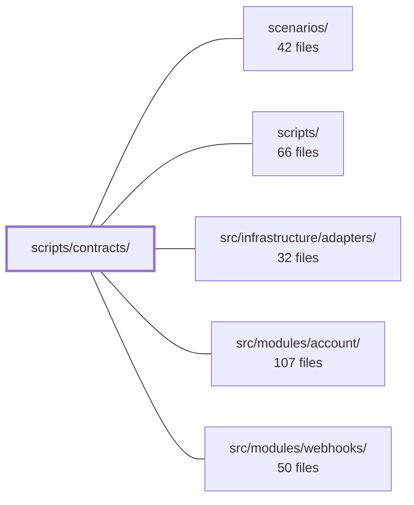

---
tags:
  - 2brain
  - 2brain/module
  - project/boilerplate-node-backend
type: module
module: scripts/contracts/
files: 18
updated: 2026-10-07T23:53:26.155175+00:00
---

# scripts/contracts/

## Purpose

`scripts/contracts/` is the build, validation, and code-generation pipeline for the repository's API contracts. It assembles per-module OpenAPI and AsyncAPI fragments into the committed bundle documents (`openapi.yaml`, `asyncapi.yaml`, `asyncapi.public.yaml`, `shared/authorization-keys.yaml`), generates the TypeScript type modules that runtime code imports, and provides the CI gates that enforce contract stability across pull requests.

## Key parts

- **Bundle building** – `build-bundles.ts` is the CLI entry point (`npm run contracts:bundle`). It iterates the central list in `bundle-registry.ts`, using the shared type/helpers in `bundle-kinds.ts`. `openapi-bundle.ts` compiles the REST spec via `redocly bundle` and post-processes responses, headers, and error codes; `asyncapi-bundles.ts` merges the event documents into the public and internal AsyncAPI bundles; `root-assembly.ts` keeps the root OpenAPI document's `$ref`/tag list in sync with modules on disk; `section-order.ts` pins a stable display order so diffs stay minimal.
- **Authorization key bundling** – `authorization-bundle.ts` splices one fragment per module plus the `core` fragment into `shared/authorization-keys.yaml`, guaranteeing a module's keys disappear when its folder is removed.
- **TypeScript code generation** – `generate-asyncapi-types.ts` emits `src/types/asyncapi.generated.ts` (payload interfaces, channel namespaces, Zod validators); `generate-error-codes.ts` produces the `ERROR_CODES` const object from the OpenAPI `x-error-codes` extension; `generate-permission-actions.ts` (with the pure renderer `permission-actions-render.ts`) turns the authorization YAML's `actions:` block into a shared string-union module; `generate-request-content-types.ts` maps operations to accepted media types for the 415 guard middleware.
- **Validation & CI gates** – `check-asyncapi-breaking.ts` (and its helper `asyncapi-breaking.ts`) fails a PR when the public AsyncAPI bundle narrows a subscriber-facing surface; `validate-asyncapi.ts` is a lightweight drop-in for `asyncapi validate`.
- **Client collections** – `client-collections-bundle.ts` supplies repo-specific metadata (path-to-module ownership, seed bodies, rejection probes) so Bruno, Insomnia, Mockoon, and Postman collections can be regenerated on demand.
- **Shared utility** – `generated-file.ts` provides the common "write a generated file with a header comment" helper used by every generator above.

## How it connects

- **Repository root** – This module is the sole writer of the root-level contract bundles (`openapi.yaml`, `asyncapi.yaml`, `asyncapi.public.yaml`) and `shared/authorization-keys.yaml`, and it emits the TypeScript files under `src/types/` that the rest of the codebase imports.
- **`src/modules/account/`, `src/modules/webhooks/`** (and every other module) – Each module directory holds the source fragments (`openapi.yaml`, `asyncapi.yaml`, `authorization.yaml`) that this module reads. Adding or removing a module folder is the only change needed; the bundles and generated types follow automatically.
- **`src/infrastructure/adapters/`** – Adapters consume the generated artifacts: the AsyncAPI type module for event payload shapes, the request-content-type map for the 415 guard, and the permission-actions union for authorization checks.
- **`scripts/`** – This directory is the contracts sub-tree of the broader `scripts/` collection; sibling scripts (lint, test, deploy) are independent, but CI orchestration typically invokes `npm run contracts:bundle` and the breaking-change check before running them.
- **`scenarios/`** – The client-collection emitters reference the repo's scenario files to supply realistic seed request bodies and rejection probes, tying the collections to the same behavioural examples used in integration tests.

## Where to start

Read `bundle-registry.ts` first — it is the one-line-per-bundle list that tells you exactly which documents exist, where their source fragments live, and which generator builds each one. Then open `build-bundles.ts` to see the ~30-line CLI that wires the registry, the staleness check, and the individual bundle builders together. Together they give you the full map before you dive into any single generator.

## Connected modules

[[boilerplate-node-backend_ROOT|/ (repository root)]] · [[boilerplate-node-backend_scenarios|scenarios/]] · [[boilerplate-node-backend_scripts|scripts/]] · [[boilerplate-node-backend_src_infrastructure_adapters|src/infrastructure/adapters/]] · [[boilerplate-node-backend_src_modules_account|src/modules/account/]] · [[boilerplate-node-backend_src_modules_webhooks|src/modules/webhooks/]]

## Files
- `scripts/contracts/asyncapi-breaking.ts`
- `scripts/contracts/asyncapi-bundles.ts` — Merges one AsyncAPI document per section into two committed bundles: `asyncapi.yaml` (every channel the service has) and `asyncapi.public.yaml` (only channels an API client can reach). The split is driven by a per-section `scope` convention (top-level `asyncapi.yaml` = public, `asyncapi.internal.yaml` = backend-only), so both bundles come from the same source documents and can never disagree. This file performs a shallow copy of five known maps into a root skeleton document, deliberately avoiding `asyncapi bundle`'s `$ref` dereferencing to keep refs intact for the downstream type generator.
- `scripts/contracts/authorization-bundle.ts` — Assembles the committed `shared/authorization-keys.yaml` by text-splicing a root residual file with one fragment per module (`src/modules/<name>/authorization.yaml`) plus the app-level `core` fragment. Replaces the earlier pattern where permission-key definitions lived centrally *and* were hand-listed in each module's manifest; the fragment itself is now the single source of truth, and the bundle guarantees a module's keys vanish when its folder does. Runs via `npm run authorization:bundle`; supports `--check` for CI staleness detection.
- `scripts/contracts/build-bundles.ts` — CLI entry point (`npm run contracts:bundle`) that rebuilds the repo's published API contract bundles from their source fragments. Fragments are the source of truth; the resulting `openapi.yaml`, `asyncapi.yaml`, and `asyncapi.public.yaml` are what downstream tools (spectral, orval, Prism, `check:spec-identity`) consume. Supports a `--check` mode that asserts freshness without writing, and name-based selection to narrow the run.
- `scripts/contracts/bundle-kinds.ts` — Defines the type contract (`ContractBundle`) and a handful of small helpers that every bundle in the registry must satisfy. It encodes the single distinction that drives build ordering—**compiled** bundles (from authored source) run before **generated** bundles (from an already-committed document)—and provides the read/compare/fragment primitives the staleness check and CLI use. No bundle content is built here; each bundle owns its own build.
- `scripts/contracts/bundle-registry.ts` — Central registry of every contract document the repo produces. It defines the complete list of bundles (spec + client-collection artifacts) so that the CLI, the staleness check, and the cross-cutting test can all iterate a single source of truth. Adding a new bundle is one entry here plus its spec file.
- `scripts/contracts/check-asyncapi-breaking.ts` — CI gate that fails a PR if `asyncapi.public.yaml` (the partner-facing webhook event catalogue) drops or narrows something a subscriber already depends on. Compares the working-tree bundle against a base ref (default `origin/main`, overridable via `--base=`) using `@asyncapi/diff`, and exits non-zero when breaking changes are detected within the same major AsyncAPI version.
- `scripts/contracts/client-collections-bundle.ts` — Configuration (not machinery) for generating the four API client collections — Bruno, Insomnia, Mockoon, Postman — on demand via `npm run contracts:bundle`. The traversal and emitters live in `@guebbit/openapi-runnable-collections`; this file supplies the three things only this repo can answer: path-to-module ownership, real seed values for request bodies, and authored rejection probes. The four output files are `.gitignore`d and written to the repo root beside `openapi.yaml`.
- `scripts/contracts/generate-asyncapi-types.ts` — Code-generation script that reads the repo's `asyncapi.yaml` contract and emits `src/types/asyncapi.generated.ts` — TypeScript interfaces for event payloads, channel-namespace constant objects, SSE event-name→payload maps, and (in this backend copy) queue-payload Zod validators. It exists so that runtime event types are always derived from the single AsyncAPI source of truth rather than hand-maintained.
- `scripts/contracts/generate-error-codes.ts` — Generates a TypeScript `error-codes.ts` module (a `const` object + union type) from the `x-error-codes` extension in the shared `openapi.yaml`. It exists so call sites can reference `ERROR_CODES.CART_EMPTY` instead of retyping raw strings, while the contract itself keeps `errors[].code` as an open `string` (CT-D5 / Zalando guideline #112) so adding a code is never a breaking change.
- `scripts/contracts/generate-permission-actions.ts` — CLI script that turns the `actions:` block of an `authorization-keys.yaml` document into a TypeScript module (a runtime string array plus a derived union type). It exists so both repos in the paired frontend/backend setup can generate an identical `permission-actions` module from the same logical YAML source.
- `scripts/contracts/generate-request-content-types.ts` — Generates a TypeScript export (`REQUEST_CONTENT_TYPES`) mapping each OpenAPI operation that declares a `requestBody` to its accepted media types. The output feeds the 415 content-type guard middleware so that request bodies with undeclared types are rejected rather than silently parsed as empty objects. Backend-only; the frontend has no server to guard.
- `scripts/contracts/generated-file.ts`
- `scripts/contracts/openapi-bundle.ts` — Compiles the REST OpenAPI contract from one standalone `openapi.yaml` per module (plus a shared root document) into the single `openapi.yaml` committed at the repo root. It shells out to `redocly bundle`, then runs four post-bundle passes that merge cross-cutting responses, versioning headers, module stamps, and an error-code catalogue into every operation. It also exposes the section/path discovery helpers that other contract tooling (client collections, CI checks) rely on to answer "which module owns which URL?" without re-parsing.
- `scripts/contracts/permission-actions-render.ts` — Pure (filesystem-free) half of the permission-action generator. It validates the `actions:` list out of the shared authorization YAML document and renders the TypeScript source (a const array plus a derived union type) that carries those actions into consuming code. Keeping I/O out of this file lets unit tests exercise the logic without touching disk.
- `scripts/contracts/root-assembly.ts` — Reconciles the root OpenAPI document (`shared/contracts/openapi.root.yaml`) with the module fragments that exist on disk, so that adding or removing a module requires no manual edit outside that module's folder. It prunes stale `$ref` entries, appends new path refs and tags, and returns the corrected YAML text ready for `redocly bundle`.
- `scripts/contracts/section-order.ts` — Provides a single pure function that resolves the display order of per-module sections within a bundle. It exists so that diffs stay small over time: sections keep their historical positions, while new or previously-unknown sections are appended alphabetically. No side effects, no I/O.
- `scripts/contracts/validate-asyncapi.ts` — A lightweight CLI script that validates AsyncAPI documents using the `@asyncapi/parser` package and its default `spectral:asyncapi/recommended` ruleset. It exists as a drop-in replacement for the retired `asyncapi validate` command (from `@asyncapi/cli`), providing identical diagnostics without the ~446 MB dependency and its telemetry.

---
[[boilerplate-node-backend_INDEX|← boilerplate-node-backend index]]
