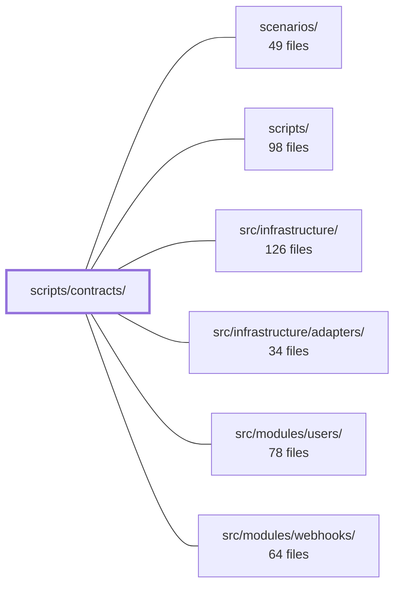

---
tags:
  - 2brain
  - 2brain/module
  - project/boilerplate-node-backend
type: module
module: scripts/contracts/
files: 35
updated: 2026-11-08T10:47:09.453559+00:00
---

# scripts/contracts/

## Purpose

`scripts/contracts/` is the contract-build and code-generation pipeline. It assembles the repo's published OpenAPI, AsyncAPI, and authorization bundles from per-module YAML fragments, then emits TypeScript type files and client-test collections that the application and its consumers depend on. Every step runs through `npm run contracts:bundle` or individual `generate-*` scripts, and a `--check` mode lets CI verify the committed artifacts haven't drifted.

## Key parts

- **Bundle assembly (OpenAPI)** — `openapi-bundle.ts` drives the Redocly-based bundle; `openapi-document.ts` defines the shared `Step` type and walk utilities; the remaining pipeline steps (`openapi-extensions.ts`, `analytics-browser-events.ts`, `cookie-auth.ts`, `fill-enum.ts`, `image-upload-encoding.ts`, `personal-data-assembly.ts`, `response-headers.ts`, `prune-unused.ts`, `root-assembly.ts`, `section-order.ts`) each transform the in-memory document in a fixed order.
- **Bundle assembly (AsyncAPI & authorization)** — `asyncapi-bundles.ts` merges section fragments into the two committed `asyncapi.yaml` files; `asyncapi-section-fragments.ts` handles per-module schema/channel inlining; `asyncapi-webhook-events.ts` indexes webhook fragments; `authorization-bundle.ts` text-splices per-module `authorization.yaml` fragments.
- **Bundle infrastructure** — `bundle-registry.ts` is the single list of all seven bundles; `bundle-kinds.ts` defines their shared identity/type; `build-bundles.ts` is the CLI entry point; `fragments.ts` provides the disk-readers every step uses; `extends-map.ts` centralises `x-extends` validation; `generated-file.ts` is the shared write-or-check tail.
- **Code generation** — `generate-asyncapi-types.ts`, `generate-error-codes.ts`, `generate-permission-vocabulary.ts` (with its pure renderer `permission-vocabulary-render.ts`), `generate-redirect-query.ts`, `generate-request-content-types.ts`, `generate-upload-types.ts`, and `generate-shared-rule-schemas.ts` (with `shared-rules-render.ts`) each read a committed bundle and emit a TypeScript module under `src/` or `api/`.
- **Validation & CI gates** — `check-asyncapi-breaking.ts` and `asyncapi-breaking.ts` detect breaking changes to the partner-facing webhook catalogue; `validate-asyncapi.ts` runs the Spectral AsyncAPI ruleset.
- **Client collections** — `client-collections-bundle.ts` configures the `@guebbit/openapi-runnable-collections` generator for Bruno, Insomnia, Mockoon, and Postman output.

## How it connects

- **Repository root (`/`)** — The committed bundles (`openapi.yaml`, `asyncapi.yaml`, `asyncapi.public.yaml`, `shared/authorization-keys.yaml`, client-collection files) live here; the module reads and rewrites them.
- **`src/modules/users/`, `src/modules/webhooks/`** (and every other module) — Each module directory owns an `openapi.yaml`, `authorization.yaml`, and optionally `asyncapi.webhooks.yaml` fragment that the bundler discovers on disk. Adding or removing a module changes the bundle with no edits outside that folder.
- **`src/infrastructure/` / `src/infrastructure/adapters/`** — The generated TypeScript files (permission vocabulary, error codes, content-types table, asyncapi types) are imported by infrastructure code and adapters at runtime.
- **`scenarios/`** — Consumes the generated client collections and the bundled OpenAPI/AsyncAPI documents for integration-test setup.
- **`scripts/`** (parent) — Houses sibling script groups; `build-bundles.ts` coordinates the full rebuild that other script groups may invoke.

## Where to start

1. **`bundle-registry.ts`** — A short, self-contained list of every bundle and its identity. Reading it first gives you the "what does this repo publish" map before touching any pipeline logic.
2. **`openapi-bundle.ts`** — The main OpenAPI assembly entry point. Walking its ordered `Step` array shows the entire transformation pipeline in one file, and each step it references is a single focused function you can read next.

## Connected modules

[[boilerplate-node-backend_ROOT|/ (repository root)]] · [[boilerplate-node-backend_scenarios|scenarios/]] · [[boilerplate-node-backend_scripts|scripts/]] · [[boilerplate-node-backend_src_infrastructure|src/infrastructure/]] · [[boilerplate-node-backend_src_infrastructure_adapters|src/infrastructure/adapters/]] · [[boilerplate-node-backend_src_modules_users|src/modules/users/]] · [[boilerplate-node-backend_src_modules_webhooks|src/modules/webhooks/]]

## Files
- `scripts/contracts/analytics-browser-events.ts` — Folds module-owned browser-event schemas (from `openapi.browser-events.yaml` fragments) into the `analytics` OpenAPI document, replacing the `AnalyticsEventRequest` placeholder with a `oneOf` discriminated union keyed on the `event` property. It exists as a separate module so the OpenAPI bundler can invoke it in a single call (`withBrowserEvents`) after the base bundle is assembled.
- `scripts/contracts/asyncapi-breaking.ts` — Holds the pure classification logic for detecting breaking changes between two AsyncAPI documents. It is extracted from the CLI entry point so that unit tests can import the function directly without triggering the git workflow or `process.exit` side-effects.
- `scripts/contracts/asyncapi-bundles.ts` — Builds the two committed AsyncAPI bundles — `asyncapi.yaml` (every channel the service owns) and the public-facing subset — by merging per-section YAML documents into a single root document via the `yaml` AST. It deliberately does **not** use `asyncapi bundle` (which dereferences every `$ref`), instead copying five top-level maps and throwing on any key collision so no channel or schema is silently dropped.
- `scripts/contracts/asyncapi-section-fragments.ts` — Discovers, localises, and merges per-module AsyncAPI YAML fragments (e.g. `asyncapi.webhooks.yaml`, `asyncapi.notifications.yaml`) into a single section document. Each module contributes schemas and channels it does not own; this file makes the merged bundle self-contained by inlining referenced REST schemas and appending `x-extends` names to the owner's `oneOf` unions, all while preserving declaration order for the downstream Zod emitter.
- `scripts/contracts/asyncapi-webhook-events.ts` — Discovers and indexes the per-module `asyncapi.webhooks.yaml` fragments so that the AsyncAPI bundler can merge them into the `webhooks` section of the spec. Enforces the same "contract leaves with the module" principle as the OpenAPI side: a deployment that omits a given module automatically omits that module's webhook channels.
- `scripts/contracts/authorization-bundle.ts` — Assembles `shared/authorization-keys.yaml` by text-splicing per-module `authorization.yaml` fragments and a root residual file. Exists so that each module's authorization rules live in its own folder and are dropped automatically when the module is deleted, and so the committed bundle can be verified against its fragments via `npm run regenerate` (or `--check`).
- `scripts/contracts/build-bundles.ts` — CLI entry point (`npm run contracts:bundle`) that rebuilds the repo's published contract bundles (OpenAPI, AsyncAPI, client collections) from their source fragments, or verifies under `--check` that the on-disk copies haven't drifted. It exists so the three consumer tools (Spectral, Orval, Prism) and the spec-identity check always read a bundle that matches the committed fragments.
- `scripts/contracts/bundle-kinds.ts` — Defines the type system for contract bundles (the two kinds, their identity fields) and provides four small utility functions — assemble, read-committed, list-fragments, and a type guard. It intentionally performs no building or concatenation; each bundle owns its own production mechanism. What lives here is only what every bundle has in common: an identity, a way to produce text, and a way to read the committed copy for staleness comparison.
- `scripts/contracts/bundle-registry.ts` — Single canonical list of every contract document this repo produces (7 bundles: 3 authored, 4 generated). The CLI, the staleness check, and the cross-cutting test all iterate this one array, so adding a new bundle is one entry here plus its spec file.
- `scripts/contracts/check-asyncapi-breaking.ts` — CI gate that fails a commit when `asyncapi.public.yaml` (the partner-facing webhook event catalogue) drops or narrows a shape a subscriber already depends on. It compares the working-tree bundle against the bundle rebuilt from the merge-base of the branch, so the comparison reflects "what would this change actually ship" rather than a stale local `main`. Invoked via `npm run check` or `npx tsx scripts/contracts/check-asyncapi-breaking.ts --base=HEAD~3`.
- `scripts/contracts/client-collections-bundle.ts` — Repo-specific configuration that feeds the `@guebbit/openapi-runnable-collections` generator to produce the four client collections (`contract.{bruno,insomnia,mockoon,postman}.*`). It answers the three questions only this codebase can: which module owns which path, which seeded values fill request bodies and path params, and which authored probes demonstrate rejections. The actual traversal, example synthesis, and tool emitters live in the external package.
- `scripts/contracts/cookie-auth.ts` — Post-bundle step that augments every OpenAPI operation using `bearerAuth` with a `cookieAuth` security alternative and a `403` response (for unsafe methods). It exists so the cookie-based auth contract and its origin-refusal semantics are derived mechanically from the existing `bearerAuth` declaration rather than hand-written per operation.
- `scripts/contracts/extends-map.ts` — Centralizes parsing and validation of a fragment's `x-extends` map so that OpenAPI and AsyncAPI consumers share one implementation. This guarantees that a malformed map, a repeated schema name, or an undeclared variant is rejected identically on both sides rather than being silently dropped in one format and thrown in the other.
- `scripts/contracts/fill-enum.ts` — Post-bundle step that resolves `x-enum-from` placeholders in an OpenAPI document by substituting the enum values from a named source list (e.g. channel names collected from every module's `asyncapi.webhooks.yaml`). It exists to avoid hand-copying values into contract fragments, which would drift the moment a module adds one.
- `scripts/contracts/fragments.ts` — Typed, cache-free disk readers for the two per-module contract files (`openapi.yaml` and `authorization.yaml`). It exists so every build step shares one set of interfaces and load functions instead of each declaring its own throwaway shape for the few keys it inspects.
- `scripts/contracts/generate-asyncapi-types.ts` — Backend code-generation script that reads `asyncapi.yaml` and emits `src/types/asyncapi.generated.ts` containing payload interfaces, message aliases, per-namespace channel constants/unions, SSE event-name/payload maps, and queue-payload Zod validators. It is the backend half of a two-repo shared generator (the frontend copy additionally inlines a JSON-Schema map for runtime SSE-frame validation). Supports `--check` mode for CI gating without writing.
- `scripts/contracts/generate-error-codes.ts` — Generates a TypeScript constants object (`ERROR_CODES`) and a derived string-union type (`ErrorCode`) from the `x-error-codes` extension field in the shared `openapi.yaml`. It exists so call sites can reference typed error-code names (with hover-able status/description) instead of retyping raw strings, while keeping the contract's `errors[].code` as a plain `type: string` (no `enum`) per Zalando API guideline #112.
- `scripts/contracts/generate-permission-vocabulary.ts` — Generates a TypeScript `permission-vocabulary` module (runtime arrays + union types for actions, subjects, rule ids, set names, scopes, step-up tiers, and the subject-to-actions pair map) from an `authorization-keys.yaml` document. It exists so both the backend and frontend repos share identical, type-safe permission identifiers derived from a single source-of-truth YAML file.
- `scripts/contracts/generate-redirect-query.ts` — Generates a TypeScript constant (`REDIRECT_QUERY_ENUMS`) that lists every query-parameter value a redirect may emit, extracted from the `x-redirect-query` vendor extension on `302` responses in `openapi.yaml`. This gives the frontend (and any other consumer) a typed, closed set of values—most notably the OAuth callback `?error=` codes—without duplicating the definition.
- `scripts/contracts/generate-request-content-types.ts` — Code-generation script that reads `openapi.yaml` and emits two TypeScript files under `api/`: a request content-types table consumed by the 415 Content-Type guard, and an operation-routes table consumed by the 405 Method-Not-Allowed handler. Both files carry pre-compiled regex literals so the runtime guards never build a matcher at boot. Rebuilt from scratch by `npm run gen:api`.
- `scripts/contracts/generate-shared-rule-schemas.ts` — One-step regeneration script that derives two artifacts from shared-rules YAML files: (1) JSON Schema files under `shared/<folder>/schemas/` for the PHP side (which has no Zod), and (2) committed `as const` TypeScript files for modules that type unions or plain numbers. It auto-discovers module-owned rules and `module.yaml` data blocks rather than requiring a manual list. Supports a `--check` mode (via `writeOrCheck`) that reports staleness instead of rewriting.
- `scripts/contracts/generate-upload-types.ts` — Reads the bundled `openapi.yaml` contract, extracts the single `imageUpload` contentType shared across all multipart upload bodies, and emits a small TypeScript file exporting `ACCEPTED_UPLOAD_TYPES` (a `const` tuple) and `AcceptedUploadType` (a union type). This makes the OpenAPI contract the single source of truth for which media types the backend's `fileFilter` and the frontend's file picker accept.
- `scripts/contracts/generated-file.ts` — Shared write-or-verify tail that every contract generator ends with. It centralizes the final step of writing a generated file to disk (or, under `--check`, comparing expected output against what is already on disk) so generators don't each reimplement the I/O and error-reporting logic.
- `scripts/contracts/image-upload-encoding.ts` — Stamps a single `encoding.imageUpload.contentType` value onto every multipart request body in the OpenAPI document that declares an `imageUpload` schema property. The accepted MIME types are declared once at the document root (`x-image-upload-types`) and then distributed, eliminating hand-copied strings that can drift. Runs as a pipeline step during bundle assembly.
- `scripts/contracts/openapi-bundle.ts` — Compiles the single committed `openapi.yaml` REST contract from per-module standalone OpenAPI documents. It runs `redocly bundle` (via `execFileSync`) to resolve cross-module `$ref`s, then applies an ordered sequence of in-memory transformation steps (`Step = (document) => void`) to the one parsed object before writing the final YAML. This exists so each module owns a complete, valid document on disk while the published contract remains a single file.
- `scripts/contracts/openapi-document.ts` — Shared foundation for the OpenAPI bundler pipeline. Defines the document type, the `Step` contract, and a small set of utilities (parse, flatten operations, detect security-open methods) that every bundler step relies on so they don't each re-import `openapi-types` or re-implement the walk over `paths`.
- `scripts/contracts/openapi-extensions.ts` — Implements the `x-extends` mechanism that lets one module append values to another module's enum or add variants to another module's `oneOf` union. It discovers fragment files (`openapi.<owner>.yaml`) from disk, validates them against the owner's contract, stages their schemas as `$ref`s for Redocly resolution, and merges the appended values/variants into the bundled OpenAPI document. It is a post-bundle step alongside the other steps in `openapi-bundle`.
- `scripts/contracts/permission-vocabulary-render.ts` — Pure (no-filesystem) half of the permission-vocabulary code generator. It parses a shared `authorization-keys.yaml` document into a structured `PermissionVocabulary` and then renders the TypeScript module that exports the resulting closed lists, union types, and the subject-to-actions pair map. Because it performs no I/O, unit tests can exercise it in isolation.
- `scripts/contracts/personal-data-assembly.ts` — Assembles the `POST /account/export` response schema by collecting `x-personal-data` declarations from each contributing module's `openapi.yaml` and merging them into the `account` module's `AccountExportResponse` stub. This eliminates a hand-maintained list of export sections: adding or removing a module automatically adds or removes its section.
- `scripts/contracts/prune-unused.ts` — Final pipeline step that removes every OpenAPI component (schema, response, parameter, security scheme, etc.) and every tag that nothing in the live document references. Without it, a deleted module leaves orphaned shared components in the published contract. It is deliberately the **last** step because earlier steps inject references (ETag, If-Match, 413/415 responses) that an earlier prune would wrongly delete.
- `scripts/contracts/response-headers.ts` — Provides two late-stage OpenAPI document transformation steps that stamp response headers onto the bundled `openapi.yaml` without requiring per-operation duplication. Because these headers are set by middleware (not route handlers), a hand-copied list on every operation would go stale silently; stamping them once at bundle time keeps the published contract in sync with actual behavior.
- `scripts/contracts/root-assembly.ts` — Assembles the root OpenAPI document by reconciling `shared/contracts/openapi.root.yaml` with whatever module fragments actually exist on disk. This is the mechanism behind "adding a module edits nothing outside its folder": the root's path index, tag list, and `x-tagGroups` are kept in sync automatically, so a new or deleted module requires zero manual edits to the root.
- `scripts/contracts/section-order.ts` — Provides a single pure function that resolves the final order of per-module sections in a bundle. It preserves a "preferred" (historical) ordering for sections that actually exist on disk, while gracefully dropping missing modules and appending any newly-discovered sections alphabetically. This keeps generated bundle diffs—and their PHP/frontend twins—small and stable over time.
- `scripts/contracts/shared-rules-render.ts` — Pure, filesystem-free renderer that turns a parsed shared-rules document plus a `GenerateSpec` into the text of a `.generated.ts` module. It is the "render" half of the code generator, kept separate so unit tests can call it without touching disk.
- `scripts/contracts/validate-asyncapi.ts` — A CLI script that validates one or more AsyncAPI documents against the `@asyncapi/parser` default Spectral ruleset (`spectral:asyncapi/recommended`). It exists as a lightweight replacement for `asyncapi validate` now that `@asyncapi/cli` (~446 MB, telemetry) is no longer used. Invoked via `npm run lint:asyncapi`.

---
[[boilerplate-node-backend_INDEX|← boilerplate-node-backend index]]
