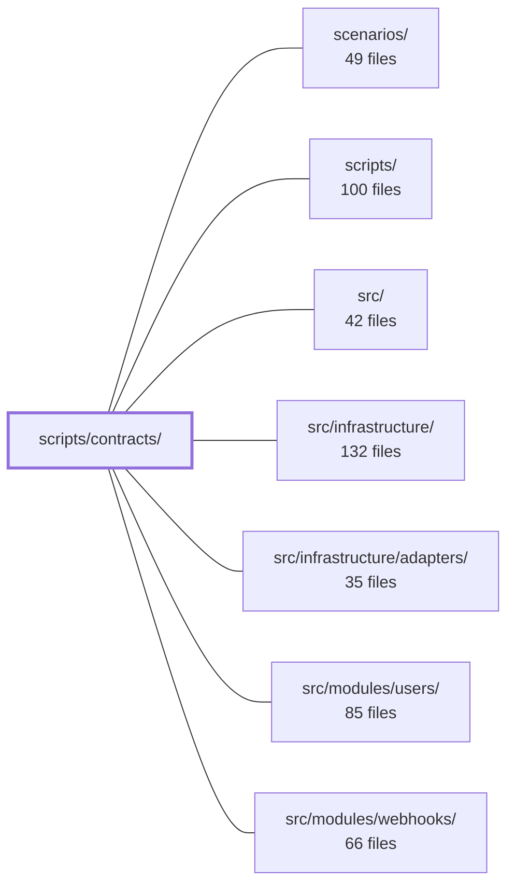

---
tags:
  - 2brain
  - 2brain/module
  - project/boilerplate-node-backend
type: module
module: scripts/contracts/
files: 37
updated: 2026-11-15T00:28:27.353752+00:00
---

# scripts/contracts/

## Purpose

`scripts/contracts/` is the contract-building and code-generation pipeline for the repository. It discovers per-module spec fragments (OpenAPI, AsyncAPI, authorization rules) on disk, merges them into the committed bundle documents that external tooling (Spectral, Orval, Prism, the PHP backend) consumes, and emits derived TypeScript modules so runtime code always reflects the declared API surface. A single CLI entry point (`build-bundles.ts`) drives the whole process; a `--check` mode lets CI detect drift between committed bundles and source fragments.

## Key parts

- **CLI entry & registry** — `build-bundles.ts` (the `npm run contracts:bundle` entry), `bundle-registry.ts` (single list of every bundle), and `bundle-kinds.ts` (shared type contract for Compiled vs. Generated bundles). Adding a new bundle is one registry entry plus its spec file.
- **OpenAPI bundling pipeline** — `openapi-bundle.ts` orchestrates `redocly bundle` over per-module `openapi.yaml` files, then runs an ordered list of in-place steps. Supporting pieces include `root-assembly.ts` (auto-prunes/appends `$ref`s so module add/remove needs no external edit), `openapi-document.ts` (shared types, parse guard, operation walk), `openapi-extensions.ts` (cross-module enum/union extension mechanism), `cookie-auth.ts`, `fill-enum.ts`, `permission-security.ts`, `prune-unused.ts`, `response-headers.ts`, `image-upload-encoding.ts`, and `analytics-browser-events.ts`.
- **AsyncAPI bundling** — `asyncapi-bundles.ts` (merges section documents into `asyncapi.yaml` + `asyncapi.public.yaml`), `asyncapi-section-fragments.ts` (discovers and inlines per-module webhook/notification fragments), and `asyncapi-webhook-events.ts` (indexes webhook fragments for the `webhooks` section).
- **Code generators** — Each reads a committed bundle and emits a TypeScript module consumed by `src/` or the PHP twin: `generate-asyncapi-types.ts`, `generate-error-codes.ts`, `generate-permission-vocabulary.ts` (+ `permission-vocabulary-render.ts`), `generate-redirect-query.ts`, `generate-request-content-types.ts`, `generate-shared-rule-schemas.ts` (+ `shared-rules-render.ts`), `generate-upload-types.ts`. All share `generated-file.ts` for the write-or-verify tail.
- **Validation & breaking-change gates** — `check-asyncapi-breaking.ts` (CI gate comparing working tree to merge-base), `asyncapi-breaking.ts` (pure classification logic, unit-testable), `validate-asyncapi.ts` (Spectral-based lint replacing the heavy `@asyncapi/cli`).
- **Authorization & client tooling** — `authorization-bundle.ts` (splices per-module auth rules into the shared YAML consumed by PHP), `client-collections-bundle.ts` (config for the Bruno/HAR collection generator).
- **Shared utilities** — `fragments.ts` (typed disk readers), `extends-map.ts` (validation of `x-extends`), `section-order.ts` (stable section ordering), `run-with-timeout.ts` (hard-kill wrapper for child processes), `personal-data-assembly.ts` (account-export schema stitching).

## How it connects

- **`src/modules/*` (e.g. `users`, `webhooks`)** — Each module owns its `openapi.yaml`, `asyncapi.webhooks.yaml`, and `authorization.yaml` fragments. This module reads them from disk; no code in `src/` imports the bundling scripts at runtime. Deleting a module folder automatically removes its contribution from every bundle.
- **`src/infrastructure/` and `src/infrastructure/adapters/`** — The generated TypeScript files (`asyncapi.generated.ts`, `error-codes.ts`, `permission-vocabulary.ts`, `request-content-types.ts`, etc.) are consumed by middleware, adapters, and type-checking across the infrastructure layer.
- **`src/` (top-level)** — `generate-asyncapi-types.ts` and `generate-permission-vocabulary.ts` emit files into `src/types/` and shared locations; the rest of `src/` imports those generated modules.
- **`scenarios/`** — Contract bundles (especially `openapi.yaml` and `asyncapi.public.yaml`) are the specification against which integration test scenarios are authored and validated.
- **Repository root** — The committed bundle files (`shared/contracts/openapi.yaml`, `asyncapi.yaml`, `shared/authorization-keys.generated.yaml`) live at the repo root and are the artifacts this module keeps in sync with the per-module fragments.

## Where to start

1. **`build-bundles.ts`** — Read this first to see the top-level flow: which bundles are built in what order, how `--check` works, and where each generator is invoked.
2. **`openapi-bundle.ts`** — Once the CLI is clear, this file shows the OpenAPI pipeline in detail: how `redocly bundle` is called, what the ordered `bundleSteps` do, and how per-module fragments get merged. Understanding this pipeline makes the individual step files (cookie-auth, prune-unused, etc.) self-explanatory.

## Connected modules

[[boilerplate-node-backend_ROOT|/ (repository root)]] · [[boilerplate-node-backend_scenarios|scenarios/]] · [[boilerplate-node-backend_scripts|scripts/]] · [[boilerplate-node-backend_src|src/]] · [[boilerplate-node-backend_src_infrastructure|src/infrastructure/]] · [[boilerplate-node-backend_src_infrastructure_adapters|src/infrastructure/adapters/]] · [[boilerplate-node-backend_src_modules_users|src/modules/users/]] · [[boilerplate-node-backend_src_modules_webhooks|src/modules/webhooks/]]

## Files
- `scripts/contracts/analytics-browser-events.ts` — Discovers per-module browser-event OpenAPI fragments from disk and folds them into the `analytics` service's `AnalyticsEventRequest` schema, replacing it with a `oneOf` discriminated union on the `event` property. It exists so each module's browser-event contract lives alongside that module on disk, and the OpenAPI bundler needs only a single call (`withBrowserEvents`) to incorporate them.
- `scripts/contracts/asyncapi-breaking.ts` — Holds the pure classification logic for detecting breaking changes between two AsyncAPI documents. It is extracted from the CLI entry point so that unit tests can import the function directly without triggering the git workflow or `process.exit` side-effects.
- `scripts/contracts/asyncapi-bundles.ts` — Merges per-section AsyncAPI documents into two committed bundles — `asyncapi.yaml` (every channel the service exposes) and a public bundle (only the channels an API client can reach). The split is driven by a `scope` field per section, so both bundles derive from the same sources and can never disagree. Deliberately avoids the `asyncapi bundle` CLI (which dereferences `$ref`s) and instead copies five top-level maps via the YAML AST, throwing on any key collision to prevent silent channel loss.
- `scripts/contracts/asyncapi-section-fragments.ts` — Discovers, localises, and merges per-module AsyncAPI YAML fragments (e.g. `asyncapi.webhooks.yaml`, `asyncapi.notifications.yaml`) into a single section document. Each module contributes schemas and channels it does not own; this file makes the merged bundle self-contained by inlining referenced REST schemas and appending `x-extends` names to the owner's `oneOf` unions, all while preserving declaration order for the downstream Zod emitter.
- `scripts/contracts/asyncapi-webhook-events.ts` — Discovers and indexes the per-module `asyncapi.webhooks.yaml` fragments so that the AsyncAPI bundler can merge them into the `webhooks` section of the spec. Enforces the same "contract leaves with the module" principle as the OpenAPI side: a deployment that omits a given module automatically omits that module's webhook channels.
- `scripts/contracts/authorization-bundle.ts` — Assembles the committed `shared/authorization-keys.generated.yaml` by splicing together per-module authorization fragments and a root residual file. Each rule/set lives in its own module's `authorization.yaml`, so deleting a module drops its rules automatically. The assembled file is also consumed by a PHP backend, which is why the splice is done as raw text rather than a YAML AST merge.
- `scripts/contracts/build-bundles.ts` — CLI entry point (`npm run contracts:bundle`) that rebuilds the repo's published contract bundles (OpenAPI, AsyncAPI, client collections) from their source fragments, or verifies under `--check` that the on-disk copies haven't drifted. It exists so the three consumer tools (Spectral, Orval, Prism) and the spec-identity check always read a bundle that matches the committed fragments.
- `scripts/contracts/bundle-kinds.ts` — Defines the shared type contract that every entry in the bundle registry must satisfy. It distinguishes two kinds of bundles — **Compiled** (built from authored source files) and **Generated** (derived from an already-committed document) — and provides the three operations common to all: identity metadata, producing the document text, and reading the committed copy for staleness comparison. This file performs no building or concatenation; each bundle owns its own build mechanism.
- `scripts/contracts/bundle-registry.ts` — Central registry of every contract bundle this repo produces (authored specs and generated client collections). It exists so the CLI, the staleness check, and the cross-cutting test can all iterate one list instead of hard-coding bundle names in three places. Adding a new bundle is a single entry here plus its spec file.
- `scripts/contracts/check-asyncapi-breaking.ts` — A commit/CI gate that fails when `asyncapi.public.yaml` — the partner-facing webhook event catalogue — drops or narrows a channel, event, or field a subscriber already depends on. It compares the working-tree bundle against the bundle rebuilt from the merge-base commit (default `origin/main`), so the diff reflects what this branch actually ships relative to main, not a stale local copy.
- `scripts/contracts/client-collections-bundle.ts` — Configuration (not machinery) for generating an API client collection from the OpenAPI contract. The traversal, example synthesis, and emitters live in `@guebbit/openapi-runnable-collections`; this file supplies the three things only this repo can answer: which module owns which path, where realistic example values (credentials, IDs) come from, and which rejection probes each module declares. Output is generated on demand (`npm run contracts:bundle -- bruno`) and gitignored.
- `scripts/contracts/cookie-auth.ts` — Post-bundle step that augments every OpenAPI operation using `bearerAuth` with a `cookieAuth` security alternative and a `403` response (for unsafe methods). It exists so the cookie-based auth contract and its origin-refusal semantics are derived mechanically from the existing `bearerAuth` declaration rather than hand-written per operation.
- `scripts/contracts/extends-map.ts` — Centralises the parsing and validation of a fragment's `x-extends` map so that OpenAPI and AsyncAPI tooling apply identical rules (must be a map of non-empty, duplicate-free string lists; every referenced name must be declared in the fragment). Without this shared module, the two formats could diverge on what counts as a malformed map.
- `scripts/contracts/fill-enum.ts` — Post-bundle step that replaces `x-enum-from` placeholder markers in OpenAPI contract fragments with concrete enum values sourced from elsewhere (e.g., webhook event names scattered across modules' `asyncapi.webhooks.yaml`). This avoids copy-paste drift: a module can declare "my enum comes from the *webhook-events* source" without hard-coding values that would go stale when another module adds one.
- `scripts/contracts/fragments.ts` — Typed, cache-free disk readers for the two per-module contract files (`openapi.yaml` and `authorization.yaml`). It exists so every build step shares one set of interfaces and load functions instead of each declaring its own throwaway shape for the few keys it inspects.
- `scripts/contracts/generate-asyncapi-types.ts` — Generates the backend's TypeScript realtime contract types (`src/types/asyncapi.generated.ts`) from `asyncapi.yaml`. It reads the full AsyncAPI 3.0 document and emits payload interfaces, message aliases, per-namespace channel constants/unions, SSE event-name/payload maps, and queue-payload Zod validators. A `--check` flag supports CI gating (writes nothing, exits 1 on drift).
- `scripts/contracts/generate-error-codes.ts` — Generates `error-codes.ts` — a `const` object (`ERROR_CODES`) and its derived union type (`ErrorCode`) — from the `x-error-codes` extension in `openapi.yaml`. The catalogue exists so call sites can reference codes by name (compiler catches typos/removed codes) while the wire contract stays open-ended (`code: string`, no `enum`), making new codes additive rather than breaking. The script is byte-identical in both repos of the pair.
- `scripts/contracts/generate-permission-vocabulary.ts` — CLI script that generates a TypeScript `permission-vocabulary` module (runtime arrays + union types for actions, subjects, rule ids, set names, scopes, step-up tiers, and the subject-to-actions pair map) from an `authorization-keys.generated.yaml` file. It exists so both the backend and frontend repos can derive identical vocabulary types from the same YAML document.
- `scripts/contracts/generate-redirect-query.ts` — Extracts the closed enum sets that a redirect encodes in its query string from `openapi.yaml` and emits a TypeScript constant (`REDIRECT_QUERY_ENUMS`). It walks every operation's responses for the `x-redirect-query` vendor extension and produces a lookup of `operationId → parameterName → string[]`. The primary use-case is the OAuth callback's `?error=` codes, where the redirect is the only channel a client learns why a round-trip failed.
- `scripts/contracts/generate-request-content-types.ts` — Builds two generated TypeScript files from `openapi.yaml`: a **request content-type table** (one row per write operation with its accepted media types, consumed by the 415 `content-type` middleware) and an **operation-routes table** (one row per path with its declared methods, owning module, and security-open methods, consumed by the 405 `method-not-allowed` middleware). Both files carry pre-compiled regex literals so the runtime never builds matchers at boot.
- `scripts/contracts/generate-shared-rule-schemas.ts` — One-shot regeneration script (run via `npm run regenerate`) that derives two artifact families from the shared-rules YAML files: JSON Schema exports (for the PHP twin, which has no Zod) and committed `as const` TypeScript data files (for union types, plain numbers, and module-level data blocks). Supports a `--check` mode that reports staleness without rewriting.
- `scripts/contracts/generate-upload-types.ts` — Extracts the single accepted upload media-type list from the bundled `openapi.yaml` (the `encoding.imageUpload.contentType` field on every multipart request body) and emits a small TypeScript module exporting a frozen array and a union type. It exists so the backend's `fileFilter` and the frontend's file picker share one canonical source for "what can be uploaded," with a `--check` mode for CI drift detection.
- `scripts/contracts/generated-file.ts` — Shared write-or-verify tail that every contract generator ends with. It centralizes the final step of writing a generated file to disk (or, under `--check`, comparing expected output against what is already on disk) so generators don't each reimplement the I/O and error-reporting logic.
- `scripts/contracts/image-upload-encoding.ts` — Stamps a single `encoding.imageUpload.contentType` value onto every multipart request body in the OpenAPI document that declares an `imageUpload` schema property. The accepted MIME types are declared once at the document root (`x-image-upload-types`) and then distributed, eliminating hand-copied strings that can drift. Runs as a pipeline step during bundle assembly.
- `scripts/contracts/openapi-bundle.ts` — Compiles the project's single REST contract (`openapi.yaml`) from per-module standalone OpenAPI documents. It invokes `redocly bundle` to merge the module files with the shared root, then applies an ordered list of in-place transformation steps (`bundleSteps`) to the one parsed document before writing the final artifact. This exists so that adding or removing a module is simply adding or deleting a folder, and so that cross-cutting concerns (default responses, versioning headers, enum filling, extension schemas) are applied once, uniformly, after `$ref` resolution.
- `scripts/contracts/openapi-document.ts` — Shared type definitions and two utility functions that every OpenAPI bundler step depends on. It defines the `OpenApiDocument` type (an OpenAPI 3.1 document augmented with the project's vendor extensions), the `Step` function signature, and provides the single YAML parse guard and the single operation-walk so no step re-implements either.
- `scripts/contracts/openapi-extensions.ts` — Implements the contract-extension mechanism that lets one module append values to another module's open enums or variants to its `oneOf` unions. It discovers `openapi.<owner>.yaml` fragment files on disk, validates them against the owner's declared schemas, and provides steps that integrate the extensions into the bundled OpenAPI document (enum filling, union variant appending, and redocly-mediated `$ref` resolution).
- `scripts/contracts/permission-security.ts` — A bundler step that derives the 401/403 error codes implied by the permission names in each operation's OpenAPI `security` requirements and merges them into `x-error-codes`. It exists so that contract fragments never have to hand-list permission-driven codes: the bundler reads the standard OAS 3.1 scopes slot and writes the codes automatically.
- `scripts/contracts/permission-vocabulary-render.ts` — The pure (I/O-free) half of the permission-vocabulary generator. It reads the closed authorization lists from a shared YAML document (`authorization-keys.generated.yaml`), validates them, and renders the TypeScript module that re-exports those lists as `as const` arrays plus derived union types. Keeping it free of filesystem calls lets unit tests exercise the full parse → validate → render pipeline in isolation.
- `scripts/contracts/personal-data-assembly.ts` — Assembles the `POST /account/export` response schema by collecting `x-personal-data` declarations from each contributing module's `openapi.yaml` and merging them into the `account` module's `AccountExportResponse` stub. This eliminates a hand-maintained list of export sections: adding or removing a module automatically adds or removes its section.
- `scripts/contracts/prune-unused.ts` — Final pipeline step that removes every OpenAPI component no operation or other component references, plus every tag no operation uses. It exists because deleting an API module orphans its components (security schemes, schemas, responses) in the shared root document, and the published contract must not describe what the deployment no longer has.
- `scripts/contracts/response-headers.ts` — Stamps two categories of response headers onto the bundled OpenAPI document as a late pipeline step: app-level headers that middleware sets on every response, and the `Idempotent-Replayed` header on idempotent operations. Exists so these headers are derived from a single source of truth rather than hand-copied onto every operation, where they would silently go stale.
- `scripts/contracts/root-assembly.ts` — Assembles the root OpenAPI document from the module fragments that exist on disk. Given the text of `shared/contracts/openapi.root.yaml` and the set of module fragments, it returns the completed YAML text ready for `redocly bundle`. It enforces the invariant that adding or removing a module requires no edit outside that module's folder: stale `$ref` entries are pruned, new ones appended, and the tag list is kept in sync automatically.
- `scripts/contracts/run-with-timeout.ts` — Provides a thin wrapper around Node's `execFileSync` that enforces a hard wall-clock timeout on a child process. When the timeout expires the child is killed with `SIGKILL` and a dedicated `CommandTimeoutError` is thrown, so callers in the contract-checking pipeline can distinguish "command hung" from "command failed" without parsing generic `ETIMEDOUT` strings.
- `scripts/contracts/section-order.ts` — Provides a single pure function that resolves the final order of per-module sections in a bundle. It preserves a "preferred" (historical) ordering for sections that actually exist on disk, while gracefully dropping missing modules and appending any newly-discovered sections alphabetically. This keeps generated bundle diffs—and their PHP/frontend twins—small and stable over time.
- `scripts/contracts/shared-rules-render.ts` — Pure rendering half of the shared-rules code generator. Given a parsed rules document and a `GenerateSpec`, it produces the full text of a `.generated.ts` module. No filesystem access, so unit tests can exercise it in isolation.
- `scripts/contracts/validate-asyncapi.ts` — A CLI script that validates one or more AsyncAPI documents against the `@asyncapi/parser` default Spectral ruleset (`spectral:asyncapi/recommended`). It exists as a lightweight replacement for `asyncapi validate` now that `@asyncapi/cli` (~446 MB, telemetry) is no longer used. Invoked via `npm run lint:asyncapi`.

---
[[boilerplate-node-backend_INDEX|← boilerplate-node-backend index]]
