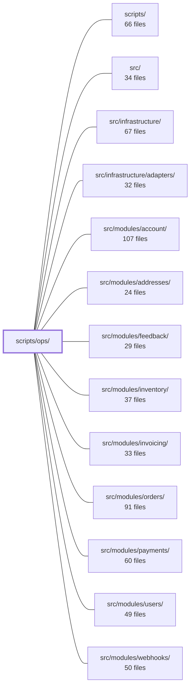

---
tags:
  - 2brain
  - 2brain/module
  - project/boilerplate-node-backend
type: module
module: scripts/ops/
files: 24
updated: 2026-10-07T23:53:47.990527+00:00
---

# scripts/ops/

## Purpose

`scripts/ops/` holds every operational and maintenance script that runs outside the HTTP request lifecycle. The scripts fall into three families: **reap** jobs that enforce data-retention and data-minimisation (GDPR Art. 5, 17), **sweep** jobs that retry or complete side-effects a crashed or timed-out request left half-done, and a **demo-removal pipeline** that irreversibly strips the shop-module demo checkout from a working tree. Each script is wired to an `npm run` alias in the root `package.json` and is intended to be driven by a scheduler (cron, container task) or run once by hand.

## Key parts

- **Demo-removal pipeline** — `demo-remove.ts` is the CLI entry point (`npm run demo:remove`). It orchestrates sibling steps: `demo-remove-modules.ts` (generic folder/registry deletion shared with the locale recipe), `demo-remove-registry.ts` (edits `src/modules.ts`, `package.json`, `docker/crontab`), `demo-remove-authorization.ts` (prunes shared auth YAML), `demo-remove-contract.ts` (strips shop fields from the OpenAPI root), `demo-remove-scenarios.ts` (deletes shop scenario files and edits shared scenario literals), and `demo-remove-tests.ts` (deletes test files that import removed modules).
- **Reap (retention) jobs** — `reap-inactive-accounts.ts` (three-stage warn → soft-delete → hard-delete), `reap-orders.ts` (anonymises PII in orders, never deletes the row), `reap-payments.ts` (deletes abandoned payment attempts), `reap-mail-spool.ts` (purges stale spooled attachments), `reap-quarantine.ts` (deletes orphaned quarantine files), `reap-invoice-pdfs.ts`, `reap-account-exports.ts`, `reap-expired-tokens.ts`, `reap-orphaned-images.ts`.
- **Sweep (retry/backstop) jobs** — `sweep-outbox.ts` (publishes due outbox events, runs every minute), `sweep-payment-effects.ts` (retries settlement commits and stuck refunds), `sweep-order-effects.ts` (re-emits `ORDER_REFUND_OWED` for pending refund markers), `sweep-reservations.ts` (expires stale inventory holds), `sweep-webhook-retries.ts` (wakes due webhook retry rows).
- **One-off maintenance** — `refresh-breached-passwords.ts` (rebuilds the SecLists-derived blocklist when the `PasswordNew` pattern changes), `reencrypt.ts`, `corpus-digest.ts`.

## How it connects

- **`/` (repository root)** — every script is launched through an `npm run` alias declared in the root `package.json`; `demo-remove-registry.ts` edits that same file to strip module-specific script lines.
- **`src/`** — the scripts read and mutate source-tree artefacts: `src/modules.ts` (registry), `shared/contracts/openapi.root.yaml` (contract), `shared/authorization-*.yaml` (auth), scenario files, and test files under `src/modules/*/`.
- **`src/infrastructure/` and `src/infrastructure/adapters/`** — reap and sweep scripts obtain database handles and configuration (retention-day thresholds, feature flags) through the shared infrastructure layer rather than opening connections directly.
- **`src/modules/orders/`** — `reap-orders.ts` performs the PII-replacement step that the `personalData.erase` hook in the orders module only schedules; `sweep-order-effects.ts` re-emits the refund marker that `cancelById` originally fired.
- **`src/modules/payments/`** — `reap-payments.ts` deletes rows the payments module created; `sweep-payment-effects.ts` retries settlement effects and refunds that the payments module could not complete.
- **`src/modules/inventory/`** — `sweep-reservations.ts` is the sole automated caller for expiring stale reservation holds that the inventory module's admin route would otherwise have to trigger manually.
- **`src/modules/webhooks/`** — `sweep-webhook-retries.ts` implements the periodic "wake due rows" half of the webhook retry design documented in `docs/modules/webhooks.md`.
- **`src/modules/account/`, `src/modules/users/`, `src/modules/addresses/`, `src/modules/feedback/`, `src/modules/invoicing/`** — reap scripts target the data these modules own (inactive accounts, address PII, feedback records, invoice PDFs, account exports).
- **`scripts/`** — parent directory; sibling operational and build scripts live alongside.

## Where to start

1. **`demo-remove.ts`** — it is the longest script in the directory and the only one that wires the other `demo-remove-*.ts` files into a sequence. Reading it top-to-bottom shows the whole pipeline, the ordering constraints, and how the generic `demo-remove-modules.ts` is reused by a second (locale) entry point.
2. **`reap-inactive-accounts.ts`** — of the many reap scripts it has the most business logic (three progressive stages, a configurable threshold, a `NODE_INACTIVE_ACCOUNT_DAYS` kill-switch) and makes the GDPR rationale explicit, giving a newcomer the mental model for *why* the reap family exists before tackling the simpler one-liner sweeps.

## Connected modules

[[boilerplate-node-backend_ROOT|/ (repository root)]] · [[boilerplate-node-backend_scripts|scripts/]] · [[boilerplate-node-backend_src|src/]] · [[boilerplate-node-backend_src_infrastructure|src/infrastructure/]] · [[boilerplate-node-backend_src_infrastructure_adapters|src/infrastructure/adapters/]] · [[boilerplate-node-backend_src_modules_account|src/modules/account/]] · [[boilerplate-node-backend_src_modules_addresses|src/modules/addresses/]] · [[boilerplate-node-backend_src_modules_feedback|src/modules/feedback/]] · [[boilerplate-node-backend_src_modules_inventory|src/modules/inventory/]] · [[boilerplate-node-backend_src_modules_invoicing|src/modules/invoicing/]] · [[boilerplate-node-backend_src_modules_orders|src/modules/orders/]] · [[boilerplate-node-backend_src_modules_payments|src/modules/payments/]] · [[boilerplate-node-backend_src_modules_users|src/modules/users/]] · [[boilerplate-node-backend_src_modules_webhooks|src/modules/webhooks/]]

## Files
- `scripts/ops/corpus-digest.ts`
- `scripts/ops/demo-remove-authorization.ts` — Handles the authorization cleanup step of demo-module removal. It reads permission keys and subjects from the modules' `authorization.yaml` fragments **before** those folders are deleted, then performs surgical text edits (not YAML round-trips) on the two hand-maintained shared files—`shared/authorization-roles.yaml` and `shared/authorization-conformance.yaml`—to remove the now-orphaned grants and cases.
- `scripts/ops/demo-remove-contract.ts` — Step 2 of 3 in the G-D2 demo-module removal flow. Edits `shared/contracts/openapi.root.yaml` to strip the seven shop-module fields (`orders`, `payments`, `shipments`, `cart`, `wishlist`, `invoicing`, `returns`) from `AccountExportResponse`, since `account`'s own fragment cannot name a sibling module's schema. This is a contract change: the caller must still run `npm run regenerate` afterward.
- `scripts/ops/demo-remove-modules.ts` — Generic "remove a set of module folders from the checkout" routine. It handles every step that is module-agnostic—deleting folders, stripping registry entries, cleaning shared authorization files, removing owned ops scripts, pruning scenario entries, and deleting residue tests. It exists so that both the shop-specific `demo-remove.ts` flow and the `measure-demo-strip.ts` locale recipe share one implementation and cannot drift apart.
- `scripts/ops/demo-remove-registry.ts` — G-D2 step 3 of the shop-module removal pipeline. It edits the **central registry files** that name a module outside its own folder — `src/modules.ts`, `package.json` npm-script lines, and `docker/crontab` — using generic name-matching rather than a hand-kept list of which script belongs to which module. It is the "lists" half of what `demo-remove.ts` orchestrates; the other half (per-folder teardown) lives in sibling `demo-remove-*.ts` scripts.
- `scripts/ops/demo-remove-scenarios.ts` — Step 3 of the G-D2 demo-removal sequence: handles the "demo scenario data" half. It deletes shop-specific scenario files (products, wishlist, shop-history flows) and performs targeted text edits in shared scenario files (`shop-modules.ts`, `index.ts`, `subjects.ts`) so that a foundation-only deployment no longer references the removed catalogue. Every edit is an exact-string substitution rather than a general codemod, because the target files are hand-authored prose and object literals.
- `scripts/ops/demo-remove-tests.ts` — Removes test files that depend on already-deleted modules. As the test-cleanup step of the `demo-remove` operation, it walks every test location, detects files that import a removed module (directly or transitively through another test), and deletes them—returning a note per file.
- `scripts/ops/demo-remove.ts` — CLI entry-point for `npm run demo:remove` (G-D2 step 3 / FE-D4). Performs the irreversible, in-place removal of every `group: shop` demo module from the current checkout: deletes the module folders, strips their references from central files, removes demo scenario/collection data, and edits the shared OpenAPI contract fragment. It is the "real command" (step 3), distinct from the measurement script that runs against a scratch copy.
- `scripts/ops/reap-account-exports.ts`
- `scripts/ops/reap-expired-tokens.ts`
- `scripts/ops/reap-inactive-accounts.ts` — A three-stage inactivity reaper (run via `npm run reap:inactive-accounts`) that progressively warns, soft-deletes, and hard-deletes accounts that have had no token exchange for a configurable threshold. It exists to satisfy the data-minimisation requirement in Art. 5(1)(e) for accounts whose purpose has lapsed. Disabled by default (`NODE_INACTIVE_ACCOUNT_DAYS=0`).
- `scripts/ops/reap-invoice-pdfs.ts`
- `scripts/ops/reap-mail-spool.ts` — Periodic backstop script (`npm run reap:mail-spool`) that deletes spooled mail attachments older than a retention window. A spooled file outlives its job only when something failed between `spoolAttachment()` and the actual send; this sweep is the safety net. Intended to run on a cron/scheduled schedule, not manually.
- `scripts/ops/reap-orders.ts` — Periodic operational script (`npm run reap:orders`) that anonymizes order PII once its retention window has elapsed. It never deletes a row — an order is treated as an invoice and kept whole under Art. 17(3)(b)/(e). It complements the `personalData.erase` hook in the orders module (which unsets `userId` and stamps `anonymizeAfter`); this script performs the second step of replacing remaining PII fields with placeholders.
- `scripts/ops/reap-orphaned-images.ts`
- `scripts/ops/reap-payments.ts` — Cron-driven cleanup script (`npm run reap:payments`) that permanently deletes payment attempts which never reached `succeeded` or `refunded` and have been untouched for longer than the retention window (`NODE_PAYMENT_ABANDONED_RETENTION_DAYS`, default 30 days). Unlike `reap-orders.ts`, there is no invoice to preserve—an abandoned payment is simply an open checkout the customer walked away from.
- `scripts/ops/reap-quarantine.ts` — Backstop cleanup job that deletes quarantined upload files older than the configured retention window (default 24 h). It exists because a crash between `imageStore.quarantine()` and job execution, an unregistered collection name, or a lost delivery can leave quarantine files behind. Intended to run as a periodic scheduled job (cron / container task), not by hand.
- `scripts/ops/reencrypt.ts`
- `scripts/ops/refresh-breached-passwords.ts` — One-shot maintenance script that rebuilds the committed breached-password blocklist. It downloads SecLists' 10 M-entry `Pwdb_top-10000000` corpus, filters it through the `PasswordNew` regex pattern read directly from the root `openapi.yaml` contract, deduplicates, sorts, and writes the small survivor set (~20 k entries, ~226 KB) to `src/infrastructure/security/breached-passwords/list.txt`. Run manually via `npm run refresh:breached-passwords`; there is no scheduler. Re-run whenever the `PasswordNew` pattern changes.
- `scripts/ops/sweep-order-effects.ts` — Periodic ops script (`npm run sweep:order-effects`) that retries the refund leg of a cancelled order. When `cancelById` fires, it emits `ORDER_REFUND_OWED` so the `payments` module can issue a refund; if the payments provider was unreachable at that moment, the refund never lands. This sweep re-emits `ORDER_REFUND_OWED` for every order whose refund marker is still pending. It does **not** cover the stock/restock half of a cancel.
- `scripts/ops/sweep-outbox.ts` — Cron backstop that publishes all transactional-outbox events that are due (crashed, unreachable, or still backing off after a failure). The fast path is the per-transaction nudge from the writer; this sweep catches what that missed. Runs every minute in the shared scheduled-jobs container and is safe to overlap.
- `scripts/ops/sweep-payment-effects.ts` — Scheduled sweep (run every 5 minutes via `npm run sweep:payment-effects`) that retries two kinds of incomplete payment work left behind by a crash: (1) settlement effects where `pendingEffects: ['commit']` was written but the stock commit or refund-owed marker was never applied, and (2) provider-side refunds stuck in `failed` or `pending` status. It exists because, unlike webhooks, a settlement that already answered its caller has no other retry path.
- `scripts/ops/sweep-reservations.ts` — Scheduled ops script (cron, every 5 min) that expires every stale inventory reservation hold. It exists because the equivalent admin route (`POST /inventory/reservations/sweep`) had no other caller, so an abandoned checkout could hold stock units indefinitely.
- `scripts/ops/sweep-webhook-retries.ts` — A per-minute cron script that turns webhook deliveries whose `nextAttemptAt` has passed back into active delivery attempts. It exists because the retry design (decision (c) in `docs/modules/webhooks.md`) uses a database timestamp rather than a broker delay queue, so something must periodically "wake" due rows.

---
[[boilerplate-node-backend_INDEX|← boilerplate-node-backend index]]
