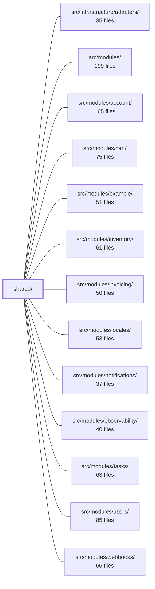

---
tags:
  - 2brain
  - 2brain/module
  - project/boilerplate-node-backend
type: module
module: shared/
files: 45
updated: 2026-11-15T00:28:41.428936+00:00
---

# shared/

## Purpose

`shared/` is the cross-cutting "single source of truth" layer for the multi-backend platform. It holds language-agnostic test vectors, the root API contracts (OpenAPI + AsyncAPI) that every domain module builds on, lint rulesets for those contracts, and build-time YAML configuration files that `npm run regenerate` compiles into TypeScript consumed by both the Node and PHP runtimes. Nothing in this directory is read at runtime directly; it feeds generated code, CI validation, and shared test suites.

## Key parts

- **`cases/`** — Declarative test-case YAML files (crypto vectors, money conversions, log-redaction rules, SSRF policy, rate-limit key bucketing, header parsing, security headers, outbox backoff, email normalization, boolean parsing, permission-model hashing). Each file is the single contract both the Node and PHP implementations validate against, so neither maintains its own ad-hoc test list.
- **`contracts/`** — The root OpenAPI 3.1 document (`openapi.root.yaml`) and AsyncAPI 3.0 roots (`asyncapi.root.yaml`, `asyncapi.workers.yaml`) that declare global conventions (servers, error envelope, tags) every module inherits. Also the Spectral rulesets (`spectral.yaml`, `spectral.modules.yaml`, `spectral.asyncapi.*`) that enforce house style in CI, and the authorization vocabulary (`authorization-keys.root.yaml`, `authorization-keys.core.yaml`) committed byte-identical to both backends.
- **`rules/`** — Build-time YAML sources (defaults, rate-limits, outbox policy, cookies, log-redaction, metrics, images, jobs, audit-actions, frontend-links) that `npm run regenerate` transpiles into `*.generated.ts` files. Their companion `schemas/*.generated.schema.json` files validate the YAML shape in CI.
- **`rules/schemas/`** — JSON Schemas (draft 2020-12) that give tooling and editors a strict, closed shape for each configuration document, catching drift before code generation.

## How it connects

- **`/` (repository root)** — The `regenerate`, `lint:*`, and `gen:api` npm scripts live in the root and consume the YAML and contract files in `shared/` to emit generated TypeScript and the compiled frontend permission type.
- **`src/modules/` (and each domain module: `account/`, `cart/`, `inventory/`, `locales/`, `notifications/`, `observability/`, `tasks/`, `users/`, `webhooks/`, `example/`)** — Each module's `openapi.yaml` extends the root document in `shared/contracts/openapi.root.yaml`; each module's `authorization.yaml` fragment is merged into `shared/contracts/authorization-keys.root.yaml`; and every module's code is tested against the shared `cases/` vectors.
- **`src/infrastructure/adapters/`** — Receives the generated image-handling code compiled from `shared/rules/images.yaml` (magic-byte signatures, re-encoding flags, thumbnail version).

## Where to start

1. **`shared/contracts/openapi.root.yaml`** — Reading this first gives you the API's identity, server list, global response/error shape, and the `x-error-codes` catalogue. Every module you'll read next hangs off these conventions.
2. **`shared/rules/defaults.yaml`** and its generated output (`src/infrastructure/config/defaults.generated.ts`) — This pair illustrates the core workflow (YAML → `npm run regenerate` → typed constants) that the entire `rules/` directory follows, so you can immediately trace any other rule file to its runtime effect.

## Connected modules

[[boilerplate-node-backend_ROOT|/ (repository root)]] · [[boilerplate-node-backend_src_infrastructure_adapters|src/infrastructure/adapters/]] · [[boilerplate-node-backend_src_modules|src/modules/]] · [[boilerplate-node-backend_src_modules_account|src/modules/account/]] · [[boilerplate-node-backend_src_modules_cart|src/modules/cart/]] · [[boilerplate-node-backend_src_modules_example|src/modules/example/]] · [[boilerplate-node-backend_src_modules_inventory|src/modules/inventory/]] · [[boilerplate-node-backend_src_modules_invoicing|src/modules/invoicing/]] · [[boilerplate-node-backend_src_modules_locales|src/modules/locales/]] · [[boilerplate-node-backend_src_modules_notifications|src/modules/notifications/]] · [[boilerplate-node-backend_src_modules_observability|src/modules/observability/]] · [[boilerplate-node-backend_src_modules_tasks|src/modules/tasks/]] · [[boilerplate-node-backend_src_modules_users|src/modules/users/]] · [[boilerplate-node-backend_src_modules_webhooks|src/modules/webhooks/]]

## Files
- `shared/cases/crypto.cases.yaml` — Shared, pre-computed crypto test vectors that let independent implementations verify they produce identical results without exchanging live secrets. Ciphertexts were sealed once by independent `node:crypto` code using fixed IVs, so each side checks its own output against the stored digest or plaintext rather than against a sibling's live computation. Every key in this file is **test-only and public**.
- `shared/cases/env-booleans.cases.yaml` — Shared test-case definitions that pin down how a single word is parsed into a boolean value when it arrives via an environment variable, query string, or form field. The file exists so every consumer of the boolean-parsing helper validates against the same contract without each one maintaining its own ad-hoc test list.
- `shared/cases/log-redaction.cases.yaml` — Behavioral spec (pinned test cases) for how log output is scrubbed before it leaves the process. Both the BEnode backend and its PHP twin run this file against their own loggers, so the YAML is the single source of truth for redaction rules. Each `redact` case is paired with a `keep` case that defines the boundary.
- `shared/cases/money.cases.yaml` — A declarative test-case table that pins the exact contracts of every money-conversion function in `money.ts`. It is the single source of truth for expected inputs/outputs (exponent lookup, text/number → minor units, minor units → decimal text, `fits`, `apportion`, `scale-by-rate`) so that any implementation or reimplementation can be validated against the same table without re-deriving edge cases.
- `shared/cases/normalize-email.cases.yaml` — Test-case specification for the email→mailbox normalization step. The resulting mailbox string is used **only to bucket rate-limit budgets**; it is never used to store or compare accounts. Each case pins down one aspect of the normalization contract (lowercasing, trimming, plus-tag removal, dot collapsing) so implementers and reviewers can verify behavior against a shared, language-agnostic reference.
- `shared/cases/outbox-backoff.cases.yaml` — Test-case table that pins down the expected exponential-backoff delay for the outbox dispatch retry logic. It exists so that any implementation of the backoff function can be verified against a single, human-readable set of (attempt → delay) pairs covering base delay, doubling progression, the 1-hour cap, and extreme-overflow edge cases.
- `shared/cases/permission-model-version.cases.yaml` — Golden test cases that pin down the exact algorithm clients use to compute a **permission-model version** from a set of rule IDs. The version is the first 4 bytes of `sha256(sorted_ids_joined_by_newline)` read as a big-endian unsigned 32-bit integer, allowing clients to cache and validate their rule set without re-fetching.
- `shared/cases/rate-limit-keys.cases.yaml` — Declares the expected bucketing keys a rate-limiter assigns to a request across three tiers—`address` (per-connection), `block` (per-subnet), and `identity` (per-user). It pins down the exact masking, unwrapping, pseudonymisation, and fallback rules so that any reimplementation or refactoring stays compatible with the documented behavior.
- `shared/cases/request-headers.cases.yaml` — Test-case catalogue for two inbound HTTP header parsers: `If-Match` (RFC 9110 §13.1.1) and `x-request-id`. It encodes the expected parse outcome for a range of valid, malformed, and edge-case header values so the parsing logic can be verified against a single declarative source of truth.
- `shared/cases/security-headers.cases.yaml` — Defines the exact set of security headers that **every** response must carry, regardless of route. It encodes helmet 8's defaults as an assertion list so that any change to a header's presence, value, or casing fails the test suite immediately. The file exists as the "twin" counterpart to `request-headers.cases.yaml`: both set the same headers with the same values, and one updates when the other does.
- `shared/cases/ssrf.cases.yaml` — A declarative test-case catalog that pins down the SSRF (Server-Side Request Forgery) validation policy for outbound calls. It enumerates which literal IP addresses and whole URLs must be **allowed** vs **refused** (and *why*), so that any implementation of the filter can be verified against a single source of truth. The policy is: HTTPS only, port 443 only, and only ordinary public-unicast addresses (every special-purpose range is refused by default).
- `shared/contracts/asyncapi.root.yaml` — Service-level preamble for the project's AsyncAPI contracts. It declares facts about the backend as a whole — protocol version, application identifier, human-readable `info` block, shared tags, and default content type — so that module-specific channel documents don't repeat them. It is the AsyncAPI counterpart to `openapi.root.yaml`.
- `shared/contracts/asyncapi.workers.yaml` — Standalone AsyncAPI 3.0.0 contract for application-level worker queues that do not belong to any domain (`worker.email.send`, `worker.image.digest`). It exists so these cross-cutting job definitions live beside the root rather than inside whichever module happens to enqueue them most, and so `npm run lint:asyncapi:modules` can validate them like any module document.
- `shared/contracts/authorization-keys.core.yaml` — Defines the authorization rules and named key-sets for the `Translation` subject. The `Translation` subject exists so that reading or writing an entity's translated fields is a distinct grant from reading or writing the entity itself — a mistranslation can never accidentally become a mischanged price. It is owned by `core` (not `locales`) because the underlying port lives in `kernel/translation.ts` and must remain gateable even if the `locales` module is absent.
- `shared/contracts/authorization-keys.root.yaml` — The single shared authorization vocabulary and rule catalogue for the multi-tenant platform. It defines the action vocabulary, scope separation, step-up tiers, condition conventions, and the full set of permission rules and permission sets. Generated by `npm run regenerate` from per-module fragments (`src/modules/<name>/authorization.yaml`) plus this root residual, it is the one artefact both backend repositories (Node and PHP/Laravel) commit byte-for-byte identical, and the single source that `npm run gen:api` compiles into the frontend permission type.
- `shared/contracts/openapi.root.yaml` — The root OpenAPI 3.1.0 document for the Boilerplate API. It declares the API's identity, server list, and global conventions (language negotiation, response shape, error envelope) that every module inherits. It also holds the module-agnostic `x-error-codes` catalogue and shared vendor extensions (`x-image-upload-types`) that a bundler merges into the final published spec. Modules under `src/modules/` build on this rather than re-declaring these concerns.
- `shared/contracts/spectral.asyncapi.modules.yaml` — Spectral ruleset that lets each AsyncAPI section (module) be linted as a standalone document via `npm run lint:asyncapi:modules`. It extends the `spectral:asyncapi` recommended ruleset with targeted `off` overrides for rules that assert service-wide facts (tag list, info metadata) which individual sections cannot and should not restate, while keeping rules that a section *can* answer (server declarations, channel-to-server bindings) active.
- `shared/contracts/spectral.asyncapi.names.yaml` — Spectral ruleset that enforces US English spelling in all machine-readable names within the bundled AsyncAPI contract. It exists as a standalone lint target (`npm run lint:asyncapi:names`) so that spelling compliance can be checked independently of structural or parser rules.
- `shared/contracts/spectral.modules.yaml` — Spectral lint configuration used when validating a **single module's** `openapi.yaml` in isolation (`npm run lint:openapi:modules`). It relaxes the rules that expect a document to be a complete API, because deployment-level concerns (tag catalogue, security schemes, servers, `info` prose) live in the root contract, not in each module fragment.
- `shared/contracts/spectral.yaml` — Spectral ruleset (extending `spectral:oas`) that enforces the project's OpenAPI 3.1 house style. Every rule is an **error**-severity gate: it codifies conventions around security declarations, error-response shape, naming (operationIds, schemas, parameters), and field-level bounds so that API contracts are linted consistently before they reach review.
- `shared/rules/audit-actions.yaml` — Declares the set of audit-action wire strings emitted by the shared security guards for requests that are refused before any domain module sees them. Because no module owns these events, they live here rather than in a per-module rules file. The file is a **build-time source of truth only**: `npm run regenerate` compiles it into `src/infrastructure/observability/audit-actions.generated.ts`, where the values become a closed `CoreAuditAction` union type (a runtime-loaded list would widen the type to `string`).
- `shared/rules/cookies.yaml` — Single registry of every cookie the backend sets. It exists so that the code that writes each cookie, the log-scrubbing pipeline, and the documentation all agree on the same name, secrecy flag, and lifetime from one place. The paired frontend's `browser-storage.yaml` mirrors this format for client-side storage.
- `shared/rules/defaults.yaml` — Single source of truth for the fallback numeric limits both backends start from when no environment variable is set. It is a build-time template, not a runtime config file: `npm run regenerate` reads it and emits `src/infrastructure/config/defaults.generated.ts`.
- `shared/rules/frontend-links.yaml` — Canonical map of every user-facing URL path the backend embeds in transactional mail, sitemap entries, and staff work-notice links. It exists so the frontend's router is tested against the exact same paths the backend emits, preventing 404s in a reader's inbox. The file is synced into the frontend (`sync:frontend`) and serves as the single source of truth for route strings shared across services.
- `shared/rules/images.yaml` — Declarative source of truth for which raster image formats the upload pipeline accepts and how to detect them by magic bytes. It is **not** read at runtime; `npm run regenerate` compiles it into `src/infrastructure/adapters/images.generated.ts`. The file also tracks the thumbnail version string so that a quality-setting change can bump the cache-busting segment in immutable (`1y`) thumbnail URLs.
- `shared/rules/jobs.yaml` — Declarative definition of the kernel-level scheduled jobs that belong to no specific module. It is the single source of truth for *which* jobs exist, their cron schedules, and their human-readable summaries. It is not read at runtime; it feeds the `npm run regenerate` step that emits `src/app/jobs.generated.ts` and `docker/crontab`.
- `shared/rules/log-redaction.yaml` — Declarative rule set that defines which fields, key fragments, and URL parameters must never appear in cleartext in log lines or trace spans. It separates **credentials** (always replaced with a redaction marker) from **personal data** (handling governed by the `NODE_LOG_PERSONAL_FIELDS` env var: hash, redact, or plain).
- `shared/rules/metrics.yaml` — Single source of truth for every **infrastructure-level** metric name, kind, help text, labels, and (for histograms) buckets. It is data, not code: `npm run regenerate` compiles it into `src/infrastructure/observability/metrics.generated.ts`, and dashboards/alerts are written against the names declared here. Module-specific metrics deliberately stay in their own `metrics.ts`.
- `shared/rules/outbox.yaml` — Source-of-truth YAML that defines the transactional outbox's retry-policy defaults. It is **not** read at runtime; instead, `npm run regenerate` transpiles it into `src/kernel/outbox.generated.ts`, which the PHP twin also copies. This keeps the values in one place while letting both the Node and PHP runtimes consume the same constants.
- `shared/rules/rate-limits.yaml` — Declares the kernel-wide rate-limit budgets (global browsing, API-key requests, image uploads) as structured data. It is the single source of truth from which `npm run regenerate` emits `src/infrastructure/http/middlewares/rate-limits.generated.ts`. The file itself is never read at runtime.
- `shared/rules/schemas/audit-actions.generated.schema.json` — A generated JSON Schema (draft 2020-12) that validates the shape of an "audit actions" payload. It enforces that the payload is a single object containing a non-empty `actions` array, where each entry pairs a namespaced security action identifier with a human-readable description.
- `shared/rules/schemas/authorization-roles.generated.schema.json` — JSON Schema (draft 2020-12) that validates the structure of an authorization-roles configuration document. It enforces the shape of the top-level object, each role entry, and the three fixed audience tiers so that any consumer (runtime loader, validation tool, or editor) can reject malformed role definitions early.
- `shared/rules/schemas/cookies.generated.schema.json` — JSON Schema (draft 2020-12) that validates a cookies inventory document. It enforces the allowed shape of a top-level `cookies` object so that every cookie / storage entry is consistently described with its owner, storage kind, purpose, and other metadata. It exists to give tooling and CI a single source of truth for what a valid cookies declaration looks like.
- `shared/rules/schemas/defaults.generated.schema.json` — A JSON Schema (draft 2020-12) that validates a system-wide `defaults` configuration object. It enforces the exact shape and value bounds of five operational settings (response cache, idempotency, pagination, images, uploads) so that any consumer reading this config gets a predictable, fully-specified set of values.
- `shared/rules/schemas/frontend-links.generated.schema.json` — A JSON Schema (draft 2020-12) that validates the shape of a frontend-link configuration object. It enforces a fixed, closed set of route/link keys for public pages, staff dashboard pages, and a list of static pages — ensuring any conforming config provides non-empty route strings for every expected entry.
- `shared/rules/schemas/images.generated.schema.json` — JSON Schema (draft 2020-12) that validates a configuration object describing image format rules—thumbnail versioning, per-format magic-byte signatures, MIME types, and re-encodability flags. It enforces strict structure (`additionalProperties: false` at every level) so that only known, well-formed image-rule documents pass validation.
- `shared/rules/schemas/jobs.generated.schema.json` — JSON Schema (draft 2020-12) that validates a top-level configuration object containing named, scheduled jobs. It enforces a strict, closed shape so that any tool or service consuming the job list can rely on a uniform structure without runtime type-checking.
- `shared/rules/schemas/log-redaction.generated.schema.json` — JSON Schema (draft 2020-12) that validates the shape of a log-redaction configuration object. It enforces that four required string-array fields are present, non-empty, and that no extra properties are allowed, ensuring a single source of truth for what the logger must redact before writing to disk.
- `shared/rules/schemas/metrics.generated.schema.json` — A JSON Schema (draft 2020-12) that validates metric-definition objects. It enforces a strict, closed shape for a `metrics` map so that any file declaring metrics conforms to a single, predictable contract (naming conventions, allowed kinds, required fields).
- `shared/rules/schemas/outbox.generated.schema.json` — JSON Schema (draft 2020-12) that validates an outbox configuration object. It defines the shape and constraints for the tunable parameters of the outbox subsystem—retention, retry attempts, lease timing, and exponential-backoff settings—so that consumers can reject malformed configs at validation time.
- `shared/rules/schemas/rate-limits.generated.schema.json` — A JSON Schema (draft 2020-12) that validates a top-level `rateLimits` configuration object. It enforces the shape of every individual rate-limit rule so that any consumer reading the config can rely on a consistent, closed set of fields.
- `shared/rules/schemas/semantic-log-names.generated.schema.json` — JSON Schema (draft 2020-12) that validates the shape of a `semanticLogNames` mapping — a dictionary of log-name identifiers to display strings. It enforces that keys are lowercase-prefixed camelCase-style identifiers and values are non-empty strings, while rejecting any extra top-level properties.
- `shared/rules/semantic-log-names.yaml` — Single source of truth mapping each camelCase log-field the code writes to the exact name that appears on the structured log line. It enforces OpenTelemetry semantic-convention names where the spec defines one and reserves the `app.*` namespace for producer-specific attributes. Consumed only by the codegen step (`npm run regenerate`) that emits `src/infrastructure/adapters/semantic-log-names.generated.ts`.
- `shared/scenarios/personas.yaml` — Defines the 13 demo login accounts for the demo profile: who they are (email, username), what they may do (role memberships), and what state they start in (verification, 2FA, consent flags, etc.). It is a seed fixture consumed by the demo backend and its paired Cypress suite; it never feeds a production database.
- `shared/scenarios/schemas/personas.generated.schema.json` — JSON Schema (draft 2020-12) that validates the shape of persona/account seed data used in scenario provisioning. It enforces a strict, closed structure for a set of named test accounts (admin, user, editor, moderator, unverified) so that scenario fixtures fail fast if a required field is missing or an unexpected property is introduced.

---
[[boilerplate-node-backend_INDEX|← boilerplate-node-backend index]]
