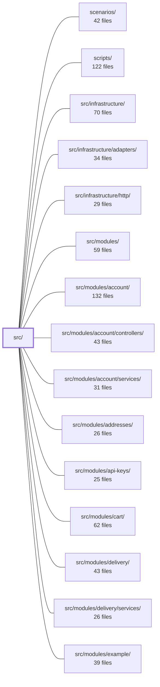

---
tags:
  - 2brain
  - 2brain/module
  - project/boilerplate-node-backend
type: module
module: src/
files: 35
updated: 2026-10-15T13:35:00.432586+00:00
---

# src/

## Purpose

`src/` is the application shell: it owns the process entry points, assembles the Express app, and provides the cross-cutting kernel (authentication, authorization, transactional events, module registration) that every domain module depends on. It deliberately separates *building* the app (import-safe, synchronous) from *serving* traffic, so tests and scenario scripts can instantiate routes without binding a socket.

## Key parts

- **Entry points & lifecycle** — `cluster.ts` (production fork/supervise), `serve.ts` (single-process HTTP start, SIGTERM handling), `app.ts` (synchronous `createApp()` that wires infrastructure, mounts module routes, and exposes `boot`/`start`/`stop`). `modules.ts` is the single registry listing every domain module served by this build.
- **App tier (`src/app/`)** — Routing (`routes.ts`, `system-routes.ts`), transport security & body parsing (`security.ts`), per-request context (`request-context.ts`), global error handling (`error-handling.ts`), Prometheus middleware (`telemetry.ts`), static-file serving (`static-assets.ts`), queue-consumer wiring (`workers.ts`), and environment config assembly/validation (`config.ts`).
- **Kernel (`src/kernel/`)** — Cross-cutting contracts and enforcement: the authentication port and dispatch (`authentication.ts`), permission-key / role definitions loaded from shared YAML (`permissions.ts`), CASL ability construction (`ability.ts`), query-time authorization filtering (`access/query.ts`), middleware guards (`middlewares/authorizations.ts`), the transactional outbox and in-process event bus (`outbox.ts`, `events.ts`), the typed module-registration interfaces (`registry.ts`), the translation port (`translation.ts`), config gates (`config.ts`, `module-config.ts`), and audit helpers (`staff-read.ts`).
- **Shared kernel** — `shared-kernel/money.ts`: a branded integer-unit `Money` type with full multi-currency arithmetic, used wherever monetary values cross module boundaries.
- **Types (`src/types/`)** — Public type barrel (`index.ts`), generated AsyncAPI schemas (`asyncapi.generated.ts`), auth-context vocabulary (`auth-context.ts`), rate-limit budget shape (`rate-limit-budget.ts`), and the `imageUrl` re-mapping utility (`server-image.ts`). `globals.d.ts` augments Express's `Request` so handlers access middleware-attached fields without per-site imports.

## How it connects

- **`src/modules/`** (and its sub-modules like `account`, `orders`, `products`, etc.) — Each module registers its routes, queues, and rate-limit budgets through the kernel's `registry.ts` interfaces. `modules.ts` is the single list the app tier walks to mount them; no module imports the app tier directly.
- **`src/infrastructure/`** (including `adapters/` and `http/`) — The app tier and kernel depend on infrastructure *ports* (cache, queue, HTTP client, OTel). Concrete adapters in `src/infrastructure/adapters/` implement those ports and are injected at boot via `app.ts`, preserving the rule that infrastructure sees no module code.
- **`scenarios/` and `scripts/`** — These call `createApp()` (from `app.ts`) to build a full route table without starting a server, and read `modules.ts` to discover available modules for scenario setup or ops tooling.
- **Repository root** — `package.json`'s `main`/`start` scripts point to `cluster.ts`; `.dependency-cruiser.cjs` and ESLint enforce the dependency walls (kernel never imports modules, types never imports kernel) that this module's structure makes possible.

## Where to start

1. **`src/modules.ts`** — A short, self-explanatory list that tells you exactly which domain modules this build serves and where their folders live. Reading it first gives you the map of the system.
2. **`src/app.ts`** — The single file that shows *how* those modules are wired together: infrastructure adapters are constructed, routes are mounted, middleware order is established, and the lifecycle (`boot` → `start` → `stop`) is exposed. Following its imports gives a natural tour of the kernel and app-tier pieces.

## Connected modules

[[boilerplate-node-backend_ROOT|/ (repository root)]] · [[boilerplate-node-backend_scenarios|scenarios/]] · [[boilerplate-node-backend_scripts|scripts/]] · [[boilerplate-node-backend_src_infrastructure|src/infrastructure/]] · [[boilerplate-node-backend_src_infrastructure_adapters|src/infrastructure/adapters/]] · [[boilerplate-node-backend_src_infrastructure_http|src/infrastructure/http/]] · [[boilerplate-node-backend_src_modules|src/modules/]] · [[boilerplate-node-backend_src_modules_account|src/modules/account/]] · [[boilerplate-node-backend_src_modules_account_controllers|src/modules/account/controllers/]] · [[boilerplate-node-backend_src_modules_account_services|src/modules/account/services/]] · [[boilerplate-node-backend_src_modules_addresses|src/modules/addresses/]] · [[boilerplate-node-backend_src_modules_api-keys|src/modules/api-keys/]] · [[boilerplate-node-backend_src_modules_cart|src/modules/cart/]] · [[boilerplate-node-backend_src_modules_delivery|src/modules/delivery/]] · [[boilerplate-node-backend_src_modules_delivery_services|src/modules/delivery/services/]] · … and 14 more

## Files
- `src/app.ts` — Builds a single Express application instance — wiring infrastructure (OTel, cache, queue, i18n), mounting every enabled module's routes and middleware, and returning a `boot`/`start`/`stop` lifecycle. It deliberately separates *building* the app (synchronous, import-safe) from *serving* traffic (only `src/serve.ts` calls `start()` and binds a socket).
- `src/app/config.ts` — Defines the app tier's own environment variables (HTTP parsing/connection bounds, security.txt fields) and assembles the complete, flat list of every config slice owned by infrastructure, the kernel, and the app tier itself. Provides the single boot-time validation entry point (`assertProcessConfig`) so that any process start—app boot, cluster primary, or ops script—judges the environment identically.
- `src/app/error-handling.ts` — Central error-handling module for the Express application. It provides the global request-level error handler, the process-level `unhandledRejection` / `uncaughtException` handlers, and the single `installErrorHandling` entry point that wires them up. All three exist to answer "what happens to a failure nobody else handled?" at the two levels where that question can be asked: inside a request and outside one.
- `src/app/request-context.ts` — Sets up per-request context that the rest of the request pipeline reads: the access log, the observability trace handle, the negotiated locale, and the canonical request ID. It must be mounted before the routes (and, for the request ID, before security/rate-limiting middleware) so that every downstream handler—including rejected ones—can log and correlate against these values.
- `src/app/routes.ts` — Single-file route installer for the Express app. It sets a default `Cache-Control: no-store` header, mounts every registered domain module at its self-declared `basePath`, mounts the system router (root ping) at `/`, and registers the 404 catch-all. The file intentionally knows no domain names — modules declare their own paths and routers in their manifests.
- `src/app/security-txt.ts` — Generates the body of `/.well-known/security.txt` (RFC 9116) as a pure function over already-parsed environment settings. It exists so the HTTP route and the unit tests share a single source of truth for the file's content and its publish-or-404 logic.
- `src/app/security.ts` — Transport-level security and body-parsing middleware for the Express app. Exists as a single file because **installation order is load-bearing** (trust-proxy → rate limiter → body parsers → content-type check) and the ordering rationale is non-obvious. Splits into two exported install functions so `src/app.ts` can mount static-file serving between them.
- `src/app/static-assets.ts` — Wires up Express static-file serving for the public assets directory (uploaded images, favicon, web manifest). It exists as a dedicated module so the caching, security, and CORS-header logic lives alongside the config it depends on, and so the test suite can assert the guarantees in one place.
- `src/app/system-routes.ts` — Defines the process-level HTTP routes that have no domain owner: the root ping, Kubernetes-style liveness/readiness probes, and the RFC 9116 `security.txt` endpoint. Kept at the `app/` level (not in `src/modules`) because it belongs to the process itself rather than any business-logic module. Mounted at `/` by `app/routes.ts`.
- `src/app/telemetry.ts` — Installs a single Express middleware that records per-request latency (histogram) and in-flight request count (gauge) as Prometheus metrics. It is mounted *before* the route table so the timer wraps the entire handler chain rather than just the matched handler.
- `src/app/workers.ts` — The single assembly point where all queue consumers are registered at application startup. It directly wires the two app-level queues (email sending, image digestion) and delegates module-owned queues (e.g. webhooks) to the kernel registry, so that new modules never require an edit here.
- `src/cluster.ts` — The production entry point of the repository (referenced by `package.json`). It establishes the correct import order (dotenv → mongoose-boot → OTel) before any application module loads, then branches: the **primary** process forks and supervises worker processes, while each **worker** (or a single-process run) dynamically imports `./serve` to build and start the Express app.
- `src/globals.d.ts` — Ambient module augmentation that extends Express's `Request` interface so every handler can access the fields middleware actually attaches (auth context, request tracking, locale, upload state) without an explicit import at each call site. It exists purely as a type declaration — no runtime code.
- `src/kernel/ability.ts` — Builds a per-request CASL `MongoAbility` from a caller's declared permission keys and their attached conditions. It is the single object every authorization question in the codebase is asked of, and it is designed so that the same rules can compile into a database read filter and be shipped to the browser for client-side gating.
- `src/kernel/access/query.ts` — Compiles a caller's CASL rules into a MongoDB filter so that the authorization restriction is embedded in the read query itself, rather than being a convention each module must independently remember. This is the kernel's sole store-specific authorization file (the other is `outbox.ts`), and it guarantees fail-closed behaviour: when no rule matches, the result is CASL's `EMPTY_RESULT_QUERY` (matches nothing), never an absent filter that downstream code would interpret as "unrestricted."
- `src/kernel/access/tenant.ts` — Single-constant module that pins the deployment's shop `_id` to one import location. It exists as its own file (rather than living inside `access/service.ts`) to break a circular import: `permissions.ts` needs the constant, and `access/service.ts` already imports from `permissions.ts`.
- `src/kernel/authentication.ts` — Declares the kernel's authentication port — the contract that maps a credential (bearer token, session cookie, or machine key) to the caller it names — and provides the thin dispatch layer the guard middleware uses to answer "who is making this request?" It exists so the kernel depends on an abstraction while `account` and `api-keys` each supply a concrete implementation at boot.
- `src/kernel/config.ts` — Defines the two kernel-level configuration groups that cross-cut all modules: the step-up (re-authentication) time windows enforced by `requireFreshAuth`, and the transactional outbox relay's retry/retention/lease policy. Kept at the kernel layer so that any module with a money or identity route can mount the guard without reaching into a sibling's config namespace.
- `src/kernel/cookies.ts` — Defines the kernel-level parsing and naming conventions for authentication credentials: the session cookie name (`__Host-session`) and the Bearer-token extractor used by the authorization middleware. It sits above the infrastructure cookie utilities so that every read-site shares one canonical cookie name and one Bearer parser.
- `src/kernel/events.ts` — In-process domain event bus: the sanctioned mechanism for two modules to communicate when a direct import would create a cycle in the dependency graph (enforced by `.dependency-cruiser.cjs`). Explicitly **not** a durable broker — no retry, no replay. Durability and redelivery are the outbox relay's job; this file only fans an event out to in-process subscribers.
- `src/kernel/middlewares/authorizations.ts` — Express middleware guards that resolve a caller's identity (bearer token or session cookie) and enforce permission-key-level access. Every guard rejection is audited and, where applicable, surfaced as a security event before the response is sent. The file exists so that routes declare *which permission key* they need rather than *which role*, and so a single middleware chain handles anonymous access, authenticated access, rate-limited API keys, and freshness re-authentication uniformly.
- `src/kernel/module-config.ts` — Boot-time configuration gate. It collects every required config slice across all enabled modules (plus caller-supplied app-level slices) and validates them in a single pass, so a misconfigured deployment reports every problem at once instead of failing one variable per restart.
- `src/kernel/outbox.ts` — Implements the **transactional outbox** pattern on top of MongoDB: a domain event is written in the *same* Mongo transaction as the state change it announces, guaranteeing atomic visibility. A relay then publishes the event to the in-process bus (`./events`) with at-least-once delivery, per-aggregate ordering, exponential backoff, and a dead-letter state for operator intervention.
- `src/kernel/permissions.ts` — Declares the static set of permission keys and preset roles that the Node.js service enforces. Both are loaded from two shared YAML artefacts (`shared/authorization-keys.yaml` and `shared/authorization-roles.yaml`) that the PHP twin reads byte-for-byte identically. The file parses and validates those files once at import (boot), not per request, so that a malformed file fails immediately rather than on the first authorization check.
- `src/kernel/registry.ts` — Defines the typed contract interfaces that modules use to register capabilities with the application without the application (or its infrastructure adapters) importing module code directly. This file exists to enforce the "app tier sees every module, infrastructure sees none" boundary: infrastructure adapters and cross-domain services resolve module-supplied behavior through these registration interfaces rather than through direct imports, preserving the module-group dependency walls enforced by ESLint.
- `src/kernel/staff-read.ts` — Provides a single audit-recording helper for the case where a staff member (holder of a resource's wide-read key, e.g. `orders.any.read`) reads **another** person's record. It exists to give a uniform, low-friction call site in detail-fetch controllers so that the `admin.<resource>.viewed` event is emitted consistently without each controller duplicating the "is this staff?" / "is this their own record?" checks.
- `src/kernel/translation.ts` — Defines the kernel-level port (hexagonal contract) for user-authored translated content — product titles, category descriptions, etc. — covering resolution, search, write, and hard-delete removal. It exists so that kernel decorators and product lifecycle code can depend on translation operations without importing from `src/modules/*`, thereby avoiding a circular dependency. The port is registered by `modules/locales`; until registration, every entry point degrades to a safe no-op or a monolingual fallback.
- `src/modules.ts` — The single registry that declares which domain modules this build serves. Adding a module is a folder under `src/modules/` plus one line here; removing one is a delete plus a line-removal, and any resulting break is intentional coupling. It is the one list that the app tier, scripts, and scenario tooling all walk to discover what is mounted.
- `src/serve.ts` — The single entry point that actually starts the HTTP server. It composes the app via `createApp()`, wires the process to SIGTERM/SIGINT for graceful shutdown, and handles boot failures. It exists as a separate file so that callers that only need to *build* the app (tests, scenario scripts) never pull in the "start listening" step or any opinion about whether traffic should be served.
- `src/shared-kernel/money.ts` — Provides a branded `Money` type (integer minor units, never a float) plus the full arithmetic and conversion toolkit for a multi-currency system. All internal arithmetic stays in exact integers; decimal `number` values appear only at the API boundary. The file pins ISO 4217 minor-unit exponents in-repo so that zero-decimal (JPY, KRW), three-decimal (KWD, BHD), and four-decimal (CLF, UYW) currencies are handled correctly without relying on `Intl`.
- `src/types/asyncapi.generated.ts` — Auto-generated TypeScript type definitions and Zod validation schemas derived from `asyncapi.yaml`. It provides compile-time types, runtime validators, and channel-name constants for every event and message defined in the AsyncAPI specification, so the rest of the codebase can import a single canonical source for event payloads, envelope shapes, and channel identifiers.
- `src/types/auth-context.ts` — Defines the core type vocabulary for authentication and authorization in the codebase: what a resolved caller *is* (`AuthContext`), what a rule may safely *ask* of them (`Caller`), and what a downstream service *sees* about the request that carried them (`CallerContext`). Exists to decouple HTTP/auth flow from Mongoose document internals — controllers, middleware, and the kernel resolver port depend on these types, never on `UserDocument`.
- `src/types/index.ts` — A public type barrel that re-exports generated API models, generated AsyncAPI types, and hand-written domain DTOs under a single import path (`@types`). Consumers never need to know which of the three sources a type originates from.
- `src/types/rate-limit-budget.ts` — Defines the `RateLimitBudget` interface — the declarative data shape for a single rate-limit budget. Module manifests (`AppModule.rateLimits`) declare budgets in this shape; `buildRateLimiter` in infrastructure consumes it to produce the actual Express middleware. It lives in `src/types/` (not `src/kernel/`) because infrastructure may only import downward into `types`, never upward into `kernel`.
- `src/types/server-image.ts` — A single type-level utility that re-maps the `imageUrl` field of a request object to reflect the server's own decision (path string, `null` for removal, or absent for no change), decoupling the wire format from the upload pipeline's output.

---
[[boilerplate-node-backend_INDEX|← boilerplate-node-backend index]]
