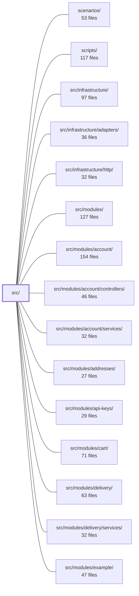

---
tags:
  - 2brain
  - 2brain/module
  - project/boilerplate-node-backend
type: module
module: src/
files: 42
updated: 2026-10-29T19:20:09.064952+00:00
---

# src/

## Purpose

`src/` is the application shell: the composition root, cross-cutting kernel services, and process entry points that boot and wire together every domain module. It owns no business logic itself—its job is to assemble infrastructure, enforce transport-level protections, declare the authorization and event ports that modules implement, and expose a single `createApp()` / `boot` / `start` / `stop` lifecycle that callers (production server, tests, ops scripts) can invoke.

## Key parts

- **Composition & entry points** — `app.ts` (single composition root), `serve.ts` (starts listening), `cluster.ts` (process-manager entry referenced by `package.json`), `modules.ts` (the registry listing every enabled domain module).
- **App-level wiring (`app/`)** — Routes installation (`routes.ts`), transport security & ordering (`security.ts`), static assets, Prometheus telemetry, queue-consumer assembly (`workers.ts`), cross-cutting scheduled jobs (`jobs.ts` + `jobs.generated.ts`), per-request context (`request-context.ts`), global error handling, liveness/readiness/system routes, and `security.txt` generation.
- **Kernel (`kernel/`)** — The hexagonal-architecture port layer: authentication contract (`authentication.ts`), permission vocabulary from shared YAML (`permissions.ts`), CASL ability choke-point (`ability.ts`), Mongo-read scoping (`access/query.ts`), in-process event bus (`events.ts`), transactional outbox (`outbox.ts` + `outbox.generated.ts`), translation port (`translation.ts`), module registry for cross-cutting needs (`registry.ts`), authorization middleware guards (`middlewares/authorizations.ts`), step-up freshness config, and cookie/token parsing conventions.
- **Domain primitives (`domain-primitives/`)** — Module-agnostic value types shared across tiers: `money.ts` (integer minor-unit arithmetic), `time.ts` (day/month/DST helpers), `lifecycle.ts` (state-machine transition tables).
- **Types & generated code (`types/`, `globals.d.ts`)** — Public type barrel, AsyncAPI-generated schemas, auth-context type vocabulary, and ambient Express `Request` augmentation.
- **Configuration** — `app/config.ts` (canonical env-var list + `assertProcessConfig` validation) and `kernel/module-config.ts` (per-module required-slice gate).

## How it connects

- **`src/modules/*`** — Every domain module (orders, products, payments, tickets, etc.) registers its routes, jobs, queue consumers, translation targets, and public events through the kernel ports and registry declared in `src/`. The `modules.ts` list in this directory is the single source of truth for which modules a build includes.
- **`src/infrastructure/` & `src/infrastructure/adapters/`** — Concrete adapters (Mongo, Redis, queue drivers, image processors) are wired in by `app.ts` and `workers.ts` to satisfy the kernel ports; `src/infrastructure/http/` supplies the Express middleware utilities that `app/security.ts` and `app/routes.ts` compose.
- **`scenarios/` & `scripts/`** — Consume `createApp()` and the `boot`/`start`/`stop` lifecycle exported by `app.ts` without side effects, and call `assertProcessConfig` to fail fast on bad environments.
- **Repository root** — `package.json` points at `cluster.ts` as the process entry; `shared/rules/*.yaml` files are the source of truth regenerated into the `*.generated.ts` files throughout this module.

## Where to start

1. **`src/app.ts`** — Read `createApp()` top-to-bottom to see the exact order in which infrastructure, middleware, module routes, workers, and jobs are assembled, and how the lifecycle is returned.
2. **`src/modules.ts`** — The one-line-per-module registry; from here you can jump into any domain module's manifest to see what it registers, giving you the full picture of how the shell and the business logic interlock.

## Connected modules

[[boilerplate-node-backend_ROOT|/ (repository root)]] · [[boilerplate-node-backend_scenarios|scenarios/]] · [[boilerplate-node-backend_scripts|scripts/]] · [[boilerplate-node-backend_src_infrastructure|src/infrastructure/]] · [[boilerplate-node-backend_src_infrastructure_adapters|src/infrastructure/adapters/]] · [[boilerplate-node-backend_src_infrastructure_http|src/infrastructure/http/]] · [[boilerplate-node-backend_src_modules|src/modules/]] · [[boilerplate-node-backend_src_modules_account|src/modules/account/]] · [[boilerplate-node-backend_src_modules_account_controllers|src/modules/account/controllers/]] · [[boilerplate-node-backend_src_modules_account_services|src/modules/account/services/]] · [[boilerplate-node-backend_src_modules_addresses|src/modules/addresses/]] · [[boilerplate-node-backend_src_modules_api-keys|src/modules/api-keys/]] · [[boilerplate-node-backend_src_modules_cart|src/modules/cart/]] · [[boilerplate-node-backend_src_modules_delivery|src/modules/delivery/]] · [[boilerplate-node-backend_src_modules_delivery_services|src/modules/delivery/services/]] · … and 14 more

## Files
- `src/app.ts` — Application factory. `createApp()` builds a fully-configured Express instance — infrastructure (database, cache, queue, i18n, templates), the middleware stack, and every enabled module's routes — and returns a `boot`/`start`/`stop` lifecycle. The file exists as the single composition root so that OTel initialises before any module it instruments is imported, and so that callers (tests, scenarios, the real server) can pull exactly the lifecycle step they need without side effects leaking into the import itself.
- `src/app/config.ts` — Central configuration registry for the application. It defines the app tier's own server-bound and security.txt variables, assembles every infrastructure, kernel, and module config slice into a single canonical list, and exposes the validation entry point (`assertProcessConfig`) used by every process entry (app boot, cluster primary, ops scripts) to fail fast on a bad environment.
- `src/app/error-handling.ts` — Central global error handler for the Express app plus the two process-level safety nets (`unhandledRejection`, `uncaughtException`). It exists so that no failure—whether inside a request or outside one—escapes without a deterministic status, a single audit log line, and a span annotation. It is the last stop in the request pipeline and the last stop for the process.
- `src/app/jobs.generated.ts` — Auto-generated registry of kernel job metadata (display name, cron schedule, human-readable summary) that is consumed by `src/app/jobs.ts` to wire up scheduled tasks. It exists so that job definitions live in a single YAML source of truth (`shared/rules/jobs.yaml`) and are kept in sync across the codebase via `npm run regenerate`.
- `src/app/jobs.ts` — Declares the application-level scheduled jobs that don't belong to any domain module: quarantine reaping, orphaned-image sweeping, mail-spool reaping, and outbox sweeping. Module-owned jobs live on each `AppModule.jobs` manifest; this file is the catch-all for cross-cutting cleanup.
- `src/app/request-context.ts` — Centralises per-request context setup: the request-ID middleware and the access-logging / observability handle. It exists as a single group because everything it attaches is read downstream by routes, audit entries, and the access log, so it must be mounted before them.
- `src/app/routes.ts` — Single install step that wires every enabled module's router onto the Express app, plus the cross-cutting HTTP concerns that must sit in a specific order: the default `Cache-Control` header, the 405/`Allow` guards (before and after the mounts), and the 404 catch-all. It deliberately knows no domain names—each module declares its own `basePath` and router in its manifest.
- `src/app/security-txt.ts` — Generates the body of `/.well-known/security.txt` (RFC 9116) as a pure function over already-parsed environment settings. It exists so the HTTP route and the unit tests share a single source of truth for the file's content and its publish-or-404 logic.
- `src/app/security.ts` — Declares and installs every transport-level protection this Express application needs—secure headers, CORS, rate limiting, body parsing, and server timeouts—split into two install phases so `src/app.ts` can serve static files between them. The ordering is deliberate and non-obvious (trust-proxy before rate limiter, rate limiter before parsers, parsers before content-type enforcement); this file is the single place that documents and enforces that order.
- `src/app/static-assets.ts` — Wires up Express static-file serving for the public assets directory (uploaded images, favicon, web manifest). It exists as a dedicated module so the caching, security, and CORS-header logic lives alongside the config it depends on, and so the test suite can assert the guarantees in one place.
- `src/app/system-routes.ts` — Defines the process-level HTTP routes that exist outside any business domain: the root ping, Kubernetes-style liveness/readiness probes, and the RFC 9116 `security.txt` endpoint. Kept in `src/app` (not `src/modules`) because none of these routes serve domain logic.
- `src/app/telemetry.ts` — Installs a single Express middleware that records per-request latency (histogram) and in-flight request count (gauge) as Prometheus metrics. It is mounted *before* the route table so the timer wraps the entire handler chain rather than just the matched handler.
- `src/app/workers.ts` — The single assembly point where all queue consumers are registered at application startup. It directly wires the two app-level queues (email sending, image digestion) and delegates module-owned queues (e.g. webhooks) to the kernel registry, so that new modules never require an edit here.
- `src/cluster.ts` — The application's main entry point (referenced by `package.json`). It orchestrates Node.js process clustering: the primary forks and supervises workers, while each worker boots the HTTP server. Critically, it also enforces a strict initialization order — environment variables, Mongoose defaults, and OpenTelemetry tracing — before any application module is loaded.
- `src/domain-primitives/lifecycle.ts` — Defines the shared, module-agnostic event-table lifecycle primitive: the type shapes (`LifecycleEvent`, `LifecycleTable`, `Lifecycle`) and the single factory `defineLifecycle` that turns a declarative table of named transitions into a queryable lifecycle object. Every domain module that models a state machine (example, orders, …) builds on this one definition so that the rules for *what transitions exist* and *who may take them* are stated once and checked uniformly.
- `src/domain-primitives/money.ts` — A domain primitive that represents monetary amounts as **whole integers of minor units** (not floats) and provides exact, order-independent arithmetic on them. It exists so that every module shares a single, compiler-enforced `Money` brand, a pinned ISO 4217 exponent table, and a small set of arithmetic helpers that never introduce floating-point drift — eliminating the class of "off-by-a-cent" bugs that arise from ad-hoc `* 100` / `/ 100` arithmetic scattered across the codebase.
- `src/domain-primitives/time.ts` — Single source of truth for time-unit constants and timezone-aware day boundary calculations. It sits below every architectural tier (in `domain-primitives/`) so that `domain/` files can express retention windows, cooldowns, and shop-day groupings in whole days without importing an infrastructure module. It also provides the EDPB-compliant "one calendar month later" rule and DST-safe local-midnight computation that deadline logic depends on.
- `src/globals.d.ts` — Ambient module augmentation that extends Express's `Request` interface so every handler can access the fields middleware actually attaches (auth context, request tracking, locale, upload state) without an explicit import at each call site. It exists purely as a type declaration — no runtime code.
- `src/kernel/ability.ts` — The single choke-point that turns a resolved `Caller` into a CASL `MongoAbility`. Every authorization question in the system — whether a route guard may proceed, which rows a read filter should include, or whether a per-row action is permitted — is ultimately asked of the object produced here. It exists so that the server-side enforcement, the compiled Mongo query filter, and the client-side UI greying all derive from the *same* declared rules rather than from parallel copies.
- `src/kernel/access/query.ts` — Compiles a caller's CASL authorization rules into a ready-to-use MongoDB filter via `@casl/mongoose`, so that every read query is scoped by construction rather than by each module remembering to apply a filter. It is the kernel's sole store-specific authorization file (alongside `../outbox.ts`) and exists so that "the restriction rides in the read" is a library guarantee, not a per-module convention.
- `src/kernel/access/tenant.ts` — Single-constant module that pins the one-shop `_id` every caller in the codebase needs. It lives in its own file (rather than under `src/modules/access/services/`) specifically to break a circular import: `permissions.ts` needs the ID, and `access/services/` already depends on `permissions.ts`.
- `src/kernel/authentication.ts` — Kernel-level **port** (hexagonal architecture) that declares the authentication contract. It defines the interfaces modules must implement and the resolve functions the rest of the kernel calls. `account` registers a session/bearer resolver at boot; `api-keys` optionally registers a machine-credential resolver. Callers get a uniform API without importing either module.
- `src/kernel/config.ts` — Kernel-level configuration for cross-cutting concerns: the step-up re-authentication freshness windows and the transactional outbox retry policy. It exists so that any module with money or identity routes can mount `requireFreshAuth` without reaching into a sibling module's config.
- `src/kernel/cookies.ts` — Defines the kernel-level parsing and naming conventions for authentication credentials: the session cookie name (`__Host-session`) and the Bearer-token extractor used by the authorization middleware. It sits above the infrastructure cookie utilities so that every read-site shares one canonical cookie name and one Bearer parser.
- `src/kernel/events.ts` — In-process domain event bus that lets two modules communicate when a direct import would create a circular dependency. It provides a typed, synchronous publish/subscribe mechanism with per-handler error isolation. It is explicitly *not* a message broker: no durability, no retry, no replay—those concerns belong to `kernel/outbox.ts`.
- `src/kernel/middlewares/authorizations.ts` — Express middleware guards that sit in front of routes to resolve identity and enforce authorization. Built on the kernel's authentication resolver, the file provides a family of guards (`getAuth`, `isAuth`, `requirePermission`, `requirePermissionViaCookie`, `requireFreshAuth`/`requireFreshAuthWhen`) that either populate `request.authContext`/`request.caller` or reject the request. Every rejection is audited and, where it names an attack, recorded as a security event before the response is sent.
- `src/kernel/middlewares/locale-preview.ts` — Express middleware that lets an authorised staff caller preview a draft (not-yet-live) language by re-binding the request's locale before translation resolution begins. If the caller's first `Accept-Language` choice is a switched-off language they have permission to see, the request is re-scoped to that draft so all downstream product reads resolve text from it; otherwise the request proceeds unchanged.
- `src/kernel/module-config.ts` — Boot-time configuration gate. It collects every required config slice across all enabled modules (plus caller-supplied app-level slices) and validates them in a single pass, so a misconfigured deployment reports every problem at once instead of failing one variable per restart.
- `src/kernel/outbox.generated.ts` — Auto-generated constants file that supplies the default retry-policy values for the outbox. It exists so that a single source of truth (`shared/rules/outbox.yaml`) can be regenerated into TypeScript, eliminating hand-maintained magic numbers in the outbox code.
- `src/kernel/outbox.ts` — Implements the transactional outbox pattern: a domain event row is written to the `outboxevents` Mongo collection inside the **same** `ClientSession` transaction as the state change it announces. A relay (nudged post-commit, backed by a `sweep:outbox` job) later publishes each row to the in-process event bus with at-least-once delivery, per-aggregate ordering, exponential backoff, and a terminal `dead` state. This is the durable event path; `./events` alone has no durability.
- `src/kernel/permissions.ts` — Defines the application's declared permission vocabulary — rules, sets, and preset roles — by reading and validating two shared YAML artefacts (`shared/authorization-keys.yaml`, `shared/authorization-roles.yaml`) at import time. It exposes the parsed, expanded data as typed constants and schemas so the rest of the kernel and modules can check permissions without ever touching the filesystem at request time. The model is CanCan (Rule → Set → Role), shared byte-for-byte with a PHP twin.
- `src/kernel/registry.ts` — Defines the set of typed interfaces that modules use to declare their cross-cutting needs (image writeback, queue consumption, translation targets, public events, browser analytics, data-subject requests) to the application without importing infrastructure directly. It is the inversion-of-control contract that lets infrastructure adapters (image worker, queue consumer, translation resolver, webhook publisher, analytics) resolve module behavior generically by string key, preserving the "app tier sees every module, infrastructure sees none" boundary enforced by ESLint.
- `src/kernel/staff-read.ts` — Records a single audit entry (`admin.<resource>.viewed`) when a staff member reads another person's record via a detail endpoint. It deliberately does **not** fire for a customer reading their own record or for list/page reads, so the log captures only the entry that names a specific record by a caller who is "staff" for that resource.
- `src/kernel/step-up.generated.ts` — Auto-generated lookup table of default step-up authentication freshness windows (in seconds) per tier. It exists so that tier-specific timeouts are defined in one typed source while remaining overridable by the environment.
- `src/kernel/translation.ts` — Declares the **translation port**: the kernel's contract for resolving user-authored content (product titles, category descriptions) into a caller's language, and for cascading a hard-delete through an entity's translation rows. The kernel declares the hook; `modules/locales` registers a concrete implementation. This keeps `createRepository` decorators and other kernel code from importing `src/modules/*`, avoiding a circular dependency. Unregistered is a valid state — every entry-point degrades to a no-op.
- `src/modules.ts` — The single registry that declares which domain modules this build serves. Every consumer that needs to know "what modules exist" (the app tier, docs generators, ops scripts, test scenarios) walks the list exported here. It exists so that adding or removing a module is a bounded, visible edit rather than a scattered convention.
- `src/serve.ts` — The single entry point that actually starts the HTTP server. It composes the app via `createApp()`, wires the process to SIGTERM/SIGINT for graceful shutdown, and handles boot failures. It exists as a separate file so that callers that only need to *build* the app (tests, scenario scripts) never pull in the "start listening" step or any opinion about whether traffic should be served.
- `src/types/asyncapi.generated.ts` — Auto-generated TypeScript type definitions and Zod validation schemas derived from `asyncapi.yaml`. It provides compile-time types, runtime validators, and channel-name constants for every event and message defined in the AsyncAPI specification, so the rest of the codebase can import a single canonical source for event payloads, envelope shapes, and channel identifiers.
- `src/types/auth-context.ts` — Pure type-and-constant module that defines the authentication and authorization vocabulary shared across the kernel, infrastructure, and module layers. It establishes three distinct shapes — `AuthContext` (what a resolved caller *is*), `Caller` (what an authorization rule may *ask* of them), and `CallerContext` (what a service reads about the request) — so that controllers, middleware, and the kernel resolver port never depend on Mongoose `UserDocument` internals. No runtime logic lives here; the functions that build these objects from a live request (`callerContextOf`, `tenantCallerContextOf`) are deliberately kept in `http/request.ts`.
- `src/types/index.ts` — Public type barrel for the `@types` import path. It re-exports three distinct sources—generated API models, generated AsyncAPI types, and hand-written domain DTOs—so that every consumer (workers, adapters, scenarios, scripts) imports from one flat path without needing to know which sub-module a type originally lives in.
- `src/types/rate-limit-budget.ts` — Defines the `RateLimitBudget` interface — the declarative data shape for a single rate-limit budget. Module manifests (`AppModule.rateLimits`) declare budgets in this shape; `buildRateLimiter` in infrastructure consumes it to produce the actual Express middleware. It lives in `src/types/` (not `src/kernel/`) because infrastructure may only import downward into `types`, never upward into `kernel`.
- `src/types/server-image.ts` — Defines the server-side shape of image fields on a write operation. It exists to separate "what the server actually stored" from "what the client sent," so service handlers receive a contract that can only be fulfilled by the upload pipeline, never by a raw request body.

---
[[boilerplate-node-backend_INDEX|← boilerplate-node-backend index]]
