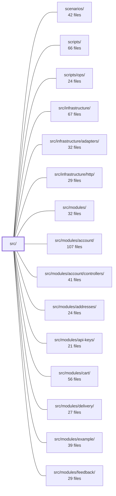

---
tags:
  - 2brain
  - 2brain/module
  - project/boilerplate-node-backend
type: module
module: src/
files: 34
updated: 2026-10-07T23:54:07.472103+00:00
---

# src/

## Purpose

`src/` is the application shell and kernel of a modular e-commerce platform. It owns the Express app factory, the cluster/serve entry points, and the cross-cutting kernel (authorization model, authentication port, module manifest contract, in-process event bus). Domain logic lives elsewhere; this directory is where all parts are wired together, where middleware order is fixed, and where the one-directional dependency boundary between the app tier and `src/modules/` is enforced.

## Key parts

- **Entry & lifecycle** — `cluster.ts` (production multi-core entry), `serve.ts` (single-process dev entry), `app.ts` (the `createApp()` factory that assembles the middleware stack, registers modules, and returns the `AppInstance`), `app/config.ts` (aggregates all runtime config and exposes `assertProcessConfig`).
- **HTTP concerns** — `app/security.ts` (secure headers, CORS, rate limiting, body parsing in load-bearing order), `app/request-context.ts` (correlation ID, access log, locale), `app/routes.ts` (mounts every module router + system routes + 404 catch-all), `app/telemetry.ts` (Prometheus latency/in-flight middleware), `app/static-assets.ts`, `app/system-routes.ts` (ping, liveness, readiness, `security.txt`), `app/error-handling.ts` (global Express error handler + process-level unhandled rejection/exception).
- **Kernel contracts** — `kernel/registry.ts` (the `AppModule` manifest interface every domain module implements), `kernel/permissions.ts` (permission keys & preset roles parsed from shared YAML), `kernel/authentication.ts` (the auth port separating "who is calling" from concrete token verification), `kernel/middlewares/authorizations.ts` (route-level auth guards), `kernel/ability.ts` + `kernel/access/query.ts` (CASL ability → MongoDB filter compilation), `kernel/events.ts` (in-process domain event bus), `kernel/translation.ts` (translation port).
- **Module registry** — `modules.ts`: the single list of every domain module in this build; the one place you edit when adding or removing a feature.
- **Shared types** — `types/` barrel (generated API models, AsyncAPI schemas, auth-context DTOs, rate-limit budget interface), `globals.d.ts` (ambient `Request` augmentation).
- **Workers** — `app/workers.ts`: registers all queue consumers at startup; delegates module-owned queues to the kernel registry.

## How it connects

- **`src/modules/*`** — The kernel defines the `AppModule` contract (`registry.ts`); each module under `src/modules/` implements it. `routes.ts` mounts their routers via the manifest without importing them directly. `modules.ts` is the discovery list both sides walk. ESLint enforces the one-directional boundary: modules may import kernel types, never the app tier.
- **`src/infrastructure/` and `src/infrastructure/adapters/`** — `app.ts` is the single place where infrastructure adapters (cache, queue, i18n, workers) are wired to the HTTP server. Kernel ports (authentication, translation, image writeback) are declared here and satisfied by concrete adapters at registration time.
- **`src/infrastructure/http/`** — Provides the transport primitives (server creation, response helpers) that `serve.ts`, `cluster.ts`, and `app/security.ts` build upon.
- **`scenarios/`, `scripts/`, `scripts/ops/`** — Consume `modules.ts` to enumerate available modules for scenario generation, docs, and operational checks; they never import individual module folders.

## Where to start

1. **`src/app.ts`** — Read `createApp()` top-to-bottom. You will see the exact middleware order, where each subsystem plugs in, and how the returned `AppInstance` exposes lifecycle. This one file tells you the shape of the entire runtime.
2. **`src/kernel/registry.ts`** — The `AppModule` interface is the contract every domain module satisfies. Understanding its fields (config, routes, queue consumers, translation targets, events) makes the module folders under `src/modules/` predictable to navigate.

## Connected modules

[[boilerplate-node-backend_ROOT|/ (repository root)]] · [[boilerplate-node-backend_scenarios|scenarios/]] · [[boilerplate-node-backend_scripts|scripts/]] · [[boilerplate-node-backend_scripts_ops|scripts/ops/]] · [[boilerplate-node-backend_src_infrastructure|src/infrastructure/]] · [[boilerplate-node-backend_src_infrastructure_adapters|src/infrastructure/adapters/]] · [[boilerplate-node-backend_src_infrastructure_http|src/infrastructure/http/]] · [[boilerplate-node-backend_src_modules|src/modules/]] · [[boilerplate-node-backend_src_modules_account|src/modules/account/]] · [[boilerplate-node-backend_src_modules_account_controllers|src/modules/account/controllers/]] · [[boilerplate-node-backend_src_modules_addresses|src/modules/addresses/]] · [[boilerplate-node-backend_src_modules_api-keys|src/modules/api-keys/]] · [[boilerplate-node-backend_src_modules_cart|src/modules/cart/]] · [[boilerplate-node-backend_src_modules_delivery|src/modules/delivery/]] · [[boilerplate-node-backend_src_modules_example|src/modules/example/]] · … and 13 more

## Files
- `src/app.ts` — Factory module that builds a single Express application instance. `createApp()` synchronously assembles the middleware stack, registers all enabled modules and their config, and returns an `AppInstance` carrying the Express object plus `boot`/`start`/`stop` lifecycle functions. It is the one place where infrastructure adapters (cache, queue, i18n, workers) are wired to the HTTP server, and the one place where middleware registration order is fixed.
- `src/app/config.ts` — Central configuration assembly point for the application. It defines the app tier's own runtime variables (HTTP bounds, security.txt fields), aggregates every infrastructure and kernel config slice into a single list, and exposes a validation entry point (`assertProcessConfig`) for processes that never call `createApp()`.
- `src/app/error-handling.ts` — The global Express error handler and the process-level (`unhandledRejection`, `uncaughtException`) handlers. It is the last safety net for any failure that no controller caught, answering two questions: what does the client see, and what gets logged / recorded in the trace. It is mounted after all routes so it only receives errors that propagated past every `try/catch` in the request path.
- `src/app/request-context.ts` — Installs the per-request context middlewares (correlation ID, access logging, locale) on an Express app. It exists as a single install step so that these cross-cutting concerns are guaranteed to run before any route handler, in a specific internal order that downstream code depends on.
- `src/app/routes.ts` — Single entry point for wiring all HTTP routes onto the Express app. It mounts each domain module's router at the base path that module's own manifest declares, adds the system-level root ping, and closes with a 404 catch-all — all without importing or referencing any specific domain by name.
- `src/app/security-txt.ts` — Pure helper module that builds the `/.well-known/security.txt` body (RFC 9116) and produces a boot-time warning when the `Expires` field is missing, past, or approaching. Extracted as pure functions over parsed settings so the HTTP route and unit tests share a single source of truth. Off by default: a fork must never accidentally publish the boilerplate author's contact.
- `src/app/security.ts` — Centralises all transport-level protections (secure headers, CORS, rate limiting, body parsing, server timeouts) in one file because their relative order is load-bearing and non-obvious. It is split into two install functions (`installSecurity`, `installRequestParsing`) so that `src/app.ts` can mount static-file serving between them, letting page assets bypass the caller's request budget.
- `src/app/static-assets.ts` — Wires up Express static-file serving for the public assets directory (uploaded images, favicon, web manifest). It exists as a dedicated module so the caching, security, and CORS-header logic lives alongside the config it depends on, and so the test suite can assert the guarantees in one place.
- `src/app/system-routes.ts` — Express router for process-level routes (root ping, liveness, readiness, `security.txt`) that serve the runtime itself rather than any business domain. It lives at the app level instead of in `src/modules` because it belongs to no single feature.
- `src/app/telemetry.ts` — Installs a single Express middleware that records per-request latency (histogram) and in-flight request count (gauge) as Prometheus metrics. It is mounted *before* the route table so the timer wraps the entire handler chain rather than just the matched handler.
- `src/app/workers.ts` — The single assembly point where all queue consumers are registered at application startup. It directly wires the two app-level queues (email sending, image digestion) and delegates module-owned queues (e.g. webhooks) to the kernel registry, so that new modules never require an edit here.
- `src/cluster.ts` — Production entry point (per `package.json`) that enables Node.js clustering across CPU cores. It guarantees `.env` is loaded and OTel tracing is started **before** any application module is imported, then forks and supervises worker processes on the primary.
- `src/globals.d.ts` — Ambient module augmentation that extends Express's `Request` interface with every field the app's middleware chain attaches. Handlers and services can read these fields with full type safety in every file without a per-site import.
- `src/kernel/ability.ts` — Builds a per-request CASL `MongoAbility` from a caller's declared permission keys and their scope. This is the single object every authorization question in the system is asked of — route guards, row-level reads, and key-enumeration endpoints all consume it or its helpers.
- `src/kernel/access/query.ts` — Compiles a caller's CASL permission rules into a ready-to-spread MongoDB filter fragment, so that "the restriction rides in the read" is a library guarantee rather than a per-module convention. It centralizes the translation (rule → query) in one place, eliminating the silent drift that arises when each module maintains its own filter fragment alongside the rules.
- `src/kernel/access/tenant.ts` — Exports the single, fixed `_id` for the deployment's tenant (shop). It lives in its own file rather than in `src/modules/access/service.ts` to break a circular import: `src/kernel/permissions.ts` needs the constant (for `anonymousCaller`, `SYSTEM_ACTOR`), and `access/service.ts` already imports from `permissions.ts`.
- `src/kernel/authentication.ts` — Declares the kernel's authentication port: the contract between the kernel (which needs to know *who* is calling) and the modules that can answer (`account` for user tokens, `api-keys` for machine credentials). It exists so the dispatch logic and the 401-vs-403 distinction live in one kernel-level file rather than being scattered across middleware, while concrete token verification stays in the owning module.
- `src/kernel/config.ts`
- `src/kernel/cookies.ts` — Provides a thin, single-purpose helper for reading one named cookie from an Express `Request`. It centralises the refresh-token cookie name and a generic accessor so that the handful of call-sites across modules (auth middleware, account controllers, observability) share one definition instead of each spelling out `request.cookies['jwt']`.
- `src/kernel/events.ts` — A minimal in-process domain event bus that lets modules communicate without importing each other, keeping the dependency graph acyclic. It exists because some cross-module relationships are genuinely mutual (e.g. catalogue ↔ cart) and the event abstraction lets the arrow point one way. It is explicitly **not** a message broker: no durability, no retry, no replay.
- `src/kernel/middlewares/authorizations.ts` — Express middleware guards that enforce authentication and authorization at the route level. Built on the token/credential resolvers in `kernel/authentication.ts`, these guards populate or inspect `request.authContext` / `request.caller`, verify permission keys against the caller's roles, gate requests by recency of proof, and audit every refusal before the response is sent. They are the single choke-point between an HTTP request and the route handlers in every module.
- `src/kernel/module-config.ts`
- `src/kernel/outbox.ts`
- `src/kernel/permissions.ts` — Defines the permission-key and preset-role model for the entire authorization system by reading and validating two shared YAML artefacts (`shared/authorization-keys.yaml`, `shared/authorization-roles.yaml`) once at import time. It exposes the parsed, immutable data (keys, roles, anonymous role) plus small lookup utilities so that no deployment can invent a permission key at runtime and no request ever re-parses YAML on the hot path.
- `src/kernel/registry.ts` — Defines the typed manifest contract (`AppModule`) and all supporting interfaces that a module uses to declare its runtime needs (config, image writeback, queue consumers, translation targets, public events, personal-data sections) to the application tier. It exists so that infrastructure adapters and sibling modules never need to import `src/modules/*` directly; instead the app tier collects every module's declarations and wires them up, preserving the one-directional dependency boundary enforced by ESLint.
- `src/kernel/staff-read.ts`
- `src/kernel/translation.ts` — Defines the **translation port**: a kernel-level hook that lets the read path resolve user-authored content (product titles, category descriptions) into the caller's language, and lets a hard delete of an entity cascade-delete its translation rows. It exists so that decorators over `createRepository` can depend on translation without importing `src/modules/*`, avoiding a circular dependency. The kernel declares the interface; `modules/locales` supplies the implementation at registration time.
- `src/modules.ts` — The single registry of every domain module this build serves. It is the one list the app tier, docs generators, ops scripts, and scenario checks all walk to discover which modules exist. Adding or removing a module is a folder under `src/modules/` plus (or minus) one line here.
- `src/serve.ts` — Thin, executable entry point (shebang) that is the single caller of `start()` (SK-D2). It builds the app via `createApp()`, registers signal handlers for graceful shutdown, and begins listening. It exists so that "build" and "serve" live in separate files, keeping `createApp` agnostic of whether the calling process actually wants to serve traffic.
- `src/types/asyncapi.generated.ts` — Auto-generated TypeScript type definitions and Zod validation schemas derived from `asyncapi.yaml`. It provides compile-time types, runtime validators, and channel-name constants for every event and message defined in the AsyncAPI specification, so the rest of the codebase can import a single canonical source for event payloads, envelope shapes, and channel identifiers.
- `src/types/auth-context.ts` — Type-only module that decouples the HTTP/auth flow from Mongoose document internals. It defines the shape of a resolved caller (`AuthContext`), the authorization-safe view of that caller (`Caller`), and the request-level context threaded into the service tier (`CallerContext`). Controllers, middleware, and the `@kernel` resolver port depend on these types rather than on `UserDocument`.
- `src/types/index.ts` — A type-only barrel that consolidates three type sources — generated API models, generated AsyncAPI types, and hand-written auth/rate-limit DTOs — behind a single import path (`@types`). Consumers never need to know which physical file a given type actually lives in.
- `src/types/rate-limit-budget.ts` — Declares the `RateLimitBudget` interface — the data shape for a single rate-limit budget as it appears on a module's manifest (`AppModule.rateLimits`). It is a pure type (erased at compile time) that bridges the kernel's manifest declaration and the infrastructure's `buildRateLimiter` factory, without forcing infrastructure to import kernel.
- `src/types/server-image.ts`

---
[[boilerplate-node-backend_INDEX|← boilerplate-node-backend index]]
