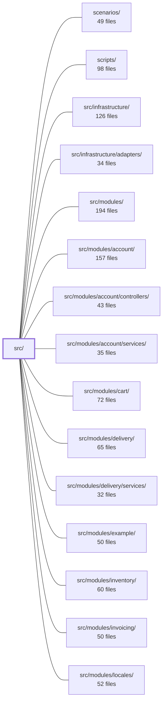

---
tags:
  - 2brain
  - 2brain/module
  - project/boilerplate-node-backend
type: module
module: src/
files: 40
updated: 2026-11-08T10:47:43.894419+00:00
---

# src/

## Purpose

`src/` is the application shell: it owns process entry, the Express assembly pipeline, and every cross-cutting contract that domain modules share. It sits between infrastructure (below) and feature modules (beside), providing the kernel interfaces, domain primitives, configuration validation, and HTTP-level middleware that let independently developed modules compose into one process without importing each other.

## Key parts

- **Process entry & app assembly** — `cluster.ts` (Node cluster bootstrap, import-order enforcement), `serve.ts` (listen + graceful shutdown), `app.ts` (the single `createApp()` factory), `modules.ts` (the ordered module registry both runtime and ops scripts walk), `app/config.ts` (flat env-var validation list shared by app, cluster, and scripts).
- **Kernel contracts & runtime** — `kernel/permissions.ts` + `kernel/ability.ts` + `kernel/access/query.ts` (permission vocabulary, per-request CASL ability, and the MongoDB filter compiler); `kernel/authentication.ts` + `kernel/cookies.ts` (auth-resolver port and credential-channel readers); `kernel/events.ts` + `kernel/outbox.ts` (in-process event bus and durable transactional outbox); `kernel/registry.ts` (the typed interface set modules implement so infrastructure never imports `src/modules/*`); `kernel/translation.ts`, `kernel/module-config.ts`, `kernel/config.ts`, `kernel/staff-read.ts`, `kernel/middlewares/` (remaining cross-cutting ports and Express guards).
- **Domain primitives** — `domain-primitives/lifecycle.ts`, `money.ts`, `postal-address.ts`, `time.ts`: framework-agnostic, import-free building blocks every tier can use without pulling in Express, Mongoose, or a date library.
- **HTTP-level concerns** — `app/security.ts` (middleware ordering), `app/error-handling.ts` (global handler + process listeners), `app/request-context.ts` (request ID + access log), `app/telemetry.ts` (Prometheus metrics), `app/routes.ts` (central route-installation pass), `app/system-routes.ts` / `app/config-routes.ts` / `app/security-txt.ts` (operational and compliance endpoints), `app/static-assets.ts`, `app/jobs.ts` (cross-cutting scheduled work), `app/workers.ts` (queue-consumer assembly).
- **Shared types** — `types/auth-context.ts`, `types/index.ts`, `types/rate-limit-budget.ts`, `types/server-image.ts`, `globals.d.ts` (ambient Express augmentation): the type contracts that let kernel, infrastructure, and modules agree on shapes without circular imports.

## How it connects

- **`src/modules/*`** — each module imports kernel ports (auth resolver, translation, registry interfaces, event bus) and domain primitives, then registers itself in `modules.ts`. The app tier mounts its routes, validates its config slice, collects its jobs, and resolves its queue names—all through the kernel contracts, never by reaching into another module's internals.
- **`src/infrastructure/` and `src/infrastructure/adapters/`** — infrastructure reads kernel interfaces (e.g. `RateLimitBudget` from `types/`, `AuthResolver` from `kernel/authentication.ts`) and the static-asset / security middleware that `app/` installs, while remaining ignorant of which concrete module supplies a given implementation.
- **`scenarios/` and `scripts/`** — both import `createApp()` from `app.ts` and the module list from `modules.ts` to build a fully wired app instance *without* calling `serve.ts`, so tests and ops tooling can exercise handlers and jobs in-process.
- **Repository root** — `package.json` names `cluster.ts` as the `main`/`start` entry, making it the first file Node loads in production.

## Where to start

Read **`src/app.ts`** first: its `createApp()` body is a linear, top-to-bottom tour of the middleware order, route mounting, job registration, and lifecycle hooks, so you see the whole assembly in one function. Then open **`src/kernel/registry.ts`** to understand the port/adapter boundary—once you see what modules must implement and what infrastructure is allowed to call, the dependency rules across the rest of the codebase become obvious.

## Connected modules

[[boilerplate-node-backend_ROOT|/ (repository root)]] · [[boilerplate-node-backend_scenarios|scenarios/]] · [[boilerplate-node-backend_scripts|scripts/]] · [[boilerplate-node-backend_src_infrastructure|src/infrastructure/]] · [[boilerplate-node-backend_src_infrastructure_adapters|src/infrastructure/adapters/]] · [[boilerplate-node-backend_src_modules|src/modules/]] · [[boilerplate-node-backend_src_modules_account|src/modules/account/]] · [[boilerplate-node-backend_src_modules_account_controllers|src/modules/account/controllers/]] · [[boilerplate-node-backend_src_modules_account_services|src/modules/account/services/]] · [[boilerplate-node-backend_src_modules_cart|src/modules/cart/]] · [[boilerplate-node-backend_src_modules_delivery|src/modules/delivery/]] · [[boilerplate-node-backend_src_modules_delivery_services|src/modules/delivery/services/]] · [[boilerplate-node-backend_src_modules_example|src/modules/example/]] · [[boilerplate-node-backend_src_modules_inventory|src/modules/inventory/]] · [[boilerplate-node-backend_src_modules_invoicing|src/modules/invoicing/]] · … and 11 more

## Files
- `src/app.ts` — Application factory. `createApp()` synchronously builds one Express instance — validates module config, registers domain-event handlers, mounts the middleware stack and every enabled route — and returns a `{ app, boot, start, stop }` lifecycle object. The file's sole structural purpose is preserving import order: OpenTelemetry must initialize before `express`, `http`, or `mongoose` are loaded, which only holds when a dynamic-import entry (e.g. `cluster.ts`) loads this module.
- `src/app/config-routes.ts` — Defines the public `GET /config` endpoint, which returns a single composite payload that a client needs *before* it has a session: session config, OAuth providers, antibot/challenge config, support email, operator identity, and terms version. The handler lives here (rather than inside any one module) because the response composes data owned by multiple modules and the operator-legal-identity fields must remain available even when optional features (e.g. the shop) are removed.
- `src/app/config.ts` — Defines the application tier's own environment variables (HTTP server bounds, security.txt contact fields) and assembles the single flat list of every configuration slice that a process must validate at boot. This is the one place where "the whole environment" is judged in a pass, shared by the app, the cluster primary, and ops scripts.
- `src/app/error-handling.ts` — The global Express error handler plus the two process-level error listeners (`unhandledRejection`, `uncaughtException`). It answers one question at two levels—inside a request and outside one—by resolving a status, logging a redacted error, and sending a constant client response that never forwards library-generated messages.
- `src/app/jobs.ts` — Declares the four application-level scheduled jobs that are not owned by any domain module: quarantine reaping, orphaned-image sweep, mail-spool reaping, and outbox backstop. Module-specific jobs live on their respective `AppModule.jobs` manifest; this file is the catch-all for cross-cutting cleanup and delivery guarantees.
- `src/app/request-context.ts` — Per-request context middleware: assigns a request ID, preserves a client-supplied ID when trusted, and installs the access logger. It must run before any route handler so that every downstream consumer (routes, audit entries, the access log) can read `request.requestId` and `request.clientRequestId`.
- `src/app/routes.ts` — Central route-installation function for the Express app. It wires up a default cache-control header, registers 405 guards, mounts every enabled domain module at its self-declared base path, attaches the two cross-cutting routers (system ping, config), and closes with a 404 catch-all — all in one ordered pass so no later mount can slip behind the terminal handlers.
- `src/app/security-txt.ts` — Pure function that builds the body of `/.well-known/security.txt` (RFC 9116) from parsed environment settings. It exists so the HTTP route and the unit tests share a single source of truth for the file's content, and so expiration logic can be evaluated per-request rather than once at boot.
- `src/app/security.ts` — Installs transport-level security middleware (secure headers, CORS, rate limiting, body parsing, server timeouts) in a strict order where sequence is load-bearing: trust proxy → rate limiter → body parsers → content-type guard. Splits installation into two functions (`installSecurity`, `installRequestParsing`) so `src/app.ts` can mount static file serving between them, keeping static assets out of the rate-limit budget.
- `src/app/static-assets.ts` — Installs an `express.static` middleware that serves public assets (uploaded images, favicon, web manifest) from a configured directory. It exists in-process rather than behind a reverse proxy so that caching, security, and CORS behavior are covered by the project's own test suite.
- `src/app/system-routes.ts` — Defines an Express `Router` for process-level endpoints that are not part of any domain module: the root ping, Kubernetes liveness/readiness probes, and the `security.txt` disclosure contact. It exists so that operational and compliance routes stay out of `src/modules`, where business-logic routes live.
- `src/app/telemetry.ts` — Installs a single Express middleware that records per-request latency (histogram) and in-flight request count (gauge) as Prometheus metrics. It must be mounted **before** all route definitions so the timing wraps the full handler chain.
- `src/app/workers.ts` — Queue-consumer registration for this build. It is the single assembly point where the app decides *which* queues exist at the infrastructure level (email, image) and delegates all module-owned queues to the kernel registry. This separation keeps the app from hard-coding module-specific queue names while still naming the two queues that make sense even in a module-less application.
- `src/cluster.ts` — The process entry point (declared in `package.json`) that enables Node.js cluster mode. Its critical job is to enforce initialization order—dotenv → Mongoose defaults → OTel instrumentation—before any application code loads, then either fork and supervise worker processes (primary) or serve the app (worker).
- `src/domain-primitives/lifecycle.ts` — A framework-agnostic, type-safe lifecycle (state machine) defined as a declarative event table. It gives every module a single source of truth for which named events are legal from which statuses, who may fire them, and where they land — validated once at construction, queried via a small read-only interface. The shape mirrors Solidus / Symfony Workflow event tables and Google AIP-216's one-verb-per-transition principle.
- `src/domain-primitives/money.ts` — Defines the `Money` type and its full arithmetic/formatting toolkit. All monetary values in the system are stored and manipulated as **whole integers of minor units** (never floats), with conversion to/from decimal strings handled by digit-shifting rather than multiplication, so totals stay exact and order-independent. The file also pins the ISO 4217 exponent table in-repo so currency scaling never depends on the runtime's CLDR data.
- `src/domain-primitives/postal-address.ts` — Defines the canonical list of postal-address fields that are personal data, shared by every module that encrypts an address at rest. It lives in `domain-primitives` (below all feature tiers) because orders, delivery, and the address book each need the same answer without depending on one another.
- `src/domain-primitives/time.ts` — A single, import-free module that centralises time-unit constants (minutes, hours, days in both ms and s) and a small set of zone-aware calendar helpers. It sits below every architectural tier so that `domain/` code, infrastructure adapters, and test doubles all share the same spellings of "a day" and the same logic for "the 5th in Rome" without pulling in a framework or a date library.
- `src/globals.d.ts` — Ambient module augmentation of Express's `Request` interface (via `express-serve-static-core`). It gives every route handler in the app a typed view of the fields that middleware attaches at runtime—auth context, request ids, upload state, locale, translation—without requiring an explicit `import` at each call site.
- `src/kernel/ability.ts` — Builds a per-request CASL `MongoAbility` from a resolved `Caller`'s declared rules, so that every authorization question in the codebase is answered against a single, consistent object. Rules compile into a database filter (so restrictions ride inside the read) and are identical between server and browser. The file also exposes row-level and set-level query helpers that modules use instead of restating rules in their own code.
- `src/kernel/access/query.ts` — Compiles a caller's CASL rules into a MongoDB filter so that the access restriction is embedded in the read query itself. It is the kernel's single store-specific authorization-compile step (the other being `../outbox.ts`), replacing per-module hand-written filter fragments with one guarantee: a key that grants more returns more, and no caller can accidentally omit the restriction.
- `src/kernel/access/tenant.ts` — Single-source home for the deployment's pinned tenant `_id`. Lives in `src/kernel/access/` (not `src/modules/access/services/`) specifically to break a circular import: `permissions.ts` needs the constant, and `access/services/` already imports from `permissions.ts`.
- `src/kernel/authentication.ts` — Kernel-level port that decouples "who is making this request?" from the modules that actually answer it. It declares the `AuthResolver` and `CredentialResolver` interfaces, holds the single registered instance of each, and exposes thin resolve/clear functions that middlewares and guards call without knowing which module (account or api-keys) supplies the implementation. It also owns the two token-prefix constants used to dispatch between the session path and the machine-key path.
- `src/kernel/config.ts` — Defines the kernel-level runtime configuration for two cross-cutting concerns: the step-up reauthentication freshness windows (`reauthConfig`) and the transactional outbox relay policy (`outboxConfig`). It lives in the kernel rather than any module so that every module mounting `requireFreshAuth` or reading outbox rules gets its values from a single, module-agnostic source.
- `src/kernel/cookies.ts` — Thin kernel-level helpers for the two credential channels a request can carry: the **session cookie** (name + reader) and the **`Authorization: Bearer` header** (token parser). It sits above the generic infrastructure cookie utilities and below every consumer that needs to *read* a session credential, providing one shared name and one shared parser so that authentication, logout, and session strategies all agree on the same source of truth.
- `src/kernel/events.ts` — In-process domain event bus that lets two modules communicate without a direct import, keeping the dependency graph acyclic. It is deliberately **not** a durable message broker — no retry, no replay, no persistence. Its role is to break mutual-dependency cycles (e.g. product ↔ cart) into a one-way arrow.
- `src/kernel/middlewares/authorizations.ts` — Express middleware guards that sit between authentication (credential resolution) and route handlers. They populate `request.authContext`, enforce permission rules declared per-route, gate requests by session recency, and—critically—audit every refusal before the response is sent. The file exists so that identity and authorization concerns are handled in one place, keeping route handlers free of token-parsing, role-checking, and audit plumbing.
- `src/kernel/middlewares/locale-preview.ts` — Express middleware that re-binds an in-flight request to a **draft (switched-off) language** when a staff caller explicitly requests that language as their *first* `Accept-Language` choice. It lets product pages resolve text against draft translations through the normal live chain, without exposing the draft to non-staff callers or to callers who merely listed it at a lower `q` value.
- `src/kernel/module-config.ts` — Boot-time configuration gate. It collects every config slice contributed by the enabled modules (their declared slices plus auto-generated rate-limit budgets) and the app-level slices handed in by the caller, then validates all of them in a single pass so a misconfigured deployment reports every problem at once instead of one per restart.
- `src/kernel/outbox.ts` — Transactional outbox for durable domain events. An event row is written to MongoDB in the **same transaction** as the state change it announces, then published later by a relay process. This guarantees that a committed state change cannot lose its corresponding event, in contrast to the in-process bus in `./events` which offers no durability.
- `src/kernel/permissions.ts` — Declares the full permission vocabulary — rules, sets, preset roles, and audience roles — by reading and validating the two shared YAML artefacts (`shared/authorization-keys.yaml`, `shared/authorization-roles.yaml`) **once at module import**. It enforces the CanCan three-layer model (rule → set → role) and acts as the single source of truth for what permissions exist, so that no deployment can invent a rule that nothing checks.
- `src/kernel/registry.ts` — Defines the typed interface contracts that modules register to declare what the application must do *for* them — image writeback, queue consumption, translation targets, public-event projection, browser-event reporting, and personal-data handling. It exists to enforce the boundary rule that infrastructure adapters and cross-domain services (image worker, queue, translation, webhooks, analytics) **cannot** import from `src/modules/*`; instead, modules supply implementations through these registry interfaces and infrastructure resolves them generically at runtime.
- `src/kernel/staff-read.ts` — Records a single audit entry (`admin.<resource>.viewed`) whenever a staff member reads **another** person's record in detail. It is deliberately a no-op for self-reads and for callers without the resource's wide-read permission, so that ordinary customer self-service traffic never generates audit noise.
- `src/kernel/translation.ts` — Defines the **translation port**: the kernel-level contract for resolving user-authored content (product titles, category descriptions) into a caller's language and for cascade-removing translation rows on a hard delete. The kernel declares the interface; `modules/locales` registers the concrete implementation, so decorators and other kernel-adjacent code can depend on translation without importing `src/modules/*` and risking a circular dependency. The same port/adapter pattern used by `kernel/authentication.ts`'s `AuthResolver`.
- `src/modules.ts` — The build's module registry. It declares which domain modules this application serves by importing each module's default export and placing them in a single, ordered array. Both the runtime app tier and the build/ops scripts walk this one list to discover modules, mount routes, register jobs, and collect per-module resources. It exists so that adding or removing a domain is a finite, visible set of edits rather than scattered discoveries.
- `src/serve.ts` — Process-level entry point that builds the app via `createApp()`, starts listening, and wires graceful shutdown to OS signals. Exists to separate "build the app" from "serve traffic," so callers that only need an app instance (tests, scenarios) can import `createApp` without triggering a listen or registering signal handlers.
- `src/types/auth-context.ts` — Defines the type contracts for identity and authorization in the request pipeline: `AuthContext` (what the resolver knows about a caller), `Caller` (what an authorization rule may safely read), and `CallerContext` (what a service needs about the request). These types let controllers, middleware, and the kernel resolver depend on a transport-safe shape without importing Mongoose document types, and they make cross-tenant reads and half-formed callers impossible to express by accident.
- `src/types/index.ts` — Public type barrel that consolidates re-exports from generated API models, generated AsyncAPI types, and hand-written domain DTOs into a single import path (`@types`). Consumers never need to know which of the three sources a given type originates from.
- `src/types/rate-limit-budget.ts` — Declares the `RateLimitBudget` interface — the single data shape every rate-limit budget in the app must conform to. It sits under `src/types/` (rather than beside `AppModule` in the kernel) so that infrastructure can import it *downward* without violating the kernel→infrastructure dependency wall. Infrastructure's `buildRateLimiter` reads one of these objects and emits the actual Express middleware.
- `src/types/server-image.ts` — Defines the server-decided image representation for write operations. It separates the "image half of a write" from client-supplied request bodies, ensuring image fields are only set by the upload pipeline and never interpreted directly from a client payload.

---
[[boilerplate-node-backend_INDEX|← boilerplate-node-backend index]]
