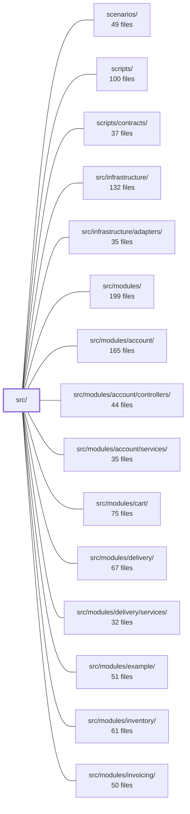

---
tags:
  - 2brain
  - 2brain/module
  - project/boilerplate-node-backend
type: module
module: src/
files: 42
updated: 2026-11-15T00:29:00.255637+00:00
---

# src/

## Purpose

`src/` is the entire application source tree. It assembles the Express HTTP server, defines the cross-cutting kernel (authentication, authorization, events, outbox, translation, module configuration), provides framework-agnostic domain primitives (money, time, lifecycle), and acts as the single wiring point where domain modules are registered, validated, and mounted into the HTTP surface.

## Key parts

- **Application assembly & entry** — `main.ts` (default entry: env → Mongoose → tracing → HTTP), `serve.ts` (starts listening + shutdown signals), `cluster.ts` (multi-process entry for bare-VM deploys), `app.ts` (the `createApp()` factory that validates config, registers modules, mounts middleware/routes, and returns the `{ app, boot, start, stop }` lifecycle object).
- **App-level HTTP plumbing** (`src/app/`) — `config.ts` (boot-time env validation), `security.ts` (CORS, headers, rate-limit ordering), `routes.ts` (walks `enabledModules` to mount routers), `error-handling.ts` (global Express + process-level error handlers), `jobs.ts` (app-level scheduled housekeeping), `telemetry.ts` (Prometheus middleware), `request-context.ts` (request-ID + access-logger middleware), `static-assets.ts`, `system-routes.ts` (liveness/readiness/security.txt), `config-routes.ts` (public `/config` payload), `boot-rendering.ts` (translation + mail-template boot), `security-txt.ts`.
- **Kernel** (`src/kernel/`) — Cross-cutting contracts and services shared by all modules: `authentication.ts` (auth port/resolver), `permissions.ts` (CASL rule vocabulary from YAML), `ability.ts` + `access/query.ts` (per-request ability + Mongo filter compilation), `middlewares/authorizations.ts` (route guards), `events.ts` (in-process domain event bus), `outbox.ts` (transactional outbox + relay), `translation.ts` (translation port), `module-config.ts` (boot-time config gate), `registry.ts` (module-manifest type slots for dependency inversion), `cookies.ts`, `config.ts` (reauth/outbox windows), `staff-read.ts` (GDPR view-audit), `access/tenant.ts`.
- **Domain primitives** (`src/domain-primitives/`) — `money.ts` (integer minor-unit currency type), `time.ts` (unit constants + zoned calendar helpers), `lifecycle.ts` (declarative state-machine event table), `postal-address.ts` (shared encrypted-field list). Zero runtime dependencies; importable from any tier without circular risk.
- **Module registry** — `modules.ts`: the single list of enabled domain modules; consumed by the app tier, docs generators, ops scripts, and test scenarios.
- **Types** — `types/index.ts` (barrel re-exporting generated + hand-written DTOs), `types/auth-context.ts` (transport-safe identity types), `globals.d.ts` (ambient `Express.Request` augmentation).

## How it connects

- **`src/modules/`** — The app tier (`app.ts`, `routes.ts`, `module-config.ts`) walks the list declared in `modules.ts` and each module's `AppModule` manifest to register routes, config slices, jobs, and queue consumers. Modules implement kernel ports (auth resolver, translation, webhook, image processing) via the typed slots in `kernel/registry.ts`, so `src/` never imports a module's internals.
- **`src/infrastructure/` / `src/infrastructure/adapters/`** — Infrastructure adapters (database, queue, mail, image processing) sit *below* the kernel and implement the ports it declares. The kernel and app tiers depend on interfaces, not on adapter classes, keeping the dependency arrow pointing downward.
- **`scripts/`, `scripts/contracts/`** — Ops scripts and contract generators import `modules.ts` for the canonical module list and `src/types/` for the shared type vocabulary, so tooling stays in sync with the runtime build.
- **`scenarios/`** — End-to-end test scenarios reference the module registry and type barrel to build realistic request fixtures without importing module internals.
- **Repository root** — `package.json` scripts (`start`, `dev`, `start:cluster`, `e2e:serve`) target `main.ts`, `cluster.ts`, and `serve.ts` as the process entry points.

## Where to start

1. **`src/app.ts`** — Read `createApp()` top-to-bottom. In one file you see the full assembly order: config validation → module registration → middleware stack → route mounting → lifecycle return. It is the table of contents for the rest of `src/`.
2. **`src/modules.ts`** — A short file that names every domain module in the build. Pair it with one module folder (e.g. `src/modules/products/`) to see what a module's manifest looks like and how it plugs into the seams defined by the kernel.

## Connected modules

[[boilerplate-node-backend_ROOT|/ (repository root)]] · [[boilerplate-node-backend_scenarios|scenarios/]] · [[boilerplate-node-backend_scripts|scripts/]] · [[boilerplate-node-backend_scripts_contracts|scripts/contracts/]] · [[boilerplate-node-backend_src_infrastructure|src/infrastructure/]] · [[boilerplate-node-backend_src_infrastructure_adapters|src/infrastructure/adapters/]] · [[boilerplate-node-backend_src_modules|src/modules/]] · [[boilerplate-node-backend_src_modules_account|src/modules/account/]] · [[boilerplate-node-backend_src_modules_account_controllers|src/modules/account/controllers/]] · [[boilerplate-node-backend_src_modules_account_services|src/modules/account/services/]] · [[boilerplate-node-backend_src_modules_cart|src/modules/cart/]] · [[boilerplate-node-backend_src_modules_delivery|src/modules/delivery/]] · [[boilerplate-node-backend_src_modules_delivery_services|src/modules/delivery/services/]] · [[boilerplate-node-backend_src_modules_example|src/modules/example/]] · [[boilerplate-node-backend_src_modules_inventory|src/modules/inventory/]] · … and 12 more

## Files
- `src/app.ts` — Assembly point for the Express application. `createApp()` validates module config, registers enabled modules, mounts the middleware stack and routes in a fixed order, and returns a `{ app, boot, start, stop }` lifecycle object. It is the single place where infrastructure, modules, and the HTTP surface are wired together; calling it has side effects, importing it does not.
- `src/app/boot-rendering.ts` — Boots the "rendering" layer: translation files, mail templates, and admin-edited overlay copy. Both the web app and every scheduled job call it so that a mail reads identically regardless of where it is built.
- `src/app/config-routes.ts` — Defines the public `GET /config` endpoint, which returns a single composite payload that a client needs *before* it has a session: session config, OAuth providers, antibot/challenge config, support email, operator identity, and terms version. The handler lives here (rather than inside any one module) because the response composes data owned by multiple modules and the operator-legal-identity fields must remain available even when optional features (e.g. the shop) are removed.
- `src/app/config.ts` — Central assembly point for every configuration slice a process validates at boot. It defines the app tier's own variables (HTTP server bounds, `security.txt` fields), imports every infrastructure/kernel slice, and exposes a single list plus a validation entry point so that app boot, the cluster primary, and ops scripts all judge the environment identically.
- `src/app/error-handling.ts` — The single global error handler for the Express app plus the two process-level handlers (`unhandledRejection`, `uncaughtException`) that catch failures nobody else did. It centralises status resolution, log scrubbing, metric recording, and the client-facing response so that no route or middleware re-implements "what to do when something throws."
- `src/app/jobs.ts` — Declares the scheduled jobs that belong to no specific module — the "app-level" housekeeping jobs (quarantine reaper, orphaned-image sweep, mail-spool reaper, outbox backstop). Jobs owned by a module live on its `AppModule.jobs` manifest instead; everything here is declared once, centrally, in `appJobs`.
- `src/app/request-context.ts` — Per-request context middleware: assigns a request ID, preserves a client-supplied ID when trusted, and installs the access logger. It must run before any route handler so that every downstream consumer (routes, audit entries, the access log) can read `request.requestId` and `request.clientRequestId`.
- `src/app/routes.ts` — Central route-mounting install for the Express app. It walks `enabledModules` to attach each module's router at its self-declared `basePath`, mounts the two app-level routers (`system-routes`, `config-routes`), and registers the 404 catch-all — all without referencing any specific domain name.
- `src/app/security-txt.ts` — Pure function that builds the body of `/.well-known/security.txt` (RFC 9116) from parsed environment settings. It exists so the HTTP route and the unit tests share a single source of truth for the file's content, and so expiration logic can be evaluated per-request rather than once at boot.
- `src/app/security.ts` — Configures all transport-level protections (secure headers, CORS, rate limiting, body parsing) for the Express application. The ordering is load-bearing and non-obvious, so this file is the single place that decides *which* middleware handlers get installed and *in what sequence*. It is split into two exported install functions so `src/app.ts` can serve static files between them (static files get headers but don't consume rate-limit budget or pay for body parsing).
- `src/app/static-assets.ts` — Installs an `express.static` middleware that serves public assets (uploaded images, favicon, web manifest) from a configured directory. It exists in-process rather than behind a reverse proxy so that caching, security, and CORS behavior are covered by the project's own test suite.
- `src/app/system-routes.ts` — Defines an Express `Router` for process-level endpoints that are not part of any domain module: the root ping, Kubernetes liveness/readiness probes, and the `security.txt` disclosure contact. It exists so that operational and compliance routes stay out of `src/modules`, where business-logic routes live.
- `src/app/telemetry.ts` — Installs a single Express middleware that records per-request latency (histogram) and in-flight request count (gauge) as Prometheus metrics. It must be mounted **before** all route definitions so the timing wraps the full handler chain.
- `src/app/workers.ts` — Queue-consumer registration for this build. It is the single assembly point where the app decides *which* queues exist at the infrastructure level (email, image) and delegates all module-owned queues to the kernel registry. This separation keeps the app from hard-coding module-specific queue names while still naming the two queues that make sense even in a module-less application.
- `src/cluster.ts` — Entry point for `npm run start:cluster` on a bare VM (no PM2/systemd). Uses Node's `cluster` module to fork worker processes, supervise their lifecycle (respawn on crash with backoff, coordinated graceful shutdown), and serve HTTP in each worker. Not the default entry — containers scale via `--scale app=N` instead.
- `src/domain-primitives/lifecycle.ts` — A framework-agnostic, type-safe lifecycle (state machine) defined as a declarative event table. It gives every module a single source of truth for which named events are legal from which statuses, who may fire them, and where they land — validated once at construction, queried via a small read-only interface. The shape mirrors Solidus / Symfony Workflow event tables and Google AIP-216's one-verb-per-transition principle.
- `src/domain-primitives/money.ts` — A zero-dependency domain primitive that represents monetary amounts as **whole integers of minor units** (never floats) and provides exact, order-independent arithmetic and string conversion. It pins the ISO 4217 minor-unit exponents in-repo so that every read, write, and display in the system agrees on a currency's scale without relying on the runtime's CLDR/`Intl` data. The `Money` type is a compile-time brand over `number`, not a class, so there is no runtime cost.
- `src/domain-primitives/postal-address.ts` — Defines the single canonical list of personal-data fields in a postal address that are encrypted at rest. It sits in the lowest tier (domain-primitives) so that three modules—orders, delivery, and the address book—that do not all depend on one another can share the same field list without introducing circular dependencies.
- `src/domain-primitives/time.ts` — Centralises time-unit constants (minutes, hours, days in ms and seconds) and timezone-aware calendar helpers (zone day, zone year, zoned midnight, end-of-UTC-day, one-calendar-month-later). It sits below every architectural tier so that `domain/` rules—retention windows, deadline calculations, day-grouping—can express themselves as `7 * DAY_MS` or `dayInZone(instant, zone)` without pulling in a date library or an infrastructure dependency.
- `src/globals.d.ts` — Ambient module augmentation of Express's `Request` interface (via `express-serve-static-core`). It gives every route handler in the app a typed view of the fields that middleware attaches at runtime—auth context, request ids, upload state, locale, translation—without requiring an explicit `import` at each call site.
- `src/kernel/ability.ts` — Builds a per-request CASL `Ability` (a `MongoAbility`) from a caller's declared permission rules and their contextual conditions. Every authorization question in the system—route guards, per-row checks, permission-set membership—is answered against this single object, so that the server's read filter and the browser's UI greying derive from the same ruleset rather than parallel copies.
- `src/kernel/access/query.ts` — Compiles a caller's CASL permission rules into a ready-to-use MongoDB filter via `@casl/mongoose`, so that access restrictions are embedded directly in the database query. It is the kernel's single guarantee that "the restriction rides in the read," replacing per-module hand-written filter fragments that can silently drift from the rules.
- `src/kernel/access/tenant.ts` — Single-source home for the deployment's pinned tenant `_id`. Lives in `src/kernel/access/` (not `src/modules/access/services/`) specifically to break a circular import: `permissions.ts` needs the constant, and `access/services/` already imports from `permissions.ts`.
- `src/kernel/authentication.ts` — Declares the kernel's authentication **port**: the contract for answering "who is making this request?" It defines the `AuthResolver` and `CredentialResolver` interfaces, the token-prefix constants that drive dispatch, and the thin accessor functions the rest of the kernel calls. The `account` module supplies the session resolver at boot; the `api-keys` module supplies the machine-credential resolver. The kernel itself never inspects token internals — it only knows *where* on the request a credential travels.
- `src/kernel/config.ts` — Defines the kernel-level runtime configuration for two cross-cutting concerns: the step-up reauthentication freshness windows (`reauthConfig`) and the transactional outbox relay policy (`outboxConfig`). It lives in the kernel rather than any module so that every module mounting `requireFreshAuth` or reading outbox rules gets its values from a single, module-agnostic source.
- `src/kernel/cookies.ts` — Thin kernel-level helpers for the two credential channels a request can carry: the **session cookie** (name + reader) and the **`Authorization: Bearer` header** (token parser). It sits above the generic infrastructure cookie utilities and below every consumer that needs to *read* a session credential, providing one shared name and one shared parser so that authentication, logout, and session strategies all agree on the same source of truth.
- `src/kernel/events.ts` — In-process domain event bus that lets two modules communicate without a direct import, keeping the dependency graph acyclic. It is deliberately **not** a durable message broker — no retry, no replay, no persistence. Its role is to break mutual-dependency cycles (e.g. product ↔ cart) into a one-way arrow.
- `src/kernel/middlewares/authorizations.ts` — Express middleware guards for identity and permission checks. Built on `kernel/authentication.ts`'s credential resolver, these guards authenticate a caller (via bearer header or session cookie), verify that the caller's role holds a declared permission rule, and optionally gate on how recently the caller proved their identity. Every rejection is audited before the response is sent, so a denied request always leaves a trail.
- `src/kernel/middlewares/locale-preview.ts` — Express middleware that lets an authenticated staff member preview product copy in a draft (switched-off) language. If the caller's first `Accept-Language` entry names a draft locale and the caller has draft-read permission, the request is re-bound to that locale for the downstream handlers; everyone else falls through untouched.
- `src/kernel/module-config.ts` — Boot-time configuration gate. It collects every config slice contributed by the enabled modules (their declared slices plus auto-generated rate-limit budgets) and the app-level slices handed in by the caller, then validates all of them in a single pass so a misconfigured deployment reports every problem at once instead of one per restart.
- `src/kernel/outbox.ts` — Implements the transactional outbox pattern: a domain event is written into the `outboxevents` Mongo collection inside the **same transaction** as the state change it announces, then a relay process picks it up and publishes it to the in-process event bus. This is the durable (at-least-once) delivery path, as opposed to the fire-and-forget bus in `./events` which offers no durability. Guarantees per-aggregate ordering, exponential-backoff retries, lease-based claim safety across concurrent relays, and TTL-based cleanup of published rows.
- `src/kernel/permissions.ts` — Declares the static permission vocabulary—rules, sets, and preset/audience roles—by reading two shared YAML artefacts (`authorization-keys.generated.yaml`, `rules/authorization-roles.yaml`) exactly once at module import. It enforces the CanCan three-layer model (rule → set → role) and guarantees that no deployment can invent a rule not present in those files. Validation failures throw at boot, not on the first authorization decision.
- `src/kernel/registry.ts` — Defines a set of typed contract interfaces (the "module manifest" slots) that let application-tier modules declare capabilities to infrastructure code without the infrastructure importing the modules. This is the dependency-inversion seam behind the project's module boundary: infrastructure adapters (image worker, queue, webhooks, analytics, translation) cannot import `src/modules/*`, so each module registers a small interface instead, keyed under a named slot on its manifest. The file is a pure type-level registry — it exports no runtime logic beyond re-exporting a couple of helper imports.
- `src/kernel/staff-read.ts` — Records an audit entry (`admin.<resource>.viewed`) when a staff member opens another person's record in a detail view. It enforces two filters before writing: the caller must hold the resource's wide-read rule, and a session caller reading their own record is skipped. It is the single point at which "who looked at my data" events are captured, feeding the GDPR Art. 15 export.
- `src/kernel/translation.ts` — Defines the **translation port**: the kernel-level contract for resolving user-authored content (product titles, category descriptions) into a caller's language and for cascade-removing translation rows on a hard delete. The kernel declares the interface; `modules/locales` registers the concrete implementation, so decorators and other kernel-adjacent code can depend on translation without importing `src/modules/*` and risking a circular dependency. The same port/adapter pattern used by `kernel/authentication.ts`'s `AuthResolver`.
- `src/main.ts` — The default single-process entry point for the application. It orchestrates the exact bootstrap sequence—loading environment variables, setting Mongoose defaults, starting OpenTelemetry tracing—then dynamically imports the HTTP server so that tracing patches are in place before Express or Mongoose are loaded. It is the target of `npm start`, `npm run dev`, `e2e:serve`, `debug`, `dev:docker`, and the production image CMD.
- `src/modules.ts` — The single module registry for the build: declares which domain modules this server serves and provides the canonical list, name set, directory collector, and compile-time name type that the app tier, docs generators, ops scripts, and test scenarios all consume. It is the one place a developer adds or removes a module (alongside the corresponding folder under `src/modules/`).
- `src/serve.ts` — The single process entry point that calls `start()` to begin serving traffic. It exists so that "build the app" and "serve the app" are separate concerns: `createApp()` in `app.ts` remains agnostic about whether its caller wants to listen on a port, while this file is the one place that actually starts the server and wires shutdown signals.
- `src/types/auth-context.ts` — Defines the transport-safe type vocabulary for "who is making this request" across three layers: the resolved identity (`AuthContext`), the authorization-relevant projection (`Caller`), and the per-request service context (`CallerContext`). It decouples controllers, middleware, and the `@kernel` resolver port from Mongoose `UserDocument` internals so that no consumer needs to import the document shape.
- `src/types/index.ts` — Public type barrel that consolidates re-exports from generated API models, generated AsyncAPI types, and hand-written domain DTOs into a single import path (`@types`). Consumers never need to know which of the three sources a given type originates from.
- `src/types/rate-limit-budget.ts` — Defines the `RateLimitBudget` interface — the declarative data shape for a single rate-limit budget. It is deliberately placed under `src/types/` (not beside `AppModule` in kernel) so that infrastructure code, which is forbidden from importing kernel, can still consume the shape when building the actual Express middleware.
- `src/types/server-image.ts` — Defines the server-decided image representation for write operations. It separates the "image half of a write" from client-supplied request bodies, ensuring image fields are only set by the upload pipeline and never interpreted directly from a client payload.

---
[[boilerplate-node-backend_INDEX|← boilerplate-node-backend index]]
