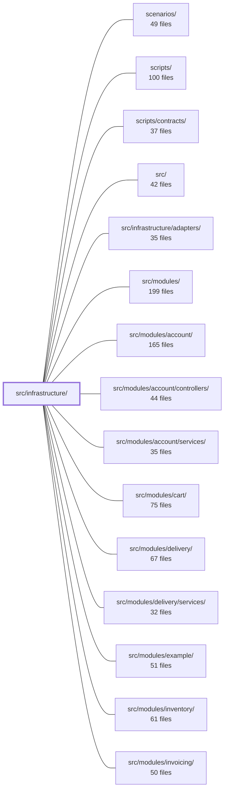

---
tags:
  - 2brain
  - 2brain/module
  - project/boilerplate-node-backend
type: module
module: src/infrastructure/
files: 132
updated: 2026-11-15T00:29:18.471361+00:00
---

# src/infrastructure/

## Purpose

`src/infrastructure/` provides the two cross-cutting layers that every domain module depends on but no single module owns: a typed, validated configuration system (environment variables + shared YAML rules) and the HTTP transport toolkit (Express middleware, error mapping, and shared request/response helpers). Domain modules import from here; nothing here imports from a specific module.

## Key parts

- **Config core** (`config/define.ts`, `config/fields.ts`, `config/store.ts`, `config/dotenv.ts`, `config/secret-files.ts`) — A single parse-point that reads `.env`, freezes a `process.env` snapshot, resolves `NODE_*_FILE` secrets, and exposes typed, memoised accessors. Field builders (`int`, `email`, `secret`, `keyRing`, …) pair Zod rules with presence checks; the store layers caller overrides and a version counter for invalidation.
- **Shared-rules schemas** (`config/shared-rules/*.ts`) — One Zod schema per `shared/rules/*.yaml` file (defaults, rate-limits, metrics, cookies, images, jobs, password-hash, outbox, log-redaction, etc.) plus `load.ts` (the boot-time YAML loader) and `registry.ts` (the name→schema map consumed by both the runtime loader and the code-gen script). `generate-spec.ts` defines the type-level contract for turning a rules file into a committed TypeScript constant.
- **HTTP middleware** (`http/middlewares/`) — Rate limiting (store + budgets), response caching, idempotency ledger, locale negotiation, CSRF origin guard, content-type enforcement, JSON depth/object guards, human-challenge gate, method-not-allowed / OPTIONS, anti-bot log helper, and locale context. Each is a standalone Express middleware mounted by the app router.
- **HTTP helpers** (`http/controller.ts`, `http/errors.ts`, `http/cookies.ts`, `http/ids.ts`, `http/frontend-link.ts`, `http/config.ts`) — Boilerplate reduction (input validation, result branching, DB-error catch), a single error→status mapper, cookie/ID extraction, frontend URL templating, and the deployment-specific HTTP settings slice.

## How it connects

- **`src/modules/*`** (account, cart, delivery, orders, payments, products, etc.) are the primary consumers: they import the config slices for their own env vars, the `defineRateLimiter` factory, the shared `reject` helpers from `http/errors.ts`, the controller helpers, and mount the relevant middlewares on their routes. They never re-implement rate-limit bookkeeping, error mapping, or locale threading.
- **`src/infrastructure/adapters/`** is a sibling infrastructure concern. The HTTP cache middleware and the rate-limit store both reach through `adapters/cache.ts` / `adapters/redis.ts` for persistence; the config layer's secret-file resolver and the store's Redis-backed overrides assume those adapters are already wired.
- **`scripts/` and `scripts/contracts/`** consume the shared-rules registry and `generate-spec.ts` at build time to regenerate committed TypeScript files and validate contract files, without booting the server.
- **`src/modules/locales/`** supplies the translation tables that the locale middleware's `t` function resolves against per request.
- **`src/modules/observability/`** reads the log-redaction and metrics YAML schemas to know which keys to scrub and what metric names to expect.

## Where to start

1. **`config/define.ts`** then **`config/store.ts`** — together they explain the entire "how does any env var reach my code" story in roughly 150 lines of readable logic. Once you see the freeze-snapshot + override + version-counter pattern, every other config slice makes sense.
2. **`http/middlewares/rate-limit.ts`** — it is the most representative piece of the HTTP layer: it shows how a module-facing API (`buildRateLimiter`) sits on top of the store, the shared 429 path, and the middleware pattern, all in one file. Reading it alongside `http/errors.ts` gives you the two rules every controller follows.

## Connected modules

[[boilerplate-node-backend_ROOT|/ (repository root)]] · [[boilerplate-node-backend_scenarios|scenarios/]] · [[boilerplate-node-backend_scripts|scripts/]] · [[boilerplate-node-backend_scripts_contracts|scripts/contracts/]] · [[boilerplate-node-backend_src|src/]] · [[boilerplate-node-backend_src_infrastructure_adapters|src/infrastructure/adapters/]] · [[boilerplate-node-backend_src_modules|src/modules/]] · [[boilerplate-node-backend_src_modules_account|src/modules/account/]] · [[boilerplate-node-backend_src_modules_account_controllers|src/modules/account/controllers/]] · [[boilerplate-node-backend_src_modules_account_services|src/modules/account/services/]] · [[boilerplate-node-backend_src_modules_cart|src/modules/cart/]] · [[boilerplate-node-backend_src_modules_delivery|src/modules/delivery/]] · [[boilerplate-node-backend_src_modules_delivery_services|src/modules/delivery/services/]] · [[boilerplate-node-backend_src_modules_example|src/modules/example/]] · [[boilerplate-node-backend_src_modules_inventory|src/modules/inventory/]] · … and 12 more

## Files
- `src/infrastructure/config/define.ts` — Defines the core configuration-slice system. `defineConfig` turns a named, typed set of environment-variable fields (with optional cross-field validation) into a memoised, type-safe accessor. This is the single layer where the environment is read and validated; every other part of the app consumes the typed result, following the Laravel/AdonisJS/NestJS/Spring convention of one parse point.
- `src/infrastructure/config/dotenv.ts` — A side-effect-only module that loads the project's `.env` file into `process.env` and then signals the config store to re-read it. It exists so that entry points can import it first, guaranteeing that `.env` values are present before the store freezes its one-time snapshot of `process.env`. The module exports nothing.
- `src/infrastructure/config/fields.ts` — Field builders for declaring configuration variables. Each builder (`int`, `decimal`, `flag`, `choice`, `text`, `email`, `timeZone`, `currency`, `country`, `countries`, `locale`, `locales`, `secret`, `csv`, `keyRing`, `versionedKeyRing`) returns a `Field<T>` that pairs a Zod parse rule with an optional boot-time `Presence` check. Every builder enforces the same invariant: a blank string is treated as unset, and a set-but-malformed value is a hard error—never a silent fallback.
- `src/infrastructure/config/secret-files.ts` — Resolves `NODE_*_FILE` environment variables (which hold file paths) into their actual secret values, then merges the resulting passwords into their corresponding connection-URL variables. It exists so secrets can be delivered as mounted files (invisible to `docker inspect` and child processes) while every downstream consumer sees a plain resolved value, as if the secret had been set inline.
- `src/infrastructure/config/shared-rules/audit-actions.ts` — Defines the Zod validation schema for `shared/rules/audit-actions.yaml`, which holds audit action identifiers that are not scoped to any specific module. It ensures the YAML file contains only well-formed `security.*` dotted strings.
- `src/infrastructure/config/shared-rules/cookies.ts` — Defines the Zod schema for `shared/rules/cookies.yaml` — a single inventory format listing every cookie and browser-storage item the app sets, shared between the backend and frontend copies. Validates structure, mutual-exclusion rules, and uniqueness at parse time.
- `src/infrastructure/config/shared-rules/defaults.ts` — Declares the Zod schema (`defaultsSchema`) that validates the shape of `shared/rules/defaults.yaml`. That YAML holds the plain-number runtime defaults (cache TTLs, size limits, pagination, image bounds, upload caps) from which both backends start before any environment-variable override is applied.
- `src/infrastructure/config/shared-rules/frontend-links.ts` — Defines the Zod schema for the shared-rules file that stores frontend URL path templates. The backend uses these templates to build user-facing links (transactional mail, sitemap) and staff-screen links (work-notice mail). This module gives those values a typed, validated shape at load time.
- `src/infrastructure/config/shared-rules/generate-spec.ts` — Defines the type-level contract for how a rules file is turned into a committed `as const` TypeScript file. It declares the shape of generation output (`GenerateSpec`, `GeneratedExport`) and provides the one Zod schema helper (`keyedListSchema`) needed to validate a `keyed-list` field. This module is consumed by the code-generation pipeline at build time, never at runtime.
- `src/infrastructure/config/shared-rules/images.ts` — Zod schema that validates the structure of `shared/rules/images.yaml`. It defines what image formats the system accepts (identified by leading-byte signatures and MIME types), what extension each is stored under, whether the digest job can re-encode it, and the version segment used in thumbnail paths.
- `src/infrastructure/config/shared-rules/jobs.ts` — Defines the Zod schema for the **data** portion of a scheduled job entry as it appears in `shared/rules/jobs.yaml` (kernel jobs) and in each module's `module.yaml` `jobs:` block. It intentionally captures only what the crontab and the ops table need (name, schedule, summary); the executable code side lives separately as `JobDeclaration` in `@kernel/registry`.
- `src/infrastructure/config/shared-rules/load.ts` — Boot-time loader for YAML rule files stored in the repo-root `shared/` directory. It reads a named file, parses it with `yaml`, and validates it against a caller-supplied Zod schema. Validation failure throws immediately so a broken rules file crashes the process at startup rather than surfacing as a per-request error. Both backend services consume the same files through this single entry point.
- `src/infrastructure/config/shared-rules/log-redaction.ts` — Defines the Zod validation schema for the `shared/rules/log-redaction.yaml` configuration file. It declares which log key names (or key fragments) contain credentials, which keys hold personal data, and which URL query parameters must not appear in clear inside OpenTelemetry span attributes. The schema is the single source of truth for what those YAML files are allowed to contain.
- `src/infrastructure/config/shared-rules/metrics.ts` — Defines the Zod validation schema for `shared/rules/metrics.yaml`, which declaratively captures the metadata (name, kind, help, label names, histogram buckets) of every infrastructure metric. Dashboards and alert rules depend on these names, so the data lives in the YAML twin; the recording logic and `collect()` hooks remain in code. This file enforces that the YAML is structurally correct at load time.
- `src/infrastructure/config/shared-rules/outbox.ts` — Declares the Zod schema that validates `shared/rules/outbox.yaml`, the configuration file holding the transactional outbox's retry-policy defaults (retention, attempt limits, lease duration, and exponential backoff bounds). It exists so the YAML is type-checked at load time rather than failing at runtime with opaque errors.
- `src/infrastructure/config/shared-rules/password-hash.ts` — Defines the Zod validation schema for the `shared/rules/password-hash.yaml` config file. The YAML holds the argon2id cost parameters (`memoryKib`, `passes`, `parallelism`) that every new password hash is produced with, and this schema enforces their shape at load time.
- `src/infrastructure/config/shared-rules/rate-limits.ts` — Defines Zod schemas that validate the **data** portion of a rate-limit budget as it appears in YAML config files (`shared/rules/rate-limits.yaml` and per-module `module.yaml` `rateLimits:` blocks). It captures only the fields a twin backend must copy (bucketing key, limits, window, audit flag); behavioral logic such as `keyGenerator` and success/skip semantics stays in code and lives on the separate `RateLimitBudget` type (`@types`).
- `src/infrastructure/config/shared-rules/registry.ts` — Central registry that maps every shared-rules YAML file name (without extension) to its Zod schema and, optionally, a spec describing the TypeScript file to generate from that data. Both the schema-regeneration script and the boot-time config loaders consume this single list, so adding or removing a rule only requires touching this file.
- `src/infrastructure/config/shared-rules/semantic-log-names.ts` — Defines the Zod validation schema for the `shared/rules/semantic-log-names.yaml` configuration file. The YAML maps each structured-log field (as named in code, camelCase) to the name that field appears under in emitted log lines. This file exists so the YAML can be parsed and validated at load time rather than discovered at runtime.
- `src/infrastructure/config/shared-rules/step-up.ts` — Defines a Zod schema that validates the `stepUp:` block inside `shared/authorization-keys.generated.yaml`. The block specifies, in seconds, how recent a sign-in must be for each authorization tier (`critical`, `sensitive`). It is deliberately a "loose" wrapper so that only this slice is asserted here while the remainder of the document stays under `kernel/permissions.ts`.
- `src/infrastructure/config/store.ts` — Single choke-point for reading and overriding the process environment. On first access it freezes a snapshot of `process.env`, then layers caller-supplied overrides on top (and resolves `NODE_X_FILE` secret files). A version counter lets config slices cache their parsed values and know when to re-derive. State is pinned to `globalThis` via `Symbol.for` so a `jest.resetModules()` re-import still finds the same object.
- `src/infrastructure/http/config.ts` — Declares every deployment-specific setting the HTTP layer needs at runtime: the site's own addresses and CORS origins, the rate-limiter's Redis connection and window, upload size/staging limits, response-cache bounds, idempotency retention, SSE stream caps, and a factory for per-budget rate-limit ceilings. All values are typed, validated, and carry documented defaults so the server can boot without a full environment.
- `src/infrastructure/http/controller.ts` — Shared helpers that factor out the boilerplate every Express controller repeats — reading and validating input, branching on the service result, and catching database errors — without hiding the `.catch()` call in a wrapper. Expressed as small, individually importable functions rather than a `defineController()` wrapper so that stack traces point at the real handler, the service result stays concrete (not a generic), and the `controller-chain-must-catch` AST lint rule still finds a literal `.catch(` at the call site.
- `src/infrastructure/http/cookies.ts` — Single-purpose transport helper that reads one named cookie off an Express request and returns it as a string (or `undefined`). It is deliberately cookie-name-agnostic: it does not know which cookie is a credential. That concern lives in `@kernel/cookies` and its callers.
- `src/infrastructure/http/errors.ts` — The single point where a caught driver or domain failure (Mongo, Mongoose, Redis, queue, timeout) is mapped to an HTTP status and message, so all twelve models answer a duplicate key, a bad ObjectId, or an outage identically. Controllers and services call its reject helpers from their `.catch()` blocks rather than interpreting the error themselves.
- `src/infrastructure/http/frontend-link.ts` — Builds a full URL into the paired frontend from a path template, a locale, and key-value parameters. It is the single place where origin + locale segment + encoded path are assembled. Modules own *which* links exist (their `NODE_FRONTEND_LINK_*` env vars and default templates); this file only knows how to render a template into a URL, keeping infrastructure free of module-specific knowledge.
- `src/infrastructure/http/ids.ts` — Centralises the one-answer-per-position rule for malformed IDs (values that are not 24-char ObjectIds). A malformed ID in a URL path gets a 404 identical to an unknown ID; one in a body field or query parameter gets a 422 `VALIDATION_ERROR` naming the field. This keeps the distinction in a single module so controllers and generated schemas stay agnostic.
- `src/infrastructure/http/middlewares/antibot-log.ts` — Single shared log-line and HTTP-refusal helper for every anti-automation "rung" (rate-limit, email-policy, human-challenge). Exists so the three rungs don't each invent their own message format, and so the email-policy check—which runs inside a service rather than a middleware—can still emit the identical log shape.
- `src/infrastructure/http/middlewares/cache.ts` — Implements HTTP response caching as an Express middleware: defines the JSON envelope stored in Redis, the TTL policy (including a development clamp), the per-entry byte limit, and the key-construction logic. All four concerns live here (rather than in the storage adapter) because they are specific to caching HTTP responses; a non-response consumer of `adapters/cache.ts` inherits none of them.
- `src/infrastructure/http/middlewares/content-type.ts` — Express middleware that returns **415 Unsupported Media Type** when a request carries a body whose media type is not declared by the matched operation. Without it, `express.json` silently drops unlisted body types, an all-optional PATCH schema accepts the resulting `{}`, and the client receives a misleading 200.
- `src/infrastructure/http/middlewares/human-challenge.ts` — Express middleware gate that, when a human-challenge provider is active, requires the caller to present a provider-verified token (sent via a header) before allowing the request to proceed. Mounted on sensitive routes (signup, reset, contact) to block automated/script traffic. With the default `none` provider it is a no-op that calls `next()` immediately.
- `src/infrastructure/http/middlewares/idempotency-model.ts` — Defines the Mongoose schema and model for the idempotency ledger — one document per `(key, caller)` pair that records a retried write's fingerprint and, once the handler has answered, its full outcome (status, body, `Location`, `Content-Type`, selected headers). It lives in infrastructure rather than a domain module because it belongs to no domain; the same exception as `rate-limit.ts`'s store.
- `src/infrastructure/http/middlewares/idempotency.ts` — Per-route Express middleware that makes retried writes safe by storing a keyed ledger of request outcomes in Mongo. Mounted per route (never globally) because GETs and already-idempotent routes should not pay for replay protection. Supports two modes: opt-in (absent key → no protection, no refusal) and mandatory (`requireIdempotencyKey`, refuses with 400 if the key is missing). For do-not-retry operations, an expired in-flight lease yields a stored 409 "outcome unknown" rather than re-running the handler.
- `src/infrastructure/http/middlewares/json-depth.ts` — Express middleware that rejects JSON request bodies nested deeper than 32 levels with a 400. It exists because `express.json`'s byte limit does not bound nesting depth—a small body of 50 000 nested arrays parses fine, then throws `RangeError` on the first recursive walk (Zod, fingerprinting, cache-key hashing), surfacing as a repeatable 500. Placed immediately after the body parser and before any route, one guard protects every downstream consumer.
- `src/infrastructure/http/middlewares/json-object.ts` — Express middleware that rejects parsed JSON bodies that are not plain objects (e.g. scalars, arrays, `null`) with a 422 `VALIDATION_ERROR`. It exists because `express.json` runs in non-strict mode (RFC 8259 §2), so any JSON value passes the parser; this guard ensures every body this API expects is an object, preventing silent no-ops (scalar PATCH → 200) or unfiltered queries (scalar search → full list).
- `src/infrastructure/http/middlewares/locale.ts` — Express middleware that resolves a request's language via `Accept-Language` negotiation and makes the resulting locale and translation function (`t`) available both explicitly on the request object and ambiently through `AsyncLocalStorage`, so that downstream handlers, services, and Zod thunks can all produce user-facing copy in the right language without threading the locale through every call.
- `src/infrastructure/http/middlewares/method-not-allowed.ts` — Implements two Express middlewares that enforce HTTP method semantics before or around the routers: a **405 guard** that answers `405 + Allow` (RFC 9110 §15.5.6) when a request hits a known path with a method the contract does not declare, and an **OPTIONS handler** that answers `204 + Allow` (plus `Accept-Patch` when PATCH is available) for every `OPTIONS` request before any router runs. Both derive the allowed-method set from the generated path table and the set of modules this build actually serves.
- `src/infrastructure/http/middlewares/origin.ts` — CSRF guard for cookie-authenticated endpoints (refresh, logout, SSE stream). It rejects any request whose `Origin` header names a value outside the allowed frontend origins, complementing CORS by preventing the action itself rather than merely hiding the response from the attacker's page.
- `src/infrastructure/http/middlewares/rate-limit-store.ts` — Provides the counter stores that `express-rate-limit` uses to track per-client hits. When a `limits` Redis URL is configured, counters live in a shared Redis instance so the budget is consistent across cluster workers and replicas; otherwise it falls back to a per-process `MemoryStore`. The module also implements a circuit breaker for Redis outages and an escalating-lockout wrapper that doubles the lockout window on repeated violations.
- `src/infrastructure/http/middlewares/rate-limit.ts` — Shared rate-limiting machinery for the application. Owns the three budgets no individual module claims (global burst brake, API-key credential budget, image-upload budget), and exposes `buildRateLimiter` — the single factory every module's own budget in its `rate-limits.ts` goes through. Also centralises the 429 refusal path (headers, audit, metrics, error envelope) so no limiter reimplements it.
- `src/infrastructure/http/middlewares/request-logger.ts` — Express middleware that emits a single structured access-log line per HTTP request. It measures duration with `process.hrtime.bigint()` for sub-millisecond precision and derives log severity from the response status (5xx → `error`, 4xx → `warn`, otherwise `info`) so that server-side failures are as loud as the error they accompany.
- `src/infrastructure/http/middlewares/route-flag.ts` — Factory for an Express middleware that injects a synthetic value into `request.params` so a route-level URL detail (e.g. a `/hard` path suffix) is readable by `readInput` the same way a query-string param would be. This lets a module express one operation in two URL spellings without duplicating controller logic.
- `src/infrastructure/http/middlewares/store-breaker.ts` — A hand-rolled circuit breaker that wraps the single shared Redis instance used by all rate-limit budgets. Without it, a dead Redis would cost every request its full connect timeout on every budget for the entire duration of the outage. The breaker short-circuits Redis calls after a failure, opens for a fixed window, then admits exactly one probe request to test recovery.
- `src/infrastructure/http/middlewares/upload.ts` — Defines the multer-based file-upload pipeline for image endpoints: where bytes land (a staging directory), how they are renamed (cryptographically random + server-chosen extension), which MIME types are admitted, and what hard limits guard the parser. It also wraps the middleware to restore `AsyncLocalStorage` locale context after multer consumes the request stream, and converts multer errors into the correct HTTP responses (415 / 400) before they reach the central error handler.
- `src/infrastructure/http/origins.ts` — Single source of truth for "which browser origins are allowed to call this API with credentials." It exists so the CORS middleware and the origin guard cannot drift apart—mismatched allow-lists would let a request the browser blocks via CORS still execute server-side.
- `src/infrastructure/http/preconditions.ts` — The HTTP transport layer for conditional writes (RFC 9110 §13.1.1). It parses `If-Match` from incoming write requests into a `Precondition` that the repository layer can check, and stamps `ETag` / `Content-Location` on outgoing responses. All version semantics and comparison logic live in `persistence/versioning.ts`; this file never inspects a row's shape.
- `src/infrastructure/http/read-capped-body.ts` — Safe body-reading helpers that cap how many bytes are consumed from a `Response` or any `AsyncIterable` before returning. They exist so that a compromised, misconfigured, or redirected upstream host cannot force the process to buffer unbounded data; every call-out site in the app uses them instead of raw `response.json()` / `response.text()`.
- `src/infrastructure/http/request.ts` — Owns the multi-source input-binding rules for HTTP endpoints. A value may arrive as a route param, query-string key, or body field, and one controller often serves both an operation and its aliases (e.g. `GET /products?text=x` and `POST /products/search {text}`). This module centralises those rules behind a single `readInput` entry point and the string-transport decoders (boolean, number, JSON, CSV) so controllers never re-assemble binding logic.
- `src/infrastructure/http/response.ts` — Serialises the two outcome shapes of the API — success and failure — into their wire formats. Success sends the resource payload (or 202/204 with no body); failure emits an RFC 9457 `application/problem+json` document whose `errors` extension carries machine-readable codes. Internally both are a single `ServiceResult` union discriminated on `success`; this module is the only layer that touches the Express `Response` object.
- `src/infrastructure/http/schemas.ts` — Reusable Zod schemas for the small set of scalar HTTP inputs (pagination, booleans, locale tags) that multiple endpoints share. Exists so that constants and validation rules are declared once in infrastructure rather than re-derived per controller, preventing drift between endpoints (e.g. two endpoints disagreeing on a legal page size) and keeping the numbers anchored to `openapi.yaml` shared components that orval flattens into per-operation constants.
- `src/infrastructure/http/sse.ts` — Shared infrastructure for opening and tearing down Server-Sent Events streams. Every SSE endpoint in the codebase goes through `openSseStream`, which handles the cross-cutting concerns (admission control, required headers, periodic access re-verification, and idempotent teardown). What each stream actually *sends* (event frames, heartbeats) and what it *tracks* (its own connection registry) stays with the owning module.
- `src/infrastructure/http/uploads.ts` — Read-side helpers for uploaded images. It normalizes what the multer upload middleware left on the Express request into a uniform `RequestImage` shape that write controllers can persist, and bundles the "undo" (delete the upload on error) alongside the data. The write side (naming, file placement, quarantine) lives in the upload middleware; this file only interprets the result.
- `src/infrastructure/http/validation-messages.ts` — Centralises every Zod validation error message into i18n-translated copy so that both generated and hand-written schemas speak the caller's language. Instead of annotating each schema individually, it installs a single global `customError` hook on the Zod singleton, mapping each issue code to a dictionary key resolved at parse time via the request-scoped translation function.
- `src/infrastructure/i18n/boot.ts` — Single entry point that initializes the one global **i18next** instance shared across the entire application. It separates the *how-to-find-locale-dirs* concern (left to each caller) from the *how-to-boot-i18next* concern (owned here), so that `app.ts`, ops scripts, and the Jest suite all end up with a consistent, fully-loaded translator.
- `src/infrastructure/i18n/catalog.ts` — Discovery, per-module merge, and resource assembly for i18next dictionaries. This file is the single source of truth for *where* translation JSON files live on disk and how they are combined into the `Resource` object consumed at boot. A project that relocates its dictionaries edits only this file.
- `src/infrastructure/i18n/config.ts` — Declares the locale-related environment configuration (default locale, fallback locale, supported-locale list, and the refresh interval for edited-copy overrides) as a typed, validated config shape consumed by the rest of the i18n subsystem.
- `src/infrastructure/i18n/context.ts` — Provides request-scoped translation for concurrent multi-locale traffic. Because `i18next`'s default instance is a single global with one active language, this module uses `AsyncLocalStorage` to carry a locale-bound `TFunction` down each request's async chain, and exposes helpers to bind, propagate, and retrieve that binding.
- `src/infrastructure/i18n/index.ts` — Request-scoped i18n barrel that re-exports the sub-modules under `src/infrastructure/i18n/` so that every call site imports `t` and locale utilities from `@infrastructure/i18n` rather than reaching into `i18next` directly. This keeps the single global i18next instance out of the per-request path.
- `src/infrastructure/i18n/locale-tag.ts` — Single, import-free definition of BCP 47 language-tag identity for the codebase. It normalises casing and deprecated subtags via `Intl.getCanonicalLocales`, exposes a few small helpers for validation, display, and Mongoose column wiring, and is deliberately kept as a zero-import module so it can sit safely in jest's global-setup import chain (where `infrastructure/config/fields.ts` pulls it in).
- `src/infrastructure/i18n/overrides.ts` — Manages the database overlay for i18n: admin-edited translation copy layered on top of the deployed dictionary files, plus which registered languages are switched on or off. Provides a single refresh operation that fills both the copy and the served-language list from one read, so they never disagree. Nothing here is awaited on the request path.
- `src/infrastructure/i18n/served.ts` — In-memory registry of which languages this deployment serves *right now*. It combines the set of deployed dictionary files with the on/off state of registered languages (pushed in by the `overrides` refresh) to produce a single, request-consistent list of answerable locales. It exists so that every part of a request — negotiation, email rendering, order snapshots — resolves to the same set without hitting the database per request.
- `src/infrastructure/object-guards.ts` — Provides three small, generic object/value helpers (`isPlainObject`, `stripUndefined`, `fillOmittedWithNull`) that sit at the JSON/request boundary. The module exists so that unrelated call sites—i18n dictionary merging, locale key trees, HTTP request bodies, and test factories—don't each hand-roll the same one-liner.
- `src/infrastructure/observability/analytics/index.ts` — Defines the product-analytics port (`AnalyticsProvider`) and the registry of the three shipped implementations (Umami, PostHog, none). It answers *product* questions (funnels, event counts), not operational ones, and centralises the consent gate, event shape, and provider lifecycle so that modules emit events through a single choke point without knowing which backend is active.
- `src/infrastructure/observability/analytics/none.ts` — A no-op analytics provider that satisfies the `AnalyticsProvider` port while performing no actual tracking. It exists so that opting out of analytics is an explicit, stated configuration choice (`NODE_ANALYTICS_PROVIDER=none`) rather than a silent side effect of missing credentials.
- `src/infrastructure/observability/analytics/posthog.ts` — PostHog implementation of the `AnalyticsProvider` port. It exists as an alternative to the default Umami provider, chosen when identity-shaped funnels are needed (PostHog stitches a user timeline by `distinct_id`). Activated via `NODE_ANALYTICS_PROVIDER=posthog`.
- `src/infrastructure/observability/analytics/umami.ts` — Default analytics provider that POSTs server-side events to a self-hosted Umami instance over plain HTTP (`/api/send`), no SDK. It exists so that backend funnel steps (webhooks, scheduled jobs, queue consumers) land in the same Umami database as the browser's tracking script events.
- `src/infrastructure/observability/audit-changes.ts` — Pure, side-effect-free module that computes the field-level diff stored in an `*.updated` audit row's `metadata`. Because the audit collection is append-only and never scrubbed on erasure, the diff is split into two lists at write time: `valued` fields carry `{ from, to }`, while `named` fields (free text, personal data, secrets) are recorded by name only. The allowlist passed in is the privacy boundary — a field appears in audit only if someone explicitly placed it in one of the two lists.
- `src/infrastructure/observability/audit.ts` — Defines the application's audit trail: a structured, machine-readable record of "who did what to which resource, and did it work." It is deliberately decoupled from application logging — audit entries are security/compliance artefacts written to a dedicated always-on logger with a stable field set, and optionally persisted through a sink for admin queryability.
- `src/infrastructure/observability/config.ts` — Declares the full analytics configuration surface: which provider is active, whether a consent gate is required, and every endpoint/credential the supported providers (Umami, PostHog) need. It exists as a single, typed schema so the provider registry and the app-boot probe can validate and consume one object rather than scattered env reads.
- `src/infrastructure/observability/forbidden.ts` — Records a `security.forbidden` audit row for refusals a service makes on its own authority—situations where the caller passed the route-level guard but lacks a field-level, step-level, or target-specific rule. It exists as a separate module so that tests which mock the audit port (`recordAudit`) intercept these rows through the same seam as every other audit write.
- `src/infrastructure/observability/metric-config.ts` — Adapts the `as const` metric definitions (generated from `shared/rules/metrics.yaml` into `metrics.generated.ts`) into the constructor-option objects that `prom-client` expects. It is a pure mapping layer—no side effects, no registry access.
- `src/infrastructure/observability/metrics-cache.ts` — Defines two Prometheus counters that make Redis-cache behavior observable and alertable: one for invalidation failures (stale-data exposure) and one for `setCache` lookup outcomes. It exists because a log line cannot trigger an alert, and cache hit-rate / stampede size otherwise remain unmeasured estimates.
- `src/infrastructure/observability/metrics-database.ts` — Defines the single Prometheus counter for database query timeouts (mongod `maxTimeMS` exceeded, error 50). These events are 503-equivalent from the caller's perspective, and without a dedicated series the 5xx alert cannot distinguish "slow" from "down."
- `src/infrastructure/observability/metrics-http.ts` — Defines and exposes four Prometheus metrics for HTTP request observation (total counter, duration histogram, error counter, in-flight gauge) plus the helper functions to record them. This file is the *definition and write* side only; serialization to the registry, read-back for the overview endpoint, and per-request tracing live elsewhere. It exists so that a single import gives the middleware everything needed to stamp a completed request into the process-wide registry.
- `src/infrastructure/observability/metrics-outbox.ts` — Defines the Prometheus metrics (three counters, one gauge) that report transactional-outbox activity. Counters give the relay a zero-DB-cost signal for publish/retry/dead events; the gauge exposes the pending-row count via a scrape-time database read. The file lives in the observability layer, which sits *below* the kernel, so it cannot import the outbox model directly.
- `src/infrastructure/observability/metrics-process.ts` — Declares a single Prometheus counter that tracks unhandled promise rejections. The counter exists because the app intentionally *survives* unhandled rejections (rather than crashing), so without an explicit metric those silent failures would be invisible.
- `src/infrastructure/observability/metrics-queue.ts` — Registers a single Prometheus counter for jobs dead-lettered into a queue's `<queue>.dead` channel. It exists because a parked job is otherwise only visible in a log line at the moment it happens; a sustained rate of dead-lettering signals a down dependency or a deterministic bug, and this counter is the sole signal that surfaces in Prometheus.
- `src/infrastructure/observability/metrics-rate-limit.ts` — Defines two Prometheus counters for rate-limiting observability, making fallback usage and 429 refusals alertable as numbers rather than one-off log lines. Registers both against the shared process-wide registry.
- `src/infrastructure/observability/metrics-registry.ts` — The single shared `prom-client` registry for the entire application. It owns the process-level gauges (uptime, heap ceiling, crontab job timestamps) that no domain module should register itself, and re-exports the global `register` instance so every module's `metrics.ts` and the `/metrics` HTTP endpoint all serialize from the same collection. It was split out of `metrics-http.ts` so HTTP concerns don't live in the file every other module imports for the registry.
- `src/infrastructure/observability/security-events.ts` — Defines the `security.*` audit-action counters and the single recording function that pairs each counter increment with an audit log entry. It exists so that a rate-based alert (Prometheus `increase()`) and the forensic audit trail always agree on how many attacks occurred.
- `src/infrastructure/observability/span-context.ts` — Provides a single function that reads the currently active OpenTelemetry span's trace and span IDs from the async context, so that log lines, audit rows, and analytics events can all stamp the same correlation IDs without threading a span object through every call site.
- `src/infrastructure/observability/tracer.ts` — Thin wrapper around the OpenTelemetry API that provides a single service-scoped tracer and ergonomic helpers for creating, annotating, and finalising custom spans. It exists so that callers never need to touch `@opentelemetry/api` directly, and so that span lifecycle (open → annotate → end) is handled uniformly, including the privacy-sensitive error-annotation logic.
- `src/infrastructure/persistence/changes.ts` — Provides small utilities for translating a domain change-set (field path → new value) into the two-operator shape Mongo expects (`$set` / `$unset`). It exists so every repository that performs a partial update shares one consistent mapping from `null` (clear) and real values (set) to Mongoose/Mongo write operators, keeping the "PUT replaces, PATCH merges" contract (see `docs/theory/request-flow.md`) uniform across modules.
- `src/infrastructure/persistence/command-metrics.ts` — Wires the MongoDB driver's built-in command-monitoring events into a Prometheus histogram so that every database command's latency is recorded once, regardless of the code path that issued it (repository method, direct model call, aggregation, etc.). The resulting `database_operation_duration` metric feeds the `GET /observability/metrics/overview` endpoint and is named per OpenTelemetry database semantic conventions for drop-in dashboard compatibility.
- `src/infrastructure/persistence/conditional-status.ts` — Provides a single atomic primitive — "set status to `to` only if it is still in one of `from`" — so that every module's lifecycle transition is race-safe at the database level. The status condition lives in the MongoDB filter rather than a prior read, guaranteeing that two concurrent writes cannot both succeed. This eliminates a whole class of double-ship / double-refund bugs without each repository re-implementing the pattern.
- `src/infrastructure/persistence/config.ts` — Defines the persistence-layer configuration schema, currently a single field for the default pagination page size. It exists so that pagination defaults are declared once, validated, and referenced consistently across persistence concerns (e.g. search).
- `src/infrastructure/persistence/create-repository.ts` — Generic repository factory that every module's `repository.ts` builds on. It encapsulates CRUD, search, pagination, and lean→wire normalization against a Mongoose model and a declared `SearchSpec`, so no module hand-rolls `$regex`/`$elemMatch`/`ObjectId` conversion or the lean-to-normalized mapping. Modules spread the factory's result into their own object (no `extends`, no protected hooks); a module that cannot honour part of the contract narrows its own type instead of inheriting a method it must break.
- `src/infrastructure/persistence/external-key-query.ts` — Defines a single reusable Mongoose query option that enables `sanitizeFilter` for any lookup keyed by an externally-supplied value (provider reference, email, federated identity). It acts as a second, per-query guard—behind Zod validation at the edge—against filter-injection where a `$`-prefixed key in a nested object would be misread as a MongoDB operator (e.g. `{ "$ne": null }` matching everything instead of a literal string).
- `src/infrastructure/persistence/factories.ts` — Shared building blocks that every module-level `factories.ts` would otherwise duplicate: the identity triple (`_id`, `createdAt`, `updatedAt`), the generic overrides type, and small coercion helpers. Exists so that the "boring 90%" of a Mongoose factory is written once and the modules only supply their domain-specific fields.
- `src/infrastructure/persistence/image-writeback.ts` — Provides a single, reusable writeback function that the image-digest pipeline calls to persist final `imageUrl` / `thumbnailUrl` back into a Mongoose document. It exists because the pipeline (`image.worker.ts`) lives below the domain layer and cannot import a model; each module hands the pipeline a writeback instance built over its own collection via this factory.
- `src/infrastructure/persistence/lease.ts` — Provides a MongoDB-backed mutual-exclusion lease so that a scaled-out cron container fleet runs a periodic job exactly once per window. One atomic `findOneAndUpdate` upsert decides the holder; no separate lock store (e.g. Redis) is needed. Fencing tokens are deliberately omitted—the repo contract requires every lease-guarded job to be idempotent.
- `src/infrastructure/persistence/money-field.ts` — Bridges the gap between MongoDB's `Decimal128` storage type and the decimal-text representation (`"19.90"`) that every layer above persistence expects. Provides the Mongoose schema path definition, a lean-query plugin, and a serialization-time padding helper so that money amounts are exact at rest, unambiguous in code, and correctly formatted on the wire.
- `src/infrastructure/persistence/mongo-errors.ts` — Pure predicate functions that classify a caught Mongo/Mongoose rejection by its driver-level code or name. They exist so that repositories and the HTTP error interpreter can make driver-fact decisions (duplicate key, query timeout, server unreachable) without importing Mongo error classes or reaching into the response layer.
- `src/infrastructure/persistence/normalize-email.ts` — Single source of truth for email normalisation across the app. Provides the two transforms the codebase uses—`normalizeEmail` (trim + lowercase, the canonical "same address" check) and `canonicalMailbox` (inbox-level key for rate/budget logic)—so that no module re-implements its own variant and the same address is never treated as two distinct callers or rows.
- `src/infrastructure/persistence/postal-address-paths.ts` — Defines the single canonical Mongoose path object for a postal address (six fields) so that every schema embedding an address—address book, order, delivery—shares one definition. The `satisfies Record<PostalAddressField, …>` constraint ties the object to the domain-primitive field list, making it a compile-time error to add a field to `PostalAddressField` without also updating this file (and Mongoose strict mode then blocks silent data loss at runtime).
- `src/infrastructure/persistence/report.ts` — Shared building blocks for MongoDB grouped reads used across stats endpoints: a half-open time window with a bucket interval and IANA time zone, plus the `$dateTrunc` aggregation expression that buckets a date field in that zone. It is intentionally module-agnostic so every owner module (invoicing, orders, payments, returns) reuses the same window/bucketing contract without duplicating logic.
- `src/infrastructure/persistence/retired-indexes.ts` — Provides a side-channel registry so that `db:sync` knows which existing MongoDB indexes are safe to drop. Because `db:sync` only ever *adds* indexes, a name that is no longer declared in a schema would otherwise persist forever. Schema modules call `retireIndexes` at the point of definition to record those names.
- `src/infrastructure/persistence/revision-plugin.ts` — Mongoose plugin that stamps an `editRevision` integer counter on a versioned row every time an editor's edit writes to it. It replaces Mongoose's `__v` with a domain-named key, increments it via `$inc` on `save` and query updates, and deliberately skips bookkeeping writes (`timestamps: false`) so the counter serves as a strong ETag validator (RFC 9110 §8.8.1).
- `src/infrastructure/persistence/search.ts` — Shared pagination, text-search, and sort helpers for Mongoose-based repositories. Extracted into one module so that new filter conventions (page-size caps, regex safety, tie-broken ordering) are defined once and reused across every service that searches, satisfying OCP.
- `src/infrastructure/persistence/serialize.ts` — Normalizes a stored Mongoose document into its wire/API payload shape in one place: renames `_id` → `id` (or drops it), removes `__v`, stringifies Decimal128 amounts, strips the internal edit-revision counter, pads money to the correct currency precision, and applies any model-specific extras. Because `.lean()`/`.aggregate()` return raw BSON without Mongoose's `toJSON` help, the same transform is returned for manual invocation.
- `src/infrastructure/persistence/translatable-columns.ts` — Provides the three database operations the `locales` translation port needs from an owning module's collection: look up a document's edit revision, copy fallback-locale field values onto the document's own columns, and stamp the document as edited. Each owning module (e.g. `products`, `example`) obtains its concrete implementation by calling the factory with its Mongoose model, rather than re-implementing the queries.
- `src/infrastructure/persistence/versioning.ts` — Implements optimistic concurrency control for HTTP writes: it tracks a per-row integer counter (`editRevision`), builds and parses the `ETag` / `If-Match` entity-tags, and fences Mongoose `save` / `updateOne` / `deleteOne` calls so a stale client can never overwrite a newer edit. It runs in the infrastructure layer via `AsyncLocalStorage`, so controllers and services never need to spell out 412 logic themselves.
- `src/infrastructure/persistence/yearly-counter.ts` — Provides the shared atomic counter and formatting helpers behind the `{year}-{sequence}` number scheme. Both the invoicing and orders modules use it, but each owns its own Mongoose counter collection and decides how the `session` parameter interacts with its own transactional guarantees (gaps are tolerated for orders, forbidden for invoices).
- `src/infrastructure/runtime/after-commit.ts` — Provides a single helper for executing side-effects that must run *after* a write has already committed (audit rows, image hand-offs, file cleanup). Because the write is already durable, any failure in these steps must be swallowed — logged, not thrown — so the caller can return its normal success response.
- `src/infrastructure/runtime/busy.ts` — Defines `ServiceBusyError`, a single sentinel error representing "bounded queue is full." It exists so that an adapter (producer side) can signal "server at its limit, will not queue this" and the HTTP layer can map it to a **503 + `Retry-After`** response — the same shape as an unreachable dependency or a time-limited query kill — without the two layers importing each other.
- `src/infrastructure/runtime/cluster-policy.ts` — Pure decision functions for the cluster primary: how many workers to fork and what to do when a worker crashes. Extracted from the primary (a script with process side effects) so each rule can be tested independently.
- `src/infrastructure/runtime/config.ts` — Declares the process-level runtime configuration — environment, logging, server binding, clustering, database connection, stock threshold, and tracing — using the project's typed config DSL. It also exports the two boolean predicates (`isTestEnvironment`, `isRelaxedEnvironment`) that gate safety behaviour across the app.
- `src/infrastructure/runtime/database.ts` — Single ownership of the MongoDB connection lifecycle: URI resolution, Mongoose global configuration, connect-with-retry, disconnect, connection-health logging, and a transaction wrapper. Every entry point (server, cron scripts, one-shot ops) goes through `start` or `startJob` here rather than calling `mongoose.connect()` directly.
- `src/infrastructure/runtime/mongoose-boot.ts` — A side-effect-only module that applies Mongoose global defaults (from `mongoose-defaults.ts`) before any model module is evaluated. Entry points import it as their **first** import to guarantee ordering, since ES import hoisting would make a post-import call too late.
- `src/infrastructure/runtime/mongoose-defaults.ts` — Sets Mongoose global options that are frozen at schema-build time, so they must be applied before any model module loads. The file intentionally has zero project imports to keep it safe as the very first import in every entry point.
- `src/infrastructure/runtime/otel-sdk.ts` — Bootstraps the OpenTelemetry `NodeSDK` for the application: configures the resource, span processor/exporter pipeline, auto-instrumentations (HTTP, Express, Mongoose, Redis), context propagators, and security guards that redact secrets and pseudonymise addresses on every span. It must be imported before any instrumented library processes traffic, because instrumentation packages patch their targets at SDK start time.
- `src/infrastructure/runtime/provider-registry.ts` — Defines the generic named-lookup seam shared by every provider family in this build (antibot, analytics, payments, OAuth, mail, etc.). It supplies the `ProviderRegistry<T>` interface, two factory functions (private and process-shared), and a `requireProvider` helper. Resolution *policy* (throw vs. return `undefined`) is deliberately left to each caller.
- `src/infrastructure/runtime/readiness.ts` — Holds the single mutable process-lifecycle state (`booting → listening → draining`) and exposes a synchronous `isServerReady()` predicate that the `GET /readyz` handler calls to decide whether to accept traffic. It is deliberately split out of `server-lifecycle.ts` (which *sequences* shutdown steps) so that the HTTP read path has a tiny, I/O-free module it can import without pulling in the full teardown logic.
- `src/infrastructure/runtime/server-lifecycle.ts` — Orchestrates the server's full lifecycle: starting the HTTP listener, handling a failed boot, draining connections on shutdown, and tearing down every infrastructure adapter in a fixed, deterministic order. Enforces a global deadline so a stuck teardown cannot hang the process past the platform's SIGKILL window.
- `src/infrastructure/runtime/settle.ts` — Provides a single shutdown utility that waits for in-flight work to finish, bounded by a timeout. Every adapter that must not exit mid-task (queue handlers, PDF renders) uses this so a hung task can't hold the process open indefinitely.
- `src/infrastructure/runtime/span-scrub.ts` — Wraps an OpenTelemetry span exporter to scrub sensitive error text (`err.message`) from spans before they leave the process. It exists because the Mongoose instrumentation writes `err.message` onto both the span status and `exception` events, and neither the instrumentation's own options nor a Collector-side processor can reliably prevent that leak. This sits at the last chokepoint — the exporter boundary.
- `src/infrastructure/security/breached-passwords/index.ts` — Provides breached-password rejection for password **set** paths (signup, reset, change). Two independent rungs—a bundled list checked synchronously and the HIBP k-anonymity range API—both fail open so a breach-service outage never blocks account creation. Explicitly never invoked on login, where rejection would lock out the target user and confirm a guess to an attacker.
- `src/infrastructure/security/config.ts` — Central shape definitions for the three security helper subsystems — pseudonymisation, PII field encryption, and breached-password checking. It declares *what* environment variables each helper expects (type, constraints, defaults) without providing values, so that consumer modules and the app-level config can wire real secrets in at their own layer.
- `src/infrastructure/security/constant-time.ts` — Provides the single constant-time string-comparison primitive used by every static-credential check in the repository. It exists so that callers never fall back to `===`, which leaks the count of matching leading bytes through response-timing side channels.
- `src/infrastructure/security/hash-token.ts` — Single-purpose leaf module that digests credential-like token values (session ids, refresh tokens, one-time links, API keys) for at-rest storage and lookup. Because it has no project-internal dependencies, any module can hash or retrieve a token without reaching a sibling for the helper.
- `src/infrastructure/security/password-hash.ts` — Wraps Node's built-in `argon2id` (Node 24.7+, `node:crypto`) with project-specific salt generation, PHC-string encoding/decoding, and constant-time comparison. It is the only application-owned layer between the crypto primitive and the rest of the codebase: the cost parameters are externalised to shared YAML so a PHP twin can read the same values.
- `src/infrastructure/security/pii-encryption.ts` — Field-level AES-256-GCM encryption for GDPR-flagged PII that lives outside an account's own secrets (address-book fields, user phone). It wraps the same `versioned-secret` primitive used by TOTP but under a separate key (`NODE_PII_ENCRYPTION_KEY`) so key rotation for one never affects the other.
- `src/infrastructure/security/pseudonymise.ts` — Provides keyed pseudonymisation (HMAC-SHA256) for identifiers and secrets that must remain comparable across log lines, rate-limit buckets, and idempotency fingerprints without being human-readable. A bare hash of a guessable value is brute-forceable; binding each digest to an HKDF-derived subkey under a root secret makes offline replay infeasible.
- `src/infrastructure/security/reencrypt.ts` — A batch re-encryption engine that rewrites stored ciphertexts from an older key version onto the newest key in a ring, enabling old keys to be retired (per NIST SP 800-57 cryptoperiods). It owns the read-loop, the rewrap call, and the write-back; owning modules only describe *where* their encrypted fields live.
- `src/infrastructure/security/subkey.ts` — Single entry point for deriving purpose-bound subkeys from a root secret via HKDF-SHA256 (RFC 5869). Enforces the "one root, one purpose" rule (NIST SP 800-57 §5.2) so that a single high-entropy root never directly serves two unrelated cryptographic roles. Results are cached in-process to keep the request path cheap.
- `src/infrastructure/security/versioned-secret.ts` — Provides versioned AES-256-GCM encryption for secrets stored at rest, so a key rotation can decrypt old rows under their original key while encrypting new ones with the newest key. Shared across the PII, TOTP, and webhook-secret rings — same crypto, different HKDF-derived keys — so the logic is written once and parameterized by a `SecretBinding`.
- `src/infrastructure/surfaces/create-delete-controller.ts` — Factory that builds the shared Express handler for a module's `DELETE /x/:id` and `DELETE /x/:id/hard` endpoints. Each entity module calls this factory once with a small spec (entity name, service callback, not-found key) to produce its own named delete handler, eliminating duplication across modules while keeping per-entity naming and audit identity intact.
- `src/infrastructure/surfaces/create-item-controller.ts` — Factory for the shared "read-one" (GET by path id) Express handler. Centralizes the contract that a malformed id and a missing record both answer with the module's own 404 key, so every entity module gets identical behaviour from one landing site instead of duplicating the logic inline.
- `src/infrastructure/surfaces/create-list-controller.ts` — Factory that builds an Express handler for a paged list endpoint. The flow is fixed: read the query string via `readInput(surface: 'list')` → validate against a Zod schema with `parseBody` → call the module's `runList` → send the result through `successResponse`. It exists so that each module's list controller only supplies the things that differ (entity name, schema, runList) instead of re-implementing the plumbing.
- `src/infrastructure/surfaces/create-restore-controller.ts` — Factory that builds a `POST /x/:id/restore` Express handler for any module whose `DELETE /x/:id` soft-deletes a record. A dedicated verb is required because DELETE must remain idempotent and safe-to-repeat (RFC 9110 §9.2.2); a retried DELETE must never resurrect a row.
- `src/infrastructure/surfaces/create-search-controller.ts` — Factory that produces a standardized Express search controller for any entity module. It fixes the shared pipeline — `readInput` (surface `'search'`) → optional module overlay → `parseBody` against a Zod schema → module-specific `runSearch` → `successResponse` / `catchAs` — so each entity only supplies its schema, any extra input fields, and the search logic itself.
- `src/infrastructure/surfaces/create-update-controller.ts` — Factory that builds the shared PUT (full replace) and PATCH (partial merge) handlers for any resource. Both verbs run one pipeline—resolve id → parse/validate body → (PUT only) fill omitted clearable fields with `null` and optionally complete the replace → call the entity's `update` (gated by `If-Match` on versioned resources) → respond with the shaped row—differing only in which schema validates the body and whether fields are filled.

---
[[boilerplate-node-backend_INDEX|← boilerplate-node-backend index]]
