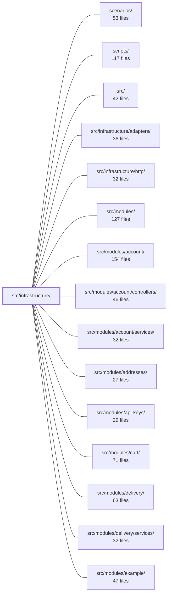

---
tags:
  - 2brain
  - 2brain/module
  - project/boilerplate-node-backend
type: module
module: src/infrastructure/
files: 97
updated: 2026-10-29T19:20:36.726233+00:00
---

# src/infrastructure/

## Purpose

`src/infrastructure/` is the foundational layer every other part of the codebase builds on. It owns three cross-cutting concerns—typed environment configuration, internationalization, and observability (audit trail, product analytics, Prometheus metrics)—plus a handful of small shared utilities. No domain module reimplements these; they are imported as ready-to-use ports and singletons.

## Key parts

- **`config/`** – The configuration subsystem. `define.ts` exports the `defineConfig` factory; `fields.ts` provides the typed field builders (`int`, `secret`, `csv`, …); `store.ts` freezes a one-time `process.env` snapshot; `dotenv.ts` is the side-effect import every entry point runs first; `secret-files.ts` resolves `NODE_X_FILE` indirections. The `shared-rules/` sub-directory holds Zod schemas that validate every YAML file under the repo-root `shared/` directory (defaults, metrics, rate-limits, password-hash, log-redaction, jobs, images, etc.) and a `registry.ts` that pairs each YAML with its schema for both runtime validation and the `regenerate` code-gen script. `defaults.generated.ts` is the committed output of that generator.
- **`i18n/`** – A complete internationalization stack. `boot.ts` initialises the single global i18next instance; `catalog.ts` discovers and deep-merges per-module dictionaries; `context.ts` binds a per-request `t` via `AsyncLocalStorage` so concurrent requests in different languages never interleave; `served.ts` tracks which languages the deployment currently offers; `overrides.ts` layers admin-edited copy from the database on top of the file-based catalog. `index.ts` is the sole public barrel—callers always import `@infrastructure/i18n`, never `i18next` directly.
- **`observability/`** – Three distinct concerns in one directory: **audit** (`audit.ts`, `audit-changes.ts`, `forbidden.ts`, `audit-actions.generated.ts`) for security/compliance event recording; **analytics** (`analytics/` with the `AnalyticsProvider` port and Umami, PostHog, and no-op implementations) for product/funnel events; **metrics** (`metric-config.ts`, `metrics-cache.ts`, `config.ts`) for Prometheus instrumentation.
- **`object-guards.ts`** – Three small, canonical helpers (deep-merge, key-tree shaping, etc.) shared by i18n, HTTP, and test tooling so no module re-implements them.

## How it connects

- **Consumed by every domain module** (`src/modules/account/`, `src/modules/orders/`, `src/modules/payments/`, …), by `src/infrastructure/adapters/`, `src/infrastructure/http/`, and the `src/` root barrel. Modules call `defineConfig` to declare their env vars, import `@infrastructure/i18n` for `t`, and use `recordAudit` / `emit` / metric helpers without re-implementing any of that plumbing.
- **Depends on the repository root** (`/`) for the `shared/rules/*.yaml` files that are the single source of truth for defaults, metric definitions, rate-limit budgets, password-hash parameters, and other cross-service rules. The `shared-rules/` schemas and the `registry.ts` tie the TypeScript side to those YAML files at boot time.
- **Used by `scripts/` and `scenarios/`** for boot-time configuration validation and i18n initialisation outside the HTTP server.

## Where to start

1. **`config/define.ts`** – ~60 lines that show the `defineConfig` → `Field` → `ConfigSlice` pattern every other config file in the repo follows. Reading this first makes the rest of `config/` self-evident.
2. **`i18n/index.ts`** – The barrel is short and its comments explain the "one global i18next, per-request `t`" design decision; from there, `context.ts` is the natural next read to understand how a request actually picks up a locale.

## Connected modules

[[boilerplate-node-backend_ROOT|/ (repository root)]] · [[boilerplate-node-backend_scenarios|scenarios/]] · [[boilerplate-node-backend_scripts|scripts/]] · [[boilerplate-node-backend_src|src/]] · [[boilerplate-node-backend_src_infrastructure_adapters|src/infrastructure/adapters/]] · [[boilerplate-node-backend_src_infrastructure_http|src/infrastructure/http/]] · [[boilerplate-node-backend_src_modules|src/modules/]] · [[boilerplate-node-backend_src_modules_account|src/modules/account/]] · [[boilerplate-node-backend_src_modules_account_controllers|src/modules/account/controllers/]] · [[boilerplate-node-backend_src_modules_account_services|src/modules/account/services/]] · [[boilerplate-node-backend_src_modules_addresses|src/modules/addresses/]] · [[boilerplate-node-backend_src_modules_api-keys|src/modules/api-keys/]] · [[boilerplate-node-backend_src_modules_cart|src/modules/cart/]] · [[boilerplate-node-backend_src_modules_delivery|src/modules/delivery/]] · [[boilerplate-node-backend_src_modules_delivery_services|src/modules/delivery/services/]] · … and 14 more

## Files
- `src/infrastructure/config/defaults.generated.ts` — A read-only, auto-generated module that centralises the baseline configuration values shared by all backend services. It exists so that a single source of truth (`shared/rules/defaults.yaml`) feeds every service's config without drift.
- `src/infrastructure/config/define.ts` — Defines the single-layer configuration contract for the codebase: the `defineConfig` factory that turns a named set of typed `Field` rules into a memoized, typed accessor, plus the type-erased `ConfigSlice` view and the `assertConfigIn` boot gate that validates every slice at once and reports *all* problems in one error. Follows the Laravel/AdonisJS/NestJS convention: the environment is read and validated here; everything downstream reads the typed result.
- `src/infrastructure/config/dotenv.ts` — Side-effect module that loads `.env` into `process.env` (via `dotenv/config`) and then notifies the config store so it can re-read the environment. It exists as a single first-import in every entry point to guarantee that no config read happens before the file is parsed.
- `src/infrastructure/config/fields.ts` — Defines the typed field builders (`int`, `decimal`, `flag`, `choice`, `text`, `email`, `timeZone`, `currency`, `secret`, `csv`, `keyRing`, `versionedKeyRing`) that configuration slices use to declare each environment variable. Every field enforces a uniform contract—trim, blank-as-unset, reject (never silently default) a wrong value—and carries optional boot-time presence rules so a developer machine can legitimately leave a secret unset.
- `src/infrastructure/config/secret-files.ts` — Resolves secret-file references in the application's environment: any `NODE_X_FILE` variable is replaced by the content of the file it points to, and standalone password variables are merged into their associated connection URLs. This lets secrets live in mounted files (invisible to `docker inspect` and child processes) while downstream config code sees only plain values.
- `src/infrastructure/config/shared-rules/audit-actions.ts` — Defines the Zod schema that validates `shared/rules/audit-actions.yaml`, a configuration file holding audit actions that are not scoped to any specific module. It exists so the YAML file's structure is type-checked at load time.
- `src/infrastructure/config/shared-rules/defaults.ts` — Defines the Zod schema that validates the shape of `shared/rules/defaults.yaml`. That YAML holds the plain-number defaults both backends start from before any environment-variable overrides are applied. Keeping the schema in TypeScript gives runtime validation and IDE support for the YAML's structure.
- `src/infrastructure/config/shared-rules/frontend-links.ts` — Defines the Zod schema (and inferred TypeScript type) for `shared/rules/frontend-links.yaml`, which declares the frontend path templates that transactional e-mails and the sitemap link to, as well as the sitemap's static pages. It exists so that the shape of that YAML file is validated at load time rather than at runtime string-building.
- `src/infrastructure/config/shared-rules/generate-spec.ts` — Defines the **spec types** that describe how a shared-rules YAML file is turned into a committed `as const` TypeScript file. It also provides a reusable Zod schema helper for validating the one list shape (`keyed-list`) that needs structural constraints. This file is consumed by the code-generation tooling (the `regenerate` script) and is **never imported at application runtime**.
- `src/infrastructure/config/shared-rules/images.ts` — Defines the Zod validation schemas for `shared/rules/images.yaml`: the set of accepted image formats (identified by magic bytes at known offsets), their MIME aliases, storage extensions, re-encodability flag, and the thumbnail version segment. It exists so that a malformed rules file is caught at load time rather than at request time.
- `src/infrastructure/config/shared-rules/jobs.ts` — Defines the Zod schemas for the **data** half of a scheduled job declaration — the fields that appear in `shared/rules/jobs.yaml` (kernel jobs) and in each module's `module.yaml` `jobs:` block. It deliberately excludes code-side concerns (`run`, lease, boot dependencies), which live in `JobDeclaration` in `@kernel/registry`.
- `src/infrastructure/config/shared-rules/load.ts` — Boots a shared YAML rule table (under the repo-root `shared/` directory) by parsing the file and validating it against a caller-supplied Zod schema. Validation happens once at process start so a malformed or type-incompatible file crashes boot rather than surfacing as a per-request failure.
- `src/infrastructure/config/shared-rules/log-redaction.ts` — Defines the Zod schema and inferred TypeScript type for `shared/rules/log-redaction.yaml`, declaring which log keys are credentials (dropped), which are personal data (hashed), and which URL query parameters must be stripped from trace-span attributes. It exists so that runtime components can validate and consume redaction policy from a single typed source.
- `src/infrastructure/config/shared-rules/metrics.ts` — Zod schema for `shared/rules/metrics.yaml`. The YAML file holds the *data* side of every infrastructure Prometheus metric (name, kind, help text, label names, histogram buckets) so dashboards and alert rules can reference metric names without importing code. Recording logic and `collect()` hooks stay in TypeScript. This file is the single source of truth for what shape that YAML must take.
- `src/infrastructure/config/shared-rules/outbox.ts` — Defines the Zod validation schema for `shared/rules/outbox.yaml`, which holds the default retry-policy parameters for the transactional outbox (retention, attempt limits, lease duration, and backoff bounds).
- `src/infrastructure/config/shared-rules/password-hash.ts` — Defines the Zod schema and inferred TypeScript type for `shared/rules/password-hash.yaml`, which stores the argon2id cost parameters (memory, passes, parallelism) used when generating new password hashes.
- `src/infrastructure/config/shared-rules/rate-limits.ts` — Defines the Zod validation schemas for rate-limit budget *data* as it appears in `shared/rules/rate-limits.yaml` (kernel budgets) and in each module's `module.yaml` `rateLimits:` block. It captures only the declarative fields a twin backend must copy verbatim (bucketing key, limits, window, audit flag, fallback); runtime logic such as `keyGenerator` lives in the `RateLimitBudget` type in `@types`, not here.
- `src/infrastructure/config/shared-rules/registry.ts` — Central registry that pairs every shared-rules YAML document with its Zod schema and (optionally) a spec for generating a typed TypeScript module. It is the single source of truth consumed both by the `regenerate` contract script (which emits `shared/rules/schemas/*.schema.json` and the `.generated.ts` files) and by boot-time loaders that validate live config against the same schemas.
- `src/infrastructure/config/shared-rules/semantic-log-names.ts` — Defines the Zod validation schema for `shared/rules/semantic-log-names.yaml`. The YAML file maps camelCase code-level field names to the actual field names used in structured log lines; this module provides the type-level contract so that any code reading that YAML gets immediate runtime validation.
- `src/infrastructure/config/shared-rules/step-up.ts` — Defines the Zod schema for the `stepUp:` block in `shared/authorization-keys.yaml`, specifying how recent a sign-in must be (in seconds) per security tier (`critical`, `sensitive`). It uses a loose object wrapper so it can extract only its slice from the full document without constraining keys owned by other modules (e.g. `kernel/permissions.ts`).
- `src/infrastructure/config/store.ts` — Central, process-lifetime store for the application's environment. It reads `process.env` exactly once (freezing a snapshot on first access), layers named overrides on top, resolves `NODE_X_FILE` secret-file indirections, and exposes the merged result to every config slice. State lives on `globalThis` behind a `Symbol.for` key so that Jest's `resetModules()` re-import still finds the same instance.
- `src/infrastructure/i18n/boot.ts` — Provides the single shared entry point (`bootI18n`) that initialises the one global i18next instance used by every process in the codebase. It separates *how* locale directories are discovered (left to each caller) from *how* i18next is configured, so the HTTP server, ops scripts, and the test suite all boot identical i18next settings.
- `src/infrastructure/i18n/catalog.ts` — Single source of truth for **where translations live on disk and how they are merged** before `i18next.init()` receives them. It resolves the shared locale directory, reads and deep-merges per-module dictionary files into one dictionary per locale, and exposes the final `Resource` object that boot hands to i18next. A project that relocates its dictionaries edits only this file.
- `src/infrastructure/i18n/config.ts` — Declares the locale-related settings for the deployment: which language is default, which is the fallback, the list of supported languages, and the refresh interval for edited-copy overrides. It uses the project's typed `defineConfig` pattern so that all locale knobs live in one place with defaults and validation.
- `src/infrastructure/i18n/context.ts` — Provides request-scoped internationalization by binding a locale-specific `t` function to an `AsyncLocalStorage` store, so concurrent requests in different languages never interleave on i18next's single global instance. Out-of-band work (queues, boot-time callbacks) falls outside the async chain and must opt in explicitly.
- `src/infrastructure/i18n/index.ts` — Barrel (re-export) file that is the **sole public entry point** for all i18n functionality. It exists to keep the global `i18next` instance out of the request path — callers always get a per-request `t` via `./context` rather than a shared singleton with one active language. Every consumer (~70 import sites) imports from `@infrastructure/i18n`, never from `i18next` directly.
- `src/infrastructure/i18n/overrides.ts` — Manages the database-served i18n overlay: admin-edited copy layered on top of the deployed dictionary files in `./catalog`, and the on/off switch for registered languages in `./served`. Exposes a provider-registration pattern so the composition root can plug in the data source (Mongo, in production) while keeping the infrastructure layer free of persistence concerns. A single `LocaleOverlay` read fills both the copy and the language list atomically.
- `src/infrastructure/i18n/served.ts` — Holds the in-process, mutable state of which languages this deployment currently serves. A language is "served" if it has a deployed dictionary file (and is not switched off) or if it is a registered row that is switched on; the fallback language is always served unconditionally. This module is the single source of truth that locale negotiation, email rendering, order snapshots, and link generation all read from, so every part of a request agrees on the same language set.
- `src/infrastructure/object-guards.ts` — A small set of shared value-guard and object-shaping utilities that prevent unrelated call sites (i18n dictionary merging, locale key trees, HTTP request bodies, test factories) from each re-implementing the same one-line logic. It exists so the three helpers have a single canonical location without belonging to any one module.
- `src/infrastructure/observability/analytics/index.ts` — Defines the product-analytics **port** (`AnalyticsProvider` interface), the **registry** of shipped implementations (Umami, PostHog, none), and the **emit helpers** every module calls to record an event. It answers product/funnel questions, not operational ones (that is tracing/metrics). Which backend is active is a deployment decision via `NODE_ANALYTICS_PROVIDER` (default `umami`).
- `src/infrastructure/observability/analytics/none.ts` — Provides the no-op `AnalyticsProvider` implementation, selected via `NODE_ANALYTICS_PROVIDER=none`. It exists to make "collects nothing" an explicit, stated configuration choice rather than an accidental side effect of blank credentials (which the other providers treat as a misconfiguration and warn about).
- `src/infrastructure/observability/analytics/posthog.ts` — PostHog implementation of the analytics provider port. It exists as the non-default analytics backend for identity-shaped funnels (PostHog stitches a user's timeline by `distinct_id`), selected via `NODE_ANALYTICS_PROVIDER=posthog`. The trade-off is a hosted dependency, which is why `umami` remains the default.
- `src/infrastructure/observability/analytics/umami.ts` — Implements the default analytics provider by posting server-side events to Umami's `/api/send` HTTP endpoint, mirroring the browser tracking script so both halves of a shared funnel land in the same database. No server SDK is required — the integration is a single `fetch` call per event.
- `src/infrastructure/observability/audit-actions.generated.ts` — Defines the set of **core audit action identifiers** for security events that fire *before* any domain logic executes (auth failures, rate-limit denials, re-auth challenges, token/key rejections). The file is generated from `shared/rules/audit-actions.yaml` by `npm run regenerate`; the YAML is the single source of truth.
- `src/infrastructure/observability/audit-changes.ts` — Pure utility that computes the field-level diff carried in the `metadata` of an `*.updated` audit row. It compares a stored record against an incoming change-set and classifies moved fields into two privacy tiers: `valued` (non-personal, recorded as `{ from, to }`) and `named` (personal data / secrets, recorded by name only). It says nothing about who, when, or where — only *what* changed.
- `src/infrastructure/observability/audit.ts` — Defines the structured audit-trail system: a security/compliance record of *who did what to which resource, and did it work*. Deliberately separate from application logging—audit entries use a dedicated always-on `auditLogger` with a stable, machine-readable field set that must not be reshaped for convenience.
- `src/infrastructure/observability/config.ts` — Declares the runtime configuration shape for product analytics: which provider is active, whether consent gating applies, and the per-provider endpoint/credential fields (Umami, PostHog). It is a single `defineConfig` export that every analytics consumer reads at runtime.
- `src/infrastructure/observability/forbidden.ts` — Provides a single shared function, `auditForbidden`, for recording the `security.forbidden` audit row when a service refuses a request on its own authority (a field, step, or target requirement the guard cannot see). It lives in its own file—importing `recordAudit` from `./audit`—so that a test which replaces the audit port observes these rows through the same mock as every other audit write, preventing silent, un-audited 403s.
- `src/infrastructure/observability/metric-config.ts` — Translates static metric definitions (generated from `shared/rules/metrics.yaml` into `metrics.generated.ts`) into the constructor-option objects that prom-client's `Counter`, `Gauge`, and `Histogram` classes expect. It is a pure mapping layer: it never touches a registry, so call sites remain free to decide *where* and *when* to register.
- `src/infrastructure/observability/metrics-cache.ts` — Defines two Prometheus counters for the infrastructure cache: one for Redis invalidation failures and one for `setCache` lookup outcomes. It exists to turn events that would otherwise be invisible log lines into alertable, observable signals.
- `src/infrastructure/observability/metrics-http.ts` — Defines the Prometheus HTTP metrics (RED + in-flight gauge) and the functions that record them per request. This is the *write* side only — the registry and process collectors live in `metrics-registry.ts`, and the JSON read-back for the overview endpoint lives in `http-readback.ts`.
- `src/infrastructure/observability/metrics-outbox.ts` — Defines the Prometheus metrics (three counters + one gauge) that track transactional-outbox throughput in the relay process. Counters report without a database round trip; the single gauge reads Mongo at scrape time to expose how many events are still pending publication.
- `src/infrastructure/observability/metrics-process.ts` — Defines a single Prometheus counter for unhandled Promise rejections. The counter exists because the app deliberately survives unhandled rejections (see `handleUnhandledRejection` in `error-handling.ts`); without a metric, those silent failures would be invisible in production. It registers the counter on the shared `metricsRegistry`.
- `src/infrastructure/observability/metrics-queue.ts` — Defines the single Prometheus counter that makes dead-lettered queue jobs visible in metrics. Without it, a parked job is only observable via a transient log line; with it, a queue that keeps rejecting or exhausting retries becomes a measurable, alertable signal.
- `src/infrastructure/observability/metrics-rate-limit.ts` — Defines two Prometheus counters that make rate-limiting behavior alertable (as opposed to log-only). One counter tracks requests served from the Redis fallback path; the other tracks requests hard-refused with 429. Both are labeled by budget namespace and registered on the shared metrics registry.
- `src/infrastructure/observability/metrics-registry.ts` — Single home for the project-wide `prom-client` registry and the process-level metrics that describe the runtime itself (default Node.js collectors, uptime, heap ceiling, crontab job timestamps). Extracted from `metrics-http.ts` so that every module's `metrics.ts` file reaches for a registry in a file whose name matches its purpose, rather than an HTTP-utility file.
- `src/infrastructure/observability/metrics.generated.ts` — Single source of truth for all infrastructure metric definitions (name, kind, help text, label names, and histogram buckets). The file is generated from `shared/rules/metrics.yaml` via `npm run regenerate`; the YAML is the editable artifact. Every consumer of infrastructure metrics imports the typed `infrastructureMetricData` object from here rather than hard-coding metric names, ensuring a one-place schema.
- `src/infrastructure/observability/security-events.ts` — Pairs every `security.*` audit log entry with a Prometheus counter so that the audit trail (evidence) and the rate-based alert rule (signal) can never disagree on event counts. It is the single choke-point for incrementing security metrics and writing their corresponding audit records.
- `src/infrastructure/observability/tracer.ts` — Thin wrapper around the OpenTelemetry API that centralises tracer access, span lifecycle management, and trace-context retrieval for this service. It exists so that call sites import a small, typed surface (`getTracer`, `withSpan`, `getActiveSpanContext`, `recordErrorOnActiveSpan`) rather than touching the raw `@opentelemetry/api` directly, and so that cross-signal correlation (audit, analytics, logging) shares one consistent way to read the active span context.
- `src/infrastructure/persistence/changes.ts` — Utility module that converts a change-set (a flat record of field-path → value) into the `$set` / `$unset` operator halves required by a MongoDB update on a hydrated Mongoose document. It exists so that every repository and service that applies an update builds the operator object the same way, centralising the "null means clear" and "empty operator halves must be omitted" rules in one place.
- `src/infrastructure/persistence/command-metrics.ts` — Registers a single Prometheus histogram that records the latency of every MongoDB database command, labelled by collection, operation, and outcome. It hooks into the Node.js MongoDB driver's built-in command-monitoring events so that all commands (repository methods, direct model calls, aggregates) are captured without double-counting. Exists so `GET /observability/metrics/overview` can expose per-command duration percentiles.
- `src/infrastructure/persistence/conditional-status.ts` — Provides a single shared atomic write primitive — "set `status` to Y only while it is still in X" — used by every module lifecycle transition. It exists so the status guard lives in the MongoDB filter (evaluated under the document lock) rather than in a read-then-write sequence, preventing silent double-ships or double-refunds from racing writes.
- `src/infrastructure/persistence/config.ts` — Declares the persistence-layer configuration surface — currently a single setting for the default pagination page size — using the project's typed config framework. It isolates persistence-specific knobs so that consumers (e.g. search) read one stable config object rather than raw environment variables.
- `src/infrastructure/persistence/create-repository.ts` — Generic repository factory that every module's `repository.ts` spreads into its own object. It builds CRUD and search against a Mongoose model plus a declarative `SearchSpec`, so individual modules never hand-roll `$regex`/`$elemMatch`/`ObjectId` conversion or the lean→normalized mapping.
- `src/infrastructure/persistence/external-key-query.ts` — Provides a pre-built Mongoose query option (`{ sanitizeFilter: true }`) to be spread into lookups that are keyed by a value an external party supplied (provider reference, email, federated identity). It acts as a second, per-query guard—behind Zod validation at the API edge—so that a filter object like `{ "$ne": null }` placed where a scalar is expected matches nothing rather than everything.
- `src/infrastructure/persistence/factories.ts` — Shared factory-identity helpers that every module's `factories.ts` would otherwise repeat: generating a `_id`, deriving `createdAt`/`updatedAt` from it, and typing the overrides bag a factory accepts. Exists so modules only declare their *own* domain fields and delegate the universal identity trio here.
- `src/infrastructure/persistence/image-writeback.ts` — Provides a single reusable factory (`imageWritebackFor`) that binds a Mongoose model to the `ImageWriteback` contract expected by the image-digest pipeline. Because the pipeline lives in infrastructure and must not import module-level models, each module calls this factory with its own model to produce a writeback function the pipeline can invoke generically.
- `src/infrastructure/persistence/lease.ts` — Provides a Mongo-backed mutual-exclusion lease so that a scaled-up cron deployment runs each periodic job in exactly one container per window. One atomic upsert decides the winner; the lock lives in the same store as the guarded work. The file also records per-job success/failure timestamps that the observability health endpoint surfaces to operators.
- `src/infrastructure/persistence/money-field.ts` — Bridges MongoDB's `Decimal128` (the on-disk representation of monetary values) and the plain `number` that every layer above persistence expects. It provides a reusable Mongoose schema-path factory, a recursive Decimal128→number reviver, and a query middleware so that neither hydrated documents, lean queries, nor serialised output ever leak a raw `Decimal128` object to application code.
- `src/infrastructure/persistence/mongo-errors.ts` — Provides two narrow type-guard functions that classify Mongo/Mongoose write failures as either **duplicate-key** (unique-index violation) or **connection-unreachable**. They exist so that repositories and the HTTP error interpreter can inspect driver-level facts about a caught rejection without coupling to the response layer or to a specific driver package instance.
- `src/infrastructure/persistence/normalize-email.ts` — Single source of truth for email normalisation across the app. Provides two levels of canonicalisation—a minimal trim + lowercase for storage/lookup, and a delivery-mailbox form for budgeting—so that no module reinvents the casing, subtag, or dot-stripping rules and two spellings of the same address never produce two rows or two budget slots.
- `src/infrastructure/persistence/report.ts` — Shared building blocks for MongoDB grouped (bucketed) reads used across multiple domain modules. It defines the window/bucket vocabulary (`ReportWindow`, `ReportInterval`) and the single `$dateTrunc` expression builder (`bucketOf`) so that every module that needs to aggregate data by day, week, or month in a given IANA zone composes its pipeline the same way.
- `src/infrastructure/persistence/retired-indexes.ts` — `db:sync` only ever **adds** indexes; it never removes ones that are no longer declared. Without an explicit signal, a renamed or deleted index name would linger in the database indefinitely. This module gives each schema a way to declare "I have given up on these index names" so the sync script knows it is safe to drop them.
- `src/infrastructure/persistence/revision-plugin.ts` — Mongoose plugin that gives a schema a monotonically-incrementing `editRevision` counter and moves it atomically (`$inc: 1`) on every write the schema's `timestamps` option considers an edit. It exists to provide a strong, per-row validator (the basis for ETag / If-Match) that changes on every edit even when two edits land in the same millisecond, replacing Mongoose's `__v` with a domain-named field.
- `src/infrastructure/persistence/search.ts` — Shared pagination, sort, and text-search helpers for Mongoose/MongoDB queries. Centralizes the logic so that new filter conventions or pagination rules change in one place rather than being duplicated across every module service (OCP).
- `src/infrastructure/persistence/serialize.ts` — Single point where a stored Mongoose document is converted into its wire/API payload. Handles the `_id` → `id` rename, `__v` removal, Decimal128 revival, edit-revision stripping, and per-model customisations. One function serves both serialisation paths: Mongoose's `toJSON` (which partially does the work) and raw BSON from `.lean()` / `.aggregate()` (which needs all steps applied manually by `create-repository.ts`).
- `src/infrastructure/persistence/translatable-columns.ts` — Defines the `TranslatableColumns` interface and a `translatableColumnsOf(model)` factory that gives the `locales` translation port the three writes it needs on any owning module's Mongoose collection: check existence, copy fallback-locale fields onto the row's own columns, and stamp the document as edited. Both `products` and `example` build their port implementation from this single factory instead of repeating the logic.
- `src/infrastructure/persistence/versioning.ts` — Implements optimistic-concurrency control for repository writes: it tracks each row's `editRevision` counter (maintained by `revision-plugin`) and enforces an HTTP `If-Match` precondition at the persistence layer so a write that lost a race matches nothing and surfaces as a 412 instead of silently overwriting. The mechanism is request-scoped via `AsyncLocalStorage`, so services and repositories never need to know a header existed.
- `src/infrastructure/persistence/yearly-counter.ts` — Provides the shared atomic counter mechanism behind all `{year}-{sequence}` identifiers in the system. One Mongoose document per calendar year is bumped via an `upsert`, yielding the next sequence number. Both the order and invoice modules reuse this primitive; each supplies its own `Model` and `ClientSession`, so the semantics of the number (gap-tolerant vs. gap-illegal) stay with the calling module.
- `src/infrastructure/runtime/after-commit.ts` — Provides a single utility (`afterCommit`) for executing best-effort follow-up work *after* a write has already committed (audit rows, image hand-offs, file cleanups, etc.). Because the primary write is already durable, any failure in the follow-up must not surface as an error to the caller — it is logged and swallowed, and the next step proceeds.
- `src/infrastructure/runtime/busy.ts` — Defines a single error type, `ServiceBusyError`, representing the condition "the server is at its limit and will not queue this request." It exists so that any adapter can signal a full bounded queue, and the HTTP layer can uniformly map that signal to a **503 Service Unavailable** with a `Retry-After` hint—semantically identical to an unreachable dependency. Placing the class under `runtime/` lets adapters throw it and the HTTP layer recognise it without a direct import in either direction.
- `src/infrastructure/runtime/cluster-policy.ts` — Pure decision functions extracted from the cluster primary in `src/cluster.ts`: how many workers to fork and how to respond to a worker crash. Kept as side-effect-free logic so each rule can be unit-tested independently of the process-lifecycle script.
- `src/infrastructure/runtime/config.ts` — Central declaration of every environment-driven setting this process reads: runtime environment, logging, HTTP server, clustering, database, stock threshold, and tracing. Each group is a `defineConfig` object that validates and defaults its fields at read time. The file also exposes the three boolean predicates (`nodeEnvironment`, `isTestEnvironment`, `isRelaxedEnvironment`) that gate safety behaviours across the codebase.
- `src/infrastructure/runtime/database.ts` — Centralises the MongoDB connection lifecycle for the entire application: URI construction, connection with bounded exponential-backoff retry, Mongoose global configuration, connection-loss observability, clean shutdown, and a transaction helper. Every entry point (HTTP server, cron reapers, one-shot scripts) goes through this module rather than touching `mongoose.connect()` directly.
- `src/infrastructure/runtime/mongoose-boot.ts` — A side-effect-only bootstrap module that applies Mongoose global defaults before any model module is evaluated. It exists to work around ES import hoisting: because `import` statements are hoisted above subsequent code, the only reliable way to guarantee the defaults are set *before* model definitions run is to make this file the very first import in an entry point.
- `src/infrastructure/runtime/mongoose-defaults.ts` — Sets Mongoose global options that are frozen at schema-build time, so they must be applied before any model module loads. Isolated as a dependency-free module so it can occupy the first import line of every entry point without pulling in the rest of the project.
- `src/infrastructure/runtime/otel-sdk.ts` — Bootstraps the OpenTelemetry Node SDK: configures resource identity, span export, auto-instrumentation (HTTP, Express, Mongoose, Redis), and context propagation for the application. Must be imported before any instrumented library handles traffic, because the instrumentation packages monkey-patch modules at `sdk.start()` time.
- `src/infrastructure/runtime/provider-registry.ts` — Defines a single, generic `ProviderRegistry<T>` interface and two factory functions (private and process-wide) that every provider seam in the build—antibot, analytics, payments, OAuth, mail, PDF, etc.—shares. The registry itself is intentionally policy-free: it only stores, lists, and looks up implementations by name. The decision to *throw* on a missing name vs. *return `undefined`* is delegated to the caller via `requireProvider` or a bare `resolve()`, so each port enforces its own failure contract.
- `src/infrastructure/runtime/readiness.ts` — Holds the single readiness state that `GET /readyz` reads: whether the process has finished booting, has begun draining for shutdown, and whether the Mongoose database connection is currently live. It is the synchronous, I/O-free read side of the server lifecycle — distinct from `server-lifecycle.ts`, which sequences the actual stop steps but exposes no queryable state.
- `src/infrastructure/runtime/server-lifecycle.ts` — Orchestrates the full server lifecycle — binding, graceful shutdown, and forced-exit deadlines. It sequences the `stop`/`shutdown` calls each adapter already exposes in a fixed order with a configurable timeout, without knowing *how* any adapter stops. Decoupled from Express middleware and route mounting.
- `src/infrastructure/runtime/settle.ts` — Provides a single shared utility for adapters that must drain in-flight work before process shutdown (queue handlers, PDF renders). It guarantees shutdown is never held hostage by hung tasks by racing "all work settled" against a hard deadline.
- `src/infrastructure/security/breached-passwords/index.ts` — Provides breached-password rejection for all password-**set** paths (signup, change, reset). It combines two independent checks — a bundled static list and the HIBP k-anonymity range API — and deliberately never runs on login, where a rejection would confirm a guess to an attacker and lock out the affected user. Both rungs fail open: any infrastructure error results in the password being accepted.
- `src/infrastructure/security/config.ts` — Declares the environment-variable schemas that the security helpers read at runtime: the pseudonymisation root key, the PII field-encryption key ring, and the breached-password checking ladder. It exists as a single import point so consumers never re-declare these shapes.
- `src/infrastructure/security/constant-time.ts` — Provides a single `constantTimeEqual` primitive for comparing two strings in constant time, eliminating the timing side-channel that a plain `===` or length-check would leak. Every static-credential verification in the repo routes through this function rather than hand-rolling its own comparison.
- `src/infrastructure/security/hash-token.ts` — Single-purpose leaf module that provides the one canonical SHA-256 digest used for every stored credential-like value (session IDs, refresh tokens, one-time links, API keys). Because it depends only on `node:crypto`, any module can hash or look up a token without coupling to a sibling service.
- `src/infrastructure/security/password-hash.ts` — Thin wrapper around Node 24.7+'s built-in `argon2id` (`node:crypto`), adding the three things Node does not supply: a random salt, a PHC-string serialisation for storage, and a constant-time comparison for verification. Cost parameters are loaded from a shared YAML rule file so the PHP twin can read the same values.
- `src/infrastructure/security/pii-encryption.ts` — Provides field-level AES-256-GCM encryption for GDPR-flagged PII values (address-book fields, user phone) that are stored outside the account's own secrets. It wraps the shared `versioned-secret.ts` primitives under a dedicated key (`NODE_PII_ENCRYPTION_KEY`), keeping PII rotation independent from TOTP/webhook key rotation.
- `src/infrastructure/security/pseudonymise.ts` — Provides keyed pseudonymisation of identifiers and secrets that must remain comparable across requests but must not be readable or brute-forceable. Uses HMAC-SHA256 under per-purpose subkeys (HKDF-derived from a single root secret) so that a guessable plaintext is protected by key secrecy rather than hash entropy. Serves log fields, rate-limit identities, and the idempotency fingerprint.
- `src/infrastructure/security/reencrypt.ts` — The re-encryption engine that moves every stored secret onto the newest key of its versioned ring, enabling safe key retirement. It is generic: each owning module describes *where* its encrypted fields live (via `fieldsOf`), and this file handles batched reading, rewrapping, and conflict-safe writing. Triggered by the `reencrypt` ops script, never called ad hoc.
- `src/infrastructure/security/subkey.ts` — Single-purpose module that derives a 32-byte HKDF-SHA256 subkey from a root secret, binding the result to a specific use via the `info` parameter (per NIST SP 800-57 §5.2 key-separation guidance). Caches results so repeated derivations on the request path are cheap.
- `src/infrastructure/security/versioned-secret.ts` — Provides AES-256-GCM at-rest encryption for secrets with built-in key-rotation support. A "ring" of versioned keys lets the system always encrypt with the newest key while decrypting any row against whichever key stamped it, eliminating the need for a migration that must determine which key a row used. The same crypto is shared across PII, TOTP, and webhook-secret storage; the only difference is the HKDF domain-separation label and the configured key material.
- `src/infrastructure/surfaces/create-delete-controller.ts` — Factory that produces a module's delete controller from a small per-entity spec. It wires the full `DELETE /x`, `DELETE /x/:id`, and `DELETE /x/:id/hard` handler — id extraction, `hardDelete` flag merging, `If-Match` preconditions, service dispatch, and response/error envelope — so each module's `delete-<entity>.ts` is reduced to a three-field call.
- `src/infrastructure/surfaces/create-item-controller.ts` — Factory that builds a module's **read-one** (fetch-by-ID) Express handler. It centralises the contract that a malformed path parameter answers as a 404 (not a 400), that a missing row uses the module's own i18n key, and that successful responses carry an `ETag`. Modules call it once with an entity-specific spec instead of repeating this logic inline.
- `src/infrastructure/surfaces/create-list-controller.ts` — Factory that produces a single Express handler for any paged list endpoint (`GET /x`). It standardises the pipeline — read the query string, validate against a Zod schema, run the module's service call, and send the result or a 500 — so each entity only supplies its schema and query logic. Kept separate from `createSearchController` because a list has no request body, whereas a search reads the body first; conflating the two would require a `surface` knob inside a factory whose sole concern is *where* input comes from.
- `src/infrastructure/surfaces/create-restore-controller.ts` — Shared factory that builds the `POST /x/:id/restore` Express handler for any module using soft-delete. Restoring is a separate verb because a retried `DELETE` must remain safe (RFC 9110 §9.2.2) and must never resurrect a record.
- `src/infrastructure/surfaces/create-search-controller.ts` — Factory that produces a single Express handler for modules exposing both `GET /x` and `POST /x/search` behind one controller. It standardises the request→validate→search→respond pipeline so each module only supplies its own schema, optional input overlay, and search implementation.
- `src/infrastructure/surfaces/create-update-controller.ts` — Shared factory that builds a module's PUT (replace) and PATCH (merge) Express handlers from a single pipeline. The verb only changes which schema validates the body, which omitted fields are filled with `null`, and whether a `completeReplace` step runs—everything else (id resolution, `If-Match` fencing, ETag emission, error mapping) is identical. Exists so that every resource's update route follows the same request-flow contract without per-module boilerplate.

---
[[boilerplate-node-backend_INDEX|← boilerplate-node-backend index]]
