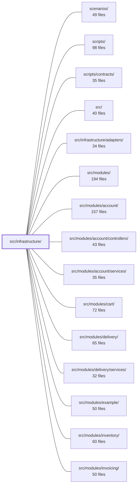

---
tags:
  - 2brain
  - 2brain/module
  - project/boilerplate-node-backend
type: module
module: src/infrastructure/
files: 126
updated: 2026-11-08T10:48:02.135087+00:00
---

# src/infrastructure/

## Purpose

`src/infrastructure/` is the cross-cutting technical layer of the application. It owns three concerns that no single domain module should duplicate: **environment configuration** (one parse point, typed and validated), **HTTP transport plumbing** (middleware stack, error mapping, request/response shaping), and **shared rule-table validation** (Zod schemas that make YAML config files fail fast at boot rather than surfacing as runtime errors). Domain modules in `src/modules/` consume this layer's outputs; they never read `process.env` or hand-roll Express middleware.

## Key parts

- **Config core** (`config/define.ts`, `config/store.ts`, `config/fields.ts`, `config/dotenv.ts`, `config/secret-files.ts`) — `defineConfig` + the typed field builders (`int`, `flag`, `secret`, `keyRing`, …) form the single layer where environment variables are read, validated, and memoised. `store.ts` is the choke-point that freezes a `process.env` snapshot and layers overrides; `dotenv.ts` ensures `.env` is loaded before that snapshot is taken; `secret-files.ts` resolves `NODE_*_FILE` paths into inline values.

- **Shared-rules schemas** (`config/shared-rules/`) — A large family of Zod schemas, one per shared YAML document (audit actions, cookies, defaults, rate-limits, metrics, images, password-hash, outbox, log-redaction, step-up, semantic-log-names, frontend-links, jobs). `registry.ts` pairs each YAML file with its schema and optional code-generation spec; `load.ts` is the boot-time loader that validates every table against its schema. `generate-spec.ts` is consumed only by the build-time codegen pipeline.

- **HTTP config & helpers** (`http/config.ts`, `http/controller.ts`, `http/errors.ts`, `http/ids.ts`, `http/frontend-link.ts`, `http/cookies.ts`) — `http/config.ts` declares all deployment-wide HTTP settings via the same `defineConfig` helpers. `http/controller.ts` provides small composable functions that strip repeated Express boilerplate while keeping `.catch()` visible for lint. `http/errors.ts` is the single mapping point from database/driver failures to HTTP status + message. `http/ids.ts` centralises malformed-ObjectId handling (404 vs 422). `http/frontend-link.ts` builds frontend URLs from a resolved template.

- **HTTP middleware** (`http/middlewares/`) — The full cross-cutting middleware stack: rate-limiting (`rate-limit.ts`, `rate-limit-store.ts`), idempotency ledger (`idempotency.ts`, `idempotency-model.ts`), response caching (`cache.ts`), JSON-depth guard, content-type guard, 405 guard, origin/CSRF guard, human-challenge gate, locale resolution, request-logger, anti-bot logging. Each is a single-purpose Express middleware that modules mount on their routes.

## How it connects

- **`src/modules/*`** (account, orders, payments, delivery, notifications, etc.) import `defineConfig` to declare their own env-var slices, use `http/controller.ts` helpers inside Express handlers, call `http/errors.ts` in their `.catch()`, mount the shared middlewares on their routers, and read shared-rule values (rate-limit budgets, job schedules, frontend links) that were validated at boot by this layer.
- **`src/infrastructure/adapters/`** — the cache middleware delegates actual Redis read/write to `adapters/cache.ts`; this module shapes data on either side of that boundary but does not own the transport.
- **`scenarios/`** — `config/shared-rules/load.ts` also resolves YAML under `shared/scenarios/`, so scenario definitions are validated through the same schema pipeline.
- **`scripts/`** — the code-generation pipeline iterates the `shared-rules/registry.ts` list (and the `generate-spec.ts` contract) to emit `.schema.json` and `.generated.ts` files at build time.
- **`/` (repository root)** — `dotenv.ts` locates the project `.env`; entry-point scripts import it first so the config store sees a complete environment.

## Where to start

1. **`src/infrastructure/config/store.ts`** — Read this first to understand how the process environment is snapshotted, how overrides are layered, and how the version counter invalidates cached config slices. Every other config file builds on this object.
2. **`src/infrastructure/http/errors.ts`** — A short, self-contained file that shows the HTTP layer's central convention: one mapping from driver failures to status codes. Reading it alongside any module controller's `.catch()` block makes the module→infrastructure boundary concrete.

## Connected modules

[[boilerplate-node-backend_ROOT|/ (repository root)]] · [[boilerplate-node-backend_scenarios|scenarios/]] · [[boilerplate-node-backend_scripts|scripts/]] · [[boilerplate-node-backend_scripts_contracts|scripts/contracts/]] · [[boilerplate-node-backend_src|src/]] · [[boilerplate-node-backend_src_infrastructure_adapters|src/infrastructure/adapters/]] · [[boilerplate-node-backend_src_modules|src/modules/]] · [[boilerplate-node-backend_src_modules_account|src/modules/account/]] · [[boilerplate-node-backend_src_modules_account_controllers|src/modules/account/controllers/]] · [[boilerplate-node-backend_src_modules_account_services|src/modules/account/services/]] · [[boilerplate-node-backend_src_modules_cart|src/modules/cart/]] · [[boilerplate-node-backend_src_modules_delivery|src/modules/delivery/]] · [[boilerplate-node-backend_src_modules_delivery_services|src/modules/delivery/services/]] · [[boilerplate-node-backend_src_modules_example|src/modules/example/]] · [[boilerplate-node-backend_src_modules_inventory|src/modules/inventory/]] · … and 12 more

## Files
- `src/infrastructure/config/define.ts` — Defines the core configuration-slice system. `defineConfig` turns a named, typed set of environment-variable fields (with optional cross-field validation) into a memoised, type-safe accessor. This is the single layer where the environment is read and validated; every other part of the app consumes the typed result, following the Laravel/AdonisJS/NestJS/Spring convention of one parse point.
- `src/infrastructure/config/dotenv.ts` — A side-effect-only module that loads the project's `.env` file into `process.env` and then signals the config store to re-read it. It exists so that entry points can import it first, guaranteeing that `.env` values are present before the store freezes its one-time snapshot of `process.env`. The module exports nothing.
- `src/infrastructure/config/fields.ts` — Provides the typed field builders (`int`, `decimal`, `flag`, `choice`, `text`, `email`, `timeZone`, `currency`, `country`, `countries`, `secret`, `csv`, `keyRing`, `versionedKeyRing`) that every configuration slice uses to declare how an environment variable is read. Each builder wraps a Zod schema behind a uniform contract: a blank value is unset, a present-but-wrong value is an issue (never a silent fallback), and boot-time presence rules (length, placeholder, production-only) are data on the field rather than parse-time checks.
- `src/infrastructure/config/secret-files.ts` — Resolves `NODE_*_FILE` environment variables (which hold file paths) into their actual secret values, then merges the resulting passwords into their corresponding connection-URL variables. It exists so secrets can be delivered as mounted files (invisible to `docker inspect` and child processes) while every downstream consumer sees a plain resolved value, as if the secret had been set inline.
- `src/infrastructure/config/shared-rules/audit-actions.ts` — Defines the Zod schema (`auditActionsSchema`) that validates the structure of `shared/rules/audit-actions.yaml`—the set of audit actions that are global to the project rather than belonging to any specific module.
- `src/infrastructure/config/shared-rules/cookies.ts` — Defines the Zod schema for `shared/rules/cookies.yaml` — a single, shared inventory of every cookie or browser-storage item the app sets (backend, frontend, or third-party library). One schema covers both the backend's and frontend's cookie files, enabling GDPR documentation and log-scrubbing from a single source of truth.
- `src/infrastructure/config/shared-rules/defaults.ts` — Declares the Zod schema (`defaultsSchema`) that validates the shape of `shared/rules/defaults.yaml`. That YAML holds the plain-number runtime defaults (cache TTLs, size limits, pagination, image bounds, upload caps) from which both backends start before any environment-variable override is applied.
- `src/infrastructure/config/shared-rules/frontend-links.ts` — Defines the Zod schema that validates `shared/rules/frontend-links.yaml`. That YAML file is the single source of truth for every frontend path the backend links to in transactional mail (verification, reset, orders, etc.), staff-screen URLs in work-notice mail, and the sitemap's static-page list. The schema exists so the YAML is type-checked at load time rather than at runtime string-concatenation time.
- `src/infrastructure/config/shared-rules/generate-spec.ts` — Defines the type-level contract for how a rules file is turned into a committed `as const` TypeScript file. It declares the shape of generation output (`GenerateSpec`, `GeneratedExport`) and provides the one Zod schema helper (`keyedListSchema`) needed to validate a `keyed-list` field. This module is consumed by the code-generation pipeline at build time, never at runtime.
- `src/infrastructure/config/shared-rules/images.ts` — Zod validation schema for `shared/rules/images.yaml`. It defines the shape of the image-format rules file: which MIME types are accepted, their magic-byte signatures, storage extensions, re-encodability flags, and the version segment used in thumbnail paths. The schema enforces strict objects and cross-format uniqueness so that a typo'd key or a duplicate MIME entry is caught at load time.
- `src/infrastructure/config/shared-rules/jobs.ts` — Defines the Zod schema for the **data** portion of a scheduled job (name, cron schedule, one-line summary) as authored in `shared/rules/jobs.yaml` and in each module's `module.yaml` `jobs:` block. It deliberately excludes the code-side concerns (what to `run`, lease details, boot requirements), which live in `JobDeclaration` in `@kernel/registry`. The schema exists so that the crontab generator and the ops table can validate YAML before any TypeScript is involved.
- `src/infrastructure/config/shared-rules/load.ts` — Loads and validates shared YAML rule tables (under `shared/rules/` or `shared/scenarios/`) against a caller-supplied Zod schema at boot time. A broken or schema-invalid file fails the process immediately rather than surfacing as a runtime request error. The module is intentionally imported via relative paths (no aliases) so it remains resolvable when the logger pulls redaction lists through it under jest's `globalSetup` chain.
- `src/infrastructure/config/shared-rules/log-redaction.ts` — Defines the Zod validation schema (and inferred TypeScript type) for `shared/rules/log-redaction.yaml`, the configuration file that declares which log keys are sensitive, which are personal data, and which URL query parameters must not appear in trace span attributes.
- `src/infrastructure/config/shared-rules/metrics.ts` — Zod schemas that validate the `shared/rules/metrics.yaml` file, which declaratively declares the name, kind, help text, labels, and buckets of every infrastructure metric. It keeps the *identity* of metrics (the parts dashboards and alert rules reference) in data while leaving recording and `collect()` hooks in code, giving both a single typed source of truth.
- `src/infrastructure/config/shared-rules/outbox.ts` — Declares the Zod schema that validates `shared/rules/outbox.yaml`, the configuration file holding the transactional outbox's retry-policy defaults (retention, attempt limits, lease duration, and exponential backoff bounds). It exists so the YAML is type-checked at load time rather than failing at runtime with opaque errors.
- `src/infrastructure/config/shared-rules/password-hash.ts` — Declares the Zod validation schema for the `shared/rules/password-hash.yaml` config file, which specifies the argon2id cost parameters (memory, passes, parallelism) used when creating new password hashes. This file is the *shape* of the config, not the hashing logic itself.
- `src/infrastructure/config/shared-rules/rate-limits.ts` — Defines the Zod schemas that validate the **data** portion of rate-limit budgets as they appear in `shared/rules/rate-limits.yaml` (kernel budgets) and in each module's `module.yaml` under `rateLimits:`. It captures only the serializable configuration (keying, limits, window, audit flag, degradation policy); behavioural code such as `keyGenerator` lives outside this schema and is added later by `RateLimitBudget` in `@types`.
- `src/infrastructure/config/shared-rules/registry.ts` — Central registry that pairs every shared-rules YAML document with its Zod schema and an optional TypeScript generation spec. The `regenerate` script iterates this list to emit `shared/rules/schemas/<name>.schema.json` files and any declared `.generated.ts` modules; boot-time loaders read the same schemas for validation.
- `src/infrastructure/config/shared-rules/semantic-log-names.ts` — Defines the Zod validation schema for the `shared/rules/semantic-log-names.yaml` configuration file. The YAML maps each structured-log field (as named in code, camelCase) to the name that field appears under in emitted log lines. This file exists so the YAML can be parsed and validated at load time rather than discovered at runtime.
- `src/infrastructure/config/shared-rules/step-up.ts` — Defines Zod schemas that validate the `stepUp:` block inside `shared/authorization-keys.yaml`. The block specifies how recent a sign-in must be (in seconds) for two security tiers (`critical` and `sensitive`). The schemas use a loose wrapper so the rest of the YAML document (owned by `kernel/permissions.ts`) can carry other keys without causing validation failures.
- `src/infrastructure/config/store.ts` — Single choke-point for reading and overriding the process environment. On first access it freezes a snapshot of `process.env`, then layers caller-supplied overrides on top (and resolves `NODE_X_FILE` secret files). A version counter lets config slices cache their parsed values and know when to re-derive. State is pinned to `globalThis` via `Symbol.for` so a `jest.resetModules()` re-import still finds the same object.
- `src/infrastructure/http/config.ts` — Declares all HTTP-layer configuration objects for a deployment: the site's own and frontend URLs, rate-limiter Redis settings, upload limits and staging, response-cache bounds, and idempotency-ledger retention. Each object is built with the shared `defineConfig` / field helpers so that validation, defaults, and environment-variable binding are uniform across the codebase.
- `src/infrastructure/http/controller.ts` — Shared helpers that factor out the boilerplate every Express controller repeats — reading and validating input, branching on the service result, and catching database errors — without hiding the `.catch()` call in a wrapper. Expressed as small, individually importable functions rather than a `defineController()` wrapper so that stack traces point at the real handler, the service result stays concrete (not a generic), and the `controller-chain-must-catch` AST lint rule still finds a literal `.catch(` at the call site.
- `src/infrastructure/http/cookies.ts` — Single-purpose transport helper that reads one named cookie off an Express request and returns it as a string (or `undefined`). It is deliberately cookie-name-agnostic: it does not know which cookie is a credential. That concern lives in `@kernel/cookies` and its callers.
- `src/infrastructure/http/errors.ts` — The database-error interpreter: the single mapping point that translates a driver failure (Mongo, Mongoose, Redis) into an HTTP status code and message. It exists so that all twelve models and every controller's `.catch` produce the same status for the same failure (duplicate key → 409, bad ObjectId → 422, outage → 503), rather than each site re-deriving the answer inline.
- `src/infrastructure/http/frontend-link.ts` — Turns a path template plus parameters into a full URL pointing at the paired frontend, prepending the deployment's origin and a validated locale. It is deliberately generic: it knows *how* to build a frontend URL but not *which* links exist—each module (`account`, `orders`, etc.) owns its own `NODE_FRONTEND_LINK_*` env vars and default templates and calls this with the template already resolved.
- `src/infrastructure/http/ids.ts` — Centralises the single rule for malformed id values: a path id that is not a valid 24-hex ObjectId answers **404** (indistinguishable from an unknown id), while a body/query id that fails the same check answers **422 `VALIDATION_ERROR`** naming the field. It also provides a schema-walk helper that finds every id-typed field in a Zod request schema so controllers can report all malformed ids in one pass.
- `src/infrastructure/http/middlewares/antibot-log.ts` — Single shared log-line and HTTP-refusal helper for every anti-automation "rung" (rate-limit, email-policy, human-challenge). Exists so the three rungs don't each invent their own message format, and so the email-policy check—which runs inside a service rather than a middleware—can still emit the identical log shape.
- `src/infrastructure/http/middlewares/cache.ts` — HTTP response-caching middleware layer. It owns the JSON envelope shape, the TTL policy (including a dev-environment clamp), the per-entry size gate, and the cache-key derivation logic — all concerns specific to caching *responses* rather than arbitrary values. The actual Redis read/write lives in `adapters/cache.ts`; this file is the only consumer that shapes data before it crosses that boundary.
- `src/infrastructure/http/middlewares/content-type.ts` — An Express middleware ("415 guard") that rejects any write request whose `Content-Type` is not among the types declared for the matched operation. It exists to close a silent-failure gap: `express.json` only parses declared types, so an undeclared body arrives as `{}`, which an all-optional PATCH schema happily accepts—returning a 200 that changed nothing. RFC 9110 §15.5.16 prescribes the honest 415 response.
- `src/infrastructure/http/middlewares/human-challenge.ts` — Express middleware gate that, when a human-challenge provider is active, requires the caller to present a provider-verified token (sent via a header) before allowing the request to proceed. Mounted on sensitive routes (signup, reset, contact) to block automated/script traffic. With the default `none` provider it is a no-op that calls `next()` immediately.
- `src/infrastructure/http/middlewares/idempotency-model.ts` — Defines the Mongoose schema and model for the idempotency ledger — one document per `(key, caller)` pair that records a retried write's fingerprint and, once the handler has answered, its full outcome (status, body, `Location`, `Content-Type`, selected headers). It lives in infrastructure rather than a domain module because it belongs to no domain; the same exception as `rate-limit.ts`'s store.
- `src/infrastructure/http/middlewares/idempotency.ts` — Express middleware that implements `Idempotency-Key` replay protection for write endpoints. When a client supplies the header, the middleware stores the handler's response in a Mongo-backed ledger; a retry with the same key gets the stored answer instead of re-executing the handler. It is mounted **per-route** (like `uploadLimiter`) and is **opt-in**: a request with no header receives neither protection nor refusal.
- `src/infrastructure/http/middlewares/json-depth.ts` — Express middleware that rejects JSON request bodies nested deeper than 32 levels with a 400. It exists because `express.json`'s byte limit does not bound nesting depth—a small body of 50 000 nested arrays parses fine, then throws `RangeError` on the first recursive walk (Zod, fingerprinting, cache-key hashing), surfacing as a repeatable 500. Placed immediately after the body parser and before any route, one guard protects every downstream consumer.
- `src/infrastructure/http/middlewares/locale.ts` — Express middleware that resolves the request's language once via `Accept-Language` negotiation and exposes the result in two forms: explicitly on `request.locale` / `request.t`, and ambiently through `AsyncLocalStorage` for downstream code (services, repositories, Zod thunks) that imports `t` directly from `@infrastructure/i18n` without holding a reference to the request.
- `src/infrastructure/http/middlewares/method-not-allowed.ts` — Express middleware that returns **405 + `Allow`** (per RFC 9110 §15.5.6) when a request targets a path the API contract defines but with a method that path does not support. It prevents these requests from falling through to the catch-all 404, which would be semantically wrong.
- `src/infrastructure/http/middlewares/origin.ts` — CSRF guard for cookie-authenticated endpoints (refresh, logout, SSE stream). It rejects any request whose `Origin` header names a value outside the allowed frontend origins, complementing CORS by preventing the action itself rather than merely hiding the response from the attacker's page.
- `src/infrastructure/http/middlewares/rate-limit-store.ts` — Builds and wraps the counter stores that `express-rate-limit` uses behind each budget. It ensures a single logical rate-limit budget is enforced across all cluster workers and instances (via a dedicated `limits` Redis), provides a circuit-breaker-guarded fallback when Redis is unreachable, and implements a multi-level escalating lockout where repeated violations double the lockout window.
- `src/infrastructure/http/middlewares/rate-limit.ts` — Shared rate-limiting machinery for the entire HTTP layer. Owns three infrastructure-level budgets (the global per-address brake, the per-credential API-key budget, and the shared image-upload budget) and exports `buildRateLimiter`, the single factory through which every module's own `rate-limits.ts` budget is also constructed. All limiters share one Redis-or-memory backing store and a unified refusal path that emits the app's error envelope, IETF-draft rate-limit headers, metrics, and optional audit records.
- `src/infrastructure/http/middlewares/request-logger.ts` — Express middleware that emits exactly one structured access-log line per HTTP request. Duration is measured with `process.hrtime.bigint()` for sub-millisecond precision, and the log severity is derived from the response status code so that server errors (5xx) surface at `error` level while client errors (4xx) surface at `warn`.
- `src/infrastructure/http/middlewares/route-flag.ts` — Factory for an Express middleware that injects a synthetic value into `request.params` so a route-level URL detail (e.g. a `/hard` path suffix) is readable by `readInput` the same way a query-string param would be. This lets a module express one operation in two URL spellings without duplicating controller logic.
- `src/infrastructure/http/middlewares/store-breaker.ts` — A hand-rolled circuit breaker that wraps the single shared Redis instance used by all rate-limit budgets. Without it, a dead Redis would cost every request its full connect timeout on every budget for the entire duration of the outage. The breaker short-circuits Redis calls after a failure, opens for a fixed window, then admits exactly one probe request to test recovery.
- `src/infrastructure/http/middlewares/upload.ts` — Defines the per-route multer upload middleware: where files land (a non-public staging directory), what they're renamed to (128-bit random hex + derived extension), which declared MIME types are accepted, and the post-write byte-level type verification. It is middleware (request-scoped, attached per route), not an adapter — the read side (`readUploadedImage`) lives in `../uploads`.
- `src/infrastructure/http/origins.ts` — Single source of truth for "which browser origins are allowed to call this API with credentials." It exists so the CORS middleware and the origin guard cannot drift apart—mismatched allow-lists would let a request the browser blocks via CORS still execute server-side.
- `src/infrastructure/http/preconditions.ts` — The HTTP-facing half of conditional writes (RFC 9110 §13.1.1). It parses `If-Match` off an Express request into a `Precondition` object, wraps a write in that precondition scope, and stamps `ETag` on responses. The version value and the actual check live in `persistence/versioning.ts`; this file is purely request/response plumbing and knows nothing about row shape.
- `src/infrastructure/http/read-capped-body.ts` — Safe body-reading helpers that cap how many bytes are consumed from a `Response` or any `AsyncIterable` before returning. They exist so that a compromised, misconfigured, or redirected upstream host cannot force the process to buffer unbounded data; every call-out site in the app uses them instead of raw `response.json()` / `response.text()`.
- `src/infrastructure/http/request.ts` — Defines the multi-source input-binding rules for HTTP routes. A single value may arrive as a route param, query-string key, or JSON/multipart body field, and this module centralises the precedence, decoding, and OR-resolution logic so controllers call one entry point (`readInput`) instead of re-assembling extraction rules per endpoint. This is what lets `GET /products?text=x` and `POST /products/search {text}` share a handler.
- `src/infrastructure/http/response.ts` — Serialises the two outcomes a service produces (`ResponseSuccess<T>` / `ResponseReject`) into HTTP responses, and provides the pure constructors (`generateSuccess`, `generateReject`) that build those envelopes without touching Express. Success payloads are sent as-is; failures are wrapped in RFC 9457 problem-details with a structured `errors` array carrying typed machine codes.
- `src/infrastructure/http/schemas.ts` — Reusable Zod schemas for the small set of scalar values (pagination, `hardDelete`, booleans) that more than one HTTP endpoint accepts. `readInput` decodes transport types but deliberately skips validation; this file fills that gap once so controllers don't each re-derive bounds and defaults independently. Numeric bounds mirror `openapi.yaml` via locally declared constants rather than importing any single orval-generated per-operation constant.
- `src/infrastructure/http/sse.ts` — Provides the shared plumbing for every Server-Sent Events stream in the system: setting the SSE headers, flushing them so the client sees the stream open immediately, periodically re-verifying that the caller still holds the key that opened the stream (fail-closed), and running idempotent teardown. What each stream *writes* (frames, heartbeat) and what it *tracks* (its own connection registry) is deliberately left to the owning module.
- `src/infrastructure/http/uploads.ts` — Read-side helpers for uploaded images. It normalizes what the multer upload middleware left on the Express request into a uniform `RequestImage` shape that write controllers can persist, and bundles the "undo" (delete the upload on error) alongside the data. The write side (naming, file placement, quarantine) lives in the upload middleware; this file only interprets the result.
- `src/infrastructure/http/validation-messages.ts` — Global Zod error-message map that replaces Zod's default English refusals with translated sentences in the caller's language. Because generated schemas (`@api/schemas.zod`) carry no per-field messages, this single hook fixes every schema without touching codegen. It activates at **parse time** (not construction time) so it can read the request-scoped `t` from i18n.
- `src/infrastructure/i18n/boot.ts` — Single entry point that initializes the one global **i18next** instance shared across the entire application. It separates the *how-to-find-locale-dirs* concern (left to each caller) from the *how-to-boot-i18next* concern (owned here), so that `app.ts`, ops scripts, and the Jest suite all end up with a consistent, fully-loaded translator.
- `src/infrastructure/i18n/catalog.ts` — Single source of truth for where file-based translations live. It discovers locale JSON files, deep-merges per-module contributions on top of the shared dictionary, and produces the `i18next` `Resource` object handed to `init()` at boot. A project that moves its dictionaries edits this file and nothing else. The database overlay (`./overrides`) layers on top of the result in one direction only.
- `src/infrastructure/i18n/config.ts` — Declares the typed, validated configuration surface for the internationalization layer: which locale is default, which is fallback, the list of supported locales, and the refresh interval for the edited-copy override overlay. It centralises these knobs so the rest of the i18n subsystem reads them from a single, validated source.
- `src/infrastructure/i18n/context.ts` — Provides request-scoped translation for concurrent multi-locale traffic. Because `i18next`'s default instance is a single global with one active language, this module uses `AsyncLocalStorage` to carry a locale-bound `TFunction` down each request's async chain, and exposes helpers to bind, propagate, and retrieve that binding.
- `src/infrastructure/i18n/index.ts` — Barrel (re-export) module that serves as the single import point for all i18n functionality. Importing `t` or any other i18n symbol from `@infrastructure/i18n` (this file) keeps the global i18next instance out of the request path and routes through the per-request context defined in `./context`. It also exposes catalog, overrides, served-language, and boot APIs so ~70 call-sites can use one alias.
- `src/infrastructure/i18n/overrides.ts` — Manages the database overlay for i18n: it pulls admin-edited translation copy and the active/inactive language list from a registered provider, then layers that data on top of the deployed dictionary files inside i18next's in-process resource bundle. A single refresh fills both the copy and the served-language list so they never come from two different reads. Nothing here is awaited on the request path.
- `src/infrastructure/i18n/served.ts` — Holds the single runtime answer to "which languages does this deployment serve right now?" and exposes the query functions every request layer (negotiation, emails, order snapshots) calls so they all agree. The state is populated by the database overlay's refresh cycle and never read from Mongo during a request; until the first refresh lands it is empty, meaning only deployed dictionary files plus the fallback are available.
- `src/infrastructure/object-guards.ts` — Provides three small, generic object/value helpers (`isPlainObject`, `stripUndefined`, `fillOmittedWithNull`) that sit at the JSON/request boundary. The module exists so that unrelated call sites—i18n dictionary merging, locale key trees, HTTP request bodies, and test factories—don't each hand-roll the same one-liner.
- `src/infrastructure/observability/analytics/index.ts` — Defines the product-analytics port (the `AnalyticsProvider` interface and the `AnalyticsEvent` / `AnalyticsEventInput` types) and the registry that maps the `NODE_ANALYTICS_PROVIDER` environment variable to one of three bundled implementations (`umami`, `posthog`, `none`). It is the single choke point every module passes through when emitting product analytics events, and it keeps the event taxonomy open for per-module augmentation without infrastructure importing from a module.
- `src/infrastructure/observability/analytics/none.ts` — A no-op analytics provider that satisfies the `AnalyticsProvider` port while performing no actual tracking. It exists so that opting out of analytics is an explicit, stated configuration choice (`NODE_ANALYTICS_PROVIDER=none`) rather than a silent side effect of missing credentials.
- `src/infrastructure/observability/analytics/posthog.ts` — Implements the PostHog analytics provider as an alternative to the default Umami provider. PostHog is chosen for identity-shaped funnels because it stitches a user's event timeline by `distinct_id`, which Umami cannot do. The trade-off is a hosted dependency, so it is opt-in via `NODE_ANALYTICS_PROVIDER=posthog`.
- `src/infrastructure/observability/analytics/umami.ts` — Default analytics provider that POSTs server-side events to a self-hosted Umami instance over plain HTTP (`/api/send`), no SDK. It exists so that backend funnel steps (webhooks, scheduled jobs, queue consumers) land in the same Umami database as the browser's tracking script events.
- `src/infrastructure/observability/audit-changes.ts` — Pure helper that computes the field-level diff an `*.updated` audit row stores in its `metadata`. It compares a stored record against an incoming change-set and emits a two-tier summary (`changes` for non-personal values, `changedFields` for personal/named fields). It carries no identity, timestamp, or side-effect — callers supply the context.
- `src/infrastructure/observability/audit.ts` — Defines the structured audit-trail emission pipeline: the event schema (`AuditEvent` / `AuditEntry`), the app-level action constant set, and the `emitAuditEvent` / `buildAuditEvent` helpers that every module calls to record "who did what to which resource, and did it work." It is deliberately separate from application logging—audit entries are a security/compliance artefact written to a dedicated always-on `auditLogger` with a stable, machine-readable field set.
- `src/infrastructure/observability/config.ts` — Declares the full analytics configuration surface: which provider is active, whether a consent gate is required, and every endpoint/credential the supported providers (Umami, PostHog) need. It exists as a single, typed schema so the provider registry and the app-boot probe can validate and consume one object rather than scattered env reads.
- `src/infrastructure/observability/forbidden.ts` — Records a `security.forbidden` audit row for refusals a service makes on its own authority—situations where the caller passed the route-level guard but lacks a field-level, step-level, or target-specific rule. It exists as a separate module so that tests which mock the audit port (`recordAudit`) intercept these rows through the same seam as every other audit write.
- `src/infrastructure/observability/metric-config.ts` — Adapts the `as const` metric definitions (generated from `shared/rules/metrics.yaml` into `metrics.generated.ts`) into the constructor-option objects that `prom-client` expects. It is a pure mapping layer—no side effects, no registry access.
- `src/infrastructure/observability/metrics-cache.ts` — Defines two Prometheus counters that make Redis-cache behavior observable and alertable: one for invalidation failures (stale-data exposure) and one for `setCache` lookup outcomes. It exists because a log line cannot trigger an alert, and cache hit-rate / stampede size otherwise remain unmeasured estimates.
- `src/infrastructure/observability/metrics-http.ts` — Defines and exposes four Prometheus metrics for HTTP request observation (total counter, duration histogram, error counter, in-flight gauge) plus the helper functions to record them. This file is the *definition and write* side only; serialization to the registry, read-back for the overview endpoint, and per-request tracing live elsewhere. It exists so that a single import gives the middleware everything needed to stamp a completed request into the process-wide registry.
- `src/infrastructure/observability/metrics-outbox.ts` — Defines the Prometheus metrics (three counters, one gauge) that report transactional-outbox activity. Counters give the relay a zero-DB-cost signal for publish/retry/dead events; the gauge exposes the pending-row count via a scrape-time database read. The file lives in the observability layer, which sits *below* the kernel, so it cannot import the outbox model directly.
- `src/infrastructure/observability/metrics-process.ts` — Declares a single Prometheus counter that tracks unhandled promise rejections. The counter exists because the app intentionally *survives* unhandled rejections (rather than crashing), so without an explicit metric those silent failures would be invisible.
- `src/infrastructure/observability/metrics-queue.ts` — Registers a single Prometheus counter for jobs dead-lettered into a queue's `<queue>.dead` channel. It exists because a parked job is otherwise only visible in a log line at the moment it happens; a sustained rate of dead-lettering signals a down dependency or a deterministic bug, and this counter is the sole signal that surfaces in Prometheus.
- `src/infrastructure/observability/metrics-rate-limit.ts` — Defines two Prometheus counters for rate-limiting observability, making fallback usage and 429 refusals alertable as numbers rather than one-off log lines. Registers both against the shared process-wide registry.
- `src/infrastructure/observability/metrics-registry.ts` — The single shared `prom-client` registry for the entire application. It owns the process-level gauges (uptime, heap ceiling, crontab job timestamps) that no domain module should register itself, and re-exports the global `register` instance so every module's `metrics.ts` and the `/metrics` HTTP endpoint all serialize from the same collection. It was split out of `metrics-http.ts` so HTTP concerns don't live in the file every other module imports for the registry.
- `src/infrastructure/observability/security-events.ts` — Defines the `security.*` audit-action counters and the single recording function that pairs each counter increment with an audit log entry. It exists so that a rate-based alert (Prometheus `increase()`) and the forensic audit trail always agree on how many attacks occurred.
- `src/infrastructure/observability/tracer.ts` — Thin wrapper around the `@opentelemetry/api` interface package that centralises span creation, error annotation, and trace-context extraction for this service. It lets any module create or annotate spans without importing the OTel SDK directly, and degrades to no-ops when no SDK is registered (e.g. in tests).
- `src/infrastructure/persistence/changes.ts` — Provides small utilities for translating a domain change-set (field path → new value) into the two-operator shape Mongo expects (`$set` / `$unset`). It exists so every repository that performs a partial update shares one consistent mapping from `null` (clear) and real values (set) to Mongoose/Mongo write operators, keeping the "PUT replaces, PATCH merges" contract (see `docs/theory/request-flow.md`) uniform across modules.
- `src/infrastructure/persistence/command-metrics.ts` — Wires the MongoDB driver's built-in command-monitoring events into a Prometheus histogram so that every database command's latency is recorded once, regardless of the code path that issued it (repository method, direct model call, aggregation, etc.). The resulting `database_operation_duration` metric feeds the `GET /observability/metrics/overview` endpoint and is named per OpenTelemetry database semantic conventions for drop-in dashboard compatibility.
- `src/infrastructure/persistence/conditional-status.ts` — Provides the single shared atomic "set status to X only if it is still in Y" write used by every module lifecycle transition. It enforces the condition in the MongoDB filter itself (rather than in a prior read) so that concurrent racers are resolved by mongod holding the document lock — preventing silent double-ships, double-refunds, or other lost-update bugs.
- `src/infrastructure/persistence/config.ts` — Defines the persistence-layer configuration schema, currently a single field for the default pagination page size. It exists so that pagination defaults are declared once, validated, and referenced consistently across persistence concerns (e.g. search).
- `src/infrastructure/persistence/create-repository.ts` — Generic repository factory that every module's `repository.ts` builds on. It provides CRUD, search, and pagination against a Mongoose model plus a declared `SearchSpec`, so individual modules never hand-roll `$regex`/`$elemMatch`/`ObjectId` conversion or lean→normalized mapping. Modules spread the factory's result into their own repository object (no inheritance), allowing any module that can't honour part of the contract to narrow its own type.
- `src/infrastructure/persistence/external-key-query.ts` — Defines a single reusable Mongoose query option that enables `sanitizeFilter` for any lookup keyed by an externally-supplied value (provider reference, email, federated identity). It acts as a second, per-query guard—behind Zod validation at the edge—against filter-injection where a `$`-prefixed key in a nested object would be misread as a MongoDB operator (e.g. `{ "$ne": null }` matching everything instead of a literal string).
- `src/infrastructure/persistence/factories.ts` — Shared building blocks that every module-level `factories.ts` would otherwise duplicate: the identity triple (`_id`, `createdAt`, `updatedAt`), the generic overrides type, and small coercion helpers. Exists so that the "boring 90%" of a Mongoose factory is written once and the modules only supply their domain-specific fields.
- `src/infrastructure/persistence/image-writeback.ts` — Provides a per-collection writeback function for the image-digest pipeline. Because `image.worker.ts` sits below the module layer and cannot import a Mongoose model, each module calls this factory with its own model to produce a ready-to-use `ImageWriteback` callback. The callback persists the final `imageUrl` / `thumbnailUrl` onto the document once the pipeline finishes processing.
- `src/infrastructure/persistence/lease.ts` — Provides a MongoDB-backed mutual-exclusion lease so that a scaled-out cron container fleet runs a periodic job exactly once per window. One atomic `findOneAndUpdate` upsert decides the holder; no separate lock store (e.g. Redis) is needed. Fencing tokens are deliberately omitted—the repo contract requires every lease-guarded job to be idempotent.
- `src/infrastructure/persistence/money-field.ts` — Bridges the gap between MongoDB's `Decimal128` storage type and the decimal-text representation (`"19.90"`) that every layer above persistence expects. Provides the Mongoose schema path definition, a lean-query plugin, and a serialization-time padding helper so that money amounts are exact at rest, unambiguous in code, and correctly formatted on the wire.
- `src/infrastructure/persistence/mongo-errors.ts` — Provides two driver-level predicates—`isDuplicateKey` and `isConnectionError`—so that repositories and the HTTP error interpreter can classify Mongo write failures (duplicate key vs. server unreachable) without reaching into the response layer or depending on mutable error message text.
- `src/infrastructure/persistence/normalize-email.ts` — Single source of truth for email normalisation across the app. Provides the two transforms the codebase uses—`normalizeEmail` (trim + lowercase, the canonical "same address" check) and `canonicalMailbox` (inbox-level key for rate/budget logic)—so that no module re-implements its own variant and the same address is never treated as two distinct callers or rows.
- `src/infrastructure/persistence/report.ts` — Shared building blocks for MongoDB grouped reads used across stats endpoints: a half-open time window with a bucket interval and IANA time zone, plus the `$dateTrunc` aggregation expression that buckets a date field in that zone. It is intentionally module-agnostic so every owner module (invoicing, orders, payments, returns) reuses the same window/bucketing contract without duplicating logic.
- `src/infrastructure/persistence/retired-indexes.ts` — Provides a side-channel registry so that `db:sync` knows which existing MongoDB indexes are safe to drop. Because `db:sync` only ever *adds* indexes, a name that is no longer declared in a schema would otherwise persist forever. Schema modules call `retireIndexes` at the point of definition to record those names.
- `src/infrastructure/persistence/revision-plugin.ts` — A Mongoose schema plugin that installs an `editRevision` integer counter on a schema and atomically increments it on every "edit" write (save or query update that stamps `updatedAt`). The counter serves as the row's strong validator: it is the value from which the ETag is derived and against which `If-Match` is compared (RFC 9110 §8.8.1). It exists because Mongoose's built-in `__v` cannot be used—the codebase needs a counter that changes on every edit regardless of sub-millisecond timing, and it needs to be distinguishable from the `locales` wire field already named `revision`.
- `src/infrastructure/persistence/search.ts` — Shared pagination, text-search, and sort helpers for Mongoose-based repositories. Extracted into one module so that new filter conventions (page-size caps, regex safety, tie-broken ordering) are defined once and reused across every service that searches, satisfying OCP.
- `src/infrastructure/persistence/serialize.ts` — Normalizes a stored Mongoose document into its wire/API payload shape in one place: renames `_id` → `id` (or drops it), removes `__v`, stringifies Decimal128 amounts, strips the internal edit-revision counter, pads money to the correct currency precision, and applies any model-specific extras. Because `.lean()`/`.aggregate()` return raw BSON without Mongoose's `toJSON` help, the same transform is returned for manual invocation.
- `src/infrastructure/persistence/translatable-columns.ts` — Provides the three write operations the `locales` translation port requires from any owning module's collection—existence check, fallback-field copy, and edit-stamp—as a single factory built from a Mongoose model. Modules (`products`, `example`) call it once with their model rather than reimplementing the same three writes.
- `src/infrastructure/persistence/versioning.ts` — Defines the optimistic-concurrency mechanism for conditional writes: it reads a row's `editRevision` counter, compares it against the caller's `If-Match` header, and fences the resulting `save()`/`deleteOne()` so a lost race surfaces as a `PreconditionFailedError` (→ 412) instead of a silent overwrite. It exists so that services and presenters never see HTTP headers or Mongoose internals — they just call `fencedSave`/`checkedDelete` and `carryVersion`.
- `src/infrastructure/persistence/yearly-counter.ts` — Provides the shared atomic counter and formatting helpers behind the `{year}-{sequence}` number scheme. Both the invoicing and orders modules use it, but each owns its own Mongoose counter collection and decides how the `session` parameter interacts with its own transactional guarantees (gaps are tolerated for orders, forbidden for invoices).
- `src/infrastructure/runtime/after-commit.ts` — Provides a single helper for executing side-effects that must run *after* a write has already committed (audit rows, image hand-offs, file cleanup). Because the write is already durable, any failure in these steps must be swallowed — logged, not thrown — so the caller can return its normal success response.
- `src/infrastructure/runtime/busy.ts` — Defines `ServiceBusyError`, a single error type representing "a bounded queue is full; nothing was started, but the same request may succeed shortly." It exists under `runtime/` so that any adapter can throw it and the HTTP layer can recognize it without either side importing the other.
- `src/infrastructure/runtime/cluster-policy.ts` — Pure decision functions for the cluster primary: how many workers to fork and what to do when a worker crashes. Extracted from the primary (a script with process side effects) so each rule can be tested independently.
- `src/infrastructure/runtime/config.ts` — Declares the process-level runtime configuration — environment, logging, server binding, clustering, database connection, stock threshold, and tracing — using the project's typed config DSL. It also exports the two boolean predicates (`isTestEnvironment`, `isRelaxedEnvironment`) that gate safety behaviour across the app.
- `src/infrastructure/runtime/database.ts` — Manages the full MongoDB connection lifecycle for the process: URI resolution, Mongoose global configuration, connect-with-retry, connection-drop logging, clean disconnect, and multi-document transactions. Every entry point (server, cron scripts, one-shot ops) funnels through this file so that retry, monitoring, and time-limit policy are set in exactly one place.
- `src/infrastructure/runtime/mongoose-boot.ts` — A side-effect-only module that applies Mongoose global defaults (from `mongoose-defaults.ts`) before any model module is evaluated. Entry points import it as their **first** import to guarantee ordering, since ES import hoisting would make a post-import call too late.
- `src/infrastructure/runtime/mongoose-defaults.ts` — Sets Mongoose global options that are frozen at schema-build time, so they must be applied before any model module loads. The file intentionally has zero project imports to keep it safe as the very first import in every entry point.
- `src/infrastructure/runtime/otel-sdk.ts` — Bootstraps the OpenTelemetry `NodeSDK` for the application: configures resource attributes, the OTLP (or no-op) span-export pipeline, text-map propagators, and auto-instrumentations for HTTP, Express, Mongoose, and Redis. It also enforces URL-secret redaction and caller-trace linking on incoming request spans. The file **must be imported before any instrumented library handles traffic**, because the instrumentation packages patch their target modules at `sdk.start()` time.
- `src/infrastructure/runtime/provider-registry.ts` — A single, generic registry seam that lets any port—antibot, analytics, payments, OAuth, invoicing, mail—store implementations under a name and look them back up. It exists so every port gets identical register / names / resolve semantics while the *policy* for an unknown name (hard-fail vs. tolerate `undefined`) stays with each caller.
- `src/infrastructure/runtime/readiness.ts` — Holds the single mutable process-lifecycle state (`booting → listening → draining`) and exposes a synchronous `isServerReady()` predicate that the `GET /readyz` handler calls to decide whether to accept traffic. It is deliberately split out of `server-lifecycle.ts` (which *sequences* shutdown steps) so that the HTTP read path has a tiny, I/O-free module it can import without pulling in the full teardown logic.
- `src/infrastructure/runtime/server-lifecycle.ts` — Orchestrates the full server lifecycle: binding, listening, and—most critically—graceful shutdown. It sequences stop-calls for every infrastructure adapter in a fixed, dependency-aware order, imposes a global deadline so a stuck teardown cannot hang the process, and registers signal handlers (`SIGTERM`/`SIGINT`) that trigger that sequence. It does not know *how* any adapter stops; it only decides *when*.
- `src/infrastructure/runtime/settle.ts` — Provides a single shutdown utility that waits for in-flight work to finish, bounded by a timeout. Every adapter that must not exit mid-task (queue handlers, PDF renders) uses this so a hung task can't hold the process open indefinitely.
- `src/infrastructure/security/breached-passwords/index.ts` — Two independent, fail-open checks that reject a password **being set** (signup, reset, change) if it appears in a bundled breach list or the HIBP k-anonymity API. Explicitly never used on login, where a rejection would both confirm an attacker's guess and lock out the very user the check is meant to protect.
- `src/infrastructure/security/config.ts` — Central shape definitions for the three security helper subsystems — pseudonymisation, PII field encryption, and breached-password checking. It declares *what* environment variables each helper expects (type, constraints, defaults) without providing values, so that consumer modules and the app-level config can wire real secrets in at their own layer.
- `src/infrastructure/security/constant-time.ts` — Provides the single constant-time string-comparison primitive used by every static-credential check in the repository. It exists so that callers never fall back to `===`, which leaks the count of matching leading bytes through response-timing side channels.
- `src/infrastructure/security/hash-token.ts` — Single-purpose leaf module that digests credential-like token values (session ids, refresh tokens, one-time links, API keys) for at-rest storage and lookup. Because it has no project-internal dependencies, any module can hash or retrieve a token without reaching a sibling for the helper.
- `src/infrastructure/security/password-hash.ts` — Wraps Node's built-in `argon2id` (Node 24.7+, `node:crypto`) with project-specific salt generation, PHC-string encoding/decoding, and constant-time comparison. It is the only application-owned layer between the crypto primitive and the rest of the codebase: the cost parameters are externalised to shared YAML so a PHP twin can read the same values.
- `src/infrastructure/security/pii-encryption.ts` — Field-level AES-256-GCM encryption for GDPR-flagged PII that lives outside an account's own secrets (address-book fields, user phone). It wraps the same `versioned-secret` primitive used by TOTP but under a separate key (`NODE_PII_ENCRYPTION_KEY`) so key rotation for one never affects the other.
- `src/infrastructure/security/pseudonymise.ts` — Provides keyed pseudonymisation (HMAC-SHA256) for identifiers and secrets that must remain comparable across log lines, rate-limit buckets, and idempotency fingerprints without being human-readable. A bare hash of a guessable value is brute-forceable; binding each digest to an HKDF-derived subkey under a root secret makes offline replay infeasible.
- `src/infrastructure/security/reencrypt.ts` — The re-encryption engine that moves stored ciphertexts onto the newest key of a versioned key ring. It owns the batching, the `rewrapVersionedSecret` call, and the conditional write; each owning module only describes *where* its encrypted fields live. Existence is justified by key-rotation retirement (NIST SP 800-57): a key can only be discarded once every value it encrypted has been rewritten under its successor.
- `src/infrastructure/security/subkey.ts` — Single entry point for deriving purpose-bound subkeys from a root secret via HKDF-SHA256 (RFC 5869). Enforces the "one root, one purpose" rule (NIST SP 800-57 §5.2) so that a single high-entropy root never directly serves two unrelated cryptographic roles. Results are cached in-process to keep the request path cheap.
- `src/infrastructure/security/versioned-secret.ts` — Provides versioned AES-256-GCM encryption for secrets stored at rest, so a key rotation can decrypt old rows under their original key while encrypting new ones with the newest key. Shared across the PII, TOTP, and webhook-secret rings — same crypto, different HKDF-derived keys — so the logic is written once and parameterized by a `SecretBinding`.
- `src/infrastructure/surfaces/create-delete-controller.ts` — Factory that builds the shared Express handler for the `DELETE /x/:id` and `DELETE /x/:id/hard` route triplet used by every module. Each module's `delete-<entity>.ts` file supplies a small spec (entity name, service call, i18n not-found key) and receives a fully wired, named handler back, eliminating per-entity duplication of the id-extraction, `hardDelete` parsing, `If-Match` fencing, and error-envelope logic.
- `src/infrastructure/surfaces/create-item-controller.ts` — Factory for the shared "read-one" (GET by path id) Express handler. Centralizes the contract that a malformed id and a missing record both answer with the module's own 404 key, so every entity module gets identical behaviour from one landing site instead of duplicating the logic inline.
- `src/infrastructure/surfaces/create-list-controller.ts` — Factory that builds an Express handler for a paged list endpoint. The flow is fixed: read the query string via `readInput(surface: 'list')` → validate against a Zod schema with `parseBody` → call the module's `runList` → send the result through `successResponse`. It exists so that each module's list controller only supplies the things that differ (entity name, schema, runList) instead of re-implementing the plumbing.
- `src/infrastructure/surfaces/create-restore-controller.ts` — Shared factory that produces the Express route handler for a module's `POST /x/:id/restore` endpoint — the operation that undoes a soft-delete. It exists as a separate verb because `DELETE` must remain safe to repeat (RFC 9110 §9.2.2); a retried `DELETE` must never resurrect a record.
- `src/infrastructure/surfaces/create-search-controller.ts` — Factory that builds a ready-to-mount Express handler for a module's `POST /x/search` endpoint. Every list-and-search module (products, orders, tasks, etc.) plugs in its own entity name, Zod schema, optional input overlay, and search function; everything else—input reading, validation, response shaping, error handling—is shared here.
- `src/infrastructure/surfaces/create-update-controller.ts` — Shared factory for building PUT (replace) and PATCH (merge) update handlers. Every resource that supports one or both verbs composes its express routes from this file; the only per-entity differences are the Zod schemas, the domain `update` function, and a few optional flags. The file owns the entire request pipeline—ID resolution, body decoding, nullable-field filling (PUT only), versioned-write fencing, and ETag-bearing response—so modules never re-implement that plumbing.

---
[[boilerplate-node-backend_INDEX|← boilerplate-node-backend index]]
