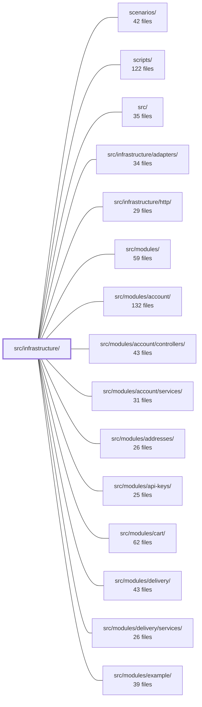

---
tags:
  - 2brain
  - 2brain/module
  - project/boilerplate-node-backend
type: module
module: src/infrastructure/
files: 70
updated: 2026-10-15T13:35:21.032111+00:00
---

# src/infrastructure/

## Purpose

`src/infrastructure/` is the shared, cross-cutting foundation every domain module builds on. It owns the typed environment-configuration system, the request-scoped i18n pipeline, the full observability stack (Prometheus metrics, OpenTelemetry tracing, product analytics, structured audit), and the Mongoose persistence abstractions (repository factory, serialization, search/pagination, leases, money handling). Nothing in here is domain-specific; it provides the *mechanics* that `src/modules/*` compose into business logic.

## Key parts

- **`config/`** — A single-layer, typed environment reader. `store.ts` freezes a `process.env` snapshot on first access; `fields.ts` provides typed builders (`int`, `flag`, `secret`, `keyRing`, …); `define.ts` turns a declared slice into a memoized, fully-typed accessor with boot-time validation (`configProblems` / `assertConfigIn`). `dotenv.ts` is the one-line first-import that guarantees `.env` is parsed before any read; `secret-files.ts` resolves `NODE_X_FILE` indirections so downstream code never sees file-based credentials.
- **`i18n/`** — A request-scoped translation subsystem built on a single global `i18next` instance. `catalog.ts` discovers and deep-merges locale JSON; `boot.ts` initialises i18next with in-memory resources (no backend adapter). `context.ts` uses `AsyncLocalStorage` to hand each request its own bound `t` function. `overrides.ts` layers admin-edited copy from the database on top of file-based dictionaries. `index.ts` is the sole import point (~70 call-sites use `@infrastructure/i18n`).
- **`observability/`** — Split into four concerns:
  - *Metrics*: `metrics-registry.ts` holds the shared `prom-client` registry; per-domain files (`metrics-http`, `metrics-queue`, `metrics-outbox`, `metrics-rate-limit`, `metrics-process`, `metrics-cache`, `security-events`) define the counters/histograms for their subsystems.
  - *Tracing*: `tracer.ts` wraps `@opentelemetry/api` with `withSpan`, error annotation, and context helpers.
  - *Analytics*: A provider-port pattern (`analytics/index.ts`) with interchangeable backends (`umami.ts`, `posthog.ts`, `none.ts`), selected at deploy time via `NODE_ANALYTICS_PROVIDER`.
  - *Audit*: `audit.ts` writes a stable, machine-readable "who/what/result" record to a dedicated logger, separate from application logs.
- **`persistence/`** — Mongoose-specific shared machinery. `create-repository.ts` is the generic CRUD + search factory every module's `repository.ts` spreads. `serialize.ts` is the single lean→wire conversion point. `search.ts` centralises pagination, regex escaping, and sort conventions. Supporting helpers: `factories.ts` (identity trio), `money-field.ts` (Decimal128 ↔ number), `revision-plugin.ts` (per-row `editRevision` counter), `lease.ts` (Mongo-backed mutual exclusion for cron), `report.ts` (`$dateTrunc` aggregation builder), `mongo-errors.ts` (duplicate-key / connection guards), `normalize-email.ts`, `changes.ts` ($set/$unset builder), `command-metrics.ts` (driver-level latency histogram).
- **`object-guards.ts`** — Two dependency-free helpers (`isPlainObject`, `stripUndefined`) shared across i18n merging, HTTP parsing, and test factories.

## How it connects

- **`src/modules/*` (every domain module)** is the primary consumer. Each module's `config.ts` imports `defineConfig` + field builders from `config/`; its `repository.ts` spreads the `create-repository.ts` factory; its services call `t()` via `i18n/index.ts`; its metrics files import `metricsRegistry`; and its controllers record audit entries. The dependency is strictly one-directional: infrastructure never imports from a domain module.
- **`src/infrastructure/http/`** sits as a sibling and consumes `observability/metrics-http.ts`, `observability/tracer.ts`, and `i18n/context.ts` to instrument and localise every HTTP response.
- **`src/infrastructure/adapters/`** (sibling) reads the same `config/` slices to resolve external-service credentials and endpoints.
- **`src/modules/locales/`** owns the database-backed translation rows that `i18n/overrides.ts` reads; it is the only module that writes to the overlay that `catalog.ts` merges at boot.
- **`scenarios/` and `scripts/`** import `config/dotenv.ts` as their first line and pull typed accessors from `config/define.ts` so test harnesses and ops scripts read the same validated environment.
- **Repository root** hosts the `.env` files and `locales/` directory tree that `dotenv.ts` and `i18n/catalog.ts` discover at runtime.

## Where to start

1. **`config/define.ts`** — Reading the `defineConfig` factory and the `Field`/`ConfigSlice` types unlocks the pattern every other file (i18n config, observability config, persistence config, analytics config) reuses. Once you see how a slice declares rules and `assertConfigIn` gates boot, the rest of the module's config files read in seconds.
2. **`persistence/create-repository.ts`** — This is the contract that every domain module's `repository.ts` depends on. Seeing the generic CRUD + `SearchSpec` shape here makes it immediate why modules "spread the factory's result" and what the `serialize.ts` / `search.ts` helpers are supplying. Together these two files (config factory + repository factory) account for the majority of what a newcomer will import from `src/infrastructure/` on day one.

## Connected modules

[[boilerplate-node-backend_ROOT|/ (repository root)]] · [[boilerplate-node-backend_scenarios|scenarios/]] · [[boilerplate-node-backend_scripts|scripts/]] · [[boilerplate-node-backend_src|src/]] · [[boilerplate-node-backend_src_infrastructure_adapters|src/infrastructure/adapters/]] · [[boilerplate-node-backend_src_infrastructure_http|src/infrastructure/http/]] · [[boilerplate-node-backend_src_modules|src/modules/]] · [[boilerplate-node-backend_src_modules_account|src/modules/account/]] · [[boilerplate-node-backend_src_modules_account_controllers|src/modules/account/controllers/]] · [[boilerplate-node-backend_src_modules_account_services|src/modules/account/services/]] · [[boilerplate-node-backend_src_modules_addresses|src/modules/addresses/]] · [[boilerplate-node-backend_src_modules_api-keys|src/modules/api-keys/]] · [[boilerplate-node-backend_src_modules_cart|src/modules/cart/]] · [[boilerplate-node-backend_src_modules_delivery|src/modules/delivery/]] · [[boilerplate-node-backend_src_modules_delivery_services|src/modules/delivery/services/]] · … and 14 more

## Files
- `src/infrastructure/config/define.ts` — Defines the `defineConfig` factory and its supporting types for a single-layer, typed environment-reading system. Each module owner declares a *slice* (a name, a set of `Field` rules keyed by variable name, and an optional cross-field check); `defineConfig` turns that into a memoized, fully-typed accessor. The file also provides the type-erased `ConfigSlice` interface and the boot-gate aggregation helpers (`configProblems`, `assertConfigIn`) that validate every slice at once and report all failures in a single `ConfigError`.
- `src/infrastructure/config/dotenv.ts` — Side-effect module that loads `.env` into `process.env` (via `dotenv/config`) and then notifies the config store so it can re-read the environment. It exists as a single first-import in every entry point to guarantee that no config read happens before the file is parsed.
- `src/infrastructure/config/fields.ts` — Defines the typed field builders (`int`, `decimal`, `flag`, `choice`, `text`, `email`, `timeZone`, `secret`, `csv`, `keyRing`, `versionedKeyRing`) used to declare configuration slices. Every builder enforces a single contract: blank strings are unset, a set-but-invalid value is an error (never a silent fallback), and presence requirements (min length, placeholder rejection, key strength) are boot-time checks separate from shape validation.
- `src/infrastructure/config/secret-files.ts` — Resolves `NODE_X_FILE` secret-file variables into their plain `NODE_X` counterparts and merges standalone password variables into their corresponding connection URLs, so downstream config consumers see fully resolved credentials without any trace of file-based mounting.
- `src/infrastructure/config/store.ts` — Central, process-lifetime store for the application's environment. It reads `process.env` exactly once (freezing a snapshot on first access), layers named overrides on top, resolves `NODE_X_FILE` secret-file indirections, and exposes the merged result to every config slice. State lives on `globalThis` behind a `Symbol.for` key so that Jest's `resetModules()` re-import still finds the same instance.
- `src/infrastructure/i18n/boot.ts` — Initialises the single global `i18next` instance shared by every entry point in the project. It accepts a pre-resolved list of locale directories and a target language, then wires up `lng`, `fallbackLng`, `supportedLngs`, and in-memory resources so that no backend adapter is needed.
- `src/infrastructure/i18n/catalog.ts` — The single source of truth for where translation dictionaries physically live and how they are assembled. It discovers locale JSON files from the shared `locales/` directory and any registered per-module directories, deep-merges them per locale, and produces the `i18next.Resource` object that `i18next.init()` consumes at boot. A project that relocates or restructures its dictionaries edits this file and nothing else.
- `src/infrastructure/i18n/config.ts` — Declares the locale-related settings for the deployment: which language is default, which is the fallback, the list of supported languages, and the refresh interval for edited-copy overrides. It uses the project's typed `defineConfig` pattern so that all locale knobs live in one place with defaults and validation.
- `src/infrastructure/i18n/context.ts` — Provides request-scoped translations so that concurrent requests in different languages don't interleave on i18next's single global instance. It uses `AsyncLocalStorage` to carry a locale-bound `t` function down each request's async call chain, and exposes a drop-in `t` that resolves to the per-request binding (or falls back to the global instance).
- `src/infrastructure/i18n/index.ts` — Barrel (facade) file for the request-scoped i18n subsystem. It is the **single import point** for translation infrastructure across the codebase (~70 call-sites use the `@infrastructure/i18n` alias), re-exporting four sub-modules—`./catalog`, `./boot`, `./overrides`, `./context`—so callers never touch `i18next` directly. This keeps the one-global i18next instance out of the per-request path; the per-request translator lives in `./context`.
- `src/infrastructure/i18n/overrides.ts` — Database overlay for i18n copy: admin-edited translations are layered on top of the deployed dictionary files in `./catalog`. The module is deliberately isolated (one-way dependency — nothing imports it back), so deleting this file plus its two boot-sequence lines removes the entire feature.
- `src/infrastructure/object-guards.ts` — Provides two small, dependency-free value helpers — `isPlainObject` and `stripUndefined` — that multiple unrelated call sites (i18n merging, locale key trees, HTTP request parsing, test factories) would otherwise each re-implement. It exists to keep that logic in one place without pulling in a utility library.
- `src/infrastructure/observability/analytics/index.ts` — Defines the **product analytics port** — the interface, event schema, provider registry, and emit helpers that every module uses to record product-behaviour events (distinct from operational metrics/tracing). The active backend (`umami`, `posthog`, or `none`) is selected at deploy time via `NODE_ANALYTICS_PROVIDER`, keeping the port stable regardless of which collector is wired in.
- `src/infrastructure/observability/analytics/none.ts` — A no-op analytics provider that implements the `AnalyticsProvider` port by doing nothing. It exists so that opting out of analytics collection is an explicit, stated choice (via `NODE_ANALYTICS_PROVIDER=none`) rather than a side effect of missing credentials or an unconfigured provider.
- `src/infrastructure/observability/analytics/posthog.ts` — Implements the PostHog adapter for the analytics port. Selected via `NODE_ANALYTICS_PROVIDER=posthog` as an alternative to the default Umami provider, chosen specifically for identity-shaped funnels because PostHog stitches a user's timeline by `distinct_id` — a capability Umami lacks. The trade-off is a hosted (or self-hosted) external dependency.
- `src/infrastructure/observability/analytics/umami.ts` — The default analytics provider for the backend. It implements the `AnalyticsProvider` port by POSTing each event as a plain HTTP request to Umami's `/api/send` collect endpoint — the same endpoint the browser tracking script hits — so server-side and client-side events land in the same Umami database without a server SDK.
- `src/infrastructure/observability/audit.ts` — Defines the structured audit-trail subsystem: the "who did what to which resource, and did it work" record. It is deliberately separate from application logging—audit entries are a security/compliance artefact written to a dedicated always-on `auditLogger` with a stable, machine-readable field set that must not be reshaped for convenience.
- `src/infrastructure/observability/config.ts` — Declares the runtime configuration shape for product analytics: which provider is active, whether a consent gate is required, and the per-provider endpoints and credentials. It is a leaf config definition that other layers (the provider registry, individual providers, and the app boot sequence) consume to resolve and validate analytics settings.
- `src/infrastructure/observability/metrics-cache.ts` — Defines the two Prometheus counters for the HTTP cache subsystem. The file exists because the cache is a side-effectful path (invalidations, stale-while-revalidate) where a log line would be the only signal, and log lines are not alertable.
- `src/infrastructure/observability/metrics-http.ts` — Defines and exports the Prometheus HTTP metrics (request counter, duration histogram, error counter, in-flight gauge) and the small helper functions used to record a completed request. The file only *defines and increments* the metrics; the registry they register against and the read-back logic that serializes them into JSON live elsewhere.
- `src/infrastructure/observability/metrics-outbox.ts` — Defines the Prometheus metrics (three counters, one gauge) for the transactional-outbox pattern. The counters are cheap, in-memory counters the relay process can increment without a DB round trip; the gauge answers "how many events are still waiting" by reading the database at scrape time.
- `src/infrastructure/observability/metrics-process.ts` — Defines a single process-level Prometheus counter that tracks unhandled promise rejections. The counter exists because the application deliberately survives unhandled rejections (via `handleUnhandledRejection`), and without a metric, those survived failures would be invisible to monitoring.
- `src/infrastructure/observability/metrics-queue.ts` — Defines the sole Prometheus counter for dead-letter queue activity in the system. It exists so that parked jobs (permanent rejections or exhausted retries) are observable as a metric rather than a one-off log line, enabling alerting on a sustained dead-letter rate.
- `src/infrastructure/observability/metrics-rate-limit.ts` — Declares the two Prometheus counters that make rate-limiting behavior alertable: how many store operations degraded to a per-process fallback and how many requests were refused with a 429. Both counters register against the shared `metricsRegistry` so they are collected alongside every other module's metrics.
- `src/infrastructure/observability/metrics-registry.ts` — Holds the single shared `prom-client` registry instance and the process-level gauges that describe the runtime itself (uptime, heap ceiling, crontab job outcomes). Every other module's `metrics.ts` imports `metricsRegistry` from here so all metrics land on the same global registry that `GET /metrics` serializes. Split out of `metrics-http.ts` to give the registry a name that isn't misleading for non-HTTP consumers.
- `src/infrastructure/observability/security-events.ts` — Defines Prometheus counters for security-attack events (forged or guessed credentials) and pairs each increment with a structured audit log entry so the metric and the evidence can never disagree. The counters are rate-alertable; the audit lines are the forensic record.
- `src/infrastructure/observability/tracer.ts` — A thin wrapper around the `@opentelemetry/api` interface that provides a single tracer instance and a small set of ergonomic helpers (`withSpan`, `getActiveSpanContext`, `recordErrorOnActiveSpan`) so that hand-written spans, cross-signal correlation, and error annotation are consistent across the codebase without requiring callers to deal with OTel's context mechanics directly.
- `src/infrastructure/persistence/changes.ts` — Utility module that converts a change-set (a flat record of field-path → value) into the `$set` / `$unset` operator halves required by a MongoDB update on a hydrated Mongoose document. It exists so that every repository and service that applies an update builds the operator object the same way, centralising the "null means clear" and "empty operator halves must be omitted" rules in one place.
- `src/infrastructure/persistence/command-metrics.ts` — Provides a Prometheus histogram that records the latency of every MongoDB command issued through a connection, using the driver's built-in command-monitoring events. Because the driver sees commands regardless of the code path (repository method, direct model call, aggregate), the metric captures full coverage with no double-counting. It feeds the `GET /observability/metrics/overview` endpoint.
- `src/infrastructure/persistence/config.ts` — Defines the persistence domain's configuration schema: a single setting, `NODE_SETTINGS_PAGINATION_PAGE_SIZE`, with a default of 10 and a minimum of 1. It exists so the rest of the codebase has a typed, validated reference for the default page size used in paginated queries.
- `src/infrastructure/persistence/create-repository.ts` — Generic repository factory that provides CRUD operations (findById, findOne, findAll, search, create, update, delete) plus declarative search against a Mongoose model and a `SearchSpec`. Every module's `repository.ts` builds on this factory so that no module hand-rolls `$regex`/`$elemMatch`/`ObjectId` coercion or the lean→normalized wire mapping. Modules spread the factory's result into their own object (no inheritance), so a module that can't honour part of the contract narrows its own type instead of overriding a method.
- `src/infrastructure/persistence/factories.ts` — Shared factory-identity helpers that every module's `factories.ts` would otherwise repeat: generating a `_id`, deriving `createdAt`/`updatedAt` from it, and typing the overrides bag a factory accepts. Exists so modules only declare their *own* domain fields and delegate the universal identity trio here.
- `src/infrastructure/persistence/lease.ts` — Provides a Mongo-backed mutual-exclusion lease so that a scaled-up cron container cannot run the same periodic job twice in one window. A single atomic upsert decides the winner; the lock lives in the same durable store as the work it guards (no Redis eviction policy to misconfigure). Fencing tokens are intentionally absent — the contract is that every lease-guarded job is idempotent.
- `src/infrastructure/persistence/money-field.ts` — Bridges the gap between MongoDB's `Decimal128` storage (required for exact money) and the application's plain `number` wire format. Provides the Mongoose schema-path definition, a lean-query post-hook, and a recursive `toJSON` transform so that every layer above persistence sees an ordinary `number`, regardless of how the document was read.
- `src/infrastructure/persistence/mongo-errors.ts` — Provides two narrow type-guard functions that classify Mongo/Mongoose write failures as either **duplicate-key** (unique-index violation) or **connection-unreachable**. They exist so that repositories and the HTTP error interpreter can inspect driver-level facts about a caught rejection without coupling to the response layer or to a specific driver package instance.
- `src/infrastructure/persistence/normalize-email.ts` — Single source of truth for email normalisation across the app. Provides two levels of canonicalisation—a minimal trim + lowercase for storage/lookup, and a delivery-mailbox form for budgeting—so that no module reinvents the casing, subtag, or dot-stripping rules and two spellings of the same address never produce two rows or two budget slots.
- `src/infrastructure/persistence/report.ts` — Shared MongoDB aggregation helpers for grouped reads (date-bucketed stats). Defines the window shape (`ReportWindow`) and the `$dateTrunc` builder (`bucketOf`) that every stats owner composes into its own pipeline. Lives in `infrastructure/persistence` because it emits MongoDB operator expressions directly; the domain modules consume it without needing to know about `$dateTrunc` details.
- `src/infrastructure/persistence/revision-plugin.ts` — Mongoose plugin that gives a schema a monotonically-incrementing `editRevision` counter and moves it atomically (`$inc: 1`) on every write the schema's `timestamps` option considers an edit. It exists to provide a strong, per-row validator (the basis for ETag / If-Match) that changes on every edit even when two edits land in the same millisecond, replacing Mongoose's `__v` with a domain-named field.
- `src/infrastructure/persistence/search.ts` — Shared pagination, search-pattern, and sort helpers for all Mongoose-backed repositories. Extracted so that filter conventions (regex escaping, control-character stripping, pagination defaults, stable sort) live in one place, satisfying OCP: a new search or sort rule changes here once rather than in every module's service.
- `src/infrastructure/persistence/serialize.ts` — Single point where a stored Mongoose document is converted into its wire/API payload. Handles the `_id` → `id` rename, `__v` removal, Decimal128 revival, edit-revision stripping, and per-model customisations. One function serves both serialisation paths: Mongoose's `toJSON` (which partially does the work) and raw BSON from `.lean()` / `.aggregate()` (which needs all steps applied manually by `create-repository.ts`).
- `src/infrastructure/persistence/versioning.ts` — Implements optimistic-concurrency control for repository writes: it tracks each row's `editRevision` counter (maintained by `revision-plugin`) and enforces an HTTP `If-Match` precondition at the persistence layer so a write that lost a race matches nothing and surfaces as a 412 instead of silently overwriting. The mechanism is request-scoped via `AsyncLocalStorage`, so services and repositories never need to know a header existed.
- `src/infrastructure/runtime/busy.ts` — Defines a single error type, `ServiceBusyError`, representing the condition "the server is at its limit and will not queue this request." It exists so that any adapter can signal a full bounded queue, and the HTTP layer can uniformly map that signal to a **503 Service Unavailable** with a `Retry-After` hint—semantically identical to an unreachable dependency. Placing the class under `runtime/` lets adapters throw it and the HTTP layer recognise it without a direct import in either direction.
- `src/infrastructure/runtime/cluster-policy.ts` — Pure decision functions extracted from the cluster primary in `src/cluster.ts`: how many workers to fork and how to respond to a worker crash. Kept as side-effect-free logic so each rule can be unit-tested independently of the process-lifecycle script.
- `src/infrastructure/runtime/config.ts` — Declares every environment-variable the process reads, grouped into named config bundles (environment, logging, server, cluster, database, currency, stock, tracing). It is the single source of truth for "what kind of process am I?" and exposes the `isRelaxedEnvironment` guard that every safety mechanism keys off. It lives in `runtime/` rather than in individual modules so that cross-module shared values (currency, stock threshold) have one canonical declaration.
- `src/infrastructure/runtime/database.ts` — Centralises the MongoDB connection lifecycle for the entire application: URI construction, connection with bounded exponential-backoff retry, Mongoose global configuration, connection-loss observability, clean shutdown, and a transaction helper. Every entry point (HTTP server, cron reapers, one-shot scripts) goes through this module rather than touching `mongoose.connect()` directly.
- `src/infrastructure/runtime/environment.ts` — Defines the shared vocabulary of boolean "words" (`true`, `false`, `yes`, `no`, `1`, `0`, `on`, `off`) and a single parser that decodes one of those words into a boolean. It exists so that configuration fields and HTTP request parsing (query strings, form fields) agree on the same on/off spelling without duplicating the list. It does **not** read `process.env` itself — each variable is still read by its owning `config.ts` via `defineConfig`.
- `src/infrastructure/runtime/mongoose-boot.ts` — A side-effect-only bootstrap module that applies Mongoose global defaults before any model module is evaluated. It exists to work around ES import hoisting: because `import` statements are hoisted above subsequent code, the only reliable way to guarantee the defaults are set *before* model definitions run is to make this file the very first import in an entry point.
- `src/infrastructure/runtime/mongoose-defaults.ts` — Sets Mongoose global options that are frozen at schema-build time, so they must be applied before any model module loads. Isolated as a dependency-free module so it can occupy the first import line of every entry point without pulling in the rest of the project.
- `src/infrastructure/runtime/otel-sdk.ts` — Bootstraps the OpenTelemetry Node SDK with auto-instrumentation (HTTP, Express, Mongoose, Redis), OTLP span export, and trace-context propagation. It must be imported *before* any instrumented library handles traffic, because instrumentation patches global modules at `sdk.start()` time. The module also enforces two security properties: sensitive query parameters are redacted from span URLs, and public endpoints never adopt an inbound trace id (to prevent trace hijacking and forced sampling).
- `src/infrastructure/runtime/provider-registry.ts` — A single generic, named-table abstraction that unifies the "name in, implementation out" shape previously duplicated across the antibot, analytics, payments, and OAuth ports. It provides registration, listing, and lookup; the *resolution policy* (throw on unknown name vs. return `undefined`) is deliberately left to each caller.
- `src/infrastructure/runtime/readiness.ts` — Holds the single readiness state that `GET /readyz` reads: whether the process has finished booting, has begun draining for shutdown, and whether the Mongoose database connection is currently live. It is the synchronous, I/O-free read side of the server lifecycle — distinct from `server-lifecycle.ts`, which sequences the actual stop steps but exposes no queryable state.
- `src/infrastructure/runtime/server-lifecycle.ts` — Orchestrates the full server lifecycle: binding an Express app to a port, and — on shutdown — draining in-flight connections and tearing down infrastructure adapters in a fixed, safe order. All timers are `unref`'d so none independently hold the event loop open, and every step carries a hard deadline (default 15 s) so a stuck teardown cannot hang the process past the orchestrator's SIGKILL window.
- `src/infrastructure/runtime/settle.ts` — Provides a single shared utility for adapters that must drain in-flight work before process shutdown (queue handlers, PDF renders). It guarantees shutdown is never held hostage by hung tasks by racing "all work settled" against a hard deadline.
- `src/infrastructure/security/breached-passwords/index.ts` — Provides breached-password checking exclusively for password **set** paths (signup, change, reset). Two independent rungs — a bundled in-memory list and the HIBP k-anonymity range API — are consulted in order. Both rungs **fail open** (any error accepts the password), and the check is never performed on login, where refusing would confirm a guess to an attacker and lock out the legitimate user.
- `src/infrastructure/security/breached-passwords/list.txt` — 5??F??q
- `src/infrastructure/security/config.ts` — Declares the environment-variable schemas that the security helpers read at runtime: the pseudonymisation root key, the PII field-encryption key ring, and the breached-password checking ladder. It exists as a single import point so consumers never re-declare these shapes.
- `src/infrastructure/security/constant-time.ts` — Provides a single `constantTimeEqual` primitive for comparing two strings in constant time, eliminating the timing side-channel that a plain `===` or length-check would leak. Every static-credential verification in the repo routes through this function rather than hand-rolling its own comparison.
- `src/infrastructure/security/hash-token.ts` — Single-purpose leaf module that provides the one canonical SHA-256 digest used for every stored credential-like value (session IDs, refresh tokens, one-time links, API keys). Because it depends only on `node:crypto`, any module can hash or look up a token without coupling to a sibling service.
- `src/infrastructure/security/password-hash.ts` — Provides the application's password hashing and verification layer on top of Node 24.7+'s built-in `argon2`/`argon2id` primitive. It owns the three things Node does not: salt generation, PHC-string encoding/decoding, and a constant-time comparison. Cost parameters follow OWASP's second argon2id profile (~19 MiB, 2 passes, 1 lane), targeting < 50 ms per derivation.
- `src/infrastructure/security/pii-encryption.ts` — Provides field-level AES-256-GCM encryption for GDPR-flagged PII values (address-book fields, user phone) that are stored outside the account's own secrets. It wraps the shared `versioned-secret.ts` primitives under a dedicated key (`NODE_PII_ENCRYPTION_KEY`), keeping PII rotation independent from TOTP/webhook key rotation.
- `src/infrastructure/security/pseudonymise.ts` — Provides keyed pseudonymisation (HMAC-SHA256) so that identifiers and secrets can be compared for equality without being human-readable. Used for log fields, rate-limit identities, and the idempotency fingerprint. A keyed scheme prevents brute-forcing of guessable values; only a holder of the root secret can reproduce or test digests.
- `src/infrastructure/security/reencrypt.ts` — A generic engine that re-encrypts stored secrets onto the newest key in a versioned ring, enabling safe key rotation. It handles batching, the rewrap call, and the write for any collection; each owning module only describes *where* its encrypted fields live. Designed to be idempotent (a second run writes nothing), concurrency-safe (writes are filtered on the ciphertext read), and silent (bypasses Mongoose hooks via `collection.bulkWrite`).
- `src/infrastructure/security/subkey.ts` — Single entry point for deriving purpose-bound subkeys from a root secret via HKDF-SHA256 (RFC 5869). Enforces key separation (one root key never directly serves two purposes, per NIST SP 800-57 §5.2) by binding each derived key to an explicit `info` label. Caches results to avoid re-derivation on the request path.
- `src/infrastructure/security/versioned-secret.ts` — Provides versioned AES-256-GCM encryption for secrets at rest (TOTP credentials, webhook signing secrets, PII). The "versioned" part means each ciphertext is stamped with the key version that wrote it, so a key-rotation ring can decrypt any row against the correct key while always encrypting new rows with the newest key — no one-off migration needed.
- `src/infrastructure/surfaces/create-delete-controller.ts` — Factory that builds the `DELETE /x` controller shared by every entity. Each module calls it once with a small spec (entity name, service call, i18n key) and gets back a fully wired Express handler that covers soft delete, hard delete, id extraction, `If-Match` preconditions, and uniform error handling—so module controllers stay one-liners.
- `src/infrastructure/surfaces/create-item-controller.ts` — A factory that builds the "read-one" (fetch-by-path-id) Express handler for any entity. It centralises the API contract decision that a malformed or missing id returns the module's own 404 (not a 500), so that behaviour has a single landing site rather than being repeated inline in every module.
- `src/infrastructure/surfaces/create-list-controller.ts` — Factory that produces an Express handler for any paged-list endpoint. It encapsulates the single shared flow—read query-string input → validate against a Zod schema → invoke the module's query → wrap the result in the standard success envelope or a `catchAs` error—so each entity only supplies its differences (entity name, schema, and query function) rather than repeating the boilerplate.
- `src/infrastructure/surfaces/create-restore-controller.ts` — Generic factory that builds a `POST /x/:id/restore` Express handler for any module whose `DELETE /x/:id` soft-deletes a record. It exists as a separate verb because HTTP DELETE must be safe to repeat (RFC 9110 §9.2.2), so a retried DELETE can never accidentally restore a record.
- `src/infrastructure/surfaces/create-search-controller.ts` — Factory that produces a single Express handler for modules exposing both `GET /x` and `POST /x/search` behind one controller. It standardises the request→validate→search→respond pipeline so each module only supplies its own schema, optional input overlay, and search implementation.
- `src/infrastructure/surfaces/create-update-controller.ts` — Shared factory that builds a PUT (replace) and PATCH (merge) Express handler pair for any resource. Both verbs run through a single pipeline — resolve id, parse body, fill omitted clearable fields (PUT only), optionally run `completeReplace`, apply optimistic-concurrency fencing, and shape the response — differing only in which Zod schema validates the body and which fields get filled with `null`.

---
[[boilerplate-node-backend_INDEX|← boilerplate-node-backend index]]
