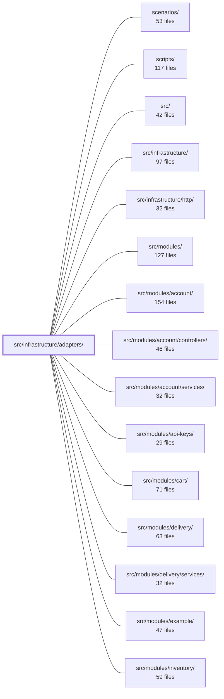

---
tags:
  - 2brain
  - 2brain/module
  - project/boilerplate-node-backend
type: module
module: src/infrastructure/adapters/
files: 36
updated: 2026-10-29T19:20:59.185370+00:00
---

# src/infrastructure/adapters/

## Purpose

`src/infrastructure/adapters/` is the collection of concrete, technology-specific adapters that satisfy the ports (interfaces) defined elsewhere in the system. Every external concern the application has—sending mail, rendering PDFs, storing images, rate-limiting, anti-bot verification, outbound HTTPS, structured logging, and queue transport—is encapsulated here so that the domain and module layers depend only on stable contracts, never on a vendor SDK or a specific protocol library.

## Key parts

- **Anti-bot ladder (rungs 2 & 3)** — `antibot.ts` (email-domain policy gate), `antibot-verdict.ts` (shared `RungVerdict` union), and `antibot-providers/` (port definition, `none`/`turnstile`/`altcha` adapters, and the `altcha-store` single-use claim guard). Selected at runtime via `NODE_ANTIBOT_PROVIDER`.
- **Email pipeline** — `mailer.ts` (template render + envelope + dispatch), `mail-transports.ts` (transport registry), `smtp-transport.ts` (nodemailer sender, isolated for test mocking), `mail-spool.ts` (claim-check for attachments), `email.worker.ts` (queue consumer), and `template-registry.ts` (template name → path lookup, split out for Jest load-order safety).
- **Image handling** — `image-store.ts` (port + local-FS impl), `image.ts` (sharp wrapper: digest + thumbnail), `image-signatures.ts` (magic-number format detection), `images.generated.ts` (accepted formats / thumbnail version), `image.worker.ts` (shared digest pipeline with injected writeback port), `remote-image.ts` (avatar re-host), and `orphaned-images.ts` (unreferenced-file sweep).
- **Documents & PDFs** — `pdf.ts` (puppeteer-core concurrency-bounded renderer), `document-store.ts` (disk cache of rendered PDFs).
- **Data stores** — `export-store.ts` (personal-data export file), `filesystem.ts` (shared primitives: atomic write, cross-mount move, non-throwing delete, directory sweeps).
- **Redis & rate limiting** — `redis.ts` (shared client factory / URL assembly), `cache.ts` (tag-invalidation byte store, fail-open), `limits-redis.ts` (dedicated noeviction instance for counters and single-use claims), `managed-connection.ts` (lifecycle boilerplate shared by both Redis adapters).
- **Queue** — `queue.ts` (RabbitMQ publish/consume with graceful no-op fallback when unconfigured).
- **Outbound networking & SSRF protection** — `pinned-https.ts` (resolve → validate → pin single call), `ssrf-guard.ts` (DNS-pinning logic), `ssrf-exemptions.ts` (zero-import exemption set for pre-load registration).
- **Structured logging** — `logger.ts` (Winston-backed `Logger` port + redaction pipeline), `semantic-names.ts` (OTel convention rename), `semantic-log-names.generated.ts` (generated field-name map).
- **Configuration** — `config.ts` (typed, self-validating config slices for every adapter above).

## How it connects

- **`src/infrastructure/http/`** — The HTTP layer (routing, middleware) is the primary *caller* of the anti-bot rungs, the image-store port, the export-store, and the mailer. It imports adapters through their ports; it never touches a vendor library directly.
- **`src/modules/*`** (account, orders, invoicing, notifications, products, webhooks, etc.) — Each business module consumes one or more adapters: notifications → `mailer.ts`; invoicing → `pdf.ts` + `document-store.ts`; account/users → `image-store.ts`, `remote-image.ts`; webhooks → `pinned-https.ts` + `queue.ts`; observability → `logger.ts`. The adapters keep module code free of protocol specifics.
- **`src/infrastructure/`** — Parent directory; this module is its adapter sub-tree, sitting alongside `http/` and other infrastructure concerns.
- **`scripts/`** — Operational cron / maintenance scripts (e.g., the orphaned-image sweep, retention sweeps for `document-store` and `export-store`) import the relevant adapter functions directly.
- **`scenarios/`** — Integration and end-to-end test scenarios exercise adapters through the public ports (e.g., verifying an ALTCHA challenge end-to-end, asserting a PDF is produced for an invoice).
- **Repository root** — Build tooling generates `images.generated.ts` and `semantic-log-names.generated.ts` from YAML rule files at the project root before compilation.

## Where to start

1. **`antibot-providers/index.ts`** — It defines the port contract (`HumanChallengeProvider`), the provider registry, and the env-var selection mechanism. Reading it first gives you the mental model (port → named adapter → runtime swap) that the entire module follows.
2. **`config.ts`** — Every adapter's typed configuration lives here. Skimming it gives you a quick map of *which* external services exist, *what* knobs control them, and *where* each adapter plugs into the process, without yet opening any adapter implementation.

## Connected modules

[[boilerplate-node-backend_ROOT|/ (repository root)]] · [[boilerplate-node-backend_scenarios|scenarios/]] · [[boilerplate-node-backend_scripts|scripts/]] · [[boilerplate-node-backend_src|src/]] · [[boilerplate-node-backend_src_infrastructure|src/infrastructure/]] · [[boilerplate-node-backend_src_infrastructure_http|src/infrastructure/http/]] · [[boilerplate-node-backend_src_modules|src/modules/]] · [[boilerplate-node-backend_src_modules_account|src/modules/account/]] · [[boilerplate-node-backend_src_modules_account_controllers|src/modules/account/controllers/]] · [[boilerplate-node-backend_src_modules_account_services|src/modules/account/services/]] · [[boilerplate-node-backend_src_modules_api-keys|src/modules/api-keys/]] · [[boilerplate-node-backend_src_modules_cart|src/modules/cart/]] · [[boilerplate-node-backend_src_modules_delivery|src/modules/delivery/]] · [[boilerplate-node-backend_src_modules_delivery_services|src/modules/delivery/services/]] · [[boilerplate-node-backend_src_modules_example|src/modules/example/]] · … and 13 more

## Files
- `src/infrastructure/adapters/antibot-providers/altcha-store.ts` — Enforces single-use semantics on ALTCHA challenge solutions so that one verified payload cannot be replayed. It sits between the caller and `altcha-lib`'s `verify` as a two-step guard: a read-only `isSpent` check before verification (so an unverified payload leaves no trace) and a `claim` write after verification succeeds (so only an accepted solution is recorded).
- `src/infrastructure/adapters/antibot-providers/altcha.ts` — Implements the self-hosted `HumanChallengeProvider` port using ALTCHA, a proof-of-work challenge the server both issues and verifies. Chosen over vendor-backed options (e.g. Turnstile) to eliminate third-party scripts and outbound traffic; the trade-off is that the CPU work lands on the visitor's device.
- `src/infrastructure/adapters/antibot-providers/index.ts` — Defines the **human-challenge port** (Rung 3 of the anti-automation ladder) and the provider registry that binds concrete adapters (`none`, `turnstile`, `altcha`) to the `NODE_ANTIBOT_PROVIDER` environment variable. The file exists so that deployment selects an implementation by name at runtime without any code-path branching in the rest of the system.
- `src/infrastructure/adapters/antibot-providers/none.ts` — Provides a no-op implementation of the `HumanChallengeProvider` interface that always succeeds. It is the default provider shipped with the codebase so that a fresh checkout, test suite, or demo runs without rendering a third-party widget or routing visitor traffic to an external service.
- `src/infrastructure/adapters/antibot-providers/turnstile.ts` — Concrete implementation of the `HumanChallengeProvider` port using Cloudflare Turnstile. It verifies a client-submitted token server-side by calling Cloudflare's `/siteverify` endpoint and maps the result to a `RungVerdict`. Shipped as a reference implementation (not an endorsement) for deployments that choose Turnstile over the alternatives documented in `docs/modules/antibot.md`.
- `src/infrastructure/adapters/antibot-verdict.ts` — Defines the single shared `RungVerdict` union type (`'ok' | 'refused'`) used as the yes/no answer for every anti-automation rung. Exists so that rung 2 (`checkEmailPolicy`) and rung 3 (`HumanChallengeProvider.verify`) cannot drift into divergent vocabularies for the same binary question.
- `src/infrastructure/adapters/antibot.ts` — Rung 2 of the anti-automation ladder: a pure yes/no gate that refuses an email address whose domain appears in a disposable-inbox blocklist, or (under the stricter `mx` policy) whose domain has no MX record. Off by default via `NODE_ANTIBOT_EMAIL_POLICY`; the module only returns a verdict and leaves the caller to decide what refusal means for its endpoint.
- `src/infrastructure/adapters/cache.ts` — Redis cache adapter that exposes an opaque byte store with tag-based invalidation. It owns exactly one Redis connection per process, and every public function fails open—returning `undefined`/`false` instead of throwing—so the app keeps serving when Redis is unreachable. What gets cached and how it is framed is deliberately the caller's concern, not this module's.
- `src/infrastructure/adapters/config.ts` — Centralised, typed configuration slices for every infrastructure adapter (mail, queue, Redis, images, outbound requests, PDF, export store, anti-bot). Each slice is a self-contained `defineConfig` block with field shapes, defaults, and cross-field validation so a bad value names the adapter it belongs to rather than surfacing as a runtime crash.
- `src/infrastructure/adapters/document-store.ts` — Disk cache for finished PDF documents (invoices, credit notes). A second download streams the stored file instead of re-launching Chromium to render. The stored PDF is a regenerable copy, not the legal record (that lives in Mongo), is never backed up, and is deleted after its retention window expires.
- `src/infrastructure/adapters/email.worker.ts` — Consumer-side handler that drains one queued email job: it validates the payload, renders the EJS template via `sendTemplatedEmail`, and discards spooled attachments. It is the worker counterpart to `enqueueEmail` in `adapters/mailer.ts` and is wired in by `consumeFromQueue` when a broker is configured. All i18n resolution happens upstream in the producer; this file only interpolates and sends.
- `src/infrastructure/adapters/export-store.ts` — Disk-backed store for a user's personal-data export file. It writes the export incrementally (streamed), reads it back as a stream, and manages deletion and retention sweeping. The file is a regenerable copy — not a record — and is intentionally plaintext, outside `NODE_PUBLIC_PATH`, with at-rest protection delegated to the host.
- `src/infrastructure/adapters/filesystem.ts` — Shared, dependency-light filesystem primitives that every other disk-touching adapter builds on: a cross-mount move, two flavors of non-throwing delete, an atomic write, and two directory-sweep helpers (age-based and reference-based). Exists so no other adapter re-derives the EXDEV fallback, the log-and-swallow pattern, or the `readdir`/`stat`/`unlink` sweep independently.
- `src/infrastructure/adapters/image-signatures.ts` — Content-based image type identification. Because a client-supplied `Content-Type` header is trivially spoofable, this module determines an image's real format from its leading bytes (magic-number signatures) instead. It exists so that downstream consumers—static file servers, decoders, SVG script vectors—never act on a label the uploader chose. It deliberately inlines three format signatures rather than pulling in `file-type` or similar, keeping the trust surface to a single auditable table.
- `src/infrastructure/adapters/image-store.ts` — Defines the `ImageStore` port and its single local-filesystem implementation. It is the one place in the codebase that maps an opaque `imageUrl` handle to a real filesystem path, so that swapping the backend (e.g. to an object bucket) is a change to this file alone rather than to every service and controller that reads or writes images.
- `src/infrastructure/adapters/image.ts` — Thin wrapper around **sharp** that exposes exactly two public transforms — `digestImage` (re-encode a quarantined upload to a size-capped version in the *same* format) and `thumbnailImage` (produce a small WebP derivative). All sharp-specific configuration, safety limits, and encoding logic is confined to this file so the image library can be swapped by rewriting two functions rather than searching the codebase.
- `src/infrastructure/adapters/image.worker.ts` — Implements the single image-digest pipeline that turns a quarantined upload into a promoted original plus thumbnail and writes the resulting URLs back onto a waiting document. Because it sits below `@kernel`/`@modules` in the import hierarchy, it cannot import module code directly; instead it receives the writeback as an injected port at boot. Both the queued-worker path and the no-broker inline path share this one pipeline to prevent drift.
- `src/infrastructure/adapters/images.generated.ts` — Generated data file that defines the accepted image formats (PNG, JPEG, WebP) and their byte-signature rules, plus the current thumbnail version. It exists so that image validation logic and thumbnail handling have a single, declarative source of truth that is produced from a YAML rule file rather than hand-maintained in TypeScript.
- `src/infrastructure/adapters/limits-redis.ts` — Manages the dedicated `limits` Redis instance that stores rate-limit counters and single-use claims (e.g. spent ALTCHA solutions) under a `noeviction` policy. It exists separately from the response-cache instance so that an `allkeys-lru` flush or pressure-driven eviction on the cache can never silently reset a budget or reopen a replayable solution.
- `src/infrastructure/adapters/logger.ts` — Structured logging adapter built on Winston. Defines a narrow `Logger` interface (port) that the rest of the codebase depends on instead of Winston directly, so swapping the underlying library only requires satisfying this small contract. Also implements the redaction and pseudonymisation pipeline that transforms every log record before it reaches a transport.
- `src/infrastructure/adapters/mail-spool.ts` — Implements the Claim Check pattern for email attachments: bytes are written durably to a local spool directory, and the queue message carries only an opaque key (the "ticket"). This decouples the attachment data from the message payload so a queued job survives process restarts, while the key-shape validation prevents a producer from ever naming a file outside the spool root.
- `src/infrastructure/adapters/mail-transports.ts` — The mail transport registry: maps the `NODE_MAIL_TRANSPORT` env var to a concrete `MailTransportAdapter` that can send (or pretend to send) one message. It exists so callers ask *"does this reach an inbox?"* (`delivers`) or *"hand this off"* (`send`) without naming a specific backend. Only `smtp` is registered in production; `log` and `outbox` are test doubles registered at preload/Jest time.
- `src/infrastructure/adapters/mailer.ts` — The email adapter that renders EJS templates into HTML, assembles a nodemailer envelope, and dispatches it through a named transport — either inline or via a RabbitMQ queue. It is the single public surface every caller uses to send mail, keeping EJS, nodemailer, spool, and transport concerns behind one set of exported functions.
- `src/infrastructure/adapters/managed-connection.ts` — Centralises the lifecycle of a single optional external dependency (Redis, etc.): connection memoisation, shared in-flight connect, warn-once outage logging, a fail-open getter, a `DependencyStatus` reader, and a safe shutdown. Exists so that `cache.ts` and `rate-limit-store.ts` stop duplicating six pieces of identical boilerplate and instead supply only what is genuinely their own (the connect/check/close calls and the human-readable outage message).
- `src/infrastructure/adapters/orphaned-images.ts` — Implements the sweep that deletes stored image files no longer referenced by any live document. Extracted from the nightly `reap:orphaned-images` cron script so the logic is a tested, reusable function. Orphans typically arise from a refused upload whose close hook never fired, or from a throwaway Mongo that was reseeded while files persisted on disk.
- `src/infrastructure/adapters/pdf.ts` — Infrastructure-level HTML→PDF rendering adapter. Wraps a headless Chromium (via `puppeteer-core`) in a concurrency-bounded, timeout-guarded, network-locked pipeline so that invoice and report HTML can be turned into PDF byte arrays without exhausting container memory or leaking browser processes.
- `src/infrastructure/adapters/pinned-https.ts` — The single outbound HTTPS path for any user- or provider-supplied URL. It combines SSRF validation, DNS pinning, and a no-redirect policy into one call so that no code path can accidentally reach a private address or follow a redirect to one. Webhook delivery and remote-avatar downloads both route through it.
- `src/infrastructure/adapters/queue.ts` — RabbitMQ (AMQP 0-9-1) adapter that provides a single shared publish/consume channel for the process. When the broker is unconfigured or unreachable every operation degrades to a no-op (callers fall back to inline work). Connection resilience is delegated entirely to amqplib's built-in `recovery` option rather than the shared `managed-connection` lifecycle, because recovery's `setup` callback naturally re-declares queues and re-binds consumers on every reconnect.
- `src/infrastructure/adapters/redis.ts` — Shared Redis plumbing for every Redis-backed adapter in this codebase: URL assembly from environment variables, the node-redis client options (timeouts, keepalive, RESP2), a single client factory, a graceful close helper, and a predicate that classifies "server unreachable" errors. Adapters that *differ* in recovery strategy (cache vs. rate-limit) keep that logic in their own files rather than here.
- `src/infrastructure/adapters/remote-image.ts` — Re-hosts a remote avatar image (e.g. from an OAuth provider) so that the platform never forwards a viewer's request to a third-party host on every render. It downloads the image once through a pinned-HTTPS guard, pushes the bytes through the same quarantine-and-digest pipeline as a local upload, and returns two local URLs. The operation is best-effort: any failure resolves to `undefined` so that a missing avatar can never break the signup that requested it.
- `src/infrastructure/adapters/semantic-log-names.generated.ts` — A generated lookup table that maps TypeScript field names (e.g. `traceId`) to the canonical attribute names used in log lines (e.g. `trace_id`). It exists as the single source of truth for how code-side property names are rendered in structured logs, and is regenerated from YAML so the mapping stays in sync without manual edits.
- `src/infrastructure/adapters/semantic-names.ts` — Renames camelCase field names in structured log records to their OpenTelemetry semantic-convention equivalents (e.g. `actorUserId` → `user.id`, `statusCode` → `http.response.status_code`) before the line is written to Loki, a SIEM, or any other collector. This lets dashboards and alerts authored against the standard work without modification.
- `src/infrastructure/adapters/smtp-transport.ts` — Provides the SMTP sending path via a nodemailer `Transporter`. The file is deliberately isolated from `mail-transports.ts` so that the latter—loaded before the application by Jest setup and the dev preload—never imports `nodemailer`, allowing a test's own `jest.mock('nodemailer')` to take effect.
- `src/infrastructure/adapters/ssrf-exemptions.ts` — A zero-import module that holds a `Set` of origins exempt from the SSRF guard's private-address check. It lives in its own file (with no dependencies) so that a dev/demo preload script or a Jest setup file can register an exemption *before* the application — and its DNS-related imports — load, avoiding load-order issues. In production the set is always empty; nothing under `src/` registers an entry.
- `src/infrastructure/adapters/ssrf-guard.ts` — Prevents Server-Side Request Forgery (SSRF) for outbound requests this server initiates on a user's behalf. Enforces a strict **resolve → validate → pin** order so a second DNS lookup (the classic DNS-rebinding TOCTOU) can never swap the target after validation. Used by the webhook delivery pipeline and the OAuth avatar re-host. Lives in infrastructure (not `domain/`) because it performs DNS I/O.
- `src/infrastructure/adapters/template-registry.ts` — A leaf-module registry that maps EJS template names (e.g. `"invoice.receipt"`) to their absolute file paths on disk. It was deliberately split out of `mailer.ts` so that test infrastructure (`tests/support/setup.ts`, run via jest `setupFiles`) can call `registerTemplateDirectories` *before* any `jest.mock('nodemailer')` hoisting occurs — importing `mailer.ts` here would pull in a real `nodemailer` and make it un-mockable.

---
[[boilerplate-node-backend_INDEX|← boilerplate-node-backend index]]
