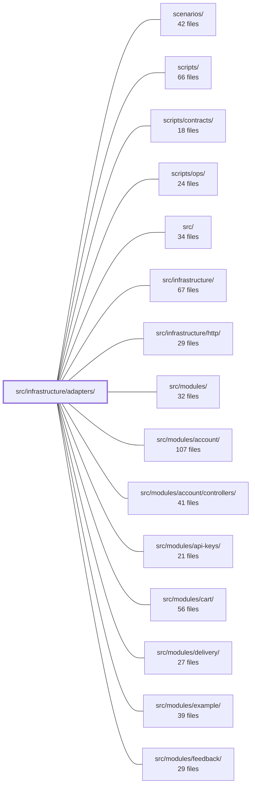

---
tags:
  - 2brain
  - 2brain/module
  - project/boilerplate-node-backend
type: module
module: src/infrastructure/adapters/
files: 32
updated: 2026-10-07T23:54:46.699980+00:00
---

# src/infrastructure/adapters/

## Purpose

This module is the concrete-implementation layer of the infrastructure: every external or platform concern (email, images, caching, queues, PDF, anti-automation, file storage, logging, outbound HTTP security) is wrapped behind a narrow port so that domain modules above it never touch a vendor SDK, a socket, or a filesystem path directly. Adapters here are the "how" — the "what" (the ports and domain rules) lives in `src/infrastructure/` and `src/modules/`.

## Key parts

- **Anti-automation ladder (rungs 2 & 3)** — `antibot-verdict.ts` (shared `RungVerdict` type), `antibot.ts` (email-domain policy gate), and the `antibot-providers/` subdirectory (`index.ts` registry + interface, `altcha.ts`/`altcha-store.ts` self-hosted PoW, `turnstile.ts` Cloudflare reference, `none.ts` no-op default). The active provider is chosen at deploy time via `NODE_ANTIBOT_PROVIDER`.
- **Email pipeline** — `mailer.ts` (EJS render → transport), `email.worker.ts` (queue consumer), `mail-spool.ts` (Claim-Check attachment store), `mail-transports.ts` / `smtp-transport.ts` (delivery backends). Callers enqueue or send inline; the worker drains the queue.
- **Image pipeline** — `image.ts` (sharp Buffer→Buffer transforms), `image-store.ts` (`ImageStore` port + filesystem impl), `image.worker.ts` (digest/promote pipeline with writeback), `image-signatures.ts` (magic-byte sniffing), `remote-image.ts`.
- **Shared state & connectivity** — `cache.ts` (Redis byte store with tag invalidation, fails open), `redis.ts` (URL/client plumbing), `managed-connection.ts` (memoised optional-dependency lifecycle shared by cache and rate-limit stores), `queue.ts` (RabbitMQ publish/consume, no-op when unconfigured).
- **File & document storage** — `filesystem.ts` (cross-mount move, safe delete, age sweep), `document-store.ts`, `export-store.ts`.
- **PDF rendering** — `pdf.ts` (headless Chromium "HTML in → PDF bytes out" API).
- **Outbound HTTP security** — `ssrf-guard.ts` (resolve→validate→pin against SSRF / DNS rebinding), `ssrf-exemptions.ts`, `pinned-https.ts`.
- **Logging** — `logger.ts` (Winston behind a `Logger` port with built-in redaction).
- **Configuration** — `config.ts` (per-adapter `defineConfig` blocks; validation fires at boot).
- **Templates** — `template-registry.ts` (EJS template lookup used by the mailer).

## How it connects

- **`src/infrastructure/` (parent)** — defines the abstract ports; this directory holds their concrete adapters and the shared plumbing (Redis, managed-connection, filesystem) they rely on.
- **`src/infrastructure/http/`** — the HTTP layer invokes anti-automation rungs before routing, calls `ImageStore` for upload/download, and passes rendered content to `pdf.ts`. It consumes the narrow ports this module exposes rather than importing vendor libraries.
- **`src/modules/` and its domain sub-modules** (`invoicing`, `orders`, `delivery`, `account`, `products`, `payments`, `returns`, `webhooks`, `feedback`, `locales`, `api-keys`, `cart`, `inventory`, `users`, `example`) — these are the primary consumers. Invoicing calls `pdf.ts` for statement generation; orders/delivery/enrollment flows call `mailer.ts` or enqueue via `queue.ts`; the HTTP middleware layer consults the `antibot-providers` registry; upload flows call `image.worker.ts` and `image-store.ts`. Because adapters sit below `@kernel`/`@modules` in the dependency hierarchy, writeback into domain documents is done through inverted ports registered at boot, not direct imports.
- **`scenarios/` and `scripts/`** (including `scripts/ops/` and `scripts/contracts/`) — exercise the adapters end-to-end (e.g., spinning up the mailer with a demo transport, hitting the anti-bot ladder, or draining the queue) and read `config.ts` to obtain validated connection parameters.

## Where to start

1. **`config.ts`** — a quick map of every environment variable the module expects and the validation rules that fire at boot; reading it tells you what external services (Redis, RabbitMQ, SMTP, image path) must exist for a given deployment.
2. **`antibot-providers/index.ts`** — the smallest self-contained port + registry pair. It shows the "interface → registry → deployment-time selection" pattern that most other adapters in this directory follow, and it pulls in `antibot-verdict.ts` so you see the shared vocabulary immediately.

## Connected modules

[[boilerplate-node-backend_ROOT|/ (repository root)]] · [[boilerplate-node-backend_scenarios|scenarios/]] · [[boilerplate-node-backend_scripts|scripts/]] · [[boilerplate-node-backend_scripts_contracts|scripts/contracts/]] · [[boilerplate-node-backend_scripts_ops|scripts/ops/]] · [[boilerplate-node-backend_src|src/]] · [[boilerplate-node-backend_src_infrastructure|src/infrastructure/]] · [[boilerplate-node-backend_src_infrastructure_http|src/infrastructure/http/]] · [[boilerplate-node-backend_src_modules|src/modules/]] · [[boilerplate-node-backend_src_modules_account|src/modules/account/]] · [[boilerplate-node-backend_src_modules_account_controllers|src/modules/account/controllers/]] · [[boilerplate-node-backend_src_modules_api-keys|src/modules/api-keys/]] · [[boilerplate-node-backend_src_modules_cart|src/modules/cart/]] · [[boilerplate-node-backend_src_modules_delivery|src/modules/delivery/]] · [[boilerplate-node-backend_src_modules_example|src/modules/example/]] · … and 11 more

## Files
- `src/infrastructure/adapters/antibot-providers/altcha-store.ts` — Implements the ALTCHA library's `Store` interface to enforce single-use of solved challenge tokens. Ensures one solution cannot be replayed across requests or worker processes by recording each spent challenge id in a shared cache with a local in-memory fallback.
- `src/infrastructure/adapters/antibot-providers/altcha.ts` — Adapter that implements the `HumanChallengeProvider` port using ALTCHA, a self-hosted proof-of-work human-challenge. The server itself issues and verifies challenges — no third-party script, no external API calls. Selected over Turnstile when zero-vendor, zero-egress is the priority; the trade-off is that the computational cost lands on the visitor's device.
- `src/infrastructure/adapters/antibot-providers/index.ts` — Entry point and contract for "rung 3" of the anti-automation ladder — the human-challenge provider. It defines the `HumanChallengeProvider` interface that every implementation (self-hosted or vendor-hosted) must satisfy, registers the bundled implementations in a provider registry, and exposes the resolution/enabled-check helpers that the rest of the system calls. Which implementation is active is a deployment-time decision (`NODE_ANTIBOT_PROVIDER`), not a code branch.
- `src/infrastructure/adapters/antibot-providers/none.ts` — Provides a no-op implementation of the `HumanChallengeProvider` interface that always succeeds. It is the default provider shipped with the codebase so that a fresh checkout, test suite, or demo runs without rendering a third-party widget or routing visitor traffic to an external service.
- `src/infrastructure/adapters/antibot-providers/turnstile.ts` — Reference implementation of the `HumanChallengeProvider` port using Cloudflare Turnstile. It verifies a client-side token server-side by calling Cloudflare's `siteverify` endpoint and maps the result to a `RungVerdict`. Shipped as a worked example, not a recommendation — selecting it means accepting a third-party script in the page.
- `src/infrastructure/adapters/antibot-verdict.ts` — Defines the single shared `RungVerdict` union type (`'ok' | 'refused'`) used as the yes/no answer for every anti-automation rung. Exists so that rung 2 (`checkEmailPolicy`) and rung 3 (`HumanChallengeProvider.verify`) cannot drift into divergent vocabularies for the same binary question.
- `src/infrastructure/adapters/antibot.ts` — Rung 2 of the anti-automation ladder: a pure yes/no gate that refuses an email address whose domain appears in a disposable-inbox blocklist, or (under the stricter `mx` policy) whose domain has no MX record. Off by default via `NODE_ANTIBOT_EMAIL_POLICY`; the module only returns a verdict and leaves the caller to decide what refusal means for its endpoint.
- `src/infrastructure/adapters/cache.ts` — Redis-backed byte store with tag-based group invalidation. Exposes a small, opaque API (`get`, `set`, `claim`) over a single shared connection. Every operation **fails open**: on any Redis error the function resolves to a neutral value (`undefined`, `false`, `'unavailable'`) so the caller can proceed as if no cache exists. What the bytes represent and how they are framed is entirely the caller's concern.
- `src/infrastructure/adapters/config.ts` — Declares the full environment-variable surface for every infrastructure adapter (mail, queue, Redis, images, PDF, anti-abuse). Each adapter gets its own named `defineConfig` block so a misconfiguration names the adapter it belongs to. Validation rules (cross-field checks, environment-specific guards) live inline in each block's `check` callback, meaning a bad value is caught at boot rather than at first use.
- `src/infrastructure/adapters/document-store.ts`
- `src/infrastructure/adapters/email.worker.ts` — Consumer-side handler that drains a single queued email job: validates the payload, renders the EJS template, and sends it over SMTP. It is the counterpart to `enqueueEmail` in `mailer.ts` and is wired into the worker loop by `consumeFromQueue` when a broker is configured. It performs no locale resolution — all strings are already final copy at the time the job was published.
- `src/infrastructure/adapters/export-store.ts`
- `src/infrastructure/adapters/filesystem.ts` — Shared low-level filesystem helpers (cross-mount move, safe delete, age-based sweep, reference-based prune) so that every other adapter that touches disk reuses a single implementation of the `EXDEV` fallback, the log-and-swallow pattern, and the `readdir`/`stat`/`unlink` sweep rather than re-deriving them independently.
- `src/infrastructure/adapters/image-signatures.ts` — Identifies the actual image format of an upload by matching its leading bytes against known signatures, rather than trusting the client-supplied `Content-Type` header. This exists because the MIME type is determined after upload (for storage naming, security review, and correct serving), and a spoofed or misspelled header must not dictate what the system believes the file is.
- `src/infrastructure/adapters/image-store.ts` — Defines the `ImageStore` port — the single seam between the rest of the application and wherever image bytes actually live. Callers outside this file never construct filesystem paths from an `imageUrl`; they only pass the opaque URL string to the store's methods. Today the sole implementation (`filesystemImageStore`) stores files under `NODE_PUBLIC_PATH/images/` served by `express.static`, but the interface is designed so a bucket-backed backend can be swapped in without touching callers.
- `src/infrastructure/adapters/image.ts` — Isolates all sharp/libvips interaction behind two pure `Buffer → Buffer` transforms (`digestImage`, `thumbnailImage`). Swapping the image library later means rewriting only these two functions, not hunting for sharp calls across the codebase.
- `src/infrastructure/adapters/image.worker.ts` — Implements the image-digest pipeline that turns a quarantined upload into a promoted original plus a thumbnail, then writes the resulting URLs back onto the target document. It provides both a queued worker entry point (`handleImageDigestJob`) and a shared pipeline function (`digestQuarantinedImage`) that the no-broker inline path in the upload middleware can reuse. Because this file sits below `@kernel`/`@modules` in the dependency hierarchy, the writeback is an inverted port registered at boot rather than a direct import.
- `src/infrastructure/adapters/limits-redis.ts`
- `src/infrastructure/adapters/logger.ts` — Structured logging adapter built on Winston. Exposes a narrow `Logger` port so the rest of the codebase never imports Winston directly, and bakes in two redaction policies (credential replacement and personal-data pseudonymisation) plus error serialisation before any record reaches a transport.
- `src/infrastructure/adapters/mail-spool.ts` — Implements the Claim Check pattern for email attachments: bytes are written durably to a spool directory and the queue message carries only an opaque key (never bytes, never a path). The key is resolved back to a path in exactly one place (`mailer.ts#resolveAttachments`) inside the spool root. The spool exists so attachments survive process restarts while a job is still queued, and so a producer can never inject a path that names a file outside the spool.
- `src/infrastructure/adapters/mail-transports.ts`
- `src/infrastructure/adapters/mailer.ts` — Email delivery adapter that renders EJS templates into HTML and sends the result via SMTP (or a non-SMTP transport for testing/demo). It is the single module every caller goes through to render a template and hand the finished message to a transport, optionally via the queue to keep HTTP responses fast.
- `src/infrastructure/adapters/managed-connection.ts` — Centralises the lifecycle of a single optional external dependency (Redis, etc.): connection memoisation, shared in-flight connect, warn-once outage logging, a fail-open getter, a `DependencyStatus` reader, and a safe shutdown. Exists so that `cache.ts` and `rate-limit-store.ts` stop duplicating six pieces of identical boilerplate and instead supply only what is genuinely their own (the connect/check/close calls and the human-readable outage message).
- `src/infrastructure/adapters/pdf.ts` — Renders HTML strings to PDF byte arrays using headless Chromium (via `puppeteer-core`). Exists as an infrastructure adapter so that domain modules (invoicing, reporting) get a stable "HTML in → PDF bytes out" API without depending on browser-automation details, container paths, or concurrency management.
- `src/infrastructure/adapters/pinned-https.ts`
- `src/infrastructure/adapters/queue.ts` — RabbitMQ (AMQP 0-9-1) adapter that provides publish/consume primitives over a single confirm channel. Every public function degrades to a no-op (or `false` return) when the broker is unconfigured, letting callers fall back to inline work. Reconnects are handled entirely by amqplib's built-in recovery loop rather than the shared `managed-connection` lifecycle.
- `src/infrastructure/adapters/redis.ts` — Shared plumbing for every Redis-backed adapter in this codebase. It centralises URL assembly from environment variables, the node-redis client options, client construction, graceful shutdown, and connection-error detection. Adapter-specific concerns (error-listener policy, `connect()` retry strategy) are deliberately left out so each adapter can differ.
- `src/infrastructure/adapters/remote-image.ts`
- `src/infrastructure/adapters/smtp-transport.ts`
- `src/infrastructure/adapters/ssrf-exemptions.ts`
- `src/infrastructure/adapters/ssrf-guard.ts` — Prevents Server-Side Request Forgery when this server initiates an outbound HTTP(S) request on a user's behalf. It follows a **resolve → validate → pin** sequence: resolves the hostname, rejects the target if *any* resolved address is non-public, and returns a `lookup` function that pins the subsequent TCP connection to the validated address — closing the DNS-rebinding TOCTOU window that a second resolution at connect time would open. Lives in `infrastructure` (not `domain/`) because it performs DNS I/O.
- `src/infrastructure/adapters/template-registry.ts`

---
[[boilerplate-node-backend_INDEX|← boilerplate-node-backend index]]
