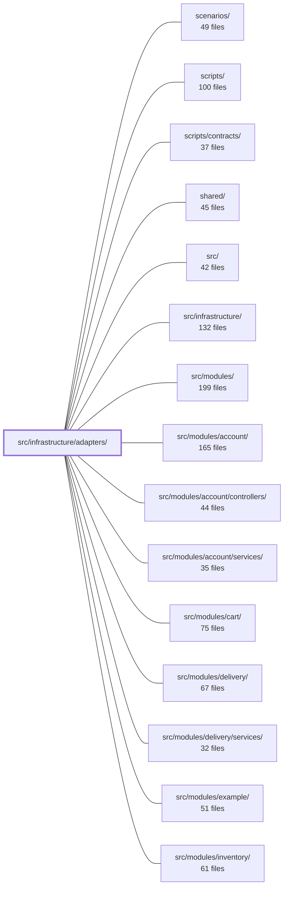

---
tags:
  - 2brain
  - 2brain/module
  - project/boilerplate-node-backend
type: module
module: src/infrastructure/adapters/
files: 35
updated: 2026-11-15T00:29:39.836072+00:00
---

# src/infrastructure/adapters/

## Purpose

This module contains every concrete, I/O-facing adapter the application needs to talk to the outside world: Redis, RabbitMQ, SMTP, headless Chromium, the local filesystem, DNS, and third-party anti-bot services. It also holds the anti-automation "ladder" (email-disposability check and human-challenge verification) as a self-contained infrastructure concern. Each adapter exposes a narrow port or function so that application modules depend on a small contract rather than on a vendor library or a raw socket.

## Key parts

- **Anti-automation ladder** — `antibot.ts` (rung 2, disposable-email policy) and `antibot-providers/` (rung 3, the `HumanChallengeProvider` port with `none`, `turnstile`, and `altcha` implementations plus the ALTCHA single-use store) together with `antibot-verdict.ts` for the shared pass/fail type.
- **Redis layer** — `redis.ts` (client factory & URL assembly), `cache.ts` (tag-invalidate byte store), `limits-redis.ts` (separate no-eviction instance for rate limits and one-time claims), and `managed-connection.ts` (shared fail-open lifecycle for both instances).
- **Email pipeline** — `mailer.ts` (template render → nodemailer envelope → transport), `mail-transports.ts` / `smtp-transport.ts` (transport registry and lazy SMTP), `mail-spool.ts` (attachment claim-check), `email.worker.ts` (consumer-side render + send), and `template-registry.ts` (EJS path lookup).
- **Image pipeline** — `image.ts` (sharp Buffer→Buffer), `image-signatures.ts` (magic-byte sniffing), `image-store.ts` (opaque-handle port), `image.worker.ts` (quarantine → digest → promote → writeback), `remote-image.ts` (avatar re-host), and `orphaned-images.ts` (nightly sweep).
- **File / document / export storage** — `filesystem.ts` (cross-mount move, atomic write, sweep helpers), `document-store.ts` (rendered-PDF disk cache), `export-store.ts` (streamed personal-data exports).
- **PDF rendering** — `pdf.ts` (headless-Chromium HTML→PDF).
- **Outbound HTTP & SSRF protection** — `pinned-https.ts` (single guarded request path), `ssrf-guard.ts` (DNS validation + pinning), `ssrf-exemptions.ts` (zero-dependency exemption set).
- **Queue** — `queue.ts` (RabbitMQ publish/consume/shutdown, no-op when unconfigured).
- **Logging & observability** — `logger.ts` (Winston behind a `Logger` port + redaction), `log-scrub.ts` (text redaction helpers), `semantic-names.ts` (OTel-convention renaming).
- **Configuration** — `config.ts` (typed, validated env-var slices for every adapter).

## How it connects

- **`src/modules/invoicing/`** calls `pdf.ts` to render invoices and reads/writes `document-store.ts` so a second download streams a cached PDF instead of re-launching Chromium.
- **`src/modules/webhooks/`** routes every outbound delivery through `pinned-https.ts`, which in turn enforces the DNS-pinning logic in `ssrf-guard.ts`.
- **`src/modules/account/`** (and other modules that persist user avatars) uses `remote-image.ts` → `image.worker.ts` → `image-store.ts` to re-host and serve images locally, and invokes the `antibot-providers` resolver at signup/login.
- **`src/modules/notifications/`** and other email-sending modules call `mailer.ts`; when a broker is configured the job is published via `queue.ts` and drained by `email.worker.ts`.
- **`src/modules/observability/`** (and every other module that logs) depends on `logger.ts` for the transport-agnostic `Logger` port and on `semantic-names.ts` for OTel-compliant field names in Loki/SIEM.
- **`src/modules/tasks/`, `shop-tasks/`, `orders/`, `payments/`** publish and consume work items through `queue.ts`; all of these paths no-op gracefully when the broker is unconfigured.
- **`shared/`** provides the `RungVerdict` type consumed by both `antibot.ts` and the `antibot-providers` implementations.
- **`scripts/` and `scenarios/`** import `config.ts` for validated settings and `logger.ts` for structured output; `queue.ts`'s shutdown hook is called during process teardown.
- **`src/infrastructure/`** (parent) aggregates these adapters and exposes the higher-level ports that `src/modules/*` consume.

## Where to start

1. **`antibot-providers/index.ts`** — It is the shortest file and defines the `HumanChallengeProvider` port, the provider registry, and the env-var resolver. Reading it first gives you the vocabulary (`RungVerdict`, port/adapter pattern) that recurs throughout the module.
2. **`managed-connection.ts`** — Nearly every Redis-backed adapter (`cache.ts`, `limits-redis.ts`) delegates its lifecycle here. Understanding the fail-open contract and the memoised-handle pattern here makes the rest of the Redis layer self-evident.

## Connected modules

[[boilerplate-node-backend_ROOT|/ (repository root)]] · [[boilerplate-node-backend_scenarios|scenarios/]] · [[boilerplate-node-backend_scripts|scripts/]] · [[boilerplate-node-backend_scripts_contracts|scripts/contracts/]] · [[boilerplate-node-backend_shared|shared/]] · [[boilerplate-node-backend_src|src/]] · [[boilerplate-node-backend_src_infrastructure|src/infrastructure/]] · [[boilerplate-node-backend_src_modules|src/modules/]] · [[boilerplate-node-backend_src_modules_account|src/modules/account/]] · [[boilerplate-node-backend_src_modules_account_controllers|src/modules/account/controllers/]] · [[boilerplate-node-backend_src_modules_account_services|src/modules/account/services/]] · [[boilerplate-node-backend_src_modules_cart|src/modules/cart/]] · [[boilerplate-node-backend_src_modules_delivery|src/modules/delivery/]] · [[boilerplate-node-backend_src_modules_delivery_services|src/modules/delivery/services/]] · [[boilerplate-node-backend_src_modules_example|src/modules/example/]] · … and 13 more

## Files
- `src/infrastructure/adapters/antibot-providers/altcha-store.ts` — Enforces single-use of ALTCHA challenge IDs so a solved challenge cannot be replayed. It wraps the verify step with a two-phase check—`isSpent` (peek, no write) before verification, `claim` (record) only after a successful `verify`—using an in-process Map as a synchronous floor and Redis as a cross-worker authority.
- `src/infrastructure/adapters/antibot-providers/altcha.ts` — Self-hosted implementation of the `HumanChallengeProvider` port using the ALTCHA proof-of-work protocol. The server both issues and verifies challenges with no third-party scripts, no vendor dependency, and no outbound traffic — at the cost of CPU work landing on the visitor's device rather than a rented bot farm.
- `src/infrastructure/adapters/antibot-providers/index.ts` — Defines the **human-challenge port** (Rung 3 of the anti-automation ladder) and its provider registry. It declares the `HumanChallengeProvider` contract, registers the shipped implementations (`none`, `turnstile`, `altcha`), and exposes a resolver that reads `NODE_ANTIBOT_PROVIDER` at call time to pick the active one. This file is the single place where a deployment selects which challenge implementation answers.
- `src/infrastructure/adapters/antibot-providers/none.ts` — A no-op implementation of the human-challenge provider that always passes verification and renders no widget. It is the default provider so that a boilerplate checkout, test suite, or demo run never contacts a third-party anti-bot service.
- `src/infrastructure/adapters/antibot-providers/turnstile.ts` — Reference implementation of the `HumanChallengeProvider` port using Cloudflare Turnstile. Exchanges a client-submitted token for a server-side pass/fail verdict by calling Cloudflare's `siteverify` endpoint. Explicitly shipped as a worked example, not a default recommendation, because selecting it introduces a third-party script into the deployment.
- `src/infrastructure/adapters/antibot-verdict.ts` — Defines the single shared verdict type (`RungVerdict`) that every anti-automation "rung" uses to signal whether a caller may proceed. By centralizing this yes/no vocabulary, it prevents rung 2 (`checkEmailPolicy`) and rung 3 (`HumanChallengeProvider.verify`) from diverging into incompatible return shapes.
- `src/infrastructure/adapters/antibot.ts` — Rung 2 of the anti-automation ladder. Answers a single yes/no question—whether an email address passes the deployment's anti-disposable-inbox policy—and returns a `RungVerdict`. It does not enforce the verdict; each caller decides what `refused` means for its endpoint. Off by default because an aggressive blocklist can refuse legitimate forwarding-service users.
- `src/infrastructure/adapters/cache.ts` — Redis cache adapter that exposes a minimal, opaque byte store with tag-based group invalidation. It owns the single Redis connection for the process and guarantees fail-open semantics: every public function resolves (with `undefined`/`false`/`{deleted:0, reachable:false}`) rather than rejecting when Redis is missing or the cache is disabled. Callers (notably the HTTP cache middleware) decide what to cache and how to frame values; this module only stores, retrieves, and deletes bytes.
- `src/infrastructure/adapters/config.ts` — Declares typed, validated configuration slices for every infrastructure adapter (mail, queue, Redis, images, outbound, PDF, exports, anti-abuse). Each slice is a `defineConfig` block that maps environment variables to typed fields with defaults, ranges, and cross-field checks, so a misconfigured value names the adapter that owns it at parse time rather than failing at first use.
- `src/infrastructure/adapters/document-store.ts` — Disk-backed cache of rendered PDF documents (invoices, credit notes) so that a second download streams an existing file instead of re-launching Chromium. It is explicitly **not** a record store: the authoritative invoice data lives in Mongo, and these PDFs are regenerable copies with a finite retention window.
- `src/infrastructure/adapters/email.worker.ts` — Consumer-side handler for queued email jobs. When a broker is configured, `consumeFromQueue` invokes this module to render an EJS template and dispatch it over SMTP. It is the drain half of the producer/consumer pair with `enqueueEmail` in `mailer.ts`. It performs no locale or i18n work — all strings are pre-resolved by the producer before the job is published.
- `src/infrastructure/adapters/export-store.ts` — Manages personal-data export files on disk: building them in streamed chunks, reading them back as `Readable` streams, deleting individual files, and reaping expired ones. It exists so large exports can be written and served without ever holding the entire file in memory.
- `src/infrastructure/adapters/filesystem.ts` — Low-level filesystem helpers shared by every adapter that touches disk: a cross-mount-safe `move`, two flavors of non-throwing delete, an atomic write, a POSIX-path normalizer, and two directory-sweep utilities (age-based and reference-based). It exists so other adapters stop re-deriving the `EXDEV` fallback, the log-and-swallow pattern, or the `readdir`/`stat`/`unlink` sweep on their own.
- `src/infrastructure/adapters/image-signatures.ts` — Identifies an uploaded file's real image format by matching its leading bytes against a small, hand-maintained signature table, rather than trusting the client-supplied `Content-Type`. Exists because a static file server that labels by extension, or a decoder fed attacker-controlled input, makes a spoofable header a real security risk. Deliberately avoids a dependency like `file-type`: three signatures are easier to audit than a library.
- `src/infrastructure/adapters/image-store.ts` — Defines the `ImageStore` port and its sole implementation (`filesystemImageStore`, local disk under `NODE_PUBLIC_PATH/images/`). It is the single place that translates between an opaque `imageUrl` handle and a real filesystem path, so that swapping the backend (e.g., to a bucket) touches one file instead of every service and controller that persists or deletes an image.
- `src/infrastructure/adapters/image.ts` — Wraps the `sharp` library behind two pure `Buffer → Buffer` transforms (`digestImage`, `thumbnailImage`). All sharp-specific code lives in this single file so that swapping the image library is a two-function rewrite, not a codebase-wide search.
- `src/infrastructure/adapters/image.worker.ts` — Implements the single image-digest pipeline: it reads a quarantined upload, identifies and re-encodes it (original + thumbnail), promotes both to storage under a content-addressed, owner-salted stem, and writes the resulting URLs back onto the target document. It exists as a dedicated adapter so that both the queued worker path and the inline (no-broker) fallback share one code path, and so that the infrastructure layer can perform the writeback without importing `@kernel` or `@modules` (inverted port).
- `src/infrastructure/adapters/limits-redis.ts` — Manages a dedicated Redis instance for rate-limit counters and single-use claims (e.g. spent ALTCHA solutions). It is kept separate from the response-cache Redis instance because eviction is per-instance: the cache runs `allkeys-lru` and may drop keys under pressure, which would silently reset a budget or reopen a replayable solution. The limits instance uses `noeviction` so cache pressure can never reach it.
- `src/infrastructure/adapters/log-scrub.ts` — Provides two redaction utilities for log message *text* — the part that key-name-based redaction never inspects. `scrubError` strips data-bearing fields (message, raw stack) from known error classes while preserving identifying fields; `maskMessage` replaces every email and IP address in arbitrary text with a caller-supplied pseudonym so the line stays correlatable with the hashed `email`/`ip` log fields.
- `src/infrastructure/adapters/logger.ts` — Structured-logging adapter that wraps Winston behind a narrow `Logger` port, applying credential redaction and personal-data pseudonymisation to every log record before it reaches a transport. It exists so the rest of the codebase depends on a small, swappable interface rather than Winston's full `Logger`, and so the redaction policy (sourced from a shared YAML file the PHP twin also reads) is enforced in exactly one place.
- `src/infrastructure/adapters/mail-spool.ts` — Implements the Claim Check pattern for email attachments: bytes are written durably to a local spool directory, and the queue message carries only an opaque key (never bytes, never a filesystem path). This lets a job survive a process restart with its attachment intact, while keeping potentially sensitive files outside `NODE_PUBLIC_PATH`.
- `src/infrastructure/adapters/mail-transports.ts` — Registry that maps the `NODE_MAIL_TRANSPORT` env var to a concrete sender. Production ships only `smtp`; test doubles (`log`, `outbox`) are registered at preload or jest-setup time. The file is intentionally dependency-light (no `nodemailer`, no `ejs` at module scope) so it can load before the application boots, with the real sender deferred to first send.
- `src/infrastructure/adapters/mailer.ts` — The email adapter: renders EJS templates into HTML, assembles a nodemailer envelope, and dispatches it through a named transport — either synchronously or by publishing a job to the message queue. It is the single public surface every module uses to send templated email, and it centralises sender identity, attachment resolution, and transport selection so callers never touch nodemailer or EJS directly.
- `src/infrastructure/adapters/managed-connection.ts` — Centralises the lifecycle of a single optional dependency connection (Redis for cache, Redis for rate-limiting) so that both adapters share identical fail-open rules: unconfigured is a supported deployment, unreachable is degraded but not an error. The module owns the memoised handle, shared in-flight connect, warn-once latch, fail-open/fail-closed getters, health-status reader, and shutdown logic; each adapter supplies only its own `connect`, `isReady`, `close`, and `isEnabled`.
- `src/infrastructure/adapters/orphaned-images.ts` — Implements the nightly `reap:orphaned-images` sweep: it compares every file on disk in the originals and thumbnails directories against the set of filenames still referenced by live documents, then deletes anything unreferenced. Kept as a standalone, tested function rather than inlined into a cron script so the logic is unit-testable and independent of job scheduling.
- `src/infrastructure/adapters/pdf.ts` — Renders pre-built HTML (invoice templates, reports) into PDF byte buffers using headless Chromium. It exists as a thin infrastructure adapter so the invoicing module can produce PDFs without knowing about browser lifecycle, concurrency limits, or shutdown sequencing.
- `src/infrastructure/adapters/pinned-https.ts` — The single outbound HTTPS path for any user- or provider-supplied URL. It performs one request that is SSRF-guarded, DNS-pinned (so a second DNS answer cannot reach a private range), and never redirected. Both webhook delivery and avatar download route through it.
- `src/infrastructure/adapters/queue.ts` — RabbitMQ (AMQP 0-9-1) adapter that provides `publishToQueue`, consumer registration, and graceful shutdown for the process. Every public function no-ops when the broker is unconfigured, letting callers fall back to inline work. Reconnection is handled entirely by `amqplib`'s built-in recovery (v2.0.1+), not by the project's own `managed-connection` lifecycle; only the shared warn-once latch is borrowed from that module.
- `src/infrastructure/adapters/redis.ts` — Shared Redis client infrastructure for all Redis-backed adapters (cache, rate limiter). Centralises URL assembly from environment variables, the node-redis client option set, a typed client factory, graceful shutdown, and connection-error classification—so each adapter only handles its own `error` listener and recovery strategy.
- `src/infrastructure/adapters/remote-image.ts` — Downloads a remote avatar URL, pushes the bytes through the same quarantine-and-digest pipeline an inline upload uses, and returns the two local image/thumbnail URLs for persistence. This exists so a viewer's IP is never sent to a third-party host on every page render — the image is fetched once at signup and served from local storage thereafter.
- `src/infrastructure/adapters/semantic-names.ts` — Transforms the camelCase field names used in code (`actorUserId`, `statusCode`) into OpenTelemetry semantic-convention names (`user.id`, `http.response.status_code`) on structured log records before they reach Loki or a SIEM. This lets dashboards and alerts written against the OTel spec work without modification.
- `src/infrastructure/adapters/smtp-transport.ts` — Lazily builds and memoizes a nodemailer SMTP transporter, then exposes a `sendBySmtp` function to render and send an `OutgoingMail` through it. The file exists in isolation (separate from `mail-transports.ts`) so that the early-loading modules (jest setup, dev preload) never pull in the `nodemailer` package, preserving testability of `jest.mock('nodemailer')`.
- `src/infrastructure/adapters/ssrf-exemptions.ts` — Holds a process-wide set of origins exempt from the SSRF guard's private-address check. Exists as a standalone module with **zero imports** so that dev preloads and Jest setup can register an exemption without pulling in `ssrf-guard.ts` (and its DNS dependencies) before a test's own DNS mock is in place. In production the set is always empty.
- `src/infrastructure/adapters/ssrf-guard.ts` — SSRF guard for outbound requests this server initiates on a user's behalf (webhook delivery, OAuth avatar re-host). It resolves a URL's DNS, validates **every** resolved address against an allowlist, and returns a target pinned to the validated address so a second DNS lookup at connect time cannot answer differently (DNS-rebinding TOCTOU). Lives in `infrastructure` because it performs DNS I/O.
- `src/infrastructure/adapters/template-registry.ts` — Leaf module that maps EJS template names to absolute file paths. It was deliberately split out of `mailer.ts` so that `tests/support/setup.ts` (run via jest `setupFiles`) can register template directories without pulling in a real `nodemailer` module that mock-based tests would then find already-evaluated and un-mockable.

---
[[boilerplate-node-backend_INDEX|← boilerplate-node-backend index]]
