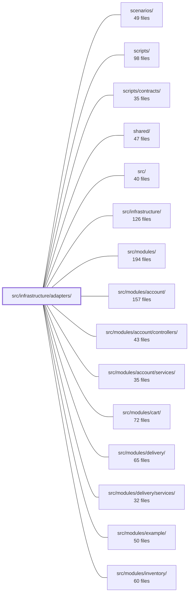

---
tags:
  - 2brain
  - 2brain/module
  - project/boilerplate-node-backend
type: module
module: src/infrastructure/adapters/
files: 34
updated: 2026-11-08T10:48:21.630394+00:00
---

# src/infrastructure/adapters/

## Purpose

`src/infrastructure/adapters/` is the infrastructure layer's adapter directory. It contains every concrete integration the application needs—Redis, RabbitMQ, SMTP, headless Chromium, Cloudflare Turnstile, ALTCHA, filesystem I/O, image processing, SSRF-guarded outbound HTTP, and structured logging—behind narrow ports and single-purpose files so that application modules never import a vendor SDK directly. Each adapter owns its connection lifecycle, fail-open behaviour, and shutdown sequencing, while exposing a small typed API to callers.

## Key parts

- **Anti-automation ladder** — `antibot-providers/` (port, registry, `none`/`altcha`/`turnstile` implementations, ALTCHA single-use store) plus `antibot.ts` (email-disposable policy, Rung 2) and `antibot-verdict.ts` (shared `RungVerdict` type). Together they form the two-stage human-challenge + policy gate that checkout and account endpoints consult.
- **Redis & caching** — `redis.ts` (shared client factory), `managed-connection.ts` (fail-open lifecycle shared by both instances), `cache.ts` (tag-based response cache), `limits-redis.ts` (dedicated `noeviction` instance for rate-limit counters and single-use claims).
- **Email pipeline** — `mailer.ts` (render + dispatch), `mail-transports.ts` / `smtp-transport.ts` (transport registry and nodemailer sender), `mail-spool.ts` (attachment claim-check), `mail.worker.ts` (queue consumer), `template-registry.ts` (EJS name → path resolution).
- **Image & file storage** — `image.ts` (sharp transforms), `image-signatures.ts` (magic-byte format detection), `image-store.ts` (`ImageStore` port + filesystem impl), `image.worker.ts` (quarantine → digest → promote pipeline), `remote-image.ts` (avatar re-host), `orphaned-images.ts` (nightly sweep), `filesystem.ts` (shared atomic-write / safe-delete / cross-mount utilities).
- **PDF & exports** — `pdf.ts` (headless Chromium render), `document-store.ts` (on-disk PDF cache), `export-store.ts` (personal-data export lifecycle).
- **Outbound & security** — `pinned-https.ts` (SSRF-guarded, DNS-pinned, non-redirecting fetch), `ssrf-guard.ts` (resolve → validate → pin enforcement), `ssrf-exemptions.ts` (zero-import exemption set for test/dev preloads).
- **Messaging** — `queue.ts` (RabbitMQ publish/consume with graceful no-op when unconfigured).
- **Cross-cutting** — `config.ts` (typed env-var config slices per adapter), `logger.ts` (Winston wrapper + redaction policy), `semantic-names.ts` (OTel attribute renaming for structured logs).

## How it connects

- **`src/modules/` (all domain modules)** are the primary consumers. Invoicing calls the PDF and document-store adapters; notifications and account call the mailer and anti-bot rungs; webhooks route through `pinned-https` / `ssrf-guard`; products and shop-tasks drive the image pipeline; users and account select the active `HumanChallengeProvider` via the port resolver.
- **`src/infrastructure/`** is the parent package that bundles this directory with the port definitions and shared kernel types the adapters implement.
- **`shared/`** supplies cross-cutting types (e.g., `OutgoingMail`, queue payload shapes) that adapters reference without importing domain logic.
- **`scripts/` and `scenarios/`** exercise the adapters in integration and E2E flows—most notably the email, image, and queue adapters—by exercising the same public APIs the runtime uses.
- **`src/modules/observability/`** pairs with `logger.ts` and `semantic-names.ts` to shape structured log records before they reach a transport.

## Where to start

1. **`antibot-providers/index.ts`** — it defines the `HumanChallengeProvider` port, shows the registry pattern, and demonstrates how a deployment picks an implementation via one env var. It is the clearest example of the port/adapter contract this directory follows.
2. **`managed-connection.ts`** — reading its fail-open / memoised-handle / shutdown logic explains why `cache.ts`, `limits-redis.ts`, and `queue.ts` all behave gracefully when their backend is absent, which is the single most common question a newcomer has when wiring up a local dev environment.

## Connected modules

[[boilerplate-node-backend_ROOT|/ (repository root)]] · [[boilerplate-node-backend_scenarios|scenarios/]] · [[boilerplate-node-backend_scripts|scripts/]] · [[boilerplate-node-backend_scripts_contracts|scripts/contracts/]] · [[boilerplate-node-backend_shared|shared/]] · [[boilerplate-node-backend_src|src/]] · [[boilerplate-node-backend_src_infrastructure|src/infrastructure/]] · [[boilerplate-node-backend_src_modules|src/modules/]] · [[boilerplate-node-backend_src_modules_account|src/modules/account/]] · [[boilerplate-node-backend_src_modules_account_controllers|src/modules/account/controllers/]] · [[boilerplate-node-backend_src_modules_account_services|src/modules/account/services/]] · [[boilerplate-node-backend_src_modules_cart|src/modules/cart/]] · [[boilerplate-node-backend_src_modules_delivery|src/modules/delivery/]] · [[boilerplate-node-backend_src_modules_delivery_services|src/modules/delivery/services/]] · [[boilerplate-node-backend_src_modules_example|src/modules/example/]] · … and 13 more

## Files
- `src/infrastructure/adapters/antibot-providers/altcha-store.ts` — Enforces single-use of ALTCHA challenge IDs so a solved challenge cannot be replayed. It wraps the verify step with a two-phase check—`isSpent` (peek, no write) before verification, `claim` (record) only after a successful `verify`—using an in-process Map as a synchronous floor and Redis as a cross-worker authority.
- `src/infrastructure/adapters/antibot-providers/altcha.ts` — Self-hosted implementation of the `HumanChallengeProvider` port using the ALTCHA proof-of-work protocol. The server both issues and verifies challenges with no third-party scripts, no vendor dependency, and no outbound traffic — at the cost of CPU work landing on the visitor's device rather than a rented bot farm.
- `src/infrastructure/adapters/antibot-providers/index.ts` — Defines the **human-challenge port** (Rung 3 of the anti-automation ladder) and its provider registry. It declares the `HumanChallengeProvider` contract, registers the shipped implementations (`none`, `turnstile`, `altcha`), and exposes a resolver that reads `NODE_ANTIBOT_PROVIDER` at call time to pick the active one. This file is the single place where a deployment selects which challenge implementation answers.
- `src/infrastructure/adapters/antibot-providers/none.ts` — A no-op implementation of the human-challenge provider that always passes verification and renders no widget. It is the default provider so that a boilerplate checkout, test suite, or demo run never contacts a third-party anti-bot service.
- `src/infrastructure/adapters/antibot-providers/turnstile.ts` — Reference implementation of the `HumanChallengeProvider` port using Cloudflare Turnstile. Exchanges a client-supplied token for a server-side pass/fail verdict against Cloudflare's `siteverify` endpoint. Documented as a worked example, not a recommendation — selecting it means accepting a third-party script in the page.
- `src/infrastructure/adapters/antibot-verdict.ts` — Defines the single shared verdict type (`RungVerdict`) that every anti-automation "rung" uses to signal whether a caller may proceed. By centralizing this yes/no vocabulary, it prevents rung 2 (`checkEmailPolicy`) and rung 3 (`HumanChallengeProvider.verify`) from diverging into incompatible return shapes.
- `src/infrastructure/adapters/antibot.ts` — Rung 2 of the anti-automation ladder. Answers a single yes/no question—whether an email address passes the deployment's anti-disposable-inbox policy—and returns a `RungVerdict`. It does not enforce the verdict; each caller decides what `refused` means for its endpoint. Off by default because an aggressive blocklist can refuse legitimate forwarding-service users.
- `src/infrastructure/adapters/cache.ts` — Redis cache adapter that exposes an opaque byte store with tag-based group invalidation. It owns the single Redis connection for the process, handles the fail-open policy (all operations resolve successfully even when Redis is down), and provides a small API—`getCacheValue`, `setCacheValue`, `claimCacheRefresh`, `invalidateCacheTags`—that callers use without needing to know anything about Redis commands or connection lifecycle.
- `src/infrastructure/adapters/config.ts` — Declares typed, validated configuration slices for every infrastructure adapter (mail, queue, Redis, images, outbound, PDF, exports, anti-abuse). Each slice is a `defineConfig` block that maps environment variables to typed fields with defaults, ranges, and cross-field checks, so a misconfigured value names the adapter that owns it at parse time rather than failing at first use.
- `src/infrastructure/adapters/document-store.ts` — Caches finished PDFs (invoices, credit notes) on disk so a repeated download streams the file instead of re-launching Chromium. Explicitly **not** the legal record (that lives in Mongo); a stored PDF is a regenerable, non-backed-up copy that expires after a retention window.
- `src/infrastructure/adapters/email.worker.ts` — Consumer-side handler for queued email jobs. When a broker is configured, `consumeFromQueue` invokes this module to render an EJS template and dispatch it over SMTP. It is the drain half of the producer/consumer pair with `enqueueEmail` in `mailer.ts`. It performs no locale or i18n work — all strings are pre-resolved by the producer before the job is published.
- `src/infrastructure/adapters/export-store.ts` — Manages the lifecycle of built personal-data export files on disk: writing them incrementally, streaming them back to a client, deleting them individually, and sweeping expired ones. It exists because exports can be large (so everything is streamed, never held in memory) and are regenerable copies tied to a Mongo record rather than canonical data themselves.
- `src/infrastructure/adapters/filesystem.ts` — Shared low-level filesystem utilities (cross-mount move, safe delete, atomic write, directory sweep) that every other disk-touching adapter in the codebase calls instead of re-implementing the same EXDEV fallback, error-swallowing, or `readdir`/`stat`/`unlink` sweep logic.
- `src/infrastructure/adapters/image-signatures.ts` — Identifies an uploaded file's real image format by matching its leading bytes against a small, hand-maintained signature table, rather than trusting the client-supplied `Content-Type`. Exists because a static file server that labels by extension, or a decoder fed attacker-controlled input, makes a spoofable header a real security risk. Deliberately avoids a dependency like `file-type`: three signatures are easier to audit than a library.
- `src/infrastructure/adapters/image-store.ts` — Defines the `ImageStore` port and its sole implementation (`filesystemImageStore`, local disk under `NODE_PUBLIC_PATH/images/`). It is the single place that translates between an opaque `imageUrl` handle and a real filesystem path, so that swapping the backend (e.g., to a bucket) touches one file instead of every service and controller that persists or deletes an image.
- `src/infrastructure/adapters/image.ts` — Wraps the `sharp` library behind two pure `Buffer → Buffer` transforms (`digestImage`, `thumbnailImage`). All sharp-specific code lives in this single file so that swapping the image library is a two-function rewrite, not a codebase-wide search.
- `src/infrastructure/adapters/image.worker.ts` — Implements the single image-digest pipeline: it reads a quarantined upload, identifies and re-encodes it (original + thumbnail), promotes both to storage under a content-addressed, owner-salted stem, and writes the resulting URLs back onto the target document. It exists as a dedicated adapter so that both the queued worker path and the inline (no-broker) fallback share one code path, and so that the infrastructure layer can perform the writeback without importing `@kernel` or `@modules` (inverted port).
- `src/infrastructure/adapters/limits-redis.ts` — Manages a dedicated Redis instance for rate-limit counters and single-use claims (e.g. spent ALTCHA solutions). It is kept separate from the response-cache Redis instance because eviction is per-instance: the cache runs `allkeys-lru` and may drop keys under pressure, which would silently reset a budget or reopen a replayable solution. The limits instance uses `noeviction` so cache pressure can never reach it.
- `src/infrastructure/adapters/logger.ts` — Adapter that wraps Winston behind a narrow `Logger` port so the rest of the codebase never imports Winston directly. It also owns the log-redaction policy: recursively scrubbing credential fields and applying a configurable mode (hash / redact / plain) to personal-data fields before any record reaches a transport.
- `src/infrastructure/adapters/mail-spool.ts` — Implements the Claim Check pattern for email attachments: bytes are written durably to a local spool directory, and the queue message carries only an opaque key (never bytes, never a filesystem path). This lets a job survive a process restart with its attachment intact, while keeping potentially sensitive files outside `NODE_PUBLIC_PATH`.
- `src/infrastructure/adapters/mail-transports.ts` — Registry that maps the `NODE_MAIL_TRANSPORT` env var to a concrete sender. Production ships only `smtp`; test doubles (`log`, `outbox`) are registered at preload or jest-setup time. The file is intentionally dependency-light (no `nodemailer`, no `ejs` at module scope) so it can load before the application boots, with the real sender deferred to first send.
- `src/infrastructure/adapters/mailer.ts` — The email adapter: renders EJS templates into HTML, assembles a nodemailer envelope, and dispatches it through a named transport — either synchronously or by publishing a job to the message queue. It is the single public surface every module uses to send templated email, and it centralises sender identity, attachment resolution, and transport selection so callers never touch nodemailer or EJS directly.
- `src/infrastructure/adapters/managed-connection.ts` — Centralises the lifecycle of a single optional dependency connection (Redis for cache, Redis for rate-limiting) so that both adapters share identical fail-open rules: unconfigured is a supported deployment, unreachable is degraded but not an error. The module owns the memoised handle, shared in-flight connect, warn-once latch, fail-open/fail-closed getters, health-status reader, and shutdown logic; each adapter supplies only its own `connect`, `isReady`, `close`, and `isEnabled`.
- `src/infrastructure/adapters/orphaned-images.ts` — Sweeps image files from the public disk that are no longer referenced by any live document. It isolates the `reap:orphaned-images` nightly job's logic into a tested, reusable function rather than embedding it in the cron script. Orphans typically arise from interrupted uploads (file written, close hook never ran) or from throwaway databases reseeded against a persistent disk.
- `src/infrastructure/adapters/pdf.ts` — Renders pre-built HTML (invoice templates, reports) into PDF byte buffers using headless Chromium. It exists as a thin infrastructure adapter so the invoicing module can produce PDFs without knowing about browser lifecycle, concurrency limits, or shutdown sequencing.
- `src/infrastructure/adapters/pinned-https.ts` — The single outbound HTTPS path for any user- or provider-supplied URL. It performs one request that is SSRF-guarded, DNS-pinned (so a second DNS answer cannot reach a private range), and never redirected. Both webhook delivery and avatar download route through it.
- `src/infrastructure/adapters/queue.ts` — RabbitMQ (AMQP 0-9-1) adapter that provides `publishToQueue` and consumer registration for the application. When the broker is unconfigured or unreachable, every function degrades to a no-op (`publishToQueue` returns `false`) so callers can fall back to inline work. Reconnection is handled entirely by amqplib's built-in `recovery` mechanism, which re-runs the `setup` callback after each successful reconnect to re-declare queues and re-bind consumers.
- `src/infrastructure/adapters/redis.ts` — Shared Redis client infrastructure for all Redis-backed adapters (cache, rate limiter). Centralises URL assembly from environment variables, the node-redis client option set, a typed client factory, graceful shutdown, and connection-error classification—so each adapter only handles its own `error` listener and recovery strategy.
- `src/infrastructure/adapters/remote-image.ts` — Downloads a remote avatar URL, pushes the bytes through the same quarantine-and-digest pipeline an inline upload uses, and returns the two local image/thumbnail URLs for persistence. This exists so a viewer's IP is never sent to a third-party host on every page render — the image is fetched once at signup and served from local storage thereafter.
- `src/infrastructure/adapters/semantic-names.ts` — Transforms the camelCase field names used in code (`actorUserId`, `statusCode`) into OpenTelemetry semantic-convention names (`user.id`, `http.response.status_code`) on structured log records before they reach Loki or a SIEM. This lets dashboards and alerts written against the OTel spec work without modification.
- `src/infrastructure/adapters/smtp-transport.ts` — Lazily builds and memoizes a nodemailer SMTP transporter, then exposes a `sendBySmtp` function to render and send an `OutgoingMail` through it. The file exists in isolation (separate from `mail-transports.ts`) so that the early-loading modules (jest setup, dev preload) never pull in the `nodemailer` package, preserving testability of `jest.mock('nodemailer')`.
- `src/infrastructure/adapters/ssrf-exemptions.ts` — Holds a process-wide set of origins exempt from the SSRF guard's private-address check. Exists as a standalone module with **zero imports** so that dev preloads and Jest setup can register an exemption without pulling in `ssrf-guard.ts` (and its DNS dependencies) before a test's own DNS mock is in place. In production the set is always empty.
- `src/infrastructure/adapters/ssrf-guard.ts` — Prevents Server-Side Request Forgery on outbound requests the server makes on a user's behalf. Enforces the resolve → validate → pin sequence so that a second DNS lookup at connect time cannot return a different (private) address than the one that was validated — closing the DNS-rebinding TOCTOU window. Callers today are the webhooks delivery path and the OAuth avatar re-host.
- `src/infrastructure/adapters/template-registry.ts` — Resolves a bare EJS template name (the wire format that travels through RabbitMQ in `EmailJobPayload`) to an absolute file path on disk. It exists as a separate leaf module—deliberately free of any `ejs` or `nodemailer` import—so that Jest's `setupFiles` can call into it before test-file mocks are hoisted, without accidentally pulling in the real `nodemailer` and making it un-mockable.

---
[[boilerplate-node-backend_INDEX|← boilerplate-node-backend index]]
