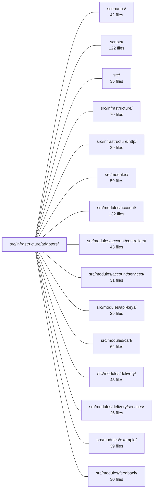

---
tags:
  - 2brain
  - 2brain/module
  - project/boilerplate-node-backend
type: module
module: src/infrastructure/adapters/
files: 34
updated: 2026-10-15T13:35:41.972417+00:00
---

# src/infrastructure/adapters/

## Purpose

This module is the infrastructure adapter layer. It wraps every external I/O concern—Redis, RabbitMQ, the filesystem, SMTP, headless Chromium, DNS lookups, and anti-bot verification—behind narrow ports and fail-open interfaces so that domain logic and feature modules never touch a raw driver, a vendor SDK, or an OS syscall directly.

## Key parts

- **Anti-automation ladder** — `antibot.ts` (rung 2: email-domain policy), `antibot-verdict.ts` (shared `RungVerdict` type), and the `antibot-providers/` sub-directory (the `HumanChallengeProvider` port, a registry keyed off `NODE_ANTIBOT_PROVIDER`, and the `altcha`, `turnstile`, and `none` implementations plus `altcha-store.ts` for replay protection).
- **Mail pipeline** — `mailer.ts` (render + dispatch), `mail-transports.ts` (transport registry), `smtp-transport.ts` (nodemailer adapter, isolated for testability), `mail-spool.ts` (attachment claim-check), `email.worker.ts` (queue consumer), and `template-registry.ts` (EJS path lookup, split out for Jest mock ordering).
- **Image pipeline** — `image-signatures.ts` (magic-byte sniffing), `image.ts` (sharp wrapper), `image-store.ts` (the `ImageStore` port), `image.worker.ts` (quarantine → digest → promote → writeback), `remote-image.ts` (OAuth avatar re-host), and `orphaned-images.ts` (sweep of unreferenced files).
- **Filesystem & document storage** — `filesystem.ts` (shared low-level helpers: cross-mount move, safe delete, age sweeps), `document-store.ts` (PDF caching), `export-store.ts` (personal-data export persistence).
- **Redis & rate-limiting** — `redis.ts` (shared client plumbing), `managed-connection.ts` (optional-dependency lifecycle), `cache.ts` (tag-invalidation byte store), `limits-redis.ts` (noeviction budget/claim instance).
- **Outbound HTTP safety** — `ssrf-guard.ts` (resolve → validate → pin), `pinned-https.ts` (the single outbound HTTPS path), `ssrf-exemptions.ts` (zero-import exemption set).
- **Messaging & rendering** — `queue.ts` (RabbitMQ publish/consume, no-ops when unconfigured), `pdf.ts` (bounded Chromium HTML→PDF).
- **Cross-cutting** — `config.ts` (typed env slices per adapter), `logger.ts` (Winston wrapper with sanitisation), `semantic-names.ts` (OTel field mapping).

## How it connects

- **`src/modules/*` (account, invoicing, webhooks, orders, users, …)** consume the ports defined here—`ImageStore`, `HumanChallengeProvider`, `MailTransportAdapter`, `Logger`—without importing concrete drivers. Module controllers call `mailer.ts` to send mail, call `image-store.ts` to persist uploads, and read `RungVerdict` to gate requests.
- **`src/infrastructure/http/`** sits at the same tier; middleware in that directory reads `antibot-verdict.ts` results and the `config.ts` slices to apply anti-automation and rate-limit logic on the request path.
- **`src/infrastructure/`** (parent) orchestrates boot: it wires providers into the registries defined in `antibot-providers/index.ts` and `mail-transports.ts`, and injects inverted ports (e.g. the image-writeback callback in `image.worker.ts`) so that adapters never import upward into `@modules`.
- **`scenarios/` and `scripts/`** inject test doubles (the `none` provider, `log`/`outbox` mail transports) and call adapter functions directly (e.g. the orphaned-image sweep extracted into `orphaned-images.ts`) without booting the full application.
- **`src/modules/webhooks/`** and **`src/modules/account/`** route outbound requests through `pinned-https.ts` → `ssrf-guard.ts` to download or deliver payloads safely.

## Where to start

1. **`config.ts`** — reading this first reveals every environment variable the adapters consume, the typed shape of each slice, and the boot-time validation, giving you a map of the whole module's configuration surface.
2. **`antibot-providers/index.ts`** — it defines the `HumanChallengeProvider` port, the registry, and the resolver in one short file, and demonstrates the exact port-and-adapter pattern repeated throughout the module (compare with `image-store.ts` and `mail-transports.ts` once you've seen it once).

## Connected modules

[[boilerplate-node-backend_ROOT|/ (repository root)]] · [[boilerplate-node-backend_scenarios|scenarios/]] · [[boilerplate-node-backend_scripts|scripts/]] · [[boilerplate-node-backend_src|src/]] · [[boilerplate-node-backend_src_infrastructure|src/infrastructure/]] · [[boilerplate-node-backend_src_infrastructure_http|src/infrastructure/http/]] · [[boilerplate-node-backend_src_modules|src/modules/]] · [[boilerplate-node-backend_src_modules_account|src/modules/account/]] · [[boilerplate-node-backend_src_modules_account_controllers|src/modules/account/controllers/]] · [[boilerplate-node-backend_src_modules_account_services|src/modules/account/services/]] · [[boilerplate-node-backend_src_modules_api-keys|src/modules/api-keys/]] · [[boilerplate-node-backend_src_modules_cart|src/modules/cart/]] · [[boilerplate-node-backend_src_modules_delivery|src/modules/delivery/]] · [[boilerplate-node-backend_src_modules_delivery_services|src/modules/delivery/services/]] · [[boilerplate-node-backend_src_modules_example|src/modules/example/]] · … and 11 more

## Files
- `src/infrastructure/adapters/antibot-providers/altcha-store.ts` — Enforces single-use semantics on ALTCHA challenge solutions so that one verified payload cannot be replayed. It sits between the caller and `altcha-lib`'s `verify` as a two-step guard: a read-only `isSpent` check before verification (so an unverified payload leaves no trace) and a `claim` write after verification succeeds (so only an accepted solution is recorded).
- `src/infrastructure/adapters/antibot-providers/altcha.ts` — Implements the self-hosted `HumanChallengeProvider` port using ALTCHA, a proof-of-work challenge the server both issues and verifies. Chosen over vendor-backed options (e.g. Turnstile) to eliminate third-party scripts and outbound traffic; the trade-off is that the CPU work lands on the visitor's device.
- `src/infrastructure/adapters/antibot-providers/index.ts` — Defines the **human-challenge port** (rung 3 of the anti-automation ladder): the interface a deployment must satisfy to answer "is this a real person?" It also owns the provider registry and the resolver that maps the `NODE_ANTIBOT_PROVIDER` env var to a concrete implementation. Ship `none` by default; a live project registers a real provider (Turnstile, Altcha, or a custom one) via `registerHumanChallengeProvider` without editing this file.
- `src/infrastructure/adapters/antibot-providers/none.ts` — Provides a no-op implementation of the `HumanChallengeProvider` interface that always succeeds. It is the default provider shipped with the codebase so that a fresh checkout, test suite, or demo runs without rendering a third-party widget or routing visitor traffic to an external service.
- `src/infrastructure/adapters/antibot-providers/turnstile.ts` — Concrete implementation of the `HumanChallengeProvider` port using Cloudflare Turnstile. It verifies a client-submitted token server-side by calling Cloudflare's `/siteverify` endpoint and maps the result to a `RungVerdict`. Shipped as a reference implementation (not an endorsement) for deployments that choose Turnstile over the alternatives documented in `docs/modules/antibot.md`.
- `src/infrastructure/adapters/antibot-verdict.ts` — Defines the single shared `RungVerdict` union type (`'ok' | 'refused'`) used as the yes/no answer for every anti-automation rung. Exists so that rung 2 (`checkEmailPolicy`) and rung 3 (`HumanChallengeProvider.verify`) cannot drift into divergent vocabularies for the same binary question.
- `src/infrastructure/adapters/antibot.ts` — Rung 2 of the anti-automation ladder: a pure yes/no gate that refuses an email address whose domain appears in a disposable-inbox blocklist, or (under the stricter `mx` policy) whose domain has no MX record. Off by default via `NODE_ANTIBOT_EMAIL_POLICY`; the module only returns a verdict and leaves the caller to decide what refusal means for its endpoint.
- `src/infrastructure/adapters/cache.ts` — A thin Redis cache adapter that exposes an opaque byte store with tag-based invalidation. Every operation fails open: if Redis is unreachable or caching is disabled, callers receive `undefined`/`false` and the app continues without a server-side cache. What gets cached, how it is serialized, and how responses are framed is entirely the caller's responsibility.
- `src/infrastructure/adapters/config.ts` — Centralises every environment-variable slice that the infrastructure adapters read. Each slice is a `defineConfig` block with a typed shape, sensible defaults, and a `check` function that surfaces missing or contradictory values at boot time. The file exists so that a misconfigured value can be attributed to a single adapter (mail, Redis, images, anti-abuse, etc.) rather than to a flat bag of `NODE_*` variables.
- `src/infrastructure/adapters/document-store.ts` — Caches finished PDFs (invoices, credit notes) on local disk so a second download streams the stored file instead of re-launching Chromium to re-render. The stored PDF is a regenerable convenience copy, never a legal record — the frozen invoice data in Mongo is the source of truth. Stored files are plaintext, intentionally outside `NODE_PUBLIC_PATH`, and subject to a retention window.
- `src/infrastructure/adapters/email.worker.ts` — Consumer-side handler that drains one queued email job: it validates the payload, renders the EJS template via `sendTemplatedEmail`, and discards spooled attachments. It is the worker counterpart to `enqueueEmail` in `adapters/mailer.ts` and is wired in by `consumeFromQueue` when a broker is configured. All i18n resolution happens upstream in the producer; this file only interpolates and sends.
- `src/infrastructure/adapters/export-store.ts` — Filesystem adapter that persists a built personal-data export on disk between the moment it is generated and the moment it is downloaded or reaped. It is deliberately streamed (neither write nor read ever holds the whole file in memory) and deliberately private (outside `NODE_PUBLIC_PATH`, plaintext on disk with at-rest protection delegated to the host). It is a regenerable copy, not a record of truth.
- `src/infrastructure/adapters/filesystem.ts` — Low-level, dependency-light filesystem helpers (cross-mount move, safe delete, age-based and reference-based directory sweeps) that every other disk-touching adapter builds on, so none of them re-implement the `EXDEV` fallback, the log-and-swallow delete, or the `readdir`/`stat`/`unlink` sweep individually.
- `src/infrastructure/adapters/image-signatures.ts` — Identifies uploaded images by their leading bytes (magic-number signatures) rather than trusting the client-supplied `Content-Type` header. It exists because a spoofable header would let an attacker store a script or executable under an image extension, and the project deliberately avoids a third-party sniffing dependency (`file-type`) so the three accepted signatures remain auditable inline.
- `src/infrastructure/adapters/image-store.ts` — Defines the `ImageStore` port — the single seam between the rest of the application and wherever image bytes actually live. Callers outside this file never construct filesystem paths from an `imageUrl`; they only pass the opaque URL string to the store's methods. Today the sole implementation (`filesystemImageStore`) stores files under `NODE_PUBLIC_PATH/images/` served by `express.static`, but the interface is designed so a bucket-backed backend can be swapped in without touching callers.
- `src/infrastructure/adapters/image.ts` — Wraps `sharp` behind two pure `Buffer → Buffer` transforms (`digestImage`, `thumbnailImage`) so that no other file in the codebase touches the sharp API directly. Swapping the image library later means rewriting only this file. All sharp-specific configuration (concurrency, cache) is also set here at module load.
- `src/infrastructure/adapters/image.worker.ts` — Implements the image-digest pipeline: reads a quarantined upload, identifies and re-encodes it, generates a thumbnail, promotes both files to the image store, and writes the resulting URLs back onto the target document. Exposes a shared core (`digestQuarantinedImage`) consumed by two entry points — the queued worker (`handleImageDigestJob`) and an inline no-broker path (`enqueueImageDigest`) — so both run one identical pipeline. Because this file sits below `@kernel`/`@modules` in the dependency graph, the writeback is an inverted port injected at boot.
- `src/infrastructure/adapters/limits-redis.ts` — Manages the dedicated `limits` Redis instance that stores rate-limit counters and single-use claims (e.g. spent ALTCHA solutions) under a `noeviction` policy. It exists separately from the response-cache instance so that an `allkeys-lru` flush or pressure-driven eviction on the cache can never silently reset a budget or reopen a replayable solution.
- `src/infrastructure/adapters/logger.ts` — Structured logging adapter that wraps Winston behind a narrow `Logger` port, applies two-layer data sanitisation (credential redaction + personal-data pseudonymisation) to every log record, and exposes a recursive `redactSensitiveFields` utility safe for arbitrary object graphs. It exists so that no other tier in the codebase imports Winston directly, and so log output is compliant with data-minimisation policy by default.
- `src/infrastructure/adapters/mail-spool.ts` — Implements a Claim Check store for email attachments: bytes are written durably to a spool directory, and the queue message carries only an opaque key. This decouples the attachment's lifetime from the request that staged it (surviving restarts) and prevents arbitrary file-read by ensuring only keys this module generated can be resolved to a path.
- `src/infrastructure/adapters/mail-transports.ts` — Registry and resolution layer for outbound mail transports. It maps the `NODE_MAIL_TRANSPORT` env var to a concrete `MailTransportAdapter` so that callers (2FA, OAuth, boot checks) can ask "does mail sent here reach a real inbox?" (`delivers`) or "hand me this message" (`send`) without naming a transport. Production registers only `smtp`; the `log` and `outbox` test doubles live in `scenarios/support/doubles/` and are injected at runtime.
- `src/infrastructure/adapters/mailer.ts` — The mail adapter. It renders EJS templates into a complete Nodemailer envelope, resolves spooled attachments to byte buffers, and dispatches through a named transport — either synchronously or by publishing a job onto the message queue for async delivery. It is the single public surface that module-level email builders (`emails.ts`) and controllers use to send mail.
- `src/infrastructure/adapters/managed-connection.ts` — Centralises the lifecycle of a single optional external dependency (Redis, etc.): connection memoisation, shared in-flight connect, warn-once outage logging, a fail-open getter, a `DependencyStatus` reader, and a safe shutdown. Exists so that `cache.ts` and `rate-limit-store.ts` stop duplicating six pieces of identical boilerplate and instead supply only what is genuinely their own (the connect/check/close calls and the human-readable outage message).
- `src/infrastructure/adapters/orphaned-images.ts` — Implements the sweep that deletes stored image files no longer referenced by any live document. Extracted from the nightly `reap:orphaned-images` cron script so the logic is a tested, reusable function. Orphans typically arise from a refused upload whose close hook never fired, or from a throwaway Mongo that was reseeded while files persisted on disk.
- `src/infrastructure/adapters/pdf.ts` — Infrastructure-level HTML→PDF rendering adapter. Wraps a headless Chromium (via `puppeteer-core`) in a concurrency-bounded, timeout-guarded, network-locked pipeline so that invoice and report HTML can be turned into PDF byte arrays without exhausting container memory or leaking browser processes.
- `src/infrastructure/adapters/pinned-https.ts` — The single outbound HTTPS path for any user- or provider-supplied URL. It combines SSRF validation, DNS pinning, and a no-redirect policy into one call so that no code path can accidentally reach a private address or follow a redirect to one. Webhook delivery and remote-avatar downloads both route through it.
- `src/infrastructure/adapters/queue.ts` — RabbitMQ (AMQP 0-9-1) adapter that provides publish/consume primitives over a single confirm channel. Every public function no-ops (or returns `false`) when the broker is unconfigured, letting callers degrade to inline work. Connection resilience is delegated entirely to `amqplib`'s built-in recovery option rather than `managed-connection`'s lifecycle.
- `src/infrastructure/adapters/redis.ts` — Shared plumbing for every Redis-backed adapter in the codebase: URL assembly from environment variables, the node-redis client options (timeouts, protocol, reconnect policy), client creation, graceful shutdown, and connection-error detection. Deliberately excludes the per-adapter `error` listener and `connect()` retry strategy, because a cache and a rate limiter handle those differently.
- `src/infrastructure/adapters/remote-image.ts` — Downloads a remote image URL (e.g. an avatar from an OAuth provider), runs it through the same quarantine-and-digest pipeline as a local upload, and returns the resulting local image/thumbnail URLs. This ensures no third-party URL is ever persisted, so a viewer's IP is never sent to an external host on every render. The operation is strictly best-effort: any failure resolves to `undefined` so that a missing avatar can never break the signup flow that requested it.
- `src/infrastructure/adapters/semantic-names.ts` — Maps camelCase field names used in application log calls to their OpenTelemetry semantic-convention equivalents (or `app.*` names for fields with no spec standard), so that log lines shipped to Loki, SIEMs, or other collectors are queryable against the standard dashboards and alerts unchanged.
- `src/infrastructure/adapters/smtp-transport.ts` — Provides the SMTP sending path via a nodemailer `Transporter`. The file is deliberately isolated from `mail-transports.ts` so that the latter—loaded before the application by Jest setup and the dev preload—never imports `nodemailer`, allowing a test's own `jest.mock('nodemailer')` to take effect.
- `src/infrastructure/adapters/ssrf-exemptions.ts` — A zero-import module that holds a `Set` of origins exempt from the SSRF guard's private-address check. It lives in its own file (with no dependencies) so that a dev/demo preload script or a Jest setup file can register an exemption *before* the application — and its DNS-related imports — load, avoiding load-order issues. In production the set is always empty; nothing under `src/` registers an entry.
- `src/infrastructure/adapters/ssrf-guard.ts` — Prevents Server-Side Request Forgery (SSRF) for outbound requests this server initiates on a user's behalf. Enforces a strict **resolve → validate → pin** order so a second DNS lookup (the classic DNS-rebinding TOCTOU) can never swap the target after validation. Used by the webhook delivery pipeline and the OAuth avatar re-host. Lives in infrastructure (not `domain/`) because it performs DNS I/O.
- `src/infrastructure/adapters/template-registry.ts` — A leaf-module registry that maps EJS template names (e.g. `"invoice.receipt"`) to their absolute file paths on disk. It was deliberately split out of `mailer.ts` so that test infrastructure (`tests/support/setup.ts`, run via jest `setupFiles`) can call `registerTemplateDirectories` *before* any `jest.mock('nodemailer')` hoisting occurs — importing `mailer.ts` here would pull in a real `nodemailer` and make it un-mockable.

---
[[boilerplate-node-backend_INDEX|← boilerplate-node-backend index]]
