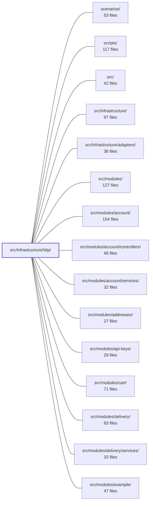

---
tags:
  - 2brain
  - 2brain/module
  - project/boilerplate-node-backend
type: module
module: src/infrastructure/http/
files: 32
updated: 2026-10-29T19:21:21.250041+00:00
---

# src/infrastructure/http/

## Purpose

`src/infrastructure/http/` is the shared HTTP-layer infrastructure for the entire API. It owns everything that lives between a raw socket and a domain controller: request parsing and validation, response serialisation, middleware (rate limiting, caching, idempotency, anti-bot, security), file-upload plumbing, SSE stream setup, and the mapping of infrastructure errors to HTTP status codes. Domain modules under `src/modules/` import from here rather than re-implementing any of these concerns.

## Key parts

- **Request & response plumbing** — `controller.ts`, `request.ts`, `response.ts`, `cookies.ts`, `schemas.ts`, `validation-messages.ts`, `ids.ts`, `errors.ts`. Together they define how controllers read multi-source input (route / query / body), bind it to Zod schemas, call a service, and serialise the `ServiceResult` union into an Express response or RFC 9457 problem document. `errors.ts` centralises the mapping from Mongo/Redis/BSON failures to 4xx/503/500 so every module gets the same answers.

- **Middleware chain** — `middlewares/` directory. Covers rate limiting (`rate-limit.ts`, `rate-limit-store.ts`, `rate-limits.generated.ts`, `store-breaker.ts`), response caching (`cache.ts`), idempotent writes (`idempotency.ts`, `idempotency-model.ts`), anti-bot gates (`human-challenge.ts`, `antibot-log.ts`), security (`origin.ts`, `content-type.ts`, `json-depth.ts`, `method-not-allowed.ts`), locale negotiation (`locale.ts`), access logging (`request-logger.ts`), and route-flag decoding (`route-flag.ts`).

- **File uploads** — `upload.ts` (multer staging, MIME/size validation, write side) and `uploads.ts` (normalisation, claim/release lifecycle, read side).

- **Edge & outbound concerns** — `origins.ts` (shared CORS/CSRF allow-list), `preconditions.ts` (If-Match / ETag), `sse.ts` (SSE header + periodic re-auth), `frontend-link.ts` (absolute URL builder), `read-capped-body.ts` (size-capped upstream reads).

- **Configuration** — `config.ts` exposes the typed, validated surface (addresses, rate-limit store, upload bounds, cache limits, idempotency retention) consumed at startup by middleware and adapters.

## How it connects

- **`src/modules/*`** (account, orders, products, etc.) — every domain controller imports `controller.ts` helpers, `readInput` from `request.ts`, response builders from `response.ts`, error mapping from `errors.ts`, and the relevant middlewares. Services produce the `ServiceResult` types defined in `response.ts`. No module owns its own rate limiter, cache, or upload pipeline; it composes the ones here.
- **`src/infrastructure/adapters/`** — the generic Redis adapter sits beneath `cache.ts` and `rate-limit-store.ts`; the HTTP module configures TTLs, byte limits, and the circuit breaker on top of that raw adapter.
- **`scenarios/` & `scripts/`** — read the same `config.ts` exports when they need to spin up or probe the HTTP layer in isolation (e.g., load-test scripts honour the rate-limit budgets defined in `rate-limits.generated.ts`).
- **`src/infrastructure/`** (parent) — this directory is one of several sibling infrastructure areas; `uploads.ts` reads files written by the `../uploads` module, and `frontend-link.ts` is the sole sanctioned way for email/notification code in `src/modules/notifications/` to build outbound URLs.

## Where to start

1. **`controller.ts`** – It is the shortest, most concrete entry point: read the four-step pattern (read → validate → call → branch/catch) and you understand the contract every endpoint in the repo follows.
2. **`middlewares/rate-limit.ts`** – It pulls in the budget descriptor, the Redis store, the circuit breaker, and the shared 429 response in one file, giving you a quick tour of how cross-cutting infrastructure is wired together before you dive into any single middleware in isolation.

## Connected modules

[[boilerplate-node-backend_ROOT|/ (repository root)]] · [[boilerplate-node-backend_scenarios|scenarios/]] · [[boilerplate-node-backend_scripts|scripts/]] · [[boilerplate-node-backend_src|src/]] · [[boilerplate-node-backend_src_infrastructure|src/infrastructure/]] · [[boilerplate-node-backend_src_infrastructure_adapters|src/infrastructure/adapters/]] · [[boilerplate-node-backend_src_modules|src/modules/]] · [[boilerplate-node-backend_src_modules_account|src/modules/account/]] · [[boilerplate-node-backend_src_modules_account_controllers|src/modules/account/controllers/]] · [[boilerplate-node-backend_src_modules_account_services|src/modules/account/services/]] · [[boilerplate-node-backend_src_modules_addresses|src/modules/addresses/]] · [[boilerplate-node-backend_src_modules_api-keys|src/modules/api-keys/]] · [[boilerplate-node-backend_src_modules_cart|src/modules/cart/]] · [[boilerplate-node-backend_src_modules_delivery|src/modules/delivery/]] · [[boilerplate-node-backend_src_modules_delivery_services|src/modules/delivery/services/]] · … and 14 more

## Files
- `src/infrastructure/http/config.ts` — Declares the typed, validated configuration surface for the HTTP layer of this deployment: site addresses, rate-limit store connection, upload bounds, response-cache limits, and idempotency retention. Each export is a `defineConfig` block (or a factory producing one) that the middleware, adapter, and module layers read at startup.
- `src/infrastructure/http/controller.ts` — Shared helpers for the four steps every HTTP controller repeats—read input, validate, call one service method, branch on the result, and catch errors. Written as small, composable functions rather than a `defineController()` wrapper so that each handler's `.catch()` call, service-result generic, and stack-frame name remain visible to the `controller-chain-must-catch` AST lint rule.
- `src/infrastructure/http/cookies.ts` — Generic transport plumbing that reads a single named cookie value off an incoming Express request. It deliberately stays credential-agnostic: it does not know *which* cookie matters, only how to safely extract a string-valued cookie regardless of what cookie-parser has done to it.
- `src/infrastructure/http/errors.ts` — Single-point interpreter that maps any driver or infrastructure failure (Mongo, Mongoose, Redis, BSON) to a deterministic HTTP status and message. It exists so all twelve models produce the same 4xx/503/500 answer for duplicate keys, bad identifiers, and outages, rather than each controller re-deriving the status inline.
- `src/infrastructure/http/frontend-link.ts` — Builds absolute URLs into the paired frontend application by combining its origin, a locale segment, and a parameterized path template. It exists so that infrastructure-level code (emails, notifications) can construct frontend links without knowing *which* links exist—each module (`account`, `orders`, etc.) owns its own templates and env-var overrides and calls this function with an already-resolved template.
- `src/infrastructure/http/ids.ts` — Centralises the one-answer-per-position rule for malformed IDs: an ID in a URL path is indistinguishable from an unknown resource (404), while an ID in a body field or query parameter is a bad argument (422). It also inspects a request's Zod schema to locate every `Id`-typed field so controllers can produce the correct validation errors without re-deriving field paths on each request.
- `src/infrastructure/http/middlewares/antibot-log.ts` — Provides the single shared log shape and HTTP-refusal response helper used by every anti-automation "rung" (rate-limit, email-policy, human-challenge). Exists so that three separate enforcement points emit one consistent warn-log line and one consistent error envelope, rather than each file defining its own message format.
- `src/infrastructure/http/middlewares/cache.ts` — HTTP response-caching layer: builds the JSON envelope, enforces the TTL policy (including a development clamp and RFC 5861 `stale-while-revalidate` / `stale-if-error` headers), and gates writes by entry size. It sits above the generic Redis adapter so that only response-caching consumers inherit the envelope shape, the dev TTL cap, and the byte-limit check.
- `src/infrastructure/http/middlewares/content-type.ts` — Express middleware that returns **415 Unsupported Media Type** when a write request carries a body whose `Content-Type` is not declared by the matched operation. Without it, `express.json` would leave an undeclared body as `{}`, and an all-optional PATCH schema would accept that — producing a misleading 200 that changed nothing.
- `src/infrastructure/http/middlewares/human-challenge.ts` — An Express middleware gate that verifies a client-supplied anti-bot token before allowing a request to proceed. It is mounted on sensitive routes (signup, password reset, contact/ticket submission) so that only callers holding a token vouched for by the active human-challenge provider can pass. When no provider is configured (the default), the gate is a near-zero-cost pass-through.
- `src/infrastructure/http/middlewares/idempotency-model.ts` — Defines the Mongoose schema, model, and TypeScript types for the idempotency ledger collection (`idempotencyrecords`). Each document represents one attempt keyed by `(key, caller)`, recording the request fingerprint and, once the handler has answered, the response to replay on a subsequent identical request. It lives in infrastructure (not under a domain module) because it belongs to no single module — the same exception applied to `rate-limit.ts`'s store.
- `src/infrastructure/http/middlewares/idempotency.ts` — Per-route Express middleware that makes retried `POST`/`PUT`/`PATCH` writes safe by storing a one-time `(key, caller)` record in Mongo. A caller supplies an `Idempotency-Key` header; if the same key+caller+request arrives again, the original response is replayed verbatim instead of re-running the handler. The header is fully optional — a request without one is treated exactly as if the middleware were not present.
- `src/infrastructure/http/middlewares/json-depth.ts` — Rejects parsed JSON request bodies whose nesting exceeds a fixed depth (`MAX_JSON_DEPTH = 32`) with a 400, before any route or downstream walker (fingerprinting, cache-key hashing, Zod validation) can throw a `RangeError`. It fills the gap left by `express.json`, which enforces only a byte limit and therefore admits arbitrarily deep structures like `[[[…]]]`.
- `src/infrastructure/http/middlewares/locale.ts` — Express middleware that negotiates the request language (from `Accept-Language`) once, at the top of the chain, and exposes the result both explicitly (`request.locale`, `request.t`) and ambiently via `AsyncLocalStorage`, so that any downstream code—handlers, services, Zod thunks—can call `t` without threading the request object.
- `src/infrastructure/http/middlewares/method-not-allowed.ts` — Express middleware that distinguishes a 405 (known path, wrong method) from the catch-all 404. It inspects the request against the generated OpenAPI path table and, when the path is served but the method is not, responds `405` with an `Allow` header per RFC 9110 §15.5.6. Without it, every wrong-method request would fall through to the 404.
- `src/infrastructure/http/middlewares/origin.ts` — CSRF-guard middleware for endpoints authenticated by a cookie alone (refresh, logout, SSE stream). It rejects any request whose `Origin` header names a value outside the allowed origins, blocking cross-origin form/`fetch` submissions that a malicious page could fire with the victim's cookie. Requests with no `Origin` header (curl, health checks, same-origin navigations) pass through unchanged.
- `src/infrastructure/http/middlewares/rate-limit-store.ts` — Provides the `Store` implementations that `express-rate-limit` uses to count hits for each rate-limit budget. Because the app forks one worker per CPU, an in-process `Map` would multiply every budget by the worker count; this module routes counters through a dedicated "limits" Redis instance (separate from the response cache) so the budget holds globally, and falls back to per-process memory or pass-through when Redis is unavailable.
- `src/infrastructure/http/middlewares/rate-limit.ts` — Central rate-limiting machinery for the HTTP layer. Builds all Express rate-limit middleware from a shared `RateLimitBudget` descriptor (the `buildRateLimiter` factory), owns the three budgets no feature module claims (global per-IP brake, API-key credential budget, image-upload budget), and produces the shared refusal response (429 with IETF draft rate-limit headers, audit trail, and metrics) used by every limiter in the app.
- `src/infrastructure/http/middlewares/rate-limits.generated.ts` — Auto-generated data table defining the three kernel rate-limit budgets (global browsing, api-key, uploads). It exists so that the numeric and behavioral configuration lives in a single YAML source (`shared/rules/rate-limits.yaml`) while the TypeScript side stays a plain `as const` object that `rate-limit.ts` consumes at runtime.
- `src/infrastructure/http/middlewares/request-logger.ts` — Express access-log middleware that emits exactly one structured log entry per HTTP request. It measures duration with `hrtime` (sub-ms precision) and maps the response status code to a log severity (5xx → error, 4xx → warn, else info) so failures are surfaced at the appropriate alerting level.
- `src/infrastructure/http/middlewares/route-flag.ts` — Middleware factory that lets a URL path segment (e.g. the `/hard` suffix in `DELETE /products/:id/hard`) be read by `readInput` exactly like a named route param, so a single controller entry point can serve two different spellings of the same operation.
- `src/infrastructure/http/middlewares/store-breaker.ts` — A hand-rolled circuit breaker for the single shared Redis instance behind all rate-limit budgets. Without it, a dead Redis forces every request on every budget to pay its full connect timeout (~1 s) for the duration of the outage. The breaker opens after a failure, stays open for a fixed window, then allows exactly one probe call before re-opening on failure or closing on success.
- `src/infrastructure/http/middlewares/upload.ts` — Defines the multer-based image-upload middleware pipeline: where files are staged, how they are named, which MIME types are accepted, and the size/part ceilings enforced. It is the **write side** of image uploads (staging, validation, quarantine); the read side (`readUploadedImage`) lives in `../uploads`. Built as per-route middleware rather than a global adapter because it is route-scoped.
- `src/infrastructure/http/origins.ts` — Centralises the single source of truth for "which browser origins may call this API with credentials." It exists so that the CORS middleware and the server-side origin guard reference the same allow-list and never diverge, which would let a request pass the server guard while the browser's CORS check blocks it.
- `src/infrastructure/http/preconditions.ts` — The HTTP-facing half of conditional writes (RFC 9110 §13.1.1). Parses the `If-Match` request header into a `Precondition`, scopes a write inside that precondition, and stamps the `ETag` response header. All version semantics (what a version is, how comparison works) live in `versioning.ts`; this file knows nothing about row shape.
- `src/infrastructure/http/read-capped-body.ts` — Provides size-capped reading of outbound HTTP response bodies so a compromised or misconfigured upstream cannot force the process to buffer unbounded data. Every caller that receives a third-party response (OAuth token/user endpoints, breached-password lookups, antibot siteverify) reads through these helpers instead of the unbounded `response.json()` / `response.text()` / `response.arrayBuffer()` defaults.
- `src/infrastructure/http/request.ts` — Defines the multi-source input-binding rules for HTTP endpoints: a single value may arrive via route param, query string, or request body, and the same controller often serves multiple shapes of the same operation (e.g. `GET /products?text=x` vs `POST /products/search`). This module centralises the precedence, decoding, and merge logic behind one entry point (`readInput`) so controllers declare *what* they read rather than re-assembling extraction at each call site.
- `src/infrastructure/http/response.ts` — Provides the response serialiser layer: the internal `ServiceResult` union types (`ResponseSuccess<T>` / `ResponseReject`) that services produce, and the Express-bound functions (`successResponse`, `createdResponse`, `noContentResponse`, `generateReject`, etc.) that put a payload or RFC 9457 problem document on the wire. Separating the "build the result" step from the "send it" step lets unit tests and non-HTTP workers assert on the same shapes without an Express `Response`.
- `src/infrastructure/http/schemas.ts` — Shared Zod schemas for the small set of scalar parameters (pagination, delete mode, booleans) that appear across many HTTP endpoints. They centralise coercion, bounds, and blank-value handling so controllers don't re-derive the same rules independently, and they keep those bounds in lockstep with `openapi.yaml` rather than drifting.
- `src/infrastructure/http/sse.ts` — Shared infrastructure for opening a Server-Sent Events stream: sets the required headers, starts a periodic permission re-verification (every 30 s), and provides idempotent teardown. It deliberately stays agnostic of *what* the stream emits or *who* owns it—those concerns remain with the calling module.
- `src/infrastructure/http/uploads.ts` — Read-side helpers for file uploads. Given a request that has already passed through the multer upload middleware, this module normalises the stored URLs, quarantined keys, and body fields into a uniform `RequestImage` object, and provides a claim/release lifecycle so that unclaimed uploads are cleaned up automatically on error responses.
- `src/infrastructure/http/validation-messages.ts` — Provides a single, language-aware error-message layer for all Zod validation failures. Generated schemas (`@api/schemas.zod`) ship without messages and would otherwise fall back to Zod's English defaults; this file installs a global `customError` hook that translates every issue into the caller's language at parse time, without requiring per-schema annotations.

---
[[boilerplate-node-backend_INDEX|← boilerplate-node-backend index]]
