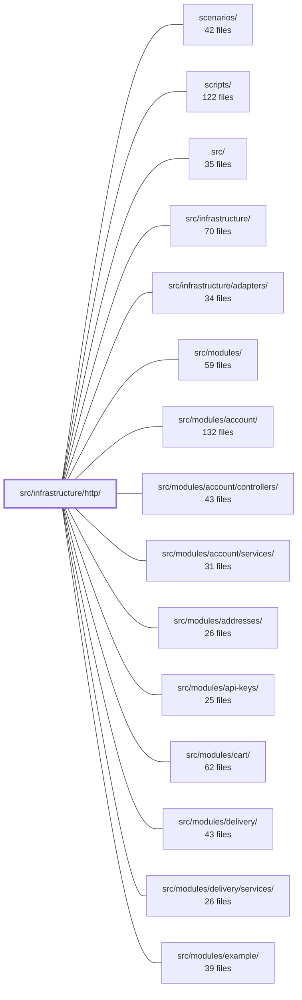

---
tags:
  - 2brain
  - 2brain/module
  - project/boilerplate-node-backend
type: module
module: src/infrastructure/http/
files: 29
updated: 2026-10-15T13:35:59.599844+00:00
---

# src/infrastructure/http/

## Purpose

`src/infrastructure/http/` is the shared HTTP plumbing layer for the Express API. It owns every module-agnostic concern that sits between the raw Express framework and the feature modules: request parsing, response shaping, validation, error mapping, rate-limiting, caching, idempotency, security gates, upload handling, and locale resolution. Feature modules declare *what* they do; this module defines *how* HTTP is done.

## Key parts

- **Request/response contract** — `response.ts` (the single discriminated-union envelope every endpoint returns), `request.ts` (the `readInput` entry point that unifies route params, query, and body into one typed object), `controller.ts` (shared helpers for the parse → validate → call-service → branch → catch pattern), `schemas.ts` (shared Zod schemas for pagination, soft/hard delete, etc.), `validation-messages.ts` (global Zod `customError` hook that localises every parse failure).
- **Error mapping & ID semantics** — `errors.ts` (translates Mongo/Redis/queue driver failures into HTTP status + safe message), `ids.ts` (enforces the 404-vs-422 rule for malformed IDs and locates `Id`-typed fields in a Zod schema).
- **Security & protection middleware** — `middlewares/rate-limit.ts` + `middlewares/rate-limit-store.ts` + `middlewares/store-breaker.ts` (Redis-backed budgets with circuit-breaker fallback), `middlewares/origin.ts` (CSRF guard for cookie-authenticated routes), `middlewares/human-challenge.ts` (anti-automation gate on sensitive endpoints), `middlewares/antibot-log.ts` (shared refusal log + response shape), `middlewares/content-type.ts` (415 on undeclared body types), `middlewares/json-depth.ts` (rejects pathologically nested JSON).
- **Caching & idempotency** — `middlewares/cache.ts` (Redis-backed response cache with TTL, size gate, key derivation), `middlewares/idempotency.ts` + `middlewares/idempotency-model.ts` (Mongo-backed replay ledger for safe retried writes).
- **Uploads** — `middlewares/upload.ts` (multer write pipeline, staging dir, MIME/size limits, byte-level validation), `uploads.ts` (read-side normalisation into a `RequestImage` shape).
- **Locale & frontend links** — `middlewares/locale.ts` (resolves `Accept-Language` once, exposes via AsyncLocalStorage), `frontend-link.ts` (builds absolute locale-prefixed frontend URLs from a path template).
- **Configuration & supporting utilities** — `config.ts` (all HTTP-layer settings via `defineConfig`), `cookies.ts` (safe single-cookie extraction), `origins.ts` (shared CORS/CSRF allow-list), `preconditions.ts` (ETag / `If-Match` handling), `read-capped-body.ts` (size-capped streaming reads for outbound calls), `middlewares/request-logger.ts` (one structured log line per request), `middlewares/route-flag.ts` (URL-segment-as-param helper).

## How it connects

- **`src/modules/*` (all feature modules)** are the primary consumers: they mount the middlewares, call `readInput` / the response helpers / `errors.ts` in their controllers, and define their own route-specific schemas and services that plug into this module's generic contract.
- **`src/infrastructure/adapters/`** provides the Redis and Mongo adapters that the rate-limit store, response cache, and idempotency ledger depend on for persistence.
- **`src/infrastructure/`** (parent) owns the i18n runtime (`@infrastructure/i18n`) that `middlewares/locale.ts` and `validation-messages.ts` call into, and the `defineConfig` schema system that `config.ts` uses.
- **`src/`** (the Express app entry) wires the middleware chain in order (locale → logger → content-type → json-depth → rate-limit → … → route handlers) and mounts `response.ts`'s serialisation helpers on the app instance.
- **`scenarios/` and `scripts/`** consume `read-capped-body.ts` and `config.ts` for outbound HTTP calls and shared settings outside the request lifecycle.

## Where to start

1. **`response.ts`** — read this first to understand the single envelope shape (`ResponseSuccess<T>` | `ResponseReject`) that every endpoint in the codebase returns. Once you know the contract, every controller and client-side consumer makes sense.
2. **`controller.ts` + `request.ts`** — these two together show the four-step handler pattern and how `readInput` collapses multiple transport sources into one typed object. Reading them in sequence explains how a typical route handler is assembled and why modules never re-derive extraction or error-mapping logic.

## Connected modules

[[boilerplate-node-backend_ROOT|/ (repository root)]] · [[boilerplate-node-backend_scenarios|scenarios/]] · [[boilerplate-node-backend_scripts|scripts/]] · [[boilerplate-node-backend_src|src/]] · [[boilerplate-node-backend_src_infrastructure|src/infrastructure/]] · [[boilerplate-node-backend_src_infrastructure_adapters|src/infrastructure/adapters/]] · [[boilerplate-node-backend_src_modules|src/modules/]] · [[boilerplate-node-backend_src_modules_account|src/modules/account/]] · [[boilerplate-node-backend_src_modules_account_controllers|src/modules/account/controllers/]] · [[boilerplate-node-backend_src_modules_account_services|src/modules/account/services/]] · [[boilerplate-node-backend_src_modules_addresses|src/modules/addresses/]] · [[boilerplate-node-backend_src_modules_api-keys|src/modules/api-keys/]] · [[boilerplate-node-backend_src_modules_cart|src/modules/cart/]] · [[boilerplate-node-backend_src_modules_delivery|src/modules/delivery/]] · [[boilerplate-node-backend_src_modules_delivery_services|src/modules/delivery/services/]] · … and 14 more

## Files
- `src/infrastructure/http/config.ts` — Central configuration declarations for the HTTP layer. Defines validated, typed settings for site addresses, rate-limiting (including the Redis connection), upload limits, response-cache bounds, and idempotency retention — all using the project's `defineConfig` schema system so every value is defaulted, ranged, and optionally production-gated in one place.
- `src/infrastructure/http/controller.ts` — Shared helper functions that encode the four-step pattern every Express controller repeats (parse input, validate, call a service method, branch on the result, catch). They are intentionally written as standalone helpers rather than a `defineController()` wrapper so that stack traces point at the actual handler, the service result's type stays concrete, and the literal `.catch(` call remains visible to the `controller-chain-must-catch` AST lint rule.
- `src/infrastructure/http/cookies.ts` — Generic transport plumbing that reads a single named cookie value off an incoming Express request. It deliberately stays credential-agnostic: it does not know *which* cookie matters, only how to safely extract a string-valued cookie regardless of what cookie-parser has done to it.
- `src/infrastructure/http/errors.ts` — Single-point mapper that translates raw driver failures (Mongo, Mongoose, Redis, or a saturated queue) into the correct HTTP status and client-safe message. Every controller's `.catch()` and every service that must return an error envelope delegates status derivation here, so all twelve models produce the same answer for the same failure without each re-deriving the logic inline.
- `src/infrastructure/http/frontend-link.ts` — Single-responsibility utility that turns a path template (e.g. `orders/{id}`) plus parameters into an absolute URL pointing at the paired frontend, prefixed with the caller's locale. It lives in infrastructure because it only reads config and i18n data; individual modules (`account`, `orders`) own *which* templates exist and resolve any env-var overrides before calling this function.
- `src/infrastructure/http/ids.ts` — Centralises the one-answer-per-position rule for malformed IDs: an ID in a URL path is indistinguishable from an unknown resource (404), while an ID in a body field or query parameter is a bad argument (422). It also inspects a request's Zod schema to locate every `Id`-typed field so controllers can produce the correct validation errors without re-deriving field paths on each request.
- `src/infrastructure/http/middlewares/antibot-log.ts` — Single shared log-line format and HTTP-refusal helper for all anti-automation rungs (rate-limit, email-policy, human-challenge). Centralises the "refused" log shape so the three rungs don't each emit their own ad-hoc message, and pairs it with the project's standard error-envelope response.
- `src/infrastructure/http/middlewares/cache.ts` — HTTP response-caching middleware for Express routes. It defines the JSON envelope stored in Redis, the TTL policy (including a development-time clamp and refresh-ahead stale window), the per-entry size gate, and the key-derivation logic that maps a request's declared parameters to a stable cache key. All of this lives here rather than in the cache adapter because it is specific to caching HTTP responses; a different consumer of the same adapter would not need the envelope, the TTL clamp, or the byte limit.
- `src/infrastructure/http/middlewares/content-type.ts` — Express middleware that returns **415 Unsupported Media Type** when a request carries a body whose `Content-Type` is not among the types the matched operation declares. It plugs a gap where `express.json` silently ignores undeclared types, producing an empty `{}` body that an all-optional PATCH schema would accept as a no-op 200.
- `src/infrastructure/http/middlewares/human-challenge.ts` — Express middleware that acts as a gate on sensitive routes (signup, password reset, contact/feedback). It requires the caller to present a token that a human-challenge provider vouches for. When the provider is set to `none`, the gate is a no-op: one registry lookup and a `next()` call, with no header parsing or network I/O.
- `src/infrastructure/http/middlewares/idempotency-model.ts` — Defines the Mongoose schema, indexes, and model for the idempotency ledger — a Mongo collection that stores one record per `(key, caller)` pair, capturing a retried write's request fingerprint and, once the handler has responded, its status/body. It exists so that `idempotency.ts` can deduplicate in-flight requests and replay cached outcomes without re-executing side effects.
- `src/infrastructure/http/middlewares/idempotency.ts` — Express middleware that makes retried write requests safe by replaying a previously stored response instead of re-executing the handler. It is mounted per-route (not globally) and is opt-in via the `Idempotency-Key` request header: a client that omits the header gets neither protection nor refusal. The ledger lives in Mongo (TTL-expired) rather than Redis, because the cache's `allkeys-lru` eviction policy could silently discard a live record under load and turn a retry into a duplicate write.
- `src/infrastructure/http/middlewares/json-depth.ts` — An Express middleware that rejects JSON request bodies nested deeper than a fixed limit (`MAX_JSON_DEPTH = 32`) with a 400 response. It exists because `express.json`'s byte-size limit does not protect against stack-overflow (`RangeError`) in any downstream recursive walk (Zod parsing, idempotency fingerprinting, cache-key hashing). Positioned immediately after the body parser, before route handlers, so a single guard covers all consumers.
- `src/infrastructure/http/middlewares/locale.ts` — Express middleware that resolves the request's language from the `Accept-Language` header once, at the top of the chain, and exposes the result in two channels: explicitly as `request.locale` / `request.t` for handlers that hold the request, and ambiently through AsyncLocalStorage so that services, repositories, and Zod thunks can call `t` (imported from `@infrastructure/i18n`) without threading the request through every call site.
- `src/infrastructure/http/middlewares/origin.ts` — CSRF-guard middleware for endpoints authenticated by a cookie alone (refresh, logout, SSE stream). It rejects any request whose `Origin` header names a value outside the allowed origins, blocking cross-origin form/`fetch` submissions that a malicious page could fire with the victim's cookie. Requests with no `Origin` header (curl, health checks, same-origin navigations) pass through unchanged.
- `src/infrastructure/http/middlewares/rate-limit-store.ts` — Provides the `express-rate-limit` `Store` implementations that back every rate-limit budget in the application. It solves the multi-process problem (each `cluster.ts` worker would otherwise hold its own in-memory budget) by routing counters through a dedicated `limits` Redis instance, with a circuit-breaker–guarded in-memory fallback so a Redis outage degrades gracefully rather than crashing or passing every request.
- `src/infrastructure/http/middlewares/rate-limit.ts` — Shared rate-limiting factory and the three infrastructure-owned budgets (global per-address brake, api-key credential budget, image-upload budget). Every module that declares its own `RateLimitBudget` calls `buildRateLimiter` here, so all limiters—regardless of which route mounts them—share the same store, response shape, metrics, and audit trail. Also exposes `chargeBudget` for non-Express code paths that need to spend a budget unit programmatically.
- `src/infrastructure/http/middlewares/request-logger.ts` — Express access-log middleware that emits exactly one structured log entry per HTTP request. It measures duration with `hrtime` (sub-ms precision) and maps the response status code to a log severity (5xx → error, 4xx → warn, else info) so failures are surfaced at the appropriate alerting level.
- `src/infrastructure/http/middlewares/route-flag.ts` — Middleware factory that lets a URL path segment (e.g. the `/hard` suffix in `DELETE /products/:id/hard`) be read by `readInput` exactly like a named route param, so a single controller entry point can serve two different spellings of the same operation.
- `src/infrastructure/http/middlewares/store-breaker.ts` — A hand-rolled circuit breaker for the single shared Redis instance behind all rate-limit budgets. Without it, a dead Redis forces every request on every budget to pay its full connect timeout (~1 s) for the duration of the outage. The breaker opens after a failure, stays open for a fixed window, then allows exactly one probe call before re-opening on failure or closing on success.
- `src/infrastructure/http/middlewares/upload.ts` — Defines the multer-based file-upload pipeline: where uploads land (staging dir), how they are named (128-bit random hex), which MIME types are accepted, and size/count limits. Exports both the raw multer middleware and a post-write validation middleware that confirms the file's actual bytes match the declared type. Files live in a non-public staging directory until a downstream quarantine step commits them.
- `src/infrastructure/http/origins.ts` — Centralises the single source of truth for "which browser origins may call this API with credentials." It exists so that the CORS middleware and the server-side origin guard reference the same allow-list and never diverge, which would let a request pass the server guard while the browser's CORS check blocks it.
- `src/infrastructure/http/preconditions.ts` — The HTTP-facing half of conditional writes (RFC 9110 §13.1.1). Parses the `If-Match` request header into a `Precondition`, scopes a write inside that precondition, and stamps the `ETag` response header. All version semantics (what a version is, how comparison works) live in `versioning.ts`; this file knows nothing about row shape.
- `src/infrastructure/http/read-capped-body.ts` — Provides size-capped helpers for reading outbound HTTP response bodies. Standard `response.json()` / `response.text()` buffer the entire payload in memory before parsing, so a compromised or misconfigured provider can exhaust process memory. These utilities stream the body and abort the moment the byte cap is exceeded. Used on every outbound call where the app reads a third-party answer (OAuth token exchange, breached-password range lookup, antibot siteverify).
- `src/infrastructure/http/request.ts` — Centralises the rules for reading a route's input across multiple transport sources (route params, query string, JSON/multipart body). Exposes a single `readInput` entry point so controllers declare *what* they read (via a `RequestInputDeclaration`) rather than re-assembling extraction, decoding, and precedence logic per endpoint. This is what allows one handler to serve both `GET /products?text=x` and `POST /products/search {text}`.
- `src/infrastructure/http/response.ts` — Defines the canonical response envelope used by every API endpoint. All routes return the same top-level discriminated-union shape (`ResponseSuccess<T>` | `ResponseReject`) so that clients (including the orval-generated API client) can branch on `success` without route-specific knowledge. The file also provides the Express helpers that serialize and send that envelope.
- `src/infrastructure/http/schemas.ts` — Defines shared Zod schemas for the handful of scalar HTTP inputs (pagination, soft/hard delete, optional booleans) that multiple endpoints accept. Centralizes bounds, coercion, and blank-value handling so every controller enforces the same contract rather than re-deriving (or disagreeing on) what a legal `pageSize` or `hardDelete` spelling is.
- `src/infrastructure/http/uploads.ts` — Read-side helpers for multipart image uploads. The upload middleware (write side) handles where files land and how they are named; this module only normalises what the middleware left on the Express request, producing a uniform `RequestImage` shape that controllers consume to decide what image URL to persist, whether a digest job is pending, and how to roll back on error.
- `src/infrastructure/http/validation-messages.ts` — Provides a single, language-aware error-message layer for all Zod validation failures. Generated schemas (`@api/schemas.zod`) ship without messages and would otherwise fall back to Zod's English defaults; this file installs a global `customError` hook that translates every issue into the caller's language at parse time, without requiring per-schema annotations.

---
[[boilerplate-node-backend_INDEX|← boilerplate-node-backend index]]
