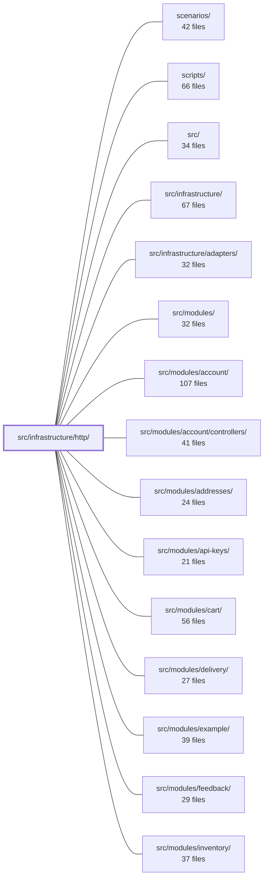

---
tags:
  - 2brain
  - 2brain/module
  - project/boilerplate-node-backend
type: module
module: src/infrastructure/http/
files: 29
updated: 2026-10-07T23:55:09.218156+00:00
---

# src/infrastructure/http/

## Purpose

`src/infrastructure/http/` is the shared HTTP plumbing layer of the Express application. It owns everything that is identical across every route—request parsing, response shaping, validation error serialisation, rate-limiting, idempotent replay, anti-automation gating, image-upload I/O, locale resolution, and structured logging—so that domain modules under `src/modules/` can focus on business logic and delegate every cross-cutting concern to this module.

## Key parts

- **Controller & response dialect** — `controller.ts` (the four-step helper sequence every handler repeats), `request.ts` (`readInput`, the single entry point for pulling route params / query / body), `response.ts` (the discriminated-union envelope, status-to-code mapping, Zod error serialisation), and `errors.ts` (database-error interpreter, `rejectDatabaseError` / `rejectDatabaseEnvelope` helpers, `ConflictError` base class). Together they define the one canonical "request in → response out" contract for all twelve domain modules.
- **Shared validation & i18n** — `schemas.ts` (Zod schemas for scalar query params like `pageSize`), `validation-messages.ts` (global Zod `customError` map so every parse violation is answered in the caller's language via the request-scoped `t`), and `config.ts` / `cookies.ts` / `ids.ts` / `preconditions.ts` / `read-capped-body.ts` for the remaining small shared utilities.
- **Middlewares** (`middlewares/`) — cross-cutting Express middleware, grouped by concern:
  - *Security & anti-automation*: `rate-limit.ts` (budget factory), `rate-limit-store.ts` (Redis-backed counter), `human-challenge.ts` (token-verification gate), `antibot-log.ts` (shared refusal log/response shape), `origin.ts`, `content-type.ts`, `json-depth.ts`.
  - *Reliability*: `idempotency.ts` + `idempotency-model.ts` (replay / in-flight / mismatch detection backed by Mongo), `cache.ts` (response-envelope caching, TTL policy, byte budget), `store-breaker.ts`.
  - *Locale & logging*: `locale.ts` (resolves `Accept-Language` once, exposes `t` via AsyncLocalStorage), `request-logger.ts` (one structured log line per request with hrtime duration and status-derived severity).
  - *Uploads*: `upload.ts` (multer write pipeline—staging, MIME filtering, size limits) and `uploads.ts` at the module root (read-side `RequestImage` normalisation and orphan cleanup).
  - *Routing*: `route-flag.ts` (treats a path segment like a named param so one controller can serve two URL spellings).
- **Frontend link** — `frontend-link.ts` builds a locale-prefixed absolute URL to the paired SPA, keeping domain modules free of origin knowledge.
- **Origins** — `origins.ts` complements the `middlewares/origin.ts` gate with the shared origin-list logic.

## How it connects

- **`src/modules/*` (account, products, users, orders, payments, …)** — every domain module's controller directory imports the helpers from `controller.ts`, `request.ts`, `response.ts`, `errors.ts`, and the middleware factories (`rate-limit`, `idempotency`, `human-challenge`, `upload`) from this module. The modules never re-implement envelope shaping, error mapping, or budget keying.
- **`src/infrastructure/adapters/`** — the `cache.ts` middleware is the HTTP-specific layer that translates a handler's response into the `CachedResponse` envelope and then delegates persistence to the opaque cache adapter; the adapter knows nothing about JSON shape or `stale-while-revalidate`.
- **`src/infrastructure/` (parent)** — `locale.ts` reaches into `@infrastructure/i18n` for the `t` function it injects via AsyncLocalStorage; `validation-messages.ts` registers its global Zod error map at the same infrastructure level so all schemas (generated and hand-written) pick it up.
- **`scenarios/` / `scripts/` / repository root** — test scenarios and operational scripts that exercise HTTP endpoints hit this module's middleware chain and response envelope directly, relying on its deterministic 4xx/5xx shapes.

## Where to start

1. **`response.ts`** — reading the envelope shape (the `success` discriminant, the error tuple) first gives you the contract every endpoint returns; everything else in the module exists to produce or consume that shape.
2. **`middlewares/locale.ts`** — once you understand how `t` becomes available without threading the request, the rest of the middleware chain (anti-bot gates, rate-limiters, idempotency) reads naturally as a flat, composable list you can find in any route definition.

## Connected modules

[[boilerplate-node-backend_ROOT|/ (repository root)]] · [[boilerplate-node-backend_scenarios|scenarios/]] · [[boilerplate-node-backend_scripts|scripts/]] · [[boilerplate-node-backend_src|src/]] · [[boilerplate-node-backend_src_infrastructure|src/infrastructure/]] · [[boilerplate-node-backend_src_infrastructure_adapters|src/infrastructure/adapters/]] · [[boilerplate-node-backend_src_modules|src/modules/]] · [[boilerplate-node-backend_src_modules_account|src/modules/account/]] · [[boilerplate-node-backend_src_modules_account_controllers|src/modules/account/controllers/]] · [[boilerplate-node-backend_src_modules_addresses|src/modules/addresses/]] · [[boilerplate-node-backend_src_modules_api-keys|src/modules/api-keys/]] · [[boilerplate-node-backend_src_modules_cart|src/modules/cart/]] · [[boilerplate-node-backend_src_modules_delivery|src/modules/delivery/]] · [[boilerplate-node-backend_src_modules_example|src/modules/example/]] · [[boilerplate-node-backend_src_modules_feedback|src/modules/feedback/]] · … and 12 more

## Files
- `src/infrastructure/http/config.ts`
- `src/infrastructure/http/controller.ts` — Shared helper functions that implement the four steps every Express controller repeats — read input, validate, call a service method, branch on the result, and catch errors. They exist as standalone helpers (rather than a `defineController()` wrapper) so that each controller's call site keeps its stack frame, its concrete generic, and its visible `.catch(` token intact for the `controller-chain-must-catch` AST lint rule.
- `src/infrastructure/http/cookies.ts`
- `src/infrastructure/http/errors.ts` — Single-point database-error interpreter that maps any driver failure (Mongo, Mongoose, Redis outage) to a deterministic HTTP status and message tuple, so all twelve models answer the same failure identically. Also provides the two reject helpers (`rejectDatabaseError`, `rejectDatabaseEnvelope`) that controllers and services call in their `.catch()` blocks, and the `ConflictError` base class that module-level invariant violations extend.
- `src/infrastructure/http/frontend-link.ts` — Converts a resolved path template and a set of parameters into a full URL pointing at the paired frontend, prefixed with the caller's locale. It exists so that domain modules never need to know the frontend's origin or how locale validation works—they hand in an already-resolved template and locale, and get back a link.
- `src/infrastructure/http/ids.ts`
- `src/infrastructure/http/middlewares/antibot-log.ts` — Centralizes the single warn-log format and the single HTTP-refusal response shape shared by every anti-automation rung (rate-limit, email-policy, human-challenge). Eliminates each rung file duplicating its own message structure in the log stream.
- `src/infrastructure/http/middlewares/cache.ts` — Defines the HTTP response-caching layer: the `CachedResponse` envelope, the TTL resolution policy (including a development-time clamp), and a per-entry size gate. It sits between route handlers and the opaque `adapters/cache` store, owning everything specific to caching a *response* (JSON shape, `stale-while-revalidate` timing, byte budget) so that a non-HTTP consumer of the adapter inherits none of it.
- `src/infrastructure/http/middlewares/content-type.ts`
- `src/infrastructure/http/middlewares/human-challenge.ts` — Express middleware gate mounted on `signup`, `reset`, and `contact` routes when a human-challenge provider is configured. It requires the caller to present a token (in a request header) that the active provider will verify; if verification fails or the token is absent, the request is refused with a standard 401 envelope. When no provider is selected (the default `none`), the gate is a near-zero-cost pass-through.
- `src/infrastructure/http/middlewares/idempotency-model.ts` — Mongoose schema and model for the idempotency ledger — one document per `(key, caller)` pair that records a retried write's fingerprint and, once the handler has answered, its response. This is the storage layer that `idempotency.ts` reads and writes against to implement replay, in-flight, and mismatch detection. It lives at the infrastructure level (not inside a domain module) because the collection belongs to no domain; the same exception applies to `rate-limit.ts`'s store.
- `src/infrastructure/http/middlewares/idempotency.ts` — Express middleware that makes retried write requests safe by replaying a previously captured response instead of re-running the handler. It is mounted per-route (never globally) and is fully opt-in: a request without an `Idempotency-Key` header passes through untouched. Records are stored in Mongo (not Redis) because the production cache runs `allkeys-lru` eviction, which would silently turn a replay into a duplicate write under load.
- `src/infrastructure/http/middlewares/json-depth.ts`
- `src/infrastructure/http/middlewares/locale.ts` — Express middleware that resolves the request's language from the `Accept-Language` header once, at the top of the chain, and exposes the result in two channels: explicitly as `request.locale` / `request.t` for handlers that hold the request, and ambiently through AsyncLocalStorage so that services, repositories, and Zod thunks can call `t` (imported from `@infrastructure/i18n`) without threading the request through every call site.
- `src/infrastructure/http/middlewares/origin.ts`
- `src/infrastructure/http/middlewares/rate-limit-store.ts` — Provides the counter store that `express-rate-limit` uses to track per-client request budgets. Because the app runs one worker per CPU, the default in-process `Map` would multiply every budget by the worker count. This module swaps in a Redis-backed store (`rate-limit-redis`) so all workers and instances share a single budget, and falls back to an in-memory store (logging at `error` level) when Redis is unavailable. The Redis connection is deliberately separate from the cache connection so disabling the cache never disables rate limiting.
- `src/infrastructure/http/middlewares/rate-limit.ts` — Central factory and shared keying helpers for all rate-limit budgets in the app. Owns the three budgets no single module claims (global burst brake, api-key credential budget, image-upload budget) and exports `buildRateLimiter`, the one factory every module's own `rate-limits.ts` budget also flows through. Every refusal is answered via the shared error envelope (429) rather than `express-rate-limit`'s plain-text body.
- `src/infrastructure/http/middlewares/request-logger.ts` — Express access-log middleware that emits exactly one structured log line per completed HTTP request, with sub-millisecond duration (via `process.hrtime.bigint()`) and a severity level derived from the response status code so that 5xx failures log at `error` and 4xx at `warn`.
- `src/infrastructure/http/middlewares/route-flag.ts` — Middleware factory that lets a URL path segment (e.g. the `/hard` suffix in `DELETE /products/:id/hard`) be read by `readInput` exactly like a named route param, so a single controller entry point can serve two different spellings of the same operation.
- `src/infrastructure/http/middlewares/store-breaker.ts`
- `src/infrastructure/http/middlewares/upload.ts` — Defines the complete multer-based image-upload pipeline: staging directory, random filename generation, MIME-type filtering (both declared and byte-level), size limits, and post-write validation. It is the *write* side of image uploads; the read side (`readUploadedImage`) lives in `../uploads`. Mounted per-route by the account, products, and users modules.
- `src/infrastructure/http/origins.ts`
- `src/infrastructure/http/preconditions.ts`
- `src/infrastructure/http/read-capped-body.ts`
- `src/infrastructure/http/request.ts` — Defines the rules for reading a route's input from multiple possible sources (route params, query string, body) through a single entry point, `readInput`. This lets one controller serve both `GET /products?text=x` and `POST /products/search {text}` without duplicating handler logic, and keeps the source-precedence and type-decoding rules in one place rather than scattered across controllers.
- `src/infrastructure/http/response.ts` — Defines the uniform response envelope for every API endpoint. All responses share a single discriminated-union shape (branch on `success`) so clients can handle any route identically and the generated API client (orval) needs only one type. The file also centralizes status-code-to-error-code/message mapping and Zod validation error serialization, giving the whole HTTP layer one canonical "response dialect."
- `src/infrastructure/http/schemas.ts` — Shared Zod validation schemas for scalar HTTP query parameters (pagination, booleans) that multiple endpoints accept. Exists to centralise bounds and coercion so that no two controllers silently disagree on what a legal `pageSize` or `hardDelete` value is, and to keep the numbers aligned with the single shared components in `openapi.yaml` without importing from any one generated per-operation constant.
- `src/infrastructure/http/uploads.ts` — Read-side helpers for image uploads. After the multer middleware (in `middlewares/upload`) has stashed file metadata on the Express request, this module normalizes that state into a uniform `RequestImage` object and provides a write wrapper that cleans up orphaned files when a controller fails. It is shared by every image-accepting controller so the three upload paths (inline digest, broker/pending, body-only) are handled in one place.
- `src/infrastructure/http/validation-messages.ts` — Centralizes Zod parse-error copy so every schema violation—generated or hand-written—is answered in the caller's language via the request-scoped i18n `t`. It registers a single global `customError` map on the Zod singleton, eliminating per-schema message strings and fixing the English fallback that generated schemas (`@api/schemas.zod`) otherwise produced.

---
[[boilerplate-node-backend_INDEX|← boilerplate-node-backend index]]
