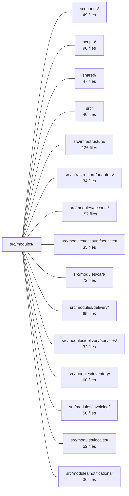

---
tags:
  - 2brain
  - 2brain/module
  - project/boilerplate-node-backend
type: module
module: src/modules/
files: 194
updated: 2026-11-08T10:48:38.217804+00:00
---

# src/modules/

## Purpose

`src/modules/` is the top-level container for every business-domain (bounded-context) module in the application. Each sub-directory is a self-contained DDD module—owning its data models, service logic, HTTP surface, OpenAPI contract, and GDPR lifecycle hooks—and is registered with the kernel at boot. Sibling modules interact only through each other's barrel (`index.ts`), enforcing strict import boundaries.

## Key parts

- **`access/`** — Tenants, memberships, and staff-role authorisation. Owns the role-grant/revocation write-path (`services/grants.ts`, `services/memberships.ts`), shop-level protection rules (`services/protection.ts`), and the audit vocabulary (`audit.ts`). Consumed by nearly every other module (account, users, orders, payments, returns, api-keys) for permission checks.
- **`addresses/`** — Per-user address book (CRUD, single-default invariant, PII encryption via `pii.ts`). The only sibling consumer is `cart` (checkout snapshot resolution) plus `users` (GDPR erasure hook).
- **Other domain modules** (account, cart, delivery, inventory, invoicing, locales, notifications, observability, orders, payments, products, returns, shop-tasks, tasks, users) — each follows the same internal layout: `module.ts` (manifest), `model.ts` (Mongoose schemas), `repository.ts`, `service(s)/`, `controllers/`, `index.ts` (barrel), `openapi.yaml`, and a `tests/` suite.
- **Test support files** — Each module ships a `tests/factories.ts` so sibling-module tests can seed data without violating import boundaries.

## How it connects

- **Sibling modules** talk exclusively through each other's `index.ts`. For example, `cart` calls `addresses` for the checkout address snapshot; `orders`, `payments`, and `returns` call `access/services` for role and self-dealing checks; `account` embeds `access`'s OpenAPI schemas in its sign-in response.
- **`src/infrastructure/`** provides the adapters (MongoDB driver, AEAD encryption, key-rotation pipeline) that repositories and `pii.ts` / `reencrypt.ts` files depend on.
- **`shared/`** supplies cross-cutting utilities (typed config, audit recording, error envelopes) used across modules.
- **`scenarios/`** and **`scripts/`** are external consumers that exercise module public APIs in integration scenarios and ops tasks (e.g. the reencrypt walk, seed scripts).
- **`src/`** (the parent) wires the kernel registry and boot sequence that reads each `module.ts` manifest.

## Where to start

1. **`src/modules/addresses/module.ts`** — the shortest, most complete example of the module-manifest pattern (routes, config, PII hooks, no cross-module imports). Reading it alongside **`src/modules/addresses/index.ts`** shows both the registration contract and the public-API surface in one pair.
2. **`src/modules/access/services/grants.ts`** — the tightest illustration of how a service enforces a business invariant, emits an audit event, and returns a structured refusal; it connects the model, repository, and audit layers in ~80 lines.

## Connected modules

[[boilerplate-node-backend_ROOT|/ (repository root)]] · [[boilerplate-node-backend_scenarios|scenarios/]] · [[boilerplate-node-backend_scripts|scripts/]] · [[boilerplate-node-backend_shared|shared/]] · [[boilerplate-node-backend_src|src/]] · [[boilerplate-node-backend_src_infrastructure|src/infrastructure/]] · [[boilerplate-node-backend_src_infrastructure_adapters|src/infrastructure/adapters/]] · [[boilerplate-node-backend_src_modules_account|src/modules/account/]] · [[boilerplate-node-backend_src_modules_account_services|src/modules/account/services/]] · [[boilerplate-node-backend_src_modules_cart|src/modules/cart/]] · [[boilerplate-node-backend_src_modules_delivery|src/modules/delivery/]] · [[boilerplate-node-backend_src_modules_delivery_services|src/modules/delivery/services/]] · [[boilerplate-node-backend_src_modules_inventory|src/modules/inventory/]] · [[boilerplate-node-backend_src_modules_invoicing|src/modules/invoicing/]] · [[boilerplate-node-backend_src_modules_locales|src/modules/locales/]] · … and 9 more

## Files
- `src/modules/access/audit.ts` — Declares the audit-action vocabulary for the `access` module and registers it into the app-wide `AuditActionMap` via TypeScript declaration merging. Only two actions exist here (`access.role.assigned`, `access.role.revoked`) because role grant/revocation is the sole operation in this module that changes a user's permissions; all other access operations (e.g. `membershipsOf`, `rolesOf`) are reads and do not emit audit events. Compliance queries can filter by the `access.*` prefix.
- `src/modules/access/authorization.yaml` — Defines the authorization rules and permission sets that govern who may manage staff **roles** within a tenant. It exists to separate role administration (a privileged, administrator-only action) from the broader customer-facing user management that other `users` rules permit.
- `src/modules/access/index.ts` — Public barrel (entry point) for the **access** module. By project convention (strategic-DDD rule, §5), this is the *only* file a sibling module may import from the access module — it re-exports the public API while keeping internal implementation files (`repository.ts`, runtime schemas in `model.ts`) unpublished.
- `src/modules/access/model.ts` — Defines the two Mongoose collections that back the authorization domain: **Tenant** (the single shop this deployment serves) and **Membership** (which user holds which role in which scope). This file is the data-shape layer only—no business logic, no route handlers. It exists as its own module because multiple unrelated modules (`account`, `api-keys`, `users`, `db` scripts, integration scenarios) share this identity-and-access domain, and splitting it out follows the same rationale as `addresses` being split from `account`.
- `src/modules/access/module.ts` — Module manifest for the **access** domain (tenants and memberships). It registers the module with the kernel registry, declares a single personal-data section for GDPR Art. 15 / erasure compliance, and deliberately exposes no HTTP routes. It exists as a module (not kernel code) because it owns the tenant/membership collections and is consumed by several sibling modules.
- `src/modules/access/openapi.yaml` — OpenAPI 3.1.0 component-only contract for the `access` module. It declares no routes (`paths: {}`); instead it defines the schemas that `account` embeds in its `GET /account`, sign-in, and refresh responses. It exists so clients and server share one normative description of the ability/role payloads without re-deriving them from TypeScript.
- `src/modules/access/repository.ts` — Data-access layer for the **tenant** and **membership** MongoDB collections. It exposes a small set of query and write primitives so that the service layer (`./services/`) can focus entirely on business invariants without repeating Mongoose boilerplate. No authorization checks or validation live here.
- `src/modules/access/services/grants.ts` — Enforces the two invariants that gate every role assignment: the granter must hold `assign:Role`, and the role must exist (and be assignable) in the target scope. Every public function here is a refusal mechanism rather than a permission grant — the file answers "may this write proceed?" and, when the answer is no, names the broken invariant. It provides both throwing and non-throwing variants so callers can validate before committing unrelated state.
- `src/modules/access/services/index.ts` — Barrel module that defines the public surface of the access service. It re-exports the pure helpers, constants, and error class from the three sibling sub-modules (`grants`, `memberships`, `protection`) and bundles every database-reading/writing operation—plus the two audit hooks from `role-audit`—into a single `accessService` object. Callers import this file instead of reaching into individual sub-module paths.
- `src/modules/access/services/memberships.ts` — The membership service layer: reads, writes, and deletes the rows that tie a user to a role in a given place (tenant or platform scope). It owns the full write-path for granting and revoking roles (with permission checks and audit), the read-path for resolving who holds what, and the bootstrap/seed entry points that give a fresh deployment its single tenant row.
- `src/modules/access/services/protection.ts` — Enforces two shop-level protection rules: (1) an account that holds a staff role may only be changed by a holder of `assign:Role` (or itself), and (2) a money step performed by the order's own buyer is flagged in the audit trail as self-dealing. All guards, refusal envelopes, and audit-flag helpers live here so that order, payment, and return services share one implementation.
- `src/modules/access/services/role-audit.ts` — Centralises the audit-row format for every role mutation (assign, revoke, refused attempt) so that the three call-sites in `grants.ts` emit structurally identical trail entries rather than each hand-rolling a near-identical `recordAudit` block. It exists to eliminate the drift that lets one branch silently drop a field (e.g. `role`) while the others keep it.
- `src/modules/access/tests/factories.ts` — Test-side entry point into the `access` module's storage and audit surfaces. Sibling modules' tests (users, account, payments, returns, api-keys) cannot import `../model` or `../audit` directly due to import-boundary rules; this file re-exports those internals and provides a granter-less `seedMembership` helper so those tests can seed roles and assert on real audit action names without reaching across the boundary.
- `src/modules/access/tests/integration/access.test.ts` — Integration test suite for the access module's **storage layer** (membership rows in the in-memory Mongo wired up by `setupTestDb`). It verifies that the module's writers (`services/`, `repository.ts`) correctly create, replace, and refuse membership records, that the invariants those writers enforce are enforced, and that audit events are emitted for role changes. It is the storage-level counterpart to `tests/cross-cutting/authorization-conformance.test.ts` (which proves both backends *decide* the same way); this file proves the data those decisions read *from* behaves correctly.
- `src/modules/access/tests/unit/grantable-roles.test.ts` — Unit tests for the `grantableRoles` read-path helper in isolation. They verify that the list of tenant roles a caller *may* hand out (as surfaced to the UI) is consistent with the write-path check performed by `assertCanGrant`, and that structural invariants hold (e.g. `system` is never assignable, platform roles don't leak into tenant scope).
- `src/modules/access/tests/unit/protection.test.ts` — Unit-test suite for the staff-account protection rules in the access service: whether an account holds a staff role, whether a caller is permitted to modify a given account, and what refusal/audit is produced when they are not. All membership data is in-memory (a `Map`), and the audit writer is mocked, so every assertion exercises the decision logic in isolation without a database.
- `src/modules/addresses/config.ts` — Defines the single configuration knob for the addresses module: the maximum number of entries a single address book may hold. It wraps that value in the project's typed-config infrastructure so other parts of the module can read it with validation.
- `src/modules/addresses/controllers/delete-address.ts` — Thin HTTP adapter for `DELETE /account/addresses/:addressId`. Validates the path-param ID, delegates deletion to `addressService.remove`, and returns a bodyless `204 No Content` on success. Exists to keep Express request/response concerns out of the service layer.
- `src/modules/addresses/controllers/get-address.ts` — Thin HTTP adapter for `GET /account/addresses/:addressId`. It validates the path parameter, delegates to `addressService.get`, and maps the result to a standard HTTP response. Exists so the Express route table stays declarative and all I/O shaping lives in one small, testable function.
- `src/modules/addresses/controllers/get-addresses.ts` — Thin HTTP adapter that exposes `GET /account/addresses`, returning the authenticated caller's full address book in one service call. It exists to decouple Express plumbing from domain logic so the service layer stays transport-agnostic.
- `src/modules/addresses/controllers/post-address.ts` — Handler for `POST /account/addresses`. Validates the request body against a Zod schema, delegates creation to the address service, and returns a `201 Created` response with a `Location` header pointing to the new entry.
- `src/modules/addresses/controllers/put-address-default.ts` — Thin HTTP adapter for `PUT /account/addresses/:addressId/default`. It extracts the authenticated user and path parameter from the request, delegates to `addressService.setDefault`, and shapes the HTTP response. No business logic lives here.
- `src/modules/addresses/controllers/update-address.ts` — Builds the two HTTP handlers for address mutation — `PUT` (full replace) and `PATCH` (partial merge) on `/account/addresses/:addressId` — by delegating to the shared `createUpdateController` factory. The file exists to wire address-specific schemas, the `addressId` param name, and the service call into that generic factory without duplicating routing logic.
- `src/modules/addresses/factories.ts` — Builds address-book fixtures for use with `addressBookRepository.create`. It encodes the domain rule that a book is identified by its owner (`userId` is unique on the wire, so no book `_id` is generated) while individual entries are identity-bearing (each carries its own `_id`). The file exists so test and scenario code can produce valid, type-safe book payloads without hand-assembling Mongoose shapes.
- `src/modules/addresses/index.ts` — Barrel (public API) file for the **Addresses** module. It is the single import surface that sibling modules are permitted to use, enforcing the strategic-DDD rule that cross-module access goes through the module's public facade rather than reaching into its internals.
- `src/modules/addresses/model.ts` — Defines the Mongoose schema and compiled model for the user address book: a single document per user (keyed by `userId`) containing an array of address entries. Each entry is an independently-addressable subdocument (its own `_id`), so two entries can share identical fields and still be distinct (e.g. "home" vs. "office").
- `src/modules/addresses/module.ts` — Module manifest for the address book (one document per user, used at checkout). It declares routes, config, personal-data lifecycle hooks, and PII re-encryption so the address book is a self-contained module: `cart`'s checkout is the only sibling consumer, and `users` reaches it solely through the `personalData.erase` hook below — no direct imports into or from `account`.
- `src/modules/addresses/openapi.yaml` — OpenAPI 3.1.0 contract for the **addresses** module — the user's personal address book. It defines the REST surface (`GET/POST /account/addresses`, full CRUD on `/account/addresses/{addressId}`, and the `PUT …/default` sub-resource), the `Address` / `AddressesResponse` / request schemas, and the module's contribution to the account data export. It exists so that the runtime implementation (`module.ts`) and any generated client SDK share a single, machine-readable source of truth.
- `src/modules/addresses/pii.ts` — Encrypts and decrypts the PII fields on a single address-book entry — the postal-address fields GDPR specifically names. It is the one module that bridges the address domain model with the AEAD encryption infrastructure, providing the shared encrypt/decrypt operations that both the repository (writes) and every reader path (service wire-mapping, checkout snapshot) rely on.
- `src/modules/addresses/presenter.ts` — Single mapping layer that converts the internal `AddressBookDocument` shape into the wire shape declared in `openapi.yaml`. Every endpoint in `./service.ts` serialises its response through one of the functions exported here, keeping the "stored → wire" translation in exactly one place.
- `src/modules/addresses/reencrypt.ts` — Thin adapter that feeds address-book documents into the generic PII key-rotation pipeline. It knows *which* fields are encrypted on an address entry and *how* to bind them, then hands the work off to the repository. Exists so the ops `reencrypt` script (see `@infrastructure/security/reencrypt`) has an address-domain entry point without the infrastructure layer needing to know address schema details.
- `src/modules/addresses/repository.ts` — Read-modify-write repository for the per-user address book. It owns all reads and writes to `addressBookModel`, enforcing the "exactly one default" invariant, the `NODE_ADDRESS_BOOK_MAX` entry cap, and PII encryption at the field level. Every value it returns to callers is already decrypted.
- `src/modules/addresses/routes.ts` — Defines the Express router for the address book, mounted at `/account` alongside the account module's own router. It wires every address CRUD endpoint to its controller handler, applies shared auth and no-cache middleware, and declares which routes require an authenticated session.
- `src/modules/addresses/service.ts` — Service layer for the address-book module. It translates controller calls into repository operations, shapes the results via the presenter, and enforces the HTTP response contract (status codes, error payloads). It also exposes the lifecycle hooks (hard-delete, minimisation) and the checkout address-resolution logic that other modules depend on.
- `src/modules/addresses/tests/contract/api.contract.test.ts` — Contract test suite for the address-book HTTP API (`/account/addresses`). It exercises the full CRUD lifecycle, the "default address" action, validation rules, and ownership/error semantics over real HTTP against a seeded test database, asserting status codes, response shapes, and cross-request invariants (e.g. single-default guarantee).
- `src/modules/addresses/tests/factories.ts` — Test-helper module that provisions a default address-book entry for an account. It exists so that cart/checkout and user tests, which exercise database-backed flows, can give an account a valid billing address in one call instead of repeating inline `addressService.create` boilerplate.
- `src/modules/addresses/tests/integration/addresses.test.ts` — Integration tests for the address-book service. They verify three core invariants end-to-end against a real database: a non-empty book always holds exactly one default, foreign entries are indistinguishable from invented ones (404), and the book cap is enforced even under concurrent writes. A secondary block confirms PII fields are stored encrypted (not plaintext) yet round-trip correctly through the repository.
- `src/modules/addresses/tests/integration/checkout.test.ts` — Integration tests for address resolution during checkout: which address (default, named, or none) gets frozen as the shipping and/or billing snapshot on an order. Covers the full decision matrix — standard vs. pickup shipping, physical vs. digital baskets, stale/foreign IDs, and empty address books — verifying both the happy-path snapshot content and that refused checkouts leave no side effects.
- `src/modules/addresses/tests/integration/fixtures.ts` — Shared test fixtures providing two fully-specified address objects used by the address-book and checkout integration suites. Exists so both test files reference identical data rather than duplicating inline literals.
- `src/modules/addresses/tests/integration/reencrypt.test.ts` — Integration test for the addresses module's `reencrypt` walk. Simulates a PII key rotation (v1 → v2) and verifies three guarantees in a single flow: dry-run writes nothing, the real run re-encrypts all stamped fields to v2, and a second run is a no-op (idempotent). Also confirms the address still reads back correctly under the new key.
- `src/modules/addresses/tests/unit/factories.test.ts` — Unit tests for the `makeAddressBook` fixture builder. They verify that the factory produces MongoDB-ready documents with correct `ObjectId` instances, respects optional-field absence (key not present vs. set to `undefined`), and passes deliverable fields through unchanged.
- `src/modules/addresses/tests/unit/routes.test.ts` — Unit test for the addresses router that asserts the complete route table (signatures, order, middleware, guards) without executing any handler logic. It exists to catch unintended route additions, missing `noStore`/`isAuth` guards, and stray middleware (rate-limiting, caching) in the first-person address-book module.
- `src/modules/addresses/tests/unit/schema-contract.test.ts` — Pins the public contract of `addressBookSchema` so that schema-level semantics (required fields, indexes, sub-document identity, defaults) are verified in isolation. It exists to catch accidental "alignment" with sibling schemas (cart, wishlist) that would silently change address-book behavior — particularly the `_id` on entries and the `default` promotion strategy.
- `src/modules/analytics/controllers/post-analytics-event.ts` — Single controller handler for the public `POST /analytics/events` endpoint. It validates the request body against a closed schema of browsing events, hands the event to the analytics service (which decides whether to relay it based on consent), and always responds `204` so the page can never tell whether its action was measured.
- `src/modules/analytics/index.ts` — Public barrel for the analytics module. It exists as the single, mandated import surface for any sibling module, enforcing the architectural rule (see `docs/theory/strategic-ddd.md` §5) that cross-module access goes only through the relay service and never through internal wiring (routes, controllers, module registration).
- `src/modules/analytics/module.ts` — Module manifest for the analytics relay. Wires together the `POST /analytics/events` route, the analytics service, and the browser-event collection hook so the app can forward consent-gated, browser-reported interaction events (page views, searches) to an external analytics provider. Business events (cart, order, payment, etc.) are explicitly out of scope — they are emitted by the services that perform them.
- `src/modules/analytics/openapi.yaml` — OpenAPI 3.1.0 contract for the analytics module's single browser-facing endpoint. It defines what events a browser may report, the consent semantics around them, and the module's error surface, serving as the canonical API description for both the implementation (`module.ts`) and any client tooling.
- `src/modules/analytics/routes.ts` — Defines the single public write route for the analytics relay (`POST /analytics/events`). It exists to keep the module's HTTP surface in one place: one endpoint, one middleware, one controller, mounted on a shared Express `Router` that the module entry point registers on the app.
- `src/modules/analytics/services/index.ts` — Barrel file for the analytics services layer. It re-exports the browser-event relay functions from `./relay` as a single `analyticsService` object, providing a stable public surface for the rest of the analytics module.
- `src/modules/analytics/services/relay.ts` — Relays a validated browsing event to the analytics infrastructure without knowing any specific event by name. Event definitions live in the owning modules (`AppModule.browserEvents`); this file only performs the name→target lookup and hand-off. Consent gating is the port's responsibility, not this file's.
- `src/modules/analytics/tests/contract/api.contract.test.ts` — Contract tests for the `POST /analytics/events` endpoint. They lock in the closed set of accepted event types (`product_viewed`, `products_searched`) and assert that any event outside that set is rejected, ensuring the API's public contract remains stable.
- `src/modules/analytics/tests/integration/relay.test.ts` — Integration test for the `POST /analytics/events` relay endpoint. Verifies the relay's core contract: the response is always `204` for well-formed events (consented or not), but the analytics provider's `capture` is only invoked when the visitor has consented. Also exercises the validation gate (closed event set, no extra fields, field-format checks) which returns `422` regardless of consent.
- `src/modules/analytics/tests/unit/relay.test.ts` — Unit tests for the relay service's dispatch protocol: verifying that `relayEvent` resolves an event name to the module that registered it, delegates to that module's `toReport`, and emits the resulting analytics payload — while safely dropping unregistered names and inherited prototype keys.
- `src/modules/antibot/controllers/get-antibot-challenge.ts` — Controller for the public `GET /antibot/challenge` endpoint. It resolves the deployment's active self-hosted antibot provider and returns a challenge object for the provider's widget to consume. Vendor-hosted providers never call this route.
- `src/modules/antibot/index.ts` — Public barrel (re-export) for the **antibot** module. It is the *only* surface a sibling module is permitted to import from (per the DDD rule in `docs/theory/stragnostic-ddd.md` §5). It exposes solely the service that the `GET /config` route composes; all internal wiring (`module.ts`, `routes.ts`, `controllers/`) stays private to the module.
- `src/modules/antibot/module.ts` — Module manifest for the **antibot** module. It declares the module's name, HTTP mount point, and data classification so the kernel can discover and wire it into the app. It does **not** implement the anti-automation gate itself — that is cross-cutting middleware (`humanChallengeGate`) living elsewhere. This file exists purely as a registration record.
- `src/modules/antibot/openapi.yaml` — OpenAPI 3.1.0 contract for the antibot module. It declares the single `GET /antibot/challenge` endpoint, the module's custom error codes, and the JSON schemas that describe the challenge payload and the config published to the browser. It exists so clients, tests, and documentation all agree on the wire shape without importing TypeScript.
- `src/modules/antibot/routes.ts` — Defines the Express route table for the antibot module. It exposes a single public endpoint (`GET /challenge`) that delivers the challenge configuration a self-hosted provider needs to render its widget. The route is intentionally stateless and write-free, so it is bounded only by the global burst brake in `app/security.ts`.
- `src/modules/antibot/service.ts` — Provides the antibot module's slice of the `GET /config` endpoint: which human-challenge provider is active, the parameters the client needs to render its widget, and a summary of the other antibot rungs (identity budgets, email policy).
- `src/modules/antibot/tests/contract/api.contract.test.ts` — Contract tests for `GET /antibot/challenge` and a short end-to-end proof that a selected anti-bot provider actually gates a guarded route (`POST /tasks`). The E2E gate test lives here (rather than in `tasks`'s own suite) because `antibot` is the one module that understands both sides of the handshake—what the client renders and what counts as a valid token—without importing the routes it guards. `GET /config` is deliberately excluded; it has its own contract test file.
- `src/modules/antibot/tests/unit/service.test.ts` — Unit test verifying that `antibotService.config` signals a misconfigured provider via promise rejection rather than a synchronous throw, ensuring the controller's `.catch` chain can intercept the error.
- `src/modules/api-keys/audit.ts` — Declares the audit-action vocabulary for API-key lifecycle events (mint, revoke, compromise-triggered bulk revoke) and registers those actions into the application-wide `AuditActionMap` via TypeScript module augmentation. This ensures the audit infrastructure is type-aware of the specific events this module can emit.
- `src/modules/api-keys/authorization.yaml` — Declares the authorization policy for the `api-keys` module: which actions on the `ApiKey` subject are permitted, at what scope, under what credential constraints, and which require step-up authentication. The rules and rule-sets here gate every read, create, and delete operation on API keys within a tenant.
- `src/modules/api-keys/controllers/delete-api-key.ts` — Handles the `DELETE /api-keys/:id` endpoint, which revokes an API key (a soft state change) rather than deleting it. It is hand-written instead of using the `createDeleteController` factory because revocation has no hard-delete counterpart and does not fit the soft/hard delete triplet pattern.
- `src/modules/api-keys/controllers/get-api-key.ts` — HTTP controller that handles `GET /api-keys/:id`. It validates the route parameter, looks up a single API key scoped to the caller's tenant via the service layer, and returns the key's metadata (never its secret). All failure modes—malformed id, unknown id, cross-tenant access—produce an identical 404 to avoid leaking existence.
- `src/modules/api-keys/controllers/get-api-keys.ts` — Defines the single exported controller for `GET /api-keys`, returning the calling tenant's API keys (newest-first by default, or per `sort`). It is a thin adapter: it validates/parses query params and delegates the actual listing to the API-keys service. Never returns a key's secret.
- `src/modules/api-keys/controllers/post-api-key.ts` — HTTP controller that handles `POST /api-keys`. It validates the request body against a Zod schema, delegates to the api-keys service to mint a new credential, and emits a `201 Created` response with a `Location` header pointing to the new resource.
- `src/modules/api-keys/credentials.ts` — Mints and verifies machine-to-machine API-key credentials using one-way SHA-256 hashing (via `hashToken`). The plaintext is shown to the caller exactly once at creation; only the hash and the non-secret public prefix are persisted. It deliberately avoids bcrypt/argon2 because the 256-bit `randomBytes` secret has no search space for a KDF to make expensive.
- `src/modules/api-keys/emails.ts` — Resolves the finished, localized text for the two emails the API-keys module sends: one when a credential is minted (to alert the owner of a potentially stolen session) and one when credentials are revoked wholesale (to tell the owner what stopped working). Functions return fully interpolated strings; they never render HTML themselves.
- `src/modules/api-keys/index.ts` — Public barrel (module facade) for the `api-keys` module. It is the **only** import surface a sibling module is allowed to use, enforcing the strategic DDD rule that internal files stay hidden (see `docs/theory/strategic-ddd.md` §5). It simply re-exports the public API of the three sibling files listed below.
- `src/modules/api-keys/model.ts` — Defines the Mongoose schema, document interface, serialization transform, and model export for the `apikeys` collection. This is the single source of truth for the persistent shape of a minted machine-to-machine credential — the secret itself is never stored, only its sha256 digest.
- `src/modules/api-keys/module.ts` — Module registration manifest for the `api-keys` feature. Wires the credential resolver into the kernel, subscribes to account lifecycle events that should cascade-revoke minted keys, and declares the module's personal-data (collect/erase) hooks. It is the single point where the api-keys module's internal services are connected to kernel ports and the domain-event bus.
- `src/modules/api-keys/openapi.yaml` — OpenAPI 3.1.0 module contract defining the machine-to-machine credential API (list, mint, get, revoke) for the `api-keys` module. It specifies the REST surface, request/response schemas, sorting grammar, and the module's section of the account data export, serving as the single source of truth for both implementation and client codegen.
- `src/modules/api-keys/presenter.ts` — Maps a stored API-key credential into the wire shape declared in `openapi.yaml`. It exists as the single translation point between the persistence layer (Mongoose document / stored row) and the API contract type `ApiKey`, so that the rest of the codebase never has to know how the document is shaped internally.
- `src/modules/api-keys/repository.ts` — Data-access layer for the `apikeys` collection. Wraps the shared CRUD factory with domain-specific queries that the generic shape cannot express (prefix-scoped lookups that filter revoked/expired *at the query*, idempotent batch revocation, minter resolution). Exists so the service layer never touches Mongoose directly.
- `src/modules/api-keys/routes.ts` — Defines the Express router for the `/api-keys` admin surface. It wires four CRUD-style endpoints (list, read, create, delete) to their controller handlers and enforces session-based authentication plus per-route permission checks. The module exists so that API-key management is a dedicated, permission-gated route group separate from the routes that *consume* the keys it mints.
- `src/modules/api-keys/services/actions.ts` — Declares the single action a caller may take on an API-key record (revoke) by mapping the `delete:ApiKey` ability key and the credential's `revokedAt` state into a per-row `ApiKeyActions` object. The ability is resolved once per request, then applied row-by-row, so a list page costs one permission lookup rather than one per credential.
- `src/modules/api-keys/services/api-keys.ts` — Implements the credential CRUD service layer for API keys: list, get, mint (with permission-subset validation and audit), and revoke (soft, idempotent, audited). Every operation is tenant-scoped to `context.caller.tenantId`. Also provides the unpaginated data-export query and the hard-delete hook wired into `module.ts`'s `personalData.erase` manifest.
- `src/modules/api-keys/services/index.ts` — Barrel (facade) file for the api-keys service layer. It re-exports the CRUD functions from `api-keys.ts` and the bearer-token resolver from `resolver.ts` under a single, unified `apiKeysService` object so that controllers and other module code interact with one consistent door rather than reaching into individual service files.
- `src/modules/api-keys/services/resolver.ts` — The credential-resolution path for `sk_...` API key bearer tokens. It turns a presented token into a `Caller` by verifying the key against the repository and re-deriving the minter's **current** permissions on every request. Registered into `kernel/authentication.ts` by `module.ts` at import time; this file contains the actual resolution logic.
- `src/modules/api-keys/tests/contract/api-keys.contract.test.ts` — Contract tests for the `/api-keys` admin surface (list, read, mint, revoke) validated against the bundled `openapi.yaml`. Every route requires a human session (`bearerAuth`). The credentials minted here are exercised against other routes in `tests/cross-cutting/`, not within this file.
- `src/modules/api-keys/tests/integration/activity.test.ts` — Integration test verifying that resolving (using) an API key stamps the minter's account with `lastApiKeyUseAt`. This guarantees a key-only account is never mistaken for idle by the inactivity reaper. The test exercises the full credential-resolution path rather than the write in isolation.
- `src/modules/api-keys/tests/integration/api-keys.test.ts` — Integration test suite that proves the "credential ⊆ minter" invariant end-to-end against a real database. It validates both halves of the boundary: (1) mint-time refusal when the caller lacks a requested permission, and (2) use-time re-flooring where `resolveCredential` re-reads the minter's *current* permissions rather than trusting the snapshot stored on the key document.
- `src/modules/api-keys/tests/integration/global-limit-refund.test.ts` — Integration test verifying the "global browsing brake" refund behavior: a request carrying a resolved API key is exempt from the shared per-IP rate limit and is instead bounded by its own per-key budget. Ensures partners sharing one egress address don't starve each other on the global cap of 100.
- `src/modules/api-keys/tests/integration/outcomes.test.ts` — Integration test suite that pins the observable outcomes of the API-key service at its public door: the one-year expiry ceiling, refusal wording, listing semantics (ordering, tenant isolation, status vocabulary), audit rows, and outgoing mail. It explicitly defers permission-subset rules to `api-keys.contract.test.ts` and does not cover HTTP-level contracts.
- `src/modules/api-keys/tests/integration/revoked-by-account.test.ts` — Integration test that proves account-level "epoch-moving" actions — logout everywhere, password reset, email-change undo — actually revoke a user's API keys via the outbox, and that related-but-distinct actions (replayed refresh token, ordinary password change, scheduled account deletion/restore) leave keys in the correct state. It exercises the real HTTP surface rather than unit-testing the event handler (which lives in `api-keys.contract.test.ts`).
- `src/modules/api-keys/tests/integration/sessions-revoked-outbox.test.ts` — Integration test verifying that the `account.sessions_revoked` outbox event is committed atomically with the credential write and epoch bump during password-reset and logout-everywhere flows, and that a failing `api-keys` consumer is retried by the relay rather than silently dropped. All scenarios are driven over HTTP to mirror how real requests arrive.
- `src/modules/api-keys/tests/unit/actions.test.ts` — Unit tests for `actionsForRows`, verifying which credential actions are exposed to a caller based on their permissions and the credential's state. The only tested action is **revoke**, which requires the `delete:ApiKey` permission and is unavailable once the credential is already revoked.
- `src/modules/api-keys/tests/unit/credentials.test.ts` — Unit tests covering the mint/parse/verify half of the API-key credential lifecycle. Exists to lock in the token format (`sk_{publicPrefix}_{secret}`), the one-way hash contract, and edge-case behavior (underscores in prefix/secret, foreign tokens, tampered values) for the functions exported by `credentials.ts`.
- `src/modules/api-keys/tests/unit/emails.test.ts` — Unit tests that verify the two API-key notification emails (`minted` and `revoked`) are fully populated with the correct content for the recipient's language, and that the revoked notice explicitly names the security event that triggered the revocation.
- `src/modules/api-keys/tests/unit/schema-contract.test.ts` — Validates the structural contract of `apiKeySchema`—required fields, index declarations, and index options—because these are schema-level declarations that no valid-document integration test can observe. A dropped `required` flag or a detached `unique` constraint silently changes lookup semantics without ever causing a valid fixture to fail.
- `src/modules/audit-logs/authorization.yaml` — Declares the authorization rules for the `audit-logs` module. It restricts access to a single read-only permission on the `AuditLog` resource, enforcing that audit rows can be inspected but never modified.
- `src/modules/audit-logs/config.ts` — Declares the single configuration knob for the audit-logs module: how many days an audit entry is retained. It uses the project's config-definition infrastructure to expose a typed, validated value (`NODE_AUDIT_RETENTION_DAYS`) that other parts of the module can read.
- `src/modules/audit-logs/controllers/get-audit.ts` — Single-file controller for `GET /audit`. It exposes this shop's own action history as a filtered, paged list, using the same underlying collection that `observability`'s `listObservabilityAuditEntries` serves but keyed by a tenant rather than a platform token (see `../service.ts` for the shared-collection rationale).
- `src/modules/audit-logs/index.ts` — Barrel (public API) file for the audit-logs module. It is the **only** surface a sibling module is allowed to import from, enforcing the strategic-DDD boundary rule described in `docs/theory/strategic-ddd.md` §5. It exposes the module's service values and model types in a single re-export statement.
- `src/modules/audit-logs/metrics.ts` — Declares the Prometheus domain counters owned by the audit-logs module. Metrics live here (in the module) rather than in `infrastructure` so the overview endpoint can read them without importing this file. Currently tracks one counter: audit sink persistence failures.
- `src/modules/audit-logs/model.ts` — Defines the Mongoose schema, indexes, TTL policy, and serialization transform for the persisted audit-trail collection. It is the durable store behind `GET /observability/audit`, letting the API answer "what has actor X done" without re-reading the compliance log line. The shape is intentionally 1:1 with `AuditEntry` from the observability layer so no translation exists in either direction.
- `src/modules/audit-logs/module.ts` — Module manifest that wires the audit-logs feature into the application. It registers the persistence sink (so `emitAuditEvent` call sites elsewhere can write rows), mounts the `GET /audit` router, and declares config, locales, and a personal-data export handler. It is the single place where the audit collection becomes *enabled*; importing the file for a type alone does not trigger persistence.
- `src/modules/audit-logs/module.yaml` — Module identity file for the audit-logs subdomain within the `foundation` group. It declares that this module *owns* the audit trail (its own read endpoint is authoritative), notes that the platform-operator's incident view lives elsewhere (observability), and records the single upstream dependency.
- `src/modules/audit-logs/openapi.yaml` — OpenAPI 3.1 contract for the audit-logs module. It defines the single shop-scoped read endpoint (`GET /audit`), the shared `AuditEntryItem` row shape, and the `x-personal-data` extension that lets the account-export bundler include audit entries in `POST /account/export`. It is the machine-readable specification that `module.ts` implements and that codegen tooling consumes.
- `src/modules/audit-logs/presenter.ts` — Defines the platform-operator presentation layer for audit log entries. The tenant view serves stored entries as-is; this module applies the single transformation that distinguishes the operator view—replacing the raw IP address with a correlation digest so repeated attempts from the same address remain linkable without exposing visitor IPs to the operator.
- `src/modules/audit-logs/repository.ts` — Append-only data-access layer for the audit log collection. It exposes exactly two operations — write one entry, read a filtered page — and deliberately omits any update or delete path so the type system itself enforces immutability. Expiry is delegated to a MongoDB TTL index defined on the model, not to application logic.
- `src/modules/audit-logs/routes.ts` — Defines the tenant-facing `/audit` Express router: a single read-only endpoint that exposes a shop's own action history to roles holding the `read:AuditLog` permission. It exists to separate audit-log access from the platform operator's surface and to permit machine consumers (compliance, SIEM) alongside human users.
- `src/modules/audit-logs/service.ts` — The service layer for the audit-logs module. It is the write sink (registered as the `AuditSink` at module import time) and the sole read path for two audiences: the platform operator (incident view) and tenant staff (full log view). It also provides the per-user export used by data-subject requests.
- `src/modules/audit-logs/tests/contract/audit.contract.test.ts` — Contract tests for the single route this module owns — `GET /audit`. They verify that an authenticated `read:AuditLog` holder can query logs with filters, and that malformed or repeated query parameters are rejected with `422` rather than silently degrading to broader results.
- `src/modules/audit-logs/tests/integration/incidents.test.ts` — Integration tests for the operator-facing `searchIncidents` endpoint. They pin the exact allow-list of `(action, outcome)` pairs that are visible, verify that customer-activity rows are withheld, confirm that raw IP addresses are replaced with keyed HMAC digests, and ensure that pagination metadata and operator-supplied filters never widen the allow-list.
- `src/modules/audit-logs/tests/integration/repository.test.ts` — Integration test suite for `auditLogRepository` (and a slice of `auditLogService`) running against an in-memory MongoDB wired up by `setupTestDb`. It validates create/search semantics, filter combinations, the exclusive `since` bound, pagination metadata, deep-paging correctness beyond 200 rows, and the `ownOrder` metadata filter.
- `src/modules/audit-logs/tests/unit/retention.test.ts` — Unit tests verifying that the audit-log collection's TTL index is declared with the correct `expireAfterSeconds` value, both for the default (90 days) and for a user-configured retention period. Because the retention value is read from the environment at **import time** (not at query time), the tests must re-import the model module to simulate a fresh process start.
- `src/modules/audit-logs/tests/unit/schema-contract.test.ts` — Contract test for the `auditLogSchema` (Mongoose). It asserts the schema's required fields, closed enum sets, schema options, index definitions, and TTL policy. The file is explicitly positioned as a **compliance artifact**—changing any assertion here means the audit-log contract has changed, not that the test needs updating.
- `src/modules/audit-logs/tests/unit/service.test.ts` — Unit tests for the two functions in `auditLogService` (`record` and `search`). The tests exist to lock in the deliberate failure asymmetry: `record` must swallow every write failure (fail-open) while `search` must propagate read failures (fail-closed). The repository is mocked so failures can be induced deterministically.
- `src/modules/shop/config.ts` — Defines the shop module's runtime configuration slice — timezone, return-shipper address, permitted shipping countries, default currency, and who pays return postage. Values are resolved per call (not captured at import) so tests can vary them per case. A deployment changes a value by restarting the process.
- `src/modules/shop/controllers/get-shop.ts` — Public controller for `GET /shop`. Returns the shop's own settings (identity, shipping origin, return address, traded goods, currency) so that a buyer can identify the seller and the checkout flow can resolve currency before any authenticated exchange.
- `src/modules/shop/index.ts` — Public barrel (module facade) for the **shop** domain module. It is the *only* import surface that sibling modules (cart, delivery, etc.) are permitted to use, enforcing the cross-module boundary rule defined in `docs/theory/strategic-ddd.md` §5. It re-exports the shop service while deliberately withholding internal wiring (config slice, manifest) from the public API.
- `src/modules/shop/module.ts` — Declares the shop module's manifest — the single object the kernel registry consumes to know what to mount, which config slice to validate at boot, and that the module carries no personal data. It exists so the rest of the codebase never needs to reference the shop's internals directly; this file is the public contract.
- `src/modules/shop/openapi.yaml` — OpenAPI 3.1.0 contract defining the single public read endpoint of the shop module: `GET /shop`. It documents the shop's immutable commerce settings (currency, ship-to countries, return address, postage payer, backorder promise, time zone) so API consumers and UI screens can discover the shop's identity without reading source.
- `src/modules/shop/routes.ts` — Defines the Express route table for the shop module. It exposes a single public read endpoint (`GET /shop`) that returns the shop's static identity data (name, currency, ship-to countries, return address). Because the response changes only on redeploy and the module performs no writes, the only rate-limiting concern is the global burst brake.
- `src/modules/shop/service.ts` — Public read surface for the shop's operational settings. It wraps the raw `shopConfig` object and the operator-identity data into small, individually-importable readers (country, timezone, currency, return address, shipping list, etc.) that sibling modules call at request time. It also assembles the single `GET /shop` response body (`getShop`) so the client receives currency, shipping constraints, return logistics, and the backorder promise in one payload.
- `src/modules/shop/tests/contract/api.contract.test.ts` — Contract tests for the public `GET /shop` endpoint. They pin the response shape (currency, minor units, ship-to countries, return address, postage payer, backorder promise, time zone) and assert that operator identity and Terms version are **not** present — those belong to `GET /config`. The suite exists to catch accidental schema drift or over-exposure before it reaches consumers.
- `src/modules/shop/tests/unit/config.test.ts` — Unit tests for the shop module's environment-driven configuration: the functions in `service.ts` that read jurisdiction, timezone, phone, return address, postage payer, ship-to list, and currency from env variables, plus the boot-time gate those reads feed into. Verifies both the "valid baseline" and the specific failure/edge behavior of each variable.
- `src/modules/sitemap/config.ts` — Declares the sitemap module's runtime configuration and the list of static frontend pages it must index. It isolates the two inputs the sitemap needs at generation time: a per-deployment cap on `<url>` entries per file, and the deployment-independent set of public pages derived from the frontend's link rules.
- `src/modules/sitemap/controllers/get-sitemap-index.ts` — Express handler for `GET /sitemap/index.xml`. It retrieves the list of sitemap files from the sitemap service and streams a Sitemap Index XML document back to the client — the top-level file that `robots.txt` points to and that references the individual per-page sitemaps.
- `src/modules/sitemap/controllers/get-sitemap-pages.ts` — Controller handler for `GET /sitemap/pages.xml`. It fetches the shop's static pages (one entry per language) from the sitemap service and sends them back as an XML sitemap. It exists to isolate the HTTP-level concerns (request/response, error formatting) from the business logic in the service layer.
- `src/modules/sitemap/controllers/get-sitemap-products.ts` — HTTP handler for `GET /sitemap/products-{page}.xml`. Validates the page number, fetches the corresponding product entries from the sitemap service, and streams them back as an XML sitemap document. Returns 404 for invalid page numbers or pages the index does not contain.
- `src/modules/sitemap/controllers/send-xml.ts` — Single egress point for all sitemap files. Converts a collection of entries into a streamed XML response on Express, applying the correct content type and a shared cache policy, so that individual sitemap controllers (index, pages, products) don't each re-implement response plumbing.
- `src/modules/sitemap/index.ts` — Public barrel file for the `sitemap` module. It is the sole import surface exposed to sibling modules, enforcing the encapsulation rule described in `docs/theory/strategic-ddd.md` §5 so that external code never reaches into internal implementation files directly.
- `src/modules/sitemap/module.ts` — Module manifest for the **sitemap** feature. It declares the module's route mount point, configuration slice, and data-ownership policy so the kernel can register and serve `sitemap.xml` from the live product catalogue without the module owning any collection of its own.
- `src/modules/sitemap/openapi.yaml` — OpenAPI 3.1.0 contract for the sitemap module. It specifies the three public, cacheable XML endpoints that expose the shop's pages and products to search engines, and pins down the shared response shape so the implementation (`module.ts`) and any consumer share a single source of truth.
- `src/modules/sitemap/routes.ts` — Defines the Express route table for the public sitemap endpoints. It wires URL paths to their respective controllers and is intentionally unauthenticated—the sitemap only exposes URLs any anonymous visitor can already reach.
- `src/modules/sitemap/service.ts` — Read-only service that produces the three kinds of data a sitemap needs: the list of XML files the index references, the per-language entries for static pages, and the per-language entries for paginated product listings. Every call reads the live catalogue and served-locale list at invocation time, so the HTTP layer is free to cache the result.
- `src/modules/sitemap/tests/contract/api.contract.test.ts` — Contract tests for the sitemap HTTP endpoints. Verifies only the API-level contract—status code, `content-type`, and `cache-control` headers—for the XML sitemap responses. Deliberately excludes validation of XML *content* (entries, alternates, `lastmod`, file-split boundaries), which belongs to `tests/integration/sitemap.test.ts`.
- `src/modules/sitemap/tests/integration/sitemap.test.ts` — Integration test that exercises the full sitemap HTTP surface (`/sitemap/index.xml`, `/sitemap/pages.xml`, `/sitemap/products-{n}.xml`) with real modules registered against a test database. It verifies URL enumeration per active language, hreflang alternates and `x-default`, `lastmod` semantics for products, file splitting at the configured limit, and 404 handling for unlisted files.
- `src/modules/stats/authorization.yaml` — Declares the authorization rules and permission sets for the **stats** module. It defines who may read shop-level sales metrics (revenue, orders, products, customers, payment mix) and bundles that permission into a reusable set that other files can reference by name.
- `src/modules/stats/controllers/get-stats.ts` — Read-only (GET) controllers for the stats module. Each exported handler validates query parameters with a zod schema, delegates to `statsService`, and writes the response. It is the thin controller layer between `routes.ts` and the stats service; all shared validation/handler logic lives in `./respond`.
- `src/modules/stats/controllers/respond.ts` — Provides the single shared handler factory (`statsHandler`) that every stats read endpoint uses. It encodes the common flow—read the query string, validate it, resolve the period against the shop's zone, run a caller-supplied composer, and return the composer's figures alongside the period ceilings—so individual endpoints only differ in their schema and composer.
- `src/modules/stats/domain/calendar.ts` — Pure calendar-day arithmetic for the stats module. A "day" is just three numbers (year, month, day) with no clock time and no timezone. This file provides parsing, formatting, day-offset math, and bucketing (day / week / month) as simple, table-testable operations. Timezone awareness is intentionally deferred to `services/range.ts`, which converts a day into an instant.
- `src/modules/stats/domain/index.ts` — Barrel file for the stats domain layer. It re-exports the public API of `range` and `calendar` so that consumers (controllers, the module's top-level `index`) can import domain types and functions from a single path rather than reaching into individual files.
- `src/modules/stats/domain/range.ts` — Pure domain logic that validates a user-requested date range (two `YYYY-MM-DD` strings plus a bucket interval) against fixed rules and, on success, computes the calendar-day bucket boundaries the report will use. It also derives the immediately preceding period of equal length for comparison queries. All arithmetic is in calendar days, so it is timezone-independent.
- `src/modules/stats/index.ts` — Public barrel (re-export) file for the stats module. It is the single entry point that sibling modules are allowed to import from, per the strategic DDD rule in `docs/theory/strategic-ddd.md` §5. No other module currently depends on it; it exists because the convention requires every module to publish a barrel.
- `src/modules/stats/module.ts` — Module manifest that registers the **stats** module with the kernel. It declares the HTTP mount point, locale path, and data-classification metadata so the app loader can wire the sales-analytics routes into the dashboard. The file itself stores no data and performs no computation; it is purely a registration surface.
- `src/modules/stats/openapi.yaml` — OpenAPI 3.1.0 contract for the **stats** module. It defines the read-only, staff-facing endpoints that expose sales figures, product/category/payment breakdowns, operational rates, customer segmentation, and a live pipeline snapshot. The file is the single source of truth for the module's request/response shapes and is consumed by code generators, clients, and API docs.
- `src/modules/stats/routes.ts` — Defines the Express `Router` for all `/stats` endpoints. Every route is a read-only `GET` that returns shop-level sales figures. The file exists as the single wiring point that couples the permission guard, the no-cache policy, and the eight stat controllers behind one consistent contract.
- `src/modules/stats/services/breakdowns.ts` — Implements the sales-dashboard breakdown queries. Each exported function is a single "owner read" (or two reads merged by key) that pulls from domain services and shapes the result into the dashboard's response types. Together they cover products, categories, one-product-over-time, payment mix, operations rates, customers, and the live pipeline.
- `src/modules/stats/services/figures.ts` — Pure derivation layer that turns raw per-bucket money counts (in minor units) into the decimal-string `Figures` contract published to consumers. It exists so that bucket-level sums always reconcile with the grand total: all arithmetic stays in integer minor units until the final string formatting step.
- `src/modules/stats/services/index.ts` — Service-layer facade for the stats module. It re-exports the period-resolution utility from `range.ts`, bundles all read-only stat queries from `sales.ts` and `breakdowns.ts` into a single `statsService` object, and exposes that object as the one API surface every controller calls. It performs no logic of its own — every figure is read on demand from whichever module owns it.
- `src/modules/stats/services/range.ts` — Resolves a raw `from`/`to`/`interval` query into a fully-typed `Period` — half-open instant windows and a list of bucket-start Dates — all anchored to the shop's local timezone. It exists so every stats composer works from the same, validated, zone-consistent time boundaries rather than re-deriving them.
- `src/modules/stats/services/sales.ts` — Computes sales statistics for a given period by merging three pre-grouped data streams—invoiced money, paid orders, and returned units—into a unified table keyed by currency and time bucket. It exists so the stats layer can present a single "sales over time" view without each domain service knowing about the others.
- `src/modules/stats/tests/contract/api.contract.test.ts` — Contract test that pins down the behavioural contract of every `/stats/*` GET endpoint: each read must return 200 for authorised roles, reject unauthorised roles, return 404 for malformed IDs, never leak data into a shared cache, and answer 422 (with a rule-naming message) when the period or query violates the API's validation rules.
- `src/modules/stats/tests/integration/stats.test.ts` — Integration tests for the stats service (`statsService`), run against a real MongoDB instance. Verifies that sales figures are bucketed by shop-local day (`Europe/Rome`), currencies are never mixed, credit notes land on their own day, period totals are bucket-size invariant, previous-period comparison works, empty periods return zeroed buckets, and product/category breakdowns are correct. Also the only test that passes a real IANA zone name through `$dateTrunc` on the Mongo binary.
- `src/modules/stats/tests/unit/calendar.test.ts` — Unit tests for the pure calendar-arithmetic domain module. The suite locks down edge-case behavior (month/year rollover, leap-year February, week-start-on-Monday, Sunday-as-week-end) without any clock, timezone, or I/O involvement.
- `src/modules/stats/tests/unit/figures.test.ts` — Unit tests for the sales-figures service. Verifies that `figuresOf` correctly computes net sales (goods minus reversals), net shipping and VAT (charged minus refunded), and average order value; that `addRawFigures` composes buckets additively; and that `rateOf` handles a zero denominator.
- `src/modules/stats/tests/unit/range.test.ts` — Unit tests for the `checkRange` validation function and the `previousOf` period-shift helper in the stats domain layer. They pin down the acceptance/rejection rules (real days, ordering, two-year cap, 400-bucket cap) and the exact bucket-start alignment semantics.
- `src/modules/stats/tests/unit/routes.test.ts` — Unit test for the stats route table that verifies structural invariants: the exact set of mounted routes, that every route is a read-only `GET`, that each requires an authenticated session, and that every route is guarded by the single `read:Stats` permission. It exists to catch accidental privilege escalation (a route gaining a write action) or route drift (an undocumented endpoint appearing).
- `src/modules/stock-alerts/controllers/delete-stock-alert.ts` — Thin HTTP adapter that handles `DELETE /stock-alerts/:productId`. It validates the route parameter, delegates to `stockAlertService.cancel`, and maps the result (or rejection) onto the HTTP response. All business logic lives in the service; this file only translates between the Express request/response cycle and the service API.
- `src/modules/stock-alerts/controllers/get-stock-alerts.ts` — Thin HTTP controller that handles `GET /stock-alerts`. It extracts the authenticated user's ID, delegates to `stockAlertService.list`, and returns the result (or a standardized error) via the shared response helpers. No business logic lives here.
- `src/modules/stock-alerts/controllers/post-stock-alerts.ts` — Thin HTTP adapter that handles `POST /stock-alerts`. It validates the request body, delegates to `stockAlertService.ask`, and returns **200** with the full stock-alerts list. Because the endpoint is idempotent (repeating the request is the same request), it intentionally uses 200 rather than 201.
- `src/modules/stock-alerts/emails.ts` — Builds the single email the stock-alerts module sends — a "back in stock" notification. It turns a product name, a product URL, a buyer's name, and a locale into a finished, localized `EmailContent` object ready for the mailer to render. By design it is the only email in this module and carries no cross-promotion.
- `src/modules/stock-alerts/events.ts` — Declares the stock-alerts module's domain event (`stock_alert.sent`) by augmenting the kernel's `DomainEventMap` rather than editing the central map directly, and exports a single spelling constant so emitters and listeners agree on the event name.
- `src/modules/stock-alerts/index.ts` — Public barrel (module facade) for the **stock-alerts** bounded context. It is the *only* import surface that sibling modules are permitted to use, enforcing the strategic-DDD encapsulation rule described in `docs/theory/strategic-ddd.md` §5.
- `src/modules/stock-alerts/jobs.ts` — Declares the scheduled job(s) owned by the `stock-alerts` module. The single job is an hourly sweep that promotes preorders whose release date has passed, turning them into orderable products without requiring an explicit write.
- `src/modules/stock-alerts/model.ts` — Defines the Mongoose model for a back-in-stock request — a single, one-shot consent record linking a user to a product for exactly one notification email. It contains the document shape, schema, indexes, serialization transform, and the model instance consumed by the rest of the stock-alerts module.
- `src/modules/stock-alerts/module.ts` — Declares the **stock-alerts** module's registration manifest: how it mounts its HTTP routes, subscribes to domain events, declares its personal-data obligations (GDPR collect/erase), and points to its job definitions, locale files, and email templates. It exists so the kernel's registry can wire this module into the application without the kernel needing to know module internals.
- `src/modules/stock-alerts/module.yaml` — Module manifest for the **stock-alerts** feature (a buyer asks to be notified once when an unorderable product becomes orderable again). It declares the module's identity, subdomain classification, upstream dependencies, audit policy, and the single scheduled job that fulfils waiting alerts.
- `src/modules/stock-alerts/openapi.yaml` — OpenAPI 3.1.0 module contract for the stock-alerts module. Defines the HTTP surface for creating, listing, and canceling back-in-stock alert requests, plus the module's contribution to the account data export. Serves as the single source of truth for the API shape that clients and the server implementation both rely on.
- `src/modules/stock-alerts/presenter.ts` — Transforms internal `StockAlertDocument` records into the exact wire shape declared in `openapi.yaml`. The response object is constructed field-by-field rather than serialized from the model, so any field absent from the contract can never leak to the client.
- `src/modules/stock-alerts/repository.ts` — Data-access layer for the stock-alerts module. It exposes the standard CRUD surface (via the shared factory) plus the domain-specific writes and reads a stock-alert request needs: idempotent "ask", cancel, per-user and per-product lookups, and the two cleanup operations owed when an account or a product is erased.
- `src/modules/stock-alerts/routes.ts` — Express route table for the stock-alerts (back-in-stock) feature. Defines the three HTTP endpoints (list, ask, cancel) and applies authentication to every route. No admin/permission key is required — the same "signed-in only" pattern used by the wishlist module.
- `src/modules/stock-alerts/service.ts` — Core service for back-in-stock alerts. It manages the full lifecycle of a "notify me" request — create, cancel, list, and delete — and handles the "buyable again" signal by sending exactly one email and one inbox row per waiting request, then deleting the request. The click on "Notify me" is the buyer's sole consent for that single mail; nothing else is ever sent on that request.
- `src/modules/stock-alerts/tests/contract/api.contract.test.ts` — Contract tests for the `/stock-alerts` API surface. Because every route returns the same `StockAlertsResponseEnvelope`, this file's sole job is to prove that each declared status-code branch (200, 401, 404, 409, 422, 405) is reachable over HTTP and matches the spec. It explicitly does **not** verify the inventory-signal wiring — that is the integration test's responsibility.
- `src/modules/stock-alerts/tests/integration/stock-alerts.test.ts` — Integration tests for the back-in-stock alert feature, exercising the full HTTP surface (POST, GET, DELETE) and the fulfilment signal through the real module wiring. Verifies requesting, refusal rules, cancellation, listing, email dispatch, outbox events, idempotency, and the hourly sweep for release-date transitions.
- `src/modules/stock-alerts/tests/unit/schema-contract.test.ts` — Unit test that verifies the **structural declarations** of `stockAlertSchema` (required paths, references, index specs, options) rather than document contents. It exists because constraints like a dropped `unique` flag on the compound index are invisible to fixture-based document tests: the pair still exists as data, it just loses its uniqueness guarantee.
- `src/modules/wishlist/analytics.ts` — Defines the wishlist module's analytics event names and registers them into the shared analytics port's type map. This exists so event names are single-sourced, type-safe, and follow the project-wide naming convention, while the wishlist save funnel (add/remove) is clearly linked to the purchase funnel via the `WISHLIST_MOVED_TO_CART` exit event.
- `src/modules/wishlist/controllers/delete-wishlist-item.ts` — Thin HTTP adapter for `DELETE /wishlist/items/:productId`. It extracts the authenticated user and product ID from the request, delegates to `wishlistService.remove`, and shapes the response (200 with the updated wishlist, or 404 / error) without containing business logic.
- `src/modules/wishlist/controllers/get-wishlist.ts` — Thin HTTP adapter for the `GET /wishlist` endpoint. It extracts the authenticated user's id, delegates to `wishlistService.get`, and shapes the result into a standard success response. The wishlist payload contains product ids only; the client is expected to join them against its own product store.
- `src/modules/wishlist/controllers/post-move-to-cart.ts` — Thin HTTP adapter for `POST /wishlist/items/:productId/move-to-cart`. It extracts the authenticated user and the `productId` path param, then delegates all business logic (cart line creation/increment + wishlist item removal) to `wishlistService.moveToCart`. It exists solely to translate between Express request/response objects and the service's typed API.
- `src/modules/wishlist/controllers/post-wishlist-items.ts` — Thin HTTP adapter that handles `POST /wishlist/items`. It validates the incoming body, extracts the authenticated user's ID, and delegates to `wishlistService.add`, then serialises the result. It exists so the wishlist module's route table stays declarative and all request/response plumbing stays in one place.
- `src/modules/wishlist/events.ts` — Declares the wishlist module's domain events by augmenting the kernel's `DomainEventMap` interface (via TypeScript module augmentation), so the event catalogue grows per-module without editing the kernel. Also exports a shared event-name constant so emitters and listeners reference a single spelling.
- `src/modules/wishlist/factories.ts` — Factory for building wishlist fixtures in tests. It accepts a bare `userId` and optional product ids, then wraps them into the `{ productId }` shape the Mongoose schema stores. The design mirrors `../cart/factories` (owner-addressed, no `_id` override) but diverges on one point: a wishlist line is just a product id, not a full `WishlistItem` with quantity, because a wishlist encodes "do I want this," not "how many."
- `src/modules/wishlist/index.ts` — Public barrel (module facade) for the Wishlist module. It is the **only** import surface a sibling module is allowed to use, per the strategic DDD rule documented in `docs/theory/strategic-ddd.md` §5. Internal consumers (tests, other wishlist files) import sub-modules directly; everything outside the module goes through this file.
- `src/modules/wishlist/model.ts` — Defines the Mongoose schema, TypeScript interfaces, and model singleton for the wishlist entity. Establishes the persisted shape (one document per user holding an array of `{ productId }` lines), enforces the one-wishlist-per-user constraint at the database level, and exposes a serialization transform for lean reads. All queries live in `./repository`; business rules in `./service`.
- `src/modules/wishlist/module.ts` — Module manifest that registers the wishlist feature with the kernel: it mounts the HTTP router, subscribes to the `PRODUCT_DELETED` domain event, and exposes a `personalData` hook for GDPR-style export and hard-delete. All business logic lives in `service.ts`; this file only wires the module into the application.
- `src/modules/wishlist/openapi.yaml` — OpenAPI 3.1.0 module contract that defines the wishlist REST API (list, save, remove, move-to-cart) and the schemas those endpoints use. It exists so that the module's HTTP surface, error semantics, and personal-data export shape are specified declaratively and consumed by both the runtime (`module.ts`) and external tooling without reading implementation code.
- `src/modules/wishlist/presenter.ts` — Presents the internal `WishlistDocument` model into the exact wire shape declared by `openapi.yaml` (`WishlistResponse`). It is the single mapping point between stored wishlist data and the API response, so the client can render everything else from its own product store.
- `src/modules/wishlist/probes.ts` — Defines the wishlist module's probe collection: a fixed set of HTTP requests that exercise edge cases the OpenAPI contract cannot express (malformed ids, stale references, missing rows). These probes are consumed by the client-collections bundling pipeline to generate runnable test collections alongside the contract-derived ones.
- `src/modules/wishlist/repository.ts` — Domain-specific CRUD and write operations for the wishlist aggregate, layered on top of the shared `createRepository` factory. It exists so the wishlist service can issue writes (add/remove a line, cascade product or user deletion) without touching Mongoose directly, and so the two cleanup duties owed to product and user deletion live in one place.
- `src/modules/wishlist/routes.ts` — Defines the Express router for the wishlist resource. Because a wishlist is inherently personal, every route in this router requires authentication (no admin variant). The file wires URL patterns to thin controller functions and applies the auth middleware once at the router level.
- `src/modules/wishlist/service.ts` — Business-logic layer for the wishlist module. Translates user intents (save, remove, move-to-cart, data export, deletion hooks) into repository calls, cart coordination, analytics emission, and the module's canonical response envelope (`{ items: [{ productId, availability }] }`). All controllers and cross-module callers go through the single `wishlistService` export; no endpoint or sibling reaches the internal functions directly.
- `src/modules/wishlist/tests/contract/api.contract.test.ts` — HTTP contract tests for every `/wishlist` route. Each test drives a real request through the API and asserts the declared response (status, body shape, headers) is actually produced, so a declared contract branch that no handler reaches would fail here. Behavioural logic is covered by the unit suite; this file only guarantees the wire surface.
- `src/modules/wishlist/tests/integration/items-removed.test.ts` — Integration test verifying that `wishlistService.removeByProductId` emits a `WISHLIST_ITEMS_REMOVED` domain event (with the affected user IDs, product ID, and localized titles) when at least one wishlist contained the product, and emits **no** event when no wishlist did — ensuring `notifications` never writes a message about nothing.
- `src/modules/wishlist/tests/integration/service.test.ts` — Integration tests for `wishlistService` and `wishlistRepository`, verifying the module's core invariants: idempotent save (`$addToSet`), public-catalogue-only access, the cart-before-drop ordering in `moveToCart`, and per-line availability projection. Runs against a real test database with actual service instances rather than unit-level mocks.
- `src/modules/wishlist/tests/integration/wishlist-races.test.ts` — Integration tests that pin down the concurrency guarantees of the wishlist endpoints under parallel writes. They verify that `$addToSet` semantics prevent duplicate lines (RW1) and that the upsert filter's exact-equality shape prevents duplicate documents (RW2), and that interleaved save/move-to-cart operations never corrupt state. They exist because the repository's correctness argument rests on write-shape rather than a retry budget, and these tests are the executable statement of that argument.
- `src/modules/wishlist/tests/unit/analytics.test.ts` — Pins the exact string values emitted by the wishlist analytics constants so that a silent rename (or accidental refactor of the string literal) is caught immediately. Umami dashboards key their series on these strings, so a mismatch silently drops data. The test also asserts that the `declare module` augmentation in `analytics.ts` actually registers the events in the app-wide `AnalyticsEventMap` union.
- `src/modules/wishlist/tests/unit/factories.test.ts` — Unit tests for the `makeWishlist` fixture builder, verifying that it produces correctly-shaped wishlist documents—particularly that bare product-id strings are mapped into `{ productId: ObjectId }` lines, that the owner is a real `ObjectId`, and that the "no items" vs "empty items" distinction is preserved.
- `src/modules/wishlist/tests/unit/routes.test.ts` — Unit tests that lock down the wishlist router's public contract: the exact set of endpoints, their order, the presence of session authentication on every route, and the absence of any admin/permission guard. They exist to catch unintended route additions or guard changes before they reach review.
- `src/modules/wishlist/tests/unit/schema-contract.test.ts` — Unit test that pins the Mongoose schema contract for the wishlist: which fields are required, how uniqueness is enforced at the database level, what defaults exist, and which indexes are declared. It exists so that any change to `wishlistSchema` in the model must be consciously reflected in these expectations, making the "one wishlist per user / no per-line id / no quantity" invariants a hard, reviewed fact rather than an implicit assumption.

---
[[boilerplate-node-backend_INDEX|← boilerplate-node-backend index]]
