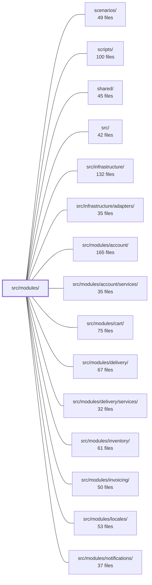

---
tags:
  - 2brain
  - 2brain/module
  - project/boilerplate-node-backend
type: module
module: src/modules/
files: 199
updated: 2026-11-15T00:29:54.417125+00:00
---

# src/modules/

## Purpose

`src/modules/` is the collection of all domain (bounded-context) modules in the application. Each subdirectory—`access/`, `addresses/`, `account/`, `cart/`, `orders/`, `payments/`, `users/`, and roughly two dozen others—is a self-contained unit that owns its data, business rules, and HTTP surface. A project-level import-boundary rule enforces that one module may only import from another through that module's public barrel (`index.ts`), keeping internal layers (model, repository, controllers) private.

## Key parts

- **Module layout convention** — Every module follows the same internal structure: `domain/` (pure rules, no I/O), `services/` (business invariants + orchestration), `repository.ts` (Mongoose data access), `model.ts` (schemas), `module.ts` (kernel manifest: routes, config, personal-data hooks), `openapi.yaml` (contract), `controllers/` + `routes.ts` (HTTP adapters), `tests/` (unit, integration, contract). Two fully documented exemplars are `access/` (authorization, roles, tenants) and `addresses/` (per-user address book with PII encryption).
- **Public barrel (`index.ts`)** — The single import surface a sibling module may use. Re-exports the service layer and pure domain rules while keeping schemas, repositories, and routes internal.
- **`module.ts` manifests** — Register the module with the kernel, declare routes (or explicitly none), personal-data lifecycle hooks (GDPR Art. 15 / erasure), and configuration. This is how the kernel discovers and wires modules at boot.
- **`openapi.yaml` contracts** — Authoritative request/response shapes per module; some (like `access`) expose no routes and serve only as shared schema references for sibling modules (e.g. `account`).
- **Tests per module** — Unit (pure logic), integration (in-memory Mongo), and contract (real HTTP) suites live alongside the code they verify, keeping ownership local.

## How it connects

- **Sibling modules** communicate only through each other's `index.ts` barrels (e.g. `cart` reads an address snapshot from `addresses`; `users` calls `access` protection rules before mutating an account; `account` consumes the `access` OpenAPI schema for its authorization payload).
- **`src/infrastructure/` and `src/infrastructure/adapters/`** provide the shared runtime (Express app factory, Mongoose connection, AEAD encryption pipeline, key-rotation scripts) that modules' repositories and PII helpers plug into.
- **`shared/`** supplies cross-cutting vocabulary (role presets, authorization rules in YAML, typed-config wrappers, audit-action map) that every module's domain and service layers reference.
- **`scenarios/` and `scripts/`** contain end-to-end test scenarios and operational scripts (e.g. the PII re-encryption run) that drive multiple modules together.
- **`src/` (top-level)** holds the kernel/registry that loads each `module.ts` manifest and assembles the final application.

## Where to start

1. **`src/modules/access/index.ts`** — the smallest complete public surface; reading it alongside `src/modules/access/domain/protection.ts` shows the "pure rules → service → barrel" layering that every other module repeats.
2. **`src/modules/addresses/module.ts`** — a richer manifest that declares routes, config, personal-data hooks, and PII re-encryption, giving a newcomer a concrete picture of what "registering a module with the kernel" looks like.

## Connected modules

[[boilerplate-node-backend_ROOT|/ (repository root)]] · [[boilerplate-node-backend_scenarios|scenarios/]] · [[boilerplate-node-backend_scripts|scripts/]] · [[boilerplate-node-backend_shared|shared/]] · [[boilerplate-node-backend_src|src/]] · [[boilerplate-node-backend_src_infrastructure|src/infrastructure/]] · [[boilerplate-node-backend_src_infrastructure_adapters|src/infrastructure/adapters/]] · [[boilerplate-node-backend_src_modules_account|src/modules/account/]] · [[boilerplate-node-backend_src_modules_account_services|src/modules/account/services/]] · [[boilerplate-node-backend_src_modules_cart|src/modules/cart/]] · [[boilerplate-node-backend_src_modules_delivery|src/modules/delivery/]] · [[boilerplate-node-backend_src_modules_delivery_services|src/modules/delivery/services/]] · [[boilerplate-node-backend_src_modules_inventory|src/modules/inventory/]] · [[boilerplate-node-backend_src_modules_invoicing|src/modules/invoicing/]] · [[boilerplate-node-backend_src_modules_locales|src/modules/locales/]] · … and 9 more

## Files
- `src/modules/access/audit.ts` — Declares the audit-action vocabulary for the `access` module and registers it into the app-wide `AuditActionMap` via TypeScript declaration merging. Only two actions exist here (`access.role.assigned`, `access.role.revoked`) because role grant/revocation is the sole operation in this module that changes a user's permissions; all other access operations (e.g. `membershipsOf`, `rolesOf`) are reads and do not emit audit events. Compliance queries can filter by the `access.*` prefix.
- `src/modules/access/authorization.yaml` — Declarative authorization policy for the access module. It defines the single staff-role permission (`assign:Role`) and bundles it into the `RoleManagement` set, governing who may hand a staff role to an account, revoke it, or mutate an account that already holds one.
- `src/modules/access/domain/index.ts` — Barrel file for the access **domain** layer. It re-exports the pure protection rules from `./protection` so that other modules (e.g. `users`, money) can consume access logic without a DB lookup or any framework dependency. A lint rule guarantees this file and its subtree remain free of Express, Mongoose, and every other tier.
- `src/modules/access/domain/protection.ts` — Pure authorization rules for protecting people: whether a caller may modify an account and whether a resource (order, payment, return) belongs to the caller. Contains no I/O — the lookups that supply inputs live in the service layer.
- `src/modules/access/index.ts` — Public barrel for the **access** module. It is the *only* import surface a sibling module is allowed to use (enforced by the module-boundary rule in `docs/theory/strategic-ddd.md` §5). It re-exports the service layer and pure domain rules while deliberately keeping runtime schemas and persistence details internal.
- `src/modules/access/model.ts` — Defines the two Mongoose schemas and exported models that back the authorization domain: **Tenant** (the single shop per deployment) and **Membership** (which user holds which role in which scope). This is the data-shape layer of the access module; it deliberately has no route of its own and is consumed by the kernel's permission resolvers, other modules, and test harnesses.
- `src/modules/access/module.ts` — Module manifest for the **access** domain (tenants and memberships). It registers the module with the kernel registry, declares a single personal-data section for GDPR Art. 15 / erasure compliance, and deliberately exposes no HTTP routes. It exists as a module (not kernel code) because it owns the tenant/membership collections and is consumed by several sibling modules.
- `src/modules/access/openapi.yaml` — OpenAPI 3.1.0 contract for the `access` module. It defines no HTTP routes of its own (`paths: {}`); it exists purely as a shared schema reference so that the `account` module can type the authorization payload it returns on `GET /account`, sign-in, and refresh responses. It also declares the module's `x-personal-data` section (the role list in account data exports).
- `src/modules/access/repository.ts` — Data-access layer for the **tenant** and **membership** MongoDB collections. It exposes a small set of query and write primitives so that the service layer (`./services/`) can focus entirely on business invariants without repeating Mongoose boilerplate. No authorization checks or validation live here.
- `src/modules/access/services/grants.ts` — Defines the authorization invariants for assigning and revoking roles. It enforces two rules as executable code: a role name must be a declared preset in the caller's scope, and the granter must hold the `assign:Role` permission. It exposes both throwing and non-throwing validation paths so callers can check before committing unrelated state, and an audited-refusal path so HTTP responses carry a typed 403/422 reason.
- `src/modules/access/services/index.ts` — Barrel file that assembles the access module's public API. It re-exports pure constants and helper types (role checks, error types, refusal reasons) directly and bundles every database-reading or writing operation into a single `accessService` object, giving consumers one stable import surface for the three service files (`grants`, `memberships`, `protection`) plus the `role-audit` helpers.
- `src/modules/access/services/memberships.ts` — The membership half of the access model: it owns every read and write of the "who holds which role in which place" relationship. A role lives exclusively in a membership row (never on the user document), and this module provides the service-level API for creating tenants, assigning/reviewing/revoking roles, batch-resolving roles, and the idempotent seed a fresh deployment needs to boot.
- `src/modules/access/services/protection.ts` — Implements the "protecting people" rule: an account that holds a staff role may only be modified by a caller holding `assign:Role`. Provides the gate check, the standardised 403 refusal envelope, and the audit-trail side-effect in one composable unit.
- `src/modules/access/services/role-audit.ts` — Centralises the audit-row format for every role mutation (assign, revoke, refused attempt) so that the three call-sites in `grants.ts` emit structurally identical trail entries rather than each hand-rolling a near-identical `recordAudit` block. It exists to eliminate the drift that lets one branch silently drop a field (e.g. `role`) while the others keep it.
- `src/modules/access/tests/factories.ts` — Test-side entry point into the `access` module's storage and audit surfaces. Sibling modules' tests (users, account, payments, returns, api-keys) cannot import `../model` or `../audit` directly due to import-boundary rules; this file re-exports those internals and provides a granter-less `seedMembership` helper so those tests can seed roles and assert on real audit action names without reaching across the boundary.
- `src/modules/access/tests/integration/access.test.ts` — Integration test suite that exercises the authorization module's **storage and writer layer** against an in-memory MongoDB (wired up by `setupTestDb`). It verifies that membership rows can be created, reassigned, and refused correctly, that every invariant enforced by the services is actually executable, and that `bootstrapAccess` behaves idempotently. It is deliberately distinct from the cross-cutting conformance suite: this file proves the data *can be written*, not that two backends *decide the same way*.
- `src/modules/access/tests/unit/grantable-roles.test.ts` — Unit tests for `grantableRoles` and `assertCanGrant` in isolation, verifying which tenant-scoped roles a preset caller is permitted to assign to other members. The test table is the executable model of the grant rule defined in `shared/rules/authorization-roles.yaml`: adding a role or changing its `assignable` flag should surface here as a new or updated row.
- `src/modules/access/tests/unit/protection.test.ts` — Unit tests for the staff-account protection rules in the access service. It verifies that `holdsStaffRole`, `staffHoldersAmong`, `canChangeAccount`, `roleProtectedRefusal`, and the pure helpers `mayChangeAccount` / `ownOrderFlag` behave correctly when membership data comes from an in-memory table rather than a real database. The file exists so the role-gate logic can be exercised in isolation, without a live repository or route.
- `src/modules/addresses/config.ts` — Defines the single configuration knob for the addresses module: the maximum number of entries a single address book may hold. It wraps that value in the project's typed-config infrastructure so other parts of the module can read it with validation.
- `src/modules/addresses/controllers/delete-address.ts` — Thin HTTP adapter for `DELETE /account/addresses/:addressId`. Validates the path-param ID, delegates deletion to `addressService.remove`, and returns a bodyless `204 No Content` on success. Exists to keep Express request/response concerns out of the service layer.
- `src/modules/addresses/controllers/get-address.ts` — Thin HTTP adapter for `GET /account/addresses/:addressId`. It validates the path parameter, delegates to `addressService.get`, and maps the result to a standard HTTP response. Exists so the Express route table stays declarative and all I/O shaping lives in one small, testable function.
- `src/modules/addresses/controllers/get-addresses.ts` — Thin HTTP adapter that exposes `GET /account/addresses`, returning the authenticated caller's full address book in one service call. It exists to decouple Express plumbing from domain logic so the service layer stays transport-agnostic.
- `src/modules/addresses/controllers/post-address.ts` — Handler for `POST /account/addresses`. Validates the request body against a Zod schema, delegates creation to the address service, and returns a `201 Created` response with a `Location` header pointing to the new entry.
- `src/modules/addresses/controllers/put-address-default.ts` — Thin HTTP adapter for `PUT /account/addresses/:addressId/default`. Translates the request (auth context + `addressId` param) into a call on the address service's `setDefault` method, then serializes the result as a `200` JSON response. Exists so the address service stays transport-agnostic.
- `src/modules/addresses/controllers/update-address.ts` — Builds the two HTTP handlers for `PUT /account/addresses/:addressId` (full replace) and `PATCH /account/addresses/:addressId` (partial merge) by calling the shared `createUpdateController` factory. The actual write and ownership check live in the addresses service; this file only wires the transport layer to it.
- `src/modules/addresses/factories.ts` — Builds address-book fixtures for use with `addressBookRepository.create`. It encodes the domain rule that a book is identified by its owner (`userId` is unique on the wire, so no book `_id` is generated) while individual entries are identity-bearing (each carries its own `_id`). The file exists so test and scenario code can produce valid, type-safe book payloads without hand-assembling Mongoose shapes.
- `src/modules/addresses/index.ts` — Barrel (public API) file for the **Addresses** module. It is the single import surface that sibling modules are permitted to use, enforcing the strategic-DDD rule that cross-module access goes through the module's public facade rather than reaching into its internals.
- `src/modules/addresses/model.ts` — Defines the Mongoose schema and compiled model for the user address book. One document per `userId` (the same pattern as the cart), so editing an address updates a small document rather than the whole account. Subdocuments carry their own `_id` because two entries can have identical fields yet represent "home" vs. "office".
- `src/modules/addresses/module.ts` — Module manifest for the address book (one document per user, used at checkout). It declares routes, config, personal-data lifecycle hooks, and PII re-encryption so the address book is a self-contained module: `cart`'s checkout is the only sibling consumer, and `users` reaches it solely through the `personalData.erase` hook below — no direct imports into or from `account`.
- `src/modules/addresses/openapi.yaml` — OpenAPI 3.1.0 contract for the **addresses** module, defining the REST surface (`/account/addresses/*`) that manages a per-user address book. It is the authoritative schema for request/response shapes, status codes, and idempotency semantics that the route handlers in `module.ts` must satisfy.
- `src/modules/addresses/pii.ts` — Encrypts and decrypts the PII fields on a single address-book entry — the postal-address fields GDPR specifically names. It is the one module that bridges the address domain model with the AEAD encryption infrastructure, providing the shared encrypt/decrypt operations that both the repository (writes) and every reader path (service wire-mapping, checkout snapshot) rely on.
- `src/modules/addresses/presenter.ts` — Single mapping layer that converts the internal `AddressBookDocument` shape into the wire shape declared in `openapi.yaml`. Every endpoint in `./service.ts` serialises its response through one of the functions exported here, keeping the "stored → wire" translation in exactly one place.
- `src/modules/addresses/reencrypt.ts` — Thin adapter that feeds address-book documents into the generic PII key-rotation pipeline. It knows *which* fields are encrypted on an address entry and *how* to bind them, then hands the work off to the repository. Exists so the ops `reencrypt` script (see `@infrastructure/security/reencrypt`) has an address-domain entry point without the infrastructure layer needing to know address schema details.
- `src/modules/addresses/repository.ts` — Read-modify-write repository for the per-user address book. It owns all reads and writes to `addressBookModel`, enforcing the "exactly one default" invariant, the `NODE_ADDRESS_BOOK_MAX` entry cap, and PII encryption at the field level. Every value it returns to callers is already decrypted.
- `src/modules/addresses/routes.ts` — Defines the Express router for the address-book endpoints, mounted at `/account` alongside the account module's own router (see `./module.ts`). It wires the six controller functions to their HTTP verbs and paths, applying auth, cache, and idempotency middleware in the correct order for each route.
- `src/modules/addresses/service.ts` — Service layer for the address-book module. It translates controller calls into repository operations, shapes the results via the presenter, and enforces the HTTP response contract (status codes, error payloads). It also exposes the lifecycle hooks (hard-delete, minimisation) and the checkout address-resolution logic that other modules depend on.
- `src/modules/addresses/tests/contract/api.contract.test.ts` — Contract tests for the address-book REST API (`/account/addresses`), exercising every route over real HTTP against a test database. The suite lives in the `addresses` module (not `account`) because the routes are owned by the addresses module even though they are mounted under the `/account` prefix.
- `src/modules/addresses/tests/factories.ts` — Test-helper module that provisions a default address-book entry for an account. It exists so that cart/checkout and user tests, which exercise database-backed flows, can give an account a valid billing address in one call instead of repeating inline `addressService.create` boilerplate.
- `src/modules/addresses/tests/integration/addresses.test.ts` — Integration tests for the address-book service. They verify three core invariants end-to-end against a real database: a non-empty book always holds exactly one default, foreign entries are indistinguishable from invented ones (404), and the book cap is enforced even under concurrent writes. A secondary block confirms PII fields are stored encrypted (not plaintext) yet round-trip correctly through the repository.
- `src/modules/addresses/tests/integration/checkout.test.ts` — Integration tests for address resolution during checkout: which address (default, named, or none) gets frozen as the shipping and/or billing snapshot on an order. Covers the full decision matrix — standard vs. pickup shipping, physical vs. digital baskets, stale/foreign IDs, and empty address books — verifying both the happy-path snapshot content and that refused checkouts leave no side effects.
- `src/modules/addresses/tests/integration/fixtures.ts` — Shared test fixtures providing two fully-specified address objects used by the address-book and checkout integration suites. Exists so both test files reference identical data rather than duplicating inline literals.
- `src/modules/addresses/tests/integration/idempotent-create.test.ts` — Integration test that verifies `POST /account/addresses` honours the `Idempotency-Key` header: a retry after a lost response replays the original entry (201 + `idempotent-replayed: true`) instead of writing a duplicate, while a different key still creates a new address. It guards against the cap-burning scenario where a client double-submits the same logical address.
- `src/modules/addresses/tests/integration/reencrypt.test.ts` — Integration test for the addresses module's `reencrypt` walk. Simulates a PII key rotation (v1 → v2) and verifies three guarantees in a single flow: dry-run writes nothing, the real run re-encrypts all stamped fields to v2, and a second run is a no-op (idempotent). Also confirms the address still reads back correctly under the new key.
- `src/modules/addresses/tests/unit/factories.test.ts` — Unit tests for the `makeAddressBook` fixture builder. They verify that the factory produces MongoDB-ready documents with correct `ObjectId` instances, respects optional-field absence (key not present vs. set to `undefined`), and passes deliverable fields through unchanged.
- `src/modules/addresses/tests/unit/routes.test.ts` — Unit test for the addresses router that asserts the complete route table (signatures, order, middleware, guards) without executing any handler logic. It exists to catch unintended route additions, missing `noStore`/`isAuth` guards, and stray middleware (rate-limiting, caching) in the first-person address-book module.
- `src/modules/addresses/tests/unit/schema-contract.test.ts` — Pins the public contract of `addressBookSchema` so that schema-level semantics (required fields, indexes, sub-document identity, defaults) are verified in isolation. It exists to catch accidental "alignment" with sibling schemas (cart, wishlist) that would silently change address-book behavior — particularly the `_id` on entries and the `default` promotion strategy.
- `src/modules/analytics/controllers/post-analytics-event.ts` — Single controller handler for the public `POST /analytics/events` endpoint. It validates the request body against a closed schema of browsing events, hands the event to the analytics service (which decides whether to relay it based on consent), and always responds `204` so the page can never tell whether its action was measured.
- `src/modules/analytics/index.ts` — Public barrel for the analytics module. It exists as the single, mandated import surface for any sibling module, enforcing the architectural rule (see `docs/theory/strategic-ddd.md` §5) that cross-module access goes only through the relay service and never through internal wiring (routes, controllers, module registration).
- `src/modules/analytics/module.ts` — Module manifest for the analytics relay. Wires together the `POST /analytics/events` route, the analytics service, and the browser-event collection hook so the app can forward consent-gated, browser-reported interaction events (page views, searches) to an external analytics provider. Business events (cart, order, payment, etc.) are explicitly out of scope — they are emitted by the services that perform them.
- `src/modules/analytics/openapi.yaml` — OpenAPI 3.1.0 contract for the analytics module's single browser-facing endpoint. It defines what events a browser may report, the consent semantics around them, and the module's error surface, serving as the canonical API description for both the implementation (`module.ts`) and any client tooling.
- `src/modules/analytics/routes.ts` — Defines the single public write route for the analytics relay (`POST /analytics/events`). It exists to keep the module's HTTP surface in one place: one endpoint, one middleware, one controller, mounted on a shared Express `Router` that the module entry point registers on the app.
- `src/modules/analytics/services/index.ts` — Barrel file for the analytics services layer. It re-exports the browser-event relay functions from `./relay` as a single `analyticsService` object, providing a stable public surface for the rest of the analytics module.
- `src/modules/analytics/services/relay.ts` — Relays a validated browsing event to the analytics port by name. It holds no knowledge of individual event types; instead it looks up a registered `BrowserEventTarget` and delegates the shaping to that target's `toReport`. It exists so that the analytics module can remain decoupled from whichever feature modules define the events.
- `src/modules/analytics/tests/contract/api.contract.test.ts` — Contract tests for the `POST /analytics/events` endpoint. They lock in the closed set of accepted event types (`product_viewed`, `products_searched`) and assert that any event outside that set is rejected, ensuring the API's public contract remains stable.
- `src/modules/analytics/tests/integration/relay.test.ts` — Integration test for the `POST /analytics/events` relay endpoint. Verifies the relay's core contract: the response is always `204` for well-formed events (consented or not), but the analytics provider's `capture` is only invoked when the visitor has consented. Also exercises the validation gate (closed event set, no extra fields, field-format checks) which returns `422` regardless of consent.
- `src/modules/analytics/tests/unit/relay.test.ts` — Unit tests for the relay service's dispatch protocol: verifying that `relayEvent` resolves an event name to the module that registered it, delegates to that module's `toReport`, and emits the resulting analytics payload — while safely dropping unregistered names and inherited prototype keys.
- `src/modules/antibot/controllers/get-antibot-challenge.ts` — Controller for the public `GET /antibot/challenge` endpoint. It resolves the deployment's active self-hosted antibot provider and returns a challenge object for the provider's widget to consume. Vendor-hosted providers never call this route.
- `src/modules/antibot/index.ts` — Public barrel (re-export) for the **antibot** module. It is the *only* surface a sibling module is permitted to import from (per the DDD rule in `docs/theory/stragnostic-ddd.md` §5). It exposes solely the service that the `GET /config` route composes; all internal wiring (`module.ts`, `routes.ts`, `controllers/`) stays private to the module.
- `src/modules/antibot/module.ts` — Module manifest for the **antibot** module. It declares the module's name, HTTP mount point, and data classification so the kernel can discover and wire it into the app. It does **not** implement the anti-automation gate itself — that is cross-cutting middleware (`humanChallengeGate`) living elsewhere. This file exists purely as a registration record.
- `src/modules/antibot/openapi.yaml` — OpenAPI 3.1.0 contract for the antibot module. It defines the single self-hosted challenge endpoint (`GET /antibot/challenge`), the `AntibotConfig` schema that `GET /config` publishes so clients know what anti-bot posture is active, and the ALTCHA-specific challenge shapes. It exists so the API surface of the module is declarative, versioned, and consumable by codegen or documentation tooling.
- `src/modules/antibot/routes.ts` — Defines the Express route table for the antibot module. It exposes a single public endpoint (`GET /challenge`) that delivers the challenge configuration a self-hosted provider needs to render its widget. The route is intentionally stateless and write-free, so it is bounded only by the global burst brake in `app/security.ts`.
- `src/modules/antibot/service.ts` — Provides the antibot module's slice of the `GET /config` endpoint: which human-challenge provider is active, the parameters the client needs to render its widget, and a summary of the other antibot rungs (identity budgets, email policy).
- `src/modules/antibot/tests/contract/api.contract.test.ts` — Contract tests for `GET /antibot/challenge` and a short end-to-end proof that a selected anti-bot provider actually gates a guarded route (`POST /tasks`). The E2E gate test lives here (rather than in `tasks`'s own suite) because `antibot` is the one module that understands both sides of the handshake—what the client renders and what counts as a valid token—without importing the routes it guards. `GET /config` is deliberately excluded; it has its own contract test file.
- `src/modules/antibot/tests/unit/service.test.ts` — Unit test verifying that `antibotService.config` signals a misconfigured provider via promise rejection rather than a synchronous throw, ensuring the controller's `.catch` chain can intercept the error.
- `src/modules/api-keys/audit.ts` — Declares the audit-action vocabulary for API-key lifecycle events (mint, revoke, compromise-triggered bulk revoke) and registers those actions into the application-wide `AuditActionMap` via TypeScript module augmentation. This ensures the audit infrastructure is type-aware of the specific events this module can emit.
- `src/modules/api-keys/authorization.yaml` — Declares the authorization policy for the `api-keys` module: which actions on the `ApiKey` subject are permitted, at what scope, under what credential constraints, and which require step-up authentication. The rules and rule-sets here gate every read, create, and delete operation on API keys within a tenant.
- `src/modules/api-keys/controllers/delete-api-key.ts` — Handles the `DELETE /api-keys/:id` endpoint, which revokes an API key (a soft state change) rather than deleting it. It is hand-written instead of using the `createDeleteController` factory because revocation has no hard-delete counterpart and does not fit the soft/hard delete triplet pattern.
- `src/modules/api-keys/controllers/get-api-key.ts` — HTTP controller that handles `GET /api-keys/:id`. It validates the route parameter, looks up a single API key scoped to the caller's tenant via the service layer, and returns the key's metadata (never its secret). All failure modes—malformed id, unknown id, cross-tenant access—produce an identical 404 to avoid leaking existence.
- `src/modules/api-keys/controllers/get-api-keys.ts` — Defines the single exported controller for `GET /api-keys`, returning the calling tenant's API keys (newest-first by default, or per `sort`). It is a thin adapter: it validates/parses query params and delegates the actual listing to the API-keys service. Never returns a key's secret.
- `src/modules/api-keys/controllers/post-api-key.ts` — HTTP controller that handles `POST /api-keys`. It validates the request body against a Zod schema, delegates to the api-keys service to mint a new credential, and emits a `201 Created` response with a `Location` header pointing to the new resource.
- `src/modules/api-keys/credentials.ts` — Mints and verifies machine-to-machine API-key credentials using one-way SHA-256 hashing (via `hashToken`). The plaintext is shown to the caller exactly once at creation; only the hash and the non-secret public prefix are persisted. It deliberately avoids bcrypt/argon2 because the 256-bit `randomBytes` secret has no search space for a KDF to make expensive.
- `src/modules/api-keys/emails.ts` — Resolves the finished, localized text for the two emails the API-keys module sends: one when a credential is minted (to alert the owner of a potentially stolen session) and one when credentials are revoked wholesale (to tell the owner what stopped working). Functions return fully interpolated strings; they never render HTML themselves.
- `src/modules/api-keys/index.ts` — Public barrel (module facade) for the `api-keys` module. It is the **only** import surface a sibling module is allowed to use, enforcing the strategic DDD rule that internal files stay hidden (see `docs/theory/strategic-ddd.md` §5). It simply re-exports the public API of the three sibling files listed below.
- `src/modules/api-keys/model.ts` — Defines the Mongoose schema, document interface, serialization transform, and model export for the `apikeys` collection. This is the single source of truth for the persistent shape of a minted machine-to-machine credential — the secret itself is never stored, only its sha256 digest.
- `src/modules/api-keys/module.ts` — Module registration manifest for the `api-keys` feature. Wires the credential resolver into the kernel, subscribes to account lifecycle events that should cascade-revoke minted keys, and declares the module's personal-data (collect/erase) hooks. It is the single point where the api-keys module's internal services are connected to kernel ports and the domain-event bus.
- `src/modules/api-keys/openapi.yaml` — OpenAPI 3.1.0 module contract for the **api-keys** module. Defines the list, get, create, and revoke endpoints for machine-to-machine credentials, their request/response schemas, and the module's contribution to the account data export via `x-personal-data`. Serves as the single source of truth for this module's HTTP surface, security requirements, and data model.
- `src/modules/api-keys/presenter.ts` — The single mapping point from a stored credential document to the wire shape declared in `openapi.yaml`. It isolates the "document → API contract" translation so that neither the model schema nor the service layer has to re-derive the `ApiKey` shape.
- `src/modules/api-keys/repository.ts` — Data-access layer for the `apikeys` collection. Wraps the shared CRUD factory with domain-specific queries that the generic shape cannot express (prefix-scoped lookups that filter revoked/expired *at the query*, idempotent batch revocation, minter resolution). Exists so the service layer never touches Mongoose directly.
- `src/modules/api-keys/routes.ts` — Defines the Express router for the `/api-keys` admin surface. It wires four CRUD-style endpoints (list, read, create, delete) to their controller handlers and enforces session-based authentication plus per-route permission checks. The module exists so that API-key management is a dedicated, permission-gated route group separate from the routes that *consume* the keys it mints.
- `src/modules/api-keys/services/actions.ts` — Centralizes the decision of *which actions a caller may perform* on an API-key record. The only action available is **revoke**, gated by the caller's `delete:ApiKey` permission and the credential's own `revokedAt` state. By resolving the ability once per page (not once per row), it keeps client-side permission logic out of the UI layer.
- `src/modules/api-keys/services/api-keys.ts` — Business-logic service for tenant-scoped API-key credentials. It implements the full lifecycle—list, fetch, mint (with permission-subset validation), and soft-revoke—and sits between the route handlers and the repository, adding audit recording, user-status enrichment, and out-of-band email notification.
- `src/modules/api-keys/services/index.ts` — Barrel (facade) file for the api-keys service layer. It re-exports the CRUD functions from `api-keys.ts` and the bearer-token resolver from `resolver.ts` under a single, unified `apiKeysService` object so that controllers and other module code interact with one consistent door rather than reaching into individual service files.
- `src/modules/api-keys/services/resolver.ts` — The credential-resolution path for `sk_...` API key bearer tokens. It turns a presented token into a `Caller` by verifying the key against the repository and re-deriving the minter's **current** permissions on every request. Registered into `kernel/authentication.ts` by `module.ts` at import time; this file contains the actual resolution logic.
- `src/modules/api-keys/tests/contract/api-keys.contract.test.ts` — Contract tests for the `/api-keys` admin surface (list, read, mint, revoke). Every request is validated against the bundled OpenAPI spec; the suite asserts status codes, response shape, security invariants (secret never leaked on GET), and validation boundaries. Credentials minted here are *exercised* against other routes in `tests/cross-cutting/`, not within this file.
- `src/modules/api-keys/tests/integration/activity.test.ts` — Integration test verifying that resolving (using) an API key stamps the minter's account with `lastApiKeyUseAt`. This guarantees a key-only account is never mistaken for idle by the inactivity reaper. The test exercises the full credential-resolution path rather than the write in isolation.
- `src/modules/api-keys/tests/integration/api-keys.test.ts` — Integration test suite that proves the "credential ⊆ minter" invariant end-to-end against a real database. It validates both halves of the boundary: (1) mint-time refusal when the caller lacks a requested permission, and (2) use-time re-flooring where `resolveCredential` re-reads the minter's *current* permissions rather than trusting the snapshot stored on the key document.
- `src/modules/api-keys/tests/integration/global-limit-refund.test.ts` — Integration test verifying the "global browsing brake" refund behavior: a request carrying a resolved API key is exempt from the shared per-IP rate limit and is instead bounded by its own per-key budget. Ensures partners sharing one egress address don't starve each other on the global cap of 100.
- `src/modules/api-keys/tests/integration/outcomes.test.ts` — Integration test suite that pins the user-visible *outcomes* of the API-key service: the one-year expiry ceiling, the exact wording of validation refusals, listing semantics (ordering, tenant isolation, status labels, export), audit rows, and queued mails. It operates at the service layer (not HTTP), and explicitly defers permission-subset rule assertions to `api-keys.contract.test.ts`.
- `src/modules/api-keys/tests/integration/revoked-by-account.test.ts` — Integration test that proves the `account` HTTP endpoints (logout-everywhere, password-reset confirm, email-change undo) actually emit the `sessions_revoked` event and that this cascades to revoke any API keys the account holder minted. It complements `api-keys.contract.test.ts`, which exercises the revocation handler in isolation; this file verifies the event is produced at the right moment over real HTTP.
- `src/modules/api-keys/tests/integration/sessions-revoked-outbox.test.ts` — Integration test verifying that the `account.sessions_revoked` outbox event is committed atomically with the credential write (password reset / logout-everywhere) and that a failing `api-keys` consumer is retried by the relay rather than silently lost. All flows are driven over HTTP to mirror how real resets and logouts arrive.
- `src/modules/api-keys/tests/unit/actions.test.ts` — Unit tests for `actionsForRows`, verifying which credential actions are exposed to a caller based on their permissions and the credential's state. The only tested action is **revoke**, which requires the `delete:ApiKey` permission and is unavailable once the credential is already revoked.
- `src/modules/api-keys/tests/unit/credentials.test.ts` — Unit tests for the four credential functions exported from `credentials.ts` (`mintApiKey`, `parseApiKeyToken`, `verifyApiKey`, `displayIdOf`). Covers the one-way hashing half of the API-key lifecycle: generating a key, extracting its public prefix, verifying a token against its SHA-256 hash, and formatting a display identifier.
- `src/modules/api-keys/tests/unit/emails.test.ts` — Unit tests that verify the two API-key notification emails (`minted` and `revoked`) are fully populated with the correct content for the recipient's language, and that the revoked notice explicitly names the security event that triggered the revocation.
- `src/modules/api-keys/tests/unit/schema-contract.test.ts` — Validates the structural contract of `apiKeySchema`—required fields, index declarations, and index options—because these are schema-level declarations that no valid-document integration test can observe. A dropped `required` flag or a detached `unique` constraint silently changes lookup semantics without ever causing a valid fixture to fail.
- `src/modules/audit-logs/authorization.yaml` — Declares the authorization rules for the `audit-logs` module. It restricts access to a single read-only permission on the `AuditLog` resource, enforcing that audit rows can be inspected but never modified.
- `src/modules/audit-logs/config.ts` — Defines the sole configuration knob for the audit-logs module: how many days an audit entry is retained before it is eligible for cleanup. It exists to centralize that single value so it can be validated at startup and read uniformly by the rest of the module.
- `src/modules/audit-logs/controllers/get-audit.ts` — Single-file controller for `GET /audit`. It exposes this shop's own action history as a filtered, paged list, using the same underlying collection that `observability`'s `listObservabilityAuditEntries` serves but keyed by a tenant rather than a platform token (see `../service.ts` for the shared-collection rationale).
- `src/modules/audit-logs/index.ts` — Barrel (public API) file for the audit-logs module. It is the **only** surface a sibling module is allowed to import from, enforcing the strategic-DDD boundary rule described in `docs/theory/strategic-ddd.md` §5. It exposes the module's service values and model types in a single re-export statement.
- `src/modules/audit-logs/metrics.ts` — Declares the Prometheus domain counters owned by the audit-logs module. Metrics live here (in the module) rather than in `infrastructure` so the overview endpoint can read them without importing this file. Currently tracks one counter: audit sink persistence failures.
- `src/modules/audit-logs/model.ts` — Defines the Mongoose schema, indexes, and serialization transform for the persisted audit trail. It is the durable half of the observability audit system: the in-memory audit logger (`@infrastructure/observability/audit`) produces the compliance record, while this collection lets `GET /observability/audit` answer "what has actor X done" as a queryable, TTL-bounded MongoDB collection.
- `src/modules/audit-logs/module.ts` — Module registration entry point for the **audit-logs** module. It wires the module's HTTP router, config slice, and personal-data collectors into the kernel's `AppModule` contract, and — via its `onRegistered` hook — plugs the audit log service's record method in as the persistence sink that `@infrastructure/observability/audit` calls on every `emitAuditEvent`. It exists so that enabling/disabling the module is a single toggle: unregistered → no sink → audit events are dropped silently.
- `src/modules/audit-logs/module.yaml` — Module declaration for the audit-logs domain. It declares the module's ownership boundary (the audit trail itself, including its own read endpoint), classifies it within the platform's taxonomy, and records its upstream dependency.
- `src/modules/audit-logs/openapi.yaml` — OpenAPI 3.1.0 module contract for the **audit-logs** module. Defines the shop-facing read-only audit trail endpoint (`GET /audit`), the shared `AuditEntryItem` row schema, the GDPR Art. 15 consultation-history schemas, and declares this module's contribution to the account data export (`x-personal-data`).
- `src/modules/audit-logs/presenter.ts` — Defines the platform-operator presentation layer for audit log entries. The tenant view serves stored entries as-is; this module applies the single transformation that distinguishes the operator view—replacing the raw IP address with a correlation digest so repeated attempts from the same address remain linkable without exposing visitor IPs to the operator.
- `src/modules/audit-logs/repository.ts` — Repository layer for the audit-log collection. It exposes an append-and-read-only surface (one `create`, filtered `search`, plus two purpose-built reads) and deliberately omits any update or delete path, since an editable trail is not an audit trail. Expiry is handled by a TTL index on the model, not by application code.
- `src/modules/audit-logs/routes.ts` — Defines the tenant-facing `/audit` Express router: a single read-only endpoint that exposes a shop's own action history to roles holding the `read:AuditLog` permission. It exists to separate audit-log access from the platform operator's surface and to permit machine consumers (compliance, SIEM) alongside human users.
- `src/modules/audit-logs/service.ts` — The single service layer for audit logs. It wraps `auditLogRepository` with the domain policies (scope, sort, pseudonymisation, retention window) that each read path needs, and provides the `record` function that `@infrastructure/observability/audit` calls as its `AuditSink`. One file, five entry points: write, tenant-staff read, operator read, full-account export, and GDPR "who consulted" export.
- `src/modules/audit-logs/tests/contract/audit.contract.test.ts` — Contract tests for the single route this module owns — `GET /audit`. They verify that an authenticated `read:AuditLog` holder can query logs with filters, and that malformed or repeated query parameters are rejected with `422` rather than silently degrading to broader results.
- `src/modules/audit-logs/tests/integration/incidents.test.ts` — Integration tests for the operator-facing `searchIncidents` endpoint. They pin the exact allow-list of `(action, outcome)` pairs that are visible, verify that customer-activity rows are withheld, confirm that raw IP addresses are replaced with keyed HMAC digests, and ensure that pagination metadata and operator-supplied filters never widen the allow-list.
- `src/modules/audit-logs/tests/integration/repository.test.ts` — Integration tests for `auditLogRepository` (and one service-level query) executed against an in-memory Mongo instance provided by `setupTestDb`. Covers document creation, filter/sort/paging behavior, the `since` lower-bound semantics, a deep-paging regression guard, and the `ownOrder` metadata filter exposed through `auditLogService.search`.
- `src/modules/audit-logs/tests/unit/retention.test.ts` — Unit test that verifies the TTL retention value baked into the audit-log collection's index at module import time. Because the retention is read from `NODE_AUDIT_RETENTION_DAYS` during import (not at query time), the test must simulate a fresh startup to observe the resulting `expireAfterSeconds`.
- `src/modules/audit-logs/tests/unit/schema-contract.test.ts` — Contract tests for `auditLogSchema` that lock down the compliance-critical guarantees: which fields are mandatory, which values are closed enums, the two schema options that make audit writes fail-fast rather than buffer, and the exact index set including the sole TTL-based deletion path in the codebase. The file exists so that a casual refactor of the model cannot silently drop a required field, open an enum, enable buffering, or misconfigure the retention index.
- `src/modules/audit-logs/tests/unit/service.test.ts` — Unit tests for the two functions in `auditLogService` (`record` and `search`), focused on their deliberately asymmetric failure behavior: `record` is fail-open (must never throw, swallows rejections into a log line) while `search` is fail-closed (a failure *is* the response to the admin caller). The repository is mocked so it can be made to fail on demand.
- `src/modules/shop/config.ts` — Defines the shop module's runtime configuration slice — timezone, return-shipper address, permitted shipping countries, default currency, and who pays return postage. Values are resolved per call (not captured at import) so tests can vary them per case. A deployment changes a value by restarting the process.
- `src/modules/shop/controllers/get-shop.ts` — Public controller for `GET /shop`. Returns the shop's own settings (identity, shipping origin, return address, traded goods, currency) so that a buyer can identify the seller and the checkout flow can resolve currency before any authenticated exchange.
- `src/modules/shop/index.ts` — Public barrel (module facade) for the **shop** domain module. It is the *only* import surface that sibling modules (cart, delivery, etc.) are permitted to use, enforcing the cross-module boundary rule defined in `docs/theory/strategic-ddd.md` §5. It re-exports the shop service while deliberately withholding internal wiring (config slice, manifest) from the public API.
- `src/modules/shop/module.ts` — Declares the shop module's manifest — the single object the kernel registry consumes to know what to mount, which config slice to validate at boot, and that the module carries no personal data. It exists so the rest of the codebase never needs to reference the shop's internals directly; this file is the public contract.
- `src/modules/shop/openapi.yaml` — OpenAPI 3.1.0 contract defining the single public read endpoint of the shop module: `GET /shop`. It documents the shop's immutable commerce settings (currency, ship-to countries, return address, postage payer, backorder promise, time zone) so API consumers and UI screens can discover the shop's identity without reading source.
- `src/modules/shop/routes.ts` — Defines the Express route table for the shop module. It exposes a single public read endpoint (`GET /shop`) that returns the shop's static identity data (name, currency, ship-to countries, return address). Because the response changes only on redeploy and the module performs no writes, the only rate-limiting concern is the global burst brake.
- `src/modules/shop/service.ts` — Public read surface for the shop's operational settings. It wraps the raw `shopConfig` object and the operator-identity data into small, individually-importable readers (country, timezone, currency, return address, shipping list, etc.) that sibling modules call at request time. It also assembles the single `GET /shop` response body (`getShop`) so the client receives currency, shipping constraints, return logistics, and the backorder promise in one payload.
- `src/modules/shop/tests/contract/api.contract.test.ts` — Contract tests for the public `GET /shop` endpoint. They pin the response shape (currency, minor units, ship-to countries, return address, postage payer, backorder promise, time zone) and assert that operator identity and Terms version are **not** present — those belong to `GET /config`. The suite exists to catch accidental schema drift or over-exposure before it reaches consumers.
- `src/modules/shop/tests/unit/config.test.ts` — Unit tests for the shop module's environment-driven configuration: the functions in `service.ts` that read jurisdiction, timezone, phone, return address, postage payer, ship-to list, and currency from env variables, plus the boot-time gate those reads feed into. Verifies both the "valid baseline" and the specific failure/edge behavior of each variable.
- `src/modules/sitemap/config.ts` — Declares the sitemap module's runtime configuration and the list of static frontend pages it must index. It isolates the two inputs the sitemap needs at generation time: a per-deployment cap on `<url>` entries per file, and the deployment-independent set of public pages derived from the frontend's link rules.
- `src/modules/sitemap/controllers/get-sitemap-index.ts` — Express handler for `GET /sitemap/index.xml`. It retrieves the list of sitemap files from the sitemap service and streams a Sitemap Index XML document back to the client — the top-level file that `robots.txt` points to and that references the individual per-page sitemaps.
- `src/modules/sitemap/controllers/get-sitemap-pages.ts` — Controller handler for `GET /sitemap/pages.xml`. It fetches the shop's static pages (one entry per language) from the sitemap service and sends them back as an XML sitemap. It exists to isolate the HTTP-level concerns (request/response, error formatting) from the business logic in the service layer.
- `src/modules/sitemap/controllers/get-sitemap-products.ts` — HTTP controller that handles `GET /sitemap/products-{page}.xml`. It validates the page number, fetches the corresponding catalogue slice from the sitemap service, and streams the result as an XML sitemap response. It exists to isolate the request-parsing/validation logic from the service and the XML serialization.
- `src/modules/sitemap/controllers/send-xml.ts` — Single egress point for all sitemap files. Converts a collection of entries into a streamed XML response on Express, applying the correct content type and a shared cache policy, so that individual sitemap controllers (index, pages, products) don't each re-implement response plumbing.
- `src/modules/sitemap/index.ts` — Public barrel file for the `sitemap` module. It is the sole import surface exposed to sibling modules, enforcing the encapsulation rule described in `docs/theory/strategic-ddd.md` §5 so that external code never reaches into internal implementation files directly.
- `src/modules/sitemap/module.ts` — Module manifest for the **sitemap** feature. It declares the module's route mount point, configuration slice, and data-ownership policy so the kernel can register and serve `sitemap.xml` from the live product catalogue without the module owning any collection of its own.
- `src/modules/sitemap/openapi.yaml` — OpenAPI 3.1.0 module contract that defines the three public, unauthenticated XML endpoints the sitemap module must expose: a stable index, a pages file, and paginated products files. It exists so the API surface, caching policy, and response shapes are documented alongside the implementation and can be validated against the shared contract infrastructure.
- `src/modules/sitemap/routes.ts` — Defines the Express route table for the public sitemap endpoints. It wires URL paths to their respective controllers and is intentionally unauthenticated—the sitemap only exposes URLs any anonymous visitor can already reach.
- `src/modules/sitemap/service.ts` — The read layer for the sitemap module. It produces the list of sitemap XML files, the per-language page entries, and the per-page product entries — each entry carrying full `hreflang` alternates so a crawler learns every translation from the sitemap alone. It reads live data (product catalogue, static page list) on every call and performs no persistence, which is what lets the HTTP layer cache freely.
- `src/modules/sitemap/tests/contract/api.contract.test.ts` — Contract tests for the sitemap HTTP endpoints. Verifies only the API-level contract—status code, `content-type`, and `cache-control` headers—for the XML sitemap responses. Deliberately excludes validation of XML *content* (entries, alternates, `lastmod`, file-split boundaries), which belongs to `tests/integration/sitemap.test.ts`.
- `src/modules/sitemap/tests/integration/sitemap.test.ts` — Integration test that exercises the full sitemap HTTP surface with real modules registered. It verifies the sitemap index, the pages file, and the products files: correct entries per language, `x-default` alternates, `lastmod` semantics, the URL-limit file split, and 404 for unlisted pages.
- `src/modules/stats/authorization.yaml` — Declares the authorization rules and permission sets for the **stats** module. It defines who may read shop-level sales metrics (revenue, orders, products, customers, payment mix) and bundles that permission into a reusable set that other files can reference by name.
- `src/modules/stats/controllers/get-stats.ts` — Read-only (GET) controllers for the stats module. Each exported handler validates query parameters with a zod schema, delegates to `statsService`, and writes the response. It is the thin controller layer between `routes.ts` and the stats service; all shared validation/handler logic lives in `./respond`.
- `src/modules/stats/controllers/respond.ts` — Shared handler factory for every stats read endpoint. It standardises the read pipeline—validate the query, resolve the period against the shop's zone, run a caller-supplied composer, and send the result with the period ceilings attached—so that individual stats routes differ only in their schema and composer function.
- `src/modules/stats/domain/calendar.ts` — Pure calendar-day arithmetic for the stats module. A "day" is just three numbers (year, month, day) with no clock time and no timezone. This file provides parsing, formatting, day-offset math, and bucketing (day / week / month) as simple, table-testable operations. Timezone awareness is intentionally deferred to `services/range.ts`, which converts a day into an instant.
- `src/modules/stats/domain/figures.ts` — Pure derivation layer that turns raw per-bucket money counts (in minor units) into the decimal-string `Figures` contract published to consumers. It exists so that bucket-level sums always reconcile with the grand total: all arithmetic stays in integer minor units until the final string formatting step.
- `src/modules/stats/domain/index.ts` — Barrel file that exposes the public API of the stats **domain layer** — the pure rules governing a reporting range, the shop's calendar, and sales figures. Importers should reach for this path (or for `src/modules/stats/index.ts`) rather than importing individual sub-modules directly.
- `src/modules/stats/domain/range.ts` — Pure domain logic that validates a user-requested date range (two `YYYY-MM-DD` strings plus a bucket interval) against fixed rules and, on success, computes the calendar-day bucket boundaries the report will use. It also derives the immediately preceding period of equal length for comparison queries. All arithmetic is in calendar days, so it is timezone-independent.
- `src/modules/stats/index.ts` — Public barrel (re-export) file for the stats module. It is the single entry point that sibling modules are allowed to import from, per the strategic DDD rule in `docs/theory/strategic-ddd.md` §5. No other module currently depends on it; it exists because the convention requires every module to publish a barrel.
- `src/modules/stats/module.ts` — Module manifest that registers the **stats** module with the kernel. It declares the HTTP mount point, locale path, and data-classification metadata so the app loader can wire the sales-analytics routes into the dashboard. The file itself stores no data and performs no computation; it is purely a registration surface.
- `src/modules/stats/openapi.yaml` — OpenAPI 3.1.0 contract for the **stats** module: the set of read-only, staff-facing endpoints that expose sales, product, category, payment, operations, customer, and pipeline figures for the staff dashboard. It defines the request/response shapes so clients and the implementing service stay in sync without either side reading the other's source.
- `src/modules/stats/routes.ts` — Defines the Express `Router` for all `/stats` endpoints. Every route is a read-only `GET` that returns shop-level sales figures. The file exists as the single wiring point that couples the permission guard, the no-cache policy, and the eight stat controllers behind one consistent contract.
- `src/modules/stats/services/breakdowns.ts` — Provides the read-model aggregation layer for the sales dashboard. Each exported function orchestrates one or more domain-service calls (orders, payments, returns, invoicing), merges the results by a natural key (product, category, bucket, currency), and returns a shaped object matching a `@types` stats interface.
- `src/modules/stats/services/index.ts` — Service-layer facade for the stats module. It re-exports the period-resolution utility from `range.ts`, bundles all read-only stat queries from `sales.ts` and `breakdowns.ts` into a single `statsService` object, and exposes that object as the one API surface every controller calls. It performs no logic of its own — every figure is read on demand from whichever module owns it.
- `src/modules/stats/services/range.ts` — Resolves a raw `from`/`to`/`interval` query into a fully-typed `Period` — half-open instant windows and a list of bucket-start Dates — all anchored to the shop's local timezone. It exists so every stats composer works from the same, validated, zone-consistent time boundaries rather than re-deriving them.
- `src/modules/stats/services/sales.ts` — Merges time-bucketed sales data from invoicing (money), orders (paid orders/units), and returns (reversed units) into a single per-currency, per-bucket `SalesStats` response for a given period and its preceding period. Each source arrives pre-aggregated (a few hundred rows at most), so the work here is a key-based merge, not a large join.
- `src/modules/stats/tests/contract/api.contract.test.ts` — Contract test that pins down the behavioural contract of every `/stats/*` GET endpoint: each read must return 200 for authorised roles, reject unauthorised roles, return 404 for malformed IDs, never leak data into a shared cache, and answer 422 (with a rule-naming message) when the period or query violates the API's validation rules.
- `src/modules/stats/tests/integration/stats.test.ts` — Integration tests for the stats service (`statsService`), run against a real MongoDB instance. Verifies that sales figures are bucketed by shop-local day (`Europe/Rome`), currencies are never mixed, credit notes land on their own day, period totals are bucket-size invariant, previous-period comparison works, empty periods return zeroed buckets, and product/category breakdowns are correct. Also the only test that passes a real IANA zone name through `$dateTrunc` on the Mongo binary.
- `src/modules/stats/tests/unit/calendar.test.ts` — Unit tests for the pure calendar-arithmetic domain module. The suite locks down edge-case behavior (month/year rollover, leap-year February, week-start-on-Monday, Sunday-as-week-end) without any clock, timezone, or I/O involvement.
- `src/modules/stats/tests/unit/figures.test.ts` — Unit tests for the sales-figures domain logic. They lock down three guarantees: net sales subtract reversals while shipping and VAT are charged-minus-refunded; a shop with zero orders never divides by zero; and currencies without a minor unit (e.g. JPY) are formatted correctly.
- `src/modules/stats/tests/unit/range.test.ts` — Unit tests for the `checkRange` validation function and the `previousOf` period-shift helper in the stats domain layer. They pin down the acceptance/rejection rules (real days, ordering, two-year cap, 400-bucket cap) and the exact bucket-start alignment semantics.
- `src/modules/stats/tests/unit/routes.test.ts` — Unit test for the stats route table that verifies structural invariants: the exact set of mounted routes, that every route is a read-only `GET`, that each requires an authenticated session, and that every route is guarded by the single `read:Stats` permission. It exists to catch accidental privilege escalation (a route gaining a write action) or route drift (an undocumented endpoint appearing).
- `src/modules/stock-alerts/config.ts` — Defines the single tunable for the stock-alerts module: the maximum number of back-in-stock requests one account may hold simultaneously. This cap guarantees that `GET /stock-alerts` stays unpaginated.
- `src/modules/stock-alerts/controllers/delete-stock-alert.ts` — Thin HTTP adapter that handles `DELETE /stock-alerts/:productId`. It validates the route parameter, delegates to `stockAlertService.cancel`, and maps the result (or rejection) onto the HTTP response. All business logic lives in the service; this file only translates between the Express request/response cycle and the service API.
- `src/modules/stock-alerts/controllers/get-stock-alerts.ts` — Thin HTTP controller that handles `GET /stock-alerts`. It extracts the authenticated user's ID, delegates to `stockAlertService.list`, and returns the result (or a standardized error) via the shared response helpers. No business logic lives here.
- `src/modules/stock-alerts/controllers/post-stock-alerts.ts` — Thin HTTP adapter that handles `POST /stock-alerts`. It validates the request body, delegates to `stockAlertService.ask`, and returns **200** with the full stock-alerts list. Because the endpoint is idempotent (repeating the request is the same request), it intentionally uses 200 rather than 201.
- `src/modules/stock-alerts/emails.ts` — Builds the single email the stock-alerts module sends — a "back in stock" notification. It turns a product name, a product URL, a buyer's name, and a locale into a finished, localized `EmailContent` object ready for the mailer to render. By design it is the only email in this module and carries no cross-promotion.
- `src/modules/stock-alerts/events.ts` — Declares the stock-alerts module's domain event (`stock_alert.sent`) by augmenting the kernel's `DomainEventMap` rather than editing the central map directly, and exports a single spelling constant so emitters and listeners agree on the event name.
- `src/modules/stock-alerts/index.ts` — Public barrel (module facade) for the **stock-alerts** bounded context. It is the *only* import surface that sibling modules are permitted to use, enforcing the strategic-DDD encapsulation rule described in `docs/theory/strategic-ddd.md` §5.
- `src/modules/stock-alerts/jobs.ts` — Declares the single scheduled job owned by the `stock-alerts` module: a periodic sweep that picks up preorders whose release date has passed and makes them buyable. Separated from `service.ts` so the job's scheduling metadata, lease, and execution entry-point live in one place.
- `src/modules/stock-alerts/model.ts` — Defines the Mongoose model for a back-in-stock request — a single, one-shot consent record linking a user to a product for exactly one notification email. It contains the document shape, schema, indexes, serialization transform, and the model instance consumed by the rest of the stock-alerts module.
- `src/modules/stock-alerts/module.ts` — Module manifest for the stock-alerts feature: a signed-in buyer registers to receive a single notification when a product they could not order becomes buyable again. This file wires together the module's routes, config, jobs, personal-data handlers, and domain-event subscriptions into one `AppModule` object that the kernel registry discovers.
- `src/modules/stock-alerts/module.yaml` — Module manifest for the back-in-stock alerts feature. It declares the module's identity, organizational placement, dependencies, and the single scheduled job that fulfils waiting alerts, so the platform runner can register the module without inspecting implementation code.
- `src/modules/stock-alerts/openapi.yaml` — OpenAPI 3.1.0 contract for the stock-alerts module. It defines the REST surface for letting an authenticated user create, list, and cancel "notify me when this product is back in stock" requests, and declares the module's contribution to the account data export (`x-personal-data`). It also registers module-specific error codes that the bundler surfaces to clients.
- `src/modules/stock-alerts/presenter.ts` — Transforms internal `StockAlertDocument` records into the exact wire shape declared in `openapi.yaml`. The response object is constructed field-by-field rather than serialized from the model, so any field absent from the contract can never leak to the client.
- `src/modules/stock-alerts/repository.ts` — Data-access layer for stock alerts. Encapsulates every MongoDB read/write the stock-alert domain needs—creating an idempotent request, cancelling, listing, and the cleanup writes owed when an account or product is deleted—so the service layer never touches Mongoose directly.
- `src/modules/stock-alerts/routes.ts` — Express route table for the stock-alerts (back-in-stock) feature. Defines the three HTTP endpoints (list, ask, cancel) and applies authentication to every route. No admin/permission key is required — the same "signed-in only" pattern used by the wishlist module.
- `src/modules/stock-alerts/service.ts` — Service layer for the back-in-stock (stock-alerts) feature. It exposes the buyer-facing operations (ask, cancel, list, export, hard-delete) and the "buyable again" reaction that answers every pending request with exactly one email and one inbox row, then deletes the request. The single click on "Notify me" is the buyer's sole consent for that one notification; no further mail is ever sent on the same request.
- `src/modules/stock-alerts/tests/contract/api.contract.test.ts` — HTTP contract tests for the `/stock-alerts` endpoints. Each declared status branch (200, 404, 405, 409, 422) is exercised over real HTTP and the response envelope is checked for shape and error codes. The file deliberately does **not** verify inventory-signal behavior (stock levels, signal emission); that is covered by the integration test suite.
- `src/modules/stock-alerts/tests/integration/stock-alerts.test.ts` — Integration tests for the stock-alerts module that exercise the full HTTP surface (create, list, cancel a back-in-stock request) and the restock signal path, with real module wiring registered. The goal is to verify the module's behavior end-to-end—including the `module.ts` registration—without mocking the service layer or repositories.
- `src/modules/stock-alerts/tests/unit/schema-contract.test.ts` — Unit test that verifies the **structural declarations** of `stockAlertSchema` (required paths, references, index specs, options) rather than document contents. It exists because constraints like a dropped `unique` flag on the compound index are invisible to fixture-based document tests: the pair still exists as data, it just loses its uniqueness guarantee.
- `src/modules/wishlist/analytics.ts` — Defines the wishlist module's analytics event names and registers them into the shared analytics port's type map. This exists so event names are single-sourced, type-safe, and follow the project-wide naming convention, while the wishlist save funnel (add/remove) is clearly linked to the purchase funnel via the `WISHLIST_MOVED_TO_CART` exit event.
- `src/modules/wishlist/config.ts` — Defines the single tunable for the wishlist module — the maximum number of products a single list may hold. It exists to keep `GET /wishlist` unpaginated yet bounded, exposing the value through a typed config object and a convenience getter.
- `src/modules/wishlist/controllers/delete-wishlist-item.ts` — Thin HTTP adapter for `DELETE /wishlist/items/:productId`. It extracts the authenticated user and product ID from the request, delegates to `wishlistService.remove`, and shapes the response (200 with the updated wishlist, or 404 / error) without containing business logic.
- `src/modules/wishlist/controllers/get-wishlist.ts` — Thin HTTP adapter for the `GET /wishlist` endpoint. It extracts the authenticated user's id, delegates to `wishlistService.get`, and shapes the result into a standard success response. The wishlist payload contains product ids only; the client is expected to join them against its own product store.
- `src/modules/wishlist/controllers/post-move-to-cart.ts` — Thin HTTP adapter for `POST /wishlist/items/:productId/move-to-cart`. It extracts the authenticated user and the `productId` path param, then delegates all business logic (cart line creation/increment + wishlist item removal) to `wishlistService.moveToCart`. It exists solely to translate between Express request/response objects and the service's typed API.
- `src/modules/wishlist/controllers/post-wishlist-items.ts` — Thin HTTP adapter that handles `POST /wishlist/items`. It validates the incoming body, extracts the authenticated user's ID, and delegates to `wishlistService.add`, then serialises the result. It exists so the wishlist module's route table stays declarative and all request/response plumbing stays in one place.
- `src/modules/wishlist/events.ts` — Declares the wishlist module's domain events by augmenting the kernel's `DomainEventMap` interface (via TypeScript module augmentation), so the event catalogue grows per-module without editing the kernel. Also exports a shared event-name constant so emitters and listeners reference a single spelling.
- `src/modules/wishlist/factories.ts` — Factory for building wishlist fixtures in tests. It accepts a bare `userId` and optional product ids, then wraps them into the `{ productId }` shape the Mongoose schema stores. The design mirrors `../cart/factories` (owner-addressed, no `_id` override) but diverges on one point: a wishlist line is just a product id, not a full `WishlistItem` with quantity, because a wishlist encodes "do I want this," not "how many."
- `src/modules/wishlist/index.ts` — Public barrel (module facade) for the Wishlist module. It is the **only** import surface a sibling module is allowed to use, per the strategic DDD rule documented in `docs/theory/strategic-ddd.md` §5. Internal consumers (tests, other wishlist files) import sub-modules directly; everything outside the module goes through this file.
- `src/modules/wishlist/model.ts` — Defines the Mongoose schema, TypeScript interfaces, and model singleton for the wishlist entity. Establishes the persisted shape (one document per user holding an array of `{ productId }` lines), enforces the one-wishlist-per-user constraint at the database level, and exposes a serialization transform for lean reads. All queries live in `./repository`; business rules in `./service`.
- `src/modules/wishlist/module.ts` — Module manifest for the wishlist feature. Wires together the module's routes, config, data-portability/erasure hooks, and domain-event subscriptions into a single `AppModule` export that the kernel registry can mount. It exists so the wishlist's cross-cutting concerns (lifecycle hooks, event reactions, locale resolution) live in one place rather than scattered across service or route files.
- `src/modules/wishlist/openapi.yaml` — OpenAPI 3.1.0 contract for the **Wishlist** module: the four endpoints that let an authenticated user save, inspect, remove, and move product references (no quantities) in a personal list capped at `NODE_WISHLIST_MAX` (250 by default). It also declares the module's contribution to the account-data export and its custom error-code vocabulary.
- `src/modules/wishlist/presenter.ts` — Presents the internal `WishlistDocument` model into the exact wire shape declared by `openapi.yaml` (`WishlistResponse`). It is the single mapping point between stored wishlist data and the API response, so the client can render everything else from its own product store.
- `src/modules/wishlist/probes.ts` — Defines the wishlist module's probe collection: a fixed set of HTTP requests that exercise edge cases the OpenAPI contract cannot express (malformed ids, stale references, missing rows). These probes are consumed by the client-collections bundling pipeline to generate runnable test collections alongside the contract-derived ones.
- `src/modules/wishlist/repository.ts` — Defines the wishlist data-access layer: a standard CRUD repository (via `createRepository`) extended with the four domain-specific writes a wishlist actually takes—add a line, remove a line, delete on user removal, and strip a product from all lists. It exists so the service layer never touches Mongoose directly and so the `addLine` race is settled in a single atomic statement rather than a read-modify-write loop.
- `src/modules/wishlist/routes.ts` — Defines the Express router for the wishlist resource. Because a wishlist is inherently personal, every route in this router requires authentication (no admin variant). The file wires URL patterns to thin controller functions and applies the auth middleware once at the router level.
- `src/modules/wishlist/service.ts` — Service layer for all wishlist operations. It owns the business rules (validity checks, idempotency, ordering guarantees, limit enforcement) and orchestrates calls to the repository, cart service, product service, analytics, and domain events. Controllers and sibling modules interact exclusively through the single exported `wishlistService` object.
- `src/modules/wishlist/tests/contract/api.contract.test.ts` — Contract (integration) tests for the `/wishlist` HTTP API. They verify that every route answers with the correct status code, response envelope shape, and headers over a real HTTP call, ensuring each contract branch is actually reachable. Behavioural/logic rules are intentionally left to the unit suite; this file only guards the wire-level agreement.
- `src/modules/wishlist/tests/integration/items-removed.test.ts` — Integration test verifying that `wishlistService.removeByProductId` emits a `WISHLIST_ITEMS_REMOVED` domain event (with the affected user IDs, product ID, and localized titles) when at least one wishlist contained the product, and emits **no** event when no wishlist did — ensuring `notifications` never writes a message about nothing.
- `src/modules/wishlist/tests/integration/service.test.ts` — Integration test suite for `wishlistService` and `wishlistRepository`. Verifies end-to-end service behavior against a real test database: idempotent adds, per-line availability labeling, the product-visibility guard, the configurable wishlist cap (including concurrent-burst safety), removal, export, move-to-cart, and the analytics announcement contract (exactly one `WISHLIST_ITEM_ADDED` per product).
- `src/modules/wishlist/tests/integration/wishlist-races.test.ts` — Integration tests that pin down the concurrency guarantees of the wishlist endpoints under parallel writes. They verify that `$addToSet` semantics prevent duplicate lines (RW1) and that the upsert filter's exact-equality shape prevents duplicate documents (RW2), and that interleaved save/move-to-cart operations never corrupt state. They exist because the repository's correctness argument rests on write-shape rather than a retry budget, and these tests are the executable statement of that argument.
- `src/modules/wishlist/tests/unit/analytics.test.ts` — Pins the exact string values emitted by the wishlist analytics constants so that a silent rename (or accidental refactor of the string literal) is caught immediately. Umami dashboards key their series on these strings, so a mismatch silently drops data. The test also asserts that the `declare module` augmentation in `analytics.ts` actually registers the events in the app-wide `AnalyticsEventMap` union.
- `src/modules/wishlist/tests/unit/factories.test.ts` — Unit tests for the `makeWishlist` fixture builder, verifying that it produces correctly-shaped wishlist documents—particularly that bare product-id strings are mapped into `{ productId: ObjectId }` lines, that the owner is a real `ObjectId`, and that the "no items" vs "empty items" distinction is preserved.
- `src/modules/wishlist/tests/unit/routes.test.ts` — Unit tests that lock down the wishlist router's public contract: the exact set of endpoints, their order, the presence of session authentication on every route, and the absence of any admin/permission guard. They exist to catch unintended route additions or guard changes before they reach review.
- `src/modules/wishlist/tests/unit/schema-contract.test.ts` — Unit test that pins the Mongoose schema contract for the wishlist: which fields are required, how uniqueness is enforced at the database level, what defaults exist, and which indexes are declared. It exists so that any change to `wishlistSchema` in the model must be consciously reflected in these expectations, making the "one wishlist per user / no per-line id / no quantity" invariants a hard, reviewed fact rather than an implicit assumption.

---
[[boilerplate-node-backend_INDEX|← boilerplate-node-backend index]]
